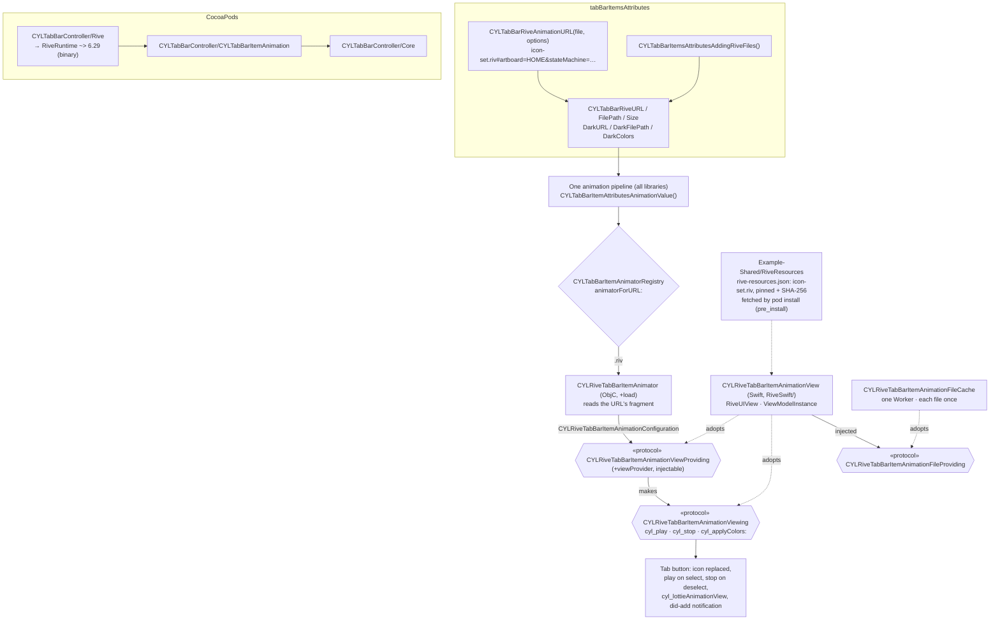
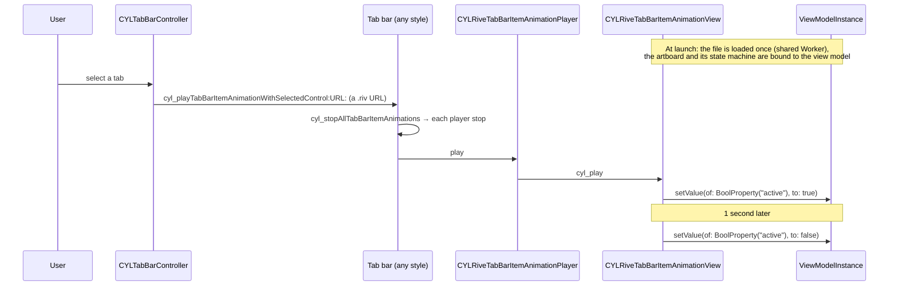

# [CN]Rive 动画 Tab 图标（与 Lottie、PAG 用法相同）
# [EN]Rive animated tab icons (used like Lottie and PAG)

<!-- bound-classes: CYLTabBarController, CYLRiveTabBarItemAnimator, CYLRiveTabBarItemAnimationConfiguration -->
<!-- binding:start -->
<!-- Generated by scripts/update-docs-navigation.py; do not edit by hand. -->

| 中文 | English |
|:---|:---|
| 绑定的代码类 `CYLTabBarController`：[`CYLTabBarController/CYLTabBarController.h`](../CYLTabBarController/CYLTabBarController.h) | Bound to the class `CYLTabBarController`: [`CYLTabBarController/CYLTabBarController.h`](../CYLTabBarController/CYLTabBarController.h) |
| 绑定的代码类 `CYLRiveTabBarItemAnimator`：[`CYLTabBarController/CYLTabBarItemAnimation/Rive/CYLRiveTabBarItemAnimator.h`](../CYLTabBarController/CYLTabBarItemAnimation/Rive/CYLRiveTabBarItemAnimator.h) | Bound to the class `CYLRiveTabBarItemAnimator`: [`CYLTabBarController/CYLTabBarItemAnimation/Rive/CYLRiveTabBarItemAnimator.h`](../CYLTabBarController/CYLTabBarItemAnimation/Rive/CYLRiveTabBarItemAnimator.h) |
| 绑定的代码类 `CYLRiveTabBarItemAnimationConfiguration`：[`CYLTabBarController/CYLTabBarItemAnimation/Rive/CYLRiveTabBarItemAnimationConfiguration.h`](../CYLTabBarController/CYLTabBarItemAnimation/Rive/CYLRiveTabBarItemAnimationConfiguration.h) | Bound to the class `CYLRiveTabBarItemAnimationConfiguration`: [`CYLTabBarController/CYLTabBarItemAnimation/Rive/CYLRiveTabBarItemAnimationConfiguration.h`](../CYLTabBarController/CYLTabBarItemAnimation/Rive/CYLRiveTabBarItemAnimationConfiguration.h) |

<!-- binding:end -->

| 中文 | English |
|:---|:---|
| 支持 [Rive](https://rive.app)（`RiveRuntime`）动画作为 Tab 图标。Rive 文件由状态机驱动，可以响应数据变化，一个 `.riv` 文件还可以通过多个画板（artboard）包含很多图标。Rive 完全按照项目中 Lottie 与 PAG 的方式接入：同样的 key 命名、同样的 CocoaPods 子库引入方式、同样的显示与播放流程，适用于经典系统 TabBar、液态玻璃（Liquid Glass）与扁平样式（FlatDesign）。它是 `CYLTabBarItemAnimation` 子库的又一个插件，**没有修改引擎、协议或其他动画库的任何代码**。 | [Rive](https://rive.app) (`RiveRuntime`) animations as tab icons. A Rive file is driven by state machines that react to data, and one `.riv` file can hold many icons, one per artboard. Rive is integrated exactly the way Lottie and PAG are in this project: the same key naming, the same CocoaPods subspec setup, and the same display and playback pipeline, in the classic system tab bar, Liquid Glass and FlatDesign. It is one more plugin of the `CYLTabBarItemAnimation` subspec, **with no change to the engine, the protocols or any other animation library**. |

## [CN]目录
## [EN]Contents

<!-- navigation:start -->
<!-- Generated by scripts/update-docs-navigation.py; do not edit by hand. -->

| 中文 | English |
|:---|:---|
| [安装](#cn安装) | [Installation](#eninstallation) |
| [Key 对照](#cnkey-对照) | [Keys, side by side with Lottie and PAG](#enkeys-side-by-side-with-lottie-and-pag) |
| [画板、状态机与 view model](#cn画板状态机与-view-model) | [Artboards, state machines and the view model](#enartboards-state-machines-and-the-view-model) |
| [各项关系](#cn各项关系) | [How the pieces relate](#enhow-the-pieces-relate) |
| [实现结构：面向接口](#cn实现结构面向接口) | [Implementation: programming to interfaces](#enimplementation-programming-to-interfaces) |
| [选中时的播放流程](#cn选中时的播放流程) | [What happens when a tab is selected](#enwhat-happens-when-a-tab-is-selected) |
| [代码演示](#cn代码演示) | [Code](#encode) |
| [Demo](#cndemo) | [Demo](#endemo) |
| [动效资源](#cn动效资源) | [Animation files](#enanimation-files) |
| [与 Lottie、PAG 的差异](#cn与-lottiepag-的差异) | [Differences from Lottie and PAG](#endifferences-from-lottie-and-pag) |
| [测试与截图](#cn测试与截图) | [Testing and screenshots](#entesting-and-screenshots) |

<!-- navigation:end -->

## [CN]安装
## [EN]Installation

| 中文 | English |
|:---|:---|
| 与 `CYLTabBarController/LottieSwift` 依赖 `lottie-ios`、`CYLTabBarController/PAG` 依赖 `libpag` 一样，新增的 `CYLTabBarController/Rive` 子库依赖 CocoaPods 上的 `RiveRuntime`（Rive 官方发布的二进制 `RiveRuntime.xcframework`，[rive-app/rive-ios](https://github.com/rive-app/rive-ios)），因此不需要把 Rive 源码复制进本项目。 | Just as `CYLTabBarController/LottieSwift` depends on `lottie-ios` and `CYLTabBarController/PAG` on `libpag`, the new `CYLTabBarController/Rive` subspec depends on the `RiveRuntime` pod (Rive's official binary `RiveRuntime.xcframework`, [rive-app/rive-ios](https://github.com/rive-app/rive-ios)), so no Rive source is copied into this project. |

```ruby
pod 'CYLTabBarController/Rive'             # RiveRuntime ~> 6.29, iOS 14+
# Compare / 对照: pod 'CYLTabBarController/LottieSwift' or 'CYLTabBarController/PAG'
```

| 中文 | English |
|:---|:---|
| **版本**：需要 `RiveRuntime` 6.29 及以上（6.x），iOS 14 及以上。6.29 起，Rive 把旧的 `RiveViewModel` / `RiveView` 标记为废弃，改用基于 Swift 并发的新 API（`Worker`、`File`、`Rive`、`RiveUIView`）；本库只使用新 API，因此不会产生废弃警告。 | **Versions**: `RiveRuntime` 6.29 or later (6.x), iOS 14 or later. Since 6.29, Rive deprecates the old `RiveViewModel` / `RiveView` in favor of a new API built on Swift concurrency (`Worker`, `File`, `Rive`, `RiveUIView`); this library uses only the new API, so it adds no deprecation warning. |
| 库内部用 `CYL_RIVE_AVAILABLE`（`__has_include(<RiveRuntime/RiveRuntime.h>)`）识别是否引入了 Rive，与 `CYL_LOTTIE_AVAILABLE`、`CYL_PAG_AVAILABLE` 相同；`CYL_TAB_ANIMATION_AVAILABLE` 表示引入了 Lottie、PAG 或 Rive。未引入 Rive 子库时，Rive key 会被忽略，Tab 显示普通图片。Swift Package Manager 与 Carthage 暂不提供 Rive。 | Inside the library, `CYL_RIVE_AVAILABLE` (`__has_include(<RiveRuntime/RiveRuntime.h>)`) tells whether Rive is linked, like `CYL_LOTTIE_AVAILABLE` and `CYL_PAG_AVAILABLE`; `CYL_TAB_ANIMATION_AVAILABLE` means Lottie, PAG or Rive. Without the Rive subspec the Rive keys are ignored and the tabs show their images. Swift Package Manager and Carthage do not offer Rive yet. |

## [CN]Key 对照
## [EN]Keys, side by side with Lottie and PAG

| Lottie | PAG | Rive | 中文 | English |
|:---|:---|:---|:---|:---|
| `CYLTabBarLottieURL` | `CYLTabBarPAGURL` | `CYLTabBarRiveURL` | 动画文件的 NSURL，优先于文件路径；Rive 的 URL 可以带画板与状态机（`CYLTabBarRiveAnimationURL()`） | The file's NSURL; wins over the path. A Rive URL can name an artboard and a state machine (`CYLTabBarRiveAnimationURL()`) |
| `CYLTabBarLottieFilePath` | `CYLTabBarPAGFilePath` | `CYLTabBarRiveFilePath` | 动画文件路径（NSString）；Rive 使用默认画板与状态机 | The file's path (NSString); Rive plays the default artboard and state machine |
| `CYLTabBarLottieSize` | `CYLTabBarPAGSize` | `CYLTabBarRiveSize` | 视图尺寸，CGSize 的 NSValue | The view size, an NSValue of CGSize |
| `CYLTabBarLottieDarkURL` / `…DarkFilePath` | `CYLTabBarPAGDarkURL` / `…DarkFilePath` | `CYLTabBarRiveDarkURL` / `…DarkFilePath` | 深色模式版本 | The Dark Mode version |
| `CYLTabBarLottieDarkColors` | — | `CYLTabBarRiveDarkColors` | 一份文件适配深色模式：Lottie 按 keypath，Rive 按 view model 颜色属性路径替换颜色 | One file for Dark Mode: colors replaced by keypath (Lottie) or by view model color property path (Rive) |
| `CYLTabBarItemsAttributesAddingLottieFiles()` | `CYLTabBarItemsAttributesAddingPAGFiles()` | `CYLTabBarItemsAttributesAddingRiveFiles()` | 按名称为每个 Tab 添加 `<名称>.json` / `.pag` / `.riv`，以及 `<名称>_dark.*` | Adds `<name>.json` / `.pag` / `.riv` (and `<name>_dark.*`) to each tab by name |
| `pod '…/LottieSwift'` | `pod '…/PAG'` | `pod '…/Rive'` | 引入方式 | How to install |

| 中文 | English |
|:---|:---|
| 通用 key（`CYLTabBarAnimationURL`…）同样适用于 Rive：".riv" 文件由 Rive 播放。不同的 Tab 可以分别使用 Lottie、PAG 与 Rive（需同时引入对应的子库），也可以只让部分 Tab 有动画（[#477](https://github.com/ChenYilong/CYLTabBarController/issues/477)，见 [Per-Tab-Animation.md](Per-Tab-Animation.md)）。 | The generic keys (`CYLTabBarAnimationURL`…) work for Rive too: ".riv" files are played by Rive. Different tabs can use Lottie, PAG and Rive (with those subspecs installed), and only some tabs can be animated ([#477](https://github.com/ChenYilong/CYLTabBarController/issues/477), see [Per-Tab-Animation.md](Per-Tab-Animation.md)). |

## [CN]画板、状态机与 view model
## [EN]Artboards, state machines and the view model

| 中文 | English |
|:---|:---|
| Rive 图标与 Lottie、PAG 不同：它没有「从第 0 帧播放到最后一帧」的时间线，而是由**状态机**根据 **view model**（数据绑定）中的属性切换状态。因此选中 Tab 时，本库通过 view model 让图标播放：把布尔属性（默认 `active`）设为 YES，1 秒后恢复为 NO；也可以改为触发一个 trigger 属性。这与 [rive_animated_icon](https://pub.dev/packages/rive_animated_icon) 中图标被点击时的做法相同。 | A Rive icon is unlike a Lottie or PAG one: it has no timeline from frame 0 to the last frame. Its **state machine** changes state from the properties of its **view model** (data binding). So when a tab is selected, this library plays the icon through the view model: it sets a boolean property (default `active`) to YES, then back to NO a second later; it can fire a trigger property instead. This is what [rive_animated_icon](https://pub.dev/packages/rive_animated_icon) does when an icon is tapped. |
| 选项写在 URL 的 fragment 中，由 `CYLTabBarRiveAnimationURL(fileURL, options)` 生成，因此多个 Tab 可以使用同一个 `.riv` 文件的不同画板（文件只加载一次），每个 URL 仍是不同的 Tab 动画（也是其深色模式版本的 key）。 | The options go in the URL's fragment, built by `CYLTabBarRiveAnimationURL(fileURL, options)`, so several tabs can use different artboards of one `.riv` file (loaded once), and each URL stays a different tab animation (and the key of its Dark Mode version). |

| 选项 / Option | 默认值 / Default | 中文 | English |
|:---|:---|:---|:---|
| `CYLTabBarRiveOptionArtboard` | 文件的默认画板 / the file's default artboard | 画板名称，例如 `HOME` | The artboard name, e.g. `HOME` |
| `CYLTabBarRiveOptionStateMachine` | 画板的默认状态机 / the artboard's default state machine | 状态机名称，例如 `HOME_interactivity` | The state machine name, e.g. `HOME_interactivity` |
| `CYLTabBarRiveOptionActiveProperty` | `active` | 选中时设为 YES 的 view model 布尔属性路径 | The path of the view model boolean set to YES on selection |
| `CYLTabBarRiveOptionActiveDuration` | `1` | 布尔属性保持 YES 的秒数 | Seconds the boolean stays YES |
| `CYLTabBarRiveOptionTriggerProperty` | — | 改为触发的 view model trigger 属性路径 | The path of a view model trigger to fire instead |
| `CYLTabBarRiveOptionColor` | 文件中的颜色 / the file's color | 图标加载时设置到 view model 颜色属性 `color` 的颜色，"#RRGGBB" 或 "#RRGGBBAA"（浅色模式） | A color set on the view model color property `color` when the icon loads, "#RRGGBB" or "#RRGGBBAA" (light mode) |

## [CN]各项关系
## [EN]How the pieces relate



## [CN]实现结构：面向接口
## [EN]Implementation: programming to interfaces

| 中文 | English |
|:---|:---|
| 与 PAG 一样，Rive 是 `CYLTabBarItemAnimation` 子库（见 [Tab-Bar-Item-Animation.md](Tab-Bar-Item-Animation.md)）的一个插件：`CYLRiveTabBarItemAnimator` 遵守公开协议 `CYLTabBarItemAnimator`，仅在引入 RiveRuntime 时编译，并在 `+load` 中向 `CYLTabBarItemAnimatorRegistry` 注册自己。引擎、Core 与其他动画库都不认识 Rive；Rive 的 key（`CYLTabBarRiveURL`…）由 `attributeKeys` 声明为通用 key 的别名。 | Like PAG, Rive is a plugin of the `CYLTabBarItemAnimation` subspec (see [Tab-Bar-Item-Animation.md](Tab-Bar-Item-Animation.md)): `CYLRiveTabBarItemAnimator` adopts the public `CYLTabBarItemAnimator` protocol, is compiled only with RiveRuntime, and registers itself with `CYLTabBarItemAnimatorRegistry` in `+load`. Neither the engine, nor Core, nor the other libraries know Rive; the Rive keys (`CYLTabBarRiveURL`…) are declared as aliases of the generic keys by `attributeKeys`. |
| Rive 内部的每一层同样**只依赖接口**，下表中的每个协议都由下一层实现： | Inside Rive, every layer likewise **depends only on interfaces**; each protocol below is implemented by the layer underneath: |

| 接口 / Interface | 使用者 / Used by | 实现 / Implemented by | 中文 | English |
|:---|:---|:---|:---|:---|
| `CYLRiveTabBarItemAnimationViewProviding`（抽象工厂 / abstract factory） | `CYLRiveTabBarItemAnimator` | `CYLRiveTabBarItemAnimationView`（Swift） | animator 通过它获取视图，不知道具体类；可用 `+[CYLRiveTabBarItemAnimator setViewProvider:]` 注入其他实现 | The animator gets views through it without knowing the concrete class; another implementation can be injected with `+[CYLRiveTabBarItemAnimator setViewProvider:]` |
| `CYLRiveTabBarItemAnimationViewing` | `CYLRiveTabBarItemAnimationPlayer` | `CYLRiveTabBarItemAnimationView`（Swift） | 播放器只调用 `cyl_play` / `cyl_showLastFrame` / `cyl_stop` / `cyl_applyColors:`，按 `conformsToProtocol:` 识别视图 | The player only calls `cyl_play` / `cyl_showLastFrame` / `cyl_stop` / `cyl_applyColors:`, and recognizes views with `conformsToProtocol:` |
| `CYLRiveTabBarItemAnimationConfiguration`（值对象 / value object） | 视图工厂 / the view factory | 由 URL 解析 / parsed from the URL | animator 与视图之间传递的唯一数据，代替一长串参数 | The only data passed from the animator to the view, instead of a long list of arguments |
| `CYLRiveTabBarItemAnimationFileProviding`（Swift） | `CYLRiveTabBarItemAnimationView` | `CYLRiveTabBarItemAnimationFileCache` | 视图通过注入的接口获取 Rive 文件；默认实现共用一个 `Worker`，每个 `.riv` 文件只加载一次 | The view gets Rive files through an injected interface; the default shares one `Worker` and loads each `.riv` file once |

| 中文 | English |
|:---|:---|
| **装配点**：Swift 没有 `+load`，无法自行注册，因此默认的视图工厂只在一个地方指定：animator 第一次需要它时按名称解析 Swift 桥接，并且只在它遵守 `CYLRiveTabBarItemAnimationViewProviding` 时使用。其他代码都只与协议交互。 | **Composition root**: Swift has no `+load` and cannot register itself, so the default view factory is named in one place only: the first time the animator needs it, it resolves the Swift bridge by name and uses it only when it adopts `CYLRiveTabBarItemAnimationViewProviding`. All other code talks to the protocols. |
| **替换实现**：任意遵守这两个协议的类（例如测试替身，或其他渲染方式）都可以通过 `viewProvider` 注入，animator、播放器与 TabBar 都无需修改；设为 nil 恢复默认。 | **Swapping the implementation**: any class adopting the two protocols (a test double, another renderer) can be injected through `viewProvider`, with no change to the animator, the player or the tab bar; nil goes back to the default. |

```objc
// A renderer that adopts the interfaces only. 只遵守接口的渲染实现。
@interface MyRiveView : UIView <CYLRiveTabBarItemAnimationViewing, CYLRiveTabBarItemAnimationViewProviding>
@end

CYLRiveTabBarItemAnimator.viewProvider = [MyRiveView class];   // inject 注入
CYLRiveTabBarItemAnimator.viewProvider = nil;                  // back to the default 恢复默认
```

## [CN]选中时的播放流程
## [EN]What happens when a tab is selected



## [CN]代码演示
## [EN]Code

```objc
// Objective-C — one file, one artboard per tab. 一个文件，每个 Tab 一个画板。
NSURL *iconSet = [[NSBundle mainBundle] URLForResource:@"icon-set" withExtension:@"riv"];
NSDictionary *home = @{
    CYLTabBarItemTitle      : @"Home",
    CYLTabBarItemImage      : @"home_normal",            // shown without the Rive subspec 未引入 Rive 子库时显示
    CYLTabBarRiveURL        : CYLTabBarRiveAnimationURL(iconSet, @{
                                  CYLTabBarRiveOptionArtboard : @"HOME",
                                  CYLTabBarRiveOptionStateMachine : @"HOME_interactivity",
                                  CYLTabBarRiveOptionColor : @"#1F1F1F",
                              }),
    CYLTabBarRiveSize       : [NSValue valueWithCGSize:CGSizeMake(30, 30)],
    CYLTabBarRiveDarkColors : @{ @"color" : UIColor.whiteColor },   // Dark Mode with the same file 同一份文件适配深色模式
};

// Or by name: "tab_home.riv"… in the main bundle, default artboard ("tab_home_dark.riv" for Dark Mode).
// 或按名称：main bundle 中的 "tab_home.riv"……，使用默认画板（深色模式为 "tab_home_dark.riv"）。
NSArray *attributes = CYLTabBarItemsAttributesAddingRiveFiles(baseAttributes, @[@"tab_home", @"tab_message"], nil);
```

```swift
// Swift — from Example-Rive/HealthyHome/Tool/TabBarCommon.swift
let iconSet = Bundle.main.url(forResource: "icon-set", withExtension: "riv")
item[CYLTabBarRiveURL] = CYLTabBarRiveAnimationURL(iconSet, [
    .artboard: "HOME",
    .stateMachine: "HOME_interactivity",
    .color: "#1F1F1F",
])
item[CYLTabBarRiveSize] = NSValue(cgSize: CGSize(width: 30, height: 30))
item[CYLTabBarRiveDarkColors] = ["color": UIColor.white]
```

| 中文 | English |
|:---|:---|
| 与 Lottie、PAG 一样：`-[UIControl cyl_lottieAnimationView]` 返回 Tab 按钮上的 Rive 视图；`-[UIControl cyl_tabBarItemAnimationPlayer]` 返回其播放器（`play` / `stop`）；`CYLTabBarItemLottieAnimationViewDidAddNotification` 在 Rive 视图添加后同样发送；`-lottieAnimationViewContentMode` 映射为 Rive 的 fit（AspectFit → contain，AspectFill → cover，ScaleToFill → fill）。 | As with Lottie and PAG: `-[UIControl cyl_lottieAnimationView]` returns the tab button's Rive view; `-[UIControl cyl_tabBarItemAnimationPlayer]` returns its player (`play` / `stop`); `CYLTabBarItemLottieAnimationViewDidAddNotification` is posted once a Rive view is added; `-lottieAnimationViewContentMode` maps to Rive's fit (AspectFit → contain, AspectFill → cover, ScaleToFill → fill). |

## [CN]Demo
## [EN]Demo

| 中文 | English |
|:---|:---|
| `Example-Rive`：由 `Example-PAG` 复制而来，Podfile 改为 `pod 'CYLTabBarController/Rive', :path => '../'`。第 1、3、4 个 Tab 使用同一个文件 `icon-set.riv` 中的画板 `HOME`、`BELL`、`USER`，第 2 个 Tab 保持图片（#477）；深色模式下图标颜色通过 `CYLTabBarRiveDarkColors` 变为白色。在该目录执行 `pod install`，打开 `HealthyHome.xcworkspace` 运行。 | `Example-Rive`: copied from `Example-PAG`, with the Podfile set to `pod 'CYLTabBarController/Rive', :path => '../'`. Tabs 1, 3 and 4 use the artboards `HOME`, `BELL` and `USER` of one file, `icon-set.riv`; tab 2 keeps its images (#477); in Dark Mode the icons turn white through `CYLTabBarRiveDarkColors`. Run `pod install` in that folder and open `HealthyHome.xcworkspace`. |

## [CN]动效资源
## [EN]Animation files

| 中文 | English |
|:---|:---|
| **按 pod 的方式获取，不直接复制进仓库**：与 PAG 的动效文件一样，`.riv` 文件在安装时下载。[`Example-Shared/RiveResources/rive-resources.json`](../Example-Shared/RiveResources/rive-resources.json) 记录来源包 [rive_animated_icon](https://pub.dev/packages/rive_animated_icon)（2.1.1，MIT，60 个图标，每个图标一个画板）、其 pub.dev 归档的 SHA-256，以及从中取出的 `assets/icon-set.riv` 与 `LICENSE` 各自的 SHA-256。在 `Example-Rive` 中执行 `pod install` 时，Podfile 的 `pre_install` 会运行 [`scripts/fetch-rive-resources.py`](../scripts/fetch-rive-resources.py) 下载、校验并只解压这两个文件；也可以直接运行该脚本（`--check` 只校验）。下载的文件已加入 `.gitignore`。 | **Fetched like a pod, not copied into the repository**: like the PAG files, the `.riv` file is downloaded on install. [`Example-Shared/RiveResources/rive-resources.json`](../Example-Shared/RiveResources/rive-resources.json) records the source package [rive_animated_icon](https://pub.dev/packages/rive_animated_icon) (2.1.1, MIT, 60 icons, one artboard each), the SHA-256 of its pub.dev archive, and the SHA-256 of the two files taken from it, `assets/icon-set.riv` and `LICENSE`. `pod install` in `Example-Rive` runs [`scripts/fetch-rive-resources.py`](../scripts/fetch-rive-resources.py) from the Podfile's `pre_install` to download, verify and extract only those two files; you can also run the script yourself (`--check` only verifies). The downloaded files are in `.gitignore`. |
| 该文件中的图标画板名称与状态机名称可以在 rive_animated_icon 的 `lib/src/config.dart` 中查到，例如 `HOME` / `HOME_interactivity`、`BELL` / `BELL_Interactivity`、`USER` / `USER_Interactivity`、`SETTINGS` / `SETTINGS_Interactivity`；它们的 view model 都有 `active`（布尔）、`color`（颜色）与 `strokeWidth`（数字）属性。 | The artboard and state machine names of the icons are listed in rive_animated_icon's `lib/src/config.dart`, e.g. `HOME` / `HOME_interactivity`, `BELL` / `BELL_Interactivity`, `USER` / `USER_Interactivity`, `SETTINGS` / `SETTINGS_Interactivity`; their view models all have `active` (boolean), `color` (color) and `strokeWidth` (number) properties. |

## [CN]与 Lottie、PAG 的差异
## [EN]Differences from Lottie and PAG

| 中文 | English |
|:---|:---|
| **播放方式**：Rive 状态机没有播放进度，选中时通过 view model 属性播放（见上文）；启动时选中的 Tab（`showLastFrame`，#389）保持静止状态。没有 view model 的画板只显示、不播放。旧式的状态机输入（SMI input）不在 Rive 新 API 中，请使用 view model 属性。 | **Playback**: a Rive state machine has no playback position; a selected tab plays through a view model property (see above), and the tab selected at launch (`showLastFrame`, #389) stays in its resting state. An artboard without a view model is shown but does not play. Old-style state machine inputs (SMI inputs) are not part of Rive's new API; use view model properties. |
| **播放速度**：`lottieAnimationSpeed` 与 `-[UIControl cyl_setLottieAnimationSpeed:]` 对 Rive 无效，请用 `CYLTabBarRiveOptionActiveDuration` 或在 Rive 编辑器中调整。 | **Playback speed**: `lottieAnimationSpeed` and `-[UIControl cyl_setLottieAnimationSpeed:]` do not apply to Rive; use `CYLTabBarRiveOptionActiveDuration`, or change it in the Rive editor. |
| **异步加载**：Rive 文件在后台异步加载；加载完成前图标区域为空，加载期间的播放请求会在加载后执行。 | **Asynchronous loading**: Rive files load asynchronously; the icon is empty until then, and a play request made meanwhile runs once it has loaded. |
| **安装方式**：仅 CocoaPods（iOS 14+）；SPM 与 Carthage 暂不提供 Rive。 | **Installation**: CocoaPods only (iOS 14+); SPM and Carthage do not offer Rive yet. |
| **命名**：部分公开 API 仍沿用 "Lottie" 命名（如 `cyl_lottieAnimationView`、`lottieAnimationViewContentMode`、相关通知），它们对 Rive 同样生效。 | **Naming**: some public APIs keep their "Lottie" names (`cyl_lottieAnimationView`, `lottieAnimationViewContentMode`, the notifications); they apply to Rive too. |

## [CN]测试与截图
## [EN]Testing and screenshots

| 中文 | English |
|:---|:---|
| 本次修改在 Linux 环境中完成，无法运行 Xcode 与 iOS 模拟器，因此**没有截图**，也没有真正编译。Swift 桥接按 RiveRuntime 6.29.0 的源码编写（逐一核对了所用的每个 API 签名），但这里没有 Swift 编译器，**未做类型检查**。已做的检查：用最小的 UIKit / Foundation / RiveRuntime 桩头文件对 `CYLRiveTabBarItemAnimator.m`、`CYLRiveTabBarItemAnimationConfiguration.m`、Core 的新增函数，以及一个只遵守两个协议并通过 `viewProvider` 注入的测试替身执行 `clang -fsyntax-only -Wall -Wextra -Wprotocol`，无错误与警告（缺少协议方法的替身会被报告）；`pod lib lint --quick` 通过；`scripts/fetch-rive-resources.py` 下载并校验了两个文件。 | This change was made on Linux, where Xcode and the iOS simulator cannot run, so there are **no screenshots** and nothing was really compiled. The Swift bridge was written against RiveRuntime 6.29.0's source (every API signature it uses was checked), but there is no Swift compiler here, so it **has not been type-checked**. Checks done: `clang -fsyntax-only -Wall -Wextra -Wprotocol` with minimal UIKit / Foundation / RiveRuntime stub headers on `CYLRiveTabBarItemAnimator.m`, `CYLRiveTabBarItemAnimationConfiguration.m`, Core's new functions, and a test double that adopts only the two protocols and is injected through `viewProvider`, with no error and no warning (a double missing a protocol method is reported); `pod lib lint --quick` passes; `scripts/fetch-rive-resources.py` downloaded and verified both files. |
| 请运行 `Example-Rive`，在三种样式下检查：Tab 显示 Rive 图标、选中时播放一次、切换后上一个 Tab 停止、第 2 个 Tab 显示图片、深色模式下图标变为白色。验证后的截图请放在 `docs/assets/` 中，并用 `` 引用。 | Please run `Example-Rive` in all three styles and check: the tabs show Rive icons, a selected tab plays once, the previous tab stops, the 2nd tab shows its images, and the icons turn white in Dark Mode. Put screenshots from these checks in `docs/assets/` and reference them as ``. |
