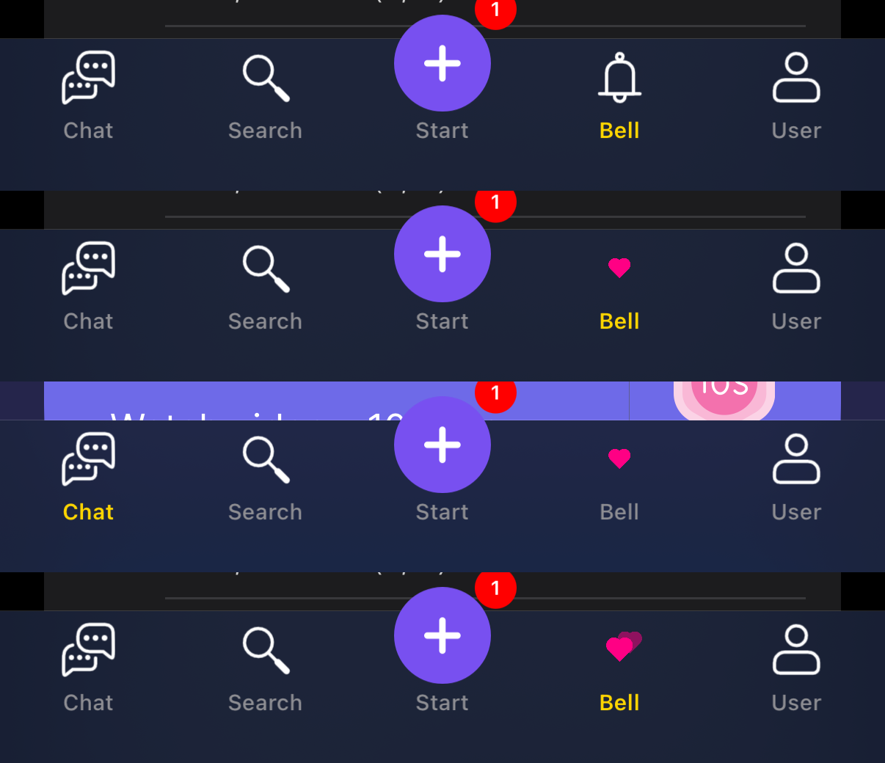
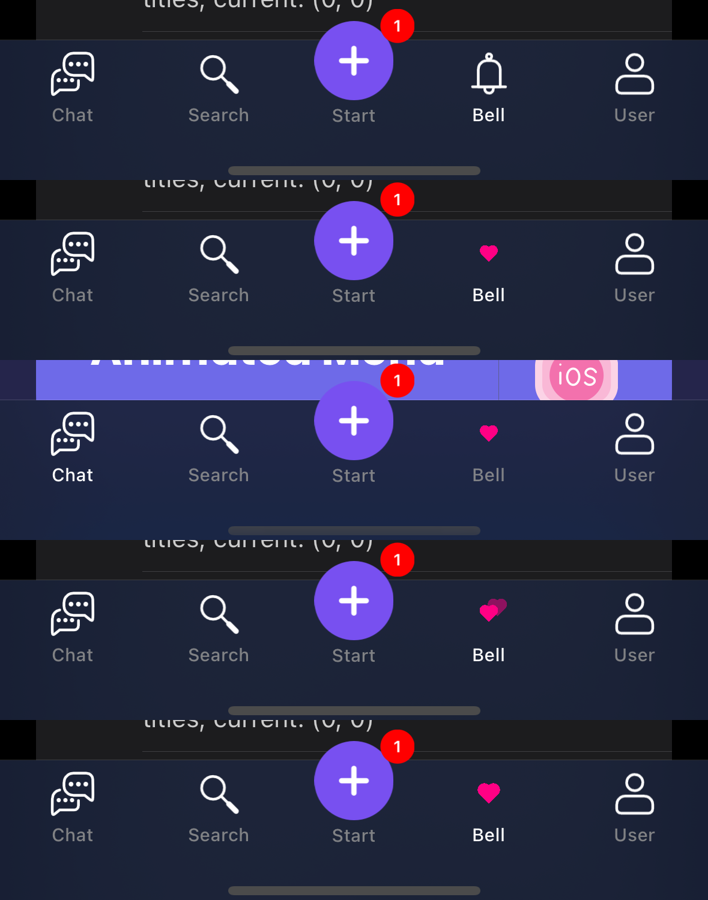
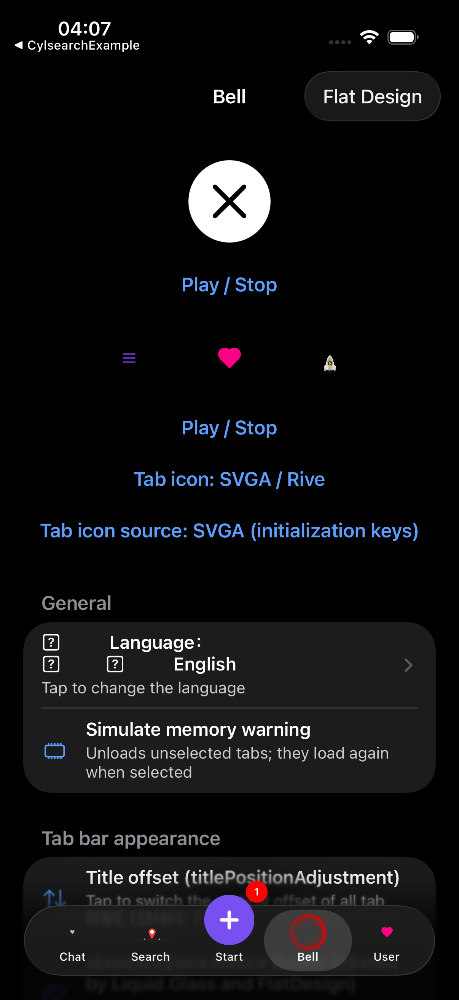
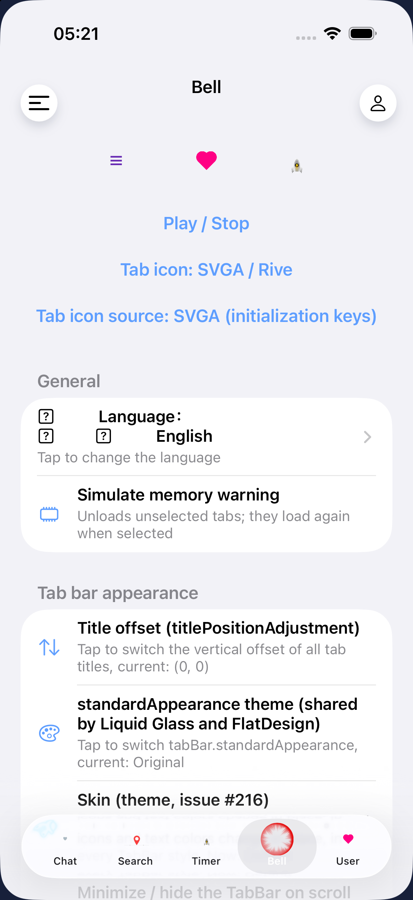
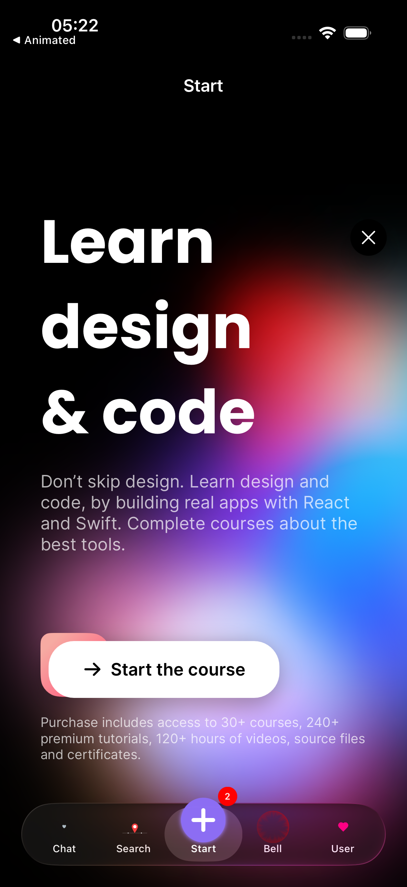
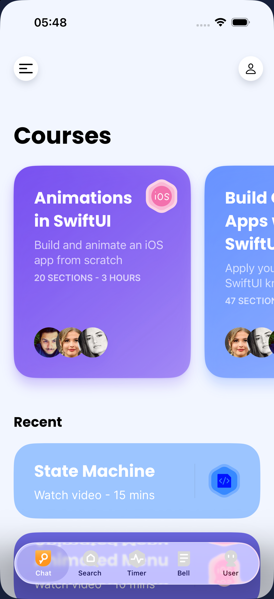

# [CN]SVGA 动画 Tab 图标（与 Rive、PAG、Lottie 用法相同）
# [EN]SVGA animated tab icons (used like Rive, PAG and Lottie)

<!-- bound-classes: CYLSVGATabBarItemAnimator, CYLTabBarItemViewAnimator -->
<!-- binding:start -->
<!-- Generated by scripts/update-docs-navigation.py; do not edit by hand. -->

| 中文 | English |
|:---|:---|
| 绑定的代码类 `CYLSVGATabBarItemAnimator`：[`CYLTabBarController/CYLTabBarItemAnimation/SVGA/CYLSVGATabBarItemAnimator.h`](../CYLTabBarController/CYLTabBarItemAnimation/SVGA/CYLSVGATabBarItemAnimator.h) | Bound to the class `CYLSVGATabBarItemAnimator`: [`CYLTabBarController/CYLTabBarItemAnimation/SVGA/CYLSVGATabBarItemAnimator.h`](../CYLTabBarController/CYLTabBarItemAnimation/SVGA/CYLSVGATabBarItemAnimator.h) |
| 绑定的代码类 `CYLTabBarItemViewAnimator`：[`CYLTabBarController/CYLTabBarItemAnimation/CYLTabBarItemViewAnimator.h`](../CYLTabBarController/CYLTabBarItemAnimation/CYLTabBarItemViewAnimator.h) | Bound to the class `CYLTabBarItemViewAnimator`: [`CYLTabBarController/CYLTabBarItemAnimation/CYLTabBarItemViewAnimator.h`](../CYLTabBarController/CYLTabBarItemAnimation/CYLTabBarItemViewAnimator.h) |

<!-- binding:end -->

| 中文 | English |
|:---|:---|
| 支持 [SVGA](https://svga.dev)（`SVGAPlayer`）动画作为 Tab 图标，接入方式模仿 [Rive](Rive-Animation.md)：一个 CocoaPods 子库（`CYLTabBarController/SVGA`）、同样的 key 与播放流程，作为 `CYLTabBarItemAnimation` 子库「可播放视图」方式的插件，适用于经典系统 TabBar、液态玻璃（Liquid Glass）与扁平样式（FlatDesign）。**Core 与引擎没有为 SVGA 修改**。来源：[issue #415](https://github.com/ChenYilong/CYLTabBarController/issues/415)「请问这个支持 svga 动画吗」。 | [SVGA](https://svga.dev) (`SVGAPlayer`) animations as tab icons, integrated the way [Rive](Rive-Animation.md) is: a CocoaPods subspec (`CYLTabBarController/SVGA`), the same keys and playback pipeline, as a plugin of the "playable view" way of the `CYLTabBarItemAnimation` subspec, in the classic system tab bar, Liquid Glass and FlatDesign. **Core and the engine were not changed for SVGA**. Source: [issue #415](https://github.com/ChenYilong/CYLTabBarController/issues/415), "does it support SVGA animations?". |

## [CN]目录
## [EN]Contents

<!-- navigation:start -->
<!-- Generated by scripts/update-docs-navigation.py; do not edit by hand. -->

| 中文 | English |
|:---|:---|
| [安装](#cn安装) | [Installation](#eninstallation) |
| [Key](#cnkey) | [Keys](#enkeys) |
| [代码演示](#cn代码演示) | [Code](#encode) |
| [实现结构](#cn实现结构) | [Implementation](#enimplementation) |
| [Demo：Example-Rive](#cndemoexample-rive) | [Demo: Example-Rive](#endemo-example-rive) |
| [任务记录](#cn任务记录) | [Task log](#entask-log) |

<!-- navigation:end -->

## [CN]安装
## [EN]Installation

| 中文 | English |
|:---|:---|
| `pod 'CYLTabBarController/SVGA'`，同时引入 `SVGAPlayer`（2.5）。子库把 `Protobuf` 固定在 3.21：SVGAPlayer 2.5.7 生成的 protobuf 文件调用了 3.22 起移除的 `OSAtomicCompareAndSwapPtrBarrier`，用更新的 Protobuf 无法编译。已有更高版本 `Protobuf` 的工程需先执行 `pod update Protobuf`。没有 SVGAPlayer 时 `CYL_SVGA_AVAILABLE` 为 0，SVGA 的 key 不存在（使用即编译失败）。 | `pod 'CYLTabBarController/SVGA'`, which also brings `SVGAPlayer` (2.5). The subspec pins `Protobuf` to 3.21: SVGAPlayer 2.5.7's generated protobuf files call `OSAtomicCompareAndSwapPtrBarrier`, removed in 3.22, so they do not build with a newer Protobuf. A project that already resolved a newer `Protobuf` runs `pod update Protobuf` first. Without SVGAPlayer, `CYL_SVGA_AVAILABLE` is 0 and the SVGA keys do not exist (using one fails to build). |

## [CN]Key
## [EN]Keys

| 中文 | English |
|:---|:---|
| `CYLTabBarSVGAURL`（NSURL）或 `CYLTabBarSVGAFilePath`（NSString）：`.svga` 文件；也可用通用的 `CYLTabBarAnimationURL` / `CYLTabBarAnimationFilePath`（按扩展名 `.svga` 选择 SVGA）。`CYLTabBarSVGASize`：动画视图尺寸。`CYLTabBarSVGADarkURL` / `CYLTabBarSVGADarkFilePath`：深色模式下的文件。配置文件按名称接受这些 key（无论是否安装 SVGA 子库）。 | `CYLTabBarSVGAURL` (NSURL) or `CYLTabBarSVGAFilePath` (NSString): the `.svga` file; the generic `CYLTabBarAnimationURL` / `CYLTabBarAnimationFilePath` work too (the `.svga` extension picks SVGA). `CYLTabBarSVGASize`: the animation view's size. `CYLTabBarSVGADarkURL` / `CYLTabBarSVGADarkFilePath`: the file for Dark Mode. Configuration files take these keys by name (whether or not the SVGA subspec is installed). |
| 选中 Tab 时播放一次并停在最后一帧；取消选中时回到第一帧；启动时选中的 Tab 直接显示最后一帧（#389）。文件解析是异步的：解析完成前的播放 / 停止请求会在解析后执行。 | Selecting a tab plays its animation once and keeps the last frame; deselecting shows the first frame again; the tab selected at launch shows its last frame without playing (#389). Parsing is asynchronous: a play or stop asked for before the file is parsed runs once it is. |

## [CN]代码演示
## [EN]Code

```swift
// Swift
var home: [AnyHashable: Any] = [CYLTabBarItemTitle: "Home", CYLTabBarItemImage: "home_normal"]
home[CYLTabBarSVGAURL] = Bundle.main.url(forResource: "heartbeat", withExtension: "svga")
home[CYLTabBarSVGASize] = NSValue(cgSize: CGSize(width: 33, height: 33))

// Outside the tab bar (as the Example-Rive demo): the same factory as Rive.
let view = CYLTabBarItemAnimationFactory.animationView(url: url, size: CGSize(width: 72, height: 72), contentMode: .scaleAspectFit)
CYLTabBarItemAnimationFactory.player(for: view)?.play()
```

## [CN]实现结构
## [EN]Implementation

| 中文 | English |
|:---|:---|
| `CYLTabBarItemAnimation/SVGA/CYLSVGATabBarItemAnimator.{h,m}`：声明 key，在 `+load` 中注册一个 `CYLTabBarItemViewAnimator`（扩展名 `svga`），其视图 `CYLSVGATabBarItemAnimationView` 是遵守 `CYLTabBarItemAnimationPlayableView` 的 `SVGAPlayer` 子类（`loops = 1`、`fillMode = "Forward"`），用 `SVGAParser` 解析本地文件（内存缓存，键为文件 URL）或远程 URL。与 Rive 相同，没有自己的 animator 或播放器类。 | `CYLTabBarItemAnimation/SVGA/CYLSVGATabBarItemAnimator.{h,m}`: declares the keys and registers, in `+load`, a `CYLTabBarItemViewAnimator` (extension `svga`) whose view, `CYLSVGATabBarItemAnimationView`, is an `SVGAPlayer` subclass adopting `CYLTabBarItemAnimationPlayableView` (`loops = 1`, `fillMode = "Forward"`) that parses a local file (memory cache, keyed by the file URL) or a remote URL with `SVGAParser`. As with Rive, there is no animator or player class of its own. |
| 为了接入 SVGA，同时修复了一个已有问题：`CYLTabBarItemAnimationPlayableView` 与 `CYLTabBarItemAnimationViewProviding` 移到 Swift 声明（`Swift/CYLTabBarItemAnimationPlayableView.swift`，selector 与 Swift 名称不变）。此前 Rive 的 Swift 视图遵守这两个 Objective-C 协议，使生成的 Swift 头文件导入总头文件，引入 Rive 子库的 CocoaPods 构建（Example-Rive）因循环导入而失败。 | Integrating SVGA also fixed an existing problem: `CYLTabBarItemAnimationPlayableView` and `CYLTabBarItemAnimationViewProviding` are now declared in Swift (`Swift/CYLTabBarItemAnimationPlayableView.swift`, same selectors and Swift names). Rive's Swift views adopting these Objective-C protocols made the generated Swift header import the umbrella header, so a CocoaPods build with the Rive subspec (Example-Rive) failed on the import cycle. |

## [CN]Demo：Example-Rive
## [EN]Demo: Example-Rive

| 中文 | English |
|:---|:---|
| [Example-Rive](../Example-Rive) 的 Bell Tab（UIKit 测试列表）上方，在 Rive 演示（`RiveMenuButtonDemoView`）之后是 [`SVGATabIconDemoView`](../Example-SwiftUI-Rive/AnimatedApp/Navigation/SVGATabIconDemoView.swift)：两个 SVGA 文件（`heartbeat.svga`、`Rocket.svga`，来自 SVGAPlayer-iOS，Apache 2.0），通过与 Rive 相同的 `CYLTabBarItemAnimationFactory` 创建，“播放 / 停止”按钮播放一次并停在最后一帧。 | Above the Bell tab's UIKit test list in [Example-Rive](../Example-Rive), after the Rive demo (`RiveMenuButtonDemoView`), is [`SVGATabIconDemoView`](../Example-SwiftUI-Rive/AnimatedApp/Navigation/SVGATabIconDemoView.swift): two SVGA files (`heartbeat.svga`, `Rocket.svga`, from SVGAPlayer-iOS, Apache 2.0) made through the same `CYLTabBarItemAnimationFactory` as Rive; the "Play / Stop" button plays them once, keeping the last frame. |

| 中文 | English |
|:---|:---|
| iOS，iOS 26.3 模拟器（CYL 17Pro），Xcode 27（iOS 26.3 SDK），基于提交 [433e953](https://github.com/ChenYilong/CYLTabBarController/commit/433e953) 的工作区，2026-11-15 13:11：Bell Tab，Rive 演示之后是 SVGA 演示 | iOS, iOS 26.3 simulator (CYL 17Pro), Xcode 27 (iOS 26.3 SDK), working tree on top of commit [433e953](https://github.com/ChenYilong/CYLTabBarController/commit/433e953), 2026-11-15 13:11: the Bell tab, the SVGA demo after the Rive demo |
|  |  |
| 播放中（心跳放大，裁剪，原始分辨率） | Playing (the heart beats; cropped, original resolution) |
|  |  |
| 播放结束，停在最后一帧 | Ended on the last frame |
|  |  |

| 中文 | English |
|:---|:---|
| **真正的 Tab 图标，三种样式**：同一演示中的“Tab 图标：SVGA / Rive”按钮通过 `-updateTabBarItemForViewController:attributes:` 把 Bell Tab 的图标原地换成 `heartbeat.svga`（通用 key `CYLTabBarAnimationURL`），再点一次换回 Rive。每张图自上而下：Rive 图标；换成 SVGA（选中）；选中 Chat（SVGA 显示第一帧）；再次选中 Bell（播放中）；播放结束停在最后一帧。 | **A real tab icon, in three styles**: the "Tab icon: SVGA / Rive" button of the same demo swaps the Bell tab's icon in place for `heartbeat.svga` with `-updateTabBarItemForViewController:attributes:` (the generic key `CYLTabBarAnimationURL`); tapping it again brings Rive back. Each image, top to bottom: the Rive icon; swapped to SVGA (selected); Chat selected (SVGA shows its first frame); Bell selected again (playing); ended on the last frame. |
| 液态玻璃：iOS，iOS 26.3 模拟器（CYL 17Pro），Xcode 27.2（27B52，iOS 27.2 SDK），基于提交 [0af437e](https://github.com/ChenYilong/CYLTabBarController/commit/0af437e) 的工作区，2026-11-15 15:10（裁剪，原始分辨率） | Liquid Glass: iOS, iOS 26.3 simulator (CYL 17Pro), Xcode 27.2 (27B52, iOS 27.2 SDK), working tree on top of commit [0af437e](https://github.com/ChenYilong/CYLTabBarController/commit/0af437e), 2026-11-15 15:10 (cropped, original resolution) |
|  |  |
| 扁平样式：同一环境，2026-11-15 15:05（没有“播放中”一行） | FlatDesign: same environment, 2026-11-15 15:05 (no "playing" row) |
|  |  |
| 经典样式：iOS，iOS 17.5 模拟器（iPhone 15 Pro），Xcode 27.2（27B52），同一工作区，2026-11-15 15:12 | Classic: iOS, iOS 17.5 simulator (iPhone 15 Pro), Xcode 27.2 (27B52), same working tree, 2026-11-15 15:12 |
|  |  |
| 测试中发现并修复的两个库问题：(1) Tab 属性中仍有 `CYLTabBarRiveURL` 时，用通用 key 传入的 `.svga` 文件仍被绑定到 Rive，图标显示为空：现在扩展名被已注册动画库认领的通用 key 文件按扩展名匹配（`CYLTabBarItemAnimationStyleRegistry.swift`）；(2) iOS 26 扁平样式下首次触摸 Tab 即崩溃（`-[CYLFlatDesignTabBarHideTabBar liquidGlassContinuousGestureRecognizer]` unrecognized selector）：Swift 迁移中的 `tabBar as CYLTabBar?` 是编译期转换，现在改为运行时检查（`CYLTabBarController+CYLInteraction.swift`）。 | Two library bugs found and fixed while testing: (1) with `CYLTabBarRiveURL` still in the tab's attributes, an `.svga` file given with the generic key was bound to Rive and the icon stayed empty: a generic-key file whose extension a registered library claims is now matched by that extension (`CYLTabBarItemAnimationStyleRegistry.swift`); (2) on iOS 26, FlatDesign crashed on the first touch on a tab (`-[CYLFlatDesignTabBarHideTabBar liquidGlassContinuousGestureRecognizer]`, unrecognized selector): `tabBar as CYLTabBar?` from the Swift migration was a compile-time cast and is now checked at run time (`CYLTabBarController+CYLInteraction.swift`). |

| 中文 | English |
|:---|:---|
| **所有 Tab 图标改用 SVGA，与 Rive 一一对应（2026-11-16）**：Bell 页面的「Tab 图标来源」按钮依次切换 Rive → SVGA（初始化 Key）→ SVGA（配置文件），并重建 TabBar；选择在重启后保持，启动参数 `-CYLDemoTabIconSource 0/1/2` 也可设置（[`SVGATabIcons.swift`](../Example-SwiftUI-Rive/AnimatedApp/Navigation/SVGATabIcons.swift)）。初始化 Key：每个 Rive Tab 的属性去掉 `CYLTabBarRiveURL`，改为 `CYLTabBarSVGAURL` 与 `CYLTabBarSVGASize`（Chat `TwitterHeart`、Search `PinJump`、Bell `alarm`、User `heartbeat`）。配置文件：[`cyl_tabbar_configuration_svga.json`](../Example-Rive/RiveApp/SVGA/cyl_tabbar_configuration_svga.json) 用 `CYLTabBarSVGAFilePath` 给出同样的文件，Tab、PlusButton 与页面（页面注册表，`CYLTabBarItemPageIdentifier`）都来自该文件，由 `+tabBarControllerWithConfigurationFile:error:` 创建。SVGA 演示中新增 `HamburgerArrow.svga`，对应上方的 Rive 菜单按钮。新文件来自 SVGAPlayer-Android 与 SVGAPlayer-Web 的示例（Apache 2.0，[NOTICE](../Example-SwiftUI-Rive/AnimatedApp/SVGAAssets/NOTICE.md)）。 | **Every tab icon in SVGA, one for one with Rive (2026-11-16)**: the "Tab icon source" button of the Bell page cycles Rive → SVGA (initialization keys) → SVGA (configuration file) and rebuilds the tab bar; the choice is kept across launches, and the launch argument `-CYLDemoTabIconSource 0/1/2` sets it too ([`SVGATabIcons.swift`](../Example-SwiftUI-Rive/AnimatedApp/Navigation/SVGATabIcons.swift)). Initialization keys: each Rive tab's attributes without `CYLTabBarRiveURL`, with `CYLTabBarSVGAURL` and `CYLTabBarSVGASize` instead (Chat `TwitterHeart`, Search `PinJump`, Bell `alarm`, User `heartbeat`). Configuration file: [`cyl_tabbar_configuration_svga.json`](../Example-Rive/RiveApp/SVGA/cyl_tabbar_configuration_svga.json) gives the same files with `CYLTabBarSVGAFilePath`; the tabs, the plus button and the pages (page registry, `CYLTabBarItemPageIdentifier`) all come from the file, through `+tabBarControllerWithConfigurationFile:error:`. The SVGA demo gains `HamburgerArrow.svga`, the twin of the Rive menu button above it. The new files are samples of SVGAPlayer-Android and SVGAPlayer-Web (Apache 2.0, [NOTICE](../Example-SwiftUI-Rive/AnimatedApp/SVGAAssets/NOTICE.md)). |
| 从上到下：初始化 Key；配置文件。均为 Bell 选中、`alarm.svga` 播放中。iOS，iOS 26.3 模拟器（CYL 17Pro），Xcode 27.2（27B52），基于提交 [0058a9f](https://github.com/ChenYilong/CYLTabBarController/commit/0058a9f) 的工作区，2026-11-16 04:07 与 04:10。 | Top to bottom: initialization keys; configuration file. Both with Bell selected and `alarm.svga` playing. iOS, iOS 26.3 simulator (CYL 17Pro), Xcode 27.2 (27B52), working tree on top of commit [0058a9f](https://github.com/ChenYilong/CYLTabBarController/commit/0058a9f), 2026-11-16 04:07 and 04:10. |
|  |  |
|  |  |
| **Example-SwiftUI-Rive 同样支持（2026-11-16）**：`SVGATabIcons.swift`、`SVGATabIconDemoView.swift` 与 SVGA 文件（`AnimatedApp/SVGAAssets/`）移到 Example-SwiftUI-Rive，与 `TabItems.swift` 一样由两个 App 共用。SwiftUI App 的 Bell 页面上方显示同一个 SVGA 演示与来源按钮；切换来源时 `ContentView` 用 `.id(tabIconSource)` 重新创建 `TabBar`。它的配置文件 [`cyl_tabbar_configuration_svga.json`](../Example-SwiftUI-Rive/AnimatedApp/cyl_tabbar_configuration_svga.json) 有 5 个 Tab（Timer 使用 `Rocket.svga`），没有 PlusButton。Example-Rive 配置文件中的 PlusButton 改用紫色图片 `svga_plus_button`（页面 `svga-timer`）。 | **Example-SwiftUI-Rive too (2026-11-16)**: `SVGATabIcons.swift`, `SVGATabIconDemoView.swift` and the SVGA files (`AnimatedApp/SVGAAssets/`) moved to Example-SwiftUI-Rive and are shared by both apps, like `TabItems.swift`. The SwiftUI app's Bell page shows the same SVGA demo and source button above its rows; changing the source makes `ContentView` recreate `TabBar` through `.id(tabIconSource)`. Its configuration file [`cyl_tabbar_configuration_svga.json`](../Example-SwiftUI-Rive/AnimatedApp/cyl_tabbar_configuration_svga.json) has 5 tabs (Timer with `Rocket.svga`) and no plus button. The plus button of Example-Rive's configuration file now uses the purple image `svga_plus_button` (page `svga-timer`). |
| 从上到下：Example-SwiftUI-Rive 初始化 Key（点按 Bell 页面按钮从 Rive 切换而来）；Example-SwiftUI-Rive 配置文件；Example-Rive 配置文件，紫色 PlusButton 的「Start」页面已选中。iOS，iOS 26.3 模拟器（CYL 17Pro），Xcode 27.2（27B52），基于提交 [0342bb2](https://github.com/ChenYilong/CYLTabBarController/commit/0342bb2) 的工作区，2026-11-16 05:19–05:22。 | Top to bottom: Example-SwiftUI-Rive with the initialization keys (switched from Rive with the Bell page's button); Example-SwiftUI-Rive with the configuration file; Example-Rive with the configuration file, the purple plus button's "Start" page selected. iOS, iOS 26.3 simulator (CYL 17Pro), Xcode 27.2 (27B52), working tree on top of commit [0342bb2](https://github.com/ChenYilong/CYLTabBarController/commit/0342bb2), 2026-11-16 05:19–05:22. |
|  |  |
|  |  |
|  |  |
| **TODO**：(1) ~~配置文件中的 PlusButton 显示为黑色~~ 已完成；(2) ~~Bell 页面按钮切换来源只在启动参数下验证~~ 已在 Example-SwiftUI-Rive 中点按验证（Rive → 初始化 Key → 配置文件）；注意启动参数 `-CYLDemoTabIconSource` 在该次启动中优先于按钮的选择；(3) 扁平与经典样式下的 SVGA 图标来源尚未截图；(4) Objective-C 示例与跨端示例的 SVGA 对应演示（任务 4，见下方任务记录）；(5) `CYLDemo.bundle` 每个语言文件都有 14 个重复的 key（早已存在），待清理。 | **TODO**: (1) ~~the configuration file's plus button shows black~~ done; (2) ~~switching the source with the Bell page's button checked only through the launch argument~~ checked by tapping in Example-SwiftUI-Rive (Rive → initialization keys → configuration file); note that the launch argument `-CYLDemoTabIconSource` wins over the button for the launch it is given to; (3) no screenshots yet of the SVGA icon sources in FlatDesign and the classic style; (4) the SVGA twins in the Objective-C example and the cross-platform examples (task 4, task log below); (5) every language file of `CYLDemo.bundle` has 14 duplicate keys (pre-existing), to clean up. |

## [CN]任务记录
## [EN]Task log

| 中文 | English |
|:---|:---|
| **DONE**（2026-11-15）：issue #415 的 SVGA 支持。要求：(1) 将 issue #415 加入文档并标注 TODO；(2) 模仿 Rive 动效的集成方式加入 SVGA 动画支持；(3) 在 example 中加入样式展示，追加到 Rive 相关动画演示后面。用户原话：「将issue #415 加入文档，标注 TODO ，模仿Rive 动效集成方式，加入 SVGA 动画支持。 在example 中加入 样式展示，追加到rive 相关动画演示后面。  continue」。结果：`SVGA` 子库、key、配置文件 key、Example-Rive 演示与截图（见上）；验证见提交说明。 | **DONE** (2026-11-15): SVGA support for issue #415. Requirements: (1) add issue #415 to the documents, marked TODO; (2) add SVGA animation support the way Rive is integrated; (3) show the style in the example, after the Rive animation demos. The user's prompt, verbatim: "将issue #415 加入文档，标注 TODO ，模仿Rive 动效集成方式，加入 SVGA 动画支持。 在example 中加入 样式展示，追加到rive 相关动画演示后面。  continue" (English: "Add issue #415 to the documents, marked TODO; add SVGA animation support the way the Rive animations are integrated; show the style in the example, after the Rive animation demos. continue"). Result: the `SVGA` subspec, its keys, the configuration keys, the Example-Rive demo and screenshots (above); verification in the commit message. |
| **TODO**：(1) ~~在模拟器上把 SVGA 用作真正的 Tab 图标，在经典、液态玻璃与扁平样式下各点几个 Tab 并截图~~ **DONE**（2026-11-15，见上方“真正的 Tab 图标，三种样式”）；(2) Android、React Native、Flutter、HarmonyOS、微信小程序尚无 SVGA；(3) ~~`Tests/CYLTabBarItemAnimation/run.sh` 已过期~~ **DONE**（2026-11-15）：改为使用逐行对应 Swift 代码的 Objective-C 替身（`CYLCoreStandIns.m`）与 Swift 协议声明（`stub/CYLTabBarController-Swift.h`），本地 74 项检查全部通过；(4) SVGAPlayer 2.5.7 自 2021 年后未更新，Protobuf 被固定在 3.21，长期看可考虑 SVGAPlayer 的维护分支。 | **TODO**: (1) ~~on a simulator, use SVGA as a real tab icon, tap a few tabs in the classic, Liquid Glass and FlatDesign styles, and take screenshots~~ **DONE** (2026-11-15, see "A real tab icon, in three styles" above); (2) Android, React Native, Flutter, HarmonyOS and the WeChat Mini Program have no SVGA yet; (3) ~~`Tests/CYLTabBarItemAnimation/run.sh` is stale~~ **DONE** (2026-11-15): it now uses Objective-C stand-ins that mirror the Swift code line by line (`CYLCoreStandIns.m`) and the Swift protocols' declarations (`stub/CYLTabBarController-Swift.h`); 74 checks pass locally; (4) SVGAPlayer 2.5.7 has not been updated since 2021 and pins Protobuf to 3.21; in the long run a maintained fork of SVGAPlayer may be better. |
| **TODO**（2026-11-16）：完成上一行剩下的两项：(2) Android、React Native、Flutter、HarmonyOS、微信小程序的 SVGA；(4) SVGAPlayer 的维护分支。用户原话：「look into the Nearby crash first then go straight to CYLPlusButton. then finish svga todo list」（三项任务中的第 3 项，前两项记录在 docs/Swift-Migration.md）。 | **TODO** (2026-11-16): finish the two items left in the row above: (2) SVGA on Android, React Native, Flutter, HarmonyOS and the WeChat Mini Program; (4) a maintained fork of SVGAPlayer. The user's prompt, verbatim: "look into the Nearby crash first then go straight to CYLPlusButton. then finish svga todo list" (task 3 of 3; tasks 1 and 2 are logged in docs/Swift-Migration.md). |
| **TODO**（2026-11-16，任务 4）：在 example 层加入与 Rive 一一对应的 SVGA 动效演示，可通过初始化 Key 与配置文件初始化，Tab item 显示 SVGA 资源，更新所有 example。用户原话：「在example层加入svga动效测试，搜索Rive关键词，一比一复刻，Rive相关动效测试，要求能在初始化Key以及配置文件中进行SVGA格式动图初始化，能在tabbar item加入svga相关资源文件展示。更新所有example层演示 ，一比一复刻，Rive相关动效演示」。进度：Example-Rive 已完成（见上方“所有 Tab 图标改用 SVGA”）；Example-SwiftUI-Rive 已完成（见上方“Example-SwiftUI-Rive 同样支持”）；Objective-C 示例只在空列表占位图中使用 Rive（`CYLMessageViewController`、`CYLPopPushDemoViewController`，`CYLDemoPlaceholderAnimationRive`），来自独立仓库 CYLTableViewPlaceHolder，它没有 SVGA 子库：SVGA 对应版本需先在该库中加入 SVGA 子库，待决定；跨端组件待做。 | **TODO** (2026-11-16, task 4): SVGA demos in the example layer, one for one with the Rive ones, set up from the initialization keys and from a configuration file, with SVGA files as tab item icons, in every example. The user's prompt, verbatim: "在example层加入svga动效测试，搜索Rive关键词，一比一复刻，Rive相关动效测试，要求能在初始化Key以及配置文件中进行SVGA格式动图初始化，能在tabbar item加入svga相关资源文件展示。更新所有example层演示 ，一比一复刻，Rive相关动效演示" (English: "Add SVGA animation tests to the example layer, one for one with the Rive ones; SVGA set up from the initialization keys and from a configuration file; SVGA files as tab bar item icons; update every example demo."). Progress: Example-Rive done (see "Every tab icon in SVGA" above); Example-SwiftUI-Rive done (see "Example-SwiftUI-Rive too" above); the Objective-C example uses Rive only in its empty-list placeholders (`CYLMessageViewController`, `CYLPopPushDemoViewController`, `CYLDemoPlaceholderAnimationRive`), which come from the separate CYLTableViewPlaceHolder repository and its subspecs, and it has no SVGA subspec: an SVGA twin first needs an SVGA subspec there, to decide; the cross-platform components to do. |
| **DONE**（2026-11-16，任务 5，分支 `feat/cross-platform-components`）：从网络下载适合 Tab 栏显示的 `.svga` 资源，替换现有 SVGA 资源，涉及所有平台的 example 层。用户原话：「.svga从网络下载 找到适合 tabbar显示的资源 替换现有的svga资源 此次操作涉及所有平台 example层」。要求：(1) 资源从网络下载，许可证允许再分发，写入 `NOTICE.md`；(2) 适合 Tab 图标：小尺寸、图标式、单个主体、播放一次后停在有意义的最后一帧；(3) 替换现有 6 个样例（`heartbeat`、`Rocket`、`alarm`、`TwitterHeart`、`PinJump`、`HamburgerArrow`，来自 SVGAPlayer 各端样例）；(4) 所有平台的 example：目前只有 iOS 的 Example-Rive 与 Example-SwiftUI-Rive 使用 SVGA，跨端组件尚无 SVGA（任务 4 待做），届时使用同一套新资源。 | **TODO** (2026-11-16, task 5, branch `feat/cross-platform-components`): download `.svga` files that suit a tab bar and replace the current SVGA files, in the examples of every platform. The user's words: ".svga从网络下载 找到适合 tabbar显示的资源 替换现有的svga资源 此次操作涉及所有平台 example层". Requirements: (1) downloaded from the web, under a license that allows redistribution, listed in `NOTICE.md`; (2) suited to tab icons: small, icon-like, one subject, played once and stopping on a meaningful last frame; (3) replace the 6 current samples (`heartbeat`, `Rocket`, `alarm`, `TwitterHeart`, `PinJump`, `HamburgerArrow`, from the SVGAPlayer samples); (4) every platform's examples: today only the iOS Example-Rive and Example-SwiftUI-Rive use SVGA; the cross-platform components have no SVGA yet (task 4, open) and will use the same new files. |
| 任务 5 结果（2026-11-16）：6 个新文件来自 [kongpf8848/Animation](https://github.com/kongpf8848/Animation)（Apache-2.0）的 96×96 Tab 图标，按 Tab 改名：`tab_chat`（原 TwitterHeart）、`tab_search`（PinJump）、`tab_activity`（Rocket）、`tab_list`（alarm）、`tab_profile`（heartbeat）、`tab_home`（HamburgerArrow）；旧文件已删除，`NOTICE.md`、两个配置文件、`SVGATabIcons.swift`、`SVGATabIconDemoView.swift`、两个 pbxproj 已更新。验证：Example-SwiftUI-Rive 与 Example-Rive 清空 DerivedData 后编译通过；iPhone 17 Pro（iOS 26.3）上以配置文件来源启动，截图 `assets/svga-tab-icons-web-assets-ios26.png`。来源说明：这些图标看起来取自某个上线 App，仓库未注明原作者，`NOTICE.md` 已写明。其他平台：跨端组件尚无 SVGA（任务 4），待接入时使用这 6 个文件。另筛选过 SVGA 官方各仓库的全部样例，只有 `11.svga`（宝箱，带中文“开宝箱”）与 `Walkthrough.svga` 接近图标，不足 6 个，未采用。 | Task 5 result (2026-11-16): 6 new files, 96 × 96 tab icons from [kongpf8848/Animation](https://github.com/kongpf8848/Animation) (Apache-2.0), renamed after their tab: `tab_chat` (was TwitterHeart), `tab_search` (PinJump), `tab_activity` (Rocket), `tab_list` (alarm), `tab_profile` (heartbeat), `tab_home` (HamburgerArrow); the old files are removed and `NOTICE.md`, both configuration files, `SVGATabIcons.swift`, `SVGATabIconDemoView.swift` and both pbxproj files updated. Checked: Example-SwiftUI-Rive and Example-Rive build from empty derived data; launched on iPhone 17 Pro (iOS 26.3) with the configuration-file source, screenshot `assets/svga-tab-icons-web-assets-ios26.png`. Origin: the icons look taken from a shipping app and the repository does not name their author; `NOTICE.md` says so. Other platforms: the cross-platform components have no SVGA yet (task 4) and will use these 6 files. Every sample in the official SVGA repositories was checked too; only `11.svga` (a chest with Chinese text) and `Walkthrough.svga` are icon-like, not 6, so they were not used. |


