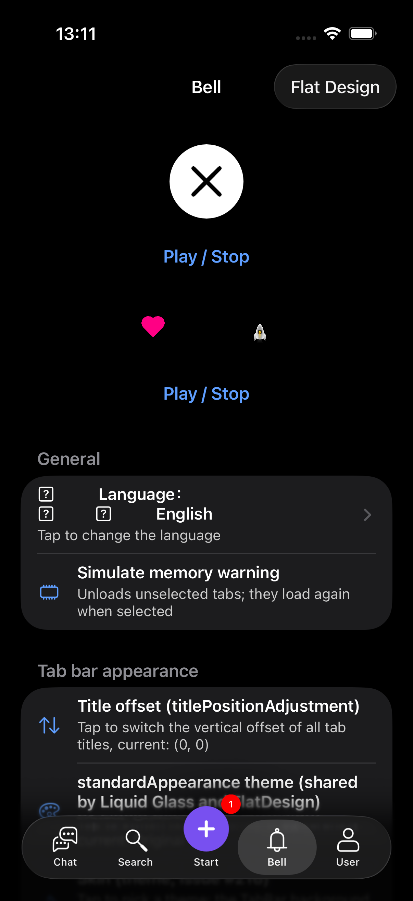
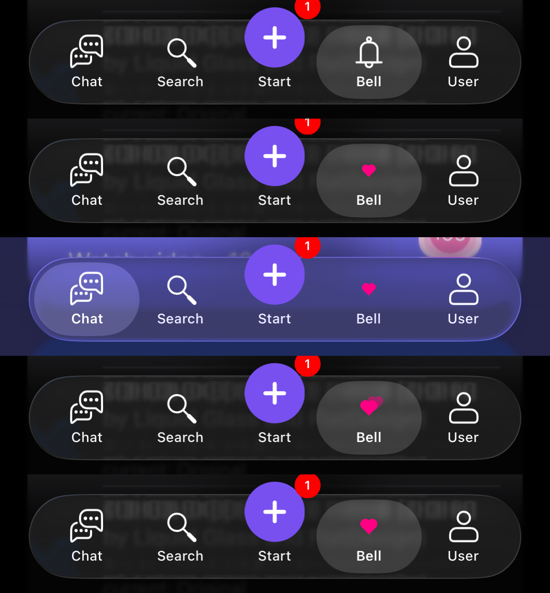
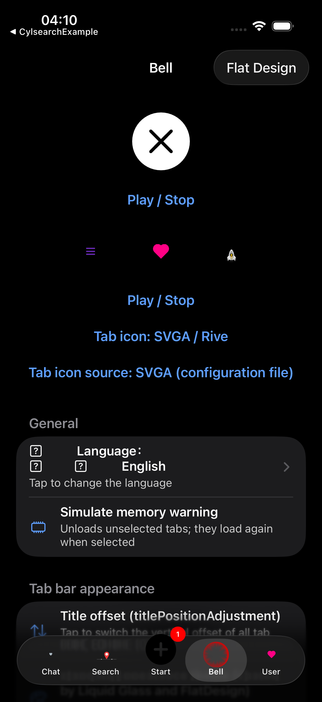
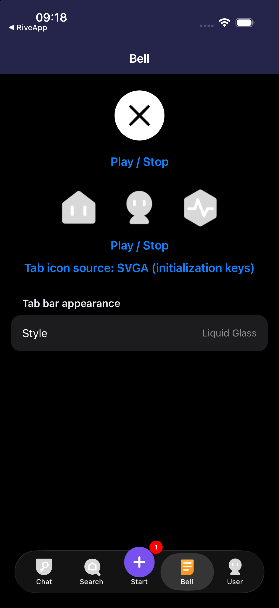
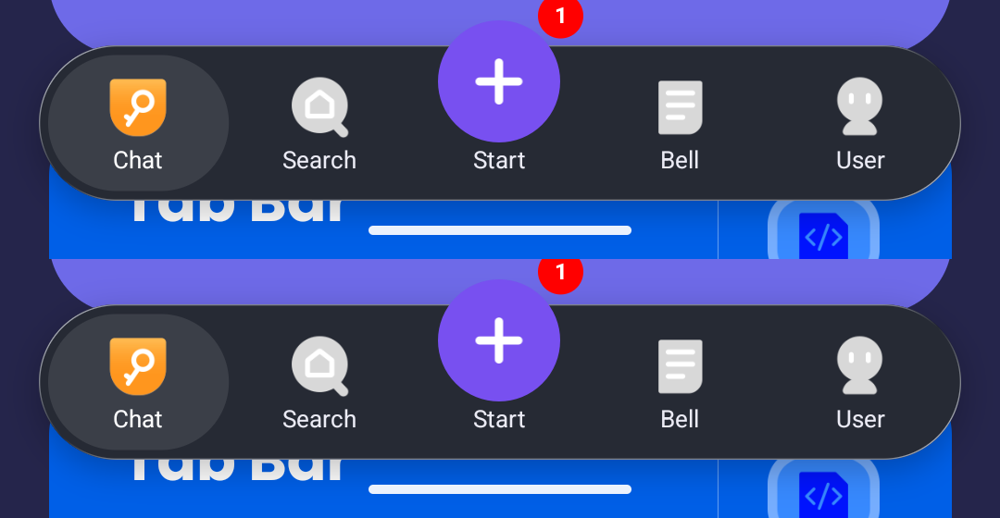
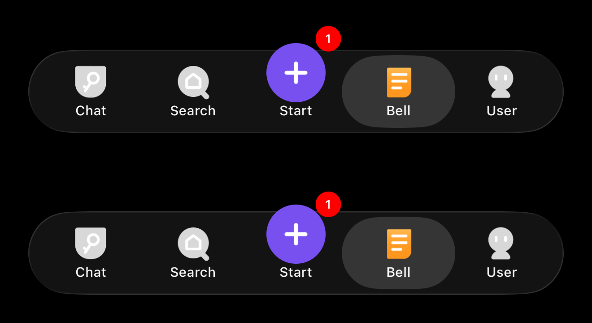
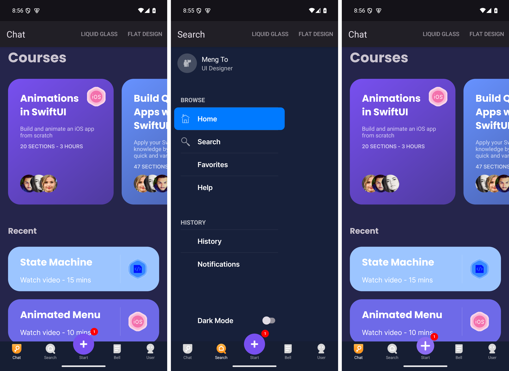
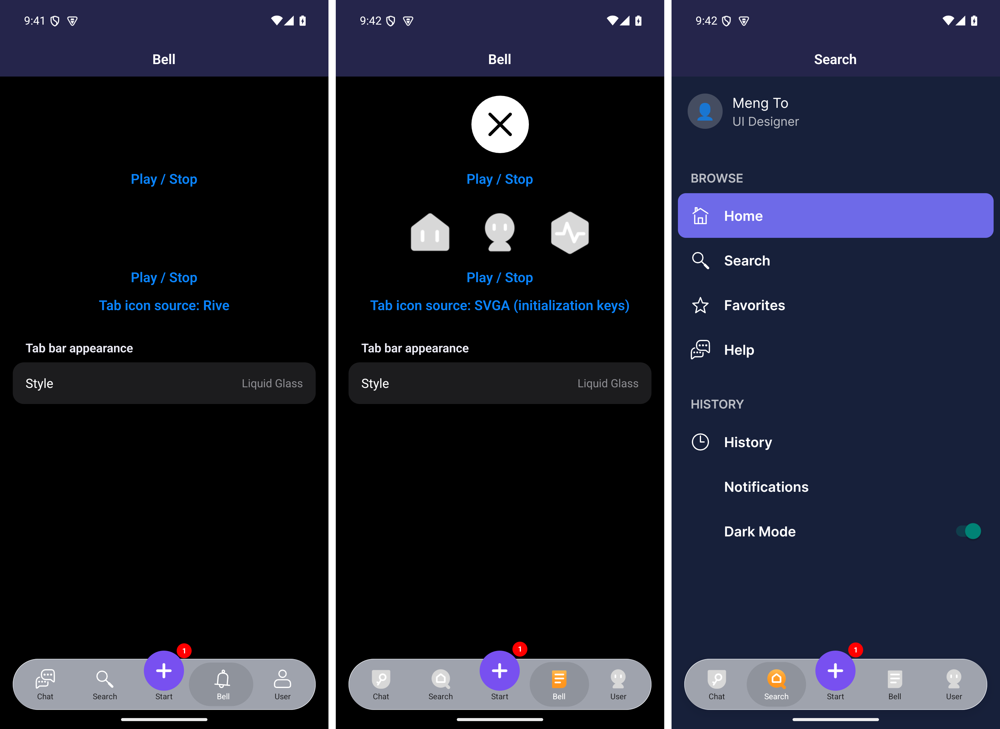
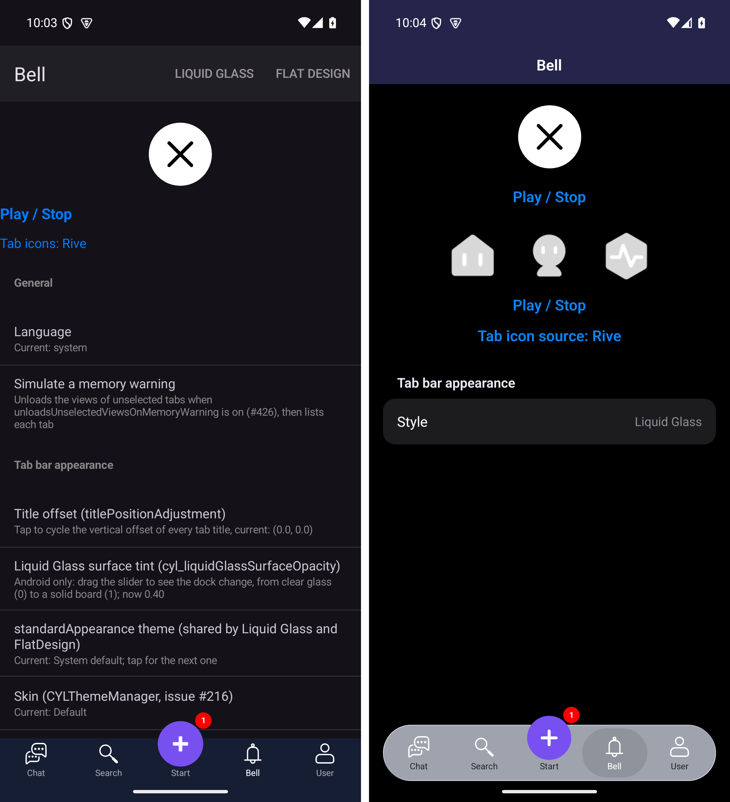
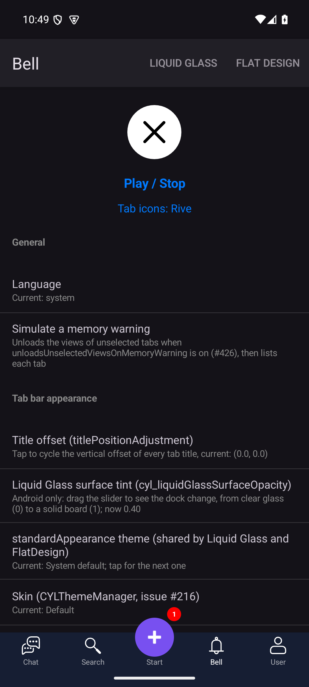

# [CN]SVGA 动画 Tab 图标（与 Rive、PAG、Lottie 用法相同）
# [EN]SVGA animated tab icons (used like Rive, PAG and Lottie)

<!-- bound-classes: CYLSVGATabBarItemAnimator, CYLTabBarItemViewAnimator -->
<!-- binding:start -->
<!-- Generated by scripts/update-docs-navigation.py; do not edit by hand. -->

| 中文 | English |
|:---|:---|
| 绑定的代码类 `CYLSVGATabBarItemAnimator`：[`CYLTabBarController/CYLTabBarItemAnimation/SVGA/CYLSVGATabBarItemAnimator.h`](../CYLTabBarController/CYLTabBarItemAnimation/SVGA/CYLSVGATabBarItemAnimator.h) | Bound to the class `CYLSVGATabBarItemAnimator`: [`CYLTabBarController/CYLTabBarItemAnimation/SVGA/CYLSVGATabBarItemAnimator.h`](../CYLTabBarController/CYLTabBarItemAnimation/SVGA/CYLSVGATabBarItemAnimator.h) |
| 绑定的代码类 `CYLTabBarItemViewAnimator`：[`CYLTabBarController/CYLTabBarItemAnimation/CYLTabBarItemViewAnimator.h`](../CYLTabBarController/CYLTabBarItemAnimation/CYLTabBarItemViewAnimator.h) | Bound to the class `CYLTabBarItemViewAnimator`: [`CYLTabBarController/CYLTabBarItemAnimation/CYLTabBarItemViewAnimator.h`](../CYLTabBarController/CYLTabBarItemAnimation/CYLTabBarItemViewAnimator.h) |

<!-- binding:end -->

| 中文 | English |
|:---|:---|
| 支持 [SVGA](https://svga.dev)（`SVGAPlayer`）动画作为 Tab 图标，接入方式模仿 [Rive](Rive-Animation.md)：一个 CocoaPods 子库（`CYLTabBarController/SVGA`）、同样的 key 与播放流程，作为 `CYLTabBarItemAnimation` 子库「可播放视图」方式的插件，适用于经典系统 TabBar、液态玻璃（Liquid Glass）与扁平样式（FlatDesign）。**Core 与引擎没有为 SVGA 修改**。来源：[issue #415](https://github.com/ChenYilong/CYLTabBarController/issues/415)「请问这个支持 svga 动画吗」。 | [SVGA](https://svga.dev) (`SVGAPlayer`) animations as tab icons, integrated the way [Rive](Rive-Animation.md) is: a CocoaPods subspec (`CYLTabBarController/SVGA`), the same keys and playback pipeline, as a plugin of the "playable view" way of the `CYLTabBarItemAnimation` subspec, in the classic system tab bar, Liquid Glass and FlatDesign. **Core and the engine were not changed for SVGA**. Source: [issue #415](https://github.com/ChenYilong/CYLTabBarController/issues/415), "does it support SVGA animations?". |

## [CN]目录
## [EN]Contents

<!-- navigation:start -->
<!-- Generated by scripts/update-docs-navigation.py; do not edit by hand. -->

| 中文 | English |
|:---|:---|
| [安装](#cn安装) | [Installation](#eninstallation) |
| [Key](#cnkey) | [Keys](#enkeys) |
| [代码演示](#cn代码演示) | [Code](#encode) |
| [实现结构](#cn实现结构) | [Implementation](#enimplementation) |
| [Demo：Example-Rive](#cndemoexample-rive) | [Demo: Example-Rive](#endemo-example-rive) |
| [任务记录](#cn任务记录) | [Task log](#entask-log) |

<!-- navigation:end -->

## [CN]安装
## [EN]Installation

| 中文 | English |
|:---|:---|
| `pod 'CYLTabBarController/SVGA'`，同时引入 `SVGAPlayer`（2.5）。子库把 `Protobuf` 固定在 3.21：SVGAPlayer 2.5.7 生成的 protobuf 文件调用了 3.22 起移除的 `OSAtomicCompareAndSwapPtrBarrier`，用更新的 Protobuf 无法编译。已有更高版本 `Protobuf` 的工程需先执行 `pod update Protobuf`。没有 SVGAPlayer 时 `CYL_SVGA_AVAILABLE` 为 0，SVGA 的 key 不存在（使用即编译失败）。 | `pod 'CYLTabBarController/SVGA'`, which also brings `SVGAPlayer` (2.5). The subspec pins `Protobuf` to 3.21: SVGAPlayer 2.5.7's generated protobuf files call `OSAtomicCompareAndSwapPtrBarrier`, removed in 3.22, so they do not build with a newer Protobuf. A project that already resolved a newer `Protobuf` runs `pod update Protobuf` first. Without SVGAPlayer, `CYL_SVGA_AVAILABLE` is 0 and the SVGA keys do not exist (using one fails to build). |

## [CN]Key
## [EN]Keys

| 中文 | English |
|:---|:---|
| `CYLTabBarSVGAURL`（NSURL）或 `CYLTabBarSVGAFilePath`（NSString）：`.svga` 文件；也可用通用的 `CYLTabBarAnimationURL` / `CYLTabBarAnimationFilePath`（按扩展名 `.svga` 选择 SVGA）。`CYLTabBarSVGASize`：动画视图尺寸。`CYLTabBarSVGADarkURL` / `CYLTabBarSVGADarkFilePath`：深色模式下的文件。配置文件按名称接受这些 key（无论是否安装 SVGA 子库）。 | `CYLTabBarSVGAURL` (NSURL) or `CYLTabBarSVGAFilePath` (NSString): the `.svga` file; the generic `CYLTabBarAnimationURL` / `CYLTabBarAnimationFilePath` work too (the `.svga` extension picks SVGA). `CYLTabBarSVGASize`: the animation view's size. `CYLTabBarSVGADarkURL` / `CYLTabBarSVGADarkFilePath`: the file for Dark Mode. Configuration files take these keys by name (whether or not the SVGA subspec is installed). |
| 选中 Tab 时播放一次并停在最后一帧；取消选中时回到第一帧；启动时选中的 Tab 直接显示最后一帧（#389）。文件解析是异步的：解析完成前的播放 / 停止请求会在解析后执行。 | Selecting a tab plays its animation once and keeps the last frame; deselecting shows the first frame again; the tab selected at launch shows its last frame without playing (#389). Parsing is asynchronous: a play or stop asked for before the file is parsed runs once it is. |

## [CN]代码演示
## [EN]Code

```swift
// Swift
var home: [AnyHashable: Any] = [CYLTabBarItemTitle: "Home", CYLTabBarItemImage: "home_normal"]
home[CYLTabBarSVGAURL] = Bundle.main.url(forResource: "heartbeat", withExtension: "svga")
home[CYLTabBarSVGASize] = NSValue(cgSize: CGSize(width: 33, height: 33))

// Outside the tab bar (as the Example-Rive demo): the same factory as Rive.
let view = CYLTabBarItemAnimationFactory.animationView(url: url, size: CGSize(width: 72, height: 72), contentMode: .scaleAspectFit)
CYLTabBarItemAnimationFactory.player(for: view)?.play()
```

## [CN]实现结构
## [EN]Implementation

| 中文 | English |
|:---|:---|
| `CYLTabBarItemAnimation/SVGA/CYLSVGATabBarItemAnimator.{h,m}`：声明 key，在 `+load` 中注册一个 `CYLTabBarItemViewAnimator`（扩展名 `svga`），其视图 `CYLSVGATabBarItemAnimationView` 是遵守 `CYLTabBarItemAnimationPlayableView` 的 `SVGAPlayer` 子类（`loops = 1`、`fillMode = "Forward"`），用 `SVGAParser` 解析本地文件（内存缓存，键为文件 URL）或远程 URL。与 Rive 相同，没有自己的 animator 或播放器类。 | `CYLTabBarItemAnimation/SVGA/CYLSVGATabBarItemAnimator.{h,m}`: declares the keys and registers, in `+load`, a `CYLTabBarItemViewAnimator` (extension `svga`) whose view, `CYLSVGATabBarItemAnimationView`, is an `SVGAPlayer` subclass adopting `CYLTabBarItemAnimationPlayableView` (`loops = 1`, `fillMode = "Forward"`) that parses a local file (memory cache, keyed by the file URL) or a remote URL with `SVGAParser`. As with Rive, there is no animator or player class of its own. |
| 为了接入 SVGA，同时修复了一个已有问题：`CYLTabBarItemAnimationPlayableView` 与 `CYLTabBarItemAnimationViewProviding` 移到 Swift 声明（`Swift/CYLTabBarItemAnimationPlayableView.swift`，selector 与 Swift 名称不变）。此前 Rive 的 Swift 视图遵守这两个 Objective-C 协议，使生成的 Swift 头文件导入总头文件，引入 Rive 子库的 CocoaPods 构建（Example-Rive）因循环导入而失败。 | Integrating SVGA also fixed an existing problem: `CYLTabBarItemAnimationPlayableView` and `CYLTabBarItemAnimationViewProviding` are now declared in Swift (`Swift/CYLTabBarItemAnimationPlayableView.swift`, same selectors and Swift names). Rive's Swift views adopting these Objective-C protocols made the generated Swift header import the umbrella header, so a CocoaPods build with the Rive subspec (Example-Rive) failed on the import cycle. |

## [CN]Demo：Example-Rive
## [EN]Demo: Example-Rive

| 中文 | English |
|:---|:---|
| [Example-Rive](../Example-Rive) 的 Bell Tab（UIKit 测试列表）上方，在 Rive 演示（`RiveMenuButtonDemoView`）之后是 [`SVGATabIconDemoView`](../Example-SwiftUI-Rive/AnimatedApp/Navigation/SVGATabIconDemoView.swift)：两个 SVGA 文件（`heartbeat.svga`、`Rocket.svga`，来自 SVGAPlayer-iOS，Apache 2.0），通过与 Rive 相同的 `CYLTabBarItemAnimationFactory` 创建，“播放 / 停止”按钮播放一次并停在最后一帧。 | Above the Bell tab's UIKit test list in [Example-Rive](../Example-Rive), after the Rive demo (`RiveMenuButtonDemoView`), is [`SVGATabIconDemoView`](../Example-SwiftUI-Rive/AnimatedApp/Navigation/SVGATabIconDemoView.swift): two SVGA files (`heartbeat.svga`, `Rocket.svga`, from SVGAPlayer-iOS, Apache 2.0) made through the same `CYLTabBarItemAnimationFactory` as Rive; the "Play / Stop" button plays them once, keeping the last frame. |

| 中文 | English |
|:---|:---|
| iOS，iOS 26.3 模拟器（CYL 17Pro），Xcode 27（iOS 26.3 SDK），基于提交 [433e953](https://github.com/ChenYilong/CYLTabBarController/commit/433e953) 的工作区，2026-11-15 13:11：Bell Tab，Rive 演示之后是 SVGA 演示 | iOS, iOS 26.3 simulator (CYL 17Pro), Xcode 27 (iOS 26.3 SDK), working tree on top of commit [433e953](https://github.com/ChenYilong/CYLTabBarController/commit/433e953), 2026-11-15 13:11: the Bell tab, the SVGA demo after the Rive demo |
|  |  |
| 播放中（心跳放大，裁剪，原始分辨率） | Playing (the heart beats; cropped, original resolution) |
|  |  |
| 播放结束，停在最后一帧 | Ended on the last frame |
|  |  |

| 中文 | English |
|:---|:---|
| **真正的 Tab 图标，三种样式**：同一演示中的“Tab 图标：SVGA / Rive”按钮通过 `-updateTabBarItemForViewController:attributes:` 把 Bell Tab 的图标原地换成 `heartbeat.svga`（通用 key `CYLTabBarAnimationURL`），再点一次换回 Rive。每张图自上而下：Rive 图标；换成 SVGA（选中）；选中 Chat（SVGA 显示第一帧）；再次选中 Bell（播放中）；播放结束停在最后一帧。 | **A real tab icon, in three styles**: the "Tab icon: SVGA / Rive" button of the same demo swaps the Bell tab's icon in place for `heartbeat.svga` with `-updateTabBarItemForViewController:attributes:` (the generic key `CYLTabBarAnimationURL`); tapping it again brings Rive back. Each image, top to bottom: the Rive icon; swapped to SVGA (selected); Chat selected (SVGA shows its first frame); Bell selected again (playing); ended on the last frame. |
| 液态玻璃：iOS，iOS 26.3 模拟器（CYL 17Pro），Xcode 27.2（27B52，iOS 27.2 SDK），基于提交 [0af437e](https://github.com/ChenYilong/CYLTabBarController/commit/0af437e) 的工作区，2026-11-15 15:10（裁剪，原始分辨率） | Liquid Glass: iOS, iOS 26.3 simulator (CYL 17Pro), Xcode 27.2 (27B52, iOS 27.2 SDK), working tree on top of commit [0af437e](https://github.com/ChenYilong/CYLTabBarController/commit/0af437e), 2026-11-15 15:10 (cropped, original resolution) |
|  |  |
| 扁平样式：同一环境，2026-11-15 15:05（没有“播放中”一行） | FlatDesign: same environment, 2026-11-15 15:05 (no "playing" row) |
|  |  |
| 经典样式：iOS，iOS 17.5 模拟器（iPhone 15 Pro），Xcode 27.2（27B52），同一工作区，2026-11-15 15:12 | Classic: iOS, iOS 17.5 simulator (iPhone 15 Pro), Xcode 27.2 (27B52), same working tree, 2026-11-15 15:12 |
|  |  |
| 测试中发现并修复的两个库问题：(1) Tab 属性中仍有 `CYLTabBarRiveURL` 时，用通用 key 传入的 `.svga` 文件仍被绑定到 Rive，图标显示为空：现在扩展名被已注册动画库认领的通用 key 文件按扩展名匹配（`CYLTabBarItemAnimationStyleRegistry.swift`）；(2) iOS 26 扁平样式下首次触摸 Tab 即崩溃（`-[CYLFlatDesignTabBarHideTabBar liquidGlassContinuousGestureRecognizer]` unrecognized selector）：Swift 迁移中的 `tabBar as CYLTabBar?` 是编译期转换，现在改为运行时检查（`CYLTabBarController+CYLInteraction.swift`）。 | Two library bugs found and fixed while testing: (1) with `CYLTabBarRiveURL` still in the tab's attributes, an `.svga` file given with the generic key was bound to Rive and the icon stayed empty: a generic-key file whose extension a registered library claims is now matched by that extension (`CYLTabBarItemAnimationStyleRegistry.swift`); (2) on iOS 26, FlatDesign crashed on the first touch on a tab (`-[CYLFlatDesignTabBarHideTabBar liquidGlassContinuousGestureRecognizer]`, unrecognized selector): `tabBar as CYLTabBar?` from the Swift migration was a compile-time cast and is now checked at run time (`CYLTabBarController+CYLInteraction.swift`). |

| 中文 | English |
|:---|:---|
| **所有 Tab 图标改用 SVGA，与 Rive 一一对应（2026-11-16）**：Bell 页面的「Tab 图标来源」按钮依次切换 Rive → SVGA（初始化 Key）→ SVGA（配置文件），并重建 TabBar；选择在重启后保持，启动参数 `-CYLDemoTabIconSource 0/1/2` 也可设置（[`SVGATabIcons.swift`](../Example-SwiftUI-Rive/AnimatedApp/Navigation/SVGATabIcons.swift)）。初始化 Key：每个 Rive Tab 的属性去掉 `CYLTabBarRiveURL`，改为 `CYLTabBarSVGAURL` 与 `CYLTabBarSVGASize`（Chat `TwitterHeart`、Search `PinJump`、Bell `alarm`、User `heartbeat`）。配置文件：[`cyl_tabbar_configuration_svga.json`](../Example-Rive/RiveApp/SVGA/cyl_tabbar_configuration_svga.json) 用 `CYLTabBarSVGAFilePath` 给出同样的文件，Tab、PlusButton 与页面（页面注册表，`CYLTabBarItemPageIdentifier`）都来自该文件，由 `+tabBarControllerWithConfigurationFile:error:` 创建。SVGA 演示中新增 `HamburgerArrow.svga`，对应上方的 Rive 菜单按钮。新文件来自 SVGAPlayer-Android 与 SVGAPlayer-Web 的示例（Apache 2.0，[NOTICE](../Example-SwiftUI-Rive/AnimatedApp/SVGAAssets/NOTICE.md)）。 | **Every tab icon in SVGA, one for one with Rive (2026-11-16)**: the "Tab icon source" button of the Bell page cycles Rive → SVGA (initialization keys) → SVGA (configuration file) and rebuilds the tab bar; the choice is kept across launches, and the launch argument `-CYLDemoTabIconSource 0/1/2` sets it too ([`SVGATabIcons.swift`](../Example-SwiftUI-Rive/AnimatedApp/Navigation/SVGATabIcons.swift)). Initialization keys: each Rive tab's attributes without `CYLTabBarRiveURL`, with `CYLTabBarSVGAURL` and `CYLTabBarSVGASize` instead (Chat `TwitterHeart`, Search `PinJump`, Bell `alarm`, User `heartbeat`). Configuration file: [`cyl_tabbar_configuration_svga.json`](../Example-Rive/RiveApp/SVGA/cyl_tabbar_configuration_svga.json) gives the same files with `CYLTabBarSVGAFilePath`; the tabs, the plus button and the pages (page registry, `CYLTabBarItemPageIdentifier`) all come from the file, through `+tabBarControllerWithConfigurationFile:error:`. The SVGA demo gains `HamburgerArrow.svga`, the twin of the Rive menu button above it. The new files are samples of SVGAPlayer-Android and SVGAPlayer-Web (Apache 2.0, [NOTICE](../Example-SwiftUI-Rive/AnimatedApp/SVGAAssets/NOTICE.md)). |
| 从上到下：初始化 Key；配置文件。均为 Bell 选中、`alarm.svga` 播放中。iOS，iOS 26.3 模拟器（CYL 17Pro），Xcode 27.2（27B52），基于提交 [0058a9f](https://github.com/ChenYilong/CYLTabBarController/commit/0058a9f) 的工作区，2026-11-16 04:07 与 04:10。 | Top to bottom: initialization keys; configuration file. Both with Bell selected and `alarm.svga` playing. iOS, iOS 26.3 simulator (CYL 17Pro), Xcode 27.2 (27B52), working tree on top of commit [0058a9f](https://github.com/ChenYilong/CYLTabBarController/commit/0058a9f), 2026-11-16 04:07 and 04:10. |
|  |  |
|  |  |
| **Example-SwiftUI-Rive 同样支持（2026-11-16）**：`SVGATabIcons.swift`、`SVGATabIconDemoView.swift` 与 SVGA 文件（`AnimatedApp/SVGAAssets/`）移到 Example-SwiftUI-Rive，与 `TabItems.swift` 一样由两个 App 共用。SwiftUI App 的 Bell 页面上方显示同一个 SVGA 演示与来源按钮；切换来源时 `ContentView` 用 `.id(tabIconSource)` 重新创建 `TabBar`。它的配置文件 [`cyl_tabbar_configuration_svga.json`](../Example-SwiftUI-Rive/AnimatedApp/cyl_tabbar_configuration_svga.json) 有 5 个 Tab（Timer 使用 `Rocket.svga`），没有 PlusButton。Example-Rive 配置文件中的 PlusButton 改用紫色图片 `svga_plus_button`（页面 `svga-timer`）。 | **Example-SwiftUI-Rive too (2026-11-16)**: `SVGATabIcons.swift`, `SVGATabIconDemoView.swift` and the SVGA files (`AnimatedApp/SVGAAssets/`) moved to Example-SwiftUI-Rive and are shared by both apps, like `TabItems.swift`. The SwiftUI app's Bell page shows the same SVGA demo and source button above its rows; changing the source makes `ContentView` recreate `TabBar` through `.id(tabIconSource)`. Its configuration file [`cyl_tabbar_configuration_svga.json`](../Example-SwiftUI-Rive/AnimatedApp/cyl_tabbar_configuration_svga.json) has 5 tabs (Timer with `Rocket.svga`) and no plus button. The plus button of Example-Rive's configuration file now uses the purple image `svga_plus_button` (page `svga-timer`). |
| 从上到下：Example-SwiftUI-Rive 初始化 Key（点按 Bell 页面按钮从 Rive 切换而来）；Example-SwiftUI-Rive 配置文件；Example-Rive 配置文件，紫色 PlusButton 的「Start」页面已选中。iOS，iOS 26.3 模拟器（CYL 17Pro），Xcode 27.2（27B52），基于提交 [0342bb2](https://github.com/ChenYilong/CYLTabBarController/commit/0342bb2) 的工作区，2026-11-16 05:19–05:22。 | Top to bottom: Example-SwiftUI-Rive with the initialization keys (switched from Rive with the Bell page's button); Example-SwiftUI-Rive with the configuration file; Example-Rive with the configuration file, the purple plus button's "Start" page selected. iOS, iOS 26.3 simulator (CYL 17Pro), Xcode 27.2 (27B52), working tree on top of commit [0342bb2](https://github.com/ChenYilong/CYLTabBarController/commit/0342bb2), 2026-11-16 05:19–05:22. |
|  |  |
|  |  |
|  |  |
| **React Native（2026-11-16）**：[`example-rive`](../CrossPlatform/react-native-cyltabbar/example-rive/src/App.tsx) 的 Bell 页面加入同样的 SVGA 演示（`<CYLAnimationView file="tab_home.svga">`，库自己的引擎）与「Tab 图标来源」按钮：Rive → SVGA（初始化 Key，`CYLTabBarSVGAFilePath`）→ SVGA（配置文件，`configurationRoute="bundle:svga?name=cyl_tabbar_configuration_svga"`，[`configurations/svga/cyl_tabbar_configuration_svga.json`](../CrossPlatform/react-native-cyltabbar/example-rive/configurations/svga/cyl_tabbar_configuration_svga.json)）；换来源时用 `key` 重建 `<CYLTabBar>`。iOS：Podfile 加入 `CYLTabBarController/SVGA`（静态库需要 `SVGAPlayer`、`Protobuf` 的 `:modular_headers => true`），SVGA 文件与 `svga` 目录加入 App。Android：`SVGAPlayer-Android` 2.6.1（JitPack）与 assets。同时修复：RN 包装层在 Swift 迁移第 36 步后找不到 `CYLTabBarHostView`：`.mm` 导入生成的 Swift 头文件，podspec 加入其 `Swift Compatibility Header` 搜索路径。 | **React Native (2026-11-16)**: the Bell page of [`example-rive`](../CrossPlatform/react-native-cyltabbar/example-rive/src/App.tsx) gains the same SVGA demo (`<CYLAnimationView file="tab_home.svga">`, the library's own engine) and the "Tab icon source" button: Rive → SVGA (initialization keys, `CYLTabBarSVGAFilePath`) → SVGA (configuration file, `configurationRoute="bundle:svga?name=cyl_tabbar_configuration_svga"`, [`configurations/svga/cyl_tabbar_configuration_svga.json`](../CrossPlatform/react-native-cyltabbar/example-rive/configurations/svga/cyl_tabbar_configuration_svga.json)); a new source rebuilds `<CYLTabBar>` through `key`. iOS: the Podfile adds `CYLTabBarController/SVGA` (static libraries need `:modular_headers => true` for `SVGAPlayer` and `Protobuf`), and the SVGA files and the `svga` folder are added to the app. Android: `SVGAPlayer-Android` 2.6.1 (JitPack) and the assets. Also fixed: since step 36 of the Swift migration the RN wrapper could not find `CYLTabBarHostView`: its `.mm` files import the generated Swift header, and the podspec adds its `Swift Compatibility Header` search path. |
| 从上到下：React Native iOS 初始化 Key；配置文件（点按 Bell 页面按钮切换）。iOS 26.3 模拟器（CYL 17Pro），Xcode 27.2（27B52），React Native 0.88，基于提交 [fe4dcda](https://github.com/ChenYilong/CYLTabBarController/commit/fe4dcda) 的工作区，2026-11-16 09:18。 | Top to bottom: React Native iOS with the initialization keys; with the configuration file (switched with the Bell page's button). iOS 26.3 simulator (CYL 17Pro), Xcode 27.2 (27B52), React Native 0.88, working tree on top of commit [fe4dcda](https://github.com/ChenYilong/CYLTabBarController/commit/fe4dcda), 2026-11-16 09:18. |
|  |  |
|  |  |
| Android：上为初始化 Key，下为配置文件（`assets/svga/cyl_tabbar_configuration_svga.json`）。Android 15（API 35）模拟器，React Native 0.88，SVGAPlayer-Android 2.6.1，基于提交 [96c8efc](https://github.com/ChenYilong/CYLTabBarController/commit/96c8efc) 的工作区，2026-11-16 09:30。Android 构建另需两处修复：SVGAPlayer-Android 的清单声明 `allowBackup=true`，App 清单加入 `tools:replace="android:allowBackup"`；配置目录的 assets 路径相对于 `android/app`。**TODO**：在该模拟器上点按 Tab 不切换页面（Rive 模式同样如此），尚未确认是否早于本次改动；因此 Android 截图通过临时修改初始来源得到，Bell 页面按钮在 Android 上未点按验证。 | Android: top, initialization keys; bottom, configuration file (`assets/svga/cyl_tabbar_configuration_svga.json`). Android 15 (API 35) emulator, React Native 0.88, SVGAPlayer-Android 2.6.1, working tree on top of commit [96c8efc](https://github.com/ChenYilong/CYLTabBarController/commit/96c8efc), 2026-11-16 09:30. The Android build needed two more fixes: SVGAPlayer-Android's manifest declares `allowBackup=true`, so the app manifest adds `tools:replace="android:allowBackup"`; the assets path of the configuration folder is relative to `android/app`. **TODO**: on that emulator, tapping a tab does not switch pages (in Rive mode too), not yet known whether this predates this change; the Android screenshots were therefore taken by changing the starting source temporarily, and the Bell page's button was not tapped on Android. |
|  |  |
| **Flutter（2026-11-16）**：[`example_rive`](../CrossPlatform/flutter_cyltabbar/example_rive/lib/main.dart) 与 React Native 一一对应：Bell 页面的 SVGA 演示与「Tab 图标来源」按钮（`configurationRoute` 指向 `configurations/svga/cyl_tabbar_configuration_svga.json`，换来源时用 `key` 重建 `CYLTabBar`）。iOS：Podfile 加入 SVGA 子库（`SVGAPlayer`、`Protobuf` 需要 `:modular_headers => true`）、SVGA 文件与 `svga` 目录；Android：SVGAPlayer-Android 2.6.1（JitPack）、assets、清单 `tools:replace="android:allowBackup"`。同时修复插件 iOS 代码在迁移第 36 步后找不到 `CYLTabBarHostView`：导入生成的 Swift 头文件（SPM 时为 `@import`），podspec 加入其搜索路径。下图：iOS 26.3 模拟器（iPhone 17 Pro Max），上为初始化 Key，下为配置文件，Bell 选中，Xcode 27.2，基于提交 [06ad3a0](https://github.com/ChenYilong/CYLTabBarController/commit/06ad3a0) 的工作区，2026-11-16 09:58。Flutter Android（2026-11-16 10:12，Android 15 模拟器）两种 SVGA 模式均显示，点按切换正常（见 Cross-Platform-Components.md 任务记录）；SVGAPlayer-Android 清单还声明了 `android:label`，因此 `tools:replace` 为 `android:allowBackup,android:label`。 | **Flutter (2026-11-16)**: [`example_rive`](../CrossPlatform/flutter_cyltabbar/example_rive/lib/main.dart) one for one with React Native: the Bell page's SVGA demo and "Tab icon source" button (`configurationRoute` to `configurations/svga/cyl_tabbar_configuration_svga.json`, a new source rebuilds `CYLTabBar` through `key`). iOS: the SVGA subspec in the Podfile (`:modular_headers => true` for `SVGAPlayer` and `Protobuf`), the SVGA files and the `svga` folder; Android: SVGAPlayer-Android 2.6.1 (JitPack), the assets, `tools:replace="android:allowBackup"` in the manifest. Also fixed: since step 36 of the migration the plugin's iOS code could not find `CYLTabBarHostView`: it imports the generated Swift header (`@import` with SwiftPM), and the podspec adds its search path. Below: iOS 26.3 simulator (iPhone 17 Pro Max), top initialization keys, bottom configuration file, Bell selected, Xcode 27.2, working tree on top of commit [06ad3a0](https://github.com/ChenYilong/CYLTabBarController/commit/06ad3a0), 2026-11-16 09:58. Flutter Android (2026-11-16 10:12, Android 15 emulator): both SVGA modes show and taps switch tabs (task log of Cross-Platform-Components.md); SVGAPlayer-Android's manifest also declares `android:label`, so `tools:replace` is `android:allowBackup,android:label`. |
|  |  |
| **TODO**：(1) ~~配置文件中的 PlusButton 显示为黑色~~ 已完成；(2) ~~Bell 页面按钮切换来源只在启动参数下验证~~ 已在 Example-SwiftUI-Rive 中点按验证（Rive → 初始化 Key → 配置文件）；注意启动参数 `-CYLDemoTabIconSource` 在该次启动中优先于按钮的选择；(3) 扁平与经典样式下的 SVGA 图标来源尚未截图；(4) Objective-C 示例与跨端示例的 SVGA 对应演示（任务 4，见下方任务记录）；(5) `CYLDemo.bundle` 每个语言文件都有 14 个重复的 key（早已存在），待清理。 | **TODO**: (1) ~~the configuration file's plus button shows black~~ done; (2) ~~switching the source with the Bell page's button checked only through the launch argument~~ checked by tapping in Example-SwiftUI-Rive (Rive → initialization keys → configuration file); note that the launch argument `-CYLDemoTabIconSource` wins over the button for the launch it is given to; (3) no screenshots yet of the SVGA icon sources in FlatDesign and the classic style; (4) the SVGA twins in the Objective-C example and the cross-platform examples (task 4, task log below); (5) every language file of `CYLDemo.bundle` has 14 duplicate keys (pre-existing), to clean up. |

## [CN]任务记录
## [EN]Task log

| 中文 | English |
|:---|:---|
| **DONE**（2026-11-15）：issue #415 的 SVGA 支持。要求：(1) 将 issue #415 加入文档并标注 TODO；(2) 模仿 Rive 动效的集成方式加入 SVGA 动画支持；(3) 在 example 中加入样式展示，追加到 Rive 相关动画演示后面。用户原话：「将issue #415 加入文档，标注 TODO ，模仿Rive 动效集成方式，加入 SVGA 动画支持。 在example 中加入 样式展示，追加到rive 相关动画演示后面。  continue」。结果：`SVGA` 子库、key、配置文件 key、Example-Rive 演示与截图（见上）；验证见提交说明。 | **DONE** (2026-11-15): SVGA support for issue #415. Requirements: (1) add issue #415 to the documents, marked TODO; (2) add SVGA animation support the way Rive is integrated; (3) show the style in the example, after the Rive animation demos. The user's prompt, verbatim: "将issue #415 加入文档，标注 TODO ，模仿Rive 动效集成方式，加入 SVGA 动画支持。 在example 中加入 样式展示，追加到rive 相关动画演示后面。  continue" (English: "Add issue #415 to the documents, marked TODO; add SVGA animation support the way the Rive animations are integrated; show the style in the example, after the Rive animation demos. continue"). Result: the `SVGA` subspec, its keys, the configuration keys, the Example-Rive demo and screenshots (above); verification in the commit message. |
| **TODO**：(1) ~~在模拟器上把 SVGA 用作真正的 Tab 图标，在经典、液态玻璃与扁平样式下各点几个 Tab 并截图~~ **DONE**（2026-11-15，见上方“真正的 Tab 图标，三种样式”）；(2) Android、React Native、Flutter、HarmonyOS、微信小程序尚无 SVGA；(3) ~~`Tests/CYLTabBarItemAnimation/run.sh` 已过期~~ **DONE**（2026-11-15）：改为使用逐行对应 Swift 代码的 Objective-C 替身（`CYLCoreStandIns.m`）与 Swift 协议声明（`stub/CYLTabBarController-Swift.h`），本地 74 项检查全部通过；(4) SVGAPlayer 2.5.7 自 2021 年后未更新，Protobuf 被固定在 3.21，长期看可考虑 SVGAPlayer 的维护分支。 | **TODO**: (1) ~~on a simulator, use SVGA as a real tab icon, tap a few tabs in the classic, Liquid Glass and FlatDesign styles, and take screenshots~~ **DONE** (2026-11-15, see "A real tab icon, in three styles" above); (2) Android, React Native, Flutter, HarmonyOS and the WeChat Mini Program have no SVGA yet; (3) ~~`Tests/CYLTabBarItemAnimation/run.sh` is stale~~ **DONE** (2026-11-15): it now uses Objective-C stand-ins that mirror the Swift code line by line (`CYLCoreStandIns.m`) and the Swift protocols' declarations (`stub/CYLTabBarController-Swift.h`); 74 checks pass locally; (4) SVGAPlayer 2.5.7 has not been updated since 2021 and pins Protobuf to 3.21; in the long run a maintained fork of SVGAPlayer may be better. |
| **TODO**（2026-11-16）：完成上一行剩下的两项：(2) Android、React Native、Flutter、HarmonyOS、微信小程序的 SVGA；(4) SVGAPlayer 的维护分支。用户原话：「look into the Nearby crash first then go straight to CYLPlusButton. then finish svga todo list」（三项任务中的第 3 项，前两项记录在 docs/Swift-Migration.md）。 | **TODO** (2026-11-16): finish the two items left in the row above: (2) SVGA on Android, React Native, Flutter, HarmonyOS and the WeChat Mini Program; (4) a maintained fork of SVGAPlayer. The user's prompt, verbatim: "look into the Nearby crash first then go straight to CYLPlusButton. then finish svga todo list" (task 3 of 3; tasks 1 and 2 are logged in docs/Swift-Migration.md). |
| **TODO**（2026-11-16，任务 4）：在 example 层加入与 Rive 一一对应的 SVGA 动效演示，可通过初始化 Key 与配置文件初始化，Tab item 显示 SVGA 资源，更新所有 example。用户原话：「在example层加入svga动效测试，搜索Rive关键词，一比一复刻，Rive相关动效测试，要求能在初始化Key以及配置文件中进行SVGA格式动图初始化，能在tabbar item加入svga相关资源文件展示。更新所有example层演示 ，一比一复刻，Rive相关动效演示」。进度：Example-Rive 已完成（见上方“所有 Tab 图标改用 SVGA”）；Example-SwiftUI-Rive 已完成（见上方“Example-SwiftUI-Rive 同样支持”）；Objective-C 示例只在空列表占位图中使用 Rive（`CYLMessageViewController`、`CYLPopPushDemoViewController`，`CYLDemoPlaceholderAnimationRive`），来自独立仓库 CYLTableViewPlaceHolder，它没有 SVGA 子库：SVGA 对应版本需先在该库中加入 SVGA 子库，待决定；React Native iOS 与 Android 已完成（Android 点按 Tab 的问题待查）；Flutter iOS 与 Android 已完成；微信小程序已完成代码与测试（svga-miniprogram，微信开发者工具中运行待做，见 Cross-Platform-Components.md 任务记录）；HarmonyOS 已完成代码（`HarmonyOS/cyltabbar` 的 `CYLSVGAView`，可编译，未在设备上运行）。 | **TODO** (2026-11-16, task 4): SVGA demos in the example layer, one for one with the Rive ones, set up from the initialization keys and from a configuration file, with SVGA files as tab item icons, in every example. The user's prompt, verbatim: "在example层加入svga动效测试，搜索Rive关键词，一比一复刻，Rive相关动效测试，要求能在初始化Key以及配置文件中进行SVGA格式动图初始化，能在tabbar item加入svga相关资源文件展示。更新所有example层演示 ，一比一复刻，Rive相关动效演示" (English: "Add SVGA animation tests to the example layer, one for one with the Rive ones; SVGA set up from the initialization keys and from a configuration file; SVGA files as tab bar item icons; update every example demo."). Progress: Example-Rive done (see "Every tab icon in SVGA" above); Example-SwiftUI-Rive done (see "Example-SwiftUI-Rive too" above); the Objective-C example uses Rive only in its empty-list placeholders (`CYLMessageViewController`, `CYLPopPushDemoViewController`, `CYLDemoPlaceholderAnimationRive`), which come from the separate CYLTableViewPlaceHolder repository and its subspecs, and it has no SVGA subspec: an SVGA twin first needs an SVGA subspec there, to decide; React Native iOS and Android done (the Android tab tap issue to look into); Flutter iOS and Android done; the WeChat Mini Program has its code and tests (svga-miniprogram; running it in WeChat DevTools is still to do, task log of Cross-Platform-Components.md); HarmonyOS has its code (`CYLSVGAView` in `HarmonyOS/cyltabbar`; it builds, not run on a device). |
| **DONE**（2026-11-16，任务 5，分支 `feat/cross-platform-components`）：从网络下载适合 Tab 栏显示的 `.svga` 资源，替换现有 SVGA 资源，涉及所有平台的 example 层。用户原话：「.svga从网络下载 找到适合 tabbar显示的资源 替换现有的svga资源 此次操作涉及所有平台 example层」。要求：(1) 资源从网络下载，许可证允许再分发，写入 `NOTICE.md`；(2) 适合 Tab 图标：小尺寸、图标式、单个主体、播放一次后停在有意义的最后一帧；(3) 替换现有 6 个样例（`heartbeat`、`Rocket`、`alarm`、`TwitterHeart`、`PinJump`、`HamburgerArrow`，来自 SVGAPlayer 各端样例）；(4) 所有平台的 example：目前只有 iOS 的 Example-Rive 与 Example-SwiftUI-Rive 使用 SVGA，跨端组件尚无 SVGA（任务 4 待做），届时使用同一套新资源。 | **TODO** (2026-11-16, task 5, branch `feat/cross-platform-components`): download `.svga` files that suit a tab bar and replace the current SVGA files, in the examples of every platform. The user's words: ".svga从网络下载 找到适合 tabbar显示的资源 替换现有的svga资源 此次操作涉及所有平台 example层". Requirements: (1) downloaded from the web, under a license that allows redistribution, listed in `NOTICE.md`; (2) suited to tab icons: small, icon-like, one subject, played once and stopping on a meaningful last frame; (3) replace the 6 current samples (`heartbeat`, `Rocket`, `alarm`, `TwitterHeart`, `PinJump`, `HamburgerArrow`, from the SVGAPlayer samples); (4) every platform's examples: today only the iOS Example-Rive and Example-SwiftUI-Rive use SVGA; the cross-platform components have no SVGA yet (task 4, open) and will use the same new files. |
| 任务 5 结果（2026-11-16）：6 个新文件来自 [kongpf8848/Animation](https://github.com/kongpf8848/Animation)（Apache-2.0）的 96×96 Tab 图标，按 Tab 改名：`tab_chat`（原 TwitterHeart）、`tab_search`（PinJump）、`tab_activity`（Rocket）、`tab_list`（alarm）、`tab_profile`（heartbeat）、`tab_home`（HamburgerArrow）；旧文件已删除，`NOTICE.md`、两个配置文件、`SVGATabIcons.swift`、`SVGATabIconDemoView.swift`、两个 pbxproj 已更新。验证：Example-SwiftUI-Rive 与 Example-Rive 清空 DerivedData 后编译通过；iPhone 17 Pro（iOS 26.3）上以配置文件来源启动，截图 `assets/svga-tab-icons-web-assets-ios26.png`。来源说明：这些图标看起来取自某个上线 App，仓库未注明原作者，`NOTICE.md` 已写明。其他平台：跨端组件尚无 SVGA（任务 4），待接入时使用这 6 个文件。另筛选过 SVGA 官方各仓库的全部样例，只有 `11.svga`（宝箱，带中文“开宝箱”）与 `Walkthrough.svga` 接近图标，不足 6 个，未采用。 | Task 5 result (2026-11-16): 6 new files, 96 × 96 tab icons from [kongpf8848/Animation](https://github.com/kongpf8848/Animation) (Apache-2.0), renamed after their tab: `tab_chat` (was TwitterHeart), `tab_search` (PinJump), `tab_activity` (Rocket), `tab_list` (alarm), `tab_profile` (heartbeat), `tab_home` (HamburgerArrow); the old files are removed and `NOTICE.md`, both configuration files, `SVGATabIcons.swift`, `SVGATabIconDemoView.swift` and both pbxproj files updated. Checked: Example-SwiftUI-Rive and Example-Rive build from empty derived data; launched on iPhone 17 Pro (iOS 26.3) with the configuration-file source, screenshot `assets/svga-tab-icons-web-assets-ios26.png`. Origin: the icons look taken from a shipping app and the repository does not name their author; `NOTICE.md` says so. Other platforms: the cross-platform components have no SVGA yet (task 4) and will use these 6 files. Every sample in the official SVGA repositories was checked too; only `11.svga` (a chest with Chinese text) and `Walkthrough.svga` are icon-like, not 6, so they were not used. |


| 中文 | English |
|:---|:---|
| Android 播放库选型（2026-11-16）：[svga/SVGAPlayer-Android](https://github.com/svga/SVGAPlayer-Android)，3262 星，Apache-2.0，最新 2.6.1，JitPack `com.github.yyued:SVGAPlayer-Android:2.6.1` 构建状态 ok。仓库 2023-02 起归档（只读，65 个 open issue 无人处理），但仍是唯一高星实现：搜索 “svga android” 的其他仓库与 fork 均不超过 12 星。与 iOS 用的 SVGAPlayer-iOS 同源，文件格式一致。风险：归档后不再修复；需要时 fork 到本项目维护。 | Android player (2026-11-16): [svga/SVGAPlayer-Android](https://github.com/svga/SVGAPlayer-Android), 3262 stars, Apache-2.0, latest 2.6.1, JitPack `com.github.yyued:SVGAPlayer-Android:2.6.1` builds ok. Archived since 2023-02 (read-only, 65 open issues unanswered), but still the only widely used one: every other "svga android" repository and fork has 12 stars or fewer. Same family as SVGAPlayer-iOS used on iOS, same file format. Risk: no fixes after archiving; fork it into this project if one is needed. |
| **DONE**（2026-11-16，任务 7）：鸿蒙 IDE 准备与模拟器必要条件的规则（全英文）追加到 `AGENTS.md` 与 skill `cyl-verify`（本仓库及 CYLTableViewPlaceHolder 的 `instructions.md`、`AGENTS.md`、`cyl-verify`）；本机 `country.region.xml` 已由 `NZ` 改为 `CN`（备份 `country.region.xml.bak-NZ`）。用户原话：「接入android ，并 全英文写入instructions相关文件以及 skills相关文件： 鸿蒙系统 ide 准备工作，模拟器安装的必要条件， region should be set to china (NZ) in country.region.xml to china make sure The region file now says China: <countryregion name="CN"/>」 | **DONE** (2026-11-16, task 7): the HarmonyOS IDE preparation and emulator prerequisites rule (English) appended to `AGENTS.md` and the `cyl-verify` skill (here and in CYLTableViewPlaceHolder's `instructions.md`, `AGENTS.md`, `cyl-verify`); this Mac's `country.region.xml` changed from `NZ` to `CN` (copy kept as `country.region.xml.bak-NZ`). |
| **DONE**（2026-11-16，任务 6）：Example-Android 接入 SVGA：依赖 `com.github.yyued:SVGAPlayer-Android:2.6.1`，6 个新图标作为 Tab 图标，一比一对应 Rive 演示（初始化 Key 与配置文件），截图更新文档。 | **DONE** (2026-11-16, task 6): SVGA in Example-Android: depend on `com.github.yyued:SVGAPlayer-Android:2.6.1`, the 6 new icons as tab icons, one for one with the Rive demos (initialization keys and configuration file), screenshots in the docs. |
| 任务 6 进度（2026-11-16，未完成）：库新增 `CYLSVGATabBarItemAnimator.kt`（反射 SVGAPlayer-Android 2.6.1，API 已用 javap 核对）、SVGA 常量与注册；example-rive 新增图标来源切换（`SVGATabIcons.kt`，Bell 页按钮，启动参数 `CYLDemoTabIconSource` 0/1/2），JitPack 仓库与依赖。`:example-rive:assembleDebug` 与 `:cyltabbar:testDebugUnitTest` 通过。**问题**：emulator-5554 上以 SVGA key 启动时 Tab 图标为空（标题正常），尚未查明原因（可能是视图尺寸、解析回调或 tint）。待办：排查并修复、配置文件来源验证、截图。 | Task 6 progress (2026-11-16, not finished): the library has `CYLSVGATabBarItemAnimator.kt` (SVGAPlayer-Android 2.6.1 through reflection, API checked with javap), the SVGA keys and its registration; example-rive has the icon source switch (`SVGATabIcons.kt`, a button on the Bell page, launch extra `CYLDemoTabIconSource` 0/1/2), the JitPack repository and the dependency. `:example-rive:assembleDebug` and `:cyltabbar:testDebugUnitTest` pass. **Problem**: on emulator-5554 with the SVGA keys the tab icons are empty (titles fine); cause not found yet (view size, parse callback or tint). Left: find and fix it, check the configuration-file source, screenshots. |
| 任务 6 结果（2026-11-16）：上一行的“图标为空”是截图时机问题，不是缺陷：日志确认 4 个文件都解析并设置成功，清空 App 数据后的首次启动、冷启动与配置文件来源均正常显示。库：`CYLSVGATabBarItemAnimator.kt`，解析失败时打印 `CYLSVGA` 警告。验证：`:example-rive:assembleDebug`、`:example-rive:testDebugUnitTest`（2 个通过）、`:cyltabbar:testDebugUnitTest` 通过；Android 模拟器 sdk_gphone64_arm64，Android 15（API 35），compileSdk 35，基于提交 `be5592c` 之后的工作区，2026-11-16 08:56。截图从左到右：SVGA 初始化 Key（选中 Chat 显示最后一帧，其余显示第一帧）、点 Search 后播放、配置文件来源（PlusButton 图片来自配置）。 | Task 6 result (2026-11-16): the "empty icons" of the row above was the moment of the screenshot, not a defect: the log shows all 4 files parsed and set; the first launch after clearing the app's data, a cold launch and the configuration-file source all show the icons. Library: `CYLSVGATabBarItemAnimator.kt`, which logs a `CYLSVGA` warning for a file it cannot parse. Checked: `:example-rive:assembleDebug`, `:example-rive:testDebugUnitTest` (2 passed), `:cyltabbar:testDebugUnitTest`; Android emulator sdk_gphone64_arm64, Android 15 (API 35), compileSdk 35, working tree after commit `be5592c`, 2026-11-16 08:56. Screenshots, left to right: SVGA initialization keys (Chat selected on its last frame, the others on their first), Search tapped and played, the configuration-file source (plus button image from the file). |


| React Native Android “点按 Tab 不切换页面”复查（2026-11-16 09:42）：**无法复现**。emulator-5554（Android 15，API 35，sdk_gphone64_arm64），用 `5682b9e` 构建的 debug 包，连 8088 端口的 Metro：Rive 模式下点 Bell 切到 Bell 页；点 “Tab icon source” 切到 SVGA（初始化 Key）后 TabBar 重建、图标为 SVGA；再点 Search 切到 Search 页并播放图标。11-08 的旧包同样正常。上一行的现象出现在另一台模拟器（emulator-5590，点按坐标 734,2240），推测与该模拟器或坐标有关，不是代码缺陷。截图从左到右：Rive 模式点 Bell、切换为 SVGA、点 Search。**另见**：当前构建的 Bell 页上，Rive 菜单按钮（白色圆形 X）未显示，11-08 的旧包有显示，待查（TODO）。 | React Native Android "tab taps do not switch pages", rechecked (2026-11-16 09:42): **not reproduced**. On emulator-5554 (Android 15, API 35, sdk_gphone64_arm64), with the debug build of `5682b9e` on Metro port 8088: in Rive mode a tap on Bell shows the Bell page; "Tab icon source" switches to SVGA (initialization keys), the tab bar is rebuilt with SVGA icons; a tap on Search then shows the Search page and plays its icon. The 11-08 build works too. The row above saw it on another emulator (emulator-5590, tap at 734,2240), so it is likely that emulator or the coordinate, not a code defect. Screenshots, left to right: Bell tapped in Rive mode, switched to SVGA, Search tapped. **Also seen**: on the Bell page of the current build the Rive menu button (white circle with an X) does not show, while the 11-08 build shows it; to check (TODO). |


| RN Bell 页 Rive 菜单按钮不显示，排查（2026-11-16 09:56，未结束）：代码层面没有找到回归。`CyltabbarAnimationView.kt` 从 11-08（`273a417`）起未改；`CYLAnimationView.native.tsx` 只改了注释；库的 Rive 加载（`setRiveBytes`）未改，之后的改动只是跳过不存在的状态机输入（`4639a0c`）。`menu_button.riv` 在 APK 中。同一时段原生 Example-Android 在 Rive 模式下也出现 Rive 图标不动、点按无反应，日志里 Choreographer 每秒跳 30–50 帧，SVGA 模式正常。当时主机负载 589（多个模拟器、DevEco 模拟器、xcodebuild 同时运行），emulator-5554 内负载 8，启动超过 20 秒。结论：很可能是负载导致 Rive 渲染线程跟不上，不是代码缺陷。待负载降下来后在 emulator-5554 上重测原生与 RN 的 Bell 页（TODO）。 | RN Bell page Rive menu button missing, investigation (2026-11-16 09:56, not finished): no code regression found. `CyltabbarAnimationView.kt` unchanged since 11-08 (`273a417`); `CYLAnimationView.native.tsx` only had comment changes; the library's Rive loading (`setRiveBytes`) unchanged, the later change only skips state machine inputs a file lacks (`4639a0c`). `menu_button.riv` is in the APK. At the same time the native Example-Android in Rive mode also had still Rive icons and ignored taps, Choreographer skipping 30–50 frames each second, while SVGA mode worked. The host load average was 589 (several emulators, the DevEco emulator and xcodebuild running), 8 inside emulator-5554, launches over 20 s. Conclusion: most likely the load starving Rive's rendering, not a code defect. Retest the native and RN Bell pages on emulator-5554 once the load is down (TODO). |

| 中文 | English |
|:---|:---|
| Android：点按 Rive 图标不切换 Tab（2026-11-16 修复）：rive-android 的 `RiveAnimationView` 为状态机的指针事件消费触摸，Tab 按钮收不到点按，Example-Android 的 example-rive 在 Rive 模式下点 Tab 无反应（SVGA 模式正常）。修复：`CYLRiveTabBarItemAnimationView.dispatchTouchEvent` 返回 false，触摸交给 Tab 按钮；图标对无障碍隐藏，由 Tab 按钮朗读。验证：emulator-5554（Android 15，API 35）Rive 模式点 Bell 切到 Bell 页，Bell 页的 Rive 菜单按钮正常显示；`:cyltabbar:testDebugUnitTest` 通过。React Native 的 Bell 页菜单按钮此前空白是主机负载所致，负载下降后正常显示（右图，未改 RN 代码）。 | Android: tapping a Rive icon did not switch tabs (fixed 2026-11-16): rive-android's `RiveAnimationView` consumes touches for its state machines' pointer events, so the tab button never got the tap; Example-Android's example-rive ignored tab taps in Rive mode (SVGA mode worked). Fix: `CYLRiveTabBarItemAnimationView.dispatchTouchEvent` returns false and leaves the touch to the tab button; the icon is hidden from accessibility, the tab button reads. Checked: on emulator-5554 (Android 15, API 35) in Rive mode a tap on Bell shows the Bell page, whose Rive menu button shows; `:cyltabbar:testDebugUnitTest` passes. The React Native Bell page's blank menu button earlier was the host load: once it dropped, it shows (right, no RN code changed). |



| 中文 | English |
|:---|:---|
| Android Bell 页（2026-11-16）：“Play / Stop” 与 “Tab icons” 两行文字改为居中（竖直 LinearLayout 的子视图占满宽度，文字需设 `gravity`）。emulator-5554，Android 15（API 35），Rive 模式。 | Android Bell page (2026-11-16): the "Play / Stop" and "Tab icons" lines are centered (a vertical LinearLayout gives children the full width, so the text sets its own `gravity`). emulator-5554, Android 15 (API 35), Rive mode. |


