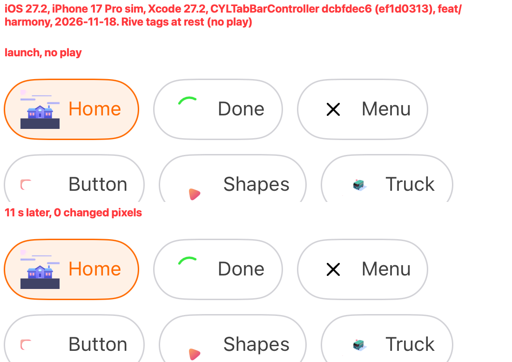

# 截图规范 / Screenshot guidelines

<!-- bound-classes: none -->
<!-- binding:start -->
<!-- Generated by scripts/update-docs-navigation.py; do not edit by hand. -->

| 中文 | English |
|:---|:---|
| 本文档不绑定代码类。 | This document is not bound to a code class. |

<!-- binding:end -->

## [CN]目录
## [EN]Contents

<!-- navigation:start -->
<!-- Generated by scripts/update-docs-navigation.py; do not edit by hand. -->

| 中文 | English |
|:---|:---|
| [用途](#cn用途) | [Purpose](#enpurpose) |
| [任务记录](#cn任务记录) | [Task log](#entask-log) |
| [拍摄](#cn拍摄) | [Capture](#encapture) |
| [排版](#cn排版) | [Layout](#enlayout) |
| [页眉、说明与页脚](#cn页眉说明与页脚) | [Header, captions and footer](#enheader-captions-and-footer) |
| [参考示例](#cn参考示例) | [Reference example](#enreference-example) |
| [工具](#cn工具) | [Tool](#entool) |

<!-- navigation:end -->

## [CN]用途
## [EN]Purpose

| 中文 | English |
|:---|:---|
| 本节按用户要求使用英文（见右列）。 | The single, complete rule set for every screenshot of this repository (iOS, Android, React Native, Flutter, HarmonyOS, WeChat Mini Program; CI and local runs; `docs/` and `README.md`). `AGENTS.md`, `docs/instructions.md`, `instructions.md` and the skills `cyl-docs` and `cyl-verify` summarize it and point here; when they differ, this document wins, and the other copy is fixed in the same change. Rules are written in English. |

## [CN]任务记录
## [EN]Task log

| 中文 | English |
|:---|:---|
| 本条按用户要求使用英文（见右列）。 | DONE (2026-11-18, branch `feat/cross-platform-components`): **screenshot rules: portrait layout, two columns, header and footer with the key facts**. User prompt, verbatim: "找到本项目instructions 相关文件以及skills相关文件，如果没有就新增文件保证写入成功，全英文写入：找到截图相关规范，如果没有就新建保证写入成功，截图除了 优先选用竖版排列风格。优先两列，多行。且给拼接好的图增加header，footer，header，footer不能与截图区域重叠 覆盖，标注关键信息：关键信息也是英文，测试模拟器平台，模拟器系统版本，操作系统版本，ide 版本，以及测试目的等等。以附带的截图为例。提取截图的附带信息以及风格 完善我的描述规则。" English: find this project's instruction files and skill files (create them when missing, and make sure the write succeeds), write in English only: find the screenshot rules (create them when missing); besides a portrait (vertical) composition, prefer two columns with several rows; add a header and a footer to every stitched image, which must not overlap or cover the screenshots; label the key facts in English: the platform of the test simulator, the simulator's OS version, the host operating system version, the IDE version, the purpose of the test, and so on; take the attached screenshot as the example, and extract its information and style to complete the rules. Result: this document; the summaries in `AGENTS.md`, `docs/instructions.md`, the new repository `instructions.md` and the skills `cyl-docs` and `cyl-verify`; the helper `scripts/stitch-screenshots.py`; the reference example `assets/screenshot-guidelines-reference-example.png`. |

## [CN]拍摄
## [EN]Capture

| 中文 | English |
|:---|:---|
| 本节按用户要求使用英文（见右列）。 | **Originals only**: never scale down or recompress a screenshot; a crop that keeps the original resolution is allowed. Every cell of one image is cropped to the same region and width (for example only the tab bar, or only the icon row), so the same element sits at the same place in every cell. |
| 本节按用户要求使用英文（见右列）。 | **Real runs only**: a screenshot comes from a simulator, an emulator, a device or WeChat DevTools running this repository's code. Never present a mock-up or a diagram as a screenshot. If a change could not be run, say so in the document instead. |
| 本节按用户要求使用英文（见右列）。 | **Animations**: `simctl` and `hdc` screenshots take seconds each and miss short animations; record a video (`xcrun simctl io <udid> recordVideo`, `hdc shell snapshot_display` in a loop, `adb shell screenrecord`) and extract frames with ffmpeg at a stated rate. State how a result was measured (identical files, changed pixel count, MD5, frame difference). |
| 本节按用户要求使用英文（见右列）。 | **Debug options**: an image taken with a debug build option on (for example `CYL_BADGE_ANIMATION_DISABLED`) says so in its header. |
| 本节按用户要求使用英文（见右列）。 | **When**: at key moments: a TODO or Linux note can be removed, a pull request can be merged, a result is judged as expected with no open issue, and before and after every bug fix (the bug first, as `AGENTS.md` requires). |

## [CN]排版
## [EN]Layout

| 中文 | English |
|:---|:---|
| 本节按用户要求使用英文（见右列）。 | **Portrait first**: the finished, stitched image is portrait (taller than wide, or square at most), because it is read on phones. `scripts/stitch-screenshots.py` warns when the result is landscape. |
| 本节按用户要求使用英文（见右列）。 | **Two columns, several rows, by default**: cells read left to right, then top to bottom (row 1: cells 1 and 2; row 2: cells 3 and 4). A pair to compare (before / after, light / dark, off / on) goes side by side in one row, in that order. |
| 本节按用户要求使用英文（见右列）。 | **One column** when each cell is already wider than tall (a tab bar strip, a row of icons, as in the reference example): two such cells side by side would make the image landscape, so stack them top to bottom, the same element lined up vertically. |
| 本节按用户要求使用英文（见右列）。 | **Grids stay grids**: a matrix (styles × libraries, platforms × states) keeps its rows and columns, labeled on both axes. **A single horizontal row** is the last resort, at most three cells. |
| 本节按用户要求使用英文（见右列）。 | **README**: cropped key details, a full screen only when needed; several details go into one stitched image built by these rules. |

## [CN]页眉、说明与页脚
## [EN]Header, captions and footer

| 中文 | English |
|:---|:---|
| 本节按用户要求使用英文（见右列）。 | **Every stitched image has a header band at the top and a footer band at the bottom, and a caption band above each cell.** The bands are added to the canvas around the screenshots (padding), never drawn over them: no text, mark or arrow may overlap or cover a screenshot's pixels. Keep at least the cell gap (16 px by default) between a band and a screenshot. A single, uncombined screenshot gets the same header and footer when it is committed. |
| 本节按用户要求使用英文（见右列）。 | **Header: where and why.** In this order, comma-separated, English only: (1) platform and its OS version (`iOS 27.2`, `Android 15 (API 35)`, `HarmonyOS 6.0.1 (API 21)`, `WeChat base library 3.x`); (2) the simulator, emulator or device, with its model (`iPhone 17 Pro simulator`, `sdk_gphone64_arm64 emulator`, `Mate 70 Pro emulator (arm64)`, `WeChat DevTools`); (3) the host operating system and its version (`macOS 27.3`, `Windows 11 24H2`); (4) the IDE and its version, with the build when known (`Xcode 27.2 (27B52)`, `DevEco Studio 6.0`, `Android Studio 2025.2`, `WeChat DevTools 2.01`); (5) the SDK when it is not implied by the IDE (`Flutter 3.x`, `React Native 0.8x`); (6) the app or example and the repository with its commit, plus the commit of the change in parentheses when they differ (`CYLTabBarController dcbfdec6 (ef1d0313)`); (7) the branch; (8) the date, `YYYY-MM-DD` (time and time zone when the time matters); then, after a full stop, (9) **the purpose**: what the image is meant to show (`Purpose: Rive tags rest until played`). |
| 本节按用户要求使用英文（见右列）。 | **Captions: what each cell is.** The state, the step or the time, and its measurement, short and lower case: `launch, no play`; `11 s later, 0 changed pixels`; `after tapping Search`; `Loop on, frame 3 of 6`. |
| 本节按用户要求使用英文（见右列）。 | **Footer: what it proves.** The result against the expectation and the method: `Result: 0 changed pixels in all six icons over 11 s (expected: still until played). Method: pixel diff of two simulator screenshots.` Add the test or script that produced it and the related document or issue when there is one (`Test: CYLRiveLoopTest; docs/Animated-Item.md`). A failed check says so plainly (`Result: FAILED, Menu does not move after the first play`). |
| 本节按用户要求使用英文（见右列）。 | **Style** (taken from the reference example): white bands; bold sans-serif text (`Arial Bold` / SF bold); red text (`#FF3B30`), left aligned, with a margin; the header may wrap to several lines, captions stay on one line; the text size is about 2 % of the image width and never under 28 px for @3x screenshots, so it stays readable when the image is shown at phone width. The same style in light and dark screenshots. |
| 本节按用户要求使用英文（见右列）。 | **The document repeats the header** as the image's label in `docs/` and `README.md` (platform, environment, SDK, commit with its link, time), as `AGENTS.md` requires, so the facts are searchable as text too. |

## [CN]参考示例
## [EN]Reference example

| 中文 | English |
|:---|:---|
| 本节按用户要求使用英文（见右列）。 | The image below (from the CollectionViewClassifyMenu session's iOS Rive check, 2026-11-18) is the style reference. What it does well: the header line `iOS 27.2, iPhone 17 Pro sim, Xcode 27.2, CYLTabBarController dcbfdec6 (ef1d0313), feat/harmony, 2026-11-18. Rive tags at rest (no play)` gives the platform version, simulator, IDE, repository commit with the change's commit, branch, date and purpose; each section has its caption above it (`launch, no play`; `11 s later, 0 changed pixels`) with the measurement in the caption; the text sits in white space above the crops and never covers them; the crops have the same region and width, stacked in one column because each crop is wider than tall. What these rules add: the host OS (`macOS 27.3`), the word `Purpose:`, a footer with the result and the method, and a portrait canvas (this example is 1100 × 778, slightly landscape; one more stacked section, or cropping each section to the tag rows, keeps it portrait). |

## [CN]工具
## [EN]Tool

| 中文 | English |
|:---|:---|
| 本节按用户要求使用英文（见右列）。 | `scripts/stitch-screenshots.py` builds an image that follows these rules with ffmpeg only (no Python packages): a header band, the cells in a grid (`--columns 2` by default, `--columns 1` for wide cells) with a caption band above each, and a footer band; screenshots keep their pixels; it prints the size and warns when the result is landscape. Example: `python3 scripts/stitch-screenshots.py --out docs/assets/ios-rive-rest.png --columns 1 --header "iOS 27.2, iPhone 17 Pro simulator, macOS 27.3, Xcode 27.2 (27B52), CYLTabBarController dcbfdec6 (ef1d0313), feat/cross-platform-components, 2026-11-18. Purpose: Rive tags rest until played" --footer "Result: 0 changed pixels over 11 s (expected: still until played). Method: pixel diff of two simulator screenshots." "launch, no play=/tmp/a.png" "11 s later, 0 changed pixels=/tmp/b.png"`. Run it with bash or from Python, not with zsh word splitting (`AGENTS.md`, "Commands"). Checked 2026-11-18 on macOS 27.3 with ffmpeg 7 (four Example-Rive tab bar crops, two columns): the bands sit above and below the cells and never overlap them. |
