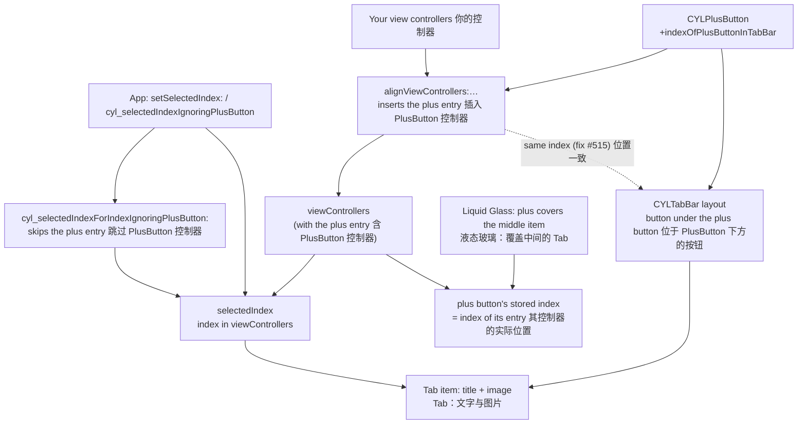

# [CN]selectedIndex 与 PlusButton：选中的文字与图片一致
# [EN]selectedIndex and the PlusButton: the selected title and image match

<!-- bound-classes: CYLTabBarController, CYLTabBar, CYLPlusButton -->
<!-- binding:start -->
<!-- Generated by scripts/update-docs-navigation.py; do not edit by hand. -->

| 中文 | English |
|:---|:---|
| 绑定的代码类 `CYLTabBarController`：[`CYLTabBarController/CYLTabBarController.h`](../CYLTabBarController/CYLTabBarController.h) | Bound to the class `CYLTabBarController`: [`CYLTabBarController/CYLTabBarController.h`](../CYLTabBarController/CYLTabBarController.h) |
| 绑定的代码类 `CYLTabBar`：[`CYLTabBarController/CYLTabBar.h`](../CYLTabBarController/CYLTabBar.h) | Bound to the class `CYLTabBar`: [`CYLTabBarController/CYLTabBar.h`](../CYLTabBarController/CYLTabBar.h) |
| 绑定的代码类 `CYLPlusButton`：[`CYLTabBarController/CYLPlusButton.h`](../CYLTabBarController/CYLPlusButton.h) | Bound to the class `CYLPlusButton`: [`CYLTabBarController/CYLPlusButton.h`](../CYLTabBarController/CYLPlusButton.h) |

<!-- binding:end -->

| 中文 | English |
|:---|:---|
| 解决 [#515](https://github.com/ChenYilong/CYLTabBarController/issues/515) 与 [#441](https://github.com/ChenYilong/CYLTabBarController/issues/441)。#515：使用自定义 PlusButton 时，调用 `setSelectedIndex:` 设置初始 Tab，选中的是该 Tab 的文字，图片却是右边相邻 Tab 的。原因是 PlusButton 的控制器（子控制器或占位控制器）没有放在 PlusButton 所在的位置。现在二者位置一致；同时新增按“不含 PlusButton 的下标”选中 Tab 的 API，在所有样式下都选中同一个 Tab。#441：`setSelectedIndex:` 看起来无效，见下文「占位控制器的下标」。 | Solves [#515](https://github.com/ChenYilong/CYLTabBarController/issues/515) and [#441](https://github.com/ChenYilong/CYLTabBarController/issues/441). #515: with a custom PlusButton, calling `setSelectedIndex:` to set the first tab selected that tab's title but the image of its right neighbour. The plus button's view controller (its child view controller or a placeholder) was not at the plus button's position. Now they match, and a new API selects a tab by its index without the plus button, which names the same tab in every style. #441: `setSelectedIndex:` seemed to do nothing; see "The placeholder's index" below. |

## [CN]目录
## [EN]Contents

<!-- navigation:start -->
<!-- Generated by scripts/update-docs-navigation.py; do not edit by hand. -->

| 中文 | English |
|:---|:---|
| [原因](#cn原因) | [Cause](#encause) |
| [修复](#cn修复) | [Fix](#enfix) |
| [占位控制器的下标（#441）](#cn占位控制器的下标441) | [The placeholder's index (#441)](#enthe-placeholders-index-441) |
| [新 API：不含 PlusButton 的下标](#cn新-api不含-plusbutton-的下标) | [New API: the index without the plus button](#ennew-api-the-index-without-the-plus-button) |
| [各项关系图](#cn各项关系图) | [How the pieces relate](#enhow-the-pieces-relate) |
| [演示](#cn演示) | [Demo](#endemo) |
| [测试与截图](#cn测试与截图) | [Testing and screenshots](#entesting-and-screenshots) |

<!-- navigation:end -->

## [CN]原因
## [EN]Cause

| 中文 | English |
|:---|:---|
| 有 PlusButton 子控制器时（以及液态玻璃、扁平样式中没有子控制器时的占位控制器），`viewControllers` 中会多出一个 PlusButton 对应的控制器。以前它总是被插在正中间（`count / 2`）。 | With a plus child view controller (and, in Liquid Glass and FlatDesign, a placeholder for a plus button without one), `viewControllers` holds one more entry for the plus button. It used to be inserted in the middle (`count / 2`). |
| 经典样式中，PlusButton 绘制在 `+indexOfPlusButtonInTabBar` 返回的位置，位于该位置的系统 Tab 按钮被放在 PlusButton 下方。当自定义位置不是正中间时，两个位置之间的 Tab 都错开一位：系统按位置选中了文字，PlusButton 下方与相邻按钮的图片却对应另一个控制器。 | In the classic style the plus button is drawn at the position `+indexOfPlusButtonInTabBar` returns, and the system tab button at that position is laid out under it. When that position is not the middle, every tab between the two positions was off by one: the title was selected at one position, the image belonged to another view controller. |
| 液态玻璃中 PlusButton 覆盖中间的 TabBarItem，但记录在 PlusButton 上的下标（用于选中其子控制器）仍取自定义位置，同样不一致。 | In Liquid Glass the plus button covers the middle tab item, but the index stored on the plus button (used to select its child view controller) was the custom position, again a mismatch. |

## [CN]修复
## [EN]Fix

| 中文 | English |
|:---|:---|
| 经典样式：PlusButton 的控制器插在 PlusButton 自己的位置（`+indexForTabbarItemsCount:`，即 `+indexOfPlusButtonInTabBar` 或中间），位于最后一个 Tab 之后的 PlusButton 也能正确插入末尾。 | Classic style: the plus button's view controller goes at the plus button's own position (`+indexForTabbarItemsCount:`, i.e. `+indexOfPlusButtonInTabBar` or the middle); a plus button after the last tab is inserted at the end too. |
| 液态玻璃：PlusButton 上记录的下标改为其占位控制器或子控制器在 `viewControllers` 中的实际位置。 | Liquid Glass: the index stored on the plus button is now the actual position of its placeholder or child view controller in `viewControllers`. |
| 扁平样式原本已使用 PlusButton 自己的位置，不受影响。没有自定义位置（PlusButton 在正中间）的 App 行为不变。 | FlatDesign already used the plus button's own position and is not affected. Apps whose plus button is in the middle (no custom position) behave as before. |
| `-reloadTabBarItemsWithAttributes:` 移除 PlusButton 子控制器时改为按对象移除；以前按 PlusButton 的位置移除，自定义位置时会移除其他 Tab。 | `-reloadTabBarItemsWithAttributes:` now removes the plus child view controller itself; it used to remove the entry at the plus button's position, another tab with a custom position. |

## [CN]占位控制器的下标（#441）
## [EN]The placeholder's index (#441)

| 中文 | English |
|:---|:---|
| 液态玻璃与扁平样式中，没有子控制器的 PlusButton 在 `viewControllers` 中有一个占位控制器。以前 `setSelectedIndex:` 传入它的下标时，会选中这个空白占位页或中途返回，看起来调用没有生效。现在该下标被忽略（不切换 Tab），DEBUG 下会在控制台提示改用 `cyl_selectedIndexIgnoringPlusButton`。其他下标的行为不变。 | In Liquid Glass and FlatDesign, a plus button without a child view controller has a placeholder in `viewControllers`. `setSelectedIndex:` with its index used to select that empty placeholder page or return halfway, so the call seemed to do nothing. That index is now ignored (the tab does not change), and in DEBUG the console suggests `cyl_selectedIndexIgnoringPlusButton`. Other indexes behave as before. |
| 如果 `setSelectedIndex:` 仍然没有效果，请检查：调用时 `viewControllers` 是否已经设置；下标是否小于 `viewControllers.count`；是否在扁平样式中于 `-viewDidLoad` 之前设置了 `tabBarStyleType`。 | If `setSelectedIndex:` still has no effect, check that `viewControllers` is set when you call it, that the index is below `viewControllers.count`, and, for FlatDesign, that `tabBarStyleType` is set before `-viewDidLoad`. |

## [CN]新 API：不含 PlusButton 的下标
## [EN]New API: the index without the plus button

| 中文 | English |
|:---|:---|
| `selectedIndex` 按 `viewControllers` 计数，会计入 PlusButton 的子控制器或占位控制器；而占位控制器只在液态玻璃与扁平样式中存在，因此同一个下标在不同样式下可能对应不同的 Tab。新 API 使用你传入的控制器数组中的下标，在所有样式下选中同一个 Tab。原有的 `selectedIndex` 保持不变。 | `selectedIndex` counts `viewControllers`, including the plus button's child view controller or placeholder; the placeholder only exists in Liquid Glass and FlatDesign, so one index can name different tabs in different styles. The new API uses the index in the view controllers you passed in, and selects the same tab in every style. `selectedIndex` itself is unchanged. |

| API | 说明 |
|:---|:---|
| `cyl_viewControllersIgnoringPlusButton` | 不含 PlusButton 子控制器与占位控制器的控制器数组 |
| `cyl_selectedIndexIgnoringPlusButton`（可读写） | 在上述数组中的选中下标；选中 PlusButton 子控制器时为 NSNotFound；设置时与 `selectedIndex` 一样选中 |
| `-cyl_selectedIndexForIndexIgnoringPlusButton:` | 把不含 PlusButton 的下标换算成 `selectedIndex` |

| API | What it does |
|:---|:---|
| `cyl_viewControllersIgnoringPlusButton` | The view controllers without the plus button's child view controller or placeholder |
| `cyl_selectedIndexIgnoringPlusButton` (read-write) | The selected index in that array; NSNotFound while the plus child view controller is selected; setting it selects like `selectedIndex` |
| `-cyl_selectedIndexForIndexIgnoringPlusButton:` | Converts an index without the plus button into a `selectedIndex` |

```objc
// The initial tab: your third view controller, in every style. 初始 Tab：你的第三个控制器，所有样式下一致。
tabBarController.cyl_selectedIndexIgnoringPlusButton = 2;
```

```swift
tabBarController.cyl_selectedIndexIgnoringPlusButton = 2
```

## [CN]各项关系图
## [EN]How the pieces relate



## [CN]演示
## [EN]Demo

| 中文 | English |
|:---|:---|
| ObjC Demo（`Example`）列表顶部的设置分组新增「selectedIndex 与 PlusButton（issue #515）」行：每次点击通过 `cyl_selectedIndexIgnoringPlusButton` 选中下一个 Tab，并同时显示不含 PlusButton 的下标、`selectedIndex` 与当前 Tab 的标题，可以直接看到两种下标的差别（Demo 的 PlusButton 位于中间并带有子控制器）。 | The settings section of the ObjC demo (`Example`) has a new row, "selectedIndex and the PlusButton (issue #515)": each tap selects the next tab with `cyl_selectedIndexIgnoringPlusButton` and shows the index without the plus button, `selectedIndex` and the selected tab's title, so the difference between the two indexes is visible (the demo's plus button is in the middle and has a child view controller). |

## [CN]测试与截图
## [EN]Testing and screenshots

| 中文 | English |
|:---|:---|
| 本次修改在没有 Xcode 与 iOS 模拟器的环境（Linux）中完成，无法编译运行，因此暂无测试截图。已通过 `pod lib lint --quick`、对修改代码的 clang 语法检查（使用模拟的 UIKit 头文件）以及代码检查。建议在设备上用 `+indexOfPlusButtonInTabBar` 不在中间的 PlusButton（例如 4 个 Tab、位置 1）验证：调用 `setSelectedIndex:` 后，选中的文字与图片属于同一个 Tab。 | This change was made in an environment without Xcode or an iOS simulator (Linux), so it could not be built or run, and there are no test screenshots. It was checked with `pod lib lint --quick`, a clang syntax check of the changed code (against stand-in UIKit headers) and code review. Check it on a device with a plus button whose `+indexOfPlusButtonInTabBar` is not the middle (e.g. 4 tabs, position 1): after `setSelectedIndex:`, the selected title and image belong to the same tab. |
