# [CN]iOS 核心层迁移到 Swift
# [EN]Migrating the iOS core layer to Swift

<!-- bound-classes: none -->
<!-- binding:start -->
<!-- Generated by scripts/update-docs-navigation.py; do not edit by hand. -->

| 中文 | English |
|:---|:---|
| 本文档不绑定代码类。 | This document is not bound to a code class. |

<!-- binding:end -->

## [CN]目录
## [EN]Contents

<!-- navigation:start -->
<!-- Generated by scripts/update-docs-navigation.py; do not edit by hand. -->

| 中文 | English |
|:---|:---|
| [任务](#cn任务) | [Task](#entask) |
| [评分](#cn评分) | [Score](#enscore) |
| [方案](#cn方案) | [Plan](#enplan) |
| [进度](#cn进度) | [Progress](#enprogress) |

<!-- navigation:end -->

## [CN]任务
## [EN]Task

| 中文 | English |
|:---|:---|
| 本文按用户要求使用英文（见右列）。 | TODO (2026-11-12, Swift migration of the iOS core layer): user prompt, verbatim: "将下面的任务找一个合适的文档，标注 TODO：全英文写入：注意本操作仅仅设计iOS端，重点修改 本项目的Core核心层面代码。 不涉及第三方库，首先创建swift编码规范文档，更新instructions和skills相关文档。如果网络有现成的swift skills请直接复制安装到本项目中，按照swift编码规范以及swift相关skilla，将Core 核心层面代码全部转录为Swift代码，如果无必要不要修改example层代码。在该文档中记录swift翻译进度。以项目中不存在objc代码为准，如果无法翻译为swift以宏定义 关键字形式 进行兼容swift的也可以算作翻译成功。不存在objc代码为满分，每提交一次就打一次分。每提交一次检查是否满分。一直到满分为止。" |
| | Requirements: iOS only. Translate the core layer (the `Core` subspec, its dependencies `CYLUtils` and `CYLBadgeView`, and the FlatDesign tab bar `CYLFlatDesignTabBar`) from Objective-C to Swift; third-party libraries and their adapters (Lottie, PAG, Rive, GIF) are out of scope. First write the Swift coding standard ([Swift-Coding-Style.md](Swift-Coding-Style.md)) and update the instructions and skills. Install ready-made Swift skills when they exist. Leave the example layer alone unless a change is needed. Record the progress here. Full marks (100) means no Objective-C code is left in the core layer; what cannot be written in Swift and stays as macros or keywords for Swift compatibility counts as translated. Score every commit and check for full marks; continue until 100. |

## [CN]评分
## [EN]Score

| 中文 | English |
|:---|:---|
| 见右列。 | `python3 scripts/swift-migration-score.py` prints the score and the files still in Objective-C. Every `.m` line counts; a `.h` file counts unless it only holds preprocessor lines, comments and Swift compatibility markers. Score = 100 × (1 − remaining / 59 391), rounded down. Every commit of this migration puts the score in its body and adds a row to "Progress". |

## [CN]方案
## [EN]Plan

| 中文 | English |
|:---|:---|
| 见右列。 | **Bottom-up, file by file.** Swift Package Manager cannot mix Swift and Objective-C in one target, so the translated Swift code is a lower layer that the remaining Objective-C imports: a file is translated only after everything it calls is Swift (or is a system API). CocoaPods and the Xcode framework target build one mixed module meanwhile. |
| | **Same API for Objective-C callers.** Every public class, category method, constant and notification keeps its Objective-C name through `@objc(name)`, so the Objective-C example and existing apps keep compiling; Swift names follow the Swift API Design Guidelines where the old `NS_SWIFT_NAME` already gave one. |
| | **Order.** ① Leaves of `CYLUtils` (helpers, localization, resource routes) → ② `CYLBadgeView` → ③ the root categories (`UIView`, `UIImage`, `UIColor`, `UIControl`, `UITabBarItem`, `NSObject` extensions) → ④ `CYLConstants`, `CYLLocalization`, the configuration parser and manifest → ⑤ `CYLPlusButton`, `CYLTabBar` → ⑥ `CYLTabBarController` and its categories → ⑦ the base and demo-section view controllers. |
| | **Dependency map (2026-11-12, `scripts/swift-migration-deps.py`)**: the remaining Objective-C files, grouped by the `#import`s that tie them together. (1) Independent leaves, movable now: `CYLTabBarTransition` and the two FlatDesign transition helpers (moved in step 9). (2) Leaves blocked by the enum/protocol rule: `CYLTabButtonAnimation` (803 lines; its protocol is used by public headers), `CYLTabBarItemAnimationService` (224; its protocols are used by other headers), `CYLTabBarConfigurationParser` (2 790; its enums), and the remaining headers of `CYLUtils` (`CYLLocalizedString.h`, `CYLUtilsMacros.h`) and of the theme (`__kindof` blocks). (3) **One cycle of 41 files, 44 669 lines**: `CYLTabBarController` and its categories, `CYLTabBar`, `CYLPlusButton`, `CYLConstants`, the FlatDesign tab bar, the badge categories, the base view controllers and the demo-section categories all import each other. SwiftPM's Swift target sits below the Objective-C target, so translated Swift code cannot call Objective-C: inside this cycle, no file can move alone without breaking the SwiftPM build. **Decision (maintainer, 2026-11-12): seams first, every commit green.** The cycle is cut with seams so that every commit still builds with CocoaPods, the Xcode framework and SwiftPM: when a Swift file needs an Objective-C class that is still in the cycle, the Swift layer declares an `@objc` protocol with just the members it needs, and the Objective-C class adopts it in its `.m` (a class extension, so no public header names the Swift protocol); a call that has no protocol yet goes by selector. Each seam is removed when its Objective-C side moves to Swift. First candidates (they import only one other cycle file, mostly the umbrella header, so few seams are needed): `UIColor+CYLTabBarControllerExtention` (820 lines), `UIImage+CYLTabBarControllerExtention` (980), `CYLLocalization` (269), `UIViewController+CYLMemoryWarning` (135), `CYLBaseViewController` / `CYLBaseTableViewController` (72 / 71), `CYLTabBarManifest` (884), `CYLTabBarPageRegistry` (995), `CYLTabBarHostView` (1 021); each is checked for the symbols it really uses before it moves. |
| | **Endgame confirmed (decision by the maintainer, 2026-11-19): open Swift classes, one Swift target.** Answer to the question "line 95 (open Swift classes) or line 53 (thin Objective-C shells)?": "Open Swift classes". So the line-95 plan applies to `feat/cross-platform-components` and replaces the shell rule below: `CYLTabBarController`, `CYLPlusButton`, `CYLBaseNavigationController`, `CYLBaseViewController`, `CYLBaseTableViewController` and `CYLTabButtonBlockAnimation` become `open` Swift classes; Objective-C apps subclass them in Swift (release notes and a migration guide, TODO); the repository's Objective-C subclasses are ported to Swift in the same step; `Package.swift` becomes one Swift target and the three SwiftPM demos turn green. Order: ① categories and helpers (extensions of the Objective-C class, as now), ② the subclassable classes with their Objective-C subclasses (the ivars become Swift stored properties; the sections that use ivars move then), ③ protocols, enums, block types and `CYLTabBarController.h` at once. Shells made under the old rule (step 102, `CYLBaseNavigationController`) are temporary. |
| | **Checklist for the `CYLTabBarController` class switch (phase 2, 2026-11-19).** (1) No Objective-C subclass is left in the repository (the examples' `MainTabBarController` and `CYLFlatDesignMainTabBarController` are Swift since steps 110 and 111, the test subclass since step 108); **CrossPlatform checked (2026-11-19, winCYLTabBarController 鸿蒙开发)**: its Objective-C classes (React Native `CyltabbarView` / `CyltabbarAnimationView` : `RCTViewComponentView`, Flutter `CYLFlutterTabBarView` / `CYLFlutterAnimationView` : `NSObject`, `CYLFlutterAnimationContainerView` : `UIView`) only use `CYLTabBarHostView` by composition; no `@interface … : CYLTabBarController / CYLPlusButton / CYLBase(Table|Navigation)ViewController / CYLTabBar / CYLFlatDesignTabBar` anywhere in the repository (Pods excluded). For the last step (no `CYLTabBarController.h`, one SwiftPM target): `CrossPlatform/react-native-cyltabbar/ios/CyltabbarView.mm`, `CyltabbarAnimationView.mm` and `CrossPlatform/flutter_cyltabbar/ios/.../FlutterCyltabbarPlugin.m` still `#import <CYLTabBarController/CYLTabBarController.h>` and must switch to `@import CYLTabBarController;` / the `-Swift.h` header then). (2) Initializers: `init(configuration:)` is the one designated initializer (plus `init?(coder:)`); `initWithViewControllers:tabBarItemsAttributes:…`, `initWithContext:`, the class factories and `init(nibName:bundle:)` become convenience initializers ending in `self.init(configuration:)`, so a subclass overriding `init(configuration:)` inherits them. (3) These members are overridden by the Swift subclasses and must stay `open` with the same Swift names (some are Swift extension methods today under `cyl…` names with the Objective-C selector; at the switch they become members named as below): `tabBarController(_:shouldSelect:)`, `tabBarController(_:didSelect control:)`, `tabBarController(_:shouldShowPlatterLiquidLensViewFor:)`, `shouldUnloadView(of:)`, `tabBarItemAnimationViewContentMode()`, `tabBarController(_:requiresLoginToSelect:)`, `tabBarController(_:presentLoginFor:completion:)`, `tabBarController(_:didRecognize:control:viewController:)`, `tabBar(_:didSelect item:)`, the property `tabBarItemAnimationSpeed`, `init(configuration:)` and `init(nibName:bundle:)`. (4) Swift cannot override members UIKit declares in a Swift extension (`configuration`) or methods declared twice above the class (`cyl_clearBadge`): those go through `class_addMethod` with explicit super IMPs (step 109). (5) `type(of:)` skips runtime subclasses (KVO): read classes with `object_getClass`. |
| | **Subclassable classes (decision by the maintainer, 2026-11-13, final): thin Objective-C shell, Swift engine.** Swift classes are exported with `objc_subclassing_restricted`, so Objective-C code cannot subclass a Swift class. Every public class that Objective-C apps or this repository subclass keeps an Objective-C class with the same name, superclass and API (the shell): its methods only forward to a Swift implementation (the engine, a Swift object the shell owns or Swift functions taking the shell), so Objective-C and Swift subclasses keep working. Classes concerned: `CYLPlusButton`, `CYLTabBarController`, `CYLBaseNavigationController`, `CYLBaseViewController`, `CYLBaseTableViewController`, `CYLTabButtonBlockAnimation` (and any other class found subclassed later). A shell file starts with the marker comment `CYL-SWIFT-MIGRATION: objc-shell` and the reason; `scripts/swift-migration-score.py` counts a marked file as compatibility code (like macro-only headers) and lists the shells with their size, so a shell that holds logic is visible. `CYLTabBarBadgeView` stays a Swift class (the maintainer's choice): Objective-C apps can no longer subclass it, a compatibility change to note in the release notes. (An earlier answer on 2026-11-13 chose to translate these classes to Swift outright; the maintainer replaced it with this one.) |
| | **The core moves on its own branch (decision by the maintainer, 2026-11-13).** Seams reached their limit after step 16: the 41 core files (~45 000 lines) adopt or expose each other's Objective-C protocols, enums and block types declared in public headers (for example `CYLTabBarHostView` adopts `CYLTabBarControllerDelegate` from `CYLTabBarController.h`), and SwiftPM's lower Swift target cannot see them, so no core file can move alone while SwiftPM stays green. The core therefore moves in large steps on the branch `swift-core` (its own pull request, based on `feat/cross-platform-components`): CocoaPods, the Xcode framework, the unit tests and the demos build at every commit there; only the SwiftPM build fails until the whole core is Swift, when `Package.swift` becomes one Swift target. `feat/cross-platform-components` (PR #788) stays green. The seams and shells rules above still apply where they help. |
| | **Types used by Objective-C headers move last.** Swift reads the public Objective-C headers without the generated Swift interface, so an Objective-C header that is still Objective-C cannot use an enum or a protocol defined in Swift (a class is fine: `@class` forward declarations resolve to the Swift class). An enum or protocol (e.g. `CYLBadgeStyle`, `CYLBadgeAnimationType`, `CYLBadgeProtocol`) moves to Swift only together with, or after, every public header that uses it; until then, Swift code that needs it is written after those headers move (learned in step 8). |
| | **Kept as compatibility.** C macros and `static inline` helpers that Objective-C callers use (e.g. `CYLExternPlusButton`, `CYL_IS_IOS_26`) stay in headers when Swift cannot replace them for those callers; such headers hold only preprocessor lines and count as translated. |
| | **Each step**: translate, clean build of the library and the Objective-C example, all unit tests (iOS 26 and iOS 17.5), commit with the score, update "Progress". |
| | **Skills used**: `swift-language`, `swift-api-design-guidelines`, `swift-concurrency`, `swift-testing`, `migration-patterns` (its `objc-to-swift.md`). Searched online on 2026-11-12: `convert-objc-swift` (aRustyDev) is AGPL-3.0, which this MIT project cannot vendor, so it is not installed. |
| | **Risks**: the public headers are the API of an Objective-C library used by many apps: renamed selectors break them, so names are kept; Swift needs the `swift_versions` of the podspec and a Swift-capable build in Carthage and SPM; the generated `CYLTabBarController-Swift.h` replaces hand-written headers for translated classes. |

## [CN]进度
## [EN]Progress

| 中文 | English |
|:---|:---|
| 见右列。 | 2026-11-12: baseline 55 876 Objective-C lines in 124 files; score **0 / 100**. Coding standard, instructions, skills and the scoring script are in place; no file is translated yet. |
| | 2026-11-12, step 1: `CYLUtils/UIViewController+CYLUtils` → `CYLUtils/Swift/UIViewController+CYLUtils.swift` (the `.m` is gone; the header keeps the Objective-C declaration behind `#ifndef __swift__`). Build plumbing for every later step: the podspec takes `.swift` in `CYLUtils`, `Package.swift` has a lower `CYLTabBarControllerSwift` target (SwiftPM cannot mix languages), the Xcode framework target compiles the file. Lesson: keep the Swift name Clang gave the method (`cyl_getViewControllerInsteadOfNavigation()`), see the style guide. Verified: unit tests 129 on iOS 26.1 pass; on iOS 17.5 two failures of one test that also fail without this step (a classic badge bug, TODO in [Update-Tab-Bar-Items-In-Place](Update-Tab-Bar-Items-In-Place.md)); the Objective-C demo (CocoaPods), `Example-Swift` (CocoaPods, local path) and the SwiftPM package build. Score **0 / 100** (55 856 lines left; the score rounds down). |
| | 2026-11-12: scope correction by the maintainer ("FlatDesign subspecs wrap belongs to core code"): `CYLFlatDesignTabBar` (3 499 lines) joins the core layer; the baseline is now 59 391 lines (FlatDesign included), 59 378 left. Score **0 / 100**. |
| | 2026-11-12, step 2: four more `CYLUtils` files to Swift: `NSObject+CYLUtils` (safe KVC now checks that a key resolves, in KVC's own search order, instead of catching an exception, which Swift cannot do; the placeholder flag keeps its selector key), `UIView+CYLUtils`, `UIBarItem+CYLUtils`, `UIView+CYLHitTestOutsideBounds` (the one-time exchange of `-hitTest:withEvent:` in Swift). Headers keep the Objective-C declarations behind `#ifndef __swift__`; the Swift names are the ones Clang gave (checked by type-checking a Swift file against the old headers: only `cyl_nearestControl(below:)` differs from the selector). New `CYLUtilsSwiftTests.m` (5 tests, called from Objective-C through the old headers). Verified: 134 unit tests pass on iOS 26.1 and iOS 17.5; the SwiftPM package, the Objective-C demo and `Example-Swift` build. Swift migration score: 0 / 100 (59230 of 59391 Objective-C lines left). The core grew by the classic badge fix (Objective-C, ~60 lines) before this step, so lines left can exceed the baseline; new core code is written in Swift from now on. |
| | 2026-11-12, step 3: `CYLUtils` (the class) and `CYLLocalizedString` (the library's strings and resource bundle) to Swift. The C functions keep their C names for Objective-C through `@_cdecl`, so the binary interface does not change; `CYLLocalizationLanguageDidChangeNotification` is a macro for Objective-C and a constant for Swift (the macro compatibility the task allows). A translated **class** cannot be declared twice, so `CYLUtils.h` imports the new `CYLSwiftInterface.h` (the generated `CYLTabBarController-Swift.h`, or `@import CYLTabBarControllerSwift` in SwiftPM; never while Swift itself compiles). In SwiftPM the resource bundle moved to the Swift target, the one that reads it. Verified: 134 unit tests on iOS 26.1 and 17.5, `xcodebuild analyze` without warnings in the library, the SwiftPM package, the Objective-C demo and `Example-Swift` build; the demo in Simplified Chinese shows the library's strings (screenshot: iOS · iOS 26.1 simulator, iPhone 17 Pro · Xcode 27.2, iOS SDK 27.2 · macOS 27.3 · branch `feat/cross-platform-components` · 2026-11-12). Swift migration score: 0 / 100 (59035 of 59391 Objective-C lines left). |

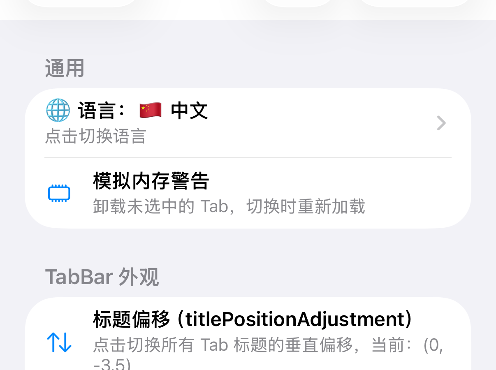

| 中文 | English |
|:---|:---|
| | 2026-11-12, step 4: `CYLResourceRoute` (a class, declared through `CYLSwiftInterface.h`; written with `NSString`'s path methods so routes resolve exactly as before) and `UIImage+CYLUtils` (header-only `CG_INLINE` functions; now Swift functions exported under their C names with `@_cdecl`, the header keeps plain declarations). The existing `CYLResourceRouteTests` caught one difference (a non-string route must give nil, not raise); the Swift method now takes `Any?` and checks the type. Verified: 134 unit tests on iOS 26.1 and 17.5, `xcodebuild analyze` clean, the SwiftPM package, the Objective-C demo and `Example-Swift` build. Swift migration score: 0 / 100 (58808 of 59391 Objective-C lines left). |
| | 2026-11-12, step 5: the theme module (`CYLUtils/CYLComponents/CYLTheme`, 9 Objective-C files) to Swift in one step, since its files call each other: `CYLThemeManager` and `CYLThemeManagerCenter` (classes, declared through `CYLSwiftInterface.h`), the `UIColor` / `UIImage` / `UIVisualEffect` / `UIView` / `CALayer` / `UIViewController` theme extensions (headers keep the Objective-C declarations behind `#ifndef __swift__`), and the private `CYLThemePrivate` helpers (now internal Swift, `CYLThemeRuntime`; the private header is gone). `CYLThemeDidChangeNotification` and `CYLThemeManagerNameDefault` are macros for Objective-C and constants for Swift. The two `-cyl_themeDidChangeByManager:identifier:theme:` hooks are `open dynamic`, so `CYLTabBarController (CYLTheme)` and apps still override them. Swift names are the ones Clang imported (checked by type-checking a probe against the old headers, e.g. `cyl_color(themeProvider:)`, `cyl_raw`). **Compatibility note**: Swift cannot express `__kindof`, so Objective-C now sees theme identifiers and manager names as `id<NSCopying, NSObject>` instead of `__kindof NSObject<NSCopying> *`; assigning one straight to `NSString *` now gives a warning (one call site in the library fixed). Verified: 134 unit tests (including `CYLThemeTests`) on iOS 26.1 and 17.5, `xcodebuild analyze` and the Objective-C demo build without warnings, the SwiftPM package and `Example-Swift` build. No screenshot: a refactor with no visible change, covered by the theme unit tests. Swift migration score: 3 / 100 (57145 of 59391 Objective-C lines left). |
| | 2026-11-12, step 6: seven translated headers no longer repeat the Objective-C declarations: `UIViewController+CYLUtils`, `UIView+CYLUtils`, `NSObject+CYLUtils`, `UIBarItem+CYLUtils`, `UIView+CYLHitTestOutsideBounds`, `UIImage+CYLUtils` (its `@_cdecl` C functions too) and `CALayer+CYLTheme` now import `CYLSwiftInterface.h`, the generated Swift interface, which declares the same categories and functions with their documentation. Not done yet, on purpose: `CYLLocalizedString.h` (its format-string attributes `NS_FORMAT_ARGUMENT` / `CYL_RETURNS_LOCALIZED_STRING` exist only in the hand header) and the theme headers whose blocks or overrides use `__kindof` identifiers (`UIColor` / `UIImage` / `UIVisualEffect` / `UIView` / `UIViewController` theme), whose generated signatures differ; they wait until their Objective-C callers are Swift. **Compatibility note, extended**: like the identifiers (step 5), `currentTheme` and `-themeForIdentifier:` are `NSObject *` for Objective-C now (no `__kindof`), so assigning one to a theme class needs a cast (one test fixed). Verified: 134 unit tests on iOS 26.1 and 17.5, `xcodebuild analyze` and the Objective-C demo build without warnings, the SwiftPM package and `Example-Swift` build. Swift migration score: 4 / 100 (56714 of 59391 Objective-C lines left). |
| | 2026-11-12, step 7: the first two `CYLBadgeView` files to Swift, in `CYLBadgeView/Swift/` (the podspec's badge subspec takes `.swift`; SwiftPM's Swift target builds that folder too): `CYLBadgeAppearance` (the same fallbacks for invalid values; Swift name `CYLBadgeAppearance.global` kept) and `CYLTabBarBadgeView` with its `CYLBadgeTextDisplaying` protocol (`UILabel` conforms in Swift). Both headers keep only `kCYLBadgeDefaultFont` (a macro) and import `CYLSwiftInterface.h`. `CYLTabBarBadgeView` tells its host about window and trait changes through the selector `cyl_notifyBadgeHostOfEnvironmentChange` until `UIView (CYLBadgeExtention)` is Swift too (the lower Swift layer cannot call that Objective-C category directly). Verified: 134 unit tests on iOS 26.1 and 17.5, `xcodebuild analyze` and the Objective-C demo build without warnings, the SwiftPM package and `Example-Swift` build, `pod lib lint --quick` passes; the demo's badges ("8", "1", "99+", "NEW") look as before (screenshot: iOS · iOS 26.1 simulator, iPhone 17 Pro · Xcode 27.2, iOS SDK 27.2 · macOS 27.3 · branch `feat/cross-platform-components` · 2026-11-12 20:27 NZDT). Swift migration score: 5 / 100 (56202 of 59391 Objective-C lines left). |

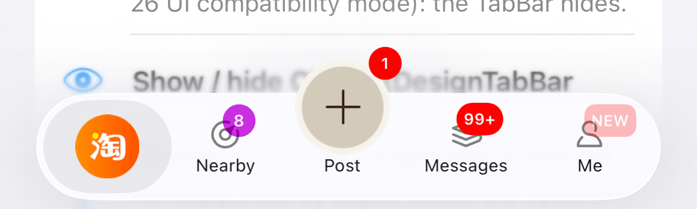
| | 2026-11-12, SonarCloud and CI for PR #788: (1) CI "Check the navigation" failed (`docs/CYLUtils-Helpers.md: bound class CYLUtils is not declared in any header`): `scripts/update-docs-navigation.py` found classes only by `@interface Name :` in headers; it now also finds `@objc(Name)` above `class Name` in Swift files and binds such a class to the header of the same name (which stays for Objective-C callers), else to the Swift file; `--check` passes. (2) SonarCloud's 70 new issues: the real ones fixed (unused parameters named `_`, an empty closure explained, a nested ternary unrolled, the empty bundle token class replaced by `Bundle(for: CYLUtils.self)`), private helpers and the Swift-side names of `@_cdecl` entry points renamed to lowerCamelCase (`cylImageNamedEntryPoint`, `applyThemeChange(by:…)`), and the names that must stay for compatibility (`cyl_` members, `CYL` C functions and constants) marked `// NOSONAR: kept API name`, the rule now in [Swift-Coding-Style.md](Swift-Coding-Style.md). Verified: 134 unit tests on iOS 26.1 and 17.5, the SwiftPM package and the Objective-C demo build. TODO: many lines of the translated Swift files are longer than the style guide's 120 characters; rewrap them in a formatting-only commit. |
| | 2026-11-12, SonarCloud follow-up for PR #788: after the re-analysis 46 issues were left: 45 naming findings (`swift:S100` / `S115`) on names kept for compatibility, which `// NOSONAR` does not silence (SonarCloud's Swift analyzer has no NOSONAR support), and one new `python:S5852` (a backtracking-prone regex in `update-docs-navigation.py`). The regex is replaced by a line-by-line parse (`swift_class_names`), the ineffective NOSONAR markers are removed, and the style guide says how kept names are handled. TODO (maintainer): mark the 45 naming findings **Accept** in SonarCloud (Issues → filter rule `swift:S100` and `swift:S115` → Bulk change → Accept), as automatic analysis offers no file-level switch for them. |
| | 2026-11-12, step 8: `CAAnimation (CYLBadgeExtention)` and `CYLAxis` to Swift (`CYLBadgeView/Swift/CAAnimation+CYLBadgeExtention.swift`, every selector and Clang Swift name kept, including the odd `cyl_badge_once_fade(in_AnimationRepeatTimes:durTimes:)`); its header keeps only the two degree macros. `CYLBadgeAnimationForType()` moved, unchanged, into `UIView+CYLBadgeExtention.m` (Objective-C), because it uses `CYLBadgeAnimationType`. **Lesson (also in the Plan)**: `CYLBadgeProtocol.h` (the badge enums and protocol) was translated too, then put back: the Objective-C headers that are still Objective-C and that Swift also reads (`UIView+CYLBadgeExtention.h` and the other badge categories, `UIViewController+CYLTabBarControllerExtention.h`, `UITableViewCell+CYLBadgeExtention.h`) use those types, and Swift reads them without the Swift interface (`cannot find protocol declaration for 'CYLBadgeProtocol'`). A Swift class can be forward-declared there (`@class`), an enum cannot. So an enum or protocol moves to Swift only together with, or after, every Objective-C public header that uses it. Verified: 134 unit tests on iOS 26.1 and 17.5, `xcodebuild analyze` and the Objective-C demo build without warnings, the SwiftPM package and `Example-Swift` build, `pod lib lint --quick` passes. SonarCloud will report the kept selector-style names of this category (`swift:S100`) for the maintainer to accept. Swift migration score: 6 / 100 (55381 of 59391 Objective-C lines left). |
| | 2026-11-12, step 9: the independent leaves of the dependency map to Swift: `CYLTabBarSlideTransitionAnimator` and `CYLTabBarInteractiveTransition` (`CYLTabBarController/Swift/CYLTabBarTransition.swift`, the first core file: the podspec's Core subspec takes `CYLTabBarController/Swift/*.swift`, SwiftPM's Swift target builds that folder) and the FlatDesign transition context and animator (`CYLFlatDesignTabBar-ObjectiveC/Swift/`; unused by the library, kept because their headers shipped as public; the accessors keep `isAnimated` / `setAnimated:`, checked in the generated header). New script `scripts/swift-migration-deps.py` prints the dependency groups; the map and the open decision on the 44 669-line cycle are in the Plan. Verified: 134 unit tests on iOS 26.1 and 17.5, `xcodebuild analyze` and the Objective-C demo build without warnings, the SwiftPM package, `Example-Swift` and `pod lib lint --quick` pass. Swift migration score: 7 / 100 (55012 of 59391 Objective-C lines left). |
| | 2026-11-12, step 10: `UIColor (CYLTabBarControllerExtention)` to Swift (`CYLTabBarController/Swift/UIColor+CYLTabBarControllerExtention.swift`), the first file of the core cycle. It needed no seam: its only cycle import (`CYLConstants.h`) was for `CYL_DEPRECATED`, which lives in `CYLUtilsMacros.h`. Every color now returns the UIKit color directly (the library's minimum is iOS 13, so the hard-coded fallbacks for earlier systems were unreachable and are gone); Swift names kept as Clang imported them (`UIColor.cyl_systemRed` …, `cyl_color(withLight:dark:)`, `cyl_randomColor`, the deprecated `cyl_systemBrown`). Verified: 134 unit tests on iOS 26.1 and 17.5, `xcodebuild analyze` and the Objective-C demo build without warnings, the SwiftPM package, `Example-Swift` (which calls `cyl_color(withLight:dark:)`) and `pod lib lint --quick` pass. Swift migration score: 8 / 100 (54190 of 59391 Objective-C lines left). |
| | 2026-11-12, step 11: `UIImage (CYLTabBarControllerExtention)`, `CYLImageCache` and `CYLImageCacheExpireType` to Swift (`CYLTabBarController/Swift/UIImage+CYLTabBarControllerExtention.swift`); no seam needed (no real cycle dependency). The cache key is the same SHA-256 hex of the URL (CryptoKit instead of CommonCrypto), so images cached by earlier versions are found. **Option sets cannot be exported from Swift**: `CYLImageLoadOptions` stays an `NS_OPTIONS` in the header for Objective-C (hidden from Swift), Swift has an `OptionSet` of the same name and values with the same `cyl_load(with:options:completion:)`, and the Objective-C selector `+cyl_loadImageWithURL:options:completion:` takes the raw value, so callers on both sides are unchanged. Swift names kept as Clang imported them (`CYLImageCache.shared()`, `cyl_image(with:size:)`, `cyl_getImage(fromImageInfo:)`, `cyl_tabItemPlaceholder()` …). Verified: 134 unit tests on iOS 26.1 and 17.5, `xcodebuild analyze` and the Objective-C demo build without warnings, the SwiftPM package, `Example-Swift`, `Example-network-download` (uses `CYLImageCache.shared()`) and `pod lib lint --quick` pass. Swift migration score: 10 / 100 (53263 of 59391 Objective-C lines left). |
| | 2026-11-13, step 12: `CYLLocalization` (`CYLLocalizedTabBarItemsAttributes()`, `cyl_localizeTexts`, the language row and picker, `cyl_setRootViewControllerProvider:`) and `UIViewController (CYLMemoryWarning)` with `CYLSimulateMemoryWarningReport()` to Swift (`CYLTabBarController/Swift/`). **The first seams**: (1) the tab item keys `CYLTabBarItemTitle` / `Image` / `SelectedImage` / `DarkImage` are Swift constants with the same strings (`CYLLocalizationItemKeys`) while `CYLTabBarController`'s constants are Objective-C; (2) the new `@objc` protocol `CYLTabBarControllerMemoryWarningSeam` (`unloadsUnselectedViewsOnMemoryWarning`, `-shouldUnloadViewOfViewController:`), adopted by `CYLTabBarController` in its `.m` class extension; (3) `+cyl_simulateMemoryWarningForTabBarController:`, `-cyl_owningTabBarController` and `-cyl_tabBarController` called by selector. `CYLSimulateMemoryWarningReport()` now takes a `UITabBarController` (every `CYLTabBarController` is one), since the Swift layer cannot name the Objective-C class. New unit test `testMemoryWarningReportThroughTheSeam` checks the seam (conformance, the settings read, one line per tab). Verified: 135 unit tests on iOS 26.1 and 17.5, `xcodebuild analyze` and the Objective-C demo build without warnings, the SwiftPM package, `Example-Swift`, `Example-Swift-02`, `Example-GIF` (callers of `CYLLocalizedTabBarItemsAttributes` and `cyl_setRootViewControllerProvider`) and `pod lib lint --quick` pass. Swift migration score: 10 / 100 (52859 of 59391 Objective-C lines left). |
| | 2026-11-13, step 13: the first Objective-C shells. `CYLBaseViewController` and `CYLBaseTableViewController` (subclassed by the demo's view controllers and by apps) already hold no logic: each lifecycle method only calls `-cyl_…NavigationSetting` of `UIViewController (CYLTabBarControllerExtention)`, which moves to Swift with that category. Their four files carry the `CYL-SWIFT-MIGRATION: objc-shell` marker (175 lines in all, listed by the score script). Comments only; no code changed. Swift migration score: 11 / 100 (52712 of 59391 Objective-C lines left). |
| | 2026-11-13, step 14: `CYLTabBarConfigurationParser` (2 577 lines: JSON, JSON5 / JSONC, property lists and .strings, YAML, TOML, INI, .properties / .env, XML, Protocol Buffers text and binary) to Swift, in six files (`CYLTabBarController/Swift/CYLTabBarConfigurationParser*.swift`). Its enums are only mentioned in comments of other headers, so the enum/protocol rule does not block it. Same rules: text is read as UTF-16 units through `NSString`, trees are Foundation mutable containers, every limit (5 MB, nesting 64, binary plist and protobuf checks, XXE off) and every error message is kept. Objective-C keeps its names through macros: `CYLTabBarConfigurationErrorDomain`, the two limits, and the old error code names (Swift exports `CYLTabBarConfigurationErrorCodeFileNotFound` …, the macros map `CYLTabBarConfigurationErrorFileNotFound` … to them). Two small behavior changes: an emoji (a character outside the Basic Multilingual Plane) in a Protocol Buffers text string is now kept, where the Objective-C version dropped it; a hexadecimal number too large for 64 bits is now read as a string instead of the largest number. The standalone harness `scripts/configuration-tests/run-tests.sh` compiles the Swift parser with swiftc (with its Objective-C header) and links the Objective-C tests; it no longer runs on Linux / GNUstep (Swift on Linux has no Objective-C interop), and the GNUstep helpers `lower.py` and `cyl_sub.h` are removed ([Configuration-Scripts.md](Configuration-Scripts.md)). Verified: the harness passes 450 checks (17 sample files, 43 edge cases, every Example exported in 12 formats), 135 unit tests on iOS 26.1 and 17.5, `xcodebuild analyze` without warnings, the SwiftPM package, the Objective-C demo, `Example-Swift` and `pod lib lint --quick`. Swift migration score: 15 / 100 (49920 of 59391 Objective-C lines left). |
| | 2026-11-13, step 15: `CYLTabBarManifest`, `CYLTabBarManifestLoader`, `CYLTabBarManifestLoaderDelegate` and `CYLTabBarManifestSource` to Swift (`CYLTabBarController/Swift/CYLTabBarManifest.swift`; conditions, eligibility, assets with SHA-256 hashes now through CryptoKit with the same `sha256-…` text, themes, the configuration, the versioned cache and the fallbacks unchanged). Seams: the configuration keys are Swift strings equal to their names (`CYLConfigurationKeys`), and `-tabBarControllerWithError:` makes the controller with `+[CYLTabBarController tabBarControllerWithConfiguration:]` by selector. **Compatibility notes**: `-tabBarControllerWithError:` returns a `UITabBarController` (always a `CYLTabBarController`), since the Swift layer cannot name the Objective-C class: the three callers in this repository cast it; Swift keeps `CYLTabBarManifest(dictionary:baseDirectory:)` and `CYLTabBarManifest(route:)` as initializers while Objective-C keeps `+manifestWithDictionary:baseDirectory:error:` and `+manifestWithRoute:error:` (an `@objc` initializer must start with `init`). The tests' private `+hashOfData:` stays as an internal `@objc` method. Verified: 135 unit tests (10 of them `CYLTabBarManifestTests`) on iOS 26.1 and 17.5, `xcodebuild analyze` and the Objective-C demo without warnings, the SwiftPM package, `Example-Swift` and `pod lib lint --quick`. Swift migration score: 17 / 100 (49060 of 59391 Objective-C lines left). |
| | 2026-11-13, step 16: the protocols of the private header `CYLTabBarItemAnimationService.h` (`CYLTabBarItemAnimationStyleSource`, `CYLTabBarItemAnimationHost`, `CYLTabBarItemAnimationService`) to Swift (`CYLTabBarController/Swift/CYLTabBarItemAnimationService.swift`, every selector kept). Only private headers use them, which Swift never reads, so the enum/protocol rule allows it; the Objective-C adopters (the animation engine and the Lottie / PAG / Rive / GIF adapters) are unchanged. The header keeps the C function declarations, whose definitions are Objective-C (`CYLConstants.m`, `UIControl+CYLTabBarItemAnimation.m`). Trade-off: a framework's generated header exports public declarations only, so the three protocols, private before, are now visible API, documented as internal. `CYLTabBarPageRegistry` stays blocked (its protocol and typed constants are used by `CYLTabBarController.h`). Verified: 135 unit tests on iOS 26.1 and 17.5, `xcodebuild analyze` and the Objective-C demo without warnings, the SwiftPM package, `Example-Swift` and `pod lib lint --quick`. Swift migration score: 17 / 100 (48894 of 59391 Objective-C lines left). |
| | TODO (2026-11-13, branch `swift-core`): move the 41-file core cycle to Swift, as the maintainer chose (answer: "Separate branch, SPM red"). Work happens in the worktree `CYLTabBarController-swift-core` (the main checkout is shared with another session). Order, each step building with CocoaPods and the Xcode framework, all unit tests passing on iOS 26.1 and 17.5, the Objective-C demo and `Example-Swift` building: ① the configuration keys and constants of `CYLConstants` / `CYLTabBarController.h` (Swift constants plus Objective-C macros), removing the key seams; ② the public enums, protocols and block types of the cycle (`CYLTabBarControllerDelegate`, `CYLPlusButtonSubclassing`, `CYLBadgeProtocol` and the badge enums, `CYLTabBarPageProviding`, `CYLTabButtonAnimation` …), all at once, so every header that uses them reads them from Swift; ③ the categories and helpers that are not subclassed (badge categories, `UIViewController` / `UIControl` / `UITabBarItem` categories, page registry, host view, demo-section categories); ④ `CYLTabBar`, `CYLPlusButton`, `CYLTabBarController`, `CYLBaseNavigationController` and the FlatDesign tab bar as thin Objective-C shells over Swift engines; ⑤ `Package.swift` as one Swift target, SwiftPM green again, then merge into `feat/cross-platform-components`. SwiftPM fails on this branch until ⑤. |
| | 2026-11-13, step 17 (branch `swift-core`, plan step ①): the 112 string constants of the core (106 configuration and attribute keys and notification names of `CYLTabBarController.h`, 5 of `CYLTabBarHostView.h`, `CYLSampleConfigurationURLString`) to Swift (`CYLTabBarController/Swift/CYLConstants+Keys.swift`, generated from the headers with each header comment): `public let` constants for Swift, and the 7 notification names as `NSNotification.Name` statics (`.CYLTabBarItemDidChange` …, the names Clang gave them). Objective-C keeps every name as a macro hidden from Swift (`#ifndef __swift__`), with the same strings; the definitions in `CYLTabBarController.m`, `CYLTabBarHostView.m` and `UIViewController+CYLConfigurationDemo.m` are gone. Two category names equal to constant names were expanded by the macros and are renamed (`CYLTabBarController (CYLTabBarItemIdentifierSupport)`, `UIViewController (CYLTabBarItemTitleSupport)`; category names are not part of any caller's code). The key seams of steps 12 and 15 now use the real constants. The registry's typed `CYLTabBarPageSource` constants stay with the registry. Verified: 135 unit tests on iOS 26.1 and 17.5, `xcodebuild analyze` and the Objective-C demo without warnings, `Example-Swift` and `pod lib lint --quick`; SwiftPM not built on this branch. Swift migration score: 17 / 100 (49030 of 59391 Objective-C lines left). |
| | 2026-11-13, decisions by the maintainer on branch `swift-core` (they replace the shells rule for this branch): (1) **big bang**: an experiment showed that Objective-C headers cannot adopt or use a Swift protocol or enum while they stay Objective-C (forward declarations warn "cannot find protocol definition", and the include order turns circular: `unknown type name 'CYLBadgeAnimationType'`), and `CYLTabBarController.h` uses nearly every type of the cycle, so the cycle moves to Swift as a whole on this branch, in WIP commits; (2) **open Swift classes**: a fully Swift core and Objective-C subclassing cannot both hold (a shell's header needs the Swift protocols and enums, which Swift cannot see while it reads that header, and SwiftPM's single Swift target cannot hold Objective-C shells), so `CYLPlusButton`, `CYLTabBarController`, `CYLBaseNavigationController`, `CYLBaseViewController`, `CYLBaseTableViewController` and `CYLTabButtonBlockAnimation` become `open` Swift classes; Objective-C apps subclass them in Swift (release notes and a migration guide, TODO); the Objective-C subclasses in this repository (demo view controllers, `CYLPlusButtonSubclass`, `MainTabBarController`, `CYLFlatDesignMainTabBarController`, the library's demo classes, the test class `CYLTestPlusButton`) are ported to Swift in the same step as their superclass. **Order that keeps CocoaPods green as long as possible**: Swift code in the mixed module can use the remaining Objective-C enums and protocols, so ① categories and helpers that are not subclassed move first while the types stay Objective-C (each header imports `CYLSwiftInterface.h` after its own declarations, so the generated header never needs a type that is not declared yet); ② then the subclassable classes with their Objective-C subclasses ported; ③ last, all at once, the protocols, enums and block types with `CYLTabBarController.h`, the only step where the builds are red. |
| | 2026-11-13, step 18 (branch `swift-core`, phase ①): `UITabBarItem (CYLTabBarControllerExtention)` and `UITabBarAppearance (CYLTabBarControllerExtention)` to Swift (`CYLTabBarController/Swift/UITabBarItem+CYLTabBarControllerExtention.swift`); Swift calls the Objective-C categories that are still Objective-C (`cyl_tabImageView`, `cyl_tabButton`, `cyl_platterView` …) through the mixed module, and the header imports `CYLSwiftInterface.h` at its end (the include-order rule). Selector association keys kept. Verified: 135 unit tests on iOS 26.1 (the full check, iOS 17.5, analyze and the demos, runs every few files in this phase). Swift migration score: 17 / 100 (48779 of 59391 Objective-C lines left). |
| | 2026-11-13, step 19 (branch `swift-core`, phase ①): `NSObject (CYLTabBarControllerExtention)` to Swift (`CYLTabBarController/Swift/NSObject+CYLTabBarControllerExtention.swift`: context, forced orientation, topmost view controller, dismiss all, debug descriptions, gesture recognizer kinds, plus page check). Two things Swift cannot do: catching an Objective-C exception, so `-cyl_removeObserver:forKeyPath:` and its `context:` variant stay in a 40-line Objective-C file marked `CYL-SWIFT-MIGRATION: objc-required` (new marker: counted as compatibility code and listed by the score script, like the shells); and `NSInvocation`, so the iOS 13–15 orientation path sets `UIDevice`'s `orientation` through KVC, as its `-performSelector:` line already did. Verified: 135 unit tests on iOS 26.1. Swift migration score: 18 / 100 (48356 of 59391 Objective-C lines left). |
| | 2026-11-13, step 20 (branch `swift-core`, phase ①): most of `UIControl+CYLTabBarItemAnimation` to Swift (`CYLTabBarController/Swift/UIControl+CYLTabBarItemAnimation.swift`): the animation service and its lock, the core host, the attribute helpers and the public C functions (`CYLTabBarItemsAttributesAddingLottieFiles`, `CYLTabBarAnimationURLWithOptions`, `CYLTabBarItemAttributesAddingAnimationFile(s)`, exported under their C names with `@_cdecl`, so the declarations of `CYLTabBarController.h` still serve Objective-C and Swift callers), and the `UIControl` / `UIView` animation methods (their declarations in `UIControl+CYLTabBarControllerExtention.h` are hidden from Swift). Kept Objective-C for now, with reasons: `CYLTabBarItemAnimationURLFromAttributes()` and its dark-style registration (they call functions declared only in private headers, which Swift cannot see; they move with `CYLConstants`), and the `CYLTabBar (CYLTabBarItemAnimation)` helpers (**new rule**: a Swift extension of a class of this module that is still Objective-C breaks the generated header, which is read before that class; such extensions wait for their class). `-cyl_replaceTrackedSubview:withView:` is called by selector (declared only in a private header). Verified: 135 unit tests on iOS 26.1. Swift migration score: 19 / 100 (48070 of 59391 Objective-C lines left). |
| | 2026-11-13, API maps: the iOS → Android and iOS → HarmonyOS API maps parse the public headers, which lose their declarations as classes move to Swift (1 406 symbols before the migration, 1 021 found after step 20). `scripts/ios-public-api.json` now freezes the public API of the headers at `1fddee2` (the commit before step 1), and `scripts/android-api-map.py` lists it plus every symbol declared in the headers since (members of renamed categories matched by class and name). Android map: 1 407 symbols, score 100; HarmonyOS map: 1 407 symbols, score 0. |
| | 2026-11-13, one branch: at the maintainer's request ("合并所有处于open 状态的pr到本分支，合并后close pr，或者本地所有未提交的代码到本分支 。仅保留一个pr，一个活跃分支为本分支"), every open pull request was merged into `feat/cross-platform-components`: #790 (Android Rive), #791 (flutter_cyltabbar ViewPager2), #792 (this migration, branch `swift-core`, steps 17–20) and #793 plus its follow-up `8ae53a7` (the Flutter plus button title). Local uncommitted work was committed too. 135 unit tests pass on iOS 26.1 after each merge, and `pod lib lint --quick` passes. The merged branches were deleted. 83 other branches with no unique commits were deleted, and 29 with unique commits were kept as tags `archive/<branch>` and then deleted. GitHub now holds only `master` and `feat/cross-platform-components`, and only #788 is open. **The migration continues on `feat/cross-platform-components`**, in place of `swift-core`. The CocoaPods and framework builds pass; the SwiftPM build has not been checked since the merge. |
| | 2026-11-13, decision by the maintainer (answer: "Accept SwiftPM being red on #788 until the core is all Swift (the plan's last step)."): the Swift files of steps 17 to 20 call Objective-C classes of the core (`CYLTabBar`, `CYLTabBarController`, the `UIControl` categories), which SwiftPM's lower Swift target `CYLTabBarControllerSwift` cannot see, so the SwiftPM build of `feat/cross-platform-components` (PR #788) may fail until the last step, when `Package.swift` becomes one Swift target. CocoaPods, the Xcode framework and Carthage must stay green after every step. GitHub CI (`ios.yml`) has no SwiftPM job; the SwiftPM demos (`Example-Swift-SwiftManager`, `Example-Swift-Gallery`, `Example-Swift-SwiftManager-FlatDesign`) are expected to fail meanwhile. TODO: fix in the last step, verified by building these three demos. |
| | 2026-11-13, step 21 (DONE for the base category; the other badge categories follow as steps 22 to 24), branch `feat/cross-platform-components`; maintainer's prompt: "continue", after "Accept SwiftPM being red on #788 until the core is all Swift (the plan's last step)."): the badge categories to Swift, starting with their base, `UIView (CYLBadgeExtention)` (1 348 lines: `CYLBadgeProtocol` on every view, the default badge view `CYLBadgeLabel`, the overlay above a clipping host, `CYLBadgeAnimationForType()` and `CYLBadgeAccessibilityDescription()`), then `UIControl`, `UITabBarItem`, `UIBarButtonItem`. Members stay `dynamic`, because Objective-C categories of subclasses override them and call `super`. Result: `CYLBadgeView/Swift/UIView+CYLBadgeExtention.swift` (1 329 lines); the `.m` is deleted. **New rule**: a public Swift conformance to an Objective-C protocol of this module, or a module Objective-C enum in a public Swift signature, makes the generated header import the umbrella header, which then runs in a circle with the core headers ("cannot define category for undefined class 'CYLTabBar'"). So the conformance stays declared in the Objective-C header (`@interface UIView (CYLBadgeExtention)<CYLBadgeProtocol> @end`), and the Swift members that implement `CYLBadgeProtocol` are internal `@objc` (callers see them through the protocol). `CYLBadgeAnimationForType()` is an internal `@_cdecl` for the same reason. Property names follow the Objective-C property, not its getter (`cyl_badgeHostReplacedByIconView`, getter `cyl_isBadgeHostReplacedByIconView`). An app's Pods project needs `pod install` after Swift files are added. Verified: 135 unit tests on iOS 26.1 (no warnings), the Objective-C demo and Example-Swift build, `pod lib lint --quick` passes. Swift migration score: 21 / 100 (46637 of 59391 Objective-C lines left). |
| | DONE (2026-11-13, rule for example build errors): maintainer's prompt, verbatim: "在文档中找到objc迁移swift相关文档，包含docs instructions skils 相关文档。全英文更新，追加规则：更新example 编译错误，规则为优先改example层代码，所有example权重为最低，无须example修改的考虑兼容性。任意修改example代码，全力保障core核心层代码没有包袱，负担。不要因为example层的用法而降低core swif代码质量。以swift编码规范为准。continue" **Examples bend, the core does not (added 2026-11-13)**: when the Swift migration breaks an example's build, fix the example first. Every example (Objective-C, Swift, SwiftUI, React Native, Flutter, and the other demos) has the lowest priority: change its code freely, and do not keep anything in the core layer only so that an example keeps compiling unchanged. Keep the core Swift code free of baggage: no workaround, extra overload, kept name or compatibility shim exists only because of how an example uses it. [docs/Swift-Coding-Style.md](Swift-Coding-Style.md) decides. Compatibility for apps still counts: the public API rule (no removed or renamed public API) and the kept Objective-C selectors stay, because they protect apps, not examples. Written in this document, [Swift-Coding-Style.md](Swift-Coding-Style.md) (Rules), AGENTS.md, the `cyl-docs` skill and the vault's `instructions.md`. |
| | 2026-11-13, step 22 (code in commit `72556e3`, which another session's commit swept up and pushed with its own message): `UIControl (CYLBadgeExtention)` to Swift (`CYLTabBarController/Swift/UIControl+CYLBadgeExtention.swift`, in **Core**: it uses the tab image view and the Liquid Glass layers, and the standalone `CYLBadgeView` subspec built without it before too). The `.m` is deleted; the header keeps only a comment (declaring `CYLBadgeProtocol` again on `UIControl` made every Swift call ambiguous, as `UIControl` inherits the conformance from `UIView`). Swift overrides the `UIView` members in an extension (`@objc dynamic`); a call on a `UIControl`-typed receiver is still ambiguous between an override and the inherited protocol requirement, so the file calls through a `UIView` reference (`cyl_asView`), which still dispatches to the override. `CYLPlusButton` (Objective-C) keeps overriding `-cyl_badgeLayerControls` and reading the anchor view by its selector key. Differences: with no badge view yet, the font and colors read as the global appearance instead of nil. Verified: 135 unit tests on iOS 26.1 (no warnings), the Objective-C demo and Example-Swift build (after `pod install`), `pod lib lint --quick` passes. Swift migration score: 22 / 100 (45906 of 59391 Objective-C lines left). |
| | 2026-11-13, step 23 (code in `a07eb3f`, `e9d5c62` and `a80052d`, auto-sync commits that ran after the pause marker `.git/NO_AUTO_SYNC` was removed): `UITabBarItem (CYLBadgeExtention)` to Swift (`CYLBadgeView/Swift/UITabBarItem+CYLBadgeExtention.swift`); the `.m` is deleted, and the header keeps the `CYLBadgeProtocol` conformance (its Swift members are internal, as for `UIView`). It still works without Core (the `CYLBadgeView` subspec alone): Core's helpers (`-cyl_imageView`, `-cyl_tabLabel`, `-cyl_isPlatterSelectedControl`, `-cyl_platterNormalControl` / `-cyl_platterSelectedControl`) are called by selector, and Core is detected at run time (`CYL_BADGE_CORE_AVAILABLE` in Objective-C becomes `NSClassFromString("CYLTabBarController") != nil`). **Rule**: `#selector(UIView.cyl_…)` for a `CYLBadgeProtocol` member is ambiguous; use `NSSelectorFromString`. Verified: 135 unit tests on iOS 26.1 (no warnings), the Objective-C demo and Example-Swift build (after `pod install`), `pod lib lint --quick` passes. Swift migration score: 23 / 100 (45441 of 59391 Objective-C lines left). |
| | 2026-11-13, step 24 (the last badge category): `UIBarButtonItem (CYLBadgeExtention)` to Swift (`CYLBadgeView/Swift/UIBarButtonItem+CYLBadgeExtention.swift`), with the iOS 26 system badge as `UIBarButtonItem.Badge` (the Swift form of `UIBarButtonItemBadge`); the `.m` is deleted. The header keeps the conformance and the declaration of `-cyl_showBadgeValue:animationType:backgroundColor:`: it takes `CYLBadgeAnimationType`, so a public Swift version made the generated header import the umbrella header again (the cycle); the Swift implementation is internal. Behavior kept as found, with a TODO: `swizzling_willMoveToSuperview` looks `-cyl_willMoveToSuperview:` up on `UIBarButtonItem`, which does not have it, so it never exchanges anything (exchanging with `UIView`'s method would affect every view). All four badge categories are Swift now. Verified: 135 unit tests on iOS 26.1 (no warnings), the Objective-C demo and Example-Swift build (after `pod install`), `pod lib lint --quick` passes. Swift migration score: 24 / 100 (44828 of 59391 Objective-C lines left). |
| | 2026-11-13, step 25: `UIView (CYLTabBarControllerExtention)`, `(CYLTabBarControllerExtentionDeprecated)` and `(CYLTabBarMetrics)` to Swift (`CYLTabBarController/Swift/UIView+CYLTabBarControllerExtention.swift`); the `.m` is deleted and the header keeps only its imports, with `CYLSwiftInterface.h` at the end. Dead code dropped instead of translated, as the "examples bend, the core does not" rule asks (no header declared it, nothing called it): the `-cyl_invokeSelector:…` methods (`NSInvocation` and C varargs, which Swift does not have), the transform-corner helpers (`-cyl_newTopLeft`…), `-cyl_otherImageViewViewInTabBarButton`, `-cyl_isTabEffectContentView`. Reproduced in Swift because Swift cannot see them: `CYLTabBarItemAnimationIsAvailable()` (a static inline function of a private header) and `CYL_NoNeed_UIDesignRequiresCompatibility_with_iOS26` (in `-cyl_isTabButton` both of its branches returned the same value). Swift names found while translating: `+[CYLPlusButton plusButtonForOwner:]` is the initializer `CYLPlusButton(forOwner:)`; `+indexForTabbarItemsCount:` is `index(forTabbarItemsCount:)`. Verified: 135 unit tests on iOS 26.1 (no warnings), the Objective-C demo and Example-Swift build (after `pod install`), `pod lib lint --quick` passes. Swift migration score: 26 / 100 (43602 of 59391 Objective-C lines left). |
| | 2026-11-13, step 26: `UIControl (CYLTabBarControllerExtention)` and `(CYLTabBarControllerExtentionDeprecated)` to Swift (`CYLTabBarController/Swift/UIControl+CYLTabBarControllerExtention.swift`); the `.m` is deleted and the header keeps the `UIControl (CYLTabBarItemAnimation)` declarations, with `CYLSwiftInterface.h` at the end. Also in Swift: the frame layout tracker of #653 (now `CYLTabButtonLayoutTracker`, internal), `-[UIView cyl_replaceTrackedSubview:withView:]` (private header), and `CYLControlIsSelectionLocked` / `CYLControlSetSelectionLocked` / `CYLControlReportsTaps` (`@_cdecl`, declared in `CYLTabBarController+CYLPrivate.h`). Changes for Swift style: the `completion` blocks are optional and receive the view passed in (never nil) with `isReplaced` NO when nothing was replaced; the FlatDesign tab button is found by class name (`NSClassFromString`), so Core does not depend on FlatDesign; the `@try` around the deprecated red dot is gone. Swift names kept as imported: `cyl_platterSelected()` / `cyl_platterNormal()`. Old warnings fixed on the way: `CYLTabBarLottieFilePath` / `CYLTabBarLottieDarkFilePath` (deprecated without Lottie) are read by their string values in `UIControl+CYLTabBarItemAnimation.swift`. Prompt (verbatim): "continue". Verified: 135 unit tests on iOS 26.1 (no warnings, no umbrella import in the generated header), the Objective-C demo and Example-Swift build (after `pod install`), `pod lib lint --quick` passes, the doc and API-map checks pass. Swift migration score: 28 / 100 (42558 of 59391 Objective-C lines left). |
| | 2026-11-14, step 27: `UIViewController (CYLTabBarControllerExtention)` and `(CYLTabBarControllerExtentionDeprecated)` to Swift (`CYLTabBarController/Swift/UIViewController+CYLTabBarControllerExtention.swift`); the `.m` is deleted and the header keeps the block typedefs and the `CYLBadgeProtocol` conformance (the badge members are internal `@objc`), with `CYLSwiftInterface.h` at the end. FlatDesign: `cyl_tabBarItem` moves to the FlatDesign subspec (`CYLFlatDesignTabBar/CYLFlatDesignTabBar-ObjectiveC/Swift/UIViewController+CYLFlatDesignTabBarItem.swift`); the duplicate `cylflatdesign_tabBarController` declaration is dropped (it is declared on `NSObject` in CYLTabBarController.h); Core reaches FlatDesign only by selector and class name (`CYLFlatDesignLookup`), so the Core subspec builds without it. New rule found: a typedef of a module header in a public Swift signature also makes the generated header import the umbrella header (and use the typedef before it is declared), so the Swift signatures spell the block types out (`CYLPopSelectCompletion`, `CYLPushOrPopHandler`, `CYLPushOrPopDecision`). API correction: `CYLPopSelectTabBarChildViewControllerCompletion` now declares its argument nullable, as it always received nil for an invalid tab (Swift closures get `UIViewController?`). Dead code dropped: the `@try` blocks of `-cyl_tabButton` (every access was already bounds-checked). Prompt (verbatim): "continue". Verified: 135 unit tests on iOS 26.1 (no warnings, no umbrella import), the Objective-C demo, Example-Swift and Example-GIF (FlatDesign subspec) build after `pod install`, `pod lib lint --quick` passes, doc checks pass. The API maps are stale only because of another session's uncommitted animation playback symbols. Swift migration score: 30 / 100 (41319 of 59391 Objective-C lines left). |
| | 2026-11-14, step 28: `UIViewController (CYLNavigationControllerExtention)` to Swift (`CYLTabBarController/Swift/UIViewController+CYLNavigationControllerExtention.swift`); the `.m` is deleted and the header keeps only its import, with `CYLSwiftInterface.h`. The `cyl_automaticNavigationSettingEnabled` swizzle uses `dynamic` methods, so the exchanged selector still calls the original. The pop gesture delegate is set through its selector, as the page need not conform to `UIGestureRecognizerDelegate`. Dead code dropped (nothing declared or called it): the tab bar show/hide helpers (`-cyl_setTabBarVisible:animated:completion:`, `-cyl_changeTabbarStatusIfNeeded`, `-cyl_tabBarIsVisible`…) and the empty `-cyl_resetTabBarHidden`. Fixed on the way (steps 21, 22, 25, 26): `zPosition = .greatestFiniteMagnitude` is Double's maximum, which CoreAnimation rejects ("zPosition should be within (-FLT_MAX, FLT_MAX) range"); the five places now use `.cyl_topZPosition` (`MAXFLOAT`, as in Objective-C, CYLUtils). Prompt (verbatim): "continue". Verified: 135 unit tests on iOS 17.5 (iPhone 15 Pro; xcodebuild listed no iOS 26 simulator at the time), no warnings, no zPosition messages, no umbrella import; the Objective-C demo and Example-Swift build after `pod install`; `pod lib lint --quick` passes; doc checks pass. Swift migration score: 31 / 100 (40552 of 59391 Objective-C lines left). |
| | 2026-11-14, step 29: `UIViewController (CYLTabBarItemUpdate)` and its row enum `CYLTabBarItemUpdateRow` to Swift (`CYLTabBarController/Swift/UIViewController+CYLTabBarItemUpdate.swift`); the enum is now a Swift `@objc` enum, with the same Objective-C case names (`CYLTabBarItemUpdateRowTitle`…) and Swift names (`.title`, `.GIFIcon`…). The `.m` is deleted and the header keeps only its import, with `CYLSwiftInterface.h`. FlatDesign titles are read through `CYLFlatDesignLookup` and the private `-cyl_drawsTitleOverBackgroundImage` by KVC, so the file needs neither FlatDesign nor the private header. Fixed on the way: `scripts/check-localization-macros.py` still read `CYLUtils/CYLLocalizedString.m`, which an earlier step moved to Swift; it now reads `CYLUtils/Swift/CYLLocalizedString.swift`. Prompt (verbatim): "continue". Verified: 135 unit tests on iOS 17.5 (no warnings, no umbrella import), the Objective-C demo and Example-Swift build after `pod install`, `pod lib lint --quick`, the doc and localization checks pass. Swift migration score: 32 / 100 (39971 of 59391 Objective-C lines left). |
| | 2026-11-14, step 30: `UIViewController (CYLThemeSettings)` to Swift (`CYLTabBarController/Swift/UIViewController+CYLThemeSettings.swift`): the demo themes (`CYLDemoTheme`, internal, conforming to `CYLTabBarTheme`), the theme settings (`CYLDemoThemes`), and the launch-argument hooks of scripts/theme-screenshots.sh and scripts/plus-child-theme-test.sh (`CYLPlusChildThemeTest`, same log lines and ack files). The `.m` is deleted and the header keeps only its import. Dropped: the `@available` checks below iOS 15 (the deployment target) and the iOS 12 tab bar color branch they guarded. `selectedContentView`, a `CYLPlusButtonSubclassing` property, is read by selector. docs/Plus-Child-Theme-Switching-Test.md names the Swift file and `CYLDemoThemes.apply`. Prompt (verbatim): "continue". Verified: 135 unit tests on iOS 17.5 (no warnings, no umbrella import), the Objective-C demo and Example-Swift build after `pod install`, `pod lib lint --quick`, doc and localization checks. TODO: run scripts/plus-child-theme-test.sh (or the theme screenshots) on a simulator; `simctl install` hung when tried (the Mac was overloaded, load average over 700). Swift migration score: 34 / 100 (39007 of 59391 Objective-C lines left). |
| | 2026-11-14, step 31: `UIViewController (CYLConfigurationDemo)` and `(CYLConfigurationEdgeCases)` to Swift (`CYLTabBarController/Swift/UIViewController+CYLConfigurationDemo.swift`): the configuration demo (sample files, routes, manifests, a URL) and the 48 simulated failures of docs/Configuration-File.md, now a table of file cases and network cases plus the cases built in code. The automatically registered demo pages keep their Objective-C class names (`@objc(CYLConfigurationDemoAutoPage)`, `…ConflictPageA/B`), so the class name order of C14 is unchanged. The header keeps the `CYLSampleConfigurationURLString` macro. Changes: one Close action (`-cyl_dismissConfigurationDemo` on `UIViewController`) replaces the two category methods; C20 creates its late page on the main thread (the completion is still called twice off the main thread); C12 raises with `NSException.raise()`, C13 and B18 pass a string or an array where Objective-C code could (`unsafeBitCast`, `perform`). Swift names found: `CYLTabBarPageRegistry.shared`, `register(_:forPageIdentifiers:)`, `register(asyncFactory:forPageIdentifiers:)`, `load(withConfigurationURLRequest:completion:)`, `cylTabBarPage(attributes:)`. Prompt (verbatim): "continue". Verified: 135 unit tests on iOS 26.3 (no warnings, no umbrella import), the Objective-C demo and Example-Swift build after `pod install`, `pod lib lint --quick`, doc and localization checks. TODO: run the edge case rows in the demo on a simulator (the Mac was overloaded). Swift migration score: 36 / 100 (37976 of 59391 Objective-C lines left). |
| | 2026-11-14, step 32: `UIViewController (CYLScrollHideSimulation)` to Swift (`CYLTabBarController/Swift/UIViewController+CYLScrollHideSimulation.swift`): the 39 scroll hiding simulations of issue #13 and their self-test, the last third of UIViewController+CYLSettingsSection.m (now 1,989 lines). Their declarations leave UIViewController+CYLSettingsSection.h, which now imports `CYLSwiftInterface.h` at the end. The row, kind and expectation enums are internal Swift enums; the self-test keeps its English log lines (scripts/scroll-hide-self-test.sh reads them) and its timings. Dropped: the `@available` checks below iOS 15. Prompt (verbatim): "continue". Verified: 135 unit tests on iOS 26.3 (no warnings, no umbrella import), the Objective-C demo and Example-Swift build after `pod install`, `pod lib lint --quick`, doc and localization checks. TODO: run scripts/scroll-hide-self-test.sh on a simulator. Swift migration score: 37 / 100 (37181 of 59391 Objective-C lines left). |
| | 2026-11-14, step 33: the rest of `UIViewController (CYLSettingsSection)` to Swift; UIViewController+CYLSettingsSection.m is deleted. `Swift/UIViewController+CYLSettingsSection.swift` holds the section (rows, groups, dispatch) and `CYLSettingsGroup`, now a Swift `@objc` enum with the same Objective-C and Swift names; the demo rows are internal, in `Swift/CYLSettingsDemoRows.swift` (title offset, standardAppearance, login, touchable area, selectedIndex, tap animation, long press and swipe), `…+Pages.swift` (outside bounds, bundle images, navigation without a base class, slide transition, a plus button whose image is set later) and `…+Interaction.swift` (tap feedback, gesture timing, adjacent tab, CYLUtils helpers, minimize behavior). The late image demo plus button keeps its Objective-C class name (`@objc(CYLLateImageDemoPlusButton)`). `CYLSettingsSection` is now a macro (it was an extern constant), same name and value; Swift imports it as `Int32`. Dropped: the `@available` checks below iOS 15. Swift names found: `CYLPlusButton.remove(forTabBarContext:)`, `register()`, `.CYLTabBarLoginStateDidChange`. Prompt (verbatim): "continue". Verified: 135 unit tests on iOS 26.3 (no warnings, no umbrella import), the Objective-C demo and Example-Swift build after `pod install`, `pod lib lint --quick`, doc and localization checks. TODO: tap through every settings row in the demos on a simulator. Swift migration score: 41 / 100 (35019 of 59391 Objective-C lines left). |
| | 2026-11-14, step 34: `UITableViewCell (CYLBadgeExtention)`, `CYLBadgeHelperTableViewController`, `-[UIViewController cyl_addBadgeHelperTable]` and the navigation badge helper to Swift (`CYLTabBarController/Swift/UITableViewCell+CYLBadgeExtention.swift`); the `.m` is deleted. The 35 badge samples are a `CYLBadgeSample` struct instead of dictionaries. `CYLBadgeHelperTableViewController` is an `open` Swift class with its Objective-C name. `CYLBadgeRowHeight` is a Swift constant and, for Objective-C, a macro (it was an extern constant). `-cyl_showNavigationBadgeValue:animationType:backgroundColor:` stays declared in the header (an Objective-C enum of this module in its signature). The vault's auto-sync committed the code in 9ac370c. Prompt: see [TODO-Sweep](TODO-Sweep.md), item A1. Verified: 135 unit tests on iOS 26.3 (no warnings, no umbrella import), the Objective-C demo, Example-Swift and Example-Swift-03 (which shows the badge table) build after `pod install`, `pod lib lint --quick`, doc and localization checks. Swift migration score: 41 / 100 (34564 of 59391 Objective-C lines left). |
| | 2026-11-14, step 35: `CYLTabBarPageRegistry` to Swift (`CYLTabBarController/Swift/CYLTabBarPageRegistry.swift`); the `.m` is deleted. In Swift: `CYLTabBarPageRegistry`, `CYLTabBarPageRequest`, `CYLTabBarSkippedTab`, `CYLTabBarPagePlaceholder`, `CYLTabBarPageSkipReason` (a Swift `@objc` enum, same names), the protocols `CYLTabBarPageProviding` and `CYLTabBarPage` and the page loading state of `UIViewController`. The block types and `CYLTabBarPageSource` stay in the header (CYLTabBarController.h uses them); the four source values are macros now (they were extern constants of an `NS_TYPED_ENUM`), same names and values. `CYLCatchException()` is the one piece that stays Objective-C, in `NSObject+CYLTabBarControllerExtention.m` (marked objc-required): Swift cannot catch the exception an app's page provider raises (C12). A bug found by `testReloadResolvesNewTabsAndReusesExistingPages` and fixed: `pages(ofTabs:)` puts the caller's own `NSDictionary` objects in `keptTabs`, not Swift copies, because `-reloadTabBarItemsWithAttributes:` matches them by identity (first full run: 3 failures, one test; after the fix: 135 tests). Prompt: see [TODO-Sweep](TODO-Sweep.md), item A1. Verified: 135 unit tests on iOS 26.3 (no warnings, no umbrella import), the Objective-C demo and Example-Swift build after `pod install`, `pod lib lint --quick`, doc and localization checks; `Example-Swift-SwiftManager-FlatDesign` (SwiftPM) fails as the recorded decision expects. Swift migration score: 43 / 100 (33668 of 59391 Objective-C lines left). |
| | 2026-11-14, step 36: `CYLTabBarHostView` to Swift (`CYLTabBarController/Swift/CYLTabBarHostView.swift`), the tab bar view of the React Native and Flutter components; the `.m` is deleted and the header keeps the five badge key macros. Every property and selector the wrappers use stays public; the delegate methods it handles itself are internal `@objc` selectors with no declared conformance (a public Swift conformance to `CYLTabBarControllerDelegate` would make the generated header import the umbrella header, and an internal one is not possible in an extension of a public class); the controller calls them by selector, `responds(to:)` and `forwardingTarget(for:)` forward the rest to the controller, `delegate` is set by key (its Objective-C type also names FlatDesign's protocol, which Core cannot), and the FlatDesign delegate protocol is added to the class at run time when that subspec is built. `loggedIn` and `selectedIndex` are computed properties with private storage, as the Objective-C setters were (`resetLoggedIn` and the internal updates must not run their side effects). Two things found by the tests: a plain Swift closure stored in the configuration dictionary is not an Objective-C block for the controller (`CYLTabBarControllerPageResolver` and `…PlusButtonAction` need `@convention(block)`; 25 of 30 host view tests failed first), and a Swift method that returns a value makes callers warn when they ignore it (`@discardableResult` on `setConfigurationJSON` and `simulateMemoryWarning`). Prompt: see [TODO-Sweep](TODO-Sweep.md), item A1. Verified: 135 unit tests on iOS 26.3 (no warnings, no umbrella import), the Objective-C demo and Example-Swift build after `pod install`, `pod lib lint --quick`, doc and localization checks. Swift migration score: 44 / 100 (32679 of 59391 Objective-C lines left). |
| | 2026-11-15, step 37: `CYLTabBarController (CYLLogin)` (tabs that require login) to Swift (`CYLTabBarController/Swift/CYLTabBarController+CYLLogin.swift`); the `.m` is deleted. `CYLTabBarController` is still an Objective-C class, so the category stays declared in `CYLTabBarController.h` and the Swift members are internal `@objc` methods with the declared selectors (the getters and setters of the properties, `cyl_isLoginRequiredForViewController:`, `cyl_interceptLoginIfNeededForViewController:`): a public Swift extension of a module class would be emitted before the class in the generated header. This is the pattern for the other `CYLTabBarController+*` categories. The five stored values live in one attached `CYLLoginSettings` object; blocks keep `@convention(block)`. Prompt: see [TODO-Sweep](TODO-Sweep.md), item A1. Verified: 135 unit tests on iOS 26.3 (no warnings, no umbrella import), the Objective-C demo and Example-Swift build after `pod install`, `pod lib lint --quick`, doc and localization checks. Swift migration score: 45 / 100 (32463 of 59391 Objective-C lines left). |
| | 2026-11-15, step 38: `CYLTabBarController (CYLTabBarItemGesture)` (tap, double tap and long press of the tab items, issue #152) to Swift (`CYLTabBarController/Swift/CYLTabBarController+CYLTabBarItemGesture.swift`); the `.m` is deleted. Same pattern as step 37: internal `@objc` methods with the declared selectors, state kept in attached `CYLTabBarItemGestureSettings` / `CYLTabBarItemGestureState` objects, handlers as `@convention(block)`. Methods declared only in `CYLTabBarController+CYLPrivate.h` (`cyl_performReselectBehaviorForViewController:`, `cyl_liquidGlassTakesTabTaps`, `cyl_installInteractionGestureRecognizersIfNeeded`) are called by selector until their owners move to Swift. Prompt: see [TODO-Sweep](TODO-Sweep.md), item A1. Verified: 135 unit tests on iOS 26.3 (no warnings, no umbrella import), the Objective-C demo and Example-Swift build after `pod install`, `pod lib lint --quick`, doc and localization checks. Swift migration score: 46 / 100 (32061 of 59391 Objective-C lines left). |
| | 2026-11-15, step 39: `CYLTabBarController (CYLTheme)` (issue #216: apply a theme in place, restore the app's look, launch theme, injectable manager, animation colors) to Swift (`CYLTabBarController/Swift/CYLTabBarController+CYLTheme.swift`); the `.m` is deleted. The restore model (`CYLThemeRestorableValue`) and the per-controller state (`CYLThemeSettings`) are Swift classes. New `CYLTabBarControllerPrivateAPI.swift`: an `@objc` protocol listing the methods that only `CYLTabBarController+CYLPrivate.h` and `CYLPlusButton.m` declare, reached through `cylPrivate` (class methods through `cylPrivateClass`): one place with checked signatures instead of selector strings; entries go away as their owners move to Swift. Lesson: a public Swift `override` of `cyl_themeDidChangeByManager:identifier:theme:` in an extension of the Objective-C class is emitted before the class in the generated header (umbrella cycle), so the two-line override stays in `CYLTabBarController.m` and calls the internal Swift `cyl_tabBarThemeDidChangeByManager:theme:`. Prompt: see [TODO-Sweep](TODO-Sweep.md), item A1. Verified: 135 unit tests on iOS 26.3 (no warnings, no umbrella import), the Objective-C demo and Example-Swift build after `pod install`, doc and localization checks. Swift migration score: 47 / 100 (31462 of 59391 Objective-C lines left). |
| | 2026-11-15, step 40: `CYLTabBarController+CYLTabBarControllerLookup` (live tab bar controllers, tab item identifiers #408, selected index without the plus button #515, the active tab bar controller, `cyl_tabBarController` of every object) to Swift (`CYLTabBarController/Swift/CYLTabBarController+CYLTabBarControllerLookup.swift`); the `.m` is deleted. The registry is a Swift `CYLTabBarControllerActivationStack` (weak `NSPointerArray`, lock). The flat design part (`cylflatdesign_setTabBarController:`, `cylflatdesign_tabBarController`, the parent search) moved to `CYLFlatDesignTabBar/CYLFlatDesignTabBar-ObjectiveC/Swift/NSObject+CYLFlatDesignTabBarLookup.swift`, compiled only with FlatDesign; the Core file finds a flat design tab bar by its class name at run time instead of the `CYL_FLATDESIGN_AVAILABLE` macro (a Swift file cannot read it). Prompt: see [TODO-Sweep](TODO-Sweep.md), item A1. Verified: 135 unit tests on iOS 26.3 (no warnings, no umbrella import), the Objective-C demo and Example-Swift build after `pod install`, `pod lib lint --quick`, doc and localization checks. Code landed in the auto-sync commit `c7469f7`. Swift migration score: 48 / 100 (30861 of 59391 Objective-C lines left). |
| | 2026-11-15, step 41: `CYLTabBar (CYLTabBarControllerExtention)` and `UITabBar (CYLTabBarControllerExtention)` to Swift (`CYLTabBarController/Swift/CYLTabBar+CYLTabBarControllerExtention.swift`); the `.m` is deleted. Internal `@objc` methods behind the header; the weak views (`cyl_platterView`, `cyl_platterContentView`, `cyl_portalLayer`) are now real weak references instead of `OBJC_ASSOCIATION_ASSIGN`; the comparators are strict. The private animation methods of `CYLTabBar` are reached through `CYLTabBarAnimationPrivateAPI`. Prompt: see [TODO-Sweep](TODO-Sweep.md), item A1. Verified: 135 unit tests on iOS 26.3 (no warnings, no umbrella import), the Objective-C demo and Example-Swift build after `pod install`, `pod lib lint --quick`. Swift migration score: 49 / 100 (30059 of 59391 Objective-C lines left). |
| DONE | 2026-11-15, step 42: `CYLTabBarController (CYLInteraction)` and `UIViewController (CYLTabButtonAnimation)` to Swift (`CYLTabBarController/Swift/CYLTabBarController+CYLInteraction.swift`); the `.m` is deleted. Tap, highlight and badge-changed animations, tap sound and haptics, long press, Liquid Glass press tracking and swipe to switch tabs now keep their state in one `CYLInteractionSettings` object. Animation steps (both spellings) are called through typed selectors, since Swift does not import the underscored optional protocol methods under a usable name. New private seams: `cyl_reportedControlForControl:` (tab bar controller), `cyl_setLiquidGlassLensMaskSuspended:` (plus button), `CYLTabBarVerticalBarPrivateAPI` (tab bar). The tab bar item gesture category now calls `cylLiquidGlassTakesTabTaps()` and `cylInstallInteractionGestureRecognizersIfNeeded()` directly instead of by selector string. FlatDesign `imageView` / `titleLabel` / `tabBarButtons` are read by key behind a runtime class check. Prompt: see [TODO-Sweep](TODO-Sweep.md), item A1 ("continue"). Verified: 135 unit tests on iOS 26.3 (2 skipped, 0 failures, no warnings, no umbrella import), the Objective-C demo and Example-Swift build after `pod install`, `pod lib lint --quick`, doc and localization checks. TODO: try long press, swipe and tap sound on a simulator. Swift migration score: 51 / 100 (28746 of 59391 Objective-C lines left). |
| DONE | 2026-11-15, step 43: `CYLTabBarController (CYLTabBarMinimize)` to Swift (`CYLTabBarController/Swift/CYLTabBarController+CYLTabBarMinimize.swift`); the `.m` is deleted. Scroll hiding (issue #13) keeps its three paths (FlatDesign, Liquid Glass, classic), the hide session whitelist, the check timer and the opt-in log. The tracker is `CYLTabBarMinimizeScrollTracker` (block KVO through `NSKeyValueObservation`); the stored state is one `CYLTabBarMinimizeSettings` object, whose optional `behavior` replaces the "not set yet" association. The iOS 26 overrides of `-setTabBarMinimizeBehavior:` and `-tabBarMinimizeBehavior` stay in `CYLTabBarController.m` as two shims (a Swift override would put this class into the generated header) calling `-cyl_setSystemTabBarMinimizeBehaviorFromApp:` / `-cyl_systemTabBarMinimizeBehaviorForApp`, declared in `CYLTabBarController+CYLPrivate.h`. FlatDesign is detected at run time (`NSClassFromString("CYLFlatDesignTabBar")`); `-[CYLTabBar cyl_showsMinimizedBar]` is reached through `CYLTabBarMinimizePrivateAPI`. Dropped: the `@available` checks below iOS 15. Prompt (verbatim): "continue next". Verified: 135 unit tests on iOS 26.3 (2 skipped, 0 failures, no warnings, no umbrella import), the Objective-C demo and Example-Swift build after `pod install`, `pod lib lint --quick`, doc and localization checks. TODO: run the scroll-hide simulation rows (`UIViewController+CYLScrollHideSimulation`) on a simulator in all three styles. Swift migration score: 54 / 100 (27265 of 59391 Objective-C lines left). |
| DONE | 2026-11-15, step 44: `CYLTabBarController (CYLConfiguration)` to Swift (`CYLTabBarController/Swift/CYLTabBarController+CYLConfiguration.swift`): value conversion, tab normalization, skins, localization, configuration and manifest routes, file and URL loaders, `-cyl_applyConfigurationThemes:`, with every selector kept. The `.m` went from 2144 to 309 lines: it keeps `CYLTabBarConfigurationTheme` (its `CYLTabBarTheme` methods name `CYLTabBarController`, so a public Swift class would bring back the umbrella cycle) and the initializers and `+loadTabBarController…` methods (a Swift convenience initializer cannot build the subclass a class method is called on). They call Swift helpers declared in `CYLTabBarController+CYLPrivate.h` (`CYLConfigurationPrivate`); Swift builds themes through `+cyl_themeWithIdentifier:values:references:` (`CYLTabBarConfigurationThemeFactory`). FlatDesign availability is checked at run time (`NSClassFromString("CYLFlatDesignTabBar")`); DEBUG logs use `#if DEBUG` (BETA no longer adds them). Prompt (verbatim): "continue". Verified: 135 unit tests on iOS 26.3 (2 skipped, 0 failures, no warnings, no umbrella import), the Objective-C demo and Example-Swift build after `pod install`, `pod lib lint --quick`, doc and localization checks. Observed: `testABadgeKeepsItsFontWhenTheTitlesChangeInPlace` waited about 10 minutes in its run loop before it passed (it does not use configurations). TODO: run the configuration demos (file, route, URL, skins, localization) on a simulator; move the theme class and initializers once phase ② makes `CYLTabBarController` a Swift class. Swift migration score: 57 / 100 (25444 of 59391 Objective-C lines left). |
| DONE | 2026-11-15, step 45: the style registry of tab icon animations (`CYLTabBarItemAnimationStyleRegistry`, `CYLTabBarItemAnimationDefaultStyleSource()`, `CYLTabBarItemAnimationRegisterDarkStyle()`, `CYLTabBarItemAnimationRegisterColors()`) from `CYLConstants.m`, and `CYLTabBarItemAnimationURLFromAttributes()` from `UIControl+CYLTabBarItemAnimation.m`, to Swift (`Swift/CYLTabBarItemAnimationStyleRegistry.swift`, C names kept with `@_cdecl`). Prompt (verbatim): "continue". `CYLConstants.m` keeps the `CYLConstants` class (its exported `CGFloat` variables need C) and calls the registry through two private `@_cdecl` functions (`CYLTabBarItemAnimationRegisterDarkURL()`, `CYLTabBarItemAnimationRegisterDarkColors()`) for the deprecated Lottie methods; `UIControl+CYLTabBarItemAnimation.m` keeps only the `CYLTabBar` category until CYLTabBar is Swift. `CYLThemeTests` casts the style source to its test protocol (the Swift-generated declaration is typed). Verified: 135 unit tests on iOS 26.3 (2 skipped, 0 failures, 39 s; the 10-minute wait of step 44's run did not come back), no warnings, no umbrella import, the Objective-C demo and Example-Swift build after `pod install`, `pod lib lint --quick`, doc and localization checks. TODO: play a Lottie tab with a dark version on a simulator and switch the appearance. Swift migration score: 57 / 100 (25274 of 59391 Objective-C lines left). |
| DONE | 2026-11-15, step 46: `CYLTabButtonAnimation` (the protocol and its nine classes, issue #535) to public Swift (`Swift/CYLTabButtonAnimation.swift`). Prompt (verbatim): "continue". The `.m` is deleted; CYLTabButtonAnimation.h keeps the documentation, a forward `@protocol` and the two block typedefs (hidden from Swift, which gets `typealias`es) and imports `CYLSwiftInterface.h`. Swift names are unchanged, the underscored `cyl_play…` ones included, so apps' conformances compile; the classes are `open`. Compatibility notes: Objective-C cannot subclass them any more (Swift classes), `CYLTabButtonFlipAnimation.direction` is `NSInteger` for Objective-C (Swift keeps `Int`), and a Swift subclass that adds an optional protocol method the superclass does not implement now writes `@objc` instead of `override` (the Gallery example was changed). Examples also fixed: Example-Swift, -02, -03 (HealthyHome) and -04 cast the result of `CYLTabBarItemsAttributesAddingLottieFiles()` to `[[AnyHashable: Any]]`, which became `[Any]` after 460ed89 dropped its generics. Verified: 135 unit tests on iOS 26.3 (2 skipped, 0 failures), no warnings, no umbrella import, the Objective-C demo, Example-Swift, -02, -04 and Example-SwiftUI build after `pod install`, `pod lib lint --quick`, doc and localization checks. TODO: play every tap animation in the Gallery on a simulator (classic, Liquid Glass, FlatDesign). Swift migration score: 58 / 100 (24571 of 59391 Objective-C lines left). |
| DONE | 2026-11-15, step 47: the FlatDesign views with UIKit-only interfaces, `CYLFlatDesignTabBarHideTabBar` and `_CYLFlatDesignTabBarParallaxOverlayView`, to public Swift (`CYLFlatDesignTabBar/CYLFlatDesignTabBar-ObjectiveC/Swift/CYLFlatDesignTabBarHideTabBar.swift`). Prompt (verbatim): "continue". Both `.m` files are deleted; their headers keep a forward `@class` and import `CYLSwiftInterface.h`. The overlay's KVO uses `NSKeyValueObservation` (no manual remove in `dealloc`). The classes are `open`; Objective-C can no longer subclass them. `CYLFlatDesignTabBarItem` waits for `CYLFlatDesignTabBarButton` (its interface names that class). Verified: 135 unit tests on iOS 26.3 (2 skipped, 0 failures), no warnings, no umbrella import, the Objective-C demo, Example-Swift and Example-SwiftUI build after `pod install`, `pod lib lint --quick`, doc and localization checks. TODO: push and pop a page in the FlatDesign style on a simulator (scrolling page included, #662). Swift migration score: 58 / 100 (24362 of 59391 Objective-C lines left). |
| DONE | 2026-11-15, step 48: `UINavigationController (CYLFlatDesignTabBarPrivate)` (the push / pop hooks of the FlatDesign tab bar) to Swift (`CYLFlatDesignTabBar/CYLFlatDesignTabBar-ObjectiveC/Swift/UINavigationController+CYLFlatDesignTabBarPrivate.swift`). Prompt (verbatim): "continue". The `.m` is deleted; the header (Objective-C) keeps the protocol for documentation, and Swift calls the delegate through an internal `@objc` protocol with the same selectors (no class declares the protocol). The swizzled methods are `@objc dynamic`; the state is one associated object. Verified: 135 unit tests on iOS 26.3 (2 skipped, 0 failures; `CYLGIFAnimationTests.testAGIFGivenAsAnImageStillLoops`, the first test class, waited about 18 minutes before it passed, as the first test of step 44's run did), no warnings, no umbrella import, the Objective-C demo and Example-Swift build after `pod install`, `pod lib lint --quick`, doc and localization checks. Simulator (iOS 26.3, CYL 17Pro, Xcode 27, base commit e0e107a, 2026-11-15 12:49): the Objective-C demo in the FlatDesign style pushes a badge row's page (the tab bar hides) and an edge swipe back brings the tab bar back in place.  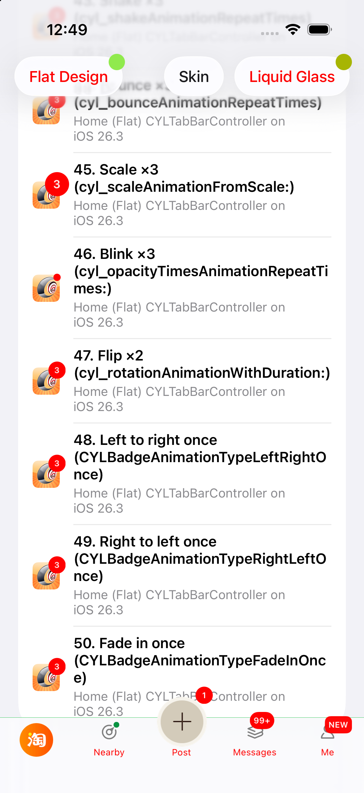 Swift migration score: 59 / 100 (23884 of 59391 Objective-C lines left). |
| DONE | 2026-11-15, step 49: `CYLFlatDesignTabBarItem` and `CYLFlatDesignTabBarButton` to public Swift, together (each interface names the other; neither names another type of the module): `CYLFlatDesignTabBar/CYLFlatDesignTabBar-ObjectiveC/Swift/CYLFlatDesignTabBarItem.swift` and `CYLFlatDesignTabBarButton.swift`. Prompt (verbatim): "Continue". Both `.m` files are deleted; CYLFlatDesignTabBarItem.h keeps the bound documentation, `CYLFlatDesignTabBarItemDidChange` (now defined in CYLFlatDesignTabBar.m) and forward `@class`es and imports `CYLSwiftInterface.h`; CYLFlatDesignTabBarButton.h imports it. Selectors and Swift names are kept (`isEnabled` with its `isEnabled` / `setEnabled:` accessors, the attribute methods, `-initWithTabBarItem:`); `-_updateTabBarButton` keeps its selector for CYLFlatDesignTabBar.m; the item's `cylflatdesign_tabBarController` is now the `NSObject` property of `NSObject+CYLFlatDesignTabBarLookup` (also weak). Compatibility notes: the classes are `open` and Objective-C can no longer subclass them; `UI_APPEARANCE_SELECTOR` is gone from the item (an `NSObject`, so it never had an appearance proxy); `tabBarItem` and the item's `-actualBadgeSuperView` are implicitly unwrapped in Swift (they were nil-able in practice); an item initialized with a non-image `id` now stores nil; a button decoded from a nib now gets its image view and label. Behavior kept on purpose: setting `tabBarItem` on a button without an item does nothing, and a string or attribute change from nil always posts the notification. Verified: 135 unit tests on iOS 26.3 (2 skipped, 0 failures), no warnings in the library, no umbrella import, the Objective-C demo and Example-Rive build after `pod install`, `pod lib lint --quick`, doc and localization checks. Simulator (iOS 26.3, CYL 17Pro, Xcode 27.2, working tree on top of commit [fb23e1d](https://github.com/ChenYilong/CYLTabBarController/commit/fb23e1d), 2026-11-15 15:40): Example-Rive in the FlatDesign style, top to bottom: Bell selected; its icon swapped to SVGA; Chat selected (titles, colors, animations and the plus button badge follow). 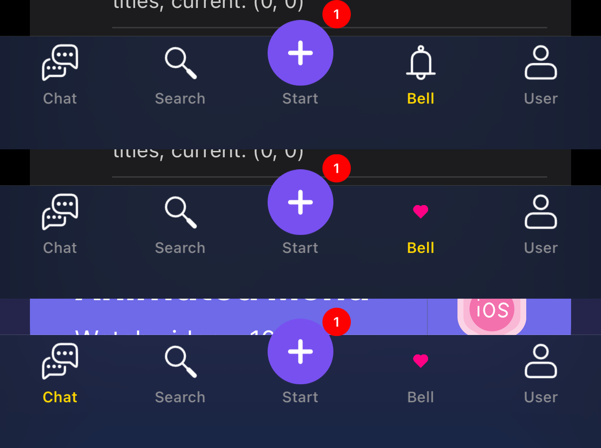 TODO: `CYLFlatDesignTabBar` itself (1164 lines) in its own step; a FlatDesign appearance demo (selection indicator image, badge appearance) on a simulator. Swift migration score: 61 / 100 (22803 of 59391 Objective-C lines left). |
| DONE | 2026-11-15, CI on #788 fixed. Prompt (verbatim): "修复ci 错误 后继续" (English: "fix the CI errors, then continue"). (1) Docs navigation: `docs/README.md` is committed as generated (it lists every committed asset, the other session's mini-program screenshot included). (2) Animation tests: `Tests/CYLTabBarItemAnimation/run.sh` no longer extracts Core code that moved to Swift; it compiles Objective-C stand-ins that mirror the Swift helpers (`CYLCoreStandIns.m`) and declarations of the Swift protocols (`stub/CYLTabBarController-Swift.h`) next to the real subspec sources: 74 checks, 0 failures locally. (3) iOS, framework job: Xcode 26.6 warned `public class 'CYLTabBarController.CYLTabBarController' shadows module 'CYLTabBarController'` while writing the module interface; the framework target passes `-alias-module-names-in-module-interface` for the iOS 26 SDKs only (Xcode 27 replaced it with module selectors and warns that the flag is obsolete). (4) iOS, SwiftPM demos (Example-Swift-Gallery, Example-Swift-SwiftManager, -FlatDesign): `continue-on-error`, per the maintainer's decision to accept SwiftPM being red until the core is all Swift; they still run. Verified locally: the framework builds without warnings on Xcode 27.2, `update-docs-navigation.py --check` passes. |
| DONE | 2026-11-15, step 50: `CYLFlatDesignTabBar` (the FlatDesign tab bar) to Swift, as a thin Objective-C shell over a Swift extension (`CYLFlatDesignTabBar/CYLFlatDesignTabBar-ObjectiveC/Swift/CYLFlatDesignTabBar+CYLImplementation.swift`). Prompt (verbatim): "continue", then "修复ci 错误 后继续" (English: "fix the CI errors, then continue"). Why a shell, not a public Swift class: `CYLTabBarController.h` adopts `CYLFlatDesignTabBarDelegate`, so the protocol stays Objective-C until `CYLTabBarController` moves, and a public Swift class naming it in `delegate` would bring back the umbrella import cycle. CYLFlatDesignTabBar.m went from 1169 to about 150 lines: `-initWithFrame:`, `-sizeThatFits:`, `-layoutSubviews`, `-safeAreaInsetsDidChange`, `-traitCollectionDidChange:`, `-hitTest:withEvent:` and the public accessors, each a one-line forward to a `cyl_flatDesign…` method declared in a private category; the state lives in one `CYLFlatDesignTabBarStorage` object (associated); the private calls into `CYLTabBarController` go through an `@objc` protocol. Selectors kept: `_tabBarDidSelectButton:`, `_tabBarDidTouchDownButton:`, `_tabBarDidTouchUpButton:`, `_tabBarItemDidChange:`, `stopAllTabBarItemAnimations`, `stopAnimationOfAllLottieView`, `cyl_isStandaloneTabBar`. Behavior changes: `selectedIndex` now returns the selected index (the Objective-C getter read a value nothing wrote and always returned 0); the unused private `-tabItemWidth`, `-plusWidth` and `-tabBarItemFrameWithIndex:` are gone. Bug found and fixed while testing: the Objective-C code builds UIKit's tab selector as `_tabBarItemClicked` without a colon, which UIKit never answers, so taps always take the library's `_cyltabBarItemClicked:` (which also deselects the plus button); a first Swift version added the colon and a selected plus button stayed selected after another tab was tapped; the selector is kept exactly as before, with a comment. Verified: 135 unit tests on iOS 26.3 (2 skipped, 0 failures), clean build without warnings, no umbrella import; Example-Rive and the Objective-C demo build after `pod install`. Simulator (iOS 26.3, CYL 17Pro, Xcode 27.2, working tree on top of commit [4934a0c](https://github.com/ChenYilong/CYLTabBarController/commit/4934a0c), 2026-11-15 23:00), top to bottom: Example-Rive in FlatDesign, Search selected; the plus button selected (its page, badge 1 -> 2); Bell selected (the plus button deselects); the Objective-C demo in FlatDesign (`-CYLScrollHideSelfTestFlatDesign YES`) pushing "PlusButton image loaded later" (the pushed page shows its own tab bar); back with an edge swipe, the host tab bar in place. The Objective-C demo's tab bar at launch matches the step 49 build. 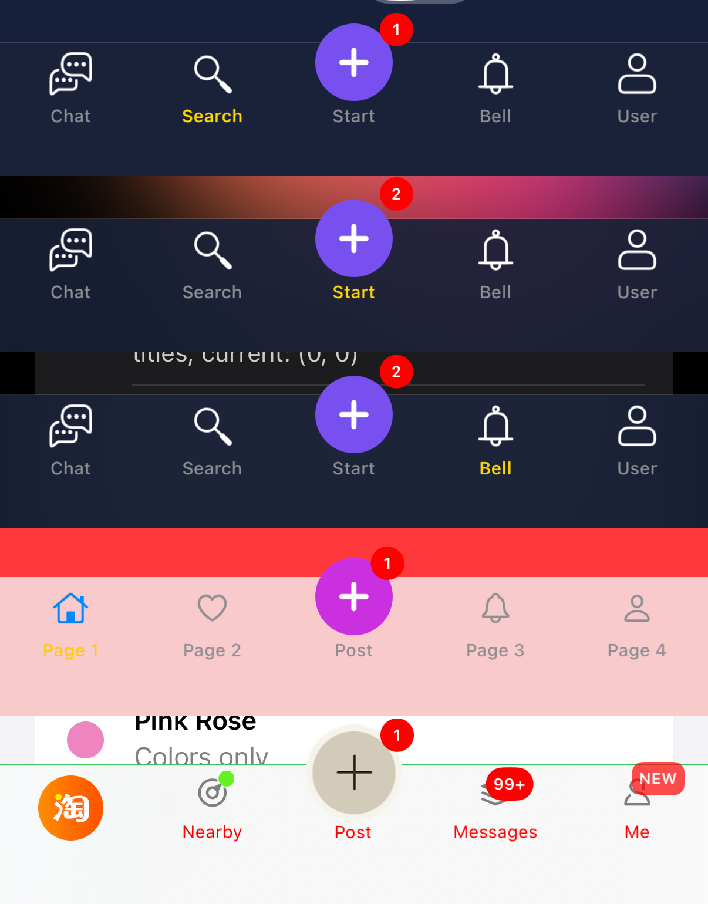 TODO: FlatDesign on an iPhone Duo (folded, vertical status bar, #662 / #672) and in RTL; the standalone FlatDesign demo page. Swift migration score: 63 / 100 (21793 of 59391 Objective-C lines left). |
| DONE | 2026-11-16, step 51: `CYLTabBar` (the classic and Liquid Glass tab bar) to Swift, as a thin Objective-C shell over a Swift extension, like step 50 (`CYLTabBarController/Swift/CYLTabBar+CYLImplementation.swift`). Prompt (verbatim): "continue". Why a shell: `CYLTabBarController.h` and `CYLPlusButton.h` name `CYLTabBar`, so the class stays declared in Objective-C until they move. CYLTabBar.m went from 2345 to about 210 lines: the initializers, `-dealloc`, `-sizeThatFits:`, `-layoutSubviews`, the six classic style setters, More editing, `-hitTest:withEvent:` (UIKit's hit test passed as a block), `-addSubview:`, `-addInteraction:` / `-removeInteraction:`, `-addGestureRecognizer:`, `-gestureRecognizerShouldBegin:` and the public accessors, each a forward to a `cyl_tabBar…` method declared in a private category; the stored properties without logic stay synthesized; `-cyl_keepStackedItemLayoutOnHingedDevice` (issue #680) stays Objective-C because `UIHingeInteraction` needs the iOS 27.1 SDK, which only the preprocessor can check. The state lives in one `CYLTabBarStorage` object (associated); KVO uses `NSKeyValueObservation` (item titles and badge values, the iOS 15 alpha fix), so `-observeValueForKeyPath:…` is gone, and `tabBarItemWidth` posts `CYLTabBarItemWidthDidChangeNotification` from its setter instead of observing itself. Private calls into `CYLTabBarController` and `CYLPlusButton` go through `@objc` protocols. Selectors kept for their callers: `cyl_isCustomizingItems`, `cyl_showsVerticalBar`, `cyl_showsMinimizedBar`, `cyl_verticalBarTabButtonAtWindowPoint:`, `cyl_liquidGlassGestureRecognizerDidUpdate:`. Also moved: `UITabBar (CYLBarBackground)` and `CYLTabBar (CYLTabBarItemAnimation)`; `UIControl+CYLTabBarItemAnimation.m` is deleted (animation-tests.yml watches the Swift file instead). Dropped: the iOS 13 / 14 code below the deployment target (`-cyl_fixTruncatedTabTitlesIfNeeded`, the pre-iOS 13 blur branches), the unused private `-tabItemWidth`, `-plusWidth`, `-plusFrame` and `-matchedTabBarContext`, and the `@try` around reading a tab label's color (it cannot throw). Verified: framework and Objective-C demo build clean (Xcode 27.2, no warnings from this code, umbrella import count 0), Example-Rive builds, 135 unit tests on iOS 26.3 (2 skipped, 0 failures), animation harness 74 checks / 0 failures. Simulator (Xcode 27.2, commit cdecfe0, 2026-11-16 01:23–01:32, load average 300–700 from other sessions' emulators): Example-Rive in Liquid Glass (iOS 26.3, CYL 17Pro): Chat, Search, the plus button (Start) and Bell select, the plus button deselects after Bell, badges in place; the Objective-C demo in the classic style (iOS 17.5, iPhone 15 Pro): Messages, the plus button (Post) and Me select, the plus button deselects after Me. 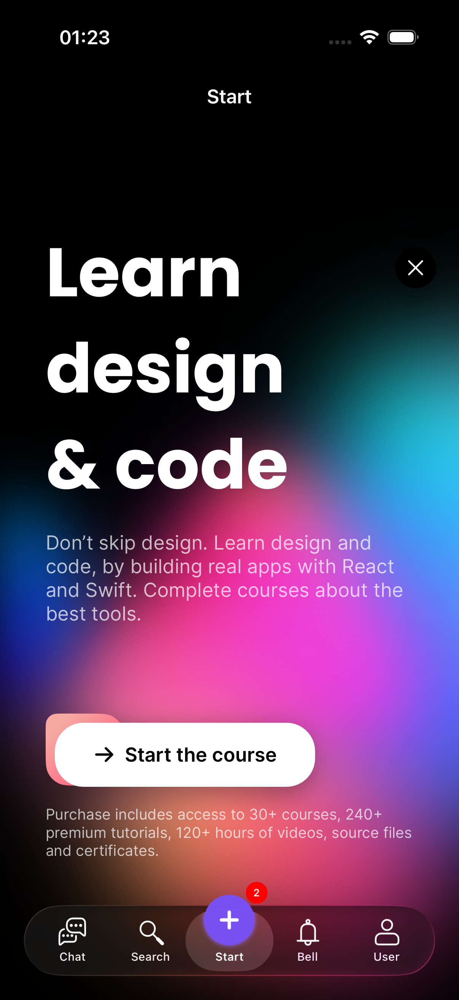 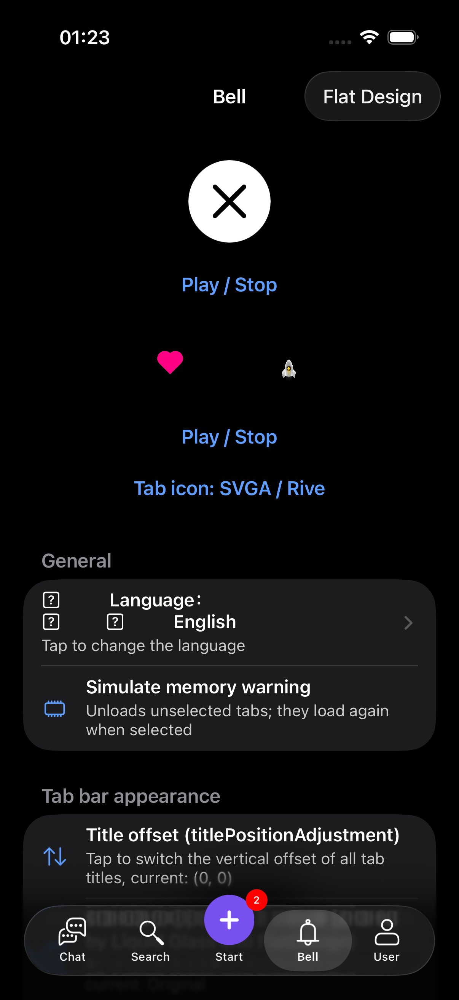 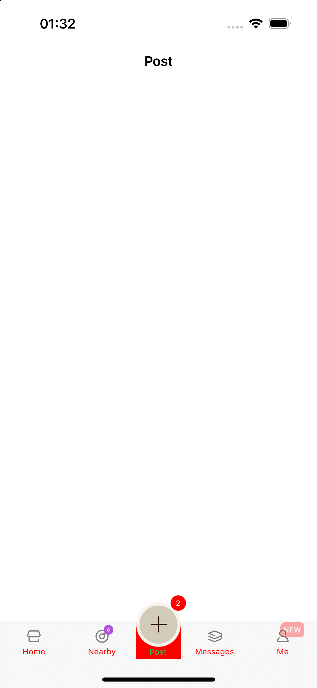  Found, not caused by this step: on iOS 17.5 the Objective-C demo crashes when Nearby is opened (`EXC_BAD_ACCESS` in `libCoreVMClient` `cvmsServerElementBuild`, the OpenGL shader compiler, on a background queue); the step 50 build (ed80367) crashes the same way. TODO: find the OpenGL user on that page (libpag?) and whether it only happens on this overloaded Mac; push / pop, More editing and FlatDesign on a simulator. Swift migration score: 66 / 100 (19622 of 59391 Objective-C lines left). |
| DONE | 2026-11-16, the Nearby crash found in step 51 (task 1 of 3). Prompt (verbatim): "look into the Nearby crash first then go straight to CYLPlusButton. then finish svga todo list". Cause: the PAG placeholders and PAG refresh icon of the Nearby page (`CYLDemoPlaceholderAnimationPag`); libpag draws with OpenGL ES, and the iOS 17.5 simulator's OpenGL shader compiler crashes on `com.apple.opengl.cvmDoWork` (`EXC_BAD_ACCESS` in `cvmsServerElementBuild`). Apple's code, not the library's; the iOS 26.3 simulator does not crash (checked). Fix in the examples only: `CYLDemoPlaceholder.supportedAnimation(for:)` uses Lottie instead of PAG on simulators below iOS 26. Verified on the iOS 17.5 simulator: Nearby opens and the app stays running (before: back to the home screen). Details and screenshots: docs/PAG-Animation.md, "Known issues". TODO: the globe and flag emoji of the Language row show as boxes on iOS 26.3 (same section). |
| DONE | 2026-11-16, step 52: `CYLPlusButton` to Swift, as a thin Objective-C shell over a Swift extension, like steps 50 and 51 (`CYLTabBarController/Swift/CYLPlusButton+CYLImplementation.swift`). Prompt (verbatim): "look into the Nearby crash first then go straight to CYLPlusButton. then finish svga todo list" (task 2 of 3). Why a shell: apps subclass `CYLPlusButton` in Objective-C and `CYLTabBarController.h` names it. CYLPlusButton.m went from 2990 to 438 lines: the C globals of CYLTabBarController.h (`CYLExternPlusButton`, `CYLPlusChildViewController`, `CYLPlusButtonWidth`; nonnull in the header, so Swift cannot clear them and `+cyl_mirrorLegacyGlobalsWithPlusButton:…` stays Objective-C), `CYLConfigurationPlusButtonPageKey`, the overrides and public methods as one-line forwards to `cyl_plusButton…` methods declared in a private category, the `super` calls the Swift code needs (`-cyl_super…`, through `CYLPlusButtonSuperAPI`), and `CYLConfigurationPlusButton` with its run-time subclasses (`objc_allocateClassPair`): Swift's `type(of:)` and class methods skip run-time subclasses of a Swift class, which lost each configuration's identifier and tap action in a first version (unit tests `testEachContextKeepsItsOwnPlusButtonAction` and `testThePlusButtonPageIsNotATabAndReportsMinusOne` caught it); its button setup is Swift. The state lives in one `CYLPlusButtonStorage` object (associated); the registry is a Swift class with a lock; the optional class methods of `CYLPlusButtonSubclassing` are reached through `CYLPlusButtonClassAPI` on `object_getClass(self)`. The lens mask (`-cyl_updateLiquidGlassMask`) is off as before: the Objective-C macro `CYL_PLUS_BUTTON_LENS_MASK_ENABLED` became the Swift compilation condition of the same name (AGENTS.md updated). Selectors kept for their callers (CYLTabBarController.m, CYLTabBar, the theme and badge code, the private header). Removed with it: `CYLPlusButtonPrivateAPI` and CYLTabBar's `CYLPlusButtonTabBarLayoutAPI` (their methods are Swift members now), the iOS 13 / 15 availability checks below the deployment target. Also fixed: the unit-test framework target failed to build after #794 (`CYLSwiftInterface.h` imports `CYLTabBarItemAnimationPlayableView.h`, which was a project header there): it is public now. Verified: framework and Objective-C demo build clean (Xcode 27.2, no warnings from the library, umbrella import count 0), Example-Rive builds, 135 unit tests on iOS 26.3 (2 skipped, 0 failures), `pod lib lint --quick`, public API comment, localization and skills checks. Simulator (Xcode 27.2, working tree on top of commit c0852bb, 2026-11-16 03:56–03:58): Example-Rive in Liquid Glass (iOS 26.3, CYL 17Pro): the plus button (Start) selects its page and counts the tap on its badge, then Bell selects and the plus button deselects; the Objective-C demo in the classic style (iOS 17.5, iPhone 15 Pro): the plus button (Post) selects, then Me selects and the plus button deselects. Top to bottom: 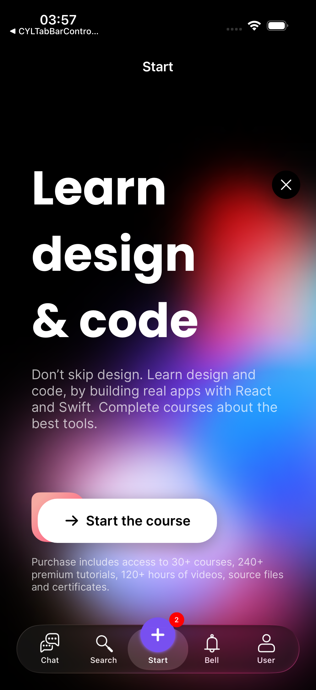 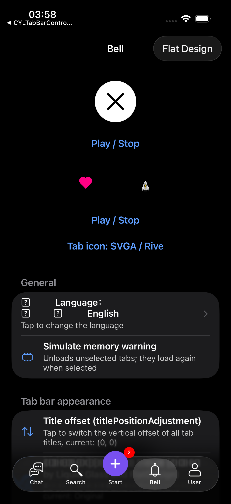 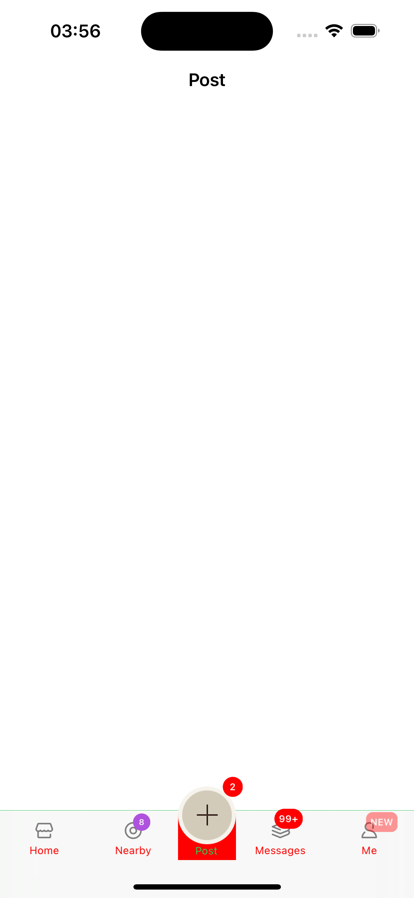 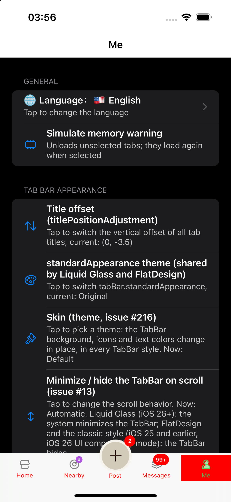 Note: the first tap, by the accessibility frame of the title "Start" (y = 836 pt, the bottom edge of the bar), did not select the plus page; a tap on the icon did. TODO: compare that edge tap with step 51 (it may never have hit); FlatDesign, a configuration-file plus button (React Native / Flutter), the stand-in through the lens, themes and badges on a simulator. Swift migration score: 71 / 100 (16985 of 59391 Objective-C lines left). |
| TODO | 2026-11-16, task 4: SVGA demos in the example layer, one for one with the Rive demos (search "Rive"), set up from the initialization keys and from the configuration file, with SVGA files as tab item icons, in every example. Prompt (verbatim): "在example层加入svga动效测试，搜索Rive关键词，一比一复刻，Rive相关动效测试，要求能在初始化Key以及配置文件中进行SVGA格式动图初始化，能在tabbar item加入svga相关资源文件展示。更新所有example层演示 ，一比一复刻，Rive相关动效演示" (English: "Add SVGA animation tests to the example layer: search for the keyword Rive and copy the Rive animation tests one for one; SVGA animations must be set up from the initialization keys and from the configuration file, and SVGA files must show as tab bar item icons. Update every example demo, one for one with the Rive animation demos."). Done after task 3 (the SVGA TODO list in docs/SVGA-Animation.md), which overlaps with it. |
| TODO | 2026-11-19, the remaining Objective-C core to Swift, so the SwiftPM demos build. Prompt (verbatim): "start the Swift migration of the remaining Objective-C core now". Context: score 69 / 100 (18 048 Objective-C lines left: `CYLTabBarController.m` 8 216, `CYLTabBarController.h` 3 294, the shells of `CYLPlusButton`, `CYLTabBar` and `CYLFlatDesignTabBar`, `CYLTabBarController+CYLConfiguration.m`, `CYLConstants`, the base view controllers, the public enums and protocols). The three SwiftPM demos (`Example-Swift-Gallery`, `Example-Swift-SwiftManager`, `-FlatDesign`) fail until `Package.swift` is one Swift target (decision of 2026-11-13). Order: (a) `CYLTabBarController.m` becomes a thin shell over Swift extensions, section by section, starting with its trailing categories (step 53); (b) the base classes and `CYLConstants`; (c) the big bang: protocols, enums, block types and `CYLTabBarController.h`; (d) `Package.swift` as one Swift target. Every step: CocoaPods, the framework and Carthage build without warnings, the unit tests pass, the Objective-C demo and Example-Swift build, `pod lib lint --quick`. Score: 100 = migration score 100 and the three SwiftPM demos green on CI; 60 = `CYLTabBarController.m` is a shell (score ≥ 80) with every build and test green. 2026-11-19, later: the user asked again, prompt (verbatim): "fix Migration score: from 74/100. to 100" (score 74, 15 065 lines left). Split agreed between the two Mac sessions: Mac-CYLTabBarController文件夹 keeps `CYLTabBarController.m` / `.h`; this session takes phase ② preparation (the Objective-C example's subclasses in Swift), `CYLTabBarController+CYLConfiguration.m`, `CYLConstants`, `CYLAnimationKeys`, and `CYLPlusButton` with its subclasses. |
| DONE | 2026-11-19, step 53 (part (a) of the 2026-11-19 task): four categories of `CYLTabBarController` to Swift (`CYLTabBarController/Swift/CYLTabBarController+CYLTabBarToolkit.swift`): `CYLReselect` (with its private `-cyl_viewControllerForTabControl:` and `-cyl_performReselectBehaviorForViewController:`), `CYLCustomTabAction`, `CYLTabBarItemStyle` (all but `-initWithNibName:bundle:`, `-initWithCoder:` and `-cyl_didInitialize`, which stay in Objective-C: Swift extensions cannot override initializers; the category's properties are `@dynamic` there) and `CYLOpaqueTabBarSafeArea`. Prompt (verbatim): "start the Swift migration of the remaining Objective-C core now". Notes: the custom action blocks live in a typed settings object, because a block read back from an associated object does not cast to a Swift block type (the new tests caught it: the handler was never called); the FlatDesign items are read at run time (`responds(to:)` + KVC), as the FlatDesign subspec is optional; `cyl_applyTabBarItemStyles` left `CYLTabBarControllerPrivateAPI` (it is a Swift member now). The vault's auto sync committed most of this step as `1f17d837 continue` in the middle of the work; `fee80f7d` completes it. New tests in `CYLTabBarToolkitTests`: reselect behavior kept, reselect pops to root (in a visible window), custom action once per run loop turn, the decider block wins, item styles kept. Verified locally (macOS 27.3, Xcode 27.2): clean framework build with no warnings; 168 unit tests on the iPhone 18 Pro simulator (iOS 27.2), 0 failures; the Objective-C demo (clean derived data) and Example-Swift build; `pod lib lint --quick` passes. Next (step 54): `CYLPageRegistry`, `CYLPendingPages` and `UIViewController (CYLTabBarItemTitleSupport)`, which need private accessors of the class (`pageRegistry`, `skippedTabs`, `pagesByPageIdentifier`, a setter for the attributes storage). Swift migration score: 70 / 100 (17 667 of 59 391 Objective-C lines left). |
| DONE | 2026-11-19, step 54: `CYLTabBarController (CYLPageRegistry)`, `CYLTabBarController (CYLPendingPages)` and `UIViewController (CYLTabBarItemTitleSupport)` to Swift (`CYLTabBarController/Swift/CYLTabBarController+CYLPageRegistry.swift`, commit `84194ce0`). Prompt (verbatim): "continue Swift migration". The page registry state stays in the class extension of CYLTabBarController.m and is read through `CYLTabBarControllerPrivateAPI` (its synthesized accessors `pageRegistry`, `pageResolver`, `pageLookupOrder`, `skippedTabs` / `setSkippedTabs:`, `pagesFromPageIdentifiers`, `pagesByPageIdentifier`, plus `-cyl_tabBarItemsAttributesIndexOfViewControllerAtIndex:`); one small Objective-C method, `-cyl_replaceTabBarItemsAttributesStorage:`, writes the attributes storage without the setter's work, as the old category did. The normal-title and navigation-title keys are selector based now (`sel_registerName`), shared by the Objective-C helpers and Swift (`CYLTabBarItemTitleKeys`). The FlatDesign item title is read at run time. Verified: clean framework build without warnings, 168 unit tests on the iPhone 18 Pro simulator (iOS 27.2), 0 failures (page registry, pending pages, `cyl_navigationTitleFollowsTabBarItemTitle`), the Objective-C demo and Example-Swift build, `pod lib lint --quick`. Swift migration score: 70 / 100 (17 516 of 59 391 Objective-C lines left). |
| DONE | 2026-11-19, step 55: `-cyl_syncTabBarItemAccessibility` and its helpers (the default identifier, the explicit identifier / label / hint of the attributes, the Liquid Glass default label) to Swift (`CYLTabBarController/Swift/CYLTabBarController+CYLAccessibility.swift`, commit `d40e5785`). Prompt (verbatim): "continue Swift migration". The method stays declared in the private header (CYLTabBarController.m and CYLTabBar call it). Verified: clean framework build without warnings, 168 unit tests, 0 failures (the accessibility tests included). Swift migration score: 70 / 100 (17 397 of 59 391 Objective-C lines left). Next (step 56): the appearance sync group (`-cyl_syncTabBarAppearances`, the standard appearance observers, selected background colors, badges of the selected tab, the FlatDesign standard appearance), then the title position, image insets and image-only tabs sections. |
| DONE | 2026-11-19, step 56: the selected tab badge (`cyl_hidesBadgeOfSelectedTab`, `-cyl_updateBadgesOfSelectedTab`), the per-tab background colors (`-cyl_setNeedsUpdateSelectedBackgroundColors`, `-cyl_updateSelectedBackgroundColorsOfTabButtons`) and `-cyl_syncTabBarAppearances` to Swift (`CYLTabBarController/Swift/CYLTabBarController+CYLTabBarItemColors.swift`, commit `ab44d413`). Prompt (verbatim): "continue Swift migration". Kept in Objective-C behind their compile switches: the Lottie loop (`CYL_LOTTIE_AVAILABLE`), the FlatDesign standard appearance and item colors (`CYL_FLATDESIGN_AVAILABLE`, called at run time), the KVO observation (its context pointer) and the title offset copies (next step), reached through `cylPrivate`. Verified locally (macOS 27.3, Xcode 27.2): clean framework build without code warnings, 169 unit tests on the iPhone 18 Pro simulator (iOS 27.2), 0 failures (new `testHidesBadgeOfSelectedTab`), Example-Swift builds, `pod lib lint --quick` passes. Note: a new Swift file needs `pod install` in the root before the framework scheme compiles it (the Pods project lists the files). Swift migration score: 70 / 100 (17 262 of 59 391 Objective-C lines left). Next (step 57): the title position adjustment copies (issue #475), the image insets and the image-only tabs sections. |
| DONE | 2026-11-19, step 57: the per-tab title offset and colors (issue #475: a copy of the tab bar's standard and scroll edge appearances with the offset and the colors written into every layout and state), `-cyl_applyTitlePositionAdjustment:toTabBarItem:` and `-cyl_syncTitlePositionAdjustmentAppearances` to Swift (`CYLTabBarController/Swift/CYLTabBarController+CYLTitlePositionAdjustment.swift`, commit `27041001`). Prompt (verbatim): "continue Swift migration". The key CYL writes on the item is selector based and shared with Objective-C; the item appearance state is a typed Swift object. Kept in Objective-C: `-setTitlePositionAdjustment:` and `-updateImageInsets:` (ivars and the FlatDesign branch) and the image-only tabs. Verified locally (macOS 27.3, Xcode 27.2): clean framework build without code warnings, 170 unit tests on the iPhone 18 Pro simulator (iOS 27.2), 0 failures (new `testPerTabColorAndOffsetReachTheItemAppearance`), Example-Swift builds, `pod lib lint --quick` passes. Swift migration score: 71 / 100 (17 054 of 59 391 Objective-C lines left). Next (step 58): the image-only tabs (`automaticallyAdjustsImageOnlyTabs`, `-offsetTabBarTabImageViewToFit:`), then the delegate section (`-tabBarController:shouldSelectViewController:`, the Liquid Glass lens callbacks). |
| DONE | 2026-11-19, step 58: the image-only tabs (issue #257, #522: `automaticallyAdjustsImageOnlyTabs`, `-cyl_restoreImageOnlyTabItems:`, `-offsetTabBarTabImageViewToFit:`) to Swift (`CYLTabBarController/Swift/CYLTabBarController+CYLImageOnlyTabs.swift`, commit `c2271c3e`). Prompt (verbatim): "continue Swift migration 修复CI 错误 https://github.com/ChenYilong/CYLTabBarController/actions/runs/44391395292/job/135109716821?pr=788" (EN: "continue Swift migration; fix the CI error at <link>"; the CI part: docs/Mac-CI-CD.md). The property is `@dynamic` in Objective-C; the item records and the item's own title offset use selector-based keys shared with `-updateImageInsets:`; `-cyl_storedTabBar` (one line, Objective-C) reads the tab bar without creating one. Verified locally (macOS 27.3, Xcode 27.2): clean framework build, no warning in the library code (an always-true cast from step 56 removed), 170 unit tests on the iPhone 18 Pro simulator (iOS 27.2), 0 failures (`CYLImageOnlyTabsTests` included), Example-Swift builds, `pod lib lint --quick` passes. Swift migration score: 71 / 100 (16 945 of 59 391 Objective-C lines left). Next (step 59): the delegate section (`-tabBarController:shouldSelectViewController:`, `-updateSelectionStatusIfNeededForTabBarController:`, the Liquid Glass lens callbacks). |
| DONE | 2026-11-19, step 59: the reported control (`-cyl_reportedControlForControl:`, `-cyl_markControlReportedInCurrentRunLoop:`) and the delegate method `-tabBarController:beginShowPlatterLiquidLensViewForControl:` to Swift (`CYLTabBarController/Swift/CYLTabBarController+CYLInteraction.swift`, an existing file, so the Xcode project stayed untouched during the parallel step 60; commit `b24f2c6a`). Prompt (verbatim): "continue Swift migration 修复CI 错误" (EN: "continue Swift migration; fix the CI errors"). Kept in Objective-C: `-updateSelectionStatusIfNeededForTabBarController:…` (declared in the main interface) and `-tabBarController:shouldShowPlatterLiquidLensViewForControl:` (its `CYL_PLUS_BUTTON_TITLE_KEEPS_LENS_ENABLED` switch). Note: the vault auto-sync swept the staged change into an unpushed commit with a Chinese message (`455fe6c8`); it was redone locally as `b24f2c6a` before any push. Verified locally (macOS 27.3, Xcode 27.2) on the tree merged with step 60: clean framework build, no warning in the library code, 183 unit tests on the iPhone 18 Pro simulator (iOS 27.2), 0 failures (new `testReportedControlWithoutPlusButtonIsTheControl`, `testBeginShowLensFollowsTheDelegate`), Example-Swift builds, `pod lib lint --quick` passes. Swift migration score: 71 / 100 (16 902 of 59 391 Objective-C lines left). Next (step 61): `-tabBarController:shouldSelectViewController:` and the two `-updateSelectionStatusIfNeeded…` methods. |
| DONE | 2026-11-19, step 60 (step 59 is the delegate section, done by another session at the same time): **`CYLAnimatedItemView` and `CYLAnimatedItemStackView` to Swift** (the `CYLAnimatedItem` pod / module, outside the score's scope; `CYLTabBarController/CYLAnimatedItem/Swift/`). Prompts (verbatim): "CYLAnimatedItemStackView 改为swift ，并确保CYLAnimatedItemView也是" (EN: make CYLAnimatedItemStackView Swift and make sure CYLAnimatedItemView is Swift too), after the owner rule "本项目iOS core 核心代码为Swift，新增任何代码均为Swift优先". Same Objective-C API (selectors, `animationReady` / `isAnimationReady`, `dragEnabled`, `iconHidden` and its key, enums `CYLAnimatedItemAxis…` and protocols as `@objc` Swift), same Swift names for subclasses (`layoutContent(in:)`, `contentSizeThatFits(_:)`, `itemStateDidChange()`, `itemAccessibilityLabel()`; `CYLFlatDesignTabBarButton` unchanged). How the build systems take it: the C macro `CYL_ANIMATION_ENGINE_AVAILABLE` becomes a Swift condition of the same name (set by the CocoaPods `Engine` subspec, the Xcode `CYLAnimatedItem` target and SwiftPM); `CYLAnimatedItemView.h` stays as a compatibility header without declarations that imports `CYLAnimatedItem-Swift.h` (not under `__swift__`), so `#import <CYLAnimatedItem/CYLAnimatedItemView.h>` keeps working; `CYLTabBarItemViewAnimator.h` forward-declares the Swift protocols and imports their header at its end (the generated Swift interface now imports the umbrella header, which needs that class first); SwiftPM: the views are the target `CYLAnimatedItemViews` (re-exports `CYLAnimatedItem`); the test helper subclass moved to `CYLTabBarControllerTests/CYLAnimatedItemTestTag.swift` (Objective-C cannot subclass a Swift class; the test target gets `SWIFT_VERSION`). Verified (macOS 27.3, Xcode 27.2): `scripts/unit-tests.sh` 181 tests on the iPhone 18 Pro simulator (iOS 27.2), 0 failures, `CYLAnimatedItemViewTests` and `CYLAnimatedItemStackViewTests` included; `pod lib lint CYLAnimatedItem.podspec` passes for `Core` (no engine: the Swift `#else` path), `Engine` and `GIF` (with `scripts/pod-lint.xcconfig`); SwiftPM scheme `CYLAnimatedItem` builds (scheme `CYLTabBarController` was already red before, see step 58 notes). Later the same day: `pod lib lint` passes for the `LottieSwift`, `PAG`, `Rive` and `SVGA` subspecs and `scripts/pod-lint.sh xcframework` builds the Carthage XCFrameworks (the Swift interface ships in `CYLAnimatedItem.xcframework`). Downstream: no repository subclasses the view in Objective-C (ClassifyMenu and CYLSearch subclass it in Swift). Score unchanged, 71 / 100 (the script counts the tab bar core only). Follow-up (2026-11-19): CollectionViewClassifyMenu adapted (its `e4dc5b59`, menu 37/37, Example 98/98, Swift Example 22/22); its `CYLTagButton` overrode `imageView`, `titleLabel`, `accessoryView` and `placeholderImage` only to forward to super and dropped those overrides. To keep Objective-C's overridability, `accessoryView` and `placeholderImage` are now `open` (`imageView` / `titleLabel` stay `let`: readonly subviews); unit tests 183 / 183. |
| DONE | 2026-11-19, step 100 (steps 66–99 are reserved for the other Mac session, which migrates `CYLTabBarController.m`): **`CYLTabBar` is a Swift class** (`CYLTabBarController/Swift/CYLTabBar.swift`; `CYLTabBar.m`, the Objective-C shell whose logic was already Swift, is removed). Prompt (verbatim): "continue swift migration and fix ci issues <three links>" (the three SwiftPM demos of run 44430574195); the owner chose "finish the migration" over a SwiftPM binary target. Nothing subclasses `CYLTabBar` in Objective-C (this repository and the three dependent ones checked), so no shell. Same Objective-C API: `CYLTabBar.h` keeps the block typedef and the `UITabBar (CYLBarBackground)` category and imports the generated interface; the `CYLTabBar (CYLTabBarControllerExtention)` category declarations are gone from `CYLTabBar+CYLTabBarControllerExtention.h` (a category of a Swift class cannot be declared there), their Swift members are now `public` so the framework's generated header lists them, with `[UIControl]` types as the header had, plus `@nonobjc` forwarders under the old Swift names. Found while porting: the Liquid Glass gesture recognizers are nil until UIKit adds them, and Objective-C's "nonnull" hid that (messages to nil); they are optional now (two call sites use `?.isEnabled`). The iOS 27.1 `UIHingeInteraction` is made through the runtime, as Swift cannot test the SDK like `__IPHONE_27_1`. Verified (macOS 27.3, Xcode 27.2): unit tests 192, 0 failures, no crash; the Objective-C example (`scripts/ci-build-example.sh .`) builds. SwiftPM stays red until the core is one Swift target. Score 72 / 100 (16 197 of 59 391 lines left). |
| DONE | 2026-11-19, step 101: **`CYLFlatDesignTabBar` is a Swift class** (`CYLFlatDesignTabBar-ObjectiveC/Swift/CYLFlatDesignTabBar.swift`); `CYLFlatDesignTabBar.m` keeps only the C constant `CYLFlatDesignTabBarItemDidChange` (Swift cannot define a C symbol for Objective-C callers). Same prompt as step 100. No Objective-C subclass (this repository and the three dependent ones checked). `CYLFlatDesignTabBar.h` keeps the `CYLFlatDesignTabBarDelegate` protocol (types used by Objective-C headers move last) and imports the generated interface; `tabBarItems` keeps its old shape (buttons when read, items when set); the appearance properties stay `UI_APPEARANCE_SELECTOR`-compatible (`@objc dynamic`). Verified (macOS 27.3, Xcode 27.2): unit tests 193, 0 failures; the Objective-C example builds. Score 73 / 100 (15 725 of 59 391 lines left). |
| DONE | 2026-11-19, step 102: **`CYLBaseNavigationController` is an Objective-C shell over Swift** (it stays Objective-C because apps and the demos subclass it; marker `CYL-SWIFT-MIGRATION: objc-shell`): its overrides call `super`, then `-cyl_baseNavigationWillPushViewController:` / `-cyl_baseNavigationToggleTabBarHidden` of `UINavigationController (CYLBaseNavigation)` in Swift (`Swift/UINavigationController+CYLBaseNavigation.swift`); the private `-toggleTabBarHidden` and its `@try` around `lastObject` (which never throws) are gone. Same prompt as step 100. Verified: unit tests 193, 0 failures; the Objective-C example builds. Score 73 / 100 (15 645 of 59 391 lines left). |
| DONE | 2026-11-19, step 103 (sections of `CYLTabBarController.m` handed over by the other Mac session): **"Memory warning (issue #426)" to Swift** (`Swift/CYLTabBarController+CYLMemoryWarning.swift`: `-shouldUnloadViewOfViewController:`, `cyl_keepsLoadedTabBarItemIdentifiers`, `-unloadViewsOfUnselectedViewControllers`). Their declarations move from the main `@interface` of `CYLTabBarController.h` to a category `CYLTabBarController (CYLMemoryWarning)` (no Objective-C implementation needed); the Swift members are internal (the generated header must not declare a category of `CYLTabBarController`: it is read before the class), and calls go through Objective-C dispatch, so subclass overrides still apply. `-didReceiveMemoryWarning` stays in the `.m` (an override in an extension of a public class would have to be public) and only calls them; `-dealloc` stays. The seam `CYLTabBarControllerMemoryWarningSeam` is still adopted in the `.m`; a scoped `-Wprotocol` pragma at `@implementation` covers the Swift-implemented method. New test `testUnloadingUnselectedViewsKeepsTheSelectedAndTheKeptTabs`. Verified: unit tests 194, 0 failures, no library warning; the Objective-C example builds. Score 74 / 100 (15 428 of 59 391 lines left). |
| DONE | 2026-11-19, step 104: **"Deprecated Lottie names (compatibility)" to Swift** (`Swift/CYLTabBarController+CYLCompatibility.swift`): `lottieURLs`, `lottieSizes`, `lottieViewAdded` (declarations moved into the existing category `CYLTabBarController (CYLTabBarControllerDeprecated)`) and `-rootWindow` (a new category `CYLTabBarController (CYLRootWindow)`), internal Swift members with the Objective-C selectors. `tabBarHeight` and `items` stay in the `.m` (they use instance variables, which a Swift extension cannot reach; they move with the class). Verified: unit tests 195, 0 failures, no library warning. |
| DONE | 2026-11-19, step 105: **"Reload badges (#404)" to Swift** (`Swift/CYLTabBarController+CYLReloadBadges.swift`): `-reloadBadgesWithBlock:` / `-performWhenTabBarItemsReady:` (a new public category `CYLTabBarController (CYLReloadBadges)`), the pending blocks (associated storage instead of the class extension's `pendingReloadBadgesBlocks`), `-cyl_adoptTabButton:forTabBarItem:` (#605), `-cyl_tabButtonReplacingTappedControl:` (#605) and `-cyl_bindTabControlActions` (#610), declared for CYLTabBarController.m in a new category of CYLTabBarController+CYLPrivate.h; `-addLottieImageWithControl:lottieURL:lottieSizeValue:animation:defaultSelected:` (still Objective-C) is reached through `CYLTabBarControllerPrivateAPI`. Verified: unit tests 196, 0 failures, no library warning; the Objective-C example builds. Score 74 / 100 (15 096 of 59 391 lines left). |
| DONE | 2026-11-19, step 106: **"Dark Mode Lottie (#442)" to Swift** (`Swift/CYLTabBarController+CYLDarkModeLottie.swift`): the work of a light / dark switch (`-cyl_traitCollectionDidChangeFrom:`) and `-cyl_reloadLottieAnimationViewsForCurrentStyle` (it reads the stored tab bar through `cylPrivate.cylStoredTabBar()` instead of the `_cyl_tabBar` instance variable), declared in CYLTabBarController+CYLPrivate.h; `-traitCollectionDidChange:` stays in the `.m` and calls it. The status bar and vertical bar parts of that range stay Objective-C for now: they are UIKit overrides of the class (they stay in its shell), they read instance variables, and the vertical bar uses iOS 27.1 SDK types (`UIVerticalBarBehavior`) that Swift cannot guard by SDK. Verified: unit tests 196, 0 failures, no library warning; the Objective-C example builds. |
| DONE | 2026-11-19, step 107: **migration guide for app developers**, [Subclassing-In-Swift.md](Subclassing-In-Swift.md): why the six subclassable classes become `open` Swift classes (the maintainer confirmed "Open Swift classes" today), what an app changes (bridging header, `@objc(Name)` to keep class names, `register()` instead of `+load` for plus buttons, overrides), examples, and the release-notes entry (TODO until phase ② ships). Next (steps 108+): Swift versions of the repository's Objective-C subclasses, built and tested against today's Objective-C classes: the tests' `CYLTestPlusButton` and `CYLSuperCallingTabBarController`, the Objective-C example's five view controllers, `CYLPlusButtonSubclass` (and its two subclasses), `MainTabBarController`, `CYLFlatDesignMainTabBarController`, and the library's `CYLConfigurationPlusButton`. |
| DONE | 2026-11-19, step 108 (phase ② preparation): **the tests' subclasses in Swift**, `CYLTabBarControllerTests/CYLTestSubclasses.swift`: `CYLTestPlusButton` (a `CYLPlusButton` + `CYLPlusButtonSubclassing`) and `CYLSuperCallingTabBarController` (overrides `-tabBarController:shouldSelectViewController:` and calls super), public with `@objc(Name)`, so CYLThemeTests.m and CYLTabBarToolkitTests.m use them through `CYLTabBarControllerTests-Swift.h` (a test bundle's generated header lists public members only). They run on today's Objective-C classes and need no change when the classes turn Swift. Also two old test warnings fixed (an `id` cast for a delegate that adopts only one of the two protocols; a scoped `-Wnonnull` pragma around a deliberate nil). Verified: unit tests 196, 0 failures, no warning in the library or the tests. |
| DONE | 2026-11-19, step 109 (phase ②, first class): **`CYLPlusButton` is an `open` Swift class** (`Swift/CYLPlusButton.swift`; `CYLPlusButton.m` deleted), with its Objective-C subclasses ported in the same step: the library's `CYLConfigurationPlusButton` (Swift, still subclassed at run time per configuration) and the Objective-C example's `CYLPlusButtonSubclass`, `CYLSecondPlusButtonSubclass`, `CYLCloseSubviewPlusButtonSubclass` (`Example/Classes/View/CYLPlusButtonSubclass.swift`; the example's bridging header now imports `CYLMainRootViewController.h` and `CYLFlatDesignMainTabBarController.h`). Every public member keeps its selector and its Swift name (checked against the Swift interface of the old header); `CYLPlusButton(forTabBarContext:)` / `CYLPlusButton(forOwner:)` stay Swift initializers through a protocol extension (`CYLPlusButtonRegisteredInstance`), the selectors stay for Objective-C. `CYLPlusButton.h` keeps `CYLPlusButtonSubclassing` (now also with the deprecated optional `+multiplerInCenterY`) and imports the generated interface. The globals `CYLExternPlusButton`, `CYLPlusChildViewController` and `CYLPlusButtonWidth` are Swift variables; Objective-C reads them through macros over `@_cdecl` functions (read-only now; `CYLTabBarController.h:998` and `CYLTabBarController.m:129` changed with the agreement of Mac-CYLTabBarController文件夹); `CYLConfigurationPlusButtonPageKey` is a string macro. Run-time details: `-setConfiguration:`, `-cyl_clearBadge` and the default `+selectedContentView` are added to the class at run time (Swift cannot override the first two, and a Swift member would clash with subclasses' own `+selectedContentView`); `type(of:)` and Swift metatype calls skip a class made by `objc_allocateClassPair`, so the configuration plus button is created with `+new`, registered by selector, and its class read with `object_getClass` (`cylRuntimeClass`, `cylIndex(forTabbarItemsCount:)`; caught by `testThePlusButtonPageIsNotATabAndReportsMinusOne`). Also fixed: step 104's `-rootWindow` returned a non-optional `UIWindow` and crashed the Objective-C example at launch (no window yet); it returns nil again. Verified: unit tests 196, 0 failures, no library warning; the Objective-C example and Example-Swift build; the Objective-C example on the iPhone 18 Pro simulator (iOS 27.2): raised plus button, badge, aligned title, a tap selects its page and bumps the badge ([screenshot](assets/ios-swift-plus-button.png)). AGENTS.md plus button rules, run on 5ac06d3f: the three lens-drag UI tests of `Example-SwiftUI/HealthyHomeUITests` pass (the SwiftUI app and the Objective-C demo, raised and flat plus buttons), recorded with `simctl io recordVideo`: the plus button is never cut ([frames](assets/ios-swift-plus-button-lens-drag.png)); `REQUIRE_PASS=1 scripts/plus-child-theme-test.sh`: 3 scenarios, every check PASS. (Two drag tests first failed because the theme test had left a skin with "★" titles saved in the demo; they pass on a fresh install.) |
| DONE | 2026-11-19, step 110 (phase ② preparation): **the Objective-C example's `MainTabBarController` in Swift** (`Example/MainTabBarController.swift`; the `.h` / `.m` are deleted), with its three demo categories of `CYLTabBarController` (plus button badge #535, login #19, tab gestures #152) as one Swift extension; the Objective-C files reach both through `CYLTabBarControllerDemo-Swift.h`, and the bridging header now imports the four Objective-C screens. Lesson for phase ② (told to Mac-CYLTabBarController文件夹): the Objective-C initializers of `CYLTabBarController` end in `[self initWithConfiguration:]` and then `[self initWithNibName:bundle:]`, so a Swift subclass with its own initializer must override both and forward them, or it traps at launch ("unimplemented initializer"). Verified: the Objective-C example builds without warnings; on the iPhone 18 Pro simulator (iOS 27.2, fresh install) the tab bar is unchanged (cover, badges, raised plus button) and a login-required tab shows the login alert ([screenshot](assets/ios-swift-main-tab-bar-controller.png)). |
| DONE | 2026-11-19, step 111 (phase ② preparation): **the Objective-C example's `CYLFlatDesignMainTabBarController` in Swift** (`Example/Classes/FlatDesignExample/MainVC/CYLFlatDesignMainTabBarController.swift`; the `.h` / `.m` are deleted; the bridging header imports `CYLFlatDesignModalViewController.h` instead). It keeps the delegate APIs it demonstrates (login #19, gestures #152, `-tabBar:didSelectItem:`, the show / hide callbacks) and forwards `init(configuration:)` / `init(nibName:bundle:)` like MainTabBarController (step 110). With both example tab bar controllers in Swift, no Objective-C subclass of `CYLTabBarController` is left in the repository (the test's is Swift since step 108). Verified: the Objective-C example builds without warnings; on the iPhone 18 Pro simulator (iOS 27.2, fresh install, `-CYLScrollHideSelfTestFlatDesign YES`) the FlatDesign tab bar is unchanged and a login-required tab shows the login alert through the delegate ([screenshot](assets/ios-swift-flat-design-main-tab-bar-controller.png)). |
| DONE | 2026-11-19, step 112 (phase ② preparation): **the Objective-C example's five pages in Swift**: `CYLHomeViewController`, `CYLSameCityViewController`, `CYLMessageViewController`, `CYLMineViewController` (subclasses of `CYLBaseTableViewController`) and `CYLDetailsViewController` (`CYLBaseViewController`); their ten `.h` / `.m` files are deleted. The four tab pages were four copies of the same table code; they now share `Example/Classes/Module/CYLDemoBadgeTableViewController.swift` (inset grouped sections, the shared demo sections, badge rows, pull to refresh, placeholders) and override only what differs (placeholder animation, row count, page rows). The bridging header imports `CYLFlatDesignTableViewController.h` (the shared demo sections) instead of the pages. With this step no Objective-C subclass of the six subclassable classes is left in the repository; CrossPlatform included (checked on 2026-11-19 by a search of every `.h`, `.m` and `.mm` for `@interface … : <class>`: no match). Verified: the Objective-C example builds without warnings; on the iPhone 18 Pro simulator (iOS 27.2, fresh install): the badge rows, a row opening the details page, a tap there selecting "Me" and pushing its test page, the dark "Me" page, and the playback controls of "Messages" ([screenshot](assets/ios-swift-example-screens.png)). |
| DONE | 2026-11-19, step 113 (phase ②): **`CYLBaseViewController`, `CYLBaseTableViewController` and `CYLBaseNavigationController` are `open` Swift classes** (`Swift/CYLBaseViewController.swift`, `Swift/CYLBaseTableViewController.swift`, `Swift/CYLBaseNavigationController.swift`); their `.m` files (the Objective-C shells, the last one from step 102) are deleted, and each `.h` only imports `CYLSwiftInterface.h`, so `CYLTabBarController.h` keeps importing them unchanged. Possible because no Objective-C subclass of them is left in the repository (steps 110-112; CrossPlatform checked: none). Same lifecycle calls as before (`-cyl_…NavigationSetting`, `-cyl_baseNavigation…`). Verified: unit tests 197, 0 failures, no warning; the Objective-C example builds (clean); on the simulator a push hides the tab bar, the details page hides its navigation bar, the test page keeps its back button ([screenshot](assets/ios-swift-base-view-controllers.png)). Example-Swift does not build at this commit because of step 69 (`cylClassicTabBar…` properties inside `#if CYL_FLATDESIGN_AVAILABLE`, reported to Mac-CYLTabBarController文件夹); rebuilt after its fix before pushing. |
| DONE | 2026-11-19, step 114: **`CYLConstants` is a Swift class** (`Swift/CYLConstants.swift`; `CYLConstants.m` deleted), every class method with its selector and Swift name (`uiBasisWidthScale()` …, the deprecated Lottie ones forward to `CYLTabBarItemAnimationStyleRegistry`). `CYLConstants.h` keeps its macros, enums, inline functions and the FlatDesign delegate protocol and imports the generated interface at its end; `CYLScale` / `CYLHScale` call `@_cdecl` functions (`CYLConstantsUIBasisWidthScale()` …), since the inline functions of the header compile before that import. The globals `CYLTabBarItemImagePlaceholderWidth` / `…Height` are Swift variables, read by Objective-C through macros (read-only there now; the new `CYLConstants.tabBarItemImagePlaceholderSize` sets them). Three instance methods of the old class (`-cyl_windows`, `-cyl_keyWindow`, `-cyl_delegateWindow`), declared nowhere and sending `connectedScenes` to a `CYLConstants` instance, are removed. Verified (after merging the fix of step 69): unit tests 197, 0 failures, no warning; the Objective-C example (clean) and Example-Swift build. |
| DONE | 2026-11-19, step 115 (phase ③, group A of [Swift-Migration-Phase3.md](Swift-Migration-Phase3.md), before the class switch): **`CYLBadgeProtocol`, `CYLBadgeStyle` and `CYLBadgeAnimationType` are Swift** (`CYLBadgeView/Swift/CYLBadgeProtocol.swift`: the `@objc` protocol with every getter / setter name, the two `@objc` enums with the imported case names, and the helpers `CYLBadgeAnimationKeyForType()` …). The conformances of `UIView`, `UITabBarItem`, `UIBarButtonItem` and `UIViewController` are declared in Swift and their members are public now: with the protocol in Swift the generated header no longer imports the umbrella header, the cycle that kept them internal. The headers `CYLBadgeProtocol.h` (animation key macros only), `CYLBadgeViewDefines.h`, `UIView+…`, `UIBarButtonItem+…`, `UITabBarItem+CYLBadgeExtention.h`, `UITableViewCell+CYLBadgeExtention.h` and the badge part of `UIViewController+CYLTabBarControllerExtention.h` keep no declarations; `-cyl_showNavigationBadgeValue:…` is public Swift with its Swift name and `@discardableResult` (Objective-C methods are imported discardable). Verified: unit tests 197, 0 failures, no warning; the Objective-C example (clean), Example-Swift and Example-Swift-03 build without warnings. |
| DONE | 2026-11-19, step 116 (phase ③, groups B-E of [Swift-Migration-Phase3.md](Swift-Migration-Phase3.md)): `UIView+CYLTheme.h` and `UIViewController+CYLTheme.h` drop their category declarations (Swift since earlier steps, hidden from Swift already; Objective-C now reads them from the generated interface). `UIViewController+CYLTabBarControllerExtention.h` (three block typedefs), `CYLTabButtonAnimation.h` (two block typedefs) and `UIImage+CYLTabBarControllerExtention.h` (`NS_OPTIONS CYLImageLoadOptions`) hold only what Swift cannot export and are marked `CYL-SWIFT-MIGRATION: objc-required` with the reason. Kept on purpose: the categories of `UIColor+CYLTheme.h`, `UIImage+CYLTheme.h` and `UIVisualEffect+CYLTheme.h`. The generated header prints a block parameter type expanded, without the typedef's `__kindof`, so an Objective-C block with a narrower parameter (`^UIColor *(CYLThemeManager *m, id i, UIColor *theme)`) no longer compiles (CYLThemeTests.m caught it); they stay until a Swift block type can carry `__kindof`. Verified: unit tests 197, 0 failures, no warning; the Objective-C example (clean) and Example-Swift build. Score 78 / 100 (12 625 lines left). |
| DONE | 2026-11-19, step 117 (phase ③, group K of [Swift-Migration-Phase3.md](Swift-Migration-Phase3.md)): `UINavigationController+CYLFlatDesignTabBarPrivate.h` keeps no declarations. Its protocol `UINavigationControllerExtensionDelegate` (unused by the library, which has its own `CYLFlatDesignNavigationExtensionDelegate`) is a public `@objc` Swift protocol under the same name for source compatibility; the category is public Swift with the names the header gave (`cylflatdesign_customPopGestureRecognizer` with its getter / setter, `+cyl_navigationBarActionHook`). Verified: unit tests 197, 0 failures, no warning; the Objective-C example (clean, with FlatDesign) and Example-Swift (without) build. Score 78 / 100 (12 526 lines left). Also on PR #788: the SonarCloud gate (kotlin:S4790, SHA-1 naming the Android demo strings) was handed to the Windows session, which fixed it with SHA-256 (2a4f60d1, pushed after the CI hold). |
| DONE | 2026-11-19, step 118 ("the last Objective-C files outside CYLTabBarController.m", first part): `CYLFlatDesignTabBarItemDidChange` is a Swift `let` with an Objective-C string macro of the same text (`CYLFlatDesignTabBar.m`, its only definition, deleted); `CYLTabBarItemAnimationService.h` drops the declarations of its `@_cdecl` functions (the generated interface declares them) and `CYLTabBarItemAnimationIsAvailable()` becomes a macro; `CYLLocalizedString.h` is marked `objc-required` (its declarations carry `NS_FORMAT_ARGUMENT` / `CYL_RETURNS_LOCALIZED_STRING` for Objective-C format checks, which the generated header lacks); the multi-line macros of `CYLUtilsMacros.h` and `CYLConstants.h` are joined onto one line each (same expansion; the continuation lines counted as code); `@import CYLAnimatedItem;` / `@import CYLTabBarControllerSwift;` become `#pragma clang module import …` (the preprocessor form of the same module import) in `CYLUtils.h`, `CYLSwiftInterface.h` and `CYLUtilsMacros.h`; unused `@class` lines go from `CYLTabBarHostView.h`, `CYLTabBarManifest.h`, `CYLFlatDesignTabBarHideTabBar.h`, `_CYLFlatDesignTabBarParallaxOverlayView.h` and `CYLFlatDesignTabBarItem.h`. Verified: unit tests 197, 0 failures, no warning; the Objective-C example (clean), Example-Swift and Example-Swift-03 build without warnings. Score 80 / 100 (11 565 lines left). |
| DONE | 2026-11-19, step 119 (the last Objective-C files outside the controller, part 2): `UITabBar (CYLTabBarControllerExtention)` is public Swift (`Swift/CYLTabBar+CYLTabBarControllerExtention.swift`): a public layer with the selectors and Swift names of the header (`cyl_platterView(with:)`, `[Any]` for the platter and portal lists …) forwards to the internal implementation, whose own `@objc` names are removed; views the header declared nonnull are implicitly unwrapped (`UIView!`) so existing Swift code compiles and a missing view does not trap on return; `-cyl_contentView` is the public method of `UIView` (`UIView!`). `UIControl (CYLTabBarItemAnimation)` in UIControl+CYLTabBarControllerExtention.h drops its declaration (already public Swift with the same names). `NSObject+CYLTabBarControllerExtention.h` (the KVO-safety category and `CYLCatchException()`, Objective-C `@try`) and `CYLTabBarPageRegistry.h` (block typedefs, a typed string, forward declarations) are marked `objc-required`. Verified: unit tests 197, 0 failures, no warning; the Objective-C example (clean), Example-Swift and Example-Swift-03 build without warnings. Score 81 / 100 (10 737 lines left). |
| DONE | 2026-11-19, step 120 (the last Objective-C files outside the controller, part 3): `UIControl+CYLTabBarItemAnimation.h` keeps no declarations. `CYLTabBar (CYLTabBarItemAnimation)` (four methods, which Swift never imported from that header: a category on the Swift class) and `-[UIView cyl_replaceTrackedSubview:withView:]` are public Swift; the C functions `CYLTabBarItemAnimationRegisterColors()`, `…RegisterDarkStyle()` and `…URLFromAttributes()` are public `@_cdecl` Swift, declared by the generated interface. Verified: unit tests 197, 0 failures, no warning; the Objective-C example (clean) and Example-Swift build. |
| DONE | 2026-11-19, step 121 (the last Objective-C files outside the controller, part 4): `UITabBar (CYLBarBackground)` (CYLTabBar.h) is public Swift with the header's selectors and Swift names (a public layer over the implementation, whose `@objc` names are removed); CYLTabBar.h keeps only the block typedef `CYLTabBarDidLayoutSubViewsBlock` and is marked `objc-required`. Verified: unit tests 197, 0 failures, no warning; the Objective-C example (clean) and Example-Swift build. |
| DONE | 2026-11-19, step 122 (phase ③, group J of [Swift-Migration-Phase3.md](Swift-Migration-Phase3.md)): the animation type table and the lookup functions `CYLAnimationAttributesValue()`, `CYLAnimationTypeOfFile()`, `CYLAnimationKnownTypes()`, `CYLAnimationSubspecOfType()` and `CYLAnimationFileExtensionsOfType()` are `@_cdecl` Swift in `CYLUtils/Swift/CYLAnimationKeyLookup.swift`, which belongs to the CYLAnimatedItem component only (its pod, its Xcode target, the SwiftPM target `CYLAnimatedItemSwift`; excluded from CYLTabBarController's `CYLUtils` subspec and `CYLTabBarControllerSwift`), so each C symbol is defined once. The table spells the keys as strings: referring to the constants would raise their per-engine warnings in Swift, where they cannot be silenced. `CYLAnimationKeys.h` / `.m` keep the key constants (per-engine warning attributes, an AGENTS.md rule), `CYLAnimationTypeIsAvailable()` and `CYLAnimationWarnMissingEngine()` (they read the `__has_include` engine switches; in SwiftPM the Swift target sits below the Objective-C one, so they cannot move there) and are marked `objc-required`. Verified: unit tests 197, 0 failures, no warning; the Objective-C example (clean), Example-Swift and Example-GIF build; `pod lib lint --quick` passes for both podspecs; `swift package describe` parses. Score 83 / 100 (9 913 lines left). |
| DONE | 2026-11-19, step 123: the three theme headers that keep their Objective-C category declarations (`UIColor+CYLTheme.h`, `UIImage+CYLTheme.h`, `UIVisualEffect+CYLTheme.h`) are marked `objc-required` with the reason found in step 116: their block parameters use `__kindof`, which the generated Swift interface drops, so Objective-C blocks with a narrower parameter type would stop compiling. No code change. |
| DONE | 2026-11-19, step 61: `-updateSelectionStatusIfNeededForTabBarController:shouldSelectViewController:` (both forms) and the body of `-tabBarController:shouldSelectViewController:` to Swift (`CYLTabBarController/Swift/CYLTabBarController+CYLSelection.swift`, commit `5a0ca329`). Prompt (verbatim): "continue with migration step 61.  then Rive decision: \"yes\" to both (fixed tint only on unselected tabs, Example-Rive follows light and dark by default) and I'll do that. Otherwise I". The two public methods moved from the main interface to the category `CYLTabBarController (CYLSelectionStatus)` in `CYLTabBarController.h` (same selectors). `-tabBarController:shouldSelectViewController:` stays a three-line Objective-C forwarder: Swift cannot define that UIKit selector on a class whose delegate conformance is declared in Objective-C, and a bare `@objc` exported `tabBarController:shouldSelect:`, so a subclass calling super crashed (caught by the new test before commit). Note: the vault auto-sync swept the work into four unpushed commits again (one with a `pod install` side effect in `Example-GIF/GIFApp.xcodeproj`, dropped); redone as one commit before any push. Verified locally (macOS 27.3, Xcode 27.2): clean framework build, no warning in the library code, 184 unit tests on the iPhone 18 Pro simulator (iOS 27.2), 0 failures (new `testSubclassSuperReachesShouldSelect`), Example-Swift, Example-GIF and the Objective-C demo build, `pod lib lint --quick` passes. Swift migration score: 71 / 100 (16 815 of 59 391 Objective-C lines left). Next (step 62): `-tabBarController:shouldShowPlatterLiquidLensViewForControl:` with `-cyl_plusButtonTitleIsDrawnByItsTabItem` (its switch becomes a Swift compilation condition), then `-cyl_sendDidSelectControl:` and `-didSelectControl:`. |
| DONE | 2026-11-19, step 62: `-tabBarController:shouldShowPlatterLiquidLensViewForControl:` and `-cyl_plusButtonTitleIsDrawnByItsTabItem` to Swift (`CYLTabBarController/Swift/CYLTabBarController+CYLInteraction.swift`, commit `cf4629f6`). Prompt (verbatim): "continue Swift migration 修复CI 错误" (EN: "continue Swift migration; fix the CI errors", sent several times). The PR #793 switch, the Objective-C macro `CYL_PLUS_BUTTON_TITLE_KEEPS_LENS_ENABLED` (default 1), became the Swift compilation condition `CYL_PLUS_BUTTON_TITLE_KEEPS_LENS_DISABLED` (on unless set), as step 52 did for the lens mask; AGENTS.md, the `cyl-plus-button` skill and docs/PlusButton.md note it. The `CYLPlusButtonShowsSelection` key is selector based and shared. Verified locally (macOS 27.3, Xcode 27.2): clean framework build, no warning in the library code, 189 unit tests on the iPhone 18 Pro simulator (iOS 27.2), 0 failures (new `testShouldShowLensBySelector`), the Objective-C demo and Example-Swift build, `pod lib lint --quick` passes. CI at this point: Docs navigation green at `86c5f7c5` (the three red runs were from other sessions' commits, fixed by later regenerations); Android and iOS runs queued. Swift migration score: 71 / 100 (16 766 of 59 391 Objective-C lines left). Next (step 63): `-cyl_sendDidSelectControl:`, `-didSelectControl:` and `-cyl_flatDesignReportDidSelectControl:`. |
| DONE | 2026-11-19, step 63: `-cyl_sendDidSelectControl:` to Swift (`CYLTabBarController/Swift/CYLTabBarController+CYLInteraction.swift`, commit `8aa2f5d7`): the tap animation, sound and haptic, a configuration plus button's action, `-tabBarController:didSelectControl:` and Reselect / DoubleTap, once per reported tap in every style. Prompt (verbatim): "continue Swift migration 修复CI 错误" (EN: "continue Swift migration; fix the CI errors"). Verified locally (macOS 27.3, Xcode 27.2): clean framework build, no warning in the library code, 190 unit tests on the iPhone 18 Pro simulator (iOS 27.2), 0 failures (new `testSendDidSelectControlReachesTheDelegate`), the Objective-C demo builds, `pod lib lint --quick` passes. Note: the vault auto-sync swept the work into an unpushed commit again (`e860bf4c`); redone as `8aa2f5d7` before any push. Swift migration score: 71 / 100 (16 732 of 59 391 Objective-C lines left). Next (step 64): `-didSelectControl:` (the classic / Liquid Glass tab selection and its control states), then `-cyl_flatDesignReportDidSelectControl:`. |
| DONE | 2026-11-19, step 64: `-didSelectControl:` to Swift (`CYLTabBarController/Swift/CYLTabBarController+CYLInteraction.swift`, commit `e8610923`): a tab button's tap on the classic tab bar and Liquid Glass (selected states of both layers, the lens, the plus button reported once per run loop turn, the tint, the animated images). Prompt (verbatim): "continue Swift migration 修复CI 错误" (EN: "continue Swift migration; fix the CI errors"). The four Objective-C helpers it calls (`-cyl_setNeedsUpdateTabBarItemIconViews`, `-cyl_setNeedsApplyTabBarItemAnimationTintColors`, `-cyl_playAnimatedImagesOfTabButton:`, the reported control state) are reached through `cylPrivate`. Verified locally (macOS 27.3, Xcode 27.2): clean framework build, no warning in the library code, 191 unit tests on the iPhone 18 Pro simulator (iOS 27.2), 0 failures (new `testDidSelectControlSelectsAndReportsTheTabButton`), the Objective-C demo and Example-Swift build, `pod lib lint --quick` passes. Swift migration score: 71 / 100 (16 640 of 59 391 Objective-C lines left). Next (step 65): `-cyl_flatDesignReportDidSelectControl:` and the animated images / tint helpers (`-cyl_playAnimatedImagesOfTabButton:`, `-cyl_setNeedsApplyTabBarItemAnimationTintColors`). |
| DONE | 2026-11-19, step 65: the animated tab images and the template tint to Swift (`CYLTabBarController/Swift/CYLTabBarController+CYLAnimatedImages.swift`, commit `73a52f94`): `-cyl_playAnimatedImagesOfTabButton:`, `-cyl_allTabButtonsForAnimatedImages`, `-cyl_setNeedsApplyTabBarItemAnimationTintColors`, `-cyl_tabBarItemForTabButton:` and their static helpers; the loops setter calls the new `-cyl_applyAnimatedImagesLoops:`; the animated image keys are selector based, shared with `CYLRestingTabBarItemImage` (still Objective-C). Prompt (verbatim): "continue Swift migration 修复CI 错误" (EN: "continue Swift migration; fix the CI errors"). Verified locally (macOS 27.3, Xcode 27.2): clean framework build, no warning in the library code, 191 unit tests on the iPhone 18 Pro simulator (iOS 27.2), 0 failures, `Tests/CYLTabBarItemAnimation` 83 checks, the Objective-C demo, Example-GIF and Example-Rive build, `pod lib lint --quick` passes. Pushed after the iOS CI run of `8bdca290` finished, so as not to cancel it. Swift migration score: 72 / 100 (16 457 of 59 391 Objective-C lines left). Next (step 66): `CYLRestingTabBarItemImage` and the tab item icon views (`-cyl_setNeedsUpdateTabBarItemIconViews`). |
| DONE | 2026-11-19, step 66: the views shown in place of a tab's icon (issue #601: `-cyl_tabBarItemIconViewProviders`, `-cyl_tabButtonsOfViewController:`, `-cyl_setNeedsUpdateTabBarItemIconViews`, `-cyl_updateTabBarItemIconViews(OfViewController:)`, `-cyl_setTabImageView:lottieView:replacedByIconView:`) and the resting first frame of an animated tab image (`CYLRestingTabBarItemImage`, now `+cyl_restingTabBarItemImage:forItem:selected:`) to Swift (`CYLTabBarController/Swift/CYLTabBarController+CYLTabBarItemIconViews.swift`, commit `e804f3b5`). Prompt (verbatim): "continue". Two private API entries became direct Swift calls; the public `-setTabBarItemIconViewProvider:atIndex:` stays in Objective-C for now. Verified locally (macOS 27.3, Xcode 27.2): clean framework build, no warning in the library code, 193 unit tests on my own simulator "iPhone 18 Pro (Mac TabBar)" (iOS 27.2), 0 failures, the Objective-C demo, Example-Swift and Example-GIF build, `pod lib lint --quick` passes. The vault auto-sync swept it into two unpushed commits; redone as one before pushing. Swift migration score: 73 / 100 (15 535 of 59 391 Objective-C lines left; the mini program session's steps 100 and 101 count too). Next (step 67): `-setTabBarItemIconViewProvider:atIndex:` and the other `-setTabBarItemIcon…` methods. |
| DONE | 2026-11-19, step 67: the tab icon setters (issue #601: `-setTabBarItemIconViewProvider:atIndex:`, `-setTabBarItemIconWithURL:selectedURL:size:atIndex:`, `-setTabBarItemIcon:selectedIcon:size:atIndex:`) and the static helpers `CYLPostTabBarItemNotification` (now `-cyl_postTabBarItemNotification:atIndex:extra:`) and `CYLLoadTabBarItemIcon` (`+cyl_loadTabBarItemIcon:completion:`) to Swift (`CYLTabBarController/Swift/CYLTabBarController+CYLTabBarItemIconViews.swift`, commit `5ffb99be`). Prompt (verbatim): "continue". The three public methods moved from the main interface to the category `CYLTabBarController (CYLTabBarItemIcons)`, same selectors; the provider parameter is a block type, so the app's own block is stored and handed back by the icon notification (new test). The private class-method bridge, now empty, is removed. From this step the mini program session ports whole sections of `CYLTabBarController.m` (steps 103+: Reload badges, Plus button in the Liquid Glass layers, Memory warning, Deprecated Lottie names, status bar / vertical bar / Dark Mode Lottie, UIContentContainer / TabBarItem Action / navigation delegate, the second Private section). Verified locally (macOS 27.3, Xcode 27.2): clean framework build, no warning in the library code, 194 unit tests on my own simulator, 0 failures (new `testIconViewProviderNotificationKeepsTheProvider`), the Objective-C demo and Example-Swift build, `pod lib lint --quick` passes. Swift migration score: 74 / 100 (15 329 of 59 391 Objective-C lines left). Next (step 68): `-updatePlusButtonWithAttributes:` and `-replaceViewControllerAtIndex:withViewController:attributes:`. |
| DONE | 2026-11-19, step 68: `-updatePlusButtonWithAttributes:` and `-cyl_plusButton:didChangeWithNotification:info:` with the static helpers `CYLApplyNavigationTitleOfFollowingPage` (now `+cyl_applyNavigationTitleOfFollowingPage:title:`), `CYLTabBarItemIconAttributes` (`+cyl_iconAttributesOfAttributes:`) and `CYLImageScaledToSize` to Swift (`CYLTabBarController/Swift/CYLTabBarController+CYLTabBarItemIconViews.swift`, commit of this row's parent). Prompt (verbatim): "continue swift migration fix ci issue". The public method moved into the category `CYLTabBarController (CYLPlusButtonUpdate)`, same selector; one private API entry added (`-cyl_layOutPlusButtonInLiquidGlassLayers`, Objective-C until phase 2). The rest of "Update a tab item in place" and `-replaceViewControllerAtIndex:…` write the class's ivars and move with the class in phase 2 (endgame confirmed: open Swift classes). CI on the way: the Docs navigation job's skills step failed on `5ac06d3f` (a new doc without its `cyl-api-map` row), fixed in `6c139382`, and the pre-commit hook now runs that check too (`959b1ecc`); the Plus child theme failure on `4bbf427a` was the step 104 launch crash, passing on `5ac06d3f`. Verified locally (macOS 27.3, Xcode 27.2): clean framework build, no warning in the library code, 197 unit tests on my own simulator, 0 failures, the Objective-C demo and Example-Swift build, `pod lib lint --quick` passes. Swift migration score: 76 / 100 (14 220 of 59 391 Objective-C lines left). Next: phase 2 for `CYLTabBarController` (the class becomes an open Swift class, with its ivar sections), coordinated with the mini program session's subclass ports. |
| DONE | 2026-11-19, step 69: the explicit instance variables of `CYLTabBarController` became private class-extension properties with the same backing names (phase 2 start; the `_delegateHas` bit-field struct became four BOOL properties), so Swift extensions reach them. Prompt (verbatim): "continue fix swift Migration score: from 75/100 (14,323 Objective-C lines left) to 100". Regression found by the mini program session: the three classic tab bar properties sat inside the outer `#if CYL_FLATDESIGN_AVAILABLE`, breaking every build without FlatDesign (Example-Swift); fixed in the next commit (`fix: classic tab bar properties outside the FlatDesign #if`). Lesson: after touching a `#if` block, build Example-Swift (no FlatDesign) as well as the Objective-C demo. |
| DONE | 2026-11-19, step 70: `-cyl_layOutPlusButtonInLiquidGlassLayers` and its retry to Swift (`CYLTabBarController/Swift/CYLTabBarController+CYLInteraction.swift`), line by line (issue #216 and #636 branches, one 0.5 s fallback retry, selector-based keys, the re-entrancy guard as a `defer`); the private API entry added in step 68 is gone. Prompt (verbatim): "migration step 70, the plus button in the Liquid Glass layers.". `cyl_updateLiquidGlassMask` stays off. Verified locally (macOS 27.3, Xcode 27.2): clean framework build, no warning in the library code, 197 unit tests on my own simulator, 0 failures, the Objective-C demo and Example-Swift build, `pod lib lint --quick` passes. Swift migration score: 76 / 100 (14 093 of 59 391 Objective-C lines left). Next: the content container / tab item action / navigation delegate group, then the second Private section. |
| DONE | 2026-11-19, step 71: the FlatDesign parts of "UIContentContainer", "TabBarItem Action" and "UINavigationControllerExtensionDelegate" to Swift, in a new file of the FlatDesign subspec (`CYLFlatDesignTabBar-ObjectiveC/Swift/CYLTabBarController+CYLFlatDesign.swift`): it compiles only with that subspec, like the `#if CYL_FLATDESIGN_AVAILABLE` blocks it replaces (CocoaPods, SwiftPM, the Xcode framework target); selectors unchanged; the Objective-C state it reads goes through a private selector protocol in that file. The `-viewWillTransitionToSize:withTransitionCoordinator:` override stays in Objective-C as a forwarder until the class switch. Prompt (verbatim): "Next: step 71, the content container, tab item action and navigation delegate sections. watch ci fail and fix", then "pick one and fix" (row 1 of the remaining table). CI on the way: Docs navigation failed on `6cb692b7` (README navigation not regenerated after `docs/Swift-Migration-Phase3.md` was added), fixed with the merge of this step. Verified locally (macOS 27.3, Xcode 27.2): clean framework build, no warning in the library code, 197 unit tests on my own simulator, 0 failures, the Objective-C demo (FlatDesign) and Example-Swift (no FlatDesign) build, `pod lib lint --quick` passes. Swift migration score: 76 / 100 (13 866 of 59 391 Objective-C lines left, before the merge of steps 113 and 114). Next: the second Private section and the rest of "Update a tab item in place". |
| DONE | 2026-11-19, step 72: the FlatDesign part of the second "Private" section to Swift (`CYLTabBarController+CYLFlatDesign.swift`, FlatDesign subspec): More item detection (issue #662), item capture and sync, the bottom bar's visibility, the parallax overlay with its frame conversion and DEBUG clipping log (issue #662, PR #665), the additional safe area insets, `-changeItem:toItem:` (public, moved to the category `CYLTabBarController (CYLFlatDesignItems)`, same selector) and `CYLSetAdditionalSafeAreaBottom`. Prompt (verbatim): "pick one and fix" (row 2 of the remaining table). One fix on the way: `_captureItems` compared the system More title's length with `< 0`, so an empty FlatDesign More item never got the system title. `-tabBarFrame` stays Objective-C (used outside FlatDesign). Verified locally (macOS 27.3, Xcode 27.2): clean framework build, no warning in the library code, 197 unit tests on my own simulator, 0 failures, the Objective-C demo (FlatDesign) and Example-Swift (no FlatDesign) build, `pod lib lint --quick` passes. Swift migration score: 77 / 100 (13 260 of 59 391 Objective-C lines left). TODO next: the rest of "Update a tab item in place" (`-updateTabBarItemAtIndex:attributes:` and friends, 300 lines; needs the C helpers `CYLRememberTabBarItemSelectedTitle`, `CYLApplyTabBarItemSelectedTitles`, `CYLApplyIconRenderingMode` and the animation URL helpers reachable from Swift, and writes `_tabBarItemsAttributes` through `-cyl_replaceTabBarItemsAttributesStorage:`). |
| DONE | 2026-11-19, step 73: "Update a tab item in place" (issue #601) to Swift (`CYLTabBarController/Swift/CYLTabBarController+CYLTabBarItemUpdate.swift`), in commit `0b2cb008` (the vault's auto sync committed and pushed it under an automatic message before my own commit; the description is in the follow-up commit with this row). Prompt (verbatim): "do swift migration one by one" (row 2 of the remaining table). Moved: `-updateTabBarItemAtIndex:attributes:`, `-updateTabBarItemForViewController:attributes:`, `-updateTabBarItemsWithAttributes:` (public, now in the category `CYLTabBarController (CYLTabBarItemUpdate)`, same selectors), the animation keys of an update (issue #216), the update itself (issues #433, #620, #787, #257 / #522, the placeholder count fix) and `-cyl_themeRemoveTabBarItemAttributeKeys:atIndex:`; the static helpers `CYLRememberTabBarItemSelectedTitle`, `CYLApplyTabBarItemSelectedTitles`, `CYLTabBarItemAnimationURLOfAnyType` (C names kept with `@_cdecl`), the selected title key (selector-based now) and the icon rendering mode (`+cyl_imageInfosOfAttributes:applyingIconRenderingModeToImageInfo:selectedImageInfo:`). FlatDesign parts through the optional selector protocol `CYLFlatDesignTabBarItemUpdating`, implemented in the FlatDesign subspec. Bridge: +3 entries (`tabBarItemAnimationURLs`, `tabBarItemAnimationSizes`, `-cyl_loadImageURLsOfAttributes:atIndex:`), -1 (the theme removal). Verified locally (macOS 27.3, Xcode 27.2): clean framework build, no warning in the library code, 197 unit tests on my own simulator, 0 failures, the Objective-C demo (FlatDesign) and Example-Swift (no FlatDesign) build, `pod lib lint --quick` passes. Swift migration score: 80 / 100 (11 853 of 59 391 Objective-C lines left). Next: row 3, life cycle, overrides, selection overrides. |
| DONE | 2026-11-19, step 74: the "Life Cycle" section to Swift (`CYLTabBarController/Swift/CYLTabBarController+CYLLifeCycle.swift`; the FlatDesign `-_cyl_refreshSystemTabBarVisibilityIfNeeded`, issue #662, in `CYLTabBarController+CYLFlatDesign.swift`). Prompt (verbatim): "fix swift migration TODO Points Why it isn't done yet / Life cycle, overrides, selection overrides ~5 … / CYLTabBarController becomes an open Swift class ~7". The four appearance overrides stay as one-line Objective-C forwarders to Swift `cyl_view…` methods that call `super` (a public Swift override would put an extension of the class into the generated header before the class); the tab change methods (issues #19, #232, #433, #423), the scroll hiding self-test (issue #13), the one-time layout block (issue #539) and `CYLSetNeedsUpdateTabBarItemSelectedTitles` are Swift. Public `-tabChangedToControl:` and `-setViewDidLayoutSubViewsBlockInvokeOnce:block:` moved to the category `CYLTabBarController (CYLLifeCycle)`. Verified locally (macOS 27.3, Xcode 27.2): clean framework build, no warning in the library code, 197 unit tests on my own simulator, 0 failures, the Objective-C demo and Example-Swift build, `pod lib lint --quick` passes. Swift migration score: 83 / 100 (9 570 of 59 391 Objective-C lines left). Next: the "Overrides" section (step 75). |
