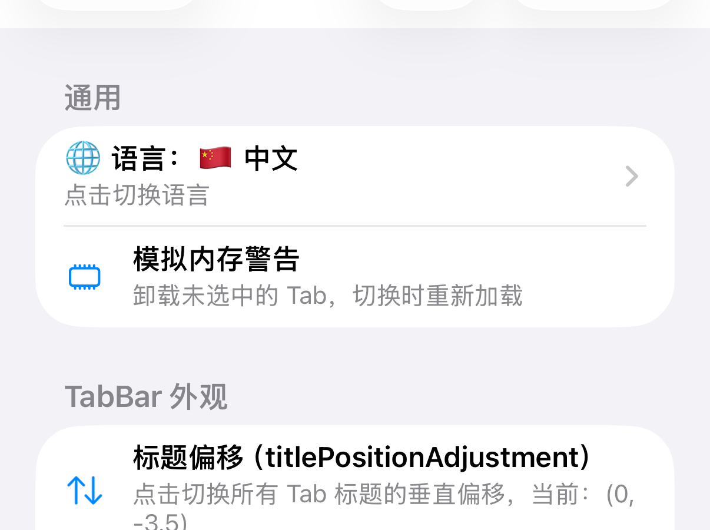
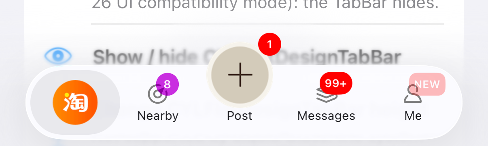

# [CN]iOS 核心层迁移到 Swift
# [EN]Migrating the iOS core layer to Swift

<!-- bound-classes: none -->
<!-- binding:start -->
<!-- Generated by scripts/update-docs-navigation.py; do not edit by hand. -->

| 中文 | English |
|:---|:---|
| 本文档不绑定代码类。 | This document is not bound to a code class. |

<!-- binding:end -->

## [CN]目录
## [EN]Contents

<!-- navigation:start -->
<!-- Generated by scripts/update-docs-navigation.py; do not edit by hand. -->

| 中文 | English |
|:---|:---|
| [任务](#cn任务) | [Task](#entask) |
| [评分](#cn评分) | [Score](#enscore) |
| [方案](#cn方案) | [Plan](#enplan) |
| [进度](#cn进度) | [Progress](#enprogress) |

<!-- navigation:end -->

## [CN]任务
## [EN]Task

| 中文 | English |
|:---|:---|
| 本文按用户要求使用英文（见右列）。 | TODO (2026-11-12, Swift migration of the iOS core layer): user prompt, verbatim: "将下面的任务找一个合适的文档，标注 TODO：全英文写入：注意本操作仅仅设计iOS端，重点修改 本项目的Core核心层面代码。 不涉及第三方库，首先创建swift编码规范文档，更新instructions和skills相关文档。如果网络有现成的swift skills请直接复制安装到本项目中，按照swift编码规范以及swift相关skilla，将Core 核心层面代码全部转录为Swift代码，如果无必要不要修改example层代码。在该文档中记录swift翻译进度。以项目中不存在objc代码为准，如果无法翻译为swift以宏定义 关键字形式 进行兼容swift的也可以算作翻译成功。不存在objc代码为满分，每提交一次就打一次分。每提交一次检查是否满分。一直到满分为止。" |
| | Requirements: iOS only. Translate the core layer (the `Core` subspec, its dependencies `CYLUtils` and `CYLBadgeView`, and the FlatDesign tab bar `CYLFlatDesignTabBar`) from Objective-C to Swift; third-party libraries and their adapters (Lottie, PAG, Rive, GIF) are out of scope. First write the Swift coding standard ([Swift-Coding-Style.md](Swift-Coding-Style.md)) and update the instructions and skills. Install ready-made Swift skills when they exist. Leave the example layer alone unless a change is needed. Record the progress here. Full marks (100) means no Objective-C code is left in the core layer; what cannot be written in Swift and stays as macros or keywords for Swift compatibility counts as translated. Score every commit and check for full marks; continue until 100. |

## [CN]评分
## [EN]Score

| 中文 | English |
|:---|:---|
| 见右列。 | `python3 scripts/swift-migration-score.py` prints the score and the files still in Objective-C. Every `.m` line counts; a `.h` file counts unless it only holds preprocessor lines, comments and Swift compatibility markers. Score = 100 × (1 − remaining / 59 391), rounded down. Every commit of this migration puts the score in its body and adds a row to "Progress". |

## [CN]方案
## [EN]Plan

| 中文 | English |
|:---|:---|
| 见右列。 | **Bottom-up, file by file.** Swift Package Manager cannot mix Swift and Objective-C in one target, so the translated Swift code is a lower layer that the remaining Objective-C imports: a file is translated only after everything it calls is Swift (or is a system API). CocoaPods and the Xcode framework target build one mixed module meanwhile. |
| | **Same API for Objective-C callers.** Every public class, category method, constant and notification keeps its Objective-C name through `@objc(name)`, so the Objective-C example and existing apps keep compiling; Swift names follow the Swift API Design Guidelines where the old `NS_SWIFT_NAME` already gave one. |
| | **Order.** ① Leaves of `CYLUtils` (helpers, localization, resource routes) → ② `CYLBadgeView` → ③ the root categories (`UIView`, `UIImage`, `UIColor`, `UIControl`, `UITabBarItem`, `NSObject` extensions) → ④ `CYLConstants`, `CYLLocalization`, the configuration parser and manifest → ⑤ `CYLPlusButton`, `CYLTabBar` → ⑥ `CYLTabBarController` and its categories → ⑦ the base and demo-section view controllers. |
| | **Dependency map (2026-11-12, `scripts/swift-migration-deps.py`)**: the remaining Objective-C files, grouped by the `#import`s that tie them together. (1) Independent leaves, movable now: `CYLTabBarTransition` and the two FlatDesign transition helpers (moved in step 9). (2) Leaves blocked by the enum/protocol rule: `CYLTabButtonAnimation` (803 lines; its protocol is used by public headers), `CYLTabBarItemAnimationService` (224; its protocols are used by other headers), `CYLTabBarConfigurationParser` (2 790; its enums), and the remaining headers of `CYLUtils` (`CYLLocalizedString.h`, `CYLUtilsMacros.h`) and of the theme (`__kindof` blocks). (3) **One cycle of 41 files, 44 669 lines**: `CYLTabBarController` and its categories, `CYLTabBar`, `CYLPlusButton`, `CYLConstants`, the FlatDesign tab bar, the badge categories, the base view controllers and the demo-section categories all import each other. SwiftPM's Swift target sits below the Objective-C target, so translated Swift code cannot call Objective-C: inside this cycle, no file can move alone without breaking the SwiftPM build. **Decision (maintainer, 2026-11-12): seams first, every commit green.** The cycle is cut with seams so that every commit still builds with CocoaPods, the Xcode framework and SwiftPM: when a Swift file needs an Objective-C class that is still in the cycle, the Swift layer declares an `@objc` protocol with just the members it needs, and the Objective-C class adopts it in its `.m` (a class extension, so no public header names the Swift protocol); a call that has no protocol yet goes by selector. Each seam is removed when its Objective-C side moves to Swift. First candidates (they import only one other cycle file, mostly the umbrella header, so few seams are needed): `UIColor+CYLTabBarControllerExtention` (820 lines), `UIImage+CYLTabBarControllerExtention` (980), `CYLLocalization` (269), `UIViewController+CYLMemoryWarning` (135), `CYLBaseViewController` / `CYLBaseTableViewController` (72 / 71), `CYLTabBarManifest` (884), `CYLTabBarPageRegistry` (995), `CYLTabBarHostView` (1 021); each is checked for the symbols it really uses before it moves. |
| | **Subclassable classes (decision by the maintainer, 2026-11-13, final): thin Objective-C shell, Swift engine.** Swift classes are exported with `objc_subclassing_restricted`, so Objective-C code cannot subclass a Swift class. Every public class that Objective-C apps or this repository subclass keeps an Objective-C class with the same name, superclass and API (the shell): its methods only forward to a Swift implementation (the engine, a Swift object the shell owns or Swift functions taking the shell), so Objective-C and Swift subclasses keep working. Classes concerned: `CYLPlusButton`, `CYLTabBarController`, `CYLBaseNavigationController`, `CYLBaseViewController`, `CYLBaseTableViewController`, `CYLTabButtonBlockAnimation` (and any other class found subclassed later). A shell file starts with the marker comment `CYL-SWIFT-MIGRATION: objc-shell` and the reason; `scripts/swift-migration-score.py` counts a marked file as compatibility code (like macro-only headers) and lists the shells with their size, so a shell that holds logic is visible. `CYLTabBarBadgeView` stays a Swift class (the maintainer's choice): Objective-C apps can no longer subclass it, a compatibility change to note in the release notes. (An earlier answer on 2026-11-13 chose to translate these classes to Swift outright; the maintainer replaced it with this one.) |
| | **The core moves on its own branch (decision by the maintainer, 2026-11-13).** Seams reached their limit after step 16: the 41 core files (~45 000 lines) adopt or expose each other's Objective-C protocols, enums and block types declared in public headers (for example `CYLTabBarHostView` adopts `CYLTabBarControllerDelegate` from `CYLTabBarController.h`), and SwiftPM's lower Swift target cannot see them, so no core file can move alone while SwiftPM stays green. The core therefore moves in large steps on the branch `swift-core` (its own pull request, based on `feat/cross-platform-components`): CocoaPods, the Xcode framework, the unit tests and the demos build at every commit there; only the SwiftPM build fails until the whole core is Swift, when `Package.swift` becomes one Swift target. `feat/cross-platform-components` (PR #788) stays green. The seams and shells rules above still apply where they help. |
| | **Types used by Objective-C headers move last.** Swift reads the public Objective-C headers without the generated Swift interface, so an Objective-C header that is still Objective-C cannot use an enum or a protocol defined in Swift (a class is fine: `@class` forward declarations resolve to the Swift class). An enum or protocol (e.g. `CYLBadgeStyle`, `CYLBadgeAnimationType`, `CYLBadgeProtocol`) moves to Swift only together with, or after, every public header that uses it; until then, Swift code that needs it is written after those headers move (learned in step 8). |
| | **Kept as compatibility.** C macros and `static inline` helpers that Objective-C callers use (e.g. `CYLExternPlusButton`, `CYL_IS_IOS_26`) stay in headers when Swift cannot replace them for those callers; such headers hold only preprocessor lines and count as translated. |
| | **Each step**: translate, clean build of the library and the Objective-C example, all unit tests (iOS 26 and iOS 17.5), commit with the score, update "Progress". |
| | **Skills used**: `swift-language`, `swift-api-design-guidelines`, `swift-concurrency`, `swift-testing`, `migration-patterns` (its `objc-to-swift.md`). Searched online on 2026-11-12: `convert-objc-swift` (aRustyDev) is AGPL-3.0, which this MIT project cannot vendor, so it is not installed. |
| | **Risks**: the public headers are the API of an Objective-C library used by many apps: renamed selectors break them, so names are kept; Swift needs the `swift_versions` of the podspec and a Swift-capable build in Carthage and SPM; the generated `CYLTabBarController-Swift.h` replaces hand-written headers for translated classes. |

## [CN]进度
## [EN]Progress

| 中文 | English |
|:---|:---|
| 见右列。 | 2026-11-12: baseline 55 876 Objective-C lines in 124 files; score **0 / 100**. Coding standard, instructions, skills and the scoring script are in place; no file is translated yet. |
| | 2026-11-12, step 1: `CYLUtils/UIViewController+CYLUtils` → `CYLUtils/Swift/UIViewController+CYLUtils.swift` (the `.m` is gone; the header keeps the Objective-C declaration behind `#ifndef __swift__`). Build plumbing for every later step: the podspec takes `.swift` in `CYLUtils`, `Package.swift` has a lower `CYLTabBarControllerSwift` target (SwiftPM cannot mix languages), the Xcode framework target compiles the file. Lesson: keep the Swift name Clang gave the method (`cyl_getViewControllerInsteadOfNavigation()`), see the style guide. Verified: unit tests 129 on iOS 26.1 pass; on iOS 17.5 two failures of one test that also fail without this step (a classic badge bug, TODO in [Update-Tab-Bar-Items-In-Place](Update-Tab-Bar-Items-In-Place.md)); the Objective-C demo (CocoaPods), `Example-Swift` (CocoaPods, local path) and the SwiftPM package build. Score **0 / 100** (55 856 lines left; the score rounds down). |
| | 2026-11-12: scope correction by the maintainer ("FlatDesign subspecs wrap belongs to core code"): `CYLFlatDesignTabBar` (3 499 lines) joins the core layer; the baseline is now 59 391 lines (FlatDesign included), 59 378 left. Score **0 / 100**. |
| | 2026-11-12, step 2: four more `CYLUtils` files to Swift: `NSObject+CYLUtils` (safe KVC now checks that a key resolves, in KVC's own search order, instead of catching an exception, which Swift cannot do; the placeholder flag keeps its selector key), `UIView+CYLUtils`, `UIBarItem+CYLUtils`, `UIView+CYLHitTestOutsideBounds` (the one-time exchange of `-hitTest:withEvent:` in Swift). Headers keep the Objective-C declarations behind `#ifndef __swift__`; the Swift names are the ones Clang gave (checked by type-checking a Swift file against the old headers: only `cyl_nearestControl(below:)` differs from the selector). New `CYLUtilsSwiftTests.m` (5 tests, called from Objective-C through the old headers). Verified: 134 unit tests pass on iOS 26.1 and iOS 17.5; the SwiftPM package, the Objective-C demo and `Example-Swift` build. Swift migration score: 0 / 100 (59230 of 59391 Objective-C lines left). The core grew by the classic badge fix (Objective-C, ~60 lines) before this step, so lines left can exceed the baseline; new core code is written in Swift from now on. |
| | 2026-11-12, step 3: `CYLUtils` (the class) and `CYLLocalizedString` (the library's strings and resource bundle) to Swift. The C functions keep their C names for Objective-C through `@_cdecl`, so the binary interface does not change; `CYLLocalizationLanguageDidChangeNotification` is a macro for Objective-C and a constant for Swift (the macro compatibility the task allows). A translated **class** cannot be declared twice, so `CYLUtils.h` imports the new `CYLSwiftInterface.h` (the generated `CYLTabBarController-Swift.h`, or `@import CYLTabBarControllerSwift` in SwiftPM; never while Swift itself compiles). In SwiftPM the resource bundle moved to the Swift target, the one that reads it. Verified: 134 unit tests on iOS 26.1 and 17.5, `xcodebuild analyze` without warnings in the library, the SwiftPM package, the Objective-C demo and `Example-Swift` build; the demo in Simplified Chinese shows the library's strings (screenshot: iOS · iOS 26.1 simulator, iPhone 17 Pro · Xcode 27.2, iOS SDK 27.2 · macOS 27.3 · branch `feat/cross-platform-components` · 2026-11-12). Swift migration score: 0 / 100 (59035 of 59391 Objective-C lines left). |

| 中文 | English |
|:---|:---|
| | 2026-11-12, step 4: `CYLResourceRoute` (a class, declared through `CYLSwiftInterface.h`; written with `NSString`'s path methods so routes resolve exactly as before) and `UIImage+CYLUtils` (header-only `CG_INLINE` functions; now Swift functions exported under their C names with `@_cdecl`, the header keeps plain declarations). The existing `CYLResourceRouteTests` caught one difference (a non-string route must give nil, not raise); the Swift method now takes `Any?` and checks the type. Verified: 134 unit tests on iOS 26.1 and 17.5, `xcodebuild analyze` clean, the SwiftPM package, the Objective-C demo and `Example-Swift` build. Swift migration score: 0 / 100 (58808 of 59391 Objective-C lines left). |
| | 2026-11-12, step 5: the theme module (`CYLUtils/CYLComponents/CYLTheme`, 9 Objective-C files) to Swift in one step, since its files call each other: `CYLThemeManager` and `CYLThemeManagerCenter` (classes, declared through `CYLSwiftInterface.h`), the `UIColor` / `UIImage` / `UIVisualEffect` / `UIView` / `CALayer` / `UIViewController` theme extensions (headers keep the Objective-C declarations behind `#ifndef __swift__`), and the private `CYLThemePrivate` helpers (now internal Swift, `CYLThemeRuntime`; the private header is gone). `CYLThemeDidChangeNotification` and `CYLThemeManagerNameDefault` are macros for Objective-C and constants for Swift. The two `-cyl_themeDidChangeByManager:identifier:theme:` hooks are `open dynamic`, so `CYLTabBarController (CYLTheme)` and apps still override them. Swift names are the ones Clang imported (checked by type-checking a probe against the old headers, e.g. `cyl_color(themeProvider:)`, `cyl_raw`). **Compatibility note**: Swift cannot express `__kindof`, so Objective-C now sees theme identifiers and manager names as `id<NSCopying, NSObject>` instead of `__kindof NSObject<NSCopying> *`; assigning one straight to `NSString *` now gives a warning (one call site in the library fixed). Verified: 134 unit tests (including `CYLThemeTests`) on iOS 26.1 and 17.5, `xcodebuild analyze` and the Objective-C demo build without warnings, the SwiftPM package and `Example-Swift` build. No screenshot: a refactor with no visible change, covered by the theme unit tests. Swift migration score: 3 / 100 (57145 of 59391 Objective-C lines left). |
| | 2026-11-12, step 6: seven translated headers no longer repeat the Objective-C declarations: `UIViewController+CYLUtils`, `UIView+CYLUtils`, `NSObject+CYLUtils`, `UIBarItem+CYLUtils`, `UIView+CYLHitTestOutsideBounds`, `UIImage+CYLUtils` (its `@_cdecl` C functions too) and `CALayer+CYLTheme` now import `CYLSwiftInterface.h`, the generated Swift interface, which declares the same categories and functions with their documentation. Not done yet, on purpose: `CYLLocalizedString.h` (its format-string attributes `NS_FORMAT_ARGUMENT` / `CYL_RETURNS_LOCALIZED_STRING` exist only in the hand header) and the theme headers whose blocks or overrides use `__kindof` identifiers (`UIColor` / `UIImage` / `UIVisualEffect` / `UIView` / `UIViewController` theme), whose generated signatures differ; they wait until their Objective-C callers are Swift. **Compatibility note, extended**: like the identifiers (step 5), `currentTheme` and `-themeForIdentifier:` are `NSObject *` for Objective-C now (no `__kindof`), so assigning one to a theme class needs a cast (one test fixed). Verified: 134 unit tests on iOS 26.1 and 17.5, `xcodebuild analyze` and the Objective-C demo build without warnings, the SwiftPM package and `Example-Swift` build. Swift migration score: 4 / 100 (56714 of 59391 Objective-C lines left). |
| | 2026-11-12, step 7: the first two `CYLBadgeView` files to Swift, in `CYLBadgeView/Swift/` (the podspec's badge subspec takes `.swift`; SwiftPM's Swift target builds that folder too): `CYLBadgeAppearance` (the same fallbacks for invalid values; Swift name `CYLBadgeAppearance.global` kept) and `CYLTabBarBadgeView` with its `CYLBadgeTextDisplaying` protocol (`UILabel` conforms in Swift). Both headers keep only `kCYLBadgeDefaultFont` (a macro) and import `CYLSwiftInterface.h`. `CYLTabBarBadgeView` tells its host about window and trait changes through the selector `cyl_notifyBadgeHostOfEnvironmentChange` until `UIView (CYLBadgeExtention)` is Swift too (the lower Swift layer cannot call that Objective-C category directly). Verified: 134 unit tests on iOS 26.1 and 17.5, `xcodebuild analyze` and the Objective-C demo build without warnings, the SwiftPM package and `Example-Swift` build, `pod lib lint --quick` passes; the demo's badges ("8", "1", "99+", "NEW") look as before (screenshot: iOS · iOS 26.1 simulator, iPhone 17 Pro · Xcode 27.2, iOS SDK 27.2 · macOS 27.3 · branch `feat/cross-platform-components` · 2026-11-12 20:27 NZDT). Swift migration score: 5 / 100 (56202 of 59391 Objective-C lines left). |

| | 2026-11-12, SonarCloud and CI for PR #788: (1) CI "Check the navigation" failed (`docs/CYLUtils-Helpers.md: bound class CYLUtils is not declared in any header`): `scripts/update-docs-navigation.py` found classes only by `@interface Name :` in headers; it now also finds `@objc(Name)` above `class Name` in Swift files and binds such a class to the header of the same name (which stays for Objective-C callers), else to the Swift file; `--check` passes. (2) SonarCloud's 70 new issues: the real ones fixed (unused parameters named `_`, an empty closure explained, a nested ternary unrolled, the empty bundle token class replaced by `Bundle(for: CYLUtils.self)`), private helpers and the Swift-side names of `@_cdecl` entry points renamed to lowerCamelCase (`cylImageNamedEntryPoint`, `applyThemeChange(by:…)`), and the names that must stay for compatibility (`cyl_` members, `CYL` C functions and constants) marked `// NOSONAR: kept API name`, the rule now in [Swift-Coding-Style.md](Swift-Coding-Style.md). Verified: 134 unit tests on iOS 26.1 and 17.5, the SwiftPM package and the Objective-C demo build. TODO: many lines of the translated Swift files are longer than the style guide's 120 characters; rewrap them in a formatting-only commit. |
| | 2026-11-12, SonarCloud follow-up for PR #788: after the re-analysis 46 issues were left: 45 naming findings (`swift:S100` / `S115`) on names kept for compatibility, which `// NOSONAR` does not silence (SonarCloud's Swift analyzer has no NOSONAR support), and one new `python:S5852` (a backtracking-prone regex in `update-docs-navigation.py`). The regex is replaced by a line-by-line parse (`swift_class_names`), the ineffective NOSONAR markers are removed, and the style guide says how kept names are handled. TODO (maintainer): mark the 45 naming findings **Accept** in SonarCloud (Issues → filter rule `swift:S100` and `swift:S115` → Bulk change → Accept), as automatic analysis offers no file-level switch for them. |
| | 2026-11-12, step 8: `CAAnimation (CYLBadgeExtention)` and `CYLAxis` to Swift (`CYLBadgeView/Swift/CAAnimation+CYLBadgeExtention.swift`, every selector and Clang Swift name kept, including the odd `cyl_badge_once_fade(in_AnimationRepeatTimes:durTimes:)`); its header keeps only the two degree macros. `CYLBadgeAnimationForType()` moved, unchanged, into `UIView+CYLBadgeExtention.m` (Objective-C), because it uses `CYLBadgeAnimationType`. **Lesson (also in the Plan)**: `CYLBadgeProtocol.h` (the badge enums and protocol) was translated too, then put back: the Objective-C headers that are still Objective-C and that Swift also reads (`UIView+CYLBadgeExtention.h` and the other badge categories, `UIViewController+CYLTabBarControllerExtention.h`, `UITableViewCell+CYLBadgeExtention.h`) use those types, and Swift reads them without the Swift interface (`cannot find protocol declaration for 'CYLBadgeProtocol'`). A Swift class can be forward-declared there (`@class`), an enum cannot. So an enum or protocol moves to Swift only together with, or after, every Objective-C public header that uses it. Verified: 134 unit tests on iOS 26.1 and 17.5, `xcodebuild analyze` and the Objective-C demo build without warnings, the SwiftPM package and `Example-Swift` build, `pod lib lint --quick` passes. SonarCloud will report the kept selector-style names of this category (`swift:S100`) for the maintainer to accept. Swift migration score: 6 / 100 (55381 of 59391 Objective-C lines left). |
| | 2026-11-12, step 9: the independent leaves of the dependency map to Swift: `CYLTabBarSlideTransitionAnimator` and `CYLTabBarInteractiveTransition` (`CYLTabBarController/Swift/CYLTabBarTransition.swift`, the first core file: the podspec's Core subspec takes `CYLTabBarController/Swift/*.swift`, SwiftPM's Swift target builds that folder) and the FlatDesign transition context and animator (`CYLFlatDesignTabBar-ObjectiveC/Swift/`; unused by the library, kept because their headers shipped as public; the accessors keep `isAnimated` / `setAnimated:`, checked in the generated header). New script `scripts/swift-migration-deps.py` prints the dependency groups; the map and the open decision on the 44 669-line cycle are in the Plan. Verified: 134 unit tests on iOS 26.1 and 17.5, `xcodebuild analyze` and the Objective-C demo build without warnings, the SwiftPM package, `Example-Swift` and `pod lib lint --quick` pass. Swift migration score: 7 / 100 (55012 of 59391 Objective-C lines left). |
| | 2026-11-12, step 10: `UIColor (CYLTabBarControllerExtention)` to Swift (`CYLTabBarController/Swift/UIColor+CYLTabBarControllerExtention.swift`), the first file of the core cycle. It needed no seam: its only cycle import (`CYLConstants.h`) was for `CYL_DEPRECATED`, which lives in `CYLUtilsMacros.h`. Every color now returns the UIKit color directly (the library's minimum is iOS 13, so the hard-coded fallbacks for earlier systems were unreachable and are gone); Swift names kept as Clang imported them (`UIColor.cyl_systemRed` …, `cyl_color(withLight:dark:)`, `cyl_randomColor`, the deprecated `cyl_systemBrown`). Verified: 134 unit tests on iOS 26.1 and 17.5, `xcodebuild analyze` and the Objective-C demo build without warnings, the SwiftPM package, `Example-Swift` (which calls `cyl_color(withLight:dark:)`) and `pod lib lint --quick` pass. Swift migration score: 8 / 100 (54190 of 59391 Objective-C lines left). |
| | 2026-11-12, step 11: `UIImage (CYLTabBarControllerExtention)`, `CYLImageCache` and `CYLImageCacheExpireType` to Swift (`CYLTabBarController/Swift/UIImage+CYLTabBarControllerExtention.swift`); no seam needed (no real cycle dependency). The cache key is the same SHA-256 hex of the URL (CryptoKit instead of CommonCrypto), so images cached by earlier versions are found. **Option sets cannot be exported from Swift**: `CYLImageLoadOptions` stays an `NS_OPTIONS` in the header for Objective-C (hidden from Swift), Swift has an `OptionSet` of the same name and values with the same `cyl_load(with:options:completion:)`, and the Objective-C selector `+cyl_loadImageWithURL:options:completion:` takes the raw value, so callers on both sides are unchanged. Swift names kept as Clang imported them (`CYLImageCache.shared()`, `cyl_image(with:size:)`, `cyl_getImage(fromImageInfo:)`, `cyl_tabItemPlaceholder()` …). Verified: 134 unit tests on iOS 26.1 and 17.5, `xcodebuild analyze` and the Objective-C demo build without warnings, the SwiftPM package, `Example-Swift`, `Example-network-download` (uses `CYLImageCache.shared()`) and `pod lib lint --quick` pass. Swift migration score: 10 / 100 (53263 of 59391 Objective-C lines left). |
| | 2026-11-13, step 12: `CYLLocalization` (`CYLLocalizedTabBarItemsAttributes()`, `cyl_localizeTexts`, the language row and picker, `cyl_setRootViewControllerProvider:`) and `UIViewController (CYLMemoryWarning)` with `CYLSimulateMemoryWarningReport()` to Swift (`CYLTabBarController/Swift/`). **The first seams**: (1) the tab item keys `CYLTabBarItemTitle` / `Image` / `SelectedImage` / `DarkImage` are Swift constants with the same strings (`CYLLocalizationItemKeys`) while `CYLTabBarController`'s constants are Objective-C; (2) the new `@objc` protocol `CYLTabBarControllerMemoryWarningSeam` (`unloadsUnselectedViewsOnMemoryWarning`, `-shouldUnloadViewOfViewController:`), adopted by `CYLTabBarController` in its `.m` class extension; (3) `+cyl_simulateMemoryWarningForTabBarController:`, `-cyl_owningTabBarController` and `-cyl_tabBarController` called by selector. `CYLSimulateMemoryWarningReport()` now takes a `UITabBarController` (every `CYLTabBarController` is one), since the Swift layer cannot name the Objective-C class. New unit test `testMemoryWarningReportThroughTheSeam` checks the seam (conformance, the settings read, one line per tab). Verified: 135 unit tests on iOS 26.1 and 17.5, `xcodebuild analyze` and the Objective-C demo build without warnings, the SwiftPM package, `Example-Swift`, `Example-Swift-02`, `Example-GIF` (callers of `CYLLocalizedTabBarItemsAttributes` and `cyl_setRootViewControllerProvider`) and `pod lib lint --quick` pass. Swift migration score: 10 / 100 (52859 of 59391 Objective-C lines left). |
| | 2026-11-13, step 13: the first Objective-C shells. `CYLBaseViewController` and `CYLBaseTableViewController` (subclassed by the demo's view controllers and by apps) already hold no logic: each lifecycle method only calls `-cyl_…NavigationSetting` of `UIViewController (CYLTabBarControllerExtention)`, which moves to Swift with that category. Their four files carry the `CYL-SWIFT-MIGRATION: objc-shell` marker (175 lines in all, listed by the score script). Comments only; no code changed. Swift migration score: 11 / 100 (52712 of 59391 Objective-C lines left). |
| | 2026-11-13, step 14: `CYLTabBarConfigurationParser` (2 577 lines: JSON, JSON5 / JSONC, property lists and .strings, YAML, TOML, INI, .properties / .env, XML, Protocol Buffers text and binary) to Swift, in six files (`CYLTabBarController/Swift/CYLTabBarConfigurationParser*.swift`). Its enums are only mentioned in comments of other headers, so the enum/protocol rule does not block it. Same rules: text is read as UTF-16 units through `NSString`, trees are Foundation mutable containers, every limit (5 MB, nesting 64, binary plist and protobuf checks, XXE off) and every error message is kept. Objective-C keeps its names through macros: `CYLTabBarConfigurationErrorDomain`, the two limits, and the old error code names (Swift exports `CYLTabBarConfigurationErrorCodeFileNotFound` …, the macros map `CYLTabBarConfigurationErrorFileNotFound` … to them). Two small behavior changes: an emoji (a character outside the Basic Multilingual Plane) in a Protocol Buffers text string is now kept, where the Objective-C version dropped it; a hexadecimal number too large for 64 bits is now read as a string instead of the largest number. The standalone harness `scripts/configuration-tests/run-tests.sh` compiles the Swift parser with swiftc (with its Objective-C header) and links the Objective-C tests; it no longer runs on Linux / GNUstep (Swift on Linux has no Objective-C interop), and the GNUstep helpers `lower.py` and `cyl_sub.h` are removed ([Configuration-Scripts.md](Configuration-Scripts.md)). Verified: the harness passes 450 checks (17 sample files, 43 edge cases, every Example exported in 12 formats), 135 unit tests on iOS 26.1 and 17.5, `xcodebuild analyze` without warnings, the SwiftPM package, the Objective-C demo, `Example-Swift` and `pod lib lint --quick`. Swift migration score: 15 / 100 (49920 of 59391 Objective-C lines left). |
| | 2026-11-13, step 15: `CYLTabBarManifest`, `CYLTabBarManifestLoader`, `CYLTabBarManifestLoaderDelegate` and `CYLTabBarManifestSource` to Swift (`CYLTabBarController/Swift/CYLTabBarManifest.swift`; conditions, eligibility, assets with SHA-256 hashes now through CryptoKit with the same `sha256-…` text, themes, the configuration, the versioned cache and the fallbacks unchanged). Seams: the configuration keys are Swift strings equal to their names (`CYLConfigurationKeys`), and `-tabBarControllerWithError:` makes the controller with `+[CYLTabBarController tabBarControllerWithConfiguration:]` by selector. **Compatibility notes**: `-tabBarControllerWithError:` returns a `UITabBarController` (always a `CYLTabBarController`), since the Swift layer cannot name the Objective-C class: the three callers in this repository cast it; Swift keeps `CYLTabBarManifest(dictionary:baseDirectory:)` and `CYLTabBarManifest(route:)` as initializers while Objective-C keeps `+manifestWithDictionary:baseDirectory:error:` and `+manifestWithRoute:error:` (an `@objc` initializer must start with `init`). The tests' private `+hashOfData:` stays as an internal `@objc` method. Verified: 135 unit tests (10 of them `CYLTabBarManifestTests`) on iOS 26.1 and 17.5, `xcodebuild analyze` and the Objective-C demo without warnings, the SwiftPM package, `Example-Swift` and `pod lib lint --quick`. Swift migration score: 17 / 100 (49060 of 59391 Objective-C lines left). |
| | 2026-11-13, step 16: the protocols of the private header `CYLTabBarItemAnimationService.h` (`CYLTabBarItemAnimationStyleSource`, `CYLTabBarItemAnimationHost`, `CYLTabBarItemAnimationService`) to Swift (`CYLTabBarController/Swift/CYLTabBarItemAnimationService.swift`, every selector kept). Only private headers use them, which Swift never reads, so the enum/protocol rule allows it; the Objective-C adopters (the animation engine and the Lottie / PAG / Rive / GIF adapters) are unchanged. The header keeps the C function declarations, whose definitions are Objective-C (`CYLConstants.m`, `UIControl+CYLTabBarItemAnimation.m`). Trade-off: a framework's generated header exports public declarations only, so the three protocols, private before, are now visible API, documented as internal. `CYLTabBarPageRegistry` stays blocked (its protocol and typed constants are used by `CYLTabBarController.h`). Verified: 135 unit tests on iOS 26.1 and 17.5, `xcodebuild analyze` and the Objective-C demo without warnings, the SwiftPM package, `Example-Swift` and `pod lib lint --quick`. Swift migration score: 17 / 100 (48894 of 59391 Objective-C lines left). |
| | TODO (2026-11-13, branch `swift-core`): move the 41-file core cycle to Swift, as the maintainer chose (answer: "Separate branch, SPM red"). Work happens in the worktree `CYLTabBarController-swift-core` (the main checkout is shared with another session). Order, each step building with CocoaPods and the Xcode framework, all unit tests passing on iOS 26.1 and 17.5, the Objective-C demo and `Example-Swift` building: ① the configuration keys and constants of `CYLConstants` / `CYLTabBarController.h` (Swift constants plus Objective-C macros), removing the key seams; ② the public enums, protocols and block types of the cycle (`CYLTabBarControllerDelegate`, `CYLPlusButtonSubclassing`, `CYLBadgeProtocol` and the badge enums, `CYLTabBarPageProviding`, `CYLTabButtonAnimation` …), all at once, so every header that uses them reads them from Swift; ③ the categories and helpers that are not subclassed (badge categories, `UIViewController` / `UIControl` / `UITabBarItem` categories, page registry, host view, demo-section categories); ④ `CYLTabBar`, `CYLPlusButton`, `CYLTabBarController`, `CYLBaseNavigationController` and the FlatDesign tab bar as thin Objective-C shells over Swift engines; ⑤ `Package.swift` as one Swift target, SwiftPM green again, then merge into `feat/cross-platform-components`. SwiftPM fails on this branch until ⑤. |
| | 2026-11-13, step 17 (branch `swift-core`, plan step ①): the 112 string constants of the core (106 configuration and attribute keys and notification names of `CYLTabBarController.h`, 5 of `CYLTabBarHostView.h`, `CYLSampleConfigurationURLString`) to Swift (`CYLTabBarController/Swift/CYLConstants+Keys.swift`, generated from the headers with each header comment): `public let` constants for Swift, and the 7 notification names as `NSNotification.Name` statics (`.CYLTabBarItemDidChange` …, the names Clang gave them). Objective-C keeps every name as a macro hidden from Swift (`#ifndef __swift__`), with the same strings; the definitions in `CYLTabBarController.m`, `CYLTabBarHostView.m` and `UIViewController+CYLConfigurationDemo.m` are gone. Two category names equal to constant names were expanded by the macros and are renamed (`CYLTabBarController (CYLTabBarItemIdentifierSupport)`, `UIViewController (CYLTabBarItemTitleSupport)`; category names are not part of any caller's code). The key seams of steps 12 and 15 now use the real constants. The registry's typed `CYLTabBarPageSource` constants stay with the registry. Verified: 135 unit tests on iOS 26.1 and 17.5, `xcodebuild analyze` and the Objective-C demo without warnings, `Example-Swift` and `pod lib lint --quick`; SwiftPM not built on this branch. Swift migration score: 17 / 100 (49030 of 59391 Objective-C lines left). |
| | 2026-11-13, decisions by the maintainer on branch `swift-core` (they replace the shells rule for this branch): (1) **big bang**: an experiment showed that Objective-C headers cannot adopt or use a Swift protocol or enum while they stay Objective-C (forward declarations warn "cannot find protocol definition", and the include order turns circular: `unknown type name 'CYLBadgeAnimationType'`), and `CYLTabBarController.h` uses nearly every type of the cycle, so the cycle moves to Swift as a whole on this branch, in WIP commits; (2) **open Swift classes**: a fully Swift core and Objective-C subclassing cannot both hold (a shell's header needs the Swift protocols and enums, which Swift cannot see while it reads that header, and SwiftPM's single Swift target cannot hold Objective-C shells), so `CYLPlusButton`, `CYLTabBarController`, `CYLBaseNavigationController`, `CYLBaseViewController`, `CYLBaseTableViewController` and `CYLTabButtonBlockAnimation` become `open` Swift classes; Objective-C apps subclass them in Swift (release notes and a migration guide, TODO); the Objective-C subclasses in this repository (demo view controllers, `CYLPlusButtonSubclass`, `MainTabBarController`, `CYLFlatDesignMainTabBarController`, the library's demo classes, the test class `CYLTestPlusButton`) are ported to Swift in the same step as their superclass. **Order that keeps CocoaPods green as long as possible**: Swift code in the mixed module can use the remaining Objective-C enums and protocols, so ① categories and helpers that are not subclassed move first while the types stay Objective-C (each header imports `CYLSwiftInterface.h` after its own declarations, so the generated header never needs a type that is not declared yet); ② then the subclassable classes with their Objective-C subclasses ported; ③ last, all at once, the protocols, enums and block types with `CYLTabBarController.h`, the only step where the builds are red. |
| | 2026-11-13, step 18 (branch `swift-core`, phase ①): `UITabBarItem (CYLTabBarControllerExtention)` and `UITabBarAppearance (CYLTabBarControllerExtention)` to Swift (`CYLTabBarController/Swift/UITabBarItem+CYLTabBarControllerExtention.swift`); Swift calls the Objective-C categories that are still Objective-C (`cyl_tabImageView`, `cyl_tabButton`, `cyl_platterView` …) through the mixed module, and the header imports `CYLSwiftInterface.h` at its end (the include-order rule). Selector association keys kept. Verified: 135 unit tests on iOS 26.1 (the full check, iOS 17.5, analyze and the demos, runs every few files in this phase). Swift migration score: 17 / 100 (48779 of 59391 Objective-C lines left). |
| | 2026-11-13, step 19 (branch `swift-core`, phase ①): `NSObject (CYLTabBarControllerExtention)` to Swift (`CYLTabBarController/Swift/NSObject+CYLTabBarControllerExtention.swift`: context, forced orientation, topmost view controller, dismiss all, debug descriptions, gesture recognizer kinds, plus page check). Two things Swift cannot do: catching an Objective-C exception, so `-cyl_removeObserver:forKeyPath:` and its `context:` variant stay in a 40-line Objective-C file marked `CYL-SWIFT-MIGRATION: objc-required` (new marker: counted as compatibility code and listed by the score script, like the shells); and `NSInvocation`, so the iOS 13–15 orientation path sets `UIDevice`'s `orientation` through KVC, as its `-performSelector:` line already did. Verified: 135 unit tests on iOS 26.1. Swift migration score: 18 / 100 (48356 of 59391 Objective-C lines left). |
| | 2026-11-13, step 20 (branch `swift-core`, phase ①): most of `UIControl+CYLTabBarItemAnimation` to Swift (`CYLTabBarController/Swift/UIControl+CYLTabBarItemAnimation.swift`): the animation service and its lock, the core host, the attribute helpers and the public C functions (`CYLTabBarItemsAttributesAddingLottieFiles`, `CYLTabBarAnimationURLWithOptions`, `CYLTabBarItemAttributesAddingAnimationFile(s)`, exported under their C names with `@_cdecl`, so the declarations of `CYLTabBarController.h` still serve Objective-C and Swift callers), and the `UIControl` / `UIView` animation methods (their declarations in `UIControl+CYLTabBarControllerExtention.h` are hidden from Swift). Kept Objective-C for now, with reasons: `CYLTabBarItemAnimationURLFromAttributes()` and its dark-style registration (they call functions declared only in private headers, which Swift cannot see; they move with `CYLConstants`), and the `CYLTabBar (CYLTabBarItemAnimation)` helpers (**new rule**: a Swift extension of a class of this module that is still Objective-C breaks the generated header, which is read before that class; such extensions wait for their class). `-cyl_replaceTrackedSubview:withView:` is called by selector (declared only in a private header). Verified: 135 unit tests on iOS 26.1. Swift migration score: 19 / 100 (48070 of 59391 Objective-C lines left). |
| | 2026-11-13, API maps: the iOS → Android and iOS → HarmonyOS API maps parse the public headers, which lose their declarations as classes move to Swift (1 406 symbols before the migration, 1 021 found after step 20). `scripts/ios-public-api.json` now freezes the public API of the headers at `1fddee2` (the commit before step 1), and `scripts/android-api-map.py` lists it plus every symbol declared in the headers since (members of renamed categories matched by class and name). Android map: 1 407 symbols, score 100; HarmonyOS map: 1 407 symbols, score 0. |
| | 2026-11-13, one branch: at the maintainer's request ("合并所有处于open 状态的pr到本分支，合并后close pr，或者本地所有未提交的代码到本分支 。仅保留一个pr，一个活跃分支为本分支"), every open pull request was merged into `feat/cross-platform-components`: #790 (Android Rive), #791 (flutter_cyltabbar ViewPager2), #792 (this migration, branch `swift-core`, steps 17–20) and #793 plus its follow-up `8ae53a7` (the Flutter plus button title). Local uncommitted work was committed too. 135 unit tests pass on iOS 26.1 after each merge, and `pod lib lint --quick` passes. The merged branches were deleted. 83 other branches with no unique commits were deleted, and 29 with unique commits were kept as tags `archive/<branch>` and then deleted. GitHub now holds only `master` and `feat/cross-platform-components`, and only #788 is open. **The migration continues on `feat/cross-platform-components`**, in place of `swift-core`. The CocoaPods and framework builds pass; the SwiftPM build has not been checked since the merge. |
| | 2026-11-13, decision by the maintainer (answer: "Accept SwiftPM being red on #788 until the core is all Swift (the plan's last step)."): the Swift files of steps 17 to 20 call Objective-C classes of the core (`CYLTabBar`, `CYLTabBarController`, the `UIControl` categories), which SwiftPM's lower Swift target `CYLTabBarControllerSwift` cannot see, so the SwiftPM build of `feat/cross-platform-components` (PR #788) may fail until the last step, when `Package.swift` becomes one Swift target. CocoaPods, the Xcode framework and Carthage must stay green after every step. GitHub CI (`ios.yml`) has no SwiftPM job; the SwiftPM demos (`Example-Swift-SwiftManager`, `Example-Swift-Gallery`, `Example-Swift-SwiftManager-FlatDesign`) are expected to fail meanwhile. TODO: fix in the last step, verified by building these three demos. |
| | 2026-11-13, step 21 (DONE for the base category; the other badge categories follow as steps 22 to 24), branch `feat/cross-platform-components`; maintainer's prompt: "continue", after "Accept SwiftPM being red on #788 until the core is all Swift (the plan's last step)."): the badge categories to Swift, starting with their base, `UIView (CYLBadgeExtention)` (1 348 lines: `CYLBadgeProtocol` on every view, the default badge view `CYLBadgeLabel`, the overlay above a clipping host, `CYLBadgeAnimationForType()` and `CYLBadgeAccessibilityDescription()`), then `UIControl`, `UITabBarItem`, `UIBarButtonItem`. Members stay `dynamic`, because Objective-C categories of subclasses override them and call `super`. Result: `CYLBadgeView/Swift/UIView+CYLBadgeExtention.swift` (1 329 lines); the `.m` is deleted. **New rule**: a public Swift conformance to an Objective-C protocol of this module, or a module Objective-C enum in a public Swift signature, makes the generated header import the umbrella header, which then runs in a circle with the core headers ("cannot define category for undefined class 'CYLTabBar'"). So the conformance stays declared in the Objective-C header (`@interface UIView (CYLBadgeExtention)<CYLBadgeProtocol> @end`), and the Swift members that implement `CYLBadgeProtocol` are internal `@objc` (callers see them through the protocol). `CYLBadgeAnimationForType()` is an internal `@_cdecl` for the same reason. Property names follow the Objective-C property, not its getter (`cyl_badgeHostReplacedByIconView`, getter `cyl_isBadgeHostReplacedByIconView`). An app's Pods project needs `pod install` after Swift files are added. Verified: 135 unit tests on iOS 26.1 (no warnings), the Objective-C demo and Example-Swift build, `pod lib lint --quick` passes. Swift migration score: 21 / 100 (46637 of 59391 Objective-C lines left). |
| | DONE (2026-11-13, rule for example build errors): maintainer's prompt, verbatim: "在文档中找到objc迁移swift相关文档，包含docs instructions skils 相关文档。全英文更新，追加规则：更新example 编译错误，规则为优先改example层代码，所有example权重为最低，无须example修改的考虑兼容性。任意修改example代码，全力保障core核心层代码没有包袱，负担。不要因为example层的用法而降低core swif代码质量。以swift编码规范为准。continue" **Examples bend, the core does not (added 2026-11-13)**: when the Swift migration breaks an example's build, fix the example first. Every example (Objective-C, Swift, SwiftUI, React Native, Flutter, and the other demos) has the lowest priority: change its code freely, and do not keep anything in the core layer only so that an example keeps compiling unchanged. Keep the core Swift code free of baggage: no workaround, extra overload, kept name or compatibility shim exists only because of how an example uses it. [docs/Swift-Coding-Style.md](Swift-Coding-Style.md) decides. Compatibility for apps still counts: the public API rule (no removed or renamed public API) and the kept Objective-C selectors stay, because they protect apps, not examples. Written in this document, [Swift-Coding-Style.md](Swift-Coding-Style.md) (Rules), AGENTS.md, the `cyl-docs` skill and the vault's `instructions.md`. |
| | 2026-11-13, step 22 (code in commit `72556e3`, which another session's commit swept up and pushed with its own message): `UIControl (CYLBadgeExtention)` to Swift (`CYLTabBarController/Swift/UIControl+CYLBadgeExtention.swift`, in **Core**: it uses the tab image view and the Liquid Glass layers, and the standalone `CYLBadgeView` subspec built without it before too). The `.m` is deleted; the header keeps only a comment (declaring `CYLBadgeProtocol` again on `UIControl` made every Swift call ambiguous, as `UIControl` inherits the conformance from `UIView`). Swift overrides the `UIView` members in an extension (`@objc dynamic`); a call on a `UIControl`-typed receiver is still ambiguous between an override and the inherited protocol requirement, so the file calls through a `UIView` reference (`cyl_asView`), which still dispatches to the override. `CYLPlusButton` (Objective-C) keeps overriding `-cyl_badgeLayerControls` and reading the anchor view by its selector key. Differences: with no badge view yet, the font and colors read as the global appearance instead of nil. Verified: 135 unit tests on iOS 26.1 (no warnings), the Objective-C demo and Example-Swift build (after `pod install`), `pod lib lint --quick` passes. Swift migration score: 22 / 100 (45906 of 59391 Objective-C lines left). |
| | 2026-11-13, step 23 (code in `a07eb3f`, `e9d5c62` and `a80052d`, auto-sync commits that ran after the pause marker `.git/NO_AUTO_SYNC` was removed): `UITabBarItem (CYLBadgeExtention)` to Swift (`CYLBadgeView/Swift/UITabBarItem+CYLBadgeExtention.swift`); the `.m` is deleted, and the header keeps the `CYLBadgeProtocol` conformance (its Swift members are internal, as for `UIView`). It still works without Core (the `CYLBadgeView` subspec alone): Core's helpers (`-cyl_imageView`, `-cyl_tabLabel`, `-cyl_isPlatterSelectedControl`, `-cyl_platterNormalControl` / `-cyl_platterSelectedControl`) are called by selector, and Core is detected at run time (`CYL_BADGE_CORE_AVAILABLE` in Objective-C becomes `NSClassFromString("CYLTabBarController") != nil`). **Rule**: `#selector(UIView.cyl_…)` for a `CYLBadgeProtocol` member is ambiguous; use `NSSelectorFromString`. Verified: 135 unit tests on iOS 26.1 (no warnings), the Objective-C demo and Example-Swift build (after `pod install`), `pod lib lint --quick` passes. Swift migration score: 23 / 100 (45441 of 59391 Objective-C lines left). |
| | 2026-11-13, step 24 (the last badge category): `UIBarButtonItem (CYLBadgeExtention)` to Swift (`CYLBadgeView/Swift/UIBarButtonItem+CYLBadgeExtention.swift`), with the iOS 26 system badge as `UIBarButtonItem.Badge` (the Swift form of `UIBarButtonItemBadge`); the `.m` is deleted. The header keeps the conformance and the declaration of `-cyl_showBadgeValue:animationType:backgroundColor:`: it takes `CYLBadgeAnimationType`, so a public Swift version made the generated header import the umbrella header again (the cycle); the Swift implementation is internal. Behavior kept as found, with a TODO: `swizzling_willMoveToSuperview` looks `-cyl_willMoveToSuperview:` up on `UIBarButtonItem`, which does not have it, so it never exchanges anything (exchanging with `UIView`'s method would affect every view). All four badge categories are Swift now. Verified: 135 unit tests on iOS 26.1 (no warnings), the Objective-C demo and Example-Swift build (after `pod install`), `pod lib lint --quick` passes. Swift migration score: 24 / 100 (44828 of 59391 Objective-C lines left). |
| | 2026-11-13, step 25: `UIView (CYLTabBarControllerExtention)`, `(CYLTabBarControllerExtentionDeprecated)` and `(CYLTabBarMetrics)` to Swift (`CYLTabBarController/Swift/UIView+CYLTabBarControllerExtention.swift`); the `.m` is deleted and the header keeps only its imports, with `CYLSwiftInterface.h` at the end. Dead code dropped instead of translated, as the "examples bend, the core does not" rule asks (no header declared it, nothing called it): the `-cyl_invokeSelector:…` methods (`NSInvocation` and C varargs, which Swift does not have), the transform-corner helpers (`-cyl_newTopLeft`…), `-cyl_otherImageViewViewInTabBarButton`, `-cyl_isTabEffectContentView`. Reproduced in Swift because Swift cannot see them: `CYLTabBarItemAnimationIsAvailable()` (a static inline function of a private header) and `CYL_NoNeed_UIDesignRequiresCompatibility_with_iOS26` (in `-cyl_isTabButton` both of its branches returned the same value). Swift names found while translating: `+[CYLPlusButton plusButtonForOwner:]` is the initializer `CYLPlusButton(forOwner:)`; `+indexForTabbarItemsCount:` is `index(forTabbarItemsCount:)`. Verified: 135 unit tests on iOS 26.1 (no warnings), the Objective-C demo and Example-Swift build (after `pod install`), `pod lib lint --quick` passes. Swift migration score: 26 / 100 (43602 of 59391 Objective-C lines left). |
| | 2026-11-13, step 26: `UIControl (CYLTabBarControllerExtention)` and `(CYLTabBarControllerExtentionDeprecated)` to Swift (`CYLTabBarController/Swift/UIControl+CYLTabBarControllerExtention.swift`); the `.m` is deleted and the header keeps the `UIControl (CYLTabBarItemAnimation)` declarations, with `CYLSwiftInterface.h` at the end. Also in Swift: the frame layout tracker of #653 (now `CYLTabButtonLayoutTracker`, internal), `-[UIView cyl_replaceTrackedSubview:withView:]` (private header), and `CYLControlIsSelectionLocked` / `CYLControlSetSelectionLocked` / `CYLControlReportsTaps` (`@_cdecl`, declared in `CYLTabBarController+CYLPrivate.h`). Changes for Swift style: the `completion` blocks are optional and receive the view passed in (never nil) with `isReplaced` NO when nothing was replaced; the FlatDesign tab button is found by class name (`NSClassFromString`), so Core does not depend on FlatDesign; the `@try` around the deprecated red dot is gone. Swift names kept as imported: `cyl_platterSelected()` / `cyl_platterNormal()`. Old warnings fixed on the way: `CYLTabBarLottieFilePath` / `CYLTabBarLottieDarkFilePath` (deprecated without Lottie) are read by their string values in `UIControl+CYLTabBarItemAnimation.swift`. Prompt (verbatim): "continue". Verified: 135 unit tests on iOS 26.1 (no warnings, no umbrella import in the generated header), the Objective-C demo and Example-Swift build (after `pod install`), `pod lib lint --quick` passes, the doc and API-map checks pass. Swift migration score: 28 / 100 (42558 of 59391 Objective-C lines left). |
| | 2026-11-14, step 27: `UIViewController (CYLTabBarControllerExtention)` and `(CYLTabBarControllerExtentionDeprecated)` to Swift (`CYLTabBarController/Swift/UIViewController+CYLTabBarControllerExtention.swift`); the `.m` is deleted and the header keeps the block typedefs and the `CYLBadgeProtocol` conformance (the badge members are internal `@objc`), with `CYLSwiftInterface.h` at the end. FlatDesign: `cyl_tabBarItem` moves to the FlatDesign subspec (`CYLFlatDesignTabBar/CYLFlatDesignTabBar-ObjectiveC/Swift/UIViewController+CYLFlatDesignTabBarItem.swift`); the duplicate `cylflatdesign_tabBarController` declaration is dropped (it is declared on `NSObject` in CYLTabBarController.h); Core reaches FlatDesign only by selector and class name (`CYLFlatDesignLookup`), so the Core subspec builds without it. New rule found: a typedef of a module header in a public Swift signature also makes the generated header import the umbrella header (and use the typedef before it is declared), so the Swift signatures spell the block types out (`CYLPopSelectCompletion`, `CYLPushOrPopHandler`, `CYLPushOrPopDecision`). API correction: `CYLPopSelectTabBarChildViewControllerCompletion` now declares its argument nullable, as it always received nil for an invalid tab (Swift closures get `UIViewController?`). Dead code dropped: the `@try` blocks of `-cyl_tabButton` (every access was already bounds-checked). Prompt (verbatim): "continue". Verified: 135 unit tests on iOS 26.1 (no warnings, no umbrella import), the Objective-C demo, Example-Swift and Example-GIF (FlatDesign subspec) build after `pod install`, `pod lib lint --quick` passes, doc checks pass. The API maps are stale only because of another session's uncommitted animation playback symbols. Swift migration score: 30 / 100 (41319 of 59391 Objective-C lines left). |
| | 2026-11-14, step 28: `UIViewController (CYLNavigationControllerExtention)` to Swift (`CYLTabBarController/Swift/UIViewController+CYLNavigationControllerExtention.swift`); the `.m` is deleted and the header keeps only its import, with `CYLSwiftInterface.h`. The `cyl_automaticNavigationSettingEnabled` swizzle uses `dynamic` methods, so the exchanged selector still calls the original. The pop gesture delegate is set through its selector, as the page need not conform to `UIGestureRecognizerDelegate`. Dead code dropped (nothing declared or called it): the tab bar show/hide helpers (`-cyl_setTabBarVisible:animated:completion:`, `-cyl_changeTabbarStatusIfNeeded`, `-cyl_tabBarIsVisible`…) and the empty `-cyl_resetTabBarHidden`. Fixed on the way (steps 21, 22, 25, 26): `zPosition = .greatestFiniteMagnitude` is Double's maximum, which CoreAnimation rejects ("zPosition should be within (-FLT_MAX, FLT_MAX) range"); the five places now use `.cyl_topZPosition` (`MAXFLOAT`, as in Objective-C, CYLUtils). Prompt (verbatim): "continue". Verified: 135 unit tests on iOS 17.5 (iPhone 15 Pro; xcodebuild listed no iOS 26 simulator at the time), no warnings, no zPosition messages, no umbrella import; the Objective-C demo and Example-Swift build after `pod install`; `pod lib lint --quick` passes; doc checks pass. Swift migration score: 31 / 100 (40552 of 59391 Objective-C lines left). |
| | 2026-11-14, step 29: `UIViewController (CYLTabBarItemUpdate)` and its row enum `CYLTabBarItemUpdateRow` to Swift (`CYLTabBarController/Swift/UIViewController+CYLTabBarItemUpdate.swift`); the enum is now a Swift `@objc` enum, with the same Objective-C case names (`CYLTabBarItemUpdateRowTitle`…) and Swift names (`.title`, `.GIFIcon`…). The `.m` is deleted and the header keeps only its import, with `CYLSwiftInterface.h`. FlatDesign titles are read through `CYLFlatDesignLookup` and the private `-cyl_drawsTitleOverBackgroundImage` by KVC, so the file needs neither FlatDesign nor the private header. Fixed on the way: `scripts/check-localization-macros.py` still read `CYLUtils/CYLLocalizedString.m`, which an earlier step moved to Swift; it now reads `CYLUtils/Swift/CYLLocalizedString.swift`. Prompt (verbatim): "continue". Verified: 135 unit tests on iOS 17.5 (no warnings, no umbrella import), the Objective-C demo and Example-Swift build after `pod install`, `pod lib lint --quick`, the doc and localization checks pass. Swift migration score: 32 / 100 (39971 of 59391 Objective-C lines left). |
| | 2026-11-14, step 30: `UIViewController (CYLThemeSettings)` to Swift (`CYLTabBarController/Swift/UIViewController+CYLThemeSettings.swift`): the demo themes (`CYLDemoTheme`, internal, conforming to `CYLTabBarTheme`), the theme settings (`CYLDemoThemes`), and the launch-argument hooks of scripts/theme-screenshots.sh and scripts/plus-child-theme-test.sh (`CYLPlusChildThemeTest`, same log lines and ack files). The `.m` is deleted and the header keeps only its import. Dropped: the `@available` checks below iOS 15 (the deployment target) and the iOS 12 tab bar color branch they guarded. `selectedContentView`, a `CYLPlusButtonSubclassing` property, is read by selector. docs/Plus-Child-Theme-Switching-Test.md names the Swift file and `CYLDemoThemes.apply`. Prompt (verbatim): "continue". Verified: 135 unit tests on iOS 17.5 (no warnings, no umbrella import), the Objective-C demo and Example-Swift build after `pod install`, `pod lib lint --quick`, doc and localization checks. TODO: run scripts/plus-child-theme-test.sh (or the theme screenshots) on a simulator; `simctl install` hung when tried (the Mac was overloaded, load average over 700). Swift migration score: 34 / 100 (39007 of 59391 Objective-C lines left). |
| | 2026-11-14, step 31: `UIViewController (CYLConfigurationDemo)` and `(CYLConfigurationEdgeCases)` to Swift (`CYLTabBarController/Swift/UIViewController+CYLConfigurationDemo.swift`): the configuration demo (sample files, routes, manifests, a URL) and the 48 simulated failures of docs/Configuration-File.md, now a table of file cases and network cases plus the cases built in code. The automatically registered demo pages keep their Objective-C class names (`@objc(CYLConfigurationDemoAutoPage)`, `…ConflictPageA/B`), so the class name order of C14 is unchanged. The header keeps the `CYLSampleConfigurationURLString` macro. Changes: one Close action (`-cyl_dismissConfigurationDemo` on `UIViewController`) replaces the two category methods; C20 creates its late page on the main thread (the completion is still called twice off the main thread); C12 raises with `NSException.raise()`, C13 and B18 pass a string or an array where Objective-C code could (`unsafeBitCast`, `perform`). Swift names found: `CYLTabBarPageRegistry.shared`, `register(_:forPageIdentifiers:)`, `register(asyncFactory:forPageIdentifiers:)`, `load(withConfigurationURLRequest:completion:)`, `cylTabBarPage(attributes:)`. Prompt (verbatim): "continue". Verified: 135 unit tests on iOS 26.3 (no warnings, no umbrella import), the Objective-C demo and Example-Swift build after `pod install`, `pod lib lint --quick`, doc and localization checks. TODO: run the edge case rows in the demo on a simulator (the Mac was overloaded). Swift migration score: 36 / 100 (37976 of 59391 Objective-C lines left). |
| | 2026-11-14, step 32: `UIViewController (CYLScrollHideSimulation)` to Swift (`CYLTabBarController/Swift/UIViewController+CYLScrollHideSimulation.swift`): the 39 scroll hiding simulations of issue #13 and their self-test, the last third of UIViewController+CYLSettingsSection.m (now 1,989 lines). Their declarations leave UIViewController+CYLSettingsSection.h, which now imports `CYLSwiftInterface.h` at the end. The row, kind and expectation enums are internal Swift enums; the self-test keeps its English log lines (scripts/scroll-hide-self-test.sh reads them) and its timings. Dropped: the `@available` checks below iOS 15. Prompt (verbatim): "continue". Verified: 135 unit tests on iOS 26.3 (no warnings, no umbrella import), the Objective-C demo and Example-Swift build after `pod install`, `pod lib lint --quick`, doc and localization checks. TODO: run scripts/scroll-hide-self-test.sh on a simulator. Swift migration score: 37 / 100 (37181 of 59391 Objective-C lines left). |
| | 2026-11-14, step 33: the rest of `UIViewController (CYLSettingsSection)` to Swift; UIViewController+CYLSettingsSection.m is deleted. `Swift/UIViewController+CYLSettingsSection.swift` holds the section (rows, groups, dispatch) and `CYLSettingsGroup`, now a Swift `@objc` enum with the same Objective-C and Swift names; the demo rows are internal, in `Swift/CYLSettingsDemoRows.swift` (title offset, standardAppearance, login, touchable area, selectedIndex, tap animation, long press and swipe), `…+Pages.swift` (outside bounds, bundle images, navigation without a base class, slide transition, a plus button whose image is set later) and `…+Interaction.swift` (tap feedback, gesture timing, adjacent tab, CYLUtils helpers, minimize behavior). The late image demo plus button keeps its Objective-C class name (`@objc(CYLLateImageDemoPlusButton)`). `CYLSettingsSection` is now a macro (it was an extern constant), same name and value; Swift imports it as `Int32`. Dropped: the `@available` checks below iOS 15. Swift names found: `CYLPlusButton.remove(forTabBarContext:)`, `register()`, `.CYLTabBarLoginStateDidChange`. Prompt (verbatim): "continue". Verified: 135 unit tests on iOS 26.3 (no warnings, no umbrella import), the Objective-C demo and Example-Swift build after `pod install`, `pod lib lint --quick`, doc and localization checks. TODO: tap through every settings row in the demos on a simulator. Swift migration score: 41 / 100 (35019 of 59391 Objective-C lines left). |
| | 2026-11-14, step 34: `UITableViewCell (CYLBadgeExtention)`, `CYLBadgeHelperTableViewController`, `-[UIViewController cyl_addBadgeHelperTable]` and the navigation badge helper to Swift (`CYLTabBarController/Swift/UITableViewCell+CYLBadgeExtention.swift`); the `.m` is deleted. The 35 badge samples are a `CYLBadgeSample` struct instead of dictionaries. `CYLBadgeHelperTableViewController` is an `open` Swift class with its Objective-C name. `CYLBadgeRowHeight` is a Swift constant and, for Objective-C, a macro (it was an extern constant). `-cyl_showNavigationBadgeValue:animationType:backgroundColor:` stays declared in the header (an Objective-C enum of this module in its signature). The vault's auto-sync committed the code in 9ac370c. Prompt: see [TODO-Sweep](TODO-Sweep.md), item A1. Verified: 135 unit tests on iOS 26.3 (no warnings, no umbrella import), the Objective-C demo, Example-Swift and Example-Swift-03 (which shows the badge table) build after `pod install`, `pod lib lint --quick`, doc and localization checks. Swift migration score: 41 / 100 (34564 of 59391 Objective-C lines left). |
| | 2026-11-14, step 35: `CYLTabBarPageRegistry` to Swift (`CYLTabBarController/Swift/CYLTabBarPageRegistry.swift`); the `.m` is deleted. In Swift: `CYLTabBarPageRegistry`, `CYLTabBarPageRequest`, `CYLTabBarSkippedTab`, `CYLTabBarPagePlaceholder`, `CYLTabBarPageSkipReason` (a Swift `@objc` enum, same names), the protocols `CYLTabBarPageProviding` and `CYLTabBarPage` and the page loading state of `UIViewController`. The block types and `CYLTabBarPageSource` stay in the header (CYLTabBarController.h uses them); the four source values are macros now (they were extern constants of an `NS_TYPED_ENUM`), same names and values. `CYLCatchException()` is the one piece that stays Objective-C, in `NSObject+CYLTabBarControllerExtention.m` (marked objc-required): Swift cannot catch the exception an app's page provider raises (C12). A bug found by `testReloadResolvesNewTabsAndReusesExistingPages` and fixed: `pages(ofTabs:)` puts the caller's own `NSDictionary` objects in `keptTabs`, not Swift copies, because `-reloadTabBarItemsWithAttributes:` matches them by identity (first full run: 3 failures, one test; after the fix: 135 tests). Prompt: see [TODO-Sweep](TODO-Sweep.md), item A1. Verified: 135 unit tests on iOS 26.3 (no warnings, no umbrella import), the Objective-C demo and Example-Swift build after `pod install`, `pod lib lint --quick`, doc and localization checks; `Example-Swift-SwiftManager-FlatDesign` (SwiftPM) fails as the recorded decision expects. Swift migration score: 43 / 100 (33668 of 59391 Objective-C lines left). |
| | 2026-11-14, step 36: `CYLTabBarHostView` to Swift (`CYLTabBarController/Swift/CYLTabBarHostView.swift`), the tab bar view of the React Native and Flutter components; the `.m` is deleted and the header keeps the five badge key macros. Every property and selector the wrappers use stays public; the delegate methods it handles itself are internal `@objc` selectors with no declared conformance (a public Swift conformance to `CYLTabBarControllerDelegate` would make the generated header import the umbrella header, and an internal one is not possible in an extension of a public class); the controller calls them by selector, `responds(to:)` and `forwardingTarget(for:)` forward the rest to the controller, `delegate` is set by key (its Objective-C type also names FlatDesign's protocol, which Core cannot), and the FlatDesign delegate protocol is added to the class at run time when that subspec is built. `loggedIn` and `selectedIndex` are computed properties with private storage, as the Objective-C setters were (`resetLoggedIn` and the internal updates must not run their side effects). Two things found by the tests: a plain Swift closure stored in the configuration dictionary is not an Objective-C block for the controller (`CYLTabBarControllerPageResolver` and `…PlusButtonAction` need `@convention(block)`; 25 of 30 host view tests failed first), and a Swift method that returns a value makes callers warn when they ignore it (`@discardableResult` on `setConfigurationJSON` and `simulateMemoryWarning`). Prompt: see [TODO-Sweep](TODO-Sweep.md), item A1. Verified: 135 unit tests on iOS 26.3 (no warnings, no umbrella import), the Objective-C demo and Example-Swift build after `pod install`, `pod lib lint --quick`, doc and localization checks. Swift migration score: 44 / 100 (32679 of 59391 Objective-C lines left). |
