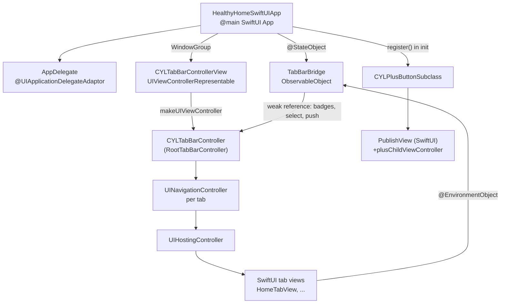
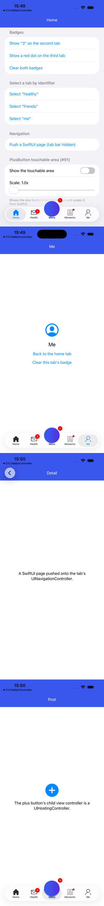
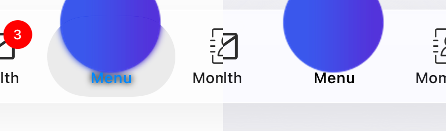

# [CN]在 SwiftUI 项目中集成 CYLTabBarController
# [EN]Integrating CYLTabBarController in a SwiftUI app

<!-- bound-classes: CYLTabBarController, CYLPlusButton -->
<!-- binding:start -->
<!-- Generated by scripts/update-docs-navigation.py; do not edit by hand. -->

| 中文 | English |
|:---|:---|
| 绑定的代码类 `CYLTabBarController`：[`CYLTabBarController/CYLTabBarController.h`](../CYLTabBarController/CYLTabBarController.h) | Bound to the class `CYLTabBarController`: [`CYLTabBarController/CYLTabBarController.h`](../CYLTabBarController/CYLTabBarController.h) |
| 绑定的代码类 `CYLPlusButton`：[`CYLTabBarController/CYLPlusButton.h`](../CYLTabBarController/CYLPlusButton.h) | Bound to the class `CYLPlusButton`: [`CYLTabBarController/CYLPlusButton.h`](../CYLTabBarController/CYLPlusButton.h) |

<!-- binding:end -->

| 中文 | English |
|:---|:---|
| CYLTabBarController 是 UIKit 的 `UITabBarController` 子类，可以直接用在 SwiftUI App 中：用 `UIViewControllerRepresentable` 把它放进 SwiftUI，每个 Tab 的内容写成 SwiftUI 视图并放进 `UIHostingController`。所有样式（液态玻璃、经典、扁平）、PlusButton、Lottie、角标等功能都保持不变。 | CYLTabBarController is a UIKit `UITabBarController` subclass and works in a SwiftUI app as is: put it into SwiftUI with `UIViewControllerRepresentable`, and write each tab's content as a SwiftUI view in a `UIHostingController`. Every style (Liquid Glass, classic, FlatDesign), the plus button, Lottie and badges keep working. |
| 完整示例：[`Example-SwiftUI`](../Example-SwiftUI)，由 `Example-Swift-03` 复制而来，改为 SwiftUI `App` 生命周期。 | Full example: [`Example-SwiftUI`](../Example-SwiftUI), copied from `Example-Swift-03` and moved to the SwiftUI `App` life cycle. |

## [CN]目录
## [EN]Contents

<!-- navigation:start -->
<!-- Generated by scripts/update-docs-navigation.py; do not edit by hand. -->

| 中文 | English |
|:---|:---|
| [结构](#cn结构) | [How it fits together](#enhow-it-fits-together) |
| [第 1 步：App 入口](#cn第-1-步app-入口) | [Step 1: the app entry point](#enstep-1-the-app-entry-point) |
| [第 2 步：用 UIViewControllerRepresentable 嵌入](#cn第-2-步用-uiviewcontrollerrepresentable-嵌入) | [Step 2: embed it with UIViewControllerRepresentable](#enstep-2-embed-it-with-uiviewcontrollerrepresentable) |
| [第 3 步：在 SwiftUI 中控制 TabBar](#cn第-3-步在-swiftui-中控制-tabbar) | [Step 3: drive the tab bar from SwiftUI](#enstep-3-drive-the-tab-bar-from-swiftui) |
| [第 4 步：SwiftUI 编写的 PlusButton 页面](#cn第-4-步swiftui-编写的-plusbutton-页面) | [Step 4: the plus button's page in SwiftUI](#enstep-4-the-plus-buttons-page-in-swiftui) |
| [示例中的演示内容](#cn示例中的演示内容) | [What the example shows](#enwhat-the-example-shows) |
| [注意事项](#cn注意事项) | [Notes](#ennotes) |
| [测试与截图](#cn测试与截图) | [Testing and screenshots](#entesting-and-screenshots) |

<!-- navigation:end -->

## [CN]结构
## [EN]How it fits together



## [CN]第 1 步：App 入口
## [EN]Step 1: the app entry point

| 中文 | English |
|:---|:---|
| 在 SwiftUI `App` 的 `init` 中注册 PlusButton（必须在创建 TabBarController 之前）。如需 UIKit 的 AppDelegate，用 `@UIApplicationDelegateAdaptor` 保留。`Info.plist` 中不要再指定 `UISceneDelegateClassName`，窗口和场景由 SwiftUI 创建。 | Register the plus button in the SwiftUI `App`'s `init` (before any tab bar controller is created). Keep a UIKit app delegate with `@UIApplicationDelegateAdaptor` if you need one. Do not name a `UISceneDelegateClassName` in `Info.plist`: SwiftUI creates the window and the scenes. |

```swift
import CYLTabBarController
import SwiftUI

@main
struct HealthyHomeSwiftUIApp: App {
    @UIApplicationDelegateAdaptor(AppDelegate.self) private var appDelegate
    @StateObject private var bridge = TabBarBridge()

    init() {
        CYLPlusButtonSubclass.register()
    }

    var body: some Scene {
        WindowGroup {
            CYLTabBarControllerView(bridge: bridge)
                .ignoresSafeArea()   // the tab bar controller handles the safe area itself 由 TabBarController 自己处理安全区域
        }
    }
}
```

## [CN]第 2 步：用 UIViewControllerRepresentable 嵌入
## [EN]Step 2: embed it with UIViewControllerRepresentable

| 中文 | English |
|:---|:---|
| 在 `makeUIViewController` 中创建一次 TabBarController。每个 Tab 是 `UINavigationController(rootViewController: UIHostingController(rootView: …))`。样式等属性与 UIKit 中一样，在视图加载之前设置。 | Create the tab bar controller once, in `makeUIViewController`. Each tab is `UINavigationController(rootViewController: UIHostingController(rootView: …))`. Set the style and other properties before the view loads, as in UIKit. |

```swift
struct CYLTabBarControllerView: UIViewControllerRepresentable {
    let bridge: TabBarBridge

    func makeUIViewController(context: Context) -> CYLTabBarController {
        let viewControllers = SwiftUITab.allCases.map { tab -> UIViewController in
            let hostingController = UIHostingController(rootView: tab.content.environmentObject(bridge))
            hostingController.title = tab.title
            return UINavigationController(rootViewController: hostingController)
        }
        let attributes: [[AnyHashable: Any]] = SwiftUITab.allCases.map { tab in
            [CYLTabBarItemTitle: tab.title,
             CYLTabBarItemImage: tab.imageName,
             CYLTabBarItemSelectedImage: tab.selectedImageName,
             CYLTabBarItemIdentifier: tab.identifier]
        }
        let tabBarController = CYLTabBarController(viewControllers: viewControllers, tabBarItemsAttributes: attributes)
        tabBarController.tabBarStyleType = .liquidGlass
        bridge.tabBarController = tabBarController
        return tabBarController
    }

    func updateUIViewController(_ uiViewController: CYLTabBarController, context: Context) {}
}
```

## [CN]第 3 步：在 SwiftUI 中控制 TabBar
## [EN]Step 3: drive the tab bar from SwiftUI

| 中文 | English |
|:---|:---|
| SwiftUI 视图拿不到 `UIViewController`，因此用一个 `ObservableObject`（`TabBarBridge`）弱引用 TabBarController，以 environment object 传给各 Tab。它只调用已有 API：按标识选中 Tab（#408）、角标、push、PlusButton 点击范围（#91）。 | A SwiftUI view has no `UIViewController` to reach, so an `ObservableObject` (`TabBarBridge`) keeps a weak reference to the tab bar controller and is passed to the tabs as an environment object. It only calls existing API: selecting tabs by identifier (#408), badges, push, and the plus button's touchable area (#91). |

```swift
final class TabBarBridge: ObservableObject {
    weak var tabBarController: CYLTabBarController?

    func select(_ identifier: String) {
        tabBarController?.cyl_selectTabBarItem(withIdentifier: identifier)
    }

    func showBadge(_ value: String, onTab identifier: String) {
        tabBarController?.cyl_viewController(withTabBarItemIdentifier: identifier)?
            .cyl_showBadgeValue(value, animationType: .bounce)
    }

    func push<Content: View>(_ content: Content, title: String) {
        guard let navigationController = tabBarController?.selectedViewController as? UINavigationController else { return }
        let hostingController = UIHostingController(rootView: content.environmentObject(self))
        hostingController.title = title
        hostingController.hidesBottomBarWhenPushed = true   // hide the tab bar 隐藏 TabBar
        navigationController.pushViewController(hostingController, animated: true)
    }
}

struct HomeTabView: View {
    @EnvironmentObject private var bridge: TabBarBridge

    var body: some View {
        List {
            Button("Show \"3\" on the second tab") { bridge.showBadge("3", onTab: "healthy") }
            Button("Select \"me\"") { bridge.select("me") }
            Button("Push a SwiftUI page") { bridge.push(DetailView(), title: "Detail") }
        }
    }
}
```

## [CN]第 4 步：SwiftUI 编写的 PlusButton 页面
## [EN]Step 4: the plus button's page in SwiftUI

```swift
class CYLPlusButtonSubclass: CYLPlusButton, CYLPlusButtonSubclassing {
    // ... plusButton(), indexOfPlusButtonInTabBar() ...

    static func plusChildViewController() -> UIViewController {
        let publish = UIHostingController(rootView: PublishView())
        publish.title = CYLLocalizedString("发布")
        return UINavigationController(rootViewController: publish)
    }
}
```

## [CN]示例中的演示内容
## [EN]What the example shows

| 中文 | English |
|:---|:---|
| 首页 Tab（`HomeTabView`）：在第 2 个 Tab 显示数字角标、在第 3 个 Tab 显示红点、清除角标；按标识选中其他 Tab；push 一个隐藏 TabBar 的 SwiftUI 页面；用 `Toggle` 显示 PlusButton 的可点击区域、用 `Slider` 按 1–3 倍放大（仅在 `hasPlusButton()` 时显示）。 | The home tab (`HomeTabView`): a number badge on the 2nd tab, a red dot on the 3rd, clearing them; selecting the other tabs by identifier; pushing a SwiftUI page with the tab bar hidden; a `Toggle` that shows the plus button's touchable area and a `Slider` that scales it 1–3× (only with `hasPlusButton()`). |
| 其他 Tab 与 PlusButton 页面均为 SwiftUI 视图；TabBar 的标题、图标、Lottie 与 `Example-Swift-03` 相同。 | The other tabs and the plus button's page are SwiftUI views; the tab titles, icons and Lottie animations are the same as in `Example-Swift-03`. |
| 运行：在 `Example-SwiftUI` 目录执行 `pod install`，打开 `HealthyHome.xcworkspace`。Podfile 与 `Example-Swift-03` 相同，Bundle ID 为 `com.HealthyHomeSwiftUI`。 | To run: `pod install` in `Example-SwiftUI`, then open `HealthyHome.xcworkspace`. The Podfile is the same as `Example-Swift-03`'s; the bundle identifier is `com.HealthyHomeSwiftUI`. |

## [CN]注意事项
## [EN]Notes

| 中文 | English |
|:---|:---|
| **只创建一次**：TabBarController 在 `makeUIViewController` 中创建；不要在 `updateUIViewController` 中重新创建，否则会丢失各 Tab 的导航栈。SwiftUI 状态通过 `TabBarBridge` 传递。 | **Create it once**: in `makeUIViewController`; recreating it in `updateUIViewController` would drop every tab's navigation stack. SwiftUI state reaches it through `TabBarBridge`. |
| **不要嵌套 SwiftUI `TabView`**：CYLTabBarController 本身就是 TabBar。 | **No SwiftUI `TabView` around it**: CYLTabBarController is the tab bar. |
| **隐藏 TabBar**：push 时设置 `hidesBottomBarWhenPushed = true`（UIKit 导航栈）。SwiftUI 的 `.toolbar(.hidden, for: .tabBar)` 只作用于 SwiftUI `TabView`。 | **Hiding the tab bar**: set `hidesBottomBarWhenPushed = true` when pushing (UIKit navigation stack). SwiftUI's `.toolbar(.hidden, for: .tabBar)` only affects a SwiftUI `TabView`. |
| **安全区域**：给 `CYLTabBarControllerView` 加 `.ignoresSafeArea()`，与 UIKit 根控制器的布局一致。 | **Safe area**: add `.ignoresSafeArea()` to `CYLTabBarControllerView`, so it lays out like a UIKit root view controller. |
| **切换根视图**：在 SwiftUI 中用状态切换（例如登录前后显示不同视图），旧的 TabBarController 会随视图一起释放。 | **Replacing the root**: switch views with SwiftUI state (e.g. before and after login); the old tab bar controller goes away with its view. |

## [CN]测试与截图
## [EN]Testing and screenshots

| 中文 | English |
|:---|:---|
| 已验证（2026-11-10，iOS 26.1，iPhone 17 Pro Max 模拟器，液态玻璃）：`Example-SwiftUI` 编译并运行。从上到下：① 角标：第二个 Tab 显示「3」、第三个 Tab 显示红点；② 按标识选中「me」；③ push 一个 SwiftUI 页面（TabBar 按设计隐藏）；④ PlusButton 的页面（子控制器为 `UIHostingController`）。PlusButton 可点击区域开关本次未测试。 | Verified (2026-11-10, iOS 26.1, iPhone 17 Pro Max simulator, Liquid Glass): `Example-SwiftUI` builds and runs. Top to bottom: ① badges: "3" on the second tab, a red dot on the third; ② selecting "me" by identifier; ③ a pushed SwiftUI page (the tab bar hidden, as designed); ④ the plus button's page (its child view controller is a `UIHostingController`). The plus button's touchable-area switch was not tested this time. |



| 中文 | English |
|:---|:---|
| TODO（选中 PlusButton 时标题模糊，待排查，2026-11-10 发现）：iOS 26.1 液态玻璃下选中 PlusButton 后，其标题「Menu」下方叠着一层模糊的重影（左：选中；右：未选中，文字清晰）。ObjC 图库 9.x 场景中选中的绿色 PlusButton 图标也有类似的模糊光晕。推测：液态玻璃下 PlusButton 位置的替身 Tab（stand-in）的图标与标题被系统选中放大镜效果模糊后，透过真实的 PlusButton 显示出来。待做：确认替身在选中时是否仍绘制标题 / 图标（见 `cyl-plus-button` skill 中替身的规则与 [PlusButton.md](PlusButton.md)），必要时在选中状态下隐藏替身的内容；验证：选中 PlusButton 的截图中标题清晰，ObjC、Swift、SwiftUI 示例各一张。 | TODO (the selected plus button's title is blurry, to investigate, found 2026-11-10): on iOS 26.1 Liquid Glass, with the plus button selected, its title "Menu" has a blurred copy under it (left: selected; right: not selected, crisp text). The selected green plus icon of the ObjC gallery 9.x scenes shows a similar blurred halo. Guess: the stand-in tab under the plus button on Liquid Glass shows its icon and title, blurred by the system's selection lens, through the real plus button. To do: check whether the stand-in still draws its title / icon while selected (the stand-in rules in the `cyl-plus-button` skill and [PlusButton.md](PlusButton.md)), and hide its content while selected if needed. Verify: a selected plus button with a crisp title in screenshots of the ObjC, Swift and SwiftUI examples. |


