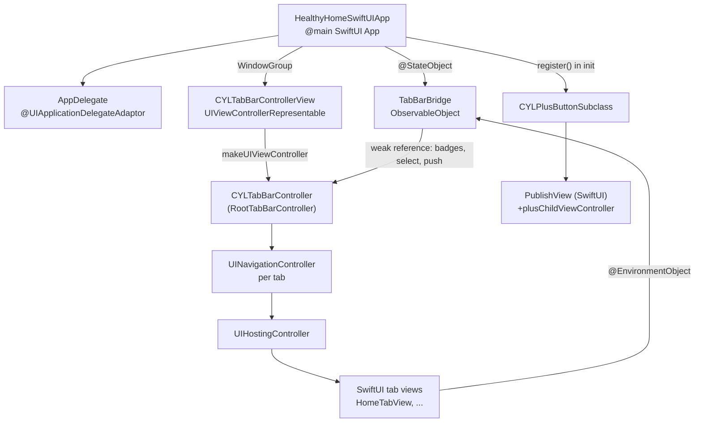
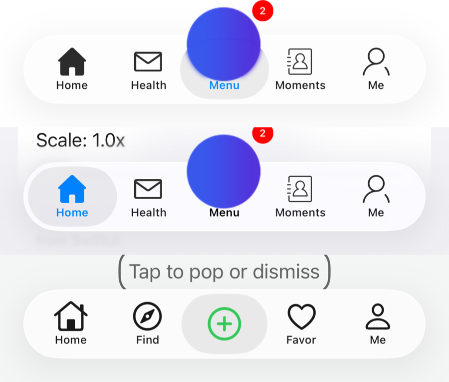

# [CN]在 SwiftUI 项目中集成 CYLTabBarController
# [EN]Integrating CYLTabBarController in a SwiftUI app

<!-- bound-classes: CYLTabBarController, CYLPlusButton -->
<!-- binding:start -->
<!-- Generated by scripts/update-docs-navigation.py; do not edit by hand. -->

| 中文 | English |
|:---|:---|
| 绑定的代码类 `CYLTabBarController`：[`CYLTabBarController/CYLTabBarController.h`](../CYLTabBarController/CYLTabBarController.h) | Bound to the class `CYLTabBarController`: [`CYLTabBarController/CYLTabBarController.h`](../CYLTabBarController/CYLTabBarController.h) |
| 绑定的代码类 `CYLPlusButton`：[`CYLTabBarController/CYLPlusButton.h`](../CYLTabBarController/CYLPlusButton.h) | Bound to the class `CYLPlusButton`: [`CYLTabBarController/CYLPlusButton.h`](../CYLTabBarController/CYLPlusButton.h) |

<!-- binding:end -->

| 中文 | English |
|:---|:---|
| CYLTabBarController 是 UIKit 的 `UITabBarController` 子类，可以直接用在 SwiftUI App 中：用 `UIViewControllerRepresentable` 把它放进 SwiftUI，每个 Tab 的内容写成 SwiftUI 视图并放进 `UIHostingController`。所有样式（液态玻璃、经典、扁平）、PlusButton、Lottie、角标等功能都保持不变。 | CYLTabBarController is a UIKit `UITabBarController` subclass and works in a SwiftUI app as is: put it into SwiftUI with `UIViewControllerRepresentable`, and write each tab's content as a SwiftUI view in a `UIHostingController`. Every style (Liquid Glass, classic, FlatDesign), the plus button, Lottie and badges keep working. |
| 完整示例：[`Example-SwiftUI`](../Example-SwiftUI)，由 `Example-Swift-03` 复制而来，改为 SwiftUI `App` 生命周期。 | Full example: [`Example-SwiftUI`](../Example-SwiftUI), copied from `Example-Swift-03` and moved to the SwiftUI `App` life cycle. |

## [CN]目录
## [EN]Contents

<!-- navigation:start -->
<!-- Generated by scripts/update-docs-navigation.py; do not edit by hand. -->

| 中文 | English |
|:---|:---|
| [结构](#cn结构) | [How it fits together](#enhow-it-fits-together) |
| [第 1 步：App 入口](#cn第-1-步app-入口) | [Step 1: the app entry point](#enstep-1-the-app-entry-point) |
| [第 2 步：用 UIViewControllerRepresentable 嵌入](#cn第-2-步用-uiviewcontrollerrepresentable-嵌入) | [Step 2: embed it with UIViewControllerRepresentable](#enstep-2-embed-it-with-uiviewcontrollerrepresentable) |
| [第 3 步：在 SwiftUI 中控制 TabBar](#cn第-3-步在-swiftui-中控制-tabbar) | [Step 3: drive the tab bar from SwiftUI](#enstep-3-drive-the-tab-bar-from-swiftui) |
| [第 4 步：SwiftUI 编写的 PlusButton 页面](#cn第-4-步swiftui-编写的-plusbutton-页面) | [Step 4: the plus button's page in SwiftUI](#enstep-4-the-plus-buttons-page-in-swiftui) |
| [示例中的演示内容](#cn示例中的演示内容) | [What the example shows](#enwhat-the-example-shows) |
| [注意事项](#cn注意事项) | [Notes](#ennotes) |
| [测试与截图](#cn测试与截图) | [Testing and screenshots](#entesting-and-screenshots) |
| [任务记录](#任务记录--task-log) | [Task log](#任务记录--task-log) |

<!-- navigation:end -->

## [CN]结构
## [EN]How it fits together



## [CN]第 1 步：App 入口
## [EN]Step 1: the app entry point

| 中文 | English |
|:---|:---|
| 在 SwiftUI `App` 的 `init` 中注册 PlusButton（必须在创建 TabBarController 之前）。如需 UIKit 的 AppDelegate，用 `@UIApplicationDelegateAdaptor` 保留。`Info.plist` 中不要再指定 `UISceneDelegateClassName`，窗口和场景由 SwiftUI 创建。 | Register the plus button in the SwiftUI `App`'s `init` (before any tab bar controller is created). Keep a UIKit app delegate with `@UIApplicationDelegateAdaptor` if you need one. Do not name a `UISceneDelegateClassName` in `Info.plist`: SwiftUI creates the window and the scenes. |

```swift
import CYLTabBarController
import SwiftUI

@main
struct HealthyHomeSwiftUIApp: App {
    @UIApplicationDelegateAdaptor(AppDelegate.self) private var appDelegate
    @StateObject private var bridge = TabBarBridge()

    init() {
        CYLPlusButtonSubclass.register()
    }

    var body: some Scene {
        WindowGroup {
            CYLTabBarControllerView(bridge: bridge)
                .ignoresSafeArea()   // the tab bar controller handles the safe area itself 由 TabBarController 自己处理安全区域
        }
    }
}
```

## [CN]第 2 步：用 UIViewControllerRepresentable 嵌入
## [EN]Step 2: embed it with UIViewControllerRepresentable

| 中文 | English |
|:---|:---|
| 在 `makeUIViewController` 中创建一次 TabBarController。每个 Tab 是 `UINavigationController(rootViewController: UIHostingController(rootView: …))`。样式等属性与 UIKit 中一样，在视图加载之前设置。 | Create the tab bar controller once, in `makeUIViewController`. Each tab is `UINavigationController(rootViewController: UIHostingController(rootView: …))`. Set the style and other properties before the view loads, as in UIKit. |

```swift
struct CYLTabBarControllerView: UIViewControllerRepresentable {
    let bridge: TabBarBridge

    func makeUIViewController(context: Context) -> CYLTabBarController {
        let viewControllers = SwiftUITab.allCases.map { tab -> UIViewController in
            let hostingController = UIHostingController(rootView: tab.content.environmentObject(bridge))
            hostingController.title = tab.title
            return UINavigationController(rootViewController: hostingController)
        }
        let attributes: [[AnyHashable: Any]] = SwiftUITab.allCases.map { tab in
            [CYLTabBarItemTitle: tab.title,
             CYLTabBarItemImage: tab.imageName,
             CYLTabBarItemSelectedImage: tab.selectedImageName,
             CYLTabBarItemIdentifier: tab.identifier]
        }
        let tabBarController = CYLTabBarController(viewControllers: viewControllers, tabBarItemsAttributes: attributes)
        tabBarController.tabBarStyleType = .liquidGlass
        bridge.tabBarController = tabBarController
        return tabBarController
    }

    func updateUIViewController(_ uiViewController: CYLTabBarController, context: Context) {}
}
```

## [CN]第 3 步：在 SwiftUI 中控制 TabBar
## [EN]Step 3: drive the tab bar from SwiftUI

| 中文 | English |
|:---|:---|
| SwiftUI 视图拿不到 `UIViewController`，因此用一个 `ObservableObject`（`TabBarBridge`）弱引用 TabBarController，以 environment object 传给各 Tab。它只调用已有 API：按标识选中 Tab（#408）、角标、push、PlusButton 点击范围（#91）。 | A SwiftUI view has no `UIViewController` to reach, so an `ObservableObject` (`TabBarBridge`) keeps a weak reference to the tab bar controller and is passed to the tabs as an environment object. It only calls existing API: selecting tabs by identifier (#408), badges, push, and the plus button's touchable area (#91). |

```swift
final class TabBarBridge: ObservableObject {
    weak var tabBarController: CYLTabBarController?

    func select(_ identifier: String) {
        tabBarController?.cyl_selectTabBarItem(withIdentifier: identifier)
    }

    func showBadge(_ value: String, onTab identifier: String) {
        tabBarController?.cyl_viewController(withTabBarItemIdentifier: identifier)?
            .cyl_showBadgeValue(value, animationType: .bounce)
    }

    func push<Content: View>(_ content: Content, title: String) {
        guard let navigationController = tabBarController?.selectedViewController as? UINavigationController else { return }
        let hostingController = UIHostingController(rootView: content.environmentObject(self))
        hostingController.title = title
        hostingController.hidesBottomBarWhenPushed = true   // hide the tab bar 隐藏 TabBar
        navigationController.pushViewController(hostingController, animated: true)
    }
}

struct HomeTabView: View {
    @EnvironmentObject private var bridge: TabBarBridge

    var body: some View {
        List {
            Button("Show \"3\" on the second tab") { bridge.showBadge("3", onTab: "healthy") }
            Button("Select \"me\"") { bridge.select("me") }
            Button("Push a SwiftUI page") { bridge.push(DetailView(), title: "Detail") }
        }
    }
}
```

## [CN]第 4 步：SwiftUI 编写的 PlusButton 页面
## [EN]Step 4: the plus button's page in SwiftUI

```swift
class CYLPlusButtonSubclass: CYLPlusButton, CYLPlusButtonSubclassing {
    // ... plusButton(), indexOfPlusButtonInTabBar() ...

    static func plusChildViewController() -> UIViewController {
        let publish = UIHostingController(rootView: PublishView())
        publish.title = CYLLocalizedString("发布")
        return UINavigationController(rootViewController: publish)
    }
}
```

## [CN]示例中的演示内容
## [EN]What the example shows

| 中文 | English |
|:---|:---|
| 首页 Tab（`HomeTabView`）：在第 2 个 Tab 显示数字角标、在第 3 个 Tab 显示红点、清除角标；按标识选中其他 Tab；push 一个隐藏 TabBar 的 SwiftUI 页面；用 `Toggle` 显示 PlusButton 的可点击区域、用 `Slider` 按 1–3 倍放大（仅在 `hasPlusButton()` 时显示）。 | The home tab (`HomeTabView`): a number badge on the 2nd tab, a red dot on the 3rd, clearing them; selecting the other tabs by identifier; pushing a SwiftUI page with the tab bar hidden; a `Toggle` that shows the plus button's touchable area and a `Slider` that scales it 1–3× (only with `hasPlusButton()`). |
| 其他 Tab 与 PlusButton 页面均为 SwiftUI 视图；TabBar 的标题、图标、Lottie 与 `Example-Swift-03` 相同。 | The other tabs and the plus button's page are SwiftUI views; the tab titles, icons and Lottie animations are the same as in `Example-Swift-03`. |
| 运行：在 `Example-SwiftUI` 目录执行 `pod install`，打开 `HealthyHome.xcworkspace`。Podfile 与 `Example-Swift-03` 相同，Bundle ID 为 `com.HealthyHomeSwiftUI`。 | To run: `pod install` in `Example-SwiftUI`, then open `HealthyHome.xcworkspace`. The Podfile is the same as `Example-Swift-03`'s; the bundle identifier is `com.HealthyHomeSwiftUI`. |

## [CN]注意事项
## [EN]Notes

| 中文 | English |
|:---|:---|
| **只创建一次**：TabBarController 在 `makeUIViewController` 中创建；不要在 `updateUIViewController` 中重新创建，否则会丢失各 Tab 的导航栈。SwiftUI 状态通过 `TabBarBridge` 传递。 | **Create it once**: in `makeUIViewController`; recreating it in `updateUIViewController` would drop every tab's navigation stack. SwiftUI state reaches it through `TabBarBridge`. |
| **不要嵌套 SwiftUI `TabView`**：CYLTabBarController 本身就是 TabBar。 | **No SwiftUI `TabView` around it**: CYLTabBarController is the tab bar. |
| **隐藏 TabBar**：push 时设置 `hidesBottomBarWhenPushed = true`（UIKit 导航栈）。SwiftUI 的 `.toolbar(.hidden, for: .tabBar)` 只作用于 SwiftUI `TabView`。 | **Hiding the tab bar**: set `hidesBottomBarWhenPushed = true` when pushing (UIKit navigation stack). SwiftUI's `.toolbar(.hidden, for: .tabBar)` only affects a SwiftUI `TabView`. |
| **安全区域**：给 `CYLTabBarControllerView` 加 `.ignoresSafeArea()`，与 UIKit 根控制器的布局一致。 | **Safe area**: add `.ignoresSafeArea()` to `CYLTabBarControllerView`, so it lays out like a UIKit root view controller. |
| **切换根视图**：在 SwiftUI 中用状态切换（例如登录前后显示不同视图），旧的 TabBarController 会随视图一起释放。 | **Replacing the root**: switch views with SwiftUI state (e.g. before and after login); the old tab bar controller goes away with its view. |

## [CN]测试与截图
## [EN]Testing and screenshots

| 中文 | English |
|:---|:---|
| 已验证（2026-11-10，iOS 26.1，iPhone 17 Pro Max 模拟器，液态玻璃）：`Example-SwiftUI` 编译并运行。从上到下：① 角标：第二个 Tab 显示「3」、第三个 Tab 显示红点；② 按标识选中「me」；③ push 一个 SwiftUI 页面（TabBar 按设计隐藏）；④ PlusButton 的页面（子控制器为 `UIHostingController`）。PlusButton 可点击区域开关本次未测试。 | Verified (2026-11-10, iOS 26.1, iPhone 17 Pro Max simulator, Liquid Glass): `Example-SwiftUI` builds and runs. Top to bottom: ① badges: "3" on the second tab, a red dot on the third; ② selecting "me" by identifier; ③ a pushed SwiftUI page (the tab bar hidden, as designed); ④ the plus button's page (its child view controller is a `UIHostingController`). The plus button's touchable-area switch was not tested this time. |


| 中文 | English |
|:---|:---|
| 已关闭，待测试（选中 PlusButton 时标题模糊，2026-11-10 发现，2026-11-12 修复后又关闭，见文末任务记录：遮罩可能在拖动放大镜时把 PlusButton 切成两半）：液态玻璃下真实 PlusButton 位于玻璃底板之下，放大镜会模糊它下面的内容，因此选中时它的标题（以及完全位于底板内的图标）在替身清晰的画面下形成一层模糊重影（下图「修复前」，左：选中；右：未选中）。现在 PlusButton 的页面被选中时，真实按钮在放大镜下被遮住：内容全部在放大镜内时遮住整个放大镜区域，否则只遮住标题所在的横条（图标超出底板的部分保留，避免缝隙）；选中其他 Tab 后移除遮罩（`-[CYLPlusButton cyl_updateLiquidGlassMask]`）。验证（iOS 26.1，iPhone 17 Pro 模拟器，液态玻璃）：单元测试 `testTheSelectedPlusButtonTitleIsNotBlurredUnderTheLens` 检查未选中与切走后没有遮罩（用代码选中时测试宿主不创建放大镜中的替身，这一步跳过，改由截图验证）；122 个测试通过。截图从上到下：`Example-SwiftUI` 选中 PlusButton，标题「Menu」清晰；再选中 Home，PlusButton 恢复原样；ObjC 图库 9.4 选中的绿色 PlusButton 图标清晰。Swift 示例本次未运行。 | Switched off, pending a test (the selected plus button's title was blurry, found 2026-11-10, fixed 2026-11-12, then switched off; see the task log at the end: the mask may cut the plus button in two while the lens is dragged): on Liquid Glass the real plus button lies under the platter, and the lens blurs whatever is under it, so once selected its title (and an icon lying wholly inside the platter) showed as a blurred copy under the stand-in's crisp picture ("before" below; left: selected, right: not selected). Now, while the plus button's page is selected, the real button is masked out under the lens: the whole lens area when all its content is inside it, else only the title's strip (the part of an icon above the platter stays, so there is no gap); the mask goes when another tab is selected (`-[CYLPlusButton cyl_updateLiquidGlassMask]`). Verified (iOS 26.1, iPhone 17 Pro simulator, Liquid Glass): the unit test `testTheSelectedPlusButtonTitleIsNotBlurredUnderTheLens` checks there is no mask before and after (selected in code, the test host does not build the lens's stand-in, so that step is skipped and checked in screenshots); 122 tests pass. Screenshots, top to bottom: `Example-SwiftUI` with the plus button selected, a crisp "Menu"; Home selected again, the plus button as before; the ObjC gallery 9.4 with a crisp selected green plus icon. The Swift example was not run this time. |

修复前 / Before:


修复后 / After:



## 任务记录 / Task log

| 中文 | English |
|:---|:---|
| TODO（2026-11-12，PlusButton 遮罩被拖动切割）：用户提示词：「谨慎实现Implementing the mask in the existing empty hook cyl_updateLiquidGlassMask 请在合适文档中进行TODO中标注，并在代码注释中标注，该方法会导致选中plusButton后，在拖拽到其他item时，原plusbutton会被切割为两部分。之前的实现由于无法解决该问题，我才删掉了该方法的实现。除非经过完整测试，不会导致用户拖拽液态玻璃遮罩的时候导致plusButton被切割，才保留该实现。该bug复现步骤为：iOS26及以上系统，液态玻璃样式非扁平样式，存在plus button存在pluschildviewcontroller ，方法会导致选中plusButton后，在拖拽到其他item时，原plusbutton会被切割为两部分。」。上下文：`bb180d0` 在 `-[CYLPlusButton cyl_updateLiquidGlassMask]` 中加入遮罩，修复选中 PlusButton 时标题模糊（见上方 DONE 行）。风险：选中 PlusButton 后把液态玻璃放大镜拖到其他 item 时，PlusButton 页面仍选中、遮罩仍在，而放大镜已离开，PlusButton 会被切成两半；维护者曾因此删除之前的实现。复现：iOS 26+、液态玻璃（非扁平样式）、有 PlusButton 子控制器，选中 PlusButton 后拖动放大镜到其他 item。当前状态：遮罩已关闭（`CYLPlusButtonLensMaskEnabled = NO`，代码注释已标注），恢复修复前的行为（选中时标题模糊重新出现）。要求：只有经过完整测试（拖动期间与之后 PlusButton 都完整）才能开启。 | TODO (2026-11-12, plus button mask cut by a drag): user prompt: "谨慎实现Implementing the mask in the existing empty hook cyl_updateLiquidGlassMask 请在合适文档中进行TODO中标注，并在代码注释中标注，该方法会导致选中plusButton后，在拖拽到其他item时，原plusbutton会被切割为两部分。之前的实现由于无法解决该问题，我才删掉了该方法的实现。除非经过完整测试，不会导致用户拖拽液态玻璃遮罩的时候导致plusButton被切割，才保留该实现。该bug复现步骤为：iOS26及以上系统，液态玻璃样式非扁平样式，存在plus button存在pluschildviewcontroller ，方法会导致选中plusButton后，在拖拽到其他item时，原plusbutton会被切割为两部分。". Context: `bb180d0` added a mask in `-[CYLPlusButton cyl_updateLiquidGlassMask]` to fix the blurry title of a selected plus button (see the DONE row above). Risk: after selecting the plus button, dragging the Liquid Glass lens to another item keeps the plus page selected and the mask on while the lens has left, so the plus button is cut in two; the maintainer removed an earlier implementation for that reason. Repro: iOS 26+, Liquid Glass (not FlatDesign), a plus child view controller; select the plus button, drag the lens to another item. Current state: the mask is off (`CYLPlusButtonLensMaskEnabled = NO`, noted in the code comment), back to the behavior before the fix (the blurry title of a selected plus button is back). Requirement: turn it on only after full testing (the plus button stays whole during and after the drag). |
