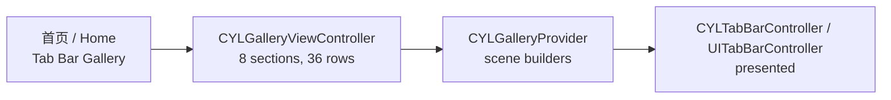

# TabBar 图库 / Tab Bar Gallery

<!-- bound-classes: CYLTabBarController, CYLTabBar, CYLPlusButton, CYLTabButtonPressAnimation -->
<!-- binding:start -->
<!-- Generated by scripts/update-docs-navigation.py; do not edit by hand. -->

| 中文 | English |
|:---|:---|
| 绑定的代码类 `CYLTabBarController`：[`CYLTabBarController/CYLTabBarController.h`](../CYLTabBarController/CYLTabBarController.h) | Bound to the class `CYLTabBarController`: [`CYLTabBarController/CYLTabBarController.h`](../CYLTabBarController/CYLTabBarController.h) |
| 绑定的代码类 `CYLTabBar`：[`CYLTabBarController/CYLTabBar.h`](../CYLTabBarController/CYLTabBar.h) | Bound to the class `CYLTabBar`: [`CYLTabBarController/CYLTabBar.h`](../CYLTabBarController/CYLTabBar.h) |
| 绑定的代码类 `CYLPlusButton`：[`CYLTabBarController/CYLPlusButton.h`](../CYLTabBarController/CYLPlusButton.h) | Bound to the class `CYLPlusButton`: [`CYLTabBarController/CYLPlusButton.h`](../CYLTabBarController/CYLPlusButton.h) |
| 绑定的代码类 `CYLTabButtonPressAnimation`：[`CYLTabBarController/CYLTabButtonAnimation.h`](../CYLTabBarController/CYLTabButtonAnimation.h) | Bound to the class `CYLTabButtonPressAnimation`: [`CYLTabBarController/CYLTabButtonAnimation.h`](../CYLTabBarController/CYLTabButtonAnimation.h) |

<!-- binding:end -->

| 中文 | English |
|:---|:---|
| ObjC Demo（`Example`）首页新增「Tab Bar Gallery」一组：点击「Open the tab bar gallery」进入图库，每一行是一个 TabBar 场景，点击该行即展示这个 TabBar。所有场景都只用本库的公开 API 构建（`#import <CYLTabBarController/CYLTabBarController.h>`），覆盖常见的自定义 TabBar 效果，以及本次新增的每一个接口。代码见 `Example/Classes/Gallery/`：`CYLGalleryViewController`（列表）与 `CYLGalleryProvider`（场景）。 | The ObjC demo (`Example`) has a new "Tab Bar Gallery" section on its home page: tap "Open the tab bar gallery", and every row is a tab bar scene, presented when the row is tapped. Every scene is built with the library's public API only (`#import <CYLTabBarController/CYLTabBarController.h>`), covering the usual custom tab bar effects and every newly added API. The code is in `Example/Classes/Gallery/`: `CYLGalleryViewController` (the list) and `CYLGalleryProvider` (the scenes). |

## 目录 / Contents

<!-- navigation:start -->
<!-- Generated by scripts/update-docs-navigation.py; do not edit by hand. -->

| 中文 | English |
|:---|:---|
| [场景与使用的接口](#场景与使用的接口--scenes-and-the-apis-they-use) | [Scenes and the APIs they use](#场景与使用的接口--scenes-and-the-apis-they-use) |
| [限制](#限制--limits) | [Limits](#限制--limits) |
| [截图](#截图--screenshots) | [Screenshots](#截图--screenshots) |

<!-- navigation:end -->

## 场景与使用的接口 / Scenes and the APIs they use

| 分组 / Section | 场景 / Scenes | 接口 / APIs |
|:---|:---|:---|
| Basic | 系统 UITabBarController 对照；仿系统样式；混合样式；液态玻璃；带 More（系统 / 本库 / 混合 / 液态玻璃）；默认选中非 0；所有系统使用经典设计；液态玻璃 + 角标；UITab 样式 · The system UITabBarController for comparison; system-like style; mixed items; Liquid Glass; with More (system / library / mixed / Liquid Glass); a non-zero default index; the classic design on every system; Liquid Glass with badges; the UITab style | `CYLTabBarStyleTypeFlatDesign`, `selectedIndex`, `cyl_tabButtonAnimation`, `cyl_hijackedTabBarItemIdentifiers`, `UITabBarItem.badgeValue` |
| Embed | 导航控制器内嵌 TabBarController；TabBarController 内嵌导航控制器 · A navigation controller embedding the tab bar controller, and the other way round | `initWithViewControllers:tabBarItemsAttributes:styleType:context:` |
| Animation | 自定义选中颜色；弹簧动画；背景色变化；按下效果；提示点击 · Selected colors; spring animation; background color change; pressed effect; suggesting a click | `CYLTabBarItemTitleColor` / `IconColor`, `CYLTabButtonAnimation`（select / reselect / highlight / dehighlight）, `CYLTabBarItemBackgroundColor`, `CYLTabBarItemSelectedBackgroundColor` |
| Irregular | 中间的大号圆形按钮 · A large round button in the middle | `CYLPlusButton`（`+tabBarContext`, `+multiplierOfTabBarHeight:`, `-pointInside:withEvent:`） |
| Customize click | 劫持按钮点击；特殊提醒气泡 · Hijacking the button click; a special reminder bubble | `CYLPlusButton`, `cyl_didHijackHandler`, `performWhenTabBarItemsReady:`, `cyl_tabButton` |
| Remind | 系统角标；仿系统角标；带动画的提醒（图标跳动 / 角标缩放）；自定义提醒 · System badges; the same on this library; animated reminders (the icon jumps / the badge scales); a custom reminder | `badgeValue`, `cyl_showBadgeValue:animationType:`, `cyl_tabImageView` |
| Lottie | 中间 Tab 播放 Lottie 动画 · A Lottie animation on the middle tab | `CYLTabBarLottieURL`, `CYLTabBarLottieSize` |
| New APIs | 重复点击：返回根页面再滚动到顶部；按下与重复点击动画；劫持普通 Tab；单个 Tab 的颜色、字体与背景；无障碍标识；PlusButton 两侧居中排列；两端留白与 Tab 间隙 · Reselect: pop to root then scroll to top; press and reselect animations; hijacking a regular tab; per-tab colors, fonts and backgrounds; accessibility identifiers; centered tabs around a plus button; edge insets and gaps | `cyl_reselectBehavior`, `CYLTabButtonPressAnimation`, `-cyl_playReselectAnimationWithTabButton:…`, `cyl_hijackedTabBarItemIdentifiers`, `CYLTabBarItemTitleFont`, `CYLTabBarItemAccessibilityIdentifier`, `itemPositioning` / `itemWidth` / `itemSpacing`, `cyl_itemEdgeInsets` |

| 中文 | English |
|:---|:---|
| 图标使用 SF Symbols 模板图片，因此单个 Tab 的图标颜色可以生效；气泡、圆形按钮与深色背景在代码中绘制，Demo 不依赖额外的图片资源。界面文字为英文，按仓库规则不在代码中写中文字符串。 | Icons are SF Symbols template images, so per-tab icon colors apply; the bubbles, the round button and the dark backgrounds are drawn in code, so the demo needs no extra image assets. The UI text is English, as the repository rules keep Chinese strings out of code. |
| 为实现这些效果，本库新增了 `CYLTabBarItemBackgroundColor`（未选中 Tab 的背景色），并让只设置 `itemSpacing` 时在 Tab 之间留出间隙（见 [Tab-Item-Colors.md](Tab-Item-Colors.md)、[Tab-Item-Positioning.md](Tab-Item-Positioning.md)）。 | To build these effects the library gained `CYLTabBarItemBackgroundColor` (the background of a tab while not selected), and `itemSpacing` alone now leaves gaps between the tabs (see [Tab-Item-Colors.md](Tab-Item-Colors.md), [Tab-Item-Positioning.md](Tab-Item-Positioning.md)). |

## 限制 / Limits

| 中文 | English |
|:---|:---|
| 背景色（`CYLTabBarItemBackgroundColor` / `SelectedBackgroundColor`）只用于经典 TabBar 与扁平样式，因此背景色相关场景在 iOS 26+ 上使用扁平样式（全宽 TabBar）；液态玻璃自带选中效果。「Edge insets and gaps」场景使用经典 TabBar，需要 iOS 25 及以前或 iOS 26 的 UI 兼容模式。 | Backgrounds (`CYLTabBarItemBackgroundColor` / `SelectedBackgroundColor`) apply to the classic tab bar and FlatDesign, so the background scenes use FlatDesign (the full-width tab bar) on iOS 26+; Liquid Glass draws its own selection. The "Edge insets and gaps" scene uses the classic tab bar, which needs iOS 25 or earlier, or iOS 26 in UI compatibility mode. |
| 图库中的 CYLTabBarController 都把自己设为代理（`delegate = self`），使劫持检查在 UIKit 选中 Tab 之前执行；代理是其他对象时，请在其 `-tabBarController:shouldSelectViewController:` 中调用 `-cyl_interceptHijackIfNeededForViewController:`（见 [Tab-Hijack.md](Tab-Hijack.md)）。 | Every CYLTabBarController in the gallery is its own delegate (`delegate = self`), so the hijack check runs before UIKit selects a tab; with a delegate that is another object, call `-cyl_interceptHijackIfNeededForViewController:` from its `-tabBarController:shouldSelectViewController:` (see [Tab-Hijack.md](Tab-Hijack.md)). |
| "Photo" 被拦截时弹出对话框，被点击的 Tab 不会被临时显示为选中。 | When "Photo" is intercepted, a dialog appears; the tapped tab is not shown as selected in the meantime. |
| Lottie 场景中的动画在选中时播放（本库的 Lottie 行为），未选中时不循环播放。 | In the Lottie scene the animation plays on selection (the library's Lottie behavior); it does not loop while unselected. |

## 截图 / Screenshots

| 中文 | English |
|:---|:---|
| 本次开发环境没有 iOS 模拟器或真机，Demo 未经编译与运行，因此暂无截图。在设备上验证后，请将每个场景的截图或 GIF 放入 `docs/assets/`（例如 `assets/tab-bar-gallery-irregular.png`）并在此引用。 | This change was made without an iOS simulator or device; the demo has not been compiled or run, so there are no screenshots yet. After testing on a device, put a screenshot or GIF of each scene in `docs/assets/` (e.g. `assets/tab-bar-gallery-irregular.png`) and reference it here. |
