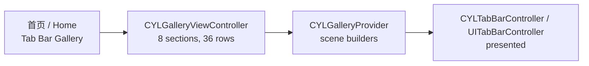

# TabBar 图库 / Tab Bar Gallery

<!-- bound-classes: CYLTabBarController, CYLTabBar, CYLPlusButton, CYLTabButtonPressAnimation -->
<!-- binding:start -->
<!-- Generated by scripts/update-docs-navigation.py; do not edit by hand. -->

| 中文 | English |
|:---|:---|
| 绑定的代码类 `CYLTabBarController`：[`CYLTabBarController/CYLTabBarController.h`](../CYLTabBarController/CYLTabBarController.h) | Bound to the class `CYLTabBarController`: [`CYLTabBarController/CYLTabBarController.h`](../CYLTabBarController/CYLTabBarController.h) |
| 绑定的代码类 `CYLTabBar`：[`CYLTabBarController/CYLTabBar.h`](../CYLTabBarController/CYLTabBar.h) | Bound to the class `CYLTabBar`: [`CYLTabBarController/CYLTabBar.h`](../CYLTabBarController/CYLTabBar.h) |
| 绑定的代码类 `CYLPlusButton`：[`CYLTabBarController/CYLPlusButton.h`](../CYLTabBarController/CYLPlusButton.h) | Bound to the class `CYLPlusButton`: [`CYLTabBarController/CYLPlusButton.h`](../CYLTabBarController/CYLPlusButton.h) |
| 绑定的代码类 `CYLTabButtonPressAnimation`：[`CYLTabBarController/CYLTabButtonAnimation.h`](../CYLTabBarController/CYLTabButtonAnimation.h) | Bound to the class `CYLTabButtonPressAnimation`: [`CYLTabBarController/CYLTabButtonAnimation.h`](../CYLTabBarController/CYLTabButtonAnimation.h) |

<!-- binding:end -->

| 中文 | English |
|:---|:---|
| ObjC Demo（`Example`）首页新增「Tab Bar Gallery」一组：点击「Open the tab bar gallery」进入图库，每一行是一个 TabBar 场景，点击该行即展示这个 TabBar。所有场景都只用本库的公开 API 构建（`#import <CYLTabBarController/CYLTabBarController.h>`），覆盖常见的自定义 TabBar 效果，以及本次新增的每一个接口。代码见 `Example/Classes/Gallery/`：`CYLGalleryViewController`（列表）与 `CYLGalleryProvider`（场景）。 | The ObjC demo (`Example`) has a new "Tab Bar Gallery" section on its home page: tap "Open the tab bar gallery", and every row is a tab bar scene, presented when the row is tapped. Every scene is built with the library's public API only (`#import <CYLTabBarController/CYLTabBarController.h>`), covering the usual custom tab bar effects and every newly added API. The code is in `Example/Classes/Gallery/`: `CYLGalleryViewController` (the list) and `CYLGalleryProvider` (the scenes). |

## 目录 / Contents

<!-- navigation:start -->
<!-- Generated by scripts/update-docs-navigation.py; do not edit by hand. -->

| 中文 | English |
|:---|:---|
| [场景与使用的接口](#场景与使用的接口--scenes-and-the-apis-they-use) | [Scenes and the APIs they use](#场景与使用的接口--scenes-and-the-apis-they-use) |
| [Swift 版图库](#swift-版图库--swift-gallery) | [Swift gallery](#swift-版图库--swift-gallery) |
| &nbsp;&nbsp;&nbsp;&nbsp;↳ [效果评估](#效果评估--what-could-and-could-not-be-built) | &nbsp;&nbsp;&nbsp;&nbsp;↳ [What could and could not be built](#效果评估--what-could-and-could-not-be-built) |
| [限制](#限制--limits) | [Limits](#限制--limits) |
| [截图](#截图--screenshots) | [Screenshots](#截图--screenshots) |

<!-- navigation:end -->

## 场景与使用的接口 / Scenes and the APIs they use

| 分组 / Section | 场景 / Scenes | 接口 / APIs |
|:---|:---|:---|
| Basic | 系统 UITabBarController 对照；仿系统样式；混合样式；液态玻璃；带 More（系统 / 本库 / 混合 / 液态玻璃）；默认选中非 0；所有系统使用经典设计；液态玻璃 + 角标；UITab 样式 · The system UITabBarController for comparison; system-like style; mixed items; Liquid Glass; with More (system / library / mixed / Liquid Glass); a non-zero default index; the classic design on every system; Liquid Glass with badges; the UITab style | `CYLTabBarStyleTypeFlatDesign`, `selectedIndex`, `cyl_tabButtonAnimation`, `cyl_hijackedTabBarItemIdentifiers`, `UITabBarItem.badgeValue` |
| Embed | 导航控制器内嵌 TabBarController；TabBarController 内嵌导航控制器 · A navigation controller embedding the tab bar controller, and the other way round | `initWithViewControllers:tabBarItemsAttributes:styleType:context:` |
| Animation | 自定义选中颜色；弹簧动画；背景色变化；按下效果；提示点击 · Selected colors; spring animation; background color change; pressed effect; suggesting a click | `CYLTabBarItemTitleColor` / `IconColor`, `CYLTabButtonAnimation`（select / reselect / highlight / dehighlight）, `CYLTabBarItemBackgroundColor`, `CYLTabBarItemSelectedBackgroundColor` |
| Irregular | 中间的大号圆形按钮 · A large round button in the middle | `CYLPlusButton`（`+tabBarContext`, `+multiplierOfTabBarHeight:`, `-pointInside:withEvent:`） |
| Customize click | 劫持按钮点击；特殊提醒气泡 · Hijacking the button click; a special reminder bubble | `CYLPlusButton`, `cyl_didHijackHandler`, `performWhenTabBarItemsReady:`, `cyl_tabButton` |
| Remind | 系统角标；仿系统角标；带动画的提醒（图标跳动 / 角标缩放）；自定义提醒 · System badges; the same on this library; animated reminders (the icon jumps / the badge scales); a custom reminder | `badgeValue`, `-cyl_playBadgeChangedAnimationWithTabButton:iconView:badgeView:`, `cyl_showBadgeValue:animationType:` |
| Lottie | 中间 Tab 播放 Lottie 动画 · A Lottie animation on the middle tab | `CYLTabBarLottieURL`, `CYLTabBarLottieSize` |
| New APIs | 重复点击：返回根页面再滚动到顶部；按下与重复点击动画；劫持普通 Tab；单个 Tab 的颜色、字体与背景；无障碍标识；PlusButton 两侧居中排列；两端留白与 Tab 间隙 · Reselect: pop to root then scroll to top; press and reselect animations; hijacking a regular tab; per-tab colors, fonts and backgrounds; accessibility identifiers; centered tabs around a plus button; edge insets and gaps | `cyl_reselectBehavior`, `CYLTabButtonPressAnimation`, `-cyl_playReselectAnimationWithTabButton:…`, `cyl_hijackedTabBarItemIdentifiers`, `CYLTabBarItemTitleFont`, `CYLTabBarItemAccessibilityIdentifier`, `itemPositioning` / `itemWidth` / `itemSpacing`, `cyl_itemEdgeInsets` |

| 中文 | English |
|:---|:---|
| 图标使用 SF Symbols 模板图片，因此单个 Tab 的图标颜色可以生效；气泡、圆形按钮与深色背景在代码中绘制，Demo 不依赖额外的图片资源。界面文字为英文，按仓库规则不在代码中写中文字符串。 | Icons are SF Symbols template images, so per-tab icon colors apply; the bubbles, the round button and the dark backgrounds are drawn in code, so the demo needs no extra image assets. The UI text is English, as the repository rules keep Chinese strings out of code. |
| 为实现这些效果，本库新增了 `CYLTabBarItemBackgroundColor`（未选中 Tab 的背景色）、`CYLTabBarLottieLoopsWhenUnselected`（未选中时循环播放 Lottie）、`cyl_hidesBadgeOfSelectedTab`（选中的 Tab 隐藏角标），并让只设置 `itemSpacing` 时在 Tab 之间留出间隙。被拦截的 "Photo" 在对话框显示期间显示为选中（交换页面，关闭后恢复）。逐项对照见 [Custom-Tab-Bar-Features.md](Custom-Tab-Bar-Features.md)。 | To build these effects the library gained `CYLTabBarItemBackgroundColor` (the background of a tab while not selected), `CYLTabBarLottieLoopsWhenUnselected` (a Lottie that loops while unselected) and `cyl_hidesBadgeOfSelectedTab` (the selected tab hides its badge), and `itemSpacing` alone now leaves gaps between the tabs. The intercepted "Photo" tab looks selected while its dialog is up (the pages are swapped, then restored). The item-by-item checklist is in [Custom-Tab-Bar-Features.md](Custom-Tab-Bar-Features.md). |

## Swift 版图库 / Swift gallery

| 中文 | English |
|:---|:---|
| `Example-Swift-Gallery/` 是同一个图库的 Swift 版本：场景、分组、行标题与 ObjC 版一致，代码结构与常见的 Swift TabBar 图库 Demo 相同（`GalleryViewController` 列表 + `GalleryProvider` 场景构建函数）。它通过 **Swift Package Manager** 集成本库：Xcode 工程以本地包（`relativePath = ..`）引用仓库根目录的 `Package.swift`，产品为 `CYLTabBarController`（Core + FlatDesign + Lottie），因此不需要 `pod install`。代码只 `import CYLTabBarController`。 | `Example-Swift-Gallery/` is the Swift version of the same gallery: the scenes, sections and row titles match the ObjC one, and the code is laid out like a typical Swift tab bar gallery demo (a `GalleryViewController` list plus `GalleryProvider` scene builders). It integrates the library with **Swift Package Manager**: the Xcode project references the repository's root `Package.swift` as a local package (`relativePath = ..`), product `CYLTabBarController` (Core + FlatDesign + Lottie), so no `pod install` is needed. The code only does `import CYLTabBarController`. |
| 打开方式：用 Xcode 26 打开 `Example-Swift-Gallery/CYLTabBarGallery.xcodeproj`，等待包解析完成后运行 `CYLTabBarGallery` 目标（iOS 15+）。工程使用 Xcode 的文件夹同步（`PBXFileSystemSynchronizedRootGroup`），`CYLTabBarGallery/` 中的源文件与 `tab_search_animate.json` 会自动加入目标。 | To run it: open `Example-Swift-Gallery/CYLTabBarGallery.xcodeproj` in Xcode 26, let the package resolve, and run the `CYLTabBarGallery` target (iOS 15+). The project uses Xcode's folder sync (`PBXFileSystemSynchronizedRootGroup`), so the sources in `CYLTabBarGallery/` and `tab_search_animate.json` join the target automatically. |

| 文件 / File | 中文 | English |
|:---|:---|:---|
| `GalleryViewController.swift` | 列表与点击分发；系统 UITabBarController / UITab 场景的代理（"Photo" 打开对话框并显示为选中） | The list and row dispatch; the delegate of the system UITabBarController / UITab scenes ("Photo" opens a dialog and looks selected) |
| `GalleryProvider.swift` | 每个场景一个构建函数 | One builder per scene |
| `GallerySupport.swift` | 颜色、SF Symbols、页面、气泡、对话框等共用工具 | Shared helpers: colors, SF Symbols, pages, bubbles, the dialog |
| `GalleryAnimations.swift` | `CYLTabButtonAnimation` 实现：弹跳、按下、重复点击旋转、角标变化 | `CYLTabButtonAnimation` implementations: bounce, pressed, reselect turn, badge-changed |
| `GalleryIrregularPlusButton.swift` | 凸起的圆形 `CYLPlusButton`，只在圆内响应 | The raised round `CYLPlusButton` that only responds inside its circle |
| `GalleryPageViewController.swift` | 示例页面、长列表与导航控制器 | Sample pages, a long list and the navigation controller |

### 效果评估 / What could and could not be built

| 中文 | English |
|:---|:---|
| 逐个场景对照后，只有一个效果无法用已有公开 API 忠实实现：**角标出现时自动播放动画**（"Remind with animation" 两个场景）。以前只能在每处设置 `badgeValue` 的代码后手动对 `cyl_tabImageView` 播放动画，而系统或其他代码设置角标时不会触发。为此本库新增了可选协议方法 `-cyl_playBadgeChangedAnimationWithTabButton:iconView:badgeView:`：`CYLTabBar` 监听每个 Item 的 `badgeValue`，新值出现时在下一个 runloop 调用该方法（见 [Tab-Interactions.md](Tab-Interactions.md)）。ObjC 与 Swift 图库的这两个场景都改为使用它。 | Going through every scene, only one effect could not be built faithfully with the existing public API: **an animation that plays automatically when a badge appears** (the two "Remind with animation" scenes). Before, you had to animate `cyl_tabImageView` by hand after every place that set `badgeValue`, and badges set by the system or other code were missed. So the library gained the optional protocol method `-cyl_playBadgeChangedAnimationWithTabButton:iconView:badgeView:`: `CYLTabBar` observes every item's `badgeValue` and calls it on the next run loop turn when a new value appears (see [Tab-Interactions.md](Tab-Interactions.md)). Both galleries now use it for these two scenes. |
| 其余效果都可以用公开 API 实现：颜色与字体（`CYLTabBarItemTitleColor` 等）、背景色、选中 / 重复点击 / 按下动画、不规则 PlusButton、劫持点击、提醒气泡、Lottie 循环、液态玻璃与 More。Swift 调用协议方法时用 `@objc(...)` 固定 Objective-C 方法名，避免导入名称差异。 | Every other effect is built with the public API: colors and fonts (`CYLTabBarItemTitleColor`...), backgrounds, select / reselect / pressed animations, the irregular plus button, hijacked clicks, reminder bubbles, a looping Lottie, Liquid Glass and "More". The Swift code pins protocol methods with `@objc(...)`, so differences in imported names do not matter. |

## 限制 / Limits

| 中文 | English |
|:---|:---|
| 背景色（`CYLTabBarItemBackgroundColor` / `SelectedBackgroundColor`）只用于经典 TabBar 与扁平样式，因此背景色相关场景在 iOS 26+ 上使用扁平样式（全宽 TabBar）；液态玻璃自带选中效果。「Edge insets and gaps」场景使用经典 TabBar，需要 iOS 25 及以前或 iOS 26 的 UI 兼容模式。 | Backgrounds (`CYLTabBarItemBackgroundColor` / `SelectedBackgroundColor`) apply to the classic tab bar and FlatDesign, so the background scenes use FlatDesign (the full-width tab bar) on iOS 26+; Liquid Glass draws its own selection. The "Edge insets and gaps" scene uses the classic tab bar, which needs iOS 25 or earlier, or iOS 26 in UI compatibility mode. |
| 图库中的 CYLTabBarController 都把自己设为代理（`delegate = self`），使劫持检查在 UIKit 选中 Tab 之前执行；代理是其他对象时，请在其 `-tabBarController:shouldSelectViewController:` 中调用 `-cyl_interceptHijackIfNeededForViewController:`（见 [Tab-Hijack.md](Tab-Hijack.md)）。 | Every CYLTabBarController in the gallery is its own delegate (`delegate = self`), so the hijack check runs before UIKit selects a tab; with a delegate that is another object, call `-cyl_interceptHijackIfNeededForViewController:` from its `-tabBarController:shouldSelectViewController:` (see [Tab-Hijack.md](Tab-Hijack.md)). |

## 截图 / Screenshots

| 中文 | English |
|:---|:---|
| 本次开发环境没有 iOS 模拟器或真机，ObjC 与 Swift 两个 Demo 均未经编译与运行，因此暂无截图。在设备上验证后，请将每个场景的截图或 GIF 放入 `docs/assets/`（例如 `assets/tab-bar-gallery-irregular.png`）并在此引用。 | This change was made without an iOS simulator or device; neither the ObjC nor the Swift demo has been compiled or run, so there are no screenshots yet. After testing on a device, put a screenshot or GIF of each scene in `docs/assets/` (e.g. `assets/tab-bar-gallery-irregular.png`) and reference it here. |
