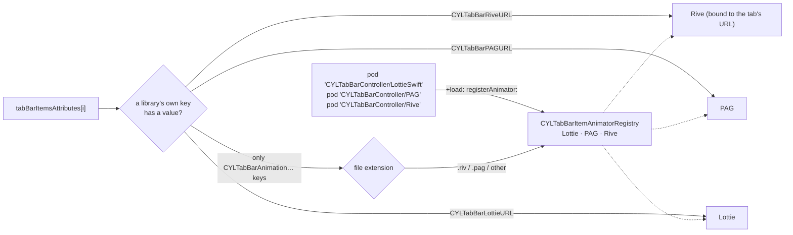
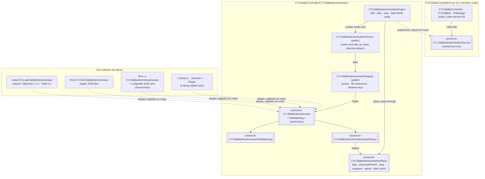
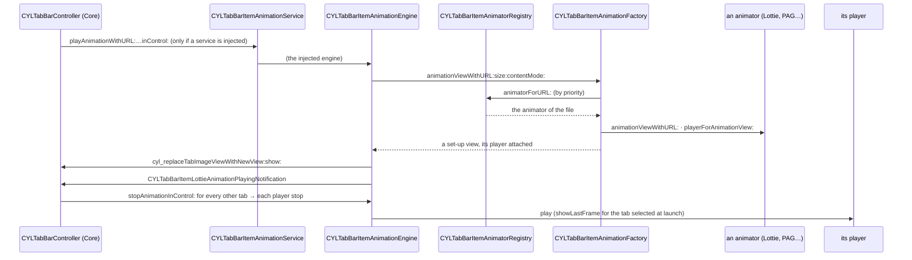

# [CN]Tab 图标动画共用子库：CYLTabBarItemAnimation（面向协议，可扩展任意动画库）
# [EN]The shared tab icon animation subspec: CYLTabBarItemAnimation (protocol-oriented, open to any library)

<!-- bound-classes: CYLTabBarItemAnimatorRegistry, CYLTabBarItemAnimationFactory, CYLTabBarItemAnimationBasePlayer, CYLTabBarItemAnimationEngine, CYLLottieTabBarItemAnimator, CYLPAGTabBarItemAnimator, CYLRiveTabBarItemAnimator, CYLTabBarItemViewAnimator -->
<!-- binding:start -->
<!-- Generated by scripts/update-docs-navigation.py; do not edit by hand. -->

| 中文 | English |
|:---|:---|
| 绑定的代码类 `CYLTabBarItemAnimatorRegistry`：[`CYLTabBarController/CYLTabBarItemAnimation/CYLTabBarItemAnimatorRegistry.h`](../CYLTabBarController/CYLTabBarItemAnimation/CYLTabBarItemAnimatorRegistry.h) | Bound to the class `CYLTabBarItemAnimatorRegistry`: [`CYLTabBarController/CYLTabBarItemAnimation/CYLTabBarItemAnimatorRegistry.h`](../CYLTabBarController/CYLTabBarItemAnimation/CYLTabBarItemAnimatorRegistry.h) |
| 绑定的代码类 `CYLTabBarItemAnimationFactory`：[`CYLTabBarController/CYLTabBarItemAnimation/CYLTabBarItemAnimationFactory.h`](../CYLTabBarController/CYLTabBarItemAnimation/CYLTabBarItemAnimationFactory.h) | Bound to the class `CYLTabBarItemAnimationFactory`: [`CYLTabBarController/CYLTabBarItemAnimation/CYLTabBarItemAnimationFactory.h`](../CYLTabBarController/CYLTabBarItemAnimation/CYLTabBarItemAnimationFactory.h) |
| 绑定的代码类 `CYLTabBarItemAnimationBasePlayer`：[`CYLTabBarController/CYLTabBarItemAnimation/CYLTabBarItemAnimationPlayer.h`](../CYLTabBarController/CYLTabBarItemAnimation/CYLTabBarItemAnimationPlayer.h) | Bound to the class `CYLTabBarItemAnimationBasePlayer`: [`CYLTabBarController/CYLTabBarItemAnimation/CYLTabBarItemAnimationPlayer.h`](../CYLTabBarController/CYLTabBarItemAnimation/CYLTabBarItemAnimationPlayer.h) |
| 绑定的代码类 `CYLTabBarItemAnimationEngine`：[`CYLTabBarController/CYLTabBarItemAnimation/CYLTabBarItemAnimationEngine.h`](../CYLTabBarController/CYLTabBarItemAnimation/CYLTabBarItemAnimationEngine.h) | Bound to the class `CYLTabBarItemAnimationEngine`: [`CYLTabBarController/CYLTabBarItemAnimation/CYLTabBarItemAnimationEngine.h`](../CYLTabBarController/CYLTabBarItemAnimation/CYLTabBarItemAnimationEngine.h) |
| 绑定的代码类 `CYLLottieTabBarItemAnimator`：[`CYLTabBarController/CYLTabBarItemAnimation/Lottie/CYLLottieTabBarItemAnimator.h`](../CYLTabBarController/CYLTabBarItemAnimation/Lottie/CYLLottieTabBarItemAnimator.h) | Bound to the class `CYLLottieTabBarItemAnimator`: [`CYLTabBarController/CYLTabBarItemAnimation/Lottie/CYLLottieTabBarItemAnimator.h`](../CYLTabBarController/CYLTabBarItemAnimation/Lottie/CYLLottieTabBarItemAnimator.h) |
| 绑定的代码类 `CYLPAGTabBarItemAnimator`：[`CYLTabBarController/CYLTabBarItemAnimation/PAG/CYLPAGTabBarItemAnimator.h`](../CYLTabBarController/CYLTabBarItemAnimation/PAG/CYLPAGTabBarItemAnimator.h) | Bound to the class `CYLPAGTabBarItemAnimator`: [`CYLTabBarController/CYLTabBarItemAnimation/PAG/CYLPAGTabBarItemAnimator.h`](../CYLTabBarController/CYLTabBarItemAnimation/PAG/CYLPAGTabBarItemAnimator.h) |
| 绑定的代码类 `CYLRiveTabBarItemAnimator`：[`CYLTabBarController/CYLTabBarItemAnimation/Rive/CYLRiveTabBarItemAnimator.h`](../CYLTabBarController/CYLTabBarItemAnimation/Rive/CYLRiveTabBarItemAnimator.h) | Bound to the class `CYLRiveTabBarItemAnimator`: [`CYLTabBarController/CYLTabBarItemAnimation/Rive/CYLRiveTabBarItemAnimator.h`](../CYLTabBarController/CYLTabBarItemAnimation/Rive/CYLRiveTabBarItemAnimator.h) |
| 绑定的代码类 `CYLTabBarItemViewAnimator`：[`CYLTabBarController/CYLTabBarItemAnimation/CYLTabBarItemViewAnimator.h`](../CYLTabBarController/CYLTabBarItemAnimation/CYLTabBarItemViewAnimator.h) | Bound to the class `CYLTabBarItemViewAnimator`: [`CYLTabBarController/CYLTabBarItemAnimation/CYLTabBarItemViewAnimator.h`](../CYLTabBarController/CYLTabBarItemAnimation/CYLTabBarItemViewAnimator.h) |

<!-- binding:end -->

| 中文 | English |
|:---|:---|
| Tab 图标动画由独立的 `CYLTabBarItemAnimation` 子库（pod）实现。它**只在引入某个动画库的子库时才会被引入**（目前为 Lottie、PAG 与 Rive）；Core 不依赖它，只引入 Core 时构建中没有任何动画代码。代码按**面向协议、依赖反转**组织：上层只依赖自己定义的协议，下层实现协议并自行注册。因此以后新增动画库（例如 SVGA、APNG）时，只需新增一个目录、一个 animator 类和一个子库，**其他代码都不用修改**（[#604](https://github.com/ChenYilong/CYLTabBarController/issues/604)）。Rive 就是这样接入的，见 [Rive-Animation.md](Rive-Animation.md)。 | Tab icon animations are implemented by a separate subspec (pod), `CYLTabBarItemAnimation`. It is **pulled in only by an animation library's subspec** (Lottie, PAG and Rive today); Core does not depend on it, and Core alone has no animation code. The code is **protocol-oriented with dependency inversion**: each upper layer depends only on a protocol it defines, and the lower layer implements it and registers itself. So a library added later (e.g. SVGA, APNG) is one more folder, one more animator class and one more subspec, with **no change anywhere else** ([#604](https://github.com/ChenYilong/CYLTabBarController/issues/604)). Rive was added exactly this way, see [Rive-Animation.md](Rive-Animation.md). |

## [CN]目录
## [EN]Contents

<!-- navigation:start -->
<!-- Generated by scripts/update-docs-navigation.py; do not edit by hand. -->

| 中文 | English |
|:---|:---|
| [如何选择子库](#cn如何选择子库) | [Which subspec to use](#enwhich-subspec-to-use) |
| [注册与选择动画库](#cn注册与选择动画库) | [Registering and choosing a library](#enregistering-and-choosing-a-library) |
| [两层依赖反转](#cn两层依赖反转) | [Dependency inversion on two levels](#endependency-inversion-on-two-levels) |
| [协议与类](#cn协议与类) | [Protocols and classes](#enprotocols-and-classes) |
| [已废弃的 Lottie 名称](#cn已废弃的-lottie-名称) | [Deprecated Lottie names](#endeprecated-lottie-names) |
| [依赖注入](#cn依赖注入) | [Dependency injection](#endependency-injection) |
| [新增一个动画库](#cn新增一个动画库) | [Adding an animation library](#enadding-an-animation-library) |
| &nbsp;&nbsp;&nbsp;&nbsp;↳ [方式 A：可播放视图（Rive 的完整实现）](#cn方式-a可播放视图rive-的完整实现) | &nbsp;&nbsp;&nbsp;&nbsp;↳ [Way A: a playable view (Rive's complete integration)](#enway-a-a-playable-view-rives-complete-integration) |
| &nbsp;&nbsp;&nbsp;&nbsp;↳ [方式 B：animator ＋ 播放器（PAG 的方式）](#cn方式-banimator--播放器pag-的方式) | &nbsp;&nbsp;&nbsp;&nbsp;↳ [Way B: an animator and a player (PAG's way)](#enway-b-an-animator-and-a-player-pags-way) |
| [选中 Tab 时](#cn选中-tab-时) | [When a tab is selected](#enwhen-a-tab-is-selected) |
| [动画库 key 的预编译检查：方案评估](#cn动画库-key-的预编译检查方案评估) | [Compile-time guards for the animation keys: options evaluated](#encompile-time-guards-for-the-animation-keys-options-evaluated) |
| &nbsp;&nbsp;&nbsp;&nbsp;↳ [现状](#cn现状) | &nbsp;&nbsp;&nbsp;&nbsp;↳ [Where the code stands](#enwhere-the-code-stands) |
| &nbsp;&nbsp;&nbsp;&nbsp;↳ [两种方案对比](#cn两种方案对比) | &nbsp;&nbsp;&nbsp;&nbsp;↳ [The two options compared](#enthe-two-options-compared) |
| &nbsp;&nbsp;&nbsp;&nbsp;↳ [结论与建议](#cn结论与建议) | &nbsp;&nbsp;&nbsp;&nbsp;↳ [Conclusion and recommendation](#enconclusion-and-recommendation) |
| [集成方式](#cn集成方式) | [Integrations](#enintegrations) |
| [跟随主题（#216）](#cn跟随主题216) | [Following the theme (#216)](#enfollowing-the-theme-216) |
| [测试](#cn测试) | [Testing](#entesting) |

<!-- navigation:end -->

## [CN]如何选择子库
## [EN]Which subspec to use

```ruby
pod 'CYLTabBarController'                  # Core only: no animation code / 只有 Core：没有动画代码
pod 'CYLTabBarController/LottieSwift'      # Lottie (lottie-ios 4.x) / Lottie
pod 'CYLTabBarController/PAG'              # PAG (libpag) / PAG
pod 'CYLTabBarController/Rive'             # Rive (RiveRuntime) / Rive
pod 'CYLTabBarController/GIF'              # GIF (ImageIO, no third-party dependency) / GIF，不依赖第三方库
# Any combination works / 可任意组合:
pod 'CYLTabBarController/LottieSwift'
pod 'CYLTabBarController/PAG'
pod 'CYLTabBarController/Rive'
```

| 中文 | English |
|:---|:---|
| `Lottie`、`LottieObjectiveC`、`LottieSwift`、`CYLFlatDesignTabBar`（依赖 `LottieSwift`）、`PAG`、`PAGEnterprise`、`Rive` 都依赖 `CYLTabBarItemAnimation`，现有 Podfile 无需修改。同一个 TabBar 中可以混用不同动画库的 Tab，也可以只让部分 Tab 有动画，见 [Per-Tab-Animation.md](Per-Tab-Animation.md)。 | `Lottie`, `LottieObjectiveC`, `LottieSwift`, `CYLFlatDesignTabBar` (through `LottieSwift`), `PAG`, `PAGEnterprise` and `Rive` depend on `CYLTabBarItemAnimation`, so existing Podfiles need no change. One tab bar can mix tabs of different libraries, and animate only some tabs, see [Per-Tab-Animation.md](Per-Tab-Animation.md). |

## [CN]注册与选择动画库
## [EN]Registering and choosing a library

| 中文 | English |
|:---|:---|
| **注册：pod 引入即自动注册。** 与 PlusButton 的注册表（`+registerPlusButton`，每个 context 一条记录，TabBarController 只取自己的那条）相同，每个动画库的子库在 `+load` 中向 `CYLTabBarItemAnimatorRegistry` 注册一个 animator，无需任何代码；同时引入多个动画库时，它们同时注册、互不覆盖（同名 animator 才会替换）。注册本身没有任何副作用（不 hook、不创建渲染器），因此不需要像 FlatDesign 的 `+cyl_navigationBarActionHook` 那样延迟到使用时才执行；动画库真正的工作（加载文件、创建 Rive 的 `Worker` 等）只在某个 Tab 使用它时才发生。 | **Registration: a pod registers itself when it is installed.** As with the plus button's registry (`+registerPlusButton`, one entry per context, each tab bar controller takes only its own), each animation subspec registers an animator with `CYLTabBarItemAnimatorRegistry` in `+load`, with no code needed; several libraries installed together register side by side without replacing each other (only an animator with the same identifier replaces one). Registering has no side effect (no hook, no renderer is created), so it does not need to wait until the feature is used, as FlatDesign's `+cyl_navigationBarActionHook` does; a library's real work (loading files, creating Rive's `Worker`…) happens only when a tab uses it. |
| **选择：由 Tab 属性中有值的 key 决定。** `-initWithViewControllers:tabBarItemsAttributes:` 中每个 Tab 的属性决定该 Tab 使用哪个动画库：某个动画库自己的 key 有值（例如 `CYLTabBarRiveURL`）时，该 Tab 只由这个动画库播放（`+animatorForAttributes:`），与文件扩展名无关（例如 CDN 上没有扩展名的 Rive 文件），并且该 Tab 的尺寸、深色版本等其他值也只从这个动画库的 key（以及通用 key）中读取，不会混用其他动画库的 key。只使用通用 key（`CYLTabBarAnimation…`）时，由文件扩展名决定（".riv" Rive、".pag" PAG，其他文件 Lottie）。 | **Choosing: the keys with a value in a tab's attributes decide.** Each tab's attributes in `-initWithViewControllers:tabBarItemsAttributes:` decide which library plays it: when one library's own key has a value (e.g. `CYLTabBarRiveURL`), the tab is played by that library only (`+animatorForAttributes:`), whatever the file's extension (e.g. a Rive file on a CDN without one), and the tab's other values, its size, dark version…, are read only from that library's keys (and the generic keys), never from another library's. With only the generic keys (`CYLTabBarAnimation…`), the file's extension decides (".riv" Rive, ".pag" PAG, any other file Lottie). |
| **多个动画库同时存在、只使用其中一个**：没有被任何 Tab 使用的动画库不会参与播放；某个动画库的 key 在其子库未引入时被忽略（Tab 显示图片），不会交给其他动画库；同一个 Tab 同时设置了多个动画库的 key 时，按查找顺序使用第一个（DEBUG 下打印提示）。所有动画库代码都在各自子库的 `__has_include` 之内，Core 与 FlatDesign 中没有任何针对某个动画库的编译开关，因此不会因为多引入一个动画库而改变其他 Tab 的行为。这些情况都由 `Tests/CYLTabBarItemAnimation` 中的测试覆盖（GitHub Actions「Animation tests」在 macOS 上运行）。 | **Several libraries installed, one used**: a library no tab uses plays nothing; a library's keys are ignored when its subspec is not installed (the tab shows its images) and are not handed to another library; a tab with the keys of several libraries uses the first in lookup order (logged in DEBUG). Every library's code is inside its own subspec's `__has_include`, and Core and FlatDesign have no compile-time switch for any library, so installing one more library does not change how the other tabs behave. The tests in `Tests/CYLTabBarItemAnimation` cover these cases (the "Animation tests" GitHub Actions workflow runs them on macOS). |



## [CN]两层依赖反转
## [EN]Dependency inversion on two levels



| 中文 | English |
|:---|:---|
| **第一层：Core → 动画服务。** Core 定义私有协议 `CYLTabBarItemAnimationService`（`CYLTabBarItemAnimationService.h`），所有动画相关的调用都只经过它（`UIControl+CYLTabBarItemAnimation` 中与动画库无关的方法、公开的 Lottie 命名方法）。子库中的 `CYLTabBarItemAnimationEngine` 实现该协议，并在 `+load` 中通过 `CYLTabBarItemAnimationSetService()` 注入。没有注入时服务为 nil，所有调用都不起作用，Tab 显示图片。Core 中没有任何动画库的类型、key 或编译开关，是否有动画在运行时判断。 | **Level 1: Core → the animation service.** Core defines the private protocol `CYLTabBarItemAnimationService` (`CYLTabBarItemAnimationService.h`), and every animation call goes through it only (the library-neutral methods of `UIControl+CYLTabBarItemAnimation`, the public Lottie-named methods). The subspec's `CYLTabBarItemAnimationEngine` implements it and injects itself in `+load` with `CYLTabBarItemAnimationSetService()`. Without it the service is nil, every call is a no-op and the tabs show their images. Core has no animation library type, key or compile-time switch; whether tabs animate is decided at runtime. |
| **第二层：引擎 → 动画库。** 引擎按职责定义公开协议（接口隔离）：`CYLTabBarItemAnimationFileMatching`（能播放哪些文件、如何被查找）与 `CYLTabBarItemAnimationViewFactory`（创建视图及其播放器），二者组合为 `CYLTabBarItemAnimator`；`CYLTabBarItemAnimationPlayer` 控制单个视图的播放。引擎只通过注入的工厂（`CYLTabBarItemAnimationViewMaking`）创建视图，只通过播放器播放与停止，只通过注入的注册表（`CYLTabBarItemAnimatorRegistering`）查找动画库，只通过注入的风格来源（`CYLTabBarItemAnimationStyleSource`）获取深色版本，从不指定具体的动画库或实现类。每个动画库的 animator 与播放器放在自己的子库中（`CYLTabBarItemAnimation/Lottie/`、`CYLTabBarItemAnimation/PAG/`），只在引入该库时编译，animator 在 `+load` 中向注册表注册自己。 | **Level 2: the engine → the libraries.** The engine defines public protocols split by role (interface segregation): `CYLTabBarItemAnimationFileMatching` (which files, and the lookup) and `CYLTabBarItemAnimationViewFactory` (views and their players), combined in `CYLTabBarItemAnimator`; `CYLTabBarItemAnimationPlayer` controls one view. The engine creates views only through the injected factory (`CYLTabBarItemAnimationViewMaking`), plays and stops only through players, finds libraries only through the injected registry (`CYLTabBarItemAnimatorRegistering`), and gets dark versions only through the injected style source (`CYLTabBarItemAnimationStyleSource`), never naming a library or an implementation class. Each library's animator and players live in its own subspec (`CYLTabBarItemAnimation/Lottie/`, `CYLTabBarItemAnimation/PAG/`), are compiled only with that library, and the animator registers itself in `+load`. |
| **播放器封装状态。** 每个动画视图都有一个播放器，由工厂绑定：视图持有播放器，播放器弱引用视图，没有循环引用。播放器保存动画库自身的状态（例如是否已应用深色颜色），引擎只调用 `play`、`showLastFrame`、`stop`，深色模式替换时通过 `progress`、`animationSpeed` 复制状态，与动画库无关。Lottie 的两个版本分别由两个播放器实现，不再在同一方法里用 `#if` 区分。 | **Players hold the state.** Each animation view has a player, attached by the factory: the view keeps its player and the player holds the view weakly, so there is no retain cycle. The player keeps the library's own state (e.g. whether dark colors are applied); the engine only calls `play`, `showLastFrame` and `stop`, and copies `progress` and `animationSpeed` for a Dark Mode swap, whatever the library. The two Lottie flavors are two players, with no `#if` branches inside one method any more. |
| **查找顺序。** animator 按优先级（`priority`，数值大的优先）查找，相同优先级按注册顺序。PAG 等只识别自己文件类型的 animator 使用默认优先级；Lottie 使用 `CYLTabBarItemAnimatorPriorityFallback`，最后查找，接收其他 animator 都不处理的文件（与以前的行为一致）。 | **Lookup order.** Animators are looked up by `priority` (higher first), then registration order. Animators that recognize their own file types, such as PAG, use the default priority; Lottie uses `CYLTabBarItemAnimatorPriorityFallback`, is looked up last, and takes every file no other animator takes (as before). |
| **属性 key。** 新增通用 key `CYLTabBarAnimationURL`、`CYLTabBarAnimationFilePath`、`CYLTabBarAnimationSize`、`CYLTabBarAnimationDarkURL`、`CYLTabBarAnimationDarkFilePath`、`CYLTabBarAnimationDarkColors`，适用于任意动画库：由文件决定使用哪个库播放。各动画库自己的 key（`CYLTabBarLottie…`、`CYLTabBarPAG…`）通过 animator 的 `attributeKeys` 声明为通用 key 的别名，仍然有效；Core 只通过 `CYLTabBarItemAttributesAnimationValue()` 读取属性，不认识任何库的 key。 | **Attribute keys.** New generic keys `CYLTabBarAnimationURL`, `CYLTabBarAnimationFilePath`, `CYLTabBarAnimationSize`, `CYLTabBarAnimationDarkURL`, `CYLTabBarAnimationDarkFilePath` and `CYLTabBarAnimationDarkColors` work for any library: the file decides which one plays it. Each library's own keys (`CYLTabBarLottie…`, `CYLTabBarPAG…`) are declared as aliases of the generic keys by the animator's `attributeKeys`, and keep working; Core reads attributes only through `CYLTabBarItemAttributesAnimationValue()` and knows no library's keys. |
| **公开 API 不变。** `-cyl_addLottieImageWithLottieURL:…`、`-cyl_animationLottieImageWithLottieURL:…`、`-cyl_stopAnimationOfLottieView`、`-cyl_lottieAnimationView`、`-cyl_setLottieAnimationSpeed:`、`-cyl_isLottieAnimationView` 等全部保留，现在交给服务处理，因此对所有动画库都有效。另新增通用通知名称 `CYLTabBarItemAnimationPlayingNotification`、`CYLTabBarItemAnimationViewDidAddNotification`，与 `CYLTabBarItemLottieAnimation…Notification` 取值相同（观察任一名称都能收到），库内部已改用通用名称。 | **The public API is unchanged.** `-cyl_addLottieImageWithLottieURL:…`, `-cyl_animationLottieImageWithLottieURL:…`, `-cyl_stopAnimationOfLottieView`, `-cyl_lottieAnimationView`, `-cyl_setLottieAnimationSpeed:`, `-cyl_isLottieAnimationView` and the rest stay; they now hand over to the service, so they work for every library. The library-neutral notification names `CYLTabBarItemAnimationPlayingNotification` and `CYLTabBarItemAnimationViewDidAddNotification` are new, with the same values as `CYLTabBarItemLottieAnimation…Notification` (an observer of either name gets them); the library itself now uses the neutral names. |

## [CN]协议与类
## [EN]Protocols and classes

| 中文 | English |
|:---|:---|
| `CYLTabBarItemAnimationFileMatching`（协议，公开）：`identifier`、`canAnimateFileAtURL:`；可选 `priority`、`fileExtensions`、`attributeKeys`。 | `CYLTabBarItemAnimationFileMatching` (protocol, public): `identifier`, `canAnimateFileAtURL:`; optional `priority`, `fileExtensions`, `attributeKeys`. |
| `CYLTabBarItemAnimationViewFactory`（协议，公开）：`animationViewWithURL:size:contentMode:`、`playerForAnimationView:`（不是本库的视图时返回 nil，同时用于识别视图）。 | `CYLTabBarItemAnimationViewFactory` (protocol, public): `animationViewWithURL:size:contentMode:`, `playerForAnimationView:` (nil for a view that is not the library's, which also recognizes views). |
| `CYLTabBarItemAnimator`（协议，公开）：以上两个协议的组合，即一个动画库。 | `CYLTabBarItemAnimator` (protocol, public): the two above combined, i.e. one library. |
| `CYLTabBarItemAnimationPlayer`（协议，公开）：`animationView`、`play`、`showLastFrame`、`stop`；可选 `progress`、`animationSpeed`、`applyDarkColors:traitCollection:`。`CYLTabBarItemAnimationBasePlayer` 是便捷父类（弱引用视图）。 | `CYLTabBarItemAnimationPlayer` (protocol, public): `animationView`, `play`, `showLastFrame`, `stop`; optional `progress`, `animationSpeed`, `applyDarkColors:traitCollection:`. `CYLTabBarItemAnimationBasePlayer` is a convenient superclass (holds the view weakly). |
| `CYLTabBarItemAnimatorRegistering`（协议，公开）与默认实现 `CYLTabBarItemAnimatorRegistry`（类，公开）：注册、注销、按优先级查找动画库，汇总扩展名与属性 key。状态保存在实例中；`+sharedRegistry` 是各子库 `+load` 注册到的实例，原有类方法都转发给它。 | `CYLTabBarItemAnimatorRegistering` (protocol, public) and its default `CYLTabBarItemAnimatorRegistry` (class, public): registers, unregisters and looks up libraries by priority, and gathers their extensions and attribute keys. The state lives in instances; `+sharedRegistry` is the one each subspec registers into in `+load`, and the existing class methods forward to it. |
| `CYLTabBarItemAnimationViewMaking`（协议，公开）与默认实现 `CYLTabBarItemAnimationFactory`（类，公开）：`animationViewWithURL:size:contentMode:` 创建并设置视图、绑定播放器；`playerForView:`、`isAnimationView:`。`-initWithRegistry:` 注入注册表；类方法转发给 `+sharedFactory`。App 也可以用它创建动画视图（例如带动画的 PlusButton）。 | `CYLTabBarItemAnimationViewMaking` (protocol, public) and its default `CYLTabBarItemAnimationFactory` (class, public): `animationViewWithURL:size:contentMode:` makes and sets up a view and attaches its player; `playerForView:`, `isAnimationView:`. `-initWithRegistry:` injects the registry; the class methods forward to `+sharedFactory`. Apps can use it too, e.g. for an animated plus button. |
| `-[UIControl cyl_tabBarItemAnimationPlayer]`（公开）：Tab 按钮动画的播放器，任意动画库都无需强转即可 `play`、`stop`、调整 `progress` / `animationSpeed`。 | `-[UIControl cyl_tabBarItemAnimationPlayer]` (public): the player of a tab button's animation, to `play`, `stop`, or set `progress` / `animationSpeed` with any library, with no cast. |
| `CYLTabBarItemAnimationPlayableView`（协议，公开）：自己会播放的视图，`cyl_playAnimationView`、`cyl_showAnimationViewLastFrame`、`cyl_stopAnimationView`；可选 `cyl_applyAnimationViewColors:`。`CYLTabBarItemAnimationViewProviding`（协议，公开）：这类视图的抽象工厂。 | `CYLTabBarItemAnimationPlayableView` (protocol, public): a view that plays itself, `cyl_playAnimationView`, `cyl_showAnimationViewLastFrame`, `cyl_stopAnimationView`; optional `cyl_applyAnimationViewColors:`. `CYLTabBarItemAnimationViewProviding` (protocol, public): the abstract factory of such views. |
| `CYLTabBarItemViewAnimator`（类，公开）：为上述视图准备的现成 animator 与播放器：按扩展名匹配、把 URL 拆分为文件与选项、转发播放、仅在深色模式变化时应用 `CYLTabBarAnimationDarkColors`；`viewProvider` 可注入。 | `CYLTabBarItemViewAnimator` (class, public): a ready-made animator and player for such views: matching by extension, splitting the URL into the file and its options, forwarding playback, applying `CYLTabBarAnimationDarkColors` only when Dark Mode changes; `viewProvider` can be injected. |
| `CYLTabBarAnimationURLWithOptions()`、`CYLTabBarAnimationOption`（Core，公开）：在 URL 中携带动画库的选项（例如 Rive 的画板），使多个 Tab 可以使用同一个文件。选项名称由各动画库在自己的子库中声明。 | `CYLTabBarAnimationURLWithOptions()`, `CYLTabBarAnimationOption` (Core, public): carry a library's options in the URL (e.g. Rive's artboard), so several tabs can use one file. Each library declares its option names in its own subspec. |
| `CYLTabBarItemAnimationEngine`（类，私有）：实现 Core 的 `CYLTabBarItemAnimationService`；四个依赖（注册表、工厂、风格来源、宿主）都通过 `-initWithRegistry:factory:styleSource:host:` 注入，不导入 Core 的任何头文件（服务协议除外）。 | `CYLTabBarItemAnimationEngine` (class, private): implements Core's `CYLTabBarItemAnimationService`; its four dependencies (registry, factory, style source, host) are injected with `-initWithRegistry:factory:styleSource:host:`, and it imports no Core header apart from the service protocols. |
| `CYLTabBarItemAnimationHost`（协议，Core 私有）：引擎对 Tab 栏的全部需求：是否为加号按钮、动画是否已布局、默认尺寸、显示动画视图、布局跟踪替换（#653）、添加与播放通知。默认实现为 `CYLTabBarItemAnimationDefaultHost()`。 | `CYLTabBarItemAnimationHost` (protocol, Core-private): everything the engine needs from the tab bar: plus button or not, whether the animation is laid out, the default size, showing the animation view, moving the layout tracking (#653), and the add and play notifications. The default is `CYLTabBarItemAnimationDefaultHost()`. |
| `CYLTabBarItemAnimationStyleSource`（协议，Core 私有）：当前风格下的动画（深色版本与深色颜色，#442）。注册信息由 Core 的 `CYLTabBarItemAnimationStyleRegistry`（`CYLConstants.m`，实例状态，不使用全局字典）持有，`CYLTabBarItemAnimationDefaultStyleSource()` 返回它；`CYLConstants` 原有的 `cyl_…DarkLottie…` 类方法保持不变并转发给它。 | `CYLTabBarItemAnimationStyleSource` (protocol, Core-private): the animation for the current style (dark version and dark colors, #442). Core's `CYLTabBarItemAnimationStyleRegistry` (`CYLConstants.m`, instance state, no global dictionaries) owns the registrations and `CYLTabBarItemAnimationDefaultStyleSource()` returns it; the existing `cyl_…DarkLottie…` class methods of `CYLConstants` stay and forward to it. |

```objc
// In -tabBarController:didSelectControl:, whatever the library. 在 -tabBarController:didSelectControl: 中，与动画库无关。
id<CYLTabBarItemAnimationPlayer> player = control.cyl_tabBarItemAnimationPlayer;
if ([player respondsToSelector:@selector(setAnimationSpeed:)]) {
    player.animationSpeed = 1.5;
}
```

## [CN]已废弃的 Lottie 名称
## [EN]Deprecated Lottie names

| 中文 | English |
|:---|:---|
| 这些名称原本只为 Lottie 设计，现在适用于任意动画库，因此新增了通用名称，旧名称标记为废弃（`DEPRECATED_MSG_ATTRIBUTE`）。旧名称没有删除，仍然可用，并转发给新名称；重写旧方法的子类也仍然有效。库内部与所有示例都已改用新名称，因此不会产生废弃警告；你的工程使用旧名称时会看到废弃警告，按下表替换即可。 | These names were made for Lottie only and now work for any library, so neutral names were added and the old ones are deprecated (`DEPRECATED_MSG_ATTRIBUTE`). Nothing was removed: the old names keep working and forward to the new ones, and a subclass that overrides an old method still works. The library and every example use the new names, so they build without deprecation warnings; a project that uses the old names sees a deprecation warning and can switch with the table below. |

| 已废弃 / Deprecated | 替换为 / Use instead |
|:---|:---|
| `-[UIControl cyl_lottieAnimationView]` | `-[UIControl cyl_tabBarItemAnimationView]` |
| `-[UIControl cyl_isLottieReady]` | `-[UIControl cyl_isTabBarItemAnimationReady]` |
| `-[UIControl cyl_addLottieImageWithLottieURL:size:contentMode:]`（及 `animationSpeed:`、`…FilePath:` 版本 / and the `animationSpeed:` and `…FilePath:` variants） | `-[UIControl cyl_addTabBarItemAnimationWithURL:size:contentMode:]`（及 `animationSpeed:` 版本 / and the `animationSpeed:` variant） |
| `-[UIControl cyl_setLottieAnimationSpeed:]` | `-[UIControl cyl_setTabBarItemAnimationSpeed:]` |
| `-[UIControl cyl_reloadLottieAnimationViewForCurrentStyle]` | `-[UIControl cyl_reloadTabBarItemAnimationViewForCurrentStyle]` |
| `-[UIControl cyl_animationLottieImageWithLottieURL:size:defaultSelected:contentMode:]` | `-[UIControl cyl_playTabBarItemAnimationWithURL:size:defaultSelected:contentMode:]` |
| `-[UIControl cyl_stopAnimationOfLottieView]` | `-[UIControl cyl_stopTabBarItemAnimation]` |
| `CYLTabBarController.lottieAnimationSpeed` | `CYLTabBarController.tabBarItemAnimationSpeed` |
| `-[CYLTabBarController lottieAnimationViewContentMode]`（可重写 / overridable） | `-[CYLTabBarController tabBarItemAnimationViewContentMode]` |
| `CYLTabBarController.lottieURLs` / `lottieSizes` / `lottieViewAdded` | `tabBarItemAnimationURLs` / `tabBarItemAnimationSizes` / `tabBarItemAnimationViewAdded` |
| `UITabBarItem.cyl_lottieURL` / `cyl_lottieSizeValue` | `cyl_tabBarItemAnimationURL` / `cyl_tabBarItemAnimationSizeValue` |
| `CYLTabBarItemLottieAnimationPlayingNotification` / `…ViewDidAddNotification` | `CYLTabBarItemAnimationPlayingNotification` / `CYLTabBarItemAnimationViewDidAddNotification`（取值相同 / same values） |
| `+[CYLConstants cyl_getTureLottieSizeValue:fromNormalImage:]` | `+[CYLConstants cyl_tabBarItemAnimationSizeValue:fromNormalImage:]` |
| `+[CYLConstants isLottieEnabledFromlottieURLs:tabBarItemsAttributes:]` | `+[CYLConstants isTabBarItemAnimationEnabledWithURLs:tabBarItemsAttributes:]` |
| `+[CYLConstants cyl_registerDarkLottieURL:…]` 等深色模式方法 / and the other Dark Mode methods | Tab item 的 `CYLTabBarAnimationDarkURL`、`CYLTabBarAnimationDarkFilePath`、`CYLTabBarAnimationDarkColors` key / the tab item keys `CYLTabBarAnimationDarkURL`, `CYLTabBarAnimationDarkFilePath`, `CYLTabBarAnimationDarkColors` |

| 中文 | English |
|:---|:---|
| 各动画库自己的 key（`CYLTabBarLottieURL`、`CYLTabBarPAGURL`、`CYLTabBarRiveURL`…）与 `CYLTabBarItemsAttributesAddingLottieFiles()` 属于各自的动画库，没有废弃。 | Each library's own keys (`CYLTabBarLottieURL`, `CYLTabBarPAGURL`, `CYLTabBarRiveURL`…) and `CYLTabBarItemsAttributesAddingLottieFiles()` belong to their library and are not deprecated. |

## [CN]依赖注入
## [EN]Dependency injection

| 中文 | English |
|:---|:---|
| 引擎、工厂和注册表都依赖协议而不是具体类，依赖通过初始化方法注入。唯一指定默认实现的地方（组合根）是引擎的 `-init`：共享注册表、基于它的工厂，以及 Core 的风格来源与宿主。 | The engine, the factory and the registry depend on protocols, not classes, and get their dependencies through their initializers. The only place that names the defaults (the composition root) is the engine's `-init`: the shared registry, a factory over it, and Core's style source and host. |
| 注册表的状态保存在实例中，没有全局可变变量：新建的注册表是空的、相互独立，适合测试或在 App 中单独组合动画库。原有的类方法（`+registerAnimator:` 等）保持不变，转发给 `+sharedRegistry`。 | The registry keeps its state in instances, with no global mutable variables: a new registry starts empty and is independent, for tests or for composing libraries separately in an app. The existing class methods (`+registerAnimator:` and the rest) stay and forward to `+sharedRegistry`. |
| 深色模式（#442）的注册信息由 Core 持有，引擎只通过 `CYLTabBarItemAnimationStyleSource` 读取；Tab 栏的状态、布局与通知只通过 `CYLTabBarItemAnimationHost` 使用。因此引擎不再依赖 `CYLConstants`、`CYLTabBarController` 或 Core 的分类，可以只用替身（fake）在 macOS 上测试（见“测试”）。 | The Dark Mode registrations (#442) are owned by Core, and the engine reads them only through `CYLTabBarItemAnimationStyleSource`; it uses the tab bar's state, layout and notifications only through `CYLTabBarItemAnimationHost`. So the engine no longer depends on `CYLConstants`, `CYLTabBarController` or Core's categories, and is tested on macOS with fakes only (see Testing). |

```objc
// A factory over its own registry, e.g. in a test or for an animated plus button.
// 基于独立注册表的工厂，例如在测试中或为带动画的 PlusButton 使用。
id<CYLTabBarItemAnimatorRegistering> registry = [[CYLTabBarItemAnimatorRegistry alloc] init];
[registry registerAnimator:[CYLRiveTabBarItemAnimator animator]];
id<CYLTabBarItemAnimationViewMaking> factory = [[CYLTabBarItemAnimationFactory alloc] initWithRegistry:registry];
UIView *view = [factory animationViewWithURL:riveURL size:CGSizeMake(30, 30) contentMode:UIViewContentModeScaleAspectFit];
[[factory playerForView:view] play];
```

```swift
let registry = CYLTabBarItemAnimatorRegistry()
registry.register(CYLRiveTabBarItemAnimator.animator)
let factory = CYLTabBarItemAnimationFactory(registry: registry)
let view = factory.animationView(url: riveURL, size: CGSize(width: 30, height: 30), contentMode: .scaleAspectFit)
factory.player(for: view)?.play()
```

## [CN]新增一个动画库
## [EN]Adding an animation library

| 中文 | English |
|:---|:---|
| 新增动画库只需新增文件，**不需要修改 Core、引擎、注册表或已有的动画库**。有两种方式，按该库的视图能否自己播放来选择： | A new library is new files only, **with no change to Core, the engine, the registry or the existing libraries**. There are two ways, depending on whether the library's view can play by itself: |

| 方式 / Way | 适用 / When | 需要编写 / What to write | 实例 / Example |
|:---|:---|:---|:---|
| **A. 可播放视图（简便）** / **A. Playable view (short)** | 视图可以遵守 `CYLTabBarItemAnimationPlayableView`，通常是自己编写的视图，例如包装 Swift SDK 的视图 / the view can adopt `CYLTabBarItemAnimationPlayableView`, usually a view you write, e.g. one wrapping a Swift SDK | 视图（遵守两个协议）＋ 在 `+load` 中注册一个 `CYLTabBarItemViewAnimator` / the view (adopting the two protocols) + registering a `CYLTabBarItemViewAnimator` in `+load` | Rive：`RiveSwift/CYLRiveTabBarItemAnimationView.swift` + `Rive/CYLRiveTabBarItemAnimator.m` |
| **B. animator ＋ 播放器** / **B. Animator + player** | 直接使用动画库自己的视图类（不能为其添加协议） / the library's own view class is used directly (it cannot adopt the protocol) | 遵守 `CYLTabBarItemAnimator` 的 animator ＋ 继承 `CYLTabBarItemAnimationBasePlayer` 的播放器 / an animator adopting `CYLTabBarItemAnimator` + a player inheriting `CYLTabBarItemAnimationBasePlayer` | PAG：`PAG/CYLPAGTabBarItemAnimator.m`；Lottie |

| 中文 | English |
|:---|:---|
| 两种方式的共同规则：(1) 新建目录 `CYLTabBarItemAnimation/<库名>/`，实现仅在引入该库时注册（`__has_include`）。(2) 在 podspec 中新增子库，依赖 Core、`CYLTabBarItemAnimation` 与该动画库。(3) **该库自己的 key、选项名称与工具函数声明在该库自己的头文件中，不放进 Core**（例如 `CYLTabBarRiveURL` 在 `CYLRiveTabBarItemAnimator.h` 中，`CYLTabBarPAGURL` 在 `CYLPAGTabBarItemAnimator.h` 中），并通过 `attributeKeys` 声明为通用 key 的别名；也可以只使用通用 key `CYLTabBarAnimation…`。(4) 不需要编译期开关：是否有动画在运行时由注册表决定。(5) 不能随仓库分发的动效文件，在 `Example-Shared/<库名>Resources/` 中写一份清单，由 `scripts/fetch-animation-resources.py` 在 `pod install` 时下载。(6) 新增一份 `docs/` 文档，并在 README 中添加说明。 | Rules for both ways: (1) a new folder `CYLTabBarItemAnimation/<Library>/`, registering only when the library is linked (`__has_include`). (2) A podspec subspec depending on Core, `CYLTabBarItemAnimation` and the library. (3) **The library's own keys, option names and helpers are declared in its own header, never in Core** (e.g. `CYLTabBarRiveURL` in `CYLRiveTabBarItemAnimator.h`, `CYLTabBarPAGURL` in `CYLPAGTabBarItemAnimator.h`), and declared as aliases of the generic keys through `attributeKeys`; the generic `CYLTabBarAnimation…` keys alone also work. (4) No compile-time switch: whether tabs animate is decided at runtime by the registry. (5) Animation files that cannot ship with the repository get a manifest in `Example-Shared/<Library>Resources/`, downloaded by `scripts/fetch-animation-resources.py` on `pod install`. (6) A `docs/` page and a README bullet. |

### [CN]方式 A：可播放视图（Rive 的完整实现）
### [EN]Way A: a playable view (Rive's complete integration)

```objc
// CYLTabBarItemAnimation/Rive/CYLRiveTabBarItemAnimator.m — the registration is all the Objective-C there is.
// The Swift view classes come from the generated CYLTabBarController-Swift.h, so the compiler checks them (no string lookup).
// 注册就是全部的 Objective-C 代码。Swift 视图类来自生成的 CYLTabBarController-Swift.h，由编译器检查（不按字符串查找）。
+ (CYLTabBarItemViewAnimator *)animator {
    … [[CYLTabBarItemViewAnimator alloc] initWithIdentifier:@"Rive"
                                             fileExtensions:@[ @"riv" ]
                                              attributeKeys:@{ CYLTabBarAnimationURL : CYLTabBarRiveURL, … }
                                               viewProvider:[CYLRiveTabBarItemAnimationView class]] …
}
#if __has_include(<RiveRuntime/RiveRuntime.h>)
+ (void)load { [CYLTabBarItemAnimatorRegistry registerAnimator:self.animator]; }
#endif
```

```swift
// RiveSwift/CYLRiveTabBarItemAnimationView.swift — only what is Rive's own. 只包含 Rive 自己的部分。
@objc(CYLRiveTabBarItemAnimationView)
final class CYLRiveTabBarItemAnimationView: UIView, CYLTabBarItemAnimationPlayableView, CYLTabBarItemAnimationViewProviding {
    static func makeAnimationView(fileURL: URL, options: [String: String], contentMode: UIView.ContentMode) -> (UIView & CYLTabBarItemAnimationPlayableView)? { … }
    func playAnimation() { … }            // view model "active" = true, then false
    func showAnimationLastFrame() { … }
    func stopAnimation() { … }
    func applyAnimationColors(_ colors: [String: UIColor]?) { … }   // optional: Dark Mode
}
```

### [CN]方式 B：animator ＋ 播放器（PAG 的方式）
### [EN]Way B: an animator and a player (PAG's way)

```objc
// CYLTabBarItemAnimation/<Library>/CYL<Library>TabBarItemAnimator.m
#if __has_include(<Library/Library.h>)          // only with the library / 仅在引入该库时编译
@interface CYLLibraryTabBarItemAnimationPlayer : CYLTabBarItemAnimationBasePlayer <CYLTabBarItemAnimationPlayer>
@end
@implementation CYLLibraryTabBarItemAnimationPlayer
- (void)play { … }            // once, from the first frame / 从第一帧播放一次
- (void)showLastFrame { … }   // #389
- (void)stop { … }            // back to the first frame / 回到第一帧
@end

@implementation CYLLibraryTabBarItemAnimator
+ (void)load { [CYLTabBarItemAnimatorRegistry registerAnimator:[[self alloc] init]]; }
- (NSString *)identifier { return @"Library"; }
- (NSArray<NSString *> *)fileExtensions { return @[ @"ext" ]; }
- (BOOL)canAnimateFileAtURL:(NSURL *)URL { return [URL.pathExtension.lowercaseString isEqualToString:@"ext"]; }
- (UIView *)animationViewWithURL:(NSURL *)URL size:(CGSize)size contentMode:(UIViewContentMode)contentMode { … }
- (id<CYLTabBarItemAnimationPlayer>)playerForAnimationView:(UIView *)view {
    return [view isKindOfClass:[LibraryView class]] ? [[CYLLibraryTabBarItemAnimationPlayer alloc] initWithAnimationView:view] : nil;
}
@end
#endif
```

| 中文 | English |
|:---|:---|
| App 也可以不改本库，直接在自己的工程中用任一方式实现并注册（`pod 'CYLTabBarController/CYLTabBarItemAnimation'`，或随任意动画子库引入）。可选协议方法：animator 的 `priority`、`fileExtensions`、`attributeKeys`；播放器的 `progress`（深色模式替换时保持进度）、`animationSpeed`（`lottieAnimationSpeed`）、`applyDarkColors:traitCollection:`（`CYLTabBarAnimationDarkColors`）。 | An app can also implement and register a library either way in its own project, without changing this library (`pod 'CYLTabBarController/CYLTabBarItemAnimation'`, or with any animation subspec). Optional protocol methods: the animator's `priority`, `fileExtensions` and `attributeKeys`; the player's `progress` (keeps the progress in a Dark Mode swap), `animationSpeed` (`lottieAnimationSpeed`) and `applyDarkColors:traitCollection:` (`CYLTabBarAnimationDarkColors`). |

## [CN]选中 Tab 时
## [EN]When a tab is selected



## [CN]动画库 key 的预编译检查：方案评估
## [EN]Compile-time guards for the animation keys: options evaluated

| 中文 | English |
|:---|:---|
| 问题：动画库自己的 key（例如 `CYLTabBarPAGURL`、`CYLTabBarRiveURL`、`CYLTabBarAnimationOptionRiveArtboard`）只有在引入对应动画库时才有作用。是否应在定义与使用处加预编译检查？有两种做法：(A) 未引入动画库时，key 取默认值「原值 + `Undefined`」（例如 `CYLTabBarPAGURLUndefined`），并通过判断 key 是否包含 `Undefined` 来判断动画库是否引入；(B) 未引入时完全不定义该 key，使用处直接编译失败，提醒先引入。以下按 PR #752 的代码评估。 | The question: a library's own keys (e.g. `CYLTabBarPAGURL`, `CYLTabBarRiveURL`, `CYLTabBarAnimationOptionRiveArtboard`) only do something when that animation library is added. Should their definitions and uses be guarded at compile time? Two ways: (A) without the library, the key takes a default value, "its value + `Undefined`" (e.g. `CYLTabBarPAGURLUndefined`), and checking whether a key contains `Undefined` tells whether the library is there; (B) without the library, the key is not defined at all, so using it fails to compile and reminds the developer to add the library first. Evaluated against the code of PR #752 below. |

### [CN]现状
### [EN]Where the code stands

| key | 声明与定义位置 / Declared and defined in | 未引入动画库时 / Without the library | 已在 master 发布 / Released on master |
|:---|:---|:---|:---|
| 通用 key `CYLTabBarAnimationURL`、`…FilePath`、`…Size`、`…DarkURL`、`…DarkFilePath`、`…DarkColors`<br>The generic keys | Core（`CYLTabBarController.h`） | 不属于任何动画库，任何动画库都使用它们，必须始终定义。<br>They belong to no library; every library uses them, so they must always be defined. | 否（本 PR 新增）/ No (new in this PR) |
| Lottie key `CYLTabBarLottieURL` 等，与 `CYLTabBarItemsAttributesAddingLottieFiles`<br>The Lottie keys, and `CYLTabBarItemsAttributesAddingLottieFiles` | Core（`CYLTabBarController.h` / `.m`），标注 `CYL_LOTTIE_REQUIRED`<br>Core, marked `CYL_LOTTIE_REQUIRED` | 仍定义、值不变，Tab 显示图片；但使用时给出**编译警告**：`'CYLTabBarLottieURL' is deprecated: Lottie is not part of this build…`，提示引入 `pod 'CYLTabBarController/Lottie'`。<br>Still defined, values unchanged, the tab shows its image; but using one gives a **compile warning**: `'CYLTabBarLottieURL' is deprecated: Lottie is not part of this build…`, which names `pod 'CYLTabBarController/Lottie'`. | **是**，属于公开 API / **Yes**, public API |
| PAG key、Rive key 与 Rive 选项<br>The PAG and Rive keys, and the Rive options | 各自子库（`PAG/CYLPAGTabBarItemAnimator.h`、`Rive/CYLRiveTabBarItemAnimator.h`），由 `CYL_PAG_AVAILABLE` / `CYL_RIVE_AVAILABLE` 包住<br>Their own subspecs, wrapped in `CYL_PAG_AVAILABLE` / `CYL_RIVE_AVAILABLE` | 不存在，使用即编译失败（`use of undeclared identifier 'CYLTabBarPAGURL'`），所有集成方式相同。CocoaPods：不引入 `PAG` / `Rive` 子库时这两个头文件根本不存在；Swift Package 与源码拷贝：头文件与 `.m` 被开关包住，编译后为空。<br>Absent: using one fails to build (`use of undeclared identifier 'CYLTabBarPAGURL'`), in every integration. CocoaPods: without the `PAG` / `Rive` subspec those headers do not exist; a Swift package or a copy of the sources: the headers and `.m` files are wrapped in the switch and compile empty. | 否（本 PR 新增）/ No (new in this PR) |

| 中文 | English |
|:---|:---|
| **使用处不需要预编译检查。** Core 从不直接写动画库的 key：它通过 `CYLTabBarItemAnimatorRegistry` 读取已注册 animator 的 `attributeKeys`。animator 只在链接了动画库时于 `+load` 中注册（`__has_include(<libpag/PAGView.h>)`、`__has_include(<RiveRuntime/RiveRuntime.h>)`、`CYL_LOTTIE_AVAILABLE`）。没有注册的动画库，它的 key 不会被读取，Tab 显示图片，不会崩溃。 | **The uses need no compile-time guard.** Core never names a library's key: it reads the `attributeKeys` of the registered animators through `CYLTabBarItemAnimatorRegistry`. An animator registers in `+load` only when its library is linked (`__has_include(<libpag/PAGView.h>)`, `__has_include(<RiveRuntime/RiveRuntime.h>)`, `CYL_LOTTIE_AVAILABLE`). The keys of a library that is not registered are never read: the tab shows its image, nothing crashes. |
| **已补齐的缺口**：以前 Swift Package（以及直接拷贝源码）会编译 `PAG/`、`Rive/` 的 `.m`，在没有 libpag / RiveRuntime 时仍定义 PAG 与 Rive key（无用的符号，没有 animator）。现在 key 的声明（头文件）与定义（`.m`）都位于同一个开关内，与 `+load` 注册相同；实测 Swift Package 构建中这两个目标文件不含任何符号。 | **The gap, now closed**: a Swift package (and a plain copy of the sources) used to compile the `.m` files in `PAG/` and `Rive/` and define the PAG and Rive keys without libpag / RiveRuntime (dead symbols, no animator). Now the keys' declarations (headers) and definitions (`.m`) sit inside the same switch as the `+load` registration; measured: in the Swift package build those two object files contain no symbols. |

### [CN]两种方案对比
### [EN]The two options compared

| 评估项 / Criterion | (A) 默认值「…Undefined」<br>(A) Default value "…Undefined" | (B) 不定义，编译失败<br>(B) Not defined, a build error |
|:---|:---|:---|
| 忘记引入动画库时<br>When the library was forgotten | 能编译，运行时 Tab 只显示图片，与现状相同：错误被推迟到运行时，仍是静默的。<br>Compiles; at run time the tab only shows its image, as today: the mistake moves to run time and stays silent. | 编译失败，停在写错的那一行，零运行时成本。<br>Fails to build, at the line of the mistake, at no run-time cost. |
| 代码量<br>Amount of code | 每个 key 需要 `#if` / `#else` 两份定义；判断依赖字符串子串匹配（`containsString:@"Undefined"`），属于约定而非类型。<br>Two definitions per key (`#if` / `#else`); the check is a substring match (`containsString:@"Undefined"`), a convention rather than a type. | 不增加代码：PAG / Rive 在 CocoaPods 中已经如此（按子库）。<br>No new code: PAG / Rive already work this way in CocoaPods (per subspec). |
| 值的一致性<br>Consistent values | 同一符号的值取决于构建配置：带与不带动画库编译的模块（App 扩展、其他 framework、SPM 与 CocoaPods）值不同；服务端 JSON、plist 或 Swift 中写的字符串字面量（`"CYLTabBarPAGURL"`）永远等于原值。两个事实来源。<br>The same symbol's value depends on the build: modules built with and without the library (app extensions, other frameworks, SPM vs CocoaPods) disagree, while literal strings in server JSON, plists or Swift (`"CYLTabBarPAGURL"`) always carry the original value. Two sources of truth. | 值永远只有一个。<br>One value, always. |
| 公开 API 规则（CLAUDE.md §4）<br>Public API rule (CLAUDE.md §4) | 用于 Lottie key 会改变已发布常量的值，违反规则；以字面量 `"CYLTabBarLottieURL"` 配置的用户会失效。<br>Applied to the Lottie keys, it changes released constants' values, which the rule forbids; users who configure with the literal `"CYLTabBarLottieURL"` would break. | 不能用于 Lottie key（删除已发布的符号同样违反规则），也不能用于通用 key。只适用于 PAG / Rive。<br>Cannot apply to the Lottie keys (removing a released symbol breaks the rule too) nor to the generic keys. Applies to PAG / Rive only. |
| 判断动画库是否可用<br>Telling whether a library is there | 通过命名约定判断，与真实状态可能不一致。<br>Through a naming convention, which can disagree with reality. | 编译期由符号是否存在决定；运行时已有精确的接口：`[CYLTabBarItemAnimatorRegistry animatorWithIdentifier:@"PAG"] != nil`，反映动画库是否真的注册。<br>At compile time, by whether the symbol exists; at run time there is already a precise API: `[CYLTabBarItemAnimatorRegistry animatorWithIdentifier:@"PAG"] != nil`, which reflects whether the library really registered. |
| CocoaPods 中的可达性<br>Reachable in CocoaPods | `#else` 分支永远不会编译：PAG / Rive 子库依赖其动画库。需要维护的死代码。<br>The `#else` branch is never compiled: the PAG / Rive subspecs depend on their libraries. Dead code to maintain. | — |
| 依赖方向<br>Dependency direction | 不影响。<br>Unaffected. | 不影响，前提是不把「不可用」的声明放进 Core（见下）。<br>Unaffected, as long as no "unavailable" declaration goes into Core (see below). |

### [CN]结论与建议
### [EN]Conclusion and recommendation

| 中文 | English |
|:---|:---|
| **建议采用 (B)，而且 PR #752 在 CocoaPods 中已经这样做了**（以子库为单位）；不建议 (A)。(A) 不能让错误更早暴露，只是把「动画库是否存在」从编译期事实变成运行时的字符串约定，同时让同一个 key 在不同构建中有不同的值；用于 Lottie 还会违反公开 API 规则。 | **Recommended: (B), which PR #752 already does in CocoaPods** (per subspec); (A) is not recommended. (A) does not surface the mistake any earlier: it turns "is the library there" from a compile-time fact into a run-time string convention, and gives the same key different values in different builds; applied to Lottie, it also breaks the public API rule. |
| 按 key 分类（已实施）：通用 key 始终定义。PAG / Rive key「不引入动画库就不存在」，使用即编译失败。Lottie key 已在 master 发布，Core-only 的 Demo（Example-Swift-03、Example-Swift-04、Example-SwiftUI）与 Carthage（其 framework 不含 Lottie）都依赖「没有 Lottie 时被忽略」，直接删除会让这些工程与已有 App 编译失败，违反公开 API 规则；因此采用**编译警告**：key 保持定义、值不变，没有 Lottie 时使用即警告并提示所需的 pod。 | Per kind of key (done): the generic keys are always defined. The PAG / Rive keys are "absent without their library": using one fails to build. The Lottie keys are released on master, and the Core-only demos (Example-Swift-03, Example-Swift-04, Example-SwiftUI) and Carthage (whose framework has no Lottie) rely on "ignored without Lottie"; removing them would break those projects and existing apps, against the public API rule. So they get a **compile warning**: still defined, values unchanged, and using one without Lottie warns and names the pod to add. |
| `CYL_LOTTIE_REQUIRED`（`CYLUtils/CYLUtilsMacros.h`，紧邻 `CYL_LOTTIE_AVAILABLE`）：有 Lottie 时为空；没有时为 `__attribute__((deprecated("…")))`。Core 中唯一使用 Lottie key 的已发布工具函数 `CYLTabBarItemsAttributesAddingLottieFiles` 在实现处屏蔽该警告；`cyl_updateLoopingLottieViews` 已在 `#if CYL_LOTTIE_AVAILABLE` 内。Demo 用 `#if canImport(Lottie)` 包住 Lottie 部分，没有 Lottie 时直接使用原属性（显示图片，与以前相同），保持无警告。App 代码同理：`#if canImport(Lottie)`（Swift）或 `#if CYL_LOTTIE_AVAILABLE`（Objective-C）。 | `CYL_LOTTIE_REQUIRED` (`CYLUtils/CYLUtilsMacros.h`, next to `CYL_LOTTIE_AVAILABLE`): empty with Lottie; `__attribute__((deprecated("…")))` without it. The one released helper in Core that fills Lottie keys, `CYLTabBarItemsAttributesAddingLottieFiles`, silences the warning in its implementation; `cyl_updateLoopingLottieViews` already sits inside `#if CYL_LOTTIE_AVAILABLE`. The demos wrap their Lottie part in `#if canImport(Lottie)` and, without Lottie, use the plain attributes (images, as before), so they stay warning-free. App code does the same: `#if canImport(Lottie)` (Swift) or `#if CYL_LOTTIE_AVAILABLE` (Objective-C). |
| **已实施的补强**：每个动画库在自己的头文件中定义一个开关，`CYL_PAG_AVAILABLE`（`__has_include(<libpag/PAGView.h>)`）与 `CYL_RIVE_AVAILABLE`（`__has_include(<RiveRuntime/RiveRuntime.h>)`），未引入时为 0。头文件的全部内容（key、选项、工具函数、animator 类）与 `.m` 的全部定义都位于该开关内，声明与定义使用同一个条件，不会出现「有声明、无定义」的链接错误。Core 与 CYLUtils 中仍没有动画库开关，依赖方向不变。 | **The hardening, done**: each library defines one switch in its own header, `CYL_PAG_AVAILABLE` (`__has_include(<libpag/PAGView.h>)`) and `CYL_RIVE_AVAILABLE` (`__has_include(<RiveRuntime/RiveRuntime.h>)`), 0 without the library. The header's whole content (keys, options, helper, animator class) and every definition in the `.m` sit inside that switch: declarations and definitions use one condition, so there is never a "declared but not defined" link error. Core and CYLUtils still have no library switch; the dependency direction is unchanged. |
| App 中只用于某个动画库的代码，可用同一个开关包住，开关始终有定义（未引入时为 0），可直接用于 `#if`：<br>`#if CYL_PAG_AVAILABLE` … `#endif`。 | App code that only makes sense with one library can use the same switch; it is always defined (0 without the library), so it works directly in `#if`:<br>`#if CYL_PAG_AVAILABLE` … `#endif`. |
| 验证：Example-PAG、Example-Rive、Example-SwiftUI-Rive 与 Swift Package Demo（Example-Swift-SwiftManager-FlatDesign）编译无警告；`pod lib lint` 的 `PAG`、`Rive` 子库通过；PAG 构建含 5 个 PAG key，Rive 构建含 16 个 Rive key 与选项；没有动画库时使用 `CYLTabBarPAGURL`、`CYLTabBarRiveURL` 报 `use of undeclared identifier`。 | Verified: Example-PAG, Example-Rive, Example-SwiftUI-Rive and the Swift package demo (Example-Swift-SwiftManager-FlatDesign) build with no warnings; `pod lib lint` passes for the `PAG` and `Rive` subspecs; the PAG build holds the 5 PAG keys, the Rive build the 16 Rive keys and options; without the libraries, `CYLTabBarPAGURL` and `CYLTabBarRiveURL` give `use of undeclared identifier`. |
| 不建议：为了让编译错误给出「请引入 `pod 'CYLTabBarController/PAG'`」这样的提示，在 Core 中用 `__attribute__((unavailable("…")))` 声明 PAG / Rive key。没有子库时只有 Core 的头文件存在，这意味着 Core 要写出动画库的 key，反转了依赖方向（Core 不包含任何动画库代码）。改为在下表中说明。 | Not recommended: declaring the PAG / Rive keys in Core with `__attribute__((unavailable("…")))` so the build error says "add `pod 'CYLTabBarController/PAG'`". Without the subspec only Core's headers exist, so Core would have to name a library's keys, reversing the dependency direction (Core holds no library code). The table below says it instead. |

| 编译错误中的 key / The key in the build error | 需要引入 / Add |
|:---|:---|
| `CYLTabBarPAG…` | `pod 'CYLTabBarController/PAG'`（或 / or `PAGEnterprise`） |
| `CYLTabBarRive…`、`CYLTabBarAnimationOptionRive…` | `pod 'CYLTabBarController/Rive'` |
| `CYLTabBarLottie…`（警告，不是错误 / a warning, not an error） | `pod 'CYLTabBarController/Lottie'`（Objective-C 版 lottie-ios 2.x）或 / or `LottieSwift`、`CYLFlatDesignTabBar`（lottie-ios 4.x） |

## [CN]集成方式
## [EN]Integrations

| 中文 | English |
|:---|:---|
| **CocoaPods**：子库 `CYLTabBarItemAnimation`（依赖 Core），其中协议、注册表、工厂与 `UIControl+CYLTabBarItemAnimationPlayer.h` 为公开头文件，引擎为私有头文件；每个动画库的 animator 属于该库的子库。animator 与引擎在 `+load` 中注册，需要链接对应的目标文件（CocoaPods 默认添加 `-ObjC`）。 | **CocoaPods**: the `CYLTabBarItemAnimation` subspec (depends on Core), with the protocols, the registry, the factory and `UIControl+CYLTabBarItemAnimationPlayer.h` public and the engine private; each library's animator belongs to that library's subspec. Animators and the engine register in `+load`, so their object files must be linked (CocoaPods adds `-ObjC`). |
| **Swift Package Manager**：同一个 target 编译全部源文件（含 Lottie）；`PAG/` 与 `Rive/` 在没有 libpag、RiveRuntime 时为空，Rive 的 Swift 桥接 `RiveSwift/` 不参与编译。 | **Swift Package Manager**: one target compiles every source (with Lottie); `PAG/` and `Rive/` are empty without libpag and RiveRuntime, and Rive's Swift bridge `RiveSwift/` is left out. |
| **Carthage**：框架工程中按目录结构登记这些文件（与 #535 新增 CYLUtils 的方式相同）；没有 PAG 与 Rive。 | **Carthage**: the framework project references these files by folder (as #535 did for CYLUtils); no PAG and no Rive. |

## [CN]跟随主题（#216）
## [EN]Following the theme (#216)

| 中文 | English |
|:---|:---|
| 换肤（[Theme-Switching.md](Theme-Switching.md)）与动画组件通过两条通路相连，都只经过协议，三个动画库无需改动：① `-updateTabBarItemsWithAttributes:`（`CYLTabBarTheme` 的图标就是这样应用的）遇到动画 key 时，经 `CYLTabBarItemAnimationService` 的可选方法 `-replaceAnimationWithURL:size:contentMode:inControl:` 原地替换动画视图，`CYLTabBarItemAnimationEngine` 复用 #442 深色变体的替换逻辑（复制播放状态、转移 #653 的布局跟踪）；② 新的通用 key `CYLTabBarAnimationColors`（keypath → `UIColor`，可以是主题颜色）由 Core 的风格注册表保存（`CYLTabBarItemAnimationStyleSource` 的可选方法 `-colorsForURL:`），主题切换时引擎经 `-refreshAnimationColorsInControl:` 重新解析并经播放器的可选方法 `-applyColors:traitCollection:` 应用；深色模式下再叠加 `CYLTabBarAnimationDarkColors`。实现了 `-applyColors:` 的播放器（Lottie、`CYLTabBarItemViewAnimator` 即 Rive）优先使用它，只实现 `-applyDarkColors:` 的播放器行为不变。 | Theming ([Theme-Switching.md](Theme-Switching.md)) and the animation components meet on two paths, both through protocols only, so none of the three libraries changes: ① when `-updateTabBarItemsWithAttributes:` (how a `CYLTabBarTheme` applies its icons) meets an animation key, the optional `-replaceAnimationWithURL:size:contentMode:inControl:` of `CYLTabBarItemAnimationService` replaces the animation view in place, and `CYLTabBarItemAnimationEngine` reuses the #442 dark-variant swap (playback state copied, the #653 layout tracking moved); ② the new generic key `CYLTabBarAnimationColors` (keypath → `UIColor`, theme colors allowed) is kept by Core's style registry (the optional `-colorsForURL:` of `CYLTabBarItemAnimationStyleSource`); on a theme change the engine resolves it again through `-refreshAnimationColorsInControl:` and applies it through the players' optional `-applyColors:traitCollection:`, with `CYLTabBarAnimationDarkColors` on top in Dark Mode. A player that implements `-applyColors:` (Lottie, and `CYLTabBarItemViewAnimator`, i.e. Rive) is preferred; one with `-applyDarkColors:` only behaves as before. |
| 引擎解析主题颜色时不依赖 CYLUtils：只在颜色能响应 `cyl_rawColor` 时取值，因此 `CYLTabBarItemAnimation` 子库仍可单独编译。 | The engine resolves theme colors without depending on CYLUtils: it reads `cyl_rawColor` only when the color responds to it, so the `CYLTabBarItemAnimation` subspec still builds on its own. |

```objc
// [EN] One Lottie file, recolored by the skin. [CN] 一份 Lottie 文件，随皮肤换色。
@{ CYLTabBarItemTitle : @"Home",
   // [EN] A full path. [CN] 完整路径。
   CYLTabBarAnimationFilePath : [[NSBundle mainBundle] pathForResource:@"home" ofType:@"json"],
   CYLTabBarAnimationColors : @{ @"**.Fill 1.Color" : [UIColor cyl_colorWithThemeProvider:^UIColor *(CYLThemeManager *manager, id identifier, id theme) {
       return [identifier isEqual:@"Christmas"] ? UIColor.systemRedColor : UIColor.systemBlueColor;
   }] } }

// [EN] A skin with its own file for the first tab (a CYLTabBarTheme). [CN] 第一个 Tab 使用皮肤自己文件的主题（CYLTabBarTheme）。
- (NSArray<NSDictionary *> *)cyl_tabBarItemsAttributesForTabBarController:(CYLTabBarController *)tabBarController {
    // [EN] CYLTabBarItemAttributesAddingAnimationFile() finds a file name in the main bundle. [CN] CYLTabBarItemAttributesAddingAnimationFile() 在 main bundle 中查找文件名。
    return @[ CYLTabBarItemAttributesAddingAnimationFile(@{}, @"home_christmas.json", nil), @{}, @{} ];
}
```

| 中文 | English |
|:---|:---|
| `CYLTabBarAnimationFilePath` 是完整路径：只写文件名时找不到文件，动画不变，并打印 `🔴[CYL #216]` 日志。在主题回调中修改动画时，请放在 `-cyl_themeDidChangeByManager:identifier:theme:` 的 `super` 之后，或控制器视图的 `cyl_themeDidChangeBlock` 中（Swift Demo 使用后者）；`CYLThemeDidChangeNotification` 比它们先发出，在通知中修改的动画会被记为 App 的原始外观。实测结果与截图见 [Theme-Switching-Evaluation.md](Theme-Switching-Evaluation.md) 第 8 节。 | `CYLTabBarAnimationFilePath` is a full path: a bare file name finds nothing, the animation stays, and `🔴[CYL #216]` is logged. To change an animation when the theme changes, do it after `super` in `-cyl_themeDidChangeByManager:identifier:theme:`, or in the `cyl_themeDidChangeBlock` of the controller's view (the Swift demos do); `CYLThemeDidChangeNotification` is posted earlier, and an animation changed there is saved as the app's original look. For results and screenshots, see section 8 of [Theme-Switching-Evaluation.md](Theme-Switching-Evaluation.md). |

## [CN]测试
## [EN]Testing

| 中文 | English |
|:---|:---|
| 第一版在 Linux 上完成（桩头文件下的语法检查），之后已在 macOS 上编译并运行：PAG 与 Rive 的示例截图见 [PAG-Animation](PAG-Animation.md) 与 [Rive-Animation](Rive-Animation.md)；2026-11-10 在 iOS 26.1 模拟器上运行 `Example-PAG`（只有 PAG）：动画 Tab 与静态 Tab 共存、选中时播放，截图见 [Per-Tab-Animation](Per-Tab-Animation.md)。 | The first version was made on Linux (syntax checks against stub headers); it has since been built and run on macOS: screenshots of the PAG and Rive examples in [PAG-Animation](PAG-Animation.md) and [Rive-Animation](Rive-Animation.md); on 2026-11-10 `Example-PAG` (PAG only) ran on an iOS 26.1 simulator: animated and static tabs side by side, playing when selected, screenshots in [Per-Tab-Animation](Per-Tab-Animation.md). |
| `Tests/CYLTabBarItemAnimation`（GitHub Actions「Animation tests」，macOS）编译真实的注册表、工厂、视图 animator 与引擎：多个动画库同时注册、各 Tab 只用其中一个；相互独立的注册表；基于注入注册表的工厂；以及只注入替身（宿主、风格来源）的引擎：添加、默认尺寸、播放与停止、加号按钮、深色版本与风格变化时的替换。 | `Tests/CYLTabBarItemAnimation` (the "Animation tests" GitHub Actions workflow, macOS) builds the real registry, factory, view animator and engine: several libraries registered with each tab using one; independent registries; a factory over an injected registry; and the engine over injected fakes only (host, style source): adding, the default size, play and stop, the plus button, the dark version, and the swap when the style changes. |
| TODO（部分完成，2026-11-10：`Example-PAG`（只有 PAG）与 ObjC 示例的 Lottie Tab（图库 7.1）已在 iOS 26.1 液态玻璃模拟器上运行）：请分别验证：`Example-Swift-03`（只有 Core，应显示普通图片）、`Example-PAG`（只有 PAG）、一个 Lottie 示例（只有 Lottie）、两者都引入的工程，并在三种样式下检查：Tab 显示动画、选中时播放一次、切换后上一个 Tab 停止、启动时选中的 Tab 显示最后一帧、深色模式替换正常。截图请放在 `docs/assets/` 中。 | TODO (partly done, 2026-11-10: `Example-PAG` (PAG only) and the ObjC example's Lottie tabs (gallery 7.1) ran on an iOS 26.1 Liquid Glass simulator): Please check `Example-Swift-03` (Core only: plain images), `Example-PAG` (PAG only), a Lottie example (Lottie only) and a project with both, in all three styles: the tabs animate, a selected tab plays once, the previous tab stops, the tab selected at launch shows its last frame, and the Dark Mode swap works. Put screenshots in `docs/assets/`. |
