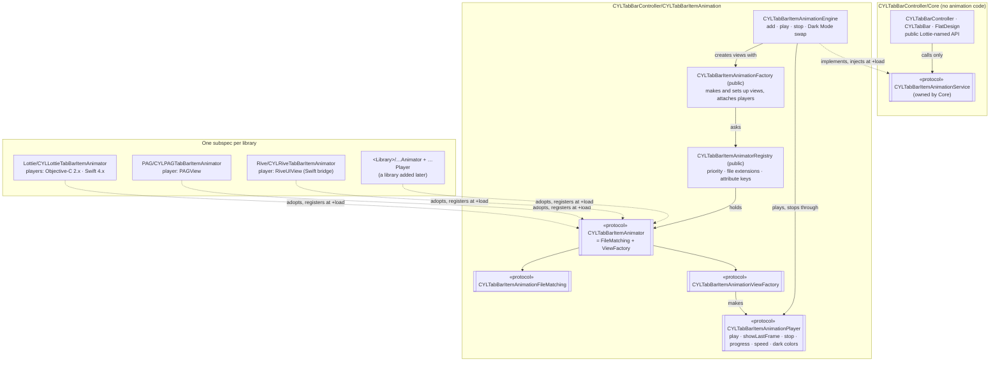
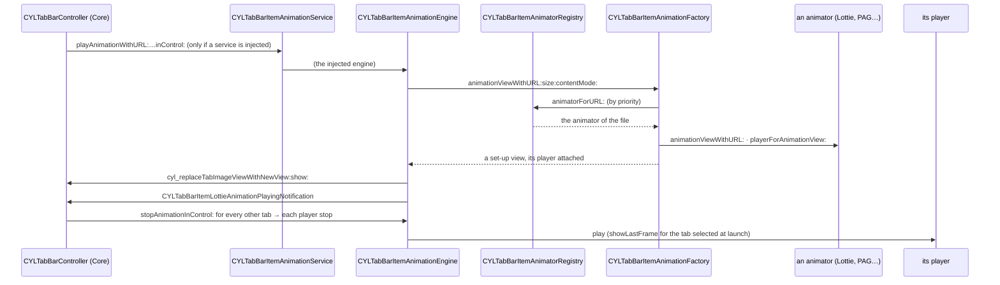

# [CN]Tab 图标动画共用子库：CYLTabBarItemAnimation（面向协议，可扩展任意动画库）
# [EN]The shared tab icon animation subspec: CYLTabBarItemAnimation (protocol-oriented, open to any library)

<!-- bound-classes: CYLTabBarItemAnimatorRegistry, CYLTabBarItemAnimationFactory, CYLTabBarItemAnimationBasePlayer, CYLTabBarItemAnimationEngine, CYLLottieTabBarItemAnimator, CYLPAGTabBarItemAnimator, CYLRiveTabBarItemAnimator -->
<!-- binding:start -->
<!-- Generated by scripts/update-docs-navigation.py; do not edit by hand. -->

| 中文 | English |
|:---|:---|
| 绑定的代码类 `CYLTabBarItemAnimatorRegistry`：[`CYLTabBarController/CYLTabBarItemAnimation/CYLTabBarItemAnimatorRegistry.h`](../CYLTabBarController/CYLTabBarItemAnimation/CYLTabBarItemAnimatorRegistry.h) | Bound to the class `CYLTabBarItemAnimatorRegistry`: [`CYLTabBarController/CYLTabBarItemAnimation/CYLTabBarItemAnimatorRegistry.h`](../CYLTabBarController/CYLTabBarItemAnimation/CYLTabBarItemAnimatorRegistry.h) |
| 绑定的代码类 `CYLTabBarItemAnimationFactory`：[`CYLTabBarController/CYLTabBarItemAnimation/CYLTabBarItemAnimationFactory.h`](../CYLTabBarController/CYLTabBarItemAnimation/CYLTabBarItemAnimationFactory.h) | Bound to the class `CYLTabBarItemAnimationFactory`: [`CYLTabBarController/CYLTabBarItemAnimation/CYLTabBarItemAnimationFactory.h`](../CYLTabBarController/CYLTabBarItemAnimation/CYLTabBarItemAnimationFactory.h) |
| 绑定的代码类 `CYLTabBarItemAnimationBasePlayer`：[`CYLTabBarController/CYLTabBarItemAnimation/CYLTabBarItemAnimationPlayer.h`](../CYLTabBarController/CYLTabBarItemAnimation/CYLTabBarItemAnimationPlayer.h) | Bound to the class `CYLTabBarItemAnimationBasePlayer`: [`CYLTabBarController/CYLTabBarItemAnimation/CYLTabBarItemAnimationPlayer.h`](../CYLTabBarController/CYLTabBarItemAnimation/CYLTabBarItemAnimationPlayer.h) |
| 绑定的代码类 `CYLTabBarItemAnimationEngine`：[`CYLTabBarController/CYLTabBarItemAnimation/CYLTabBarItemAnimationEngine.h`](../CYLTabBarController/CYLTabBarItemAnimation/CYLTabBarItemAnimationEngine.h) | Bound to the class `CYLTabBarItemAnimationEngine`: [`CYLTabBarController/CYLTabBarItemAnimation/CYLTabBarItemAnimationEngine.h`](../CYLTabBarController/CYLTabBarItemAnimation/CYLTabBarItemAnimationEngine.h) |
| 绑定的代码类 `CYLLottieTabBarItemAnimator`：[`CYLTabBarController/CYLTabBarItemAnimation/Lottie/CYLLottieTabBarItemAnimator.h`](../CYLTabBarController/CYLTabBarItemAnimation/Lottie/CYLLottieTabBarItemAnimator.h) | Bound to the class `CYLLottieTabBarItemAnimator`: [`CYLTabBarController/CYLTabBarItemAnimation/Lottie/CYLLottieTabBarItemAnimator.h`](../CYLTabBarController/CYLTabBarItemAnimation/Lottie/CYLLottieTabBarItemAnimator.h) |
| 绑定的代码类 `CYLPAGTabBarItemAnimator`：[`CYLTabBarController/CYLTabBarItemAnimation/PAG/CYLPAGTabBarItemAnimator.h`](../CYLTabBarController/CYLTabBarItemAnimation/PAG/CYLPAGTabBarItemAnimator.h) | Bound to the class `CYLPAGTabBarItemAnimator`: [`CYLTabBarController/CYLTabBarItemAnimation/PAG/CYLPAGTabBarItemAnimator.h`](../CYLTabBarController/CYLTabBarItemAnimation/PAG/CYLPAGTabBarItemAnimator.h) |
| 绑定的代码类 `CYLRiveTabBarItemAnimator`：[`CYLTabBarController/CYLTabBarItemAnimation/Rive/CYLRiveTabBarItemAnimator.h`](../CYLTabBarController/CYLTabBarItemAnimation/Rive/CYLRiveTabBarItemAnimator.h) | Bound to the class `CYLRiveTabBarItemAnimator`: [`CYLTabBarController/CYLTabBarItemAnimation/Rive/CYLRiveTabBarItemAnimator.h`](../CYLTabBarController/CYLTabBarItemAnimation/Rive/CYLRiveTabBarItemAnimator.h) |

<!-- binding:end -->

| 中文 | English |
|:---|:---|
| Tab 图标动画由独立的 `CYLTabBarItemAnimation` 子库（pod）实现。它**只在引入某个动画库的子库时才会被引入**（目前为 Lottie、PAG 与 Rive）；Core 不依赖它，只引入 Core 时构建中没有任何动画代码。代码按**面向协议、依赖反转**组织：上层只依赖自己定义的协议，下层实现协议并自行注册。因此以后新增动画库（例如 SVGA、APNG）时，只需新增一个目录、一个 animator 类和一个子库，**其他代码都不用修改**（[#604](https://github.com/ChenYilong/CYLTabBarController/issues/604)）。Rive 就是这样接入的，见 [Rive-Animation.md](Rive-Animation.md)。 | Tab icon animations are implemented by a separate subspec (pod), `CYLTabBarItemAnimation`. It is **pulled in only by an animation library's subspec** (Lottie, PAG and Rive today); Core does not depend on it, and Core alone has no animation code. The code is **protocol-oriented with dependency inversion**: each upper layer depends only on a protocol it defines, and the lower layer implements it and registers itself. So a library added later (e.g. SVGA, APNG) is one more folder, one more animator class and one more subspec, with **no change anywhere else** ([#604](https://github.com/ChenYilong/CYLTabBarController/issues/604)). Rive was added exactly this way, see [Rive-Animation.md](Rive-Animation.md). |

## [CN]目录
## [EN]Contents

<!-- navigation:start -->
<!-- Generated by scripts/update-docs-navigation.py; do not edit by hand. -->

| 中文 | English |
|:---|:---|
| [如何选择子库](#cn如何选择子库) | [Which subspec to use](#enwhich-subspec-to-use) |
| [两层依赖反转](#cn两层依赖反转) | [Dependency inversion on two levels](#endependency-inversion-on-two-levels) |
| [协议与类](#cn协议与类) | [Protocols and classes](#enprotocols-and-classes) |
| [新增一个动画库](#cn新增一个动画库) | [Adding an animation library](#enadding-an-animation-library) |
| [选中 Tab 时](#cn选中-tab-时) | [When a tab is selected](#enwhen-a-tab-is-selected) |
| [集成方式](#cn集成方式) | [Integrations](#enintegrations) |
| [测试](#cn测试) | [Testing](#entesting) |

<!-- navigation:end -->

## [CN]如何选择子库
## [EN]Which subspec to use

```ruby
pod 'CYLTabBarController'                  # Core only: no animation code / 只有 Core：没有动画代码
pod 'CYLTabBarController/LottieSwift'      # Lottie (lottie-ios 4.x) / Lottie
pod 'CYLTabBarController/PAG'              # PAG (libpag) / PAG
pod 'CYLTabBarController/Rive'             # Rive (RiveRuntime) / Rive
# Any combination works / 可任意组合:
pod 'CYLTabBarController/LottieSwift'
pod 'CYLTabBarController/PAG'
pod 'CYLTabBarController/Rive'
```

| 中文 | English |
|:---|:---|
| `Lottie`、`LottieObjectiveC`、`LottieSwift`、`CYLFlatDesignTabBar`（依赖 `LottieSwift`）、`PAG`、`PAGEnterprise`、`Rive` 都依赖 `CYLTabBarItemAnimation`，现有 Podfile 无需修改。同一个 TabBar 中可以混用不同动画库的 Tab，也可以只让部分 Tab 有动画，见 [Per-Tab-Animation.md](Per-Tab-Animation.md)。 | `Lottie`, `LottieObjectiveC`, `LottieSwift`, `CYLFlatDesignTabBar` (through `LottieSwift`), `PAG`, `PAGEnterprise` and `Rive` depend on `CYLTabBarItemAnimation`, so existing Podfiles need no change. One tab bar can mix tabs of different libraries, and animate only some tabs, see [Per-Tab-Animation.md](Per-Tab-Animation.md). |

## [CN]两层依赖反转
## [EN]Dependency inversion on two levels



| 中文 | English |
|:---|:---|
| **第一层：Core → 动画服务。** Core 定义私有协议 `CYLTabBarItemAnimationService`（`CYLTabBarItemAnimationService.h`），所有动画相关的调用都只经过它（`UIControl+CYLTabBarItemAnimation` 中与动画库无关的方法、公开的 Lottie 命名方法）。子库中的 `CYLTabBarItemAnimationEngine` 实现该协议，并在 `+load` 中通过 `CYLTabBarItemAnimationSetService()` 注入。没有注入时服务为 nil，所有调用都不起作用，Tab 显示图片。Core 中没有任何动画库的类型、key 或编译开关，是否有动画在运行时判断。 | **Level 1: Core → the animation service.** Core defines the private protocol `CYLTabBarItemAnimationService` (`CYLTabBarItemAnimationService.h`), and every animation call goes through it only (the library-neutral methods of `UIControl+CYLTabBarItemAnimation`, the public Lottie-named methods). The subspec's `CYLTabBarItemAnimationEngine` implements it and injects itself in `+load` with `CYLTabBarItemAnimationSetService()`. Without it the service is nil, every call is a no-op and the tabs show their images. Core has no animation library type, key or compile-time switch; whether tabs animate is decided at runtime. |
| **第二层：引擎 → 动画库。** 引擎按职责定义公开协议（接口隔离）：`CYLTabBarItemAnimationFileMatching`（能播放哪些文件、如何被查找）与 `CYLTabBarItemAnimationViewFactory`（创建视图及其播放器），二者组合为 `CYLTabBarItemAnimator`；`CYLTabBarItemAnimationPlayer` 控制单个视图的播放。引擎只通过工厂类 `CYLTabBarItemAnimationFactory` 创建视图，只通过播放器播放与停止，只通过 `CYLTabBarItemAnimatorRegistry` 查找动画库，从不指定具体的动画库。每个动画库的 animator 与播放器放在自己的子库中（`CYLTabBarItemAnimation/Lottie/`、`CYLTabBarItemAnimation/PAG/`），只在引入该库时编译，animator 在 `+load` 中向注册表注册自己。 | **Level 2: the engine → the libraries.** The engine defines public protocols split by role (interface segregation): `CYLTabBarItemAnimationFileMatching` (which files, and the lookup) and `CYLTabBarItemAnimationViewFactory` (views and their players), combined in `CYLTabBarItemAnimator`; `CYLTabBarItemAnimationPlayer` controls one view. The engine creates views only through the factory class `CYLTabBarItemAnimationFactory`, plays and stops only through players, and finds libraries only through `CYLTabBarItemAnimatorRegistry`, never naming a library. Each library's animator and players live in its own subspec (`CYLTabBarItemAnimation/Lottie/`, `CYLTabBarItemAnimation/PAG/`), are compiled only with that library, and the animator registers itself in `+load`. |
| **播放器封装状态。** 每个动画视图都有一个播放器，由工厂绑定：视图持有播放器，播放器弱引用视图，没有循环引用。播放器保存动画库自身的状态（例如是否已应用深色颜色），引擎只调用 `play`、`showLastFrame`、`stop`，深色模式替换时通过 `progress`、`animationSpeed` 复制状态，与动画库无关。Lottie 的两个版本分别由两个播放器实现，不再在同一方法里用 `#if` 区分。 | **Players hold the state.** Each animation view has a player, attached by the factory: the view keeps its player and the player holds the view weakly, so there is no retain cycle. The player keeps the library's own state (e.g. whether dark colors are applied); the engine only calls `play`, `showLastFrame` and `stop`, and copies `progress` and `animationSpeed` for a Dark Mode swap, whatever the library. The two Lottie flavors are two players, with no `#if` branches inside one method any more. |
| **查找顺序。** animator 按优先级（`priority`，数值大的优先）查找，相同优先级按注册顺序。PAG 等只识别自己文件类型的 animator 使用默认优先级；Lottie 使用 `CYLTabBarItemAnimatorPriorityFallback`，最后查找，接收其他 animator 都不处理的文件（与以前的行为一致）。 | **Lookup order.** Animators are looked up by `priority` (higher first), then registration order. Animators that recognize their own file types, such as PAG, use the default priority; Lottie uses `CYLTabBarItemAnimatorPriorityFallback`, is looked up last, and takes every file no other animator takes (as before). |
| **属性 key。** 新增通用 key `CYLTabBarAnimationURL`、`CYLTabBarAnimationFilePath`、`CYLTabBarAnimationSize`、`CYLTabBarAnimationDarkURL`、`CYLTabBarAnimationDarkFilePath`、`CYLTabBarAnimationDarkColors`，适用于任意动画库：由文件决定使用哪个库播放。各动画库自己的 key（`CYLTabBarLottie…`、`CYLTabBarPAG…`）通过 animator 的 `attributeKeys` 声明为通用 key 的别名，仍然有效；Core 只通过 `CYLTabBarItemAttributesAnimationValue()` 读取属性，不认识任何库的 key。 | **Attribute keys.** New generic keys `CYLTabBarAnimationURL`, `CYLTabBarAnimationFilePath`, `CYLTabBarAnimationSize`, `CYLTabBarAnimationDarkURL`, `CYLTabBarAnimationDarkFilePath` and `CYLTabBarAnimationDarkColors` work for any library: the file decides which one plays it. Each library's own keys (`CYLTabBarLottie…`, `CYLTabBarPAG…`) are declared as aliases of the generic keys by the animator's `attributeKeys`, and keep working; Core reads attributes only through `CYLTabBarItemAttributesAnimationValue()` and knows no library's keys. |
| **公开 API 不变。** `-cyl_addLottieImageWithLottieURL:…`、`-cyl_animationLottieImageWithLottieURL:…`、`-cyl_stopAnimationOfLottieView`、`-cyl_lottieAnimationView`、`-cyl_setLottieAnimationSpeed:`、`-cyl_isLottieAnimationView` 等全部保留，现在交给服务处理，因此对所有动画库都有效。 | **The public API is unchanged.** `-cyl_addLottieImageWithLottieURL:…`, `-cyl_animationLottieImageWithLottieURL:…`, `-cyl_stopAnimationOfLottieView`, `-cyl_lottieAnimationView`, `-cyl_setLottieAnimationSpeed:`, `-cyl_isLottieAnimationView` and the rest stay; they now hand over to the service, so they work for every library. |

## [CN]协议与类
## [EN]Protocols and classes

| 中文 | English |
|:---|:---|
| `CYLTabBarItemAnimationFileMatching`（协议，公开）：`identifier`、`canAnimateFileAtURL:`；可选 `priority`、`fileExtensions`、`attributeKeys`。 | `CYLTabBarItemAnimationFileMatching` (protocol, public): `identifier`, `canAnimateFileAtURL:`; optional `priority`, `fileExtensions`, `attributeKeys`. |
| `CYLTabBarItemAnimationViewFactory`（协议，公开）：`animationViewWithURL:size:contentMode:`、`playerForAnimationView:`（不是本库的视图时返回 nil，同时用于识别视图）。 | `CYLTabBarItemAnimationViewFactory` (protocol, public): `animationViewWithURL:size:contentMode:`, `playerForAnimationView:` (nil for a view that is not the library's, which also recognizes views). |
| `CYLTabBarItemAnimator`（协议，公开）：以上两个协议的组合，即一个动画库。 | `CYLTabBarItemAnimator` (protocol, public): the two above combined, i.e. one library. |
| `CYLTabBarItemAnimationPlayer`（协议，公开）：`animationView`、`play`、`showLastFrame`、`stop`；可选 `progress`、`animationSpeed`、`applyDarkColors:traitCollection:`。`CYLTabBarItemAnimationBasePlayer` 是便捷父类（弱引用视图）。 | `CYLTabBarItemAnimationPlayer` (protocol, public): `animationView`, `play`, `showLastFrame`, `stop`; optional `progress`, `animationSpeed`, `applyDarkColors:traitCollection:`. `CYLTabBarItemAnimationBasePlayer` is a convenient superclass (holds the view weakly). |
| `CYLTabBarItemAnimatorRegistry`（类，公开）：注册、注销、按优先级查找动画库，汇总扩展名与属性 key。 | `CYLTabBarItemAnimatorRegistry` (class, public): registers, unregisters and looks up libraries by priority, and gathers their extensions and attribute keys. |
| `CYLTabBarItemAnimationFactory`（类，公开）：`+animationViewWithURL:size:contentMode:` 创建并设置视图、绑定播放器；`+playerForView:`、`+isAnimationView:`。App 也可以用它创建动画视图（例如带动画的 PlusButton）。 | `CYLTabBarItemAnimationFactory` (class, public): `+animationViewWithURL:size:contentMode:` makes and sets up a view and attaches its player; `+playerForView:`, `+isAnimationView:`. Apps can use it too, e.g. for an animated plus button. |
| `-[UIControl cyl_tabBarItemAnimationPlayer]`（公开）：Tab 按钮动画的播放器，任意动画库都无需强转即可 `play`、`stop`、调整 `progress` / `animationSpeed`。 | `-[UIControl cyl_tabBarItemAnimationPlayer]` (public): the player of a tab button's animation, to `play`, `stop`, or set `progress` / `animationSpeed` with any library, with no cast. |
| `CYLTabBarItemAnimationEngine`（类，私有）：实现 Core 的 `CYLTabBarItemAnimationService`。 | `CYLTabBarItemAnimationEngine` (class, private): implements Core's `CYLTabBarItemAnimationService`. |

```objc
// In -tabBarController:didSelectControl:, whatever the library. 在 -tabBarController:didSelectControl: 中，与动画库无关。
id<CYLTabBarItemAnimationPlayer> player = control.cyl_tabBarItemAnimationPlayer;
if ([player respondsToSelector:@selector(setAnimationSpeed:)]) {
    player.animationSpeed = 1.5;
}
```

## [CN]新增一个动画库
## [EN]Adding an animation library

| 中文 | English |
|:---|:---|
| 以 Rive（`.riv`）为例。只需新增文件，不需要修改 Core、引擎、注册表或已有的动画库： | Taking Rive (`.riv`) as an example. Only new files, with no change to Core, the engine, the registry or the existing libraries: |
| 1. 新建目录 `CYLTabBarController/CYLTabBarItemAnimation/Rive/`，添加 `CYLRiveTabBarItemAnimator.h/.m`：一个继承 `CYLTabBarItemAnimationBasePlayer` 的播放器类，以及一个遵守 `CYLTabBarItemAnimator` 的 animator（作为该播放器的工厂）。整个实现用该库的 `__has_include` 包起来，并在 `+load` 中注册 animator。 | 1. Create `CYLTabBarController/CYLTabBarItemAnimation/Rive/` with `CYLRiveTabBarItemAnimator.h/.m`: a player class inheriting `CYLTabBarItemAnimationBasePlayer`, and an animator adopting `CYLTabBarItemAnimator` (the player's factory). Wrap the whole implementation in the library's `__has_include`, and register the animator in `+load`. |
| 2. 在 podspec 中新增子库：依赖 Core、`CYLTabBarItemAnimation` 与该动画库，`source_files` 指向新目录。 | 2. Add a subspec to the podspec: depending on Core, `CYLTabBarItemAnimation` and the library, with `source_files` pointing at the new folder. |
| 3. （可选）在 `CYLTabBarController.h` 中为该库新增专用 key（如 `CYLTabBarRiveURL`），并在 `attributeKeys` 中声明；不新增时，直接使用通用 key `CYLTabBarAnimation…` 即可。 | 3. (Optional) Add the library's own keys (e.g. `CYLTabBarRiveURL`) to `CYLTabBarController.h` and declare them in `attributeKeys`; without them, the generic `CYLTabBarAnimation…` keys just work. |
| 4. 新增一份 `docs/` 文档，并在 README 中添加说明。 | 4. Add a `docs/` page and a README bullet. |

```objc
// CYLTabBarController/CYLTabBarItemAnimation/Rive/CYLRiveTabBarItemAnimator.m
#import "CYLRiveTabBarItemAnimator.h"
#if __has_include(<RiveRuntime/RiveRuntime.h>)          // only with the library / 仅在引入该库时编译
#import <RiveRuntime/RiveRuntime.h>
#import "CYLTabBarItemAnimatorRegistry.h"

// The player: controls one Rive view. 播放器：控制一个 Rive 视图。
@interface CYLRiveTabBarItemAnimationPlayer : CYLTabBarItemAnimationBasePlayer <CYLTabBarItemAnimationPlayer>
@end

@implementation CYLRiveTabBarItemAnimationPlayer
- (void)play { … }            // once, from the first frame / 从第一帧播放一次
- (void)showLastFrame { … }   // #389
- (void)stop { … }            // back to the first frame / 回到第一帧
@end

// The animator: which files, and the factory of views and players. animator：识别文件，并作为视图与播放器的工厂。
@implementation CYLRiveTabBarItemAnimator

+ (void)load {
    [CYLTabBarItemAnimatorRegistry registerAnimator:[[self alloc] init]];   // self-registration / 自行注册
}

- (NSString *)identifier { return @"Rive"; }
- (NSArray<NSString *> *)fileExtensions { return @[ @"riv" ]; }
- (BOOL)canAnimateFileAtURL:(NSURL *)URL { return [URL.pathExtension.lowercaseString isEqualToString:@"riv"]; }

- (UIView *)animationViewWithURL:(NSURL *)URL size:(CGSize)size contentMode:(UIViewContentMode)contentMode {
    // Load the file; show its first frame. 加载文件，显示第一帧。
    …
}

- (id<CYLTabBarItemAnimationPlayer>)playerForAnimationView:(UIView *)view {
    return [view isKindOfClass:[RiveView class]] ? [[CYLRiveTabBarItemAnimationPlayer alloc] initWithAnimationView:view] : nil;
}

@end
#endif
```

```ruby
s.subspec 'Rive' do |rive|
  rive.dependency 'CYLTabBarController/Core'
  rive.dependency 'CYLTabBarController/CYLTabBarItemAnimation'
  rive.source_files = 'CYLTabBarController/CYLTabBarItemAnimation/Rive/*.{h,m}'
  rive.private_header_files = 'CYLTabBarController/CYLTabBarItemAnimation/Rive/*.h'
  rive.dependency 'RiveRuntime'
end
```

| 中文 | English |
|:---|:---|
| App 也可以不改本库，直接在自己的工程中实现并注册 animator（`pod 'CYLTabBarController/CYLTabBarItemAnimation'`，或随任意动画子库引入）。可选协议方法：animator 的 `priority`、`fileExtensions`、`attributeKeys`；播放器的 `progress`（深色模式替换时保持进度）、`animationSpeed`（`lottieAnimationSpeed`）、`applyDarkColors:traitCollection:`（`CYLTabBarAnimationDarkColors`）。 | An app can also implement and register an animator in its own project without changing this library (`pod 'CYLTabBarController/CYLTabBarItemAnimation'`, or with any animation subspec). Optional protocol methods: the animator's `priority`, `fileExtensions` and `attributeKeys`; the player's `progress` (keeps the progress in a Dark Mode swap), `animationSpeed` (`lottieAnimationSpeed`) and `applyDarkColors:traitCollection:` (`CYLTabBarAnimationDarkColors`). |

## [CN]选中 Tab 时
## [EN]When a tab is selected



## [CN]集成方式
## [EN]Integrations

| 中文 | English |
|:---|:---|
| **CocoaPods**：子库 `CYLTabBarItemAnimation`（依赖 Core），其中协议、注册表、工厂与 `UIControl+CYLTabBarItemAnimationPlayer.h` 为公开头文件，引擎为私有头文件；每个动画库的 animator 属于该库的子库。animator 与引擎在 `+load` 中注册，需要链接对应的目标文件（CocoaPods 默认添加 `-ObjC`）。 | **CocoaPods**: the `CYLTabBarItemAnimation` subspec (depends on Core), with the protocols, the registry, the factory and `UIControl+CYLTabBarItemAnimationPlayer.h` public and the engine private; each library's animator belongs to that library's subspec. Animators and the engine register in `+load`, so their object files must be linked (CocoaPods adds `-ObjC`). |
| **Swift Package Manager**：同一个 target 编译全部源文件（含 Lottie）；`PAG/` 与 `Rive/` 在没有 libpag、RiveRuntime 时为空，Rive 的 Swift 桥接 `RiveSwift/` 不参与编译。 | **Swift Package Manager**: one target compiles every source (with Lottie); `PAG/` and `Rive/` are empty without libpag and RiveRuntime, and Rive's Swift bridge `RiveSwift/` is left out. |
| **Carthage**：框架工程中按目录结构登记这些文件（与 #535 新增 CYLUtils 的方式相同）；没有 PAG 与 Rive。 | **Carthage**: the framework project references these files by folder (as #535 did for CYLUtils); no PAG and no Rive. |

## [CN]测试
## [EN]Testing

| 中文 | English |
|:---|:---|
| 本次修改在 Linux 环境中完成，无法运行 Xcode、CocoaPods 与 iOS 模拟器，因此**没有截图**，也没有真正编译。已做的检查：用最小的 UIKit / Foundation / Lottie / libpag 桩头文件，在“都没有、只有 Lottie ObjC、只有 Lottie Swift、只有 PAG、Lottie ObjC + PAG、Lottie Swift + PAG”六种组合下，对子库全部源文件（注册表、工厂、播放器、引擎、Lottie 与 PAG animator 及其播放器）、Core 的转发实现，以及一个只新增文件的假想第三个动画库（animator 加播放器）执行 `clang -fsyntax-only -Wall -Wextra -Werror=incomplete-implementation`，均无错误与警告。这只能说明语法与协议签名一致。 | This change was made on Linux, where Xcode, CocoaPods and the iOS simulator cannot run, so there are **no screenshots** and nothing was really compiled. Checks done: with minimal UIKit / Foundation / Lottie / libpag stub headers, `clang -fsyntax-only -Wall -Wextra -Werror=incomplete-implementation` on every source of the subspec (registry, factory, players, engine, Lottie and PAG animators and their players), Core's forwarders, and an imaginary third library added with new files only (an animator and a player), in six combinations (none, Lottie ObjC only, Lottie Swift only, PAG only, Lottie ObjC + PAG, Lottie Swift + PAG), reports no error and no warning. This only shows that the syntax and the protocol signatures agree. |
| 请分别验证：`Example-Swift-03`（只有 Core，应显示普通图片）、`Example-PAG`（只有 PAG）、一个 Lottie 示例（只有 Lottie）、两者都引入的工程，并在三种样式下检查：Tab 显示动画、选中时播放一次、切换后上一个 Tab 停止、启动时选中的 Tab 显示最后一帧、深色模式替换正常。截图请放在 `docs/assets/` 中。 | Please check `Example-Swift-03` (Core only: plain images), `Example-PAG` (PAG only), a Lottie example (Lottie only) and a project with both, in all three styles: the tabs animate, a selected tab plays once, the previous tab stops, the tab selected at launch shows its last frame, and the Dark Mode swap works. Put screenshots in `docs/assets/`. |
