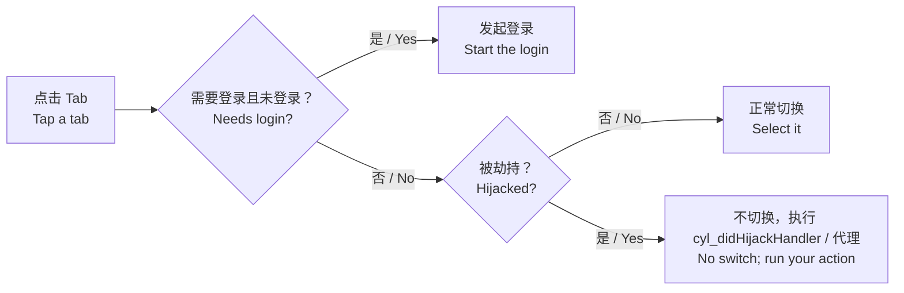

# 劫持 Tab 点击 / Hijacked Tabs

<!-- bound-classes: CYLTabBarController -->
<!-- binding:start -->
<!-- Generated by scripts/update-docs-navigation.py; do not edit by hand. -->

| 中文 | English |
|:---|:---|
| 绑定的代码类 `CYLTabBarController`：[`CYLTabBarController/CYLTabBarController.h`](../CYLTabBarController/CYLTabBarController.h) | Bound to the class `CYLTabBarController`: [`CYLTabBarController/CYLTabBarController.h`](../CYLTabBarController/CYLTabBarController.h) |

<!-- binding:end -->

| 中文 | English |
|:---|:---|
| 有些 Tab 点击后不应切换，而是执行一个操作：模态弹出发布页、打开菜单、启动相机、跳转到其他 App……以前只有 PlusButton 能这样做，普通 Tab 需要自己实现 `-tabBarController:shouldSelectViewController:` 并处理各种样式的差异。现在任意 Tab 都可以被"劫持"：点击后不选中、不播放动画、不回调 `tabBarController:didSelectControl:`，而是执行你的操作。经典样式、液态玻璃与扁平样式都支持。 | Some tabs should run an action instead of being selected: present a publish page modally, open a menu, start the camera, open another app... Only the plus button could do that; a regular tab needed your own `-tabBarController:shouldSelectViewController:` and care for each style. Now any tab can be "hijacked": a tap does not select it, does not animate and does not call `tabBarController:didSelectControl:`; your action runs instead. Works in the classic style, Liquid Glass and FlatDesign. |



## 目录 / Contents

<!-- navigation:start -->
<!-- Generated by scripts/update-docs-navigation.py; do not edit by hand. -->

| 中文 | English |
|:---|:---|
| [用法](#用法--usage) | [Usage](#用法--usage) |
| [API](#api) | [API](#api) |
| [限制](#限制--limits) | [Limits](#限制--limits) |
| [截图](#截图--screenshots) | [Screenshots](#截图--screenshots) |

<!-- navigation:end -->

## 用法 / Usage

```objc
// 1. 哪些 Tab 被劫持：标识（CYLTabBarItemIdentifier）、block 或代理方法。
//    Which tabs are hijacked: identifiers (CYLTabBarItemIdentifier), a block, or the delegate method.
tabBarController.cyl_hijackedTabBarItemIdentifiers = @[ @"publish" ];
// 或 / or:
tabBarController.cyl_shouldHijackHandler = ^BOOL(CYLTabBarController *tabBarController, UIViewController *viewController) {
    return [viewController.cyl_tabBarItemIdentifier isEqualToString:@"publish"];
};

// 2. 被劫持时执行的操作。/ The action.
tabBarController.cyl_didHijackHandler = ^(CYLTabBarController *tabBarController, UIViewController *viewController) {
    UINavigationController *page = [[UINavigationController alloc] initWithRootViewController:[PublishViewController new]];
    [tabBarController presentViewController:page animated:YES completion:nil];
};
```

```swift
tabBarController.cyl_hijackedTabBarItemIdentifiers = ["publish"]
tabBarController.cyl_didHijackHandler = { tabBarController, viewController in
    tabBarController.present(UINavigationController(rootViewController: PublishViewController()), animated: true)
}
```

| 中文 | English |
|:---|:---|
| 代理方式：实现 `-tabBarController:shouldHijackViewController:` 与 `-tabBarController:didHijackViewController:`。block 优先于代理方法。 | Delegate: implement `-tabBarController:shouldHijackViewController:` and `-tabBarController:didHijackViewController:`. Blocks take precedence. |
| 代理是 TabBarController 以外的对象时，请在其 `-tabBarController:shouldSelectViewController:` 开头调用：`if ([tabBarController cyl_interceptHijackIfNeededForViewController:viewController]) { return NO; }`。子类重写该方法时须调用 super。 | With a delegate that is not the tab bar controller itself, start its `-tabBarController:shouldSelectViewController:` with `if ([tabBarController cyl_interceptHijackIfNeededForViewController:viewController]) { return NO; }`. A subclass that overrides it must call super. |

## API

| API | 中文 | English |
|:---|:---|:---|
| `cyl_hijackedTabBarItemIdentifiers` | 被劫持 Tab 的标识列表。 | Identifiers of the hijacked tabs. |
| `cyl_shouldHijackHandler` | 是否劫持，优先于代理与标识。 | Whether to hijack; wins over the delegate and the identifiers. |
| `cyl_didHijackHandler` | 被劫持时执行的操作（每次点击一次）。 | The action (once per tap). |
| `-tabBarController:shouldHijackViewController:` / `-tabBarController:didHijackViewController:` | 代理方式。 | The delegate versions. |
| `-cyl_isHijackedViewController:` | 是否被劫持（依次判断 block、代理、标识）。 | Whether it is hijacked (block, delegate, identifiers). |
| `-cyl_interceptHijackIfNeededForViewController:` | 被劫持时执行操作并返回 YES（应拒绝选中）。 | Runs the action and returns YES (refuse the selection) when hijacked. |

## 限制 / Limits

| 中文 | English |
|:---|:---|
| 代码选中（`selectedIndex = …`）不会被劫持。 | Selecting in code (`selectedIndex = …`) is not hijacked. |
| 需要登录的 Tab 先检查登录（见 [Login-Required-Tabs.md](Login-Required-Tabs.md)），登录后才检查劫持。 | A tab that needs login is checked for login first (see [Login-Required-Tabs.md](Login-Required-Tabs.md)), then for hijacking. |
| PlusButton 有自己的点击事件，不经过这里。 | The plus button has its own action and does not go through this. |

## 截图 / Screenshots

| 中文 | English |
|:---|:---|
| 本次开发环境没有 iOS 模拟器或真机，无法运行 Demo，因此暂无测试截图；上方为流程示意图。在设备上验证后，请将截图放入 `docs/assets/` 并在此引用，例如 ``。 | This change was developed without an iOS simulator or device, so there are no test screenshots yet; the figure above is a flow diagram. After testing on a device, put screenshots in `docs/assets/` and reference them here, e.g. ``. |
