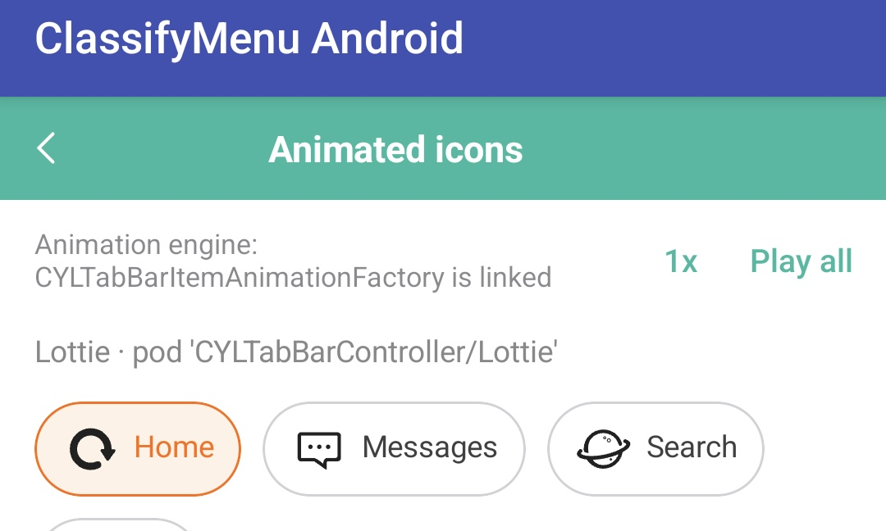

# [CN]Tab 动画接入指南：Lottie、PAG、Rive
# [EN]Tab icon animation quick start: Lottie, PAG and Rive

<!-- bound-classes: CYLTabBarController -->
<!-- binding:start -->
<!-- Generated by scripts/update-docs-navigation.py; do not edit by hand. -->

| 中文 | English |
|:---|:---|
| 绑定的代码类 `CYLTabBarController`：[`CYLTabBarController/CYLTabBarController.h`](../CYLTabBarController/CYLTabBarController.h) | Bound to the class `CYLTabBarController`: [`CYLTabBarController/CYLTabBarController.h`](../CYLTabBarController/CYLTabBarController.h) |

<!-- binding:end -->

| 中文 | English |
|:---|:---|
| 本文说明如何把 Tab 图标换成动画，三个动画库都用同一套写法：引入子库，把动画文件加入工程，在 `tabBarItemsAttributes` 中加入对应的 key。选中 Tab 时库会自动播放，不需要自己写播放代码。 | This page shows how to animate tab icons. All three libraries work the same way: add the subspec, add the animation file to the project, and put its key in `tabBarItemsAttributes`. The library plays the animation when a tab is selected; you write no playback code. |

## [CN]目录
## [EN]Contents

<!-- navigation:start -->
<!-- Generated by scripts/update-docs-navigation.py; do not edit by hand. -->

| 中文 | English |
|:---|:---|
| [先体验：运行 Demo](#cn先体验运行-demo) | [Try it first: run a demo](#entry-it-first-run-a-demo) |
| [选择动画库](#cn选择动画库) | [Choose a library](#enchoose-a-library) |
| [接入步骤](#cn接入步骤) | [Steps](#ensteps) |
| &nbsp;&nbsp;&nbsp;&nbsp;↳ [Lottie](#cnlottie) | &nbsp;&nbsp;&nbsp;&nbsp;↳ [Lottie](#enlottie) |
| &nbsp;&nbsp;&nbsp;&nbsp;↳ [PAG](#cnpag) | &nbsp;&nbsp;&nbsp;&nbsp;↳ [PAG](#enpag) |
| &nbsp;&nbsp;&nbsp;&nbsp;↳ [Rive](#cnrive) | &nbsp;&nbsp;&nbsp;&nbsp;↳ [Rive](#enrive) |
| &nbsp;&nbsp;&nbsp;&nbsp;↳ [GIF](#cngif) | &nbsp;&nbsp;&nbsp;&nbsp;↳ [GIF](#engif) |
| &nbsp;&nbsp;&nbsp;&nbsp;↳ [通用写法](#cn通用写法) | &nbsp;&nbsp;&nbsp;&nbsp;↳ [The generic form](#enthe-generic-form) |
| &nbsp;&nbsp;&nbsp;&nbsp;↳ [配置文件与 Android](#cn配置文件与-android) | &nbsp;&nbsp;&nbsp;&nbsp;↳ [Configuration files and Android](#enconfiguration-files-and-android) |
| [注意事项](#cn注意事项) | [Things to watch for](#enthings-to-watch-for) |
| [深入阅读](#cn深入阅读) | [Read more](#enread-more) |
| [示例中的动画播放控件](#cn示例中的动画播放控件) | [Playback controls in the animation examples](#enplayback-controls-in-the-animation-examples) |

<!-- navigation:end -->

## [CN]先体验：运行 Demo
## [EN]Try it first: run a demo

| 中文 | English |
|:---|:---|
| **建议接入前先运行一次 Demo，点几个 Tab，看看效果是不是你想要的。** 这样也能确认本机环境没有问题。只需要几分钟。 | **Before integrating, run a demo once and tap a few tabs to see whether this is the effect you want.** It also confirms that your machine is set up. It only takes a few minutes. |

```sh
# PAG (.pag files are downloaded by pod install / 动画文件由 pod install 下载)
cd Example-PAG && pod install && open HealthyHome.xcworkspace
# Rive
cd Example-Rive && pod install && open RiveApp.xcworkspace
# Lottie 4.x
cd Example-Swift && pod install && open *.xcworkspace
```

| 动画库 / Library | Demo | 集成方式 / Integration | 代码位置 / Where to look |
|:---|:---|:---|:---|
| Lottie | [Example](../Example)（Objective-C，根目录的 `CYLTabBarController.xcodeproj`） | `CYLFlatDesignTabBar`（含 Lottie 4.x / includes Lottie 4.x） | [Example/MainTabBarController.m](../Example/MainTabBarController.m) |
| Lottie 4.x | [Example-Swift](../Example-Swift) | `LottieSwift` | [Example-Swift/MainTabBarController.swift](../Example-Swift/MainTabBarController.swift) |
| Lottie 2.5 | [Example-Swift-02](../Example-Swift-02) | `Lottie` | [MainRootNavigationViewController.swift](../Example-Swift-02/CYLTabBarController-Swift/Classes/Main/MainRootNavigationViewController.swift) |
| PAG | [Example-PAG](../Example-PAG) | `PAG` | [TabBarCommon.swift](../Example-Swift-03/HealthyHome/Tool/TabBarCommon.swift) (`#if CYL_DEMO_PAG`) |
| Rive（UIKit） | [Example-Rive](../Example-Rive) | `Rive` | [TabItems.swift](../Example-SwiftUI-Rive/AnimatedApp/Navigation/TabItems.swift) |
| Rive（SwiftUI） | [Example-SwiftUI-Rive](../Example-SwiftUI-Rive) | `Rive` | 同上 / The same file |
| GIF | [Example-GIF](../Example-GIF) | `GIF` | [AppDelegate.swift](../Example-GIF/GIFApp/Classes/Other/AppDelegate.swift) |
| PAG、Rive（React Native） | [react-native-cyltabbar](../CrossPlatform/react-native-cyltabbar) `example-pag`、`example-rive` | `PAG` / `Rive` 子库 + `CYLTabBarHostView` / subspec + `CYLTabBarHostView` | [example-rive/src/App.tsx](../CrossPlatform/react-native-cyltabbar/example-rive/src/App.tsx) |
| PAG、Rive（Flutter） | [flutter_cyltabbar](../CrossPlatform/flutter_cyltabbar) `example_pag`、`example_rive` | 同上 / The same | [example_rive/lib/main.dart](../CrossPlatform/flutter_cyltabbar/example_rive/lib/main.dart) |
| Lottie、PAG、Rive（微信小程序 / WeChat Mini Program） | [wechat-miniprogram-cyltabbar/example](../CrossPlatform/wechat-miniprogram-cyltabbar/example)，Me 页面「Tab icons」 / the Me page, "Tab icons" | `cyl-lottie-miniprogram`、`cyl-pag-miniprogram`、`cyl-rive-miniprogram`（`cyl-tabbar-miniprogram` 的子依赖 / sub-dependencies of `cyl-tabbar-miniprogram`） | [cyl_demo_configuration.js](../CrossPlatform/wechat-miniprogram-cyltabbar/example/miniprogram/utils/cyl_demo_configuration.js) |

## [CN]选择动画库
## [EN]Choose a library

| 动画库 / Library | 子库 / Subspec | 文件 / File | 最低 iOS / Minimum iOS | 其他集成方式 / Other integrations | 文件来源 / Files |
|:---|:---|:---|:---|:---|:---|
| Lottie 4.x | `CYLTabBarController/LottieSwift` | `.json` | 13.0 | SPM（含 FlatDesign / with FlatDesign） | [LottieFiles](https://lottiefiles.com) |
| Lottie 2.5 | `CYLTabBarController/Lottie` | `.json` | 12.0 | - | 同上 / The same |
| PAG | `CYLTabBarController/PAG`、`PAGEnterprise` | `.pag` | 12.0 | 只有 CocoaPods / CocoaPods only | [PAG](https://pag.io)（AE 导出 / exported from After Effects） |
| Rive | `CYLTabBarController/Rive` | `.riv` | 14.0 | 只有 CocoaPods / CocoaPods only | [Rive](https://rive.app) |
| GIF | `CYLTabBarController/GIF` | `.gif` | 12.0 | SPM、Carthage（通用 key / generic keys） | 任意 GIF，见 [GIF-Animation.md](GIF-Animation.md) / Any GIF, see [GIF-Animation.md](GIF-Animation.md) |

| 中文 | English |
|:---|:---|
| Xcode 27 只能构建 iOS 15.0 及以上，新项目建议使用 15.0。子库可以同时引入，同一个 TabBar 可以混用不同动画库和静态 Tab，见 [Per-Tab-Animation.md](Per-Tab-Animation.md)。 | Xcode 27 only builds for iOS 15.0 and later, so new projects should use 15.0. Subspecs can be combined, and one tab bar can mix libraries and static tabs: see [Per-Tab-Animation.md](Per-Tab-Animation.md). |

## [CN]接入步骤
## [EN]Steps

| 中文 | English |
|:---|:---|
| **第 1 步**：在 Podfile 中引入一个子库，然后执行 `pod install`，用 `.xcworkspace` 打开工程。只写 `pod 'CYLTabBarController'` 时没有任何动画代码，Tab 只显示图片。 | **Step 1**: add one subspec to the Podfile, run `pod install` and open the `.xcworkspace`. With `pod 'CYLTabBarController'` alone there is no animation code, and tabs show their images. |
| **第 2 步**：把动画文件拖入工程，并确认勾选了 App target（出现在 Build Phases 的 Copy Bundle Resources 中）。 | **Step 2**: drag the animation file into the project, with the app target checked (it appears in Copy Bundle Resources under Build Phases). |
| **第 3 步**：在 `tabBarItemsAttributes` 中加入 key。**图片 key 要保留**：动画库不可用或文件加载失败时显示它。 | **Step 3**: add the keys to `tabBarItemsAttributes`. **Keep the image keys**: they show when the library is missing or the file fails to load. |
| **第 4 步**：运行并点击 Tab。启动时选中的 Tab 不播放，直接显示最后一帧（#389），要点其他 Tab 才能看到播放。 | **Step 4**: run and tap a tab. The tab selected at launch does not play and shows its last frame (#389), so tap another tab to see it play. |

### [CN]Lottie
### [EN]Lottie

```ruby
pod 'CYLTabBarController/LottieSwift'   # Lottie 4.x
# pod 'CYLTabBarController/Lottie'      # Lottie 2.5 (Objective-C)
```

```objc
// Objective-C — Example/MainTabBarController.m
NSDictionary *home = @{
    CYLTabBarItemTitle         : @"首页",
    CYLTabBarItemImage         : @"home_normal",
    CYLTabBarItemSelectedImage : @"home_highlight",
    CYLTabBarLottieFilePath    : [[NSBundle mainBundle] pathForResource:@"green_lottie_tab_home" ofType:@"json"],
    CYLTabBarLottieDarkFilePath: [[NSBundle mainBundle] pathForResource:@"green_lottie_tab_home_dark" ofType:@"json"],
};
```

### [CN]PAG
### [EN]PAG

```ruby
pod 'CYLTabBarController/PAG'
```

```swift
// Swift — Example-Swift-03/HealthyHome/Tool/TabBarCommon.swift (#if CYL_DEMO_PAG, compiled by Example-PAG)
// Each file is found in the main bundle; "" leaves a tab with its images. 文件在 main bundle 中查找；"" 表示该 Tab 保持图片。
let animationFiles = ["tab_home.pag", "tab_health.pag", "tab_moments.pag", "tab_me.pag"]
let attributes = zip(tabBarItemsAttributes, animationFiles).map { attributes, fileName in
    var item = CYLTabBarItemAttributesAddingAnimationFile(attributes, fileName, nil)
    if item[CYLTabBarAnimationFilePath] != nil {
        item[CYLTabBarAnimationSize] = NSValue(cgSize: CGSize(width: 33, height: 33))
    }
    return item
}
```

### [CN]Rive
### [EN]Rive

```ruby
pod 'CYLTabBarController/Rive'
```

```swift
// Swift — Example-SwiftUI-Rive/AnimatedApp/Navigation/TabItems.swift
// One .riv file, one artboard per tab. 一个 .riv 文件，每个 Tab 一个画板。
let iconsURL = Bundle.main.url(forResource: "icons", withExtension: "riv")
attributes[CYLTabBarRiveURL] = CYLTabBarAnimationURLWithOptions(iconsURL, [
    .riveArtboard: "CHAT",
    .riveStateMachine: "CHAT_Interactivity",
    .riveInput: "active",   // a file without a view model 没有 view model 的文件
])
attributes[CYLTabBarRiveSize] = NSValue(cgSize: CGSize(width: 32, height: 32))
```

| 中文 | English |
|:---|:---|
| 所有选项见 [Rive-Animation.md](Rive-Animation.md)。文件使用数据绑定（view model）时不需要 `.riveInput`。 | All the options are in [Rive-Animation.md](Rive-Animation.md). A file with data binding (a view model) needs no `.riveInput`. |

### [CN]GIF
### [EN]GIF

```ruby
pod 'CYLTabBarController/GIF'
```

```objc
// Objective-C
NSDictionary *home = @{
    CYLTabBarItemTitle         : @"首页",
    CYLTabBarItemImage         : @"home_normal",
    CYLTabBarItemSelectedImage : @"home_highlight",
    CYLTabBarGIFFilePath       : [[NSBundle mainBundle] pathForResource:@"tab_home" ofType:@"gif"],
    CYLTabBarGIFSize           : [NSValue valueWithCGSize:CGSizeMake(30, 30)],
};
```

| 中文 | English |
|:---|:---|
| 通过 `CYLTabBarGIF…`（或通用 key）传入的 GIF 是动画：显示第一帧，选中 Tab 时播放一次并停在最后一帧。作为图片传入（`CYLTabBarItemImage` 传动图，或 `CYLTabBarItemImageURL`）的 GIF 循环播放，不需要子库。GIF 没有颜色图层，深色模式请提供 `CYLTabBarGIFDarkFilePath`。 | A GIF given by `CYLTabBarGIF…` (or the generic keys) is an animation: it shows its first frame, plays once when the tab is selected and stays on its last frame. A GIF given as an image (an animated `CYLTabBarItemImage`, or `CYLTabBarItemImageURL`) loops and needs no subspec. A GIF has no color layers: for Dark Mode, give `CYLTabBarGIFDarkFilePath`. |

### [CN]通用写法
### [EN]The generic form

| 中文 | English |
|:---|:---|
| `CYLTabBarItemAttributesAddingAnimationFile()` 按文件扩展名选择动画库（`.json`、`.pag`、`.riv`、`.gif`），通用 key（`CYLTabBarAnimationURL`、`CYLTabBarAnimationFilePath`、`CYLTabBarAnimationSize`）也适用于任何动画库。需要混用动画库时推荐这种写法。播放速度用 `tabBarItemAnimationSpeed`，详见 [Tab-Bar-Item-Animation.md](Tab-Bar-Item-Animation.md)。 | `CYLTabBarItemAttributesAddingAnimationFile()` picks the library from the file extension (`.json`, `.pag`, `.riv`, `.gif`), and the generic keys (`CYLTabBarAnimationURL`, `CYLTabBarAnimationFilePath`, `CYLTabBarAnimationSize`) work with any library. Prefer this form when mixing libraries. Set the speed with `tabBarItemAnimationSpeed`; see [Tab-Bar-Item-Animation.md](Tab-Bar-Item-Animation.md). |

### [CN]配置文件与 Android
### [EN]Configuration files and Android

| 中文 | English |
|:---|:---|
| 配置文件（`-initWithConfiguration:`，[Configuration-File.md](Configuration-File.md)）中可以写同样的 key（字符串形式）：通用 key、`CYLTabBarAnimationOptions`、各动画库的 key（按名称识别，未引入对应子库时被忽略，Tab 显示图片）。文件路径写 main bundle 中的文件名即可，本地文件必须存在；`.json` 必须是 Lottie 动画，`.gif` 必须以 GIF 签名开头，否则该 key 被移除并输出警告。 | A configuration file (`-initWithConfiguration:`, [Configuration-File.md](Configuration-File.md)) takes the same keys as strings: the generic keys, `CYLTabBarAnimationOptions`, and each library's keys (known by name: without its subspec they are ignored and the tab shows its image). A file name in the main bundle is enough for a path, and a local file must exist; a `.json` must be a Lottie animation and a `.gif` must start with a GIF signature, otherwise the key is removed with a warning. |
| Android 版（[Android-Library.md](Android-Library.md)）读取同一份配置：GIF 由系统解码，总可播放；Lottie、PAG、Rive 在 App 引入 lottie-android、libpag、rive-android 时自动启用，没有时显示图片。 | The Android version ([Android-Library.md](Android-Library.md)) reads the same configuration: GIF is decoded by the platform and always plays; Lottie, PAG and Rive turn on when the app has lottie-android, libpag or rive-android, and show the image otherwise. |
| Android 上可以运行与 iOS 示例对应的 `example-pag`、`example-gif`、`example-rive`（[Android-Examples.md](Android-Examples.md)），它们读取同样的动画文件。 | On Android, run `example-pag`, `example-gif` and `example-rive`, the twins of the iOS examples ([Android-Examples.md](Android-Examples.md)); they read the same animation files. |
| React Native 与 Flutter 中，TabBar 配置写同样的 key；页面中的动画用 `CYLAnimationView` 播放，它使用同一个动画引擎。见 [React Native 与 Flutter 组件](Cross-Platform-Components.md#cn动效图标示例)。 | In React Native and Flutter, the tab bar configuration takes the same keys; animations in a page play through `CYLAnimationView`, on the same animation engine. See [React Native and Flutter components](Cross-Platform-Components.md#enanimated-icon-demos). |
| 微信小程序中，TabBar 配置也写同样的 key（`CYLTabBarLottie…`、`CYLTabBarPAG…`、`CYLTabBarRive…`、`CYLTabBarAnimationOptions`）。小程序代码包不包含 `.pag`、`.riv` 文件，副本要命名为 `*.pag.bin`、`*.riv.bin`；小程序读不到 `miniprogram_npm` 下的文件，Rive 与 PAG 的 WebAssembly 要复制到代码包根目录（`/cyl-rive-miniprogram/rive.wasm.br`、`/cyl-pag-miniprogram/libpag.wasm.br`）；PAG 使用完整 libpag（4.5.85），可以播放矢量 Tab 图标，真机效果尚待验证。每种动画是一个独立的可选包（`cyl-lottie-miniprogram`、`cyl-pag-miniprogram`、`cyl-rive-miniprogram`、`cyl-gif-miniprogram`），通过 `cyl-tab-bar` 的抽象节点（如 `generic:cyl-lottie-view="cyl-lottie"`）接入，只安装需要的包以控制 2 MB 主包。见 [微信小程序](WeChat-Mini-Program.md)。 | In the WeChat Mini Program, the tab bar configuration takes the same keys (`CYLTabBarLottie…`, `CYLTabBarPAG…`, `CYLTabBarRive…`, `CYLTabBarAnimationOptions`). A code package leaves out `.pag` and `.riv` files, so name the copies `*.pag.bin` and `*.riv.bin`; a mini program cannot read files under `miniprogram_npm`, so the WebAssembly of Rive and PAG goes to the package root (`/cyl-rive-miniprogram/rive.wasm.br`, `/cyl-pag-miniprogram/libpag.wasm.br`); PAG uses the full libpag (4.5.85), which plays vector tab icons, and a real-device check is still TODO. Each animation is a separate optional package (`cyl-lottie-miniprogram`, `cyl-pag-miniprogram`, `cyl-rive-miniprogram`, `cyl-gif-miniprogram`), plugged in through the abstract nodes of `cyl-tab-bar` (e.g. `generic:cyl-lottie-view="cyl-lottie"`); install only the ones you need to stay under the 2 MB main package. See [WeChat Mini Program](WeChat-Mini-Program.md). |

## [CN]注意事项
## [EN]Things to watch for

| 现象 / Symptom | 原因 / Cause | 处理 / What to do |
|:---|:---|:---|
| GIF 一直循环，没有点击才播放 / A GIF keeps looping instead of playing when tapped | 它作为图片传入（`CYLTabBarItemImage`、`CYLTabBarItemImageURL`）/ It is given as an image (`CYLTabBarItemImage`, `CYLTabBarItemImageURL`) | 引入 `GIF` 子库并使用 `CYLTabBarGIFFilePath`，见 [GIF-Animation.md](GIF-Animation.md) / Add the `GIF` subspec and use `CYLTabBarGIFFilePath`, see [GIF-Animation.md](GIF-Animation.md) |
| Tab 平时是空白的，点了才出现 / A tab is blank until tapped | 选中之前显示动画的第一帧，而文件第一帧是空的 / A tab shows the first frame until it is selected, and the file starts empty | 换第一帧就能看到图标的文件 / Use a file whose first frame shows the icon |
| 图标小得看不出动画 / The animation cannot be seen | 素材是全屏或海报尺寸 / The file is a full-screen or poster animation | 用为图标制作的小尺寸素材，并设置尺寸 key / Use a small file made for icons, and set the size key |
| 白色图标看不见 / White icons cannot be seen | 动画文件自带颜色，不受 `tintColor` 影响；液态玻璃也不使用 `standardAppearance` 的背景色 / Animation files draw their own colors, ignoring `tintColor`; Liquid Glass ignores a background color in `standardAppearance` | 换文件，或使用深色界面（Rive Demo 的做法）/ Change the file, or use a dark interface, as the Rive demos do |
| 没有动画，只显示图片 / Only images show | 没有引入子库，或文件没有加入 target / The subspec is missing, or the file is not in the target | 检查 Podfile 与 Copy Bundle Resources / Check the Podfile and Copy Bundle Resources |
| 编译时找不到 PAG 或 Rive 的 key / The PAG or Rive keys are not found | 这些 key 只在引入对应子库时存在；或 `Pods/` 过期 / These keys exist only with their subspec; or `Pods/` is stale | 引入子库后重新执行 `pod install` / Add the subspec and run `pod install` again |
| Rive 文件不显示动画 / A Rive file shows no animation | 画板、状态机或输入名称写错 / A wrong artboard, state machine or input name | DEBUG 下看控制台输出，名称与 Rive 编辑器保持一致 / Read the console in DEBUG, and match the names in the Rive editor |
| 控制台有 `program_source ... Compilation succeeded` / The console prints it | `RiveRuntime` 内部的着色器警告 / Shader warnings inside `RiveRuntime` | 无害，可以忽略 / Harmless; ignore them |
| 模拟器上 PAG 图标出现得较慢 / PAG icons appear slowly on a simulator | 模拟器用软件 OpenGL 绘制 PAG / A simulator draws PAG with software OpenGL | 评估效果时以真机为准 / Judge the effect on a device |

| 中文 | English |
|:---|:---|
| 素材的许可需要自行确认：Demo 的 `.pag` 文件来自 libpag 官方示例，`.riv` 文件来自课程附件，只用于演示。发布 App 前请使用你有权使用的素材。 | Check the license of your files: the demos' `.pag` files are libpag's official samples and their `.riv` files come from a course download, for demonstration only. Use files you have the rights to before you ship. |

## [CN]深入阅读
## [EN]Read more

| 中文 | English |
|:---|:---|
| [Tab-Bar-Item-Animation.md](Tab-Bar-Item-Animation.md)：子库的设计，以及如何接入新的动画库。[PAG-Animation.md](PAG-Animation.md)、[Rive-Animation.md](Rive-Animation.md)、[GIF-Animation.md](GIF-Animation.md)：各动画库的所有 key 与选项。[Per-Tab-Animation.md](Per-Tab-Animation.md)：混用动画库与静态 Tab。 | [Tab-Bar-Item-Animation.md](Tab-Bar-Item-Animation.md): how the subspec is designed and how to add a library. [PAG-Animation.md](PAG-Animation.md) and [Rive-Animation.md](Rive-Animation.md): every key and option. [Per-Tab-Animation.md](Per-Tab-Animation.md): mixing libraries and static tabs. |

## [CN]示例中的动画播放控件
## [EN]Playback controls in the animation examples

| 中文 | English |
|:---|:---|
| 本节按用户要求使用英文（见右列）。 | TODO (2026-11-13, rule for every example that shows tab icon animations): user prompt, verbatim: "在docs 中找到example演示规则，找到相关文档及相关章节，如果没有就新建，确保写入成功：全英文写入：instructions相关相关文档中中记录 相关skills中记录引用该文档去，在展示动效相关example展示中，除了一次性play all ，触发重新开始从0进度开始播放， 额外增加倍速滑块，以及循环播放switch。这几个组件可以组合控制动效播放策略。请在example相关页面实现，如有必要可以修改core核心代码，以支持该演示策略。通过调整这些组件可以实时控制动效的播放策略。标记为TODO事项：举例说明，截图中的页面就可以应用该策略。此要求适用于所有层面的example包括iOS端 android端，跨端 rn flutter 小程序 鸿蒙 continue" |
| | **Rule**: every example page that shows tab icon animations (Lottie, PAG, Rive, GIF) offers three controls that combine into one playback policy, applied live: ① **Play all**: plays every tab icon animation once, each restarting from progress 0 (not continuing from where it stopped); ② a **speed slider** (e.g. 0.25× to 3×, the current value shown next to it) that changes the speed of the playing and the next animations at once; ③ a **loop switch** that makes the animations repeat until it is turned off (off: they play once and stop). Changing any control takes effect immediately, during playback. |
| | **Scope**: all example layers: iOS (Objective-C, Swift, SwiftUI), Android, the cross-platform examples (React Native, Flutter), the WeChat Mini Program and HarmonyOS. Example: the "Animated icons" page in the screenshot below (the CollectionViewClassifyMenu Android example, today showing only a speed button "1x" and "Play all") is one page to update. |
| | **Library support**: change the core when an example needs it, on every platform, e.g. a playback speed and a loop mode per tab animation that apply to the animation already playing, and "play from progress 0". The animation APIs that exist today (`-cyl_setTabBarItemAnimationSpeed:`, `CYLTabBarLottieLoopsWhenUnselected`, `CYLTabBarAnimationOptions`) are the starting point. |
| | **Done when**: each example page has the three controls with accessibility labels and values (VoiceOver / TalkBack read "Speed, 1.5 times" and "Loop, on"), works on a simulator or emulator, and has labeled screenshots in `docs/assets/`. Status: not started. |
| | DONE for the WeChat Mini Program (2026-11-13; user prompt "continue"): `cyl-tab-bar` has `cyl_playAll()` (every tab icon from progress 0), `animation-speed` and `animation-loop` (also `cyl_setAnimationSpeed()`, `cyl_setAnimationLoop()`), applied live through `cyl-tab-bar-item` to `cyl-lottie` (speed, loop), `cyl-pag` (new `speed`, through `PAGFile.setDuration`) and `cyl-rive` (new `speed` on the render clock and the input duration; `loop` turns the input on again after each play). GIF plays in `<image>`, which has no speed or loop control. The example's Me page has a Playback section: Play all, a speed slider (0.25× to 3×, value shown) and a loop switch, with accessibility labels and values ("Speed, 1.5 times", "Loop, on"). Measured in DevTools: Lottie at 2× with loop, the four icons start at frame 0 together and repeat every 0.6 s; loop off stops them; PAG duration 1.83 s → 0.92 s at 2×; Rive at 2× with loop, `active` on 0.5 s, off, on again after 0.2 s. Screenshot: [33](assets/wechat-miniprogram-api-33-playback-controls-lottie.png) in WeChat-Mini-Program.md. The other platforms are still TODO. |
| | TODO for iOS (2026-11-14; user prompt, verbatim: "play all"): core: an optional `loops` on `CYLTabBarItemAnimationPlayer` (Lottie, PAG), and on `CYLTabBarController` `-cyl_playAllTabBarItemAnimations` (every tab icon from progress 0), a `tabBarItemAnimationSpeed` that also changes the views already added, and `tabBarItemAnimationLoops`, all applied live. Example: a Playback section (Play all, a speed slider 0.25× to 3× with its value, a loop switch, VoiceOver labels and values) on the Objective-C example's second tab (Message). Done when it works on the simulator with labeled screenshots in `docs/assets/`. Status (2026-11-14, dc04439): code done and built clean for the iOS Simulator (iPhone 17 Pro, Xcode 27); the new APIs are in the app binary. Simulator run (2026-11-14, iPhone 17 Pro simulator, iOS 26.1, Xcode 27 SDK, dc04439): the Playback card shows on the Message tab, reading the controller's 1.5× ([screenshot](assets/ios-playback-controls-message-tab-iphone17pro-ios26.1-dc04439.png)); taps on Play all and Loop work. Still TODO: this example's default tab bar shows static images (`home_normal`…), not Lottie views, so a frame comparison showed no icon change with or without Play all (only the animated "1" and "NEW" badges move). Next: run it where the tabs are Lottie views (the FlatDesign / Lottie setup or Example-Swift) and check Play all, the speed and Loop there. Not covered: Rive and GIF have no loop mode, PAG has no speed (as before), and the FlatDesign style's own tab bar. |


