# [CN]Tab 交互：点击动画、长按、滑动切换及其他
# [EN]Tab interactions: tap animations, long press, swipe, and more

<!-- bound-classes: CYLTabBarController, CYLTabButtonScaleAnimation, CYLTabButtonBlockAnimation, CYLTabBarSlideTransitionAnimator -->
<!-- binding:start -->
<!-- Generated by scripts/update-docs-navigation.py; do not edit by hand. -->

| 中文 | English |
|:---|:---|
| 绑定的代码类 `CYLTabBarController`：[`CYLTabBarController/CYLTabBarController.h`](../CYLTabBarController/CYLTabBarController.h) | Bound to the class `CYLTabBarController`: [`CYLTabBarController/CYLTabBarController.h`](../CYLTabBarController/CYLTabBarController.h) |
| 绑定的代码类 `CYLTabButtonScaleAnimation`：[`CYLTabBarController/CYLTabButtonAnimation.h`](../CYLTabBarController/CYLTabButtonAnimation.h) | Bound to the class `CYLTabButtonScaleAnimation`: [`CYLTabBarController/CYLTabButtonAnimation.h`](../CYLTabBarController/CYLTabButtonAnimation.h) |
| 绑定的代码类 `CYLTabButtonBlockAnimation`：[`CYLTabBarController/CYLTabButtonAnimation.h`](../CYLTabBarController/CYLTabButtonAnimation.h) | Bound to the class `CYLTabButtonBlockAnimation`: [`CYLTabBarController/CYLTabButtonAnimation.h`](../CYLTabBarController/CYLTabButtonAnimation.h) |
| 绑定的代码类 `CYLTabBarSlideTransitionAnimator`：[`CYLTabBarController/CYLTabBarTransition.h`](../CYLTabBarController/CYLTabBarTransition.h) | Bound to the class `CYLTabBarSlideTransitionAnimator`: [`CYLTabBarController/CYLTabBarTransition.h`](../CYLTabBarController/CYLTabBarTransition.h) |

<!-- binding:end -->

| 中文 | English |
|:---|:---|
| [#535](https://github.com/ChenYilong/CYLTabBarController/issues/535) 是一组改进建议。角标拆分（#721）与网络图标（#718）已在之前完成；本文介绍其余建议带来的新功能：Tab 与 PlusButton 的点击动画、长按、左右滑动切换 Tab、超出父视图的子视图响应点击、从任意位置加载图片的内联函数，以及不继承基类也能使用的导航栏设置。所有新功能默认关闭，原有代码与行为不变；与已有功能相似的部分都保留，由你选择使用哪一种。适用于经典样式、液态玻璃（Liquid Glass）与扁平样式（FlatDesign）。 | [#535](https://github.com/ChenYilong/CYLTabBarController/issues/535) is a set of suggestions. The badge split (#721) and network icons (#718) were done before; this page covers what the other suggestions add: tap animations for the tabs and the plus button, long press, swiping to switch tabs, subviews that respond outside their superview, inline functions to load images from anywhere, and navigation bar settings without base classes. Every new feature is off by default, so existing code and behavior do not change; where a feature is close to an existing one, both are kept and you choose. Works in the classic style, Liquid Glass and FlatDesign. |

## [CN]目录
## [EN]Contents

<!-- navigation:start -->
<!-- Generated by scripts/update-docs-navigation.py; do not edit by hand. -->

| 中文 | English |
|:---|:---|
| [建议与对应功能](#cn建议与对应功能) | [Suggestions and what they became](#ensuggestions-and-what-they-became) |
| [点击动画](#cn点击动画) | [Tap animations](#entap-animations) |
| &nbsp;&nbsp;&nbsp;&nbsp;↳ [重复点击与按下动画](#cn重复点击与按下动画) | &nbsp;&nbsp;&nbsp;&nbsp;↳ [Reselect and pressed animations](#enreselect-and-pressed-animations) |

<!-- navigation:end -->

## [CN]建议与对应功能
## [EN]Suggestions and what they became

| 建议（#535） | 结果 | 状态 |
|:---|:---|:---|
| 点击放大再缩小（1.5 → 0.8 → 1.0） | `CYLTabButtonTapAnimationTypeScale` / `CYLTabButtonScaleAnimation`，以及 `-[UIView cyl_addScaleBounceAnimationWithCompletion:]` | 新增 |
| 图片从小放大、TLAnimationTabBar 的弹性 / 旋转 / 翻转 / 飘散 / 逐帧动画 | `CYLTabButtonTapAnimationType` 与 `CYLTabButton...Animation` 类，协议 `<CYLTabButtonAnimation>` | 新增 |
| 支持长按手势和短按手势 | `cyl_didLongPressControlBlock`、`-tabBarController:didLongPressControl:`（短按即原有的 `-tabBarController:didSelectControl:`） | 新增 |
| 手势横向滚动子 VC 联动 Tabbar 切换 | `cyl_swipeToSwitchTabEnabled`，以及可自行使用的 `CYLTabBarSlideTransitionAnimator` / `CYLTabBarInteractiveTransition` | 新增 |
| 子视图超出父视图不响应（`ableRespose`） | `UIView.cyl_respondsOutsideSuperviewBounds` | 新增 |
| 图片读取用内联函数、不固定图片位置 | `CYLImageNamed`、`CYLBundleImage`、`CYLBundleImagePath`、`CYLBundleImageData`、`CYLBundleImageFromData` | 新增 |
| 不要用基类继承；隐藏导航栏失灵 | `UIViewController.cyl_automaticNavigationSettingEnabled`、`cyl_hidesAncestorNavigationBars`（基类仍保留） | 新增 |
| 自定义 TabBar 高度并能取到 | `CYLTabBarController.tabBarHeight`、`CYLTabBarHeight` | 已有 |
| 背景色 / 背景图、字体颜色 | `tabBar.standardAppearance`（见 [FlatDesign × UITabBarAppearance](FlatDesign-StandardAppearance.md)） | 已有 |
| 支持图片与 Lottie、url 资源 | `tabBarItemsAttributes` 中的图片与 Lottie；网络图标见 #718 | 已有 |
| 解耦角标（插件式） | `CYLTabBarController/CYLBadgeView` subspec（#721） | 已有 |
| 点击音效与震动反馈、中间按钮与其他按钮同类型 | 按要求不在本次范围内 | 未采纳 |

| Suggestion (#535) | Result | Status |
|:---|:---|:---|
| Scale up then down on tap (1.5 → 0.8 → 1.0) | `CYLTabButtonTapAnimationTypeScale` / `CYLTabButtonScaleAnimation`, and `-[UIView cyl_addScaleBounceAnimationWithCompletion:]` | New |
| Image grows from small; TLAnimationTabBar's bounce / rotation / flip / fume / frame animations | `CYLTabButtonTapAnimationType` and the `CYLTabButton...Animation` classes, protocol `<CYLTabButtonAnimation>` | New |
| Long press as well as tap | `cyl_didLongPressControlBlock`, `-tabBarController:didLongPressControl:` (the tap is the existing `-tabBarController:didSelectControl:`) | New |
| Swipe the pages horizontally to switch tabs | `cyl_swipeToSwitchTabEnabled`, plus `CYLTabBarSlideTransitionAnimator` / `CYLTabBarInteractiveTransition` for your own delegate | New |
| Subviews outside their superview do not respond (`ableRespose`) | `UIView.cyl_respondsOutsideSuperviewBounds` | New |
| Load images with inline functions, from any location | `CYLImageNamed`, `CYLBundleImage`, `CYLBundleImagePath`, `CYLBundleImageData`, `CYLBundleImageFromData` | New |
| No base class inheritance; hiding the navigation bar did not work | `UIViewController.cyl_automaticNavigationSettingEnabled`, `cyl_hidesAncestorNavigationBars` (the base classes stay) | New |
| A custom tab bar height you can read | `CYLTabBarController.tabBarHeight`, `CYLTabBarHeight` | Existing |
| Background color / image, fonts and colors | `tabBar.standardAppearance` (see [FlatDesign × UITabBarAppearance](FlatDesign-StandardAppearance.md)) | Existing |
| Images and Lottie, URL resources | Images and Lottie in `tabBarItemsAttributes`; network icons in #718 | Existing |
| Split the badges out (plug-in style) | The `CYLTabBarController/CYLBadgeView` subspec (#721) | Existing |
| Tap sound and haptic feedback; the middle button the same type as the others | Left out of this change, as requested | Not adopted |

## [CN]点击动画
## [EN]Tap animations

| 中文 | English |
|:---|:---|
| Tab 按钮或 PlusButton 被选中时播放：用户点击、再次点击已选中的 Tab，或代码修改 `selectedIndex`。有 Lottie 时作用于 Lottie 视图，否则作用于图标；液态玻璃下选中图层同时播放。登录拦截（#19）拒绝的点击不会播放。 | Played when a tab button or the plus button is selected: a tap, a repeated tap on the selected tab, or a change of `selectedIndex` in code. It runs on the Lottie view when the tab has one, otherwise on the icon; in Liquid Glass the selected layer plays it too. A tap refused by the login check (#19) plays nothing. |
| 三种设置方式，优先级从高到低：每个 Tab 单独设置 `viewController.cyl_tabButtonAnimation`；所有 Tab 共用 `tabBarController.cyl_defaultTabButtonAnimation`；内置枚举 `tabBarController.cyl_tabButtonTapAnimationType`。 | Three ways, highest precedence first: one tab's `viewController.cyl_tabButtonAnimation`; every tab's `tabBarController.cyl_defaultTabButtonAnimation`; the built-in enum `tabBarController.cyl_tabButtonTapAnimationType`. |
| 内置动画：放大再缩小（Scale）、从小放大（ZoomIn）、弹性（Bounce）、弹性 + 烟花、旋转（Rotation）、翻转（Flip）、飘散（Fume，选中期间隐藏标题）。逐帧动画 `CYLTabButtonFrameAnimation` 需要传入图片，因此只能通过对象设置。也可以实现 `<CYLTabButtonAnimation>` 自定义动画，取消选中时会调用可选的 `-cyl_playDeselectAnimationWithTabButton:iconView:titleLabel:`。 | Built-in animations: Scale, ZoomIn, Bounce, Bounce with fireworks, Rotation, Flip and Fume (the title stays hidden while selected). The frame animation `CYLTabButtonFrameAnimation` needs images, so it is set as an object only. You can also implement `<CYLTabButtonAnimation>`; the optional `-cyl_playDeselectAnimationWithTabButton:iconView:titleLabel:` runs when another button is selected. |
| 原有方式仍然可用：在 `-tabBarController:didSelectControl:` 中自己做动画（ObjC Demo 的 `-addOnceScaleAnimationOnView:`），或使用 Lottie 图标。 | The existing ways still work: your own animation in `-tabBarController:didSelectControl:` (the ObjC demo's `-addOnceScaleAnimationOnView:`), or Lottie icons. |

```objc
// All tabs. 所有 Tab。
tabBarController.cyl_tabButtonTapAnimationType = CYLTabButtonTapAnimationTypeScale;

// Or one object for all tabs. 或所有 Tab 共用一个对象。
CYLTabButtonBounceAnimation *bounce = [[CYLTabButtonBounceAnimation alloc] init];
bounce.playsFireworks = YES;
tabBarController.cyl_defaultTabButtonAnimation = bounce;

// Or one tab only. 或只设置一个 Tab。
messageNavigationController.cyl_tabButtonAnimation = [[CYLTabButtonRotationAnimation alloc] init];

// Any view: the keyframes from the issue. 任意视图：issue 中的关键帧动画。
[someView cyl_addScaleBounceAnimationWithCompletion:nil];
```

```swift
tabBarController.cyl_tabButtonTapAnimationType = .bounce
```

| 中文 | English |
|:---|:---|
| 一个动画可能在按钮上留下状态：逐帧动画在 Tab 选中期间保持最后一帧，Fume 在选中期间隐藏标题。若 Tab 选中期间换成另一个动画（例如修改 `cyl_tabButtonTapAnimationType`），TabBarController 会先调用上一个动画可选实现的 `-cyl_resetTabButton:iconView:titleLabel:` 撤销这些状态，再播放新的动画。自己实现 `<CYLTabButtonAnimation>` 时，如果选中动画留下的状态需要由取消选中动画撤销，也请实现该方法。逐帧动画取消选中时倒序播放，结束后恢复显示图标本身。 | An animation can leave state on the button: the frame animation keeps its last frame while the tab is selected, and Fume hides the title. When another animation takes over while the tab is selected (e.g. `cyl_tabButtonTapAnimationType` changes), the tab bar controller first calls the previous animation's optional `-cyl_resetTabButton:iconView:titleLabel:` to undo that state, then plays the new one. When your own `<CYLTabButtonAnimation>` leaves state that its deselect animation would undo, implement it too. The frame animation's deselect plays the frames in reverse, then shows the icon itself again. |

### [CN]重复点击与按下动画
### [EN]Reselect and pressed animations

| 中文 | English |
|:---|:---|
| `CYLTabButtonAnimation` 协议新增三个可选方法：`-cyl_playReselectAnimationWithTabButton:iconView:titleLabel:`（再次点击已选中的按钮时代替选中动画播放；未实现时与以前一样再次播放选中动画）、`-cyl_playHighlightAnimationWithTabButton:iconView:titleLabel:`（手指按下）与 `-cyl_playDehighlightAnimationWithTabButton:iconView:titleLabel:`（手指抬起或触摸取消）。按下动画适用于所有样式：经典 TabBar、扁平样式与 PlusButton 跟随按钮的触摸事件，液态玻璃跟随系统手势的开始与结束。同一时间只有一个按钮处于按下状态。 | The `CYLTabButtonAnimation` protocol has three new optional methods: `-cyl_playReselectAnimationWithTabButton:iconView:titleLabel:` (played instead of the select animation when the selected button is tapped again; without it the select animation plays again, as before), `-cyl_playHighlightAnimationWithTabButton:iconView:titleLabel:` (finger down) and `-cyl_playDehighlightAnimationWithTabButton:iconView:titleLabel:` (finger up or touch cancelled). The pressed animation works in every style: the classic tab bar, FlatDesign and the plus button follow the button's touches, Liquid Glass follows its system gesture beginning and ending. One button is pressed at a time. |
| 内置的 `CYLTabButtonPressAnimation`：按下时图标缩小（`pressedScale`，默认 0.85），抬起时弹回，不播放选中动画。 | The built-in `CYLTabButtonPressAnimation`: the icon shrinks while pressed (`pressedScale`, default 0.85) and springs back when the finger lifts, with no select animation. |

```objc
tabBarController.cyl_defaultTabButtonAnimation = [CYLTabButtonPressAnimation new];

// 或者自己实现 / or your own:
@interface MyTabAnimation : NSObject <CYLTabButtonAnimation>
@end
@implementation MyTabAnimation
- (void)cyl_playSelectAnimationWithTabButton:(UIControl *)button iconView:(UIView *)iconView titleLabel:(UILabel *)titleLabel {
    [[CYLTabButtonBounceAnimation new] cyl_playSelectAnimationWithTabButton:button iconView:iconView titleLabel:titleLabel];
}
- (void)cyl_playReselectAnimationWithTabButton:(UIControl *)button iconView:(UIView *)iconView titleLabel:(UILabel *)titleLabel {
    [[CYLTabButtonRotationAnimation new] cyl_playSelectAnimationWithTabButton:button iconView:iconView titleLabel:titleLabel];
}
@end

## [CN]点击声音与触感反馈
## [EN]Tap sound and haptics

| 中文 | English |
|:---|:---|
| 点击 Tab 或 PlusButton 时可以播放声音和触感反馈，默认都关闭。它们在 `-tabBarController:didSelectControl:` 之前与点击动画一起播放，因此场景相同：点击、再次点击已选中的 Tab、滑动切换、代码修改 `selectedIndex`；被登录检查拒绝的点击不会播放。 | A tap on a tab or the plus button can play a sound and a haptic; both are off by default. They play with the tap animation, right before `-tabBarController:didSelectControl:`, so in the same cases: a tap, a repeated tap on the selected tab, a swipe, a change of `selectedIndex` in code; not a tap refused by the login check. |
| 声音：默认是系统键盘点击声，也可以用 `cyl_tabButtonTapSoundURL` 指定本地音频文件（.caf、.wav、.aif，最长 30 秒）。与所有系统音效一样，受静音开关与系统音量控制。音效只创建一次，更换时释放（issue 中的示例代码每次点击都会新建且从不释放）。 | Sound: the system keyboard click by default, or a local file through `cyl_tabButtonTapSoundURL` (.caf, .wav or .aif, at most 30 seconds). Like any system sound, it follows the ring/silent switch and the volume. The sound is created once and released when it changes (the issue's sample code created one on every tap and never released it). |
| 触感反馈：`UIImpactFeedbackGenerator`，强度由 `cyl_tabButtonHapticFeedbackStyle` 设置（默认 Medium）。只有带 Taptic Engine 的真机会振动，模拟器不会。 | Haptics: `UIImpactFeedbackGenerator`, with the strength in `cyl_tabButtonHapticFeedbackStyle` (default Medium). Only a device with a Taptic Engine vibrates; the simulator does not. |

```objc
tabBarController.cyl_tabButtonTapSoundEnabled = YES;
tabBarController.cyl_tabButtonHapticFeedbackEnabled = YES;
tabBarController.cyl_tabButtonHapticFeedbackStyle = UIImpactFeedbackStyleLight;
// [EN] Optional: your own sound. [CN] 可选：自己的音效。
tabBarController.cyl_tabButtonTapSoundURL = [[NSBundle mainBundle] URLForResource:@"tap" withExtension:@"caf"];
```

## [CN]长按
## [EN]Long press

| 中文 | English |
|:---|:---|
| 设置 `cyl_didLongPressControlBlock` 或实现代理方法 `-tabBarController:didLongPressControl:` 即开启长按，二者都会被调用（block 先调用）。`control` 与 `-tabBarController:didSelectControl:` 中的控件相同，可用 `control.cyl_tabBarItemIdentifier`（#408）区分。按住时长 `cyl_tabButtonLongPressMinimumDuration` 默认 0.5 秒。长按后抬起手指不会再选中该 Tab。 | Setting `cyl_didLongPressControlBlock` or implementing `-tabBarController:didLongPressControl:` turns the long press on; both are called (the block first). `control` is the same control as in `-tabBarController:didSelectControl:`; tell them apart with `control.cyl_tabBarItemIdentifier` (#408). `cyl_tabButtonLongPressMinimumDuration` defaults to 0.5 s. After a long press, lifting the finger does not select the tab. |
| 手势添加在 TabBarController 的 view 上，并使用自己的类，因此不会与液态玻璃自身的长按手势冲突；PlusButton（包括凸起部分与扩展的点击范围）按 TabBar 自己的 hitTest 识别。 | The gesture is on the tab bar controller's view and has its own class, so it does not clash with Liquid Glass's own long press; the plus button (its raised part and enlarged touchable area included) is found by the tab bar's own hit test. |
| **与 TabBarItem 手势共用一个长按手势**：[TabBarItem 手势](TabBarItem-Gestures.md)（#152）的 `CYLTabBarItemGestureLongPress` 与这里的长按使用同一个手势：一次长按先回调 `cyl_didLongPressControlBlock`、`-tabBarController:didLongPressControl:`，再回调 `CYLTabBarItemGestureLongPress`。`cyl_tabButtonLongPressMinimumDuration` 与 `cyl_tabBarItemLongPressDuration` 是同一个值（最短 0.1 秒）。只要设置了这里的回调，长按后抬起手指就不会选中该 Tab；只使用 `CYLTabBarItemGestureLongPress` 时仍会选中。 | **One long press recognizer, shared with the tab bar item gestures**: `CYLTabBarItemGestureLongPress` of the [tab bar item gestures](TabBarItem-Gestures.md) (#152) and this long press use the same recognizer: one long press calls `cyl_didLongPressControlBlock` and `-tabBarController:didLongPressControl:` first, then `CYLTabBarItemGestureLongPress`. `cyl_tabButtonLongPressMinimumDuration` and `cyl_tabBarItemLongPressDuration` are the same value (at least 0.1 s). While a callback of this section is set, lifting the finger after a long press does not select the tab; with only `CYLTabBarItemGestureLongPress`, it still does. |
| **液态玻璃**：Tab 按钮的长按由系统自己的液态玻璃手势识别（库另加的手势在液态玻璃下收不到 Tab 按钮的触摸），PlusButton 的长按仍由库的手势识别，详见 [TabBarItem 手势：液态玻璃下的手势](TabBarItem-Gestures.md#cn液态玻璃下的手势)。 | **Liquid Glass**: a tab button's long press is recognized from UIKit's own Liquid Glass gestures (a gesture added by the library gets no tab button touches there); the plus button's long press still comes from the library's recognizer. See [Tab bar item gestures: Gestures in Liquid Glass](TabBarItem-Gestures.md#engestures-in-liquid-glass). |

```objc
tabBarController.cyl_didLongPressControlBlock = ^(CYLTabBarController *tabBarController, UIControl *control) {
    NSLog(@"long press: %@", control.cyl_tabBarItemIdentifier);
};
```

## [CN]左右滑动切换 Tab
## [EN]Swipe to switch tabs

| 中文 | English |
|:---|:---|
| `cyl_swipeToSwitchTabEnabled = YES` 后，在页面上向左滑动切换到下一个 Tab，向右切换到上一个，带滑动动画。切换与点击一样经过 `-tabBarController:shouldSelectViewController:` 与登录检查（#19），并回调 `-tabBarController:didSelectControl:`、播放点击动画与 Lottie。PlusButton 没有子控制器时跳过其下方的占位 Tab。 | With `cyl_swipeToSwitchTabEnabled = YES`, swiping the page left goes to the next tab and right to the previous one, with a slide animation. Like a tap, it goes through `-tabBarController:shouldSelectViewController:` and the login check (#19), and calls `-tabBarController:didSelectControl:`, the tap animation and Lottie. The placeholder tab under a plus button without a child view controller is skipped. |
| 仅在水平滑动、当前 Tab 的导航栈位于根控制器、且不在可横向滚动的 scrollView（轮播图、横向列表）或滑块上时触发，因此返回手势与这些控件不受影响。也可以用代码调用 `-cyl_switchToAdjacentTabWithStep:animated:`。 | It starts only on a horizontal swipe, when the selected tab's navigation stack is at its root, and not on a horizontally scrolling scroll view (carousels, horizontal lists) or a slider, so the back gesture and those controls keep working. In code, call `-cyl_switchToAdjacentTabWithStep:animated:`. |
| 想要跟随手指的交互式转场时，可以在自己的 UITabBarControllerDelegate 中使用 `CYLTabBarSlideTransitionAnimator` 与 `CYLTabBarInteractiveTransition`（移植自 issue 中的 TransitionAnimation / TransitionController，用法见头文件注释）。 | For an interactive transition that follows the finger, use `CYLTabBarSlideTransitionAnimator` and `CYLTabBarInteractiveTransition` in your own UITabBarControllerDelegate (ported from the issue's TransitionAnimation / TransitionController; see the header comments). |

## [CN]超出父视图的子视图响应点击
## [EN]Subviews that respond outside their superview

| 中文 | English |
|:---|:---|
| 对超出父视图的子视图设置 `cyl_respondsOutsideSuperviewBounds = YES`，父视图范围之外的部分也能接收点击。移植自 issue 中的 `UIView (Chain)`：第一次设为 YES 时才安装方法交换，会继续对该子视图的子视图做 hitTest，并跳过隐藏、透明或不可交互的父视图。PlusButton 及其子视图由 TabBar 自己处理（#91、#202），本属性用于你自己的视图。它位于 CYLUtils（`UIView+CYLHitTestOutsideBounds.h`）。 | Set `cyl_respondsOutsideSuperviewBounds = YES` on a subview that sticks out of its superview and its outside part gets touches too. Ported from the issue's `UIView (Chain)`: the swizzle is installed only the first time it is set to YES, it hit-tests the subview's own subviews, and it skips hidden, transparent and non-interactive superviews. The tab bars handle the plus button and its subviews themselves (#91, #202); this is for your own views. It is in CYLUtils (`UIView+CYLHitTestOutsideBounds.h`). |

## [CN]从任意位置加载图片
## [EN]Loading images from anywhere

| 中文 | English |
|:---|:---|
| CYLUtils 中新增 `UIImage+CYLUtils.h` 内联函数（不使用宏）：`CYLImageNamed`（`imageNamed:`，系统缓存，适合频繁使用的小图标），以及读取 `.bundle` 中图片的 `CYLBundleImagePath`、`CYLBundleImage`（`imageWithContentsOfFile:`，不缓存，适合较大或不常用的图片）、`CYLBundleImageData`、`CYLBundleImageFromData`；还有从指定 NSBundle 读取的 `CYLImagePathInBundle`、`CYLImageInBundle`（使用 `use_frameworks!` 时资源包位于 framework 内，不在主 bundle 中）。结果可直接作为 `CYLTabBarItemImage` 传入。详见 [CYLUtils 通用工具](CYLUtils-Helpers.md)。 | CYLUtils adds `UIImage+CYLUtils.h`, with inline functions (no macros): `CYLImageNamed` (`imageNamed:`, cached by the system, for small icons used often), and for images in a `.bundle`: `CYLBundleImagePath`, `CYLBundleImage` (`imageWithContentsOfFile:`, not cached, for large or rarely used images), `CYLBundleImageData` and `CYLBundleImageFromData`; plus `CYLImagePathInBundle` and `CYLImageInBundle`, which read from a given NSBundle (with `use_frameworks!` a resource bundle is inside the framework, not in the main bundle). Pass the results as `CYLTabBarItemImage`. See [CYLUtils helpers](CYLUtils-Helpers.md). |

```objc
// TabBarIcons.bundle/home/home_normal.png (".png" is added when there is no extension).
UIImage *home = CYLBundleImage(nil, @"TabBarIcons", @"home", @"home_normal");
```

## [CN]不继承基类使用导航栏设置
## [EN]Navigation bar settings without base classes

| 中文 | English |
|:---|:---|
| `cyl_navigationBarHidden`、`cyl_hideNavigationBarSeparator`、`cyl_disablePopGestureRecognizer` 以前只在 CYLBaseViewController / CYLBaseTableViewController 的子类中生效，这正是 issue 中“隐藏导航栏失灵”的原因。现在在启动时设置一次 `UIViewController.cyl_automaticNavigationSettingEnabled = YES`，任何控制器都可以使用这些属性，无需继承。基类保留，并且不会被重复调用。 | `cyl_navigationBarHidden`, `cyl_hideNavigationBarSeparator` and `cyl_disablePopGestureRecognizer` used to work only in subclasses of CYLBaseViewController / CYLBaseTableViewController, which is why hiding the navigation bar "did not work" in the issue. Set `UIViewController.cyl_automaticNavigationSettingEnabled = YES` once at launch and they work in any view controller, without inheriting. The base classes stay and are not called twice. |
| TabBarController 被 push 到另一个导航控制器中时，外层导航栏也会显示。设置 `cyl_hidesAncestorNavigationBars = YES` 会同时隐藏外层导航栏；没有可见页面再要求隐藏时恢复（只恢复以这种方式隐藏的导航栏）。 | When the tab bar controller is pushed onto another navigation controller, the outer navigation bar shows too. `cyl_hidesAncestorNavigationBars = YES` hides the outer bars as well, and shows them again when no visible page asks for it any more (only the bars hidden this way). |

```objc
// AppDelegate, once. 启动时设置一次。
UIViewController.cyl_automaticNavigationSettingEnabled = YES;

// Any view controller, no base class. 任何控制器，无需基类。
self.cyl_navigationBarHidden = YES;
self.cyl_hidesAncestorNavigationBars = YES;
```

## [CN]放进 CYLUtils 的通用工具
## [EN]Generic helpers in CYLUtils

| 中文 | English |
|:---|:---|
| 不依赖 TabBar 的通用工具放在 CYLUtils subspec 中，Core 与 CYLBadgeView 都可以使用，只引入 `pod 'CYLTabBarController/CYLUtils'` 时也能单独使用：`UIView.cyl_respondsOutsideSuperviewBounds`（`UIView+CYLHitTestOutsideBounds.h`）、`-[UIView cyl_addScaleBounceAnimationWithCompletion:]`（`UIView+CYLUtils.h`）与图片加载函数（`UIImage+CYLUtils.h`）。与 Tab 相关的部分（点击动画类、长按、滑动切换、转场）留在 Core。引入方式不变：`#import <CYLTabBarController/CYLTabBarController.h>` 已包含它们。 | Helpers that do not depend on the tab bar are in the CYLUtils subspec, so Core and CYLBadgeView both use them, and they also work with `pod 'CYLTabBarController/CYLUtils'` alone: `UIView.cyl_respondsOutsideSuperviewBounds` (`UIView+CYLHitTestOutsideBounds.h`), `-[UIView cyl_addScaleBounceAnimationWithCompletion:]` (`UIView+CYLUtils.h`) and the image loading functions (`UIImage+CYLUtils.h`). The tab parts (animation classes, long press, swipe, transitions) stay in Core. Imports do not change: `#import <CYLTabBarController/CYLTabBarController.h>` includes them. |
| issue 中关于 UIControl 与 PlusButton 设计（中间按钮与其他按钮同类型）的建议不采纳：PlusButton 的设计是本项目的特色，保持不变。 | The issue's suggestion about UIControl and the PlusButton design (the middle button the same type as the others) is not adopted: the PlusButton design is a feature of this project and stays as it is. |

## [CN]演示
## [EN]Demo

| 中文 | English |
|:---|:---|
| ObjC Demo（`Example`）：各页面列表顶部的设置分组新增七行，每个新功能都有一行，见下表。 | ObjC demo (`Example`): the settings section at the top of each list has seven new rows, one per new feature; see the table below. |

| 演示行 | 演示的 API | 操作 |
|:---|:---|:---|
| Tab 点击动画（issue #535） | `cyl_tabButtonTapAnimationType`、`viewController.cyl_tabButtonAnimation`、`cyl_defaultTabButtonAnimation`、所有 `CYLTabButton...Animation` 类、`-cyl_playTabButtonAnimationForControl:` | 点击依次切换 7 种内置动画、「旋转（仅当前 Tab）」与「逐帧 + 烟花（所有 Tab）」，并在当前 Tab 上立即播放 |
| 长按 Tab（issue #535） | `cyl_didLongPressControlBlock`（`-tabBarController:didLongPressControl:` 同理） | 打开开关后长按任意 Tab 或 PlusButton，弹出该按钮的标识 |
| 左右滑动切换 Tab（issue #535） | `cyl_swipeToSwitchTabEnabled`、`-cyl_switchToAdjacentTabWithStep:animated:` | 打开开关后左右滑动页面 |
| 超出父视图响应点击（issue #535） | `cyl_respondsOutsideSuperviewBounds`、`-cyl_addScaleBounceAnimationWithCompletion:` | 开关关闭时点击灰框外的按钮部分无反应，打开后有反应；每次点击播放放大再缩小动画并计数 |
| 从 bundle 加载图片（issue #535） | `CYLImageInBundle`、`CYLBundleImage` | 左侧图标由资源包读取；文字说明主 bundle 中能否找到 |
| 不继承基类隐藏导航栏（issue #535） | `cyl_automaticNavigationSettingEnabled`、`cyl_navigationBarHidden`、`cyl_hidesAncestorNavigationBars` | 开关设置自动模式；点击该行 push 一个普通 UIViewController，对比开关前后导航栏是否隐藏 |
| 滑动转场（CYLTabBarSlideTransitionAnimator） | `CYLTabBarSlideTransitionAnimator`、`CYLTabBarInteractiveTransition` | 点击打开一个系统 UITabBarController，点击 Tab 或左右拖动页面 |

| Demo row | API shown | What to do |
|:---|:---|:---|
| Tab tap animation (issue #535) | `cyl_tabButtonTapAnimationType`, `viewController.cyl_tabButtonAnimation`, `cyl_defaultTabButtonAnimation`, every `CYLTabButton...Animation` class, `-cyl_playTabButtonAnimationForControl:` | Tap to cycle through the 7 built-in animations, "Rotate (this tab only)" and "Frames + fireworks (all tabs)", played at once on the selected tab |
| Long press on tabs (issue #535) | `cyl_didLongPressControlBlock` (`-tabBarController:didLongPressControl:` works the same) | Switch it on, then long-press any tab or the PlusButton to see its identifier |
| Swipe to switch tabs (issue #535) | `cyl_swipeToSwitchTabEnabled`, `-cyl_switchToAdjacentTabWithStep:animated:` | Switch it on, then swipe the page left or right |
| Respond outside the superview (issue #535) | `cyl_respondsOutsideSuperviewBounds`, `-cyl_addScaleBounceAnimationWithCompletion:` | With the switch off, the part of the button outside the gray box does nothing; on, it responds; each tap plays the scale animation and counts |
| Load images from a bundle (issue #535) | `CYLImageInBundle`, `CYLBundleImage` | The icon is read from the resource bundle; the text says whether the main bundle has it |
| Hide the navigation bar without a base class (issue #535) | `cyl_automaticNavigationSettingEnabled`, `cyl_navigationBarHidden`, `cyl_hidesAncestorNavigationBars` | The switch sets the automatic mode; tap the row to push a plain UIViewController and compare the bar with the switch off and on |
| Slide transition (CYLTabBarSlideTransitionAnimator) | `CYLTabBarSlideTransitionAnimator`, `CYLTabBarInteractiveTransition` | Tap to open a system UITabBarController, then tap a tab or drag the page |
| Swift Demo（Example-Swift、-02、-03、-04、Carthage、SwiftManager-FlatDesign、SwiftUI）：共享文件 `Example-Shared/CYLPlusButtonBadgeDemo.swift` 中的 `demoSetUpInteractions()` 开启弹性点击动画、长按弹窗与滑动切换；它由各 TabBarController 在 `viewDidAppear(_:)` 中已调用的 `demoShowPlusButtonBadgeAfterLayout()` 调用，因此各 Demo 的代码无需修改。 | Swift demos (Example-Swift, -02, -03, -04, Carthage, SwiftManager-FlatDesign, SwiftUI): `demoSetUpInteractions()` in the shared `Example-Shared/CYLPlusButtonBadgeDemo.swift` turns on the bounce tap animation, the long press alert and swiping; `demoShowPlusButtonBadgeAfterLayout()`, which each tab bar controller already calls in `viewDidAppear(_:)`, calls it, so the demos' own code is unchanged. |
| Swift 测试列表：`Example-Shared/CYLSettingsDemoTableViewController.swift` 是 ObjC Demo 测试列表的纯 Swift 版本，按库提供的分组（`-cyl_settingsGroups`、`-cyl_settingsRowsInGroup:`）显示所有设置行，包括本页的全部演示行。Example-Rive 与 Example-SwiftUI-Rive 的 Bell Tab、Example-PAG 的「我的」Tab 使用它。 | The Swift test list: `Example-Shared/CYLSettingsDemoTableViewController.swift` is the ObjC demo's test list in pure Swift; it shows every settings row in the library's groups (`-cyl_settingsGroups`, `-cyl_settingsRowsInGroup:`), including every demo row of this page. The Bell tab of Example-Rive and Example-SwiftUI-Rive, and the Me tab of Example-PAG, use it. |
| 新增的演示行：「Tab 点击声音与触感反馈」「长按时长与双击间隔」「切换到上一个 / 下一个 Tab」「CYLUtils 弱引用关联对象与查找按钮」；点击动画行还依次演示设置了属性的动画类（慢速放大、星星烟花、向上卷页等）。 | Rows added later: "Tab tap sound and haptics", "Long press duration and double tap interval", "Previous / next tab" and "CYLUtils weak associated objects and finding a button"; the tap animation row also cycles the animation classes with their properties (slow scale, star fireworks, curl up and more). |
| 所有 Demo 仍只导入 CYLTabBarController，Podfile 与 Package 无需修改。演示文案已加入全部 33 种语言。 | Every demo still imports only CYLTabBarController; no Podfile or package changes. The demo texts are in all 33 languages. |

### [CN]角标变化动画
### [EN]Badge-changed animation

| 中文 | English |
|:---|:---|
| `CYLTabButtonAnimation` 协议新增可选方法 `-cyl_playBadgeChangedAnimationWithTabButton:iconView:badgeView:`：Tab 的 `UITabBarItem.badgeValue` 被设为新值（出现或改变，而不是移除）时，本库在下一个 runloop（UIKit 显示新角标之后）调用它，`badgeView` 为 UIKit 绘制的角标（`-cyl_tabBadgeView`），找不到时为 nil。适合「角标出现时图标跳动」或「角标缩放弹出」这类提醒效果，不需要在每处设置角标的代码中手动播放动画。经典 TabBar 与液态玻璃都支持（液态玻璃会在普通层与选中层上各播放一次）。 | The `CYLTabButtonAnimation` protocol has a new optional method, `-cyl_playBadgeChangedAnimationWithTabButton:iconView:badgeView:`: when a tab's `UITabBarItem.badgeValue` is set to a new value (shown or changed, not removed), the library calls it on the next run loop turn, once UIKit shows the new badge. `badgeView` is the badge UIKit draws (`-cyl_tabBadgeView`), nil when it cannot be found. Use it for reminders such as "the icon jumps when a badge appears" or "the badge scales in", without playing an animation everywhere a badge is set. It works with the classic tab bar and Liquid Glass (Liquid Glass plays it on the normal and the selected layer). |

```swift
let badgeJump = CYLTabButtonBlockAnimation()
badgeJump.badgeChangedAnimation = { _, iconView, _ in
    // 图标跳动 / the icon jumps
    let jump = CAKeyframeAnimation(keyPath: "transform.translation.y")
    jump.values = [0, -8, 4, -4, 0]
    jump.duration = 0.6
    iconView.layer.add(jump, forKey: "badge")
}
viewController.cyl_tabButtonAnimation = badgeJump
viewController.tabBarItem.badgeValue = "1"   // 播放动画 / plays the animation
```

### [CN]无下划线的方法名
### [EN]Underscore-free method names

| 中文 | English |
|:---|:---|
| `CYLTabButtonAnimation` 的每个方法都新增了去掉下划线、保留 `cyl` 前缀的同名方法：`-cylPlaySelectAnimationWithTabButton:…`、`-cylPlayDeselectAnimationWithTabButton:…`、`-cylPlayReselectAnimationWithTabButton:…`、`-cylPlayHighlightAnimationWithTabButton:…`、`-cylPlayDehighlightAnimationWithTabButton:…`、`-cylPlayBadgeChangedAnimationWithTabButton:…`。它们通过 `NS_SWIFT_NAME` 在 Swift 中导入为 `cylPlaySelectAnimation(withTabButton:iconView:titleLabel:)` 等，因此 Swift 实现协议时方法名不带下划线（符合常见的命名规则与静态分析）。两种写法执行同一段逻辑：本库先调用 `cylPlay…`，没有实现时再调用 `cyl_play…`。原来必需的 `-cyl_playSelectAnimationWithTabButton:…` 改为可选，以便只实现 `cylPlay…` 写法；已有的实现不受影响，但 Swift 中对 `CYLTabButtonAnimation` 类型的值直接调用它时需要改用可选链（`animation.cyl_playSelectAnimation?(withTabButton:…)`）。DEBUG 下两种写法都没有实现选中方法时会打印日志。 | Every `CYLTabButtonAnimation` method has a new twin with the same name minus the underscore, keeping the `cyl` prefix: `-cylPlaySelectAnimationWithTabButton:…`, `-cylPlayDeselectAnimationWithTabButton:…`, `-cylPlayReselectAnimationWithTabButton:…`, `-cylPlayHighlightAnimationWithTabButton:…`, `-cylPlayDehighlightAnimationWithTabButton:…` and `-cylPlayBadgeChangedAnimationWithTabButton:…`. With `NS_SWIFT_NAME` they import into Swift as `cylPlaySelectAnimation(withTabButton:iconView:titleLabel:)` and so on, so a Swift implementation has no underscore in its method names (as usual naming rules and static analysis expect). Both spellings run the same logic: the library calls `cylPlay…` first and `cyl_play…` when it is not implemented. `-cyl_playSelectAnimationWithTabButton:…`, which was required, is optional now, so a class can implement only the `cylPlay…` spelling; existing implementations are unaffected, but Swift code that calls it on a value typed `CYLTabButtonAnimation` now needs optional chaining (`animation.cyl_playSelectAnimation?(withTabButton:…)`). In DEBUG, an animation that implements neither select spelling is logged. |

```swift
final class Bounce: NSObject, CYLTabButtonAnimation {
    func cylPlaySelectAnimation(withTabButton _: UIControl, iconView: UIView, titleLabel _: UILabel?) {
        iconView.transform = CGAffineTransform(scaleX: 1.2, y: 1.2)
        UIView.animate(withDuration: 0.3) { iconView.transform = .identity }
    }
}
tabBarController.cyl_defaultTabButtonAnimation = Bounce()
```

### [CN]用 block 组成动画
### [EN]Animations made of blocks

| 中文 | English |
|:---|:---|
| `CYLTabButtonBlockAnimation` 用 block（Swift 闭包）代替协议方法：`selectAnimation`、`deselectAnimation`、`reselectAnimation`、`highlightAnimation`、`dehighlightAnimation`、`badgeChangedAnimation` 分别对应同名协议方法，参数相同。为 nil 的 block 等同于未实现该方法，库的默认行为生效（例如没有 `reselectAnimation` 时重复点击再次播放 `selectAnimation`）。Swift 中无需声明 `cyl_play…` 方法，因此不会遇到 Objective-C 导入名带来的命名问题（如静态分析的命名规则）。 | `CYLTabButtonBlockAnimation` replaces the protocol methods with blocks (Swift closures): `selectAnimation`, `deselectAnimation`, `reselectAnimation`, `highlightAnimation`, `dehighlightAnimation` and `badgeChangedAnimation` play the protocol methods of the same names, with the same arguments. A block left nil behaves as if the method were not implemented, so the library's default applies (e.g. without `reselectAnimation` a reselect plays `selectAnimation` again). Swift code declares no `cyl_play…` method, so the names imported from Objective-C cause no naming issues (such as static-analysis naming rules). |

```objc
CYLTabButtonBlockAnimation *animation = [CYLTabButtonBlockAnimation new];
animation.highlightAnimation = ^(UIControl *button, UIView *iconView, UILabel *titleLabel) {
    iconView.transform = CGAffineTransformMakeScale(0.8, 0.8);   // 按下 / pressed
};
animation.dehighlightAnimation = ^(UIControl *button, UIView *iconView, UILabel *titleLabel) {
    iconView.transform = CGAffineTransformIdentity;              // 抬起 / released
};
tabBarController.cyl_defaultTabButtonAnimation = animation;
```

```swift
// 组合内置动画 / combine a built-in animation
let press: CYLTabButtonAnimation = CYLTabButtonPressAnimation()
let animation = CYLTabButtonBlockAnimation()
animation.highlightAnimation = { button, iconView, titleLabel in
    press.cyl_playHighlightAnimation?(withTabButton: button, iconView: iconView, titleLabel: titleLabel)
}
animation.dehighlightAnimation = { button, iconView, titleLabel in
    press.cyl_playDehighlightAnimation?(withTabButton: button, iconView: iconView, titleLabel: titleLabel)
}
tabBarController.cyl_defaultTabButtonAnimation = animation
```

## [CN]API 一览
## [EN]API reference

| API | 说明 | 所在头文件 |
|:---|:---|:---|
| `CYLTabButtonTapAnimationType` / `cyl_tabButtonTapAnimationType` | 内置点击动画枚举，默认 None | `CYLTabBarController+CYLInteraction.h` |
| `cyl_defaultTabButtonAnimation` | 所有 Tab 共用的动画对象 | `CYLTabBarController+CYLInteraction.h` |
| `UIViewController.cyl_tabButtonAnimation` | 单个 Tab 的动画对象（优先级最高） | `CYLTabBarController+CYLInteraction.h` |
| `-cyl_playTabButtonAnimationForControl:` | 立即播放某个按钮的点击动画 | `CYLTabBarController+CYLInteraction.h` |
| `cyl_didLongPressControlBlock` / `-tabBarController:didLongPressControl:` | 长按回调 | `CYLTabBarController+CYLInteraction.h` / `CYLTabBarController.h` |
| `cyl_tabButtonLongPressMinimumDuration` | 长按时长，默认 0.5 秒 | `CYLTabBarController+CYLInteraction.h` |
| `cyl_tabButtonTapSoundEnabled` / `cyl_tabButtonTapSoundURL` / `cyl_tabButtonHapticFeedbackEnabled` / `cyl_tabButtonHapticFeedbackStyle` / `-cyl_playTabButtonTapFeedback` | 点击声音与触感反馈，默认关闭 | `CYLTabBarController+CYLInteraction.h` |
| `-cyl_resetTabButton:iconView:titleLabel:`（可选） | 其他动画接管按钮时，撤销本动画留下的状态 | `CYLTabButtonAnimation.h` |
| `UIControl.cyl_tabBarItemDisplayName` | 用于显示的 Tab 名称：标题、标识或类名 | `UIControl+CYLTabBarControllerExtention.h` |
| `cyl_swipeToSwitchTabEnabled` / `-cyl_switchToAdjacentTabWithStep:animated:` | 左右滑动切换 Tab / 代码切换到相邻 Tab | `CYLTabBarController+CYLInteraction.h` |
| `-cyl_playBadgeChangedAnimationWithTabButton:iconView:badgeView:` | 角标出现或变化时的动画（可选协议方法） | `CYLTabButtonAnimation.h` |
| `-cylPlay…AnimationWithTabButton:…` | 协议方法的无下划线写法（Swift：`cylPlay…Animation(withTabButton:…)`），优先于 `cyl_play…` 调用 | `CYLTabButtonAnimation.h` |
| `CYLTabButtonBlockAnimation` | 用 block（Swift 闭包）组成的动画，每个 block 对应一个协议方法 | `CYLTabButtonAnimation.h` |
| `<CYLTabButtonAnimation>` 与 `CYLTabButtonScaleAnimation`、`ZoomIn`、`Bounce`、`Rotation`、`Fume`、`Flip`、`Frame` | 动画协议与内置动画类 | `CYLTabButtonAnimation.h` |
| `CYLTabBarSlideTransitionAnimator` / `CYLTabBarInteractiveTransition` | 滑动转场与跟手交互转场 | `CYLTabBarTransition.h` |
| `UIViewController.cyl_automaticNavigationSettingEnabled` / `cyl_hidesAncestorNavigationBars` | 不继承基类的导航栏设置 / 同时隐藏外层导航栏 | `UIViewController+CYLNavigationControllerExtention.h` |
| `UIView.cyl_respondsOutsideSuperviewBounds`、`-cyl_addScaleBounceAnimationWithCompletion:`、`CYLImageNamed` 等图片函数 | CYLUtils 通用工具，见 [CYLUtils 通用工具](CYLUtils-Helpers.md) | `CYLUtils/` |

| API | What it does | Header |
|:---|:---|:---|
| `CYLTabButtonTapAnimationType` / `cyl_tabButtonTapAnimationType` | The built-in tap animation enum, default None | `CYLTabBarController+CYLInteraction.h` |
| `cyl_defaultTabButtonAnimation` | An animation object for every tab | `CYLTabBarController+CYLInteraction.h` |
| `UIViewController.cyl_tabButtonAnimation` | One tab's animation object (highest precedence) | `CYLTabBarController+CYLInteraction.h` |
| `-cyl_playTabButtonAnimationForControl:` | Plays a button's tap animation now | `CYLTabBarController+CYLInteraction.h` |
| `cyl_didLongPressControlBlock` / `-tabBarController:didLongPressControl:` | The long press callback | `CYLTabBarController+CYLInteraction.h` / `CYLTabBarController.h` |
| `cyl_tabButtonLongPressMinimumDuration` | How long a long press is, default 0.5 s | `CYLTabBarController+CYLInteraction.h` |
| `cyl_tabButtonTapSoundEnabled` / `cyl_tabButtonTapSoundURL` / `cyl_tabButtonHapticFeedbackEnabled` / `cyl_tabButtonHapticFeedbackStyle` / `-cyl_playTabButtonTapFeedback` | Tap sound and haptics, off by default | `CYLTabBarController+CYLInteraction.h` |
| `-cyl_resetTabButton:iconView:titleLabel:` (optional) | Undoes what this animation left on a button when another animation takes over | `CYLTabButtonAnimation.h` |
| `UIControl.cyl_tabBarItemDisplayName` | A name to show for a tab: its title, identifier or class name | `UIControl+CYLTabBarControllerExtention.h` |
| `cyl_swipeToSwitchTabEnabled` / `-cyl_switchToAdjacentTabWithStep:animated:` | Swipe to switch tabs / switch to the adjacent tab in code | `CYLTabBarController+CYLInteraction.h` |
| `-cyl_playBadgeChangedAnimationWithTabButton:iconView:badgeView:` | The animation when a badge appears or changes (optional protocol method) | `CYLTabButtonAnimation.h` |
| `-cylPlay…AnimationWithTabButton:…` | The underscore-free spelling of the protocol methods (Swift: `cylPlay…Animation(withTabButton:…)`), called before `cyl_play…` | `CYLTabButtonAnimation.h` |
| `CYLTabButtonBlockAnimation` | An animation made of blocks (Swift closures), one per protocol method | `CYLTabButtonAnimation.h` |
| `<CYLTabButtonAnimation>` and `CYLTabButtonScaleAnimation`, `ZoomIn`, `Bounce`, `Rotation`, `Fume`, `Flip`, `Frame` | The animation protocol and built-in classes | `CYLTabButtonAnimation.h` |
| `CYLTabBarSlideTransitionAnimator` / `CYLTabBarInteractiveTransition` | The slide transition and its interactive driver | `CYLTabBarTransition.h` |
| `UIViewController.cyl_automaticNavigationSettingEnabled` / `cyl_hidesAncestorNavigationBars` | Navigation bar settings without a base class / also hide the outer bars | `UIViewController+CYLNavigationControllerExtention.h` |
| `UIView.cyl_respondsOutsideSuperviewBounds`, `-cyl_addScaleBounceAnimationWithCompletion:`, `CYLImageNamed` and the other image functions | Generic CYLUtils helpers, see [CYLUtils helpers](CYLUtils-Helpers.md) | `CYLUtils/` |

## [CN]兼容性与隔离
## [EN]Compatibility and guards

| 中文 | English |
|:---|:---|
| 最低支持 iOS 12（与 podspec 一致）。新增代码只使用 iOS 12 及以下就有的 API（如 `UIGraphicsImageRenderer` iOS 10、`adjustedContentInset` iOS 11）；演示中的 SF Symbols 图标（iOS 13）用 `@available(iOS 13.0, *)` 隔离。 | The minimum is iOS 12, as in the podspec. The new code only uses APIs available on iOS 12 or earlier (e.g. `UIGraphicsImageRenderer` iOS 10, `adjustedContentInset` iOS 11); the demo's SF Symbols icons (iOS 13) are guarded with `@available(iOS 13.0, *)`. |
| Lottie：只有引入 Lottie 库时（`#if CYL_LOTTIE_AVAILABLE`），点击动画才会作用于 Lottie 视图，并通过 `respondsToSelector:` 调用；没有 Lottie 时作用于图标。 | Lottie: only with the Lottie library (`#if CYL_LOTTIE_AVAILABLE`) does the tap animation use the Lottie view, called through `respondsToSelector:`; without Lottie it uses the icon. |
| 扁平样式：所有 FlatDesign 相关代码都在 `#if CYL_FLATDESIGN_AVAILABLE` 中，并只在 `CYLTabBarStyleTypeFlatDesign` 下执行，因此液态玻璃与经典样式不受影响。 | FlatDesign: every FlatDesign-specific line is inside `#if CYL_FLATDESIGN_AVAILABLE` and runs only for `CYLTabBarStyleTypeFlatDesign`, so Liquid Glass and the classic style are not affected. |

## [CN]各项关系图
## [EN]How the pieces relate

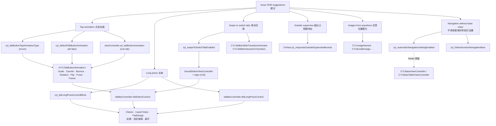

## [CN]测试与截图
## [EN]Testing and screenshots

| 中文 | English |
|:---|:---|
| 在模拟器上验证（PR #744 与 #752）：iOS 26.5 与 iOS 17.5 编译无警告，`pod lib lint --quick` 与文档导航检查通过。扁平样式、液态玻璃（iOS 26.5，Example-Rive）与经典样式（iOS 17.5，ObjC Demo）中，以下各项均通过：13 种点击动画、长按、长按时长与双击间隔生效、左右滑动切换（含 PlusButton 页面与需要登录的 Tab）、上一个 / 下一个 Tab、不继承基类隐藏导航栏、超出父视图响应点击、CYLUtils 与 bundle 图片行、滑动转场演示。点击声音与触感反馈只验证了不会出错：模拟器不会振动，声音未在真机上试听。 | Checked on the simulator (PRs #744 and #752): builds on iOS 26.5 and iOS 17.5 with no warnings; `pod lib lint --quick` and the docs navigation check pass. In FlatDesign, Liquid Glass (iOS 26.5, Example-Rive) and the classic style (iOS 17.5, the ObjC demo), all of these pass: the 13 tap animation steps, long press, the long press duration and double tap interval taking effect, swipe (including the plus button's page and a tab that needs login), previous / next tab, the navigation bar without a base class, touches outside the superview, the CYLUtils and bundle image rows, and the slide transition demo. The tap sound and haptics were only checked not to fail: the simulator does not vibrate, and the sound was not listened to on a device. |

### [CN]点击动画
### [EN]Tap animations

| 中文 | English |
|:---|:---|
| 扁平样式：「弹性 + 星星烟花」（`CYLTabButtonBounceAnimation.fireworksImage`，SF Symbol 粒子保持黄色）。 | FlatDesign: "Bounce + star fireworks" (`CYLTabButtonBounceAnimation.fireworksImage`; the SF Symbol particles keep their yellow). |

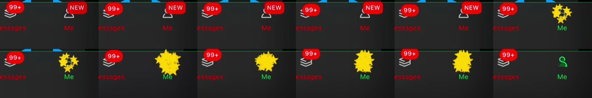

### [CN]长按
### [EN]Long press

| 中文 | English |
|:---|:---|
| 依次为扁平样式、液态玻璃、经典样式：长按弹出被长按 Tab 的名称，抬起手指后不会选中该 Tab。 | FlatDesign, Liquid Glass and the classic style: a long press shows the pressed tab's name, and lifting the finger does not select it. |

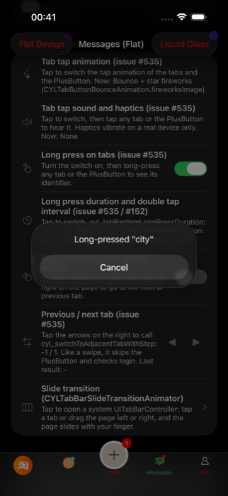 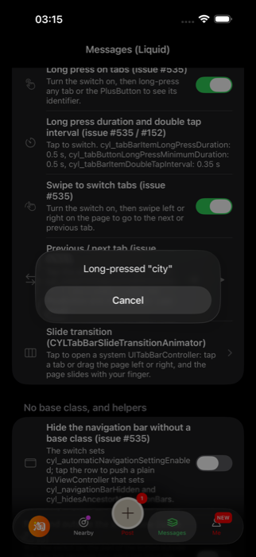 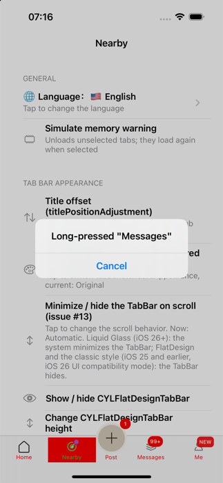

### [CN]左右滑动切换 Tab
### [EN]Swipe to switch tabs

| 中文 | English |
|:---|:---|
| 液态玻璃（滑动中，TabBar 保持显示）；经典样式 iOS 17（逐帧：旧页面滑出、新页面滑入）；经典样式中滑到需要登录的 Tab 时停下并发起登录。 | Liquid Glass (mid-swipe, the tab bar stays visible); the classic style on iOS 17 (frame by frame: the old page slides out, the new one in); in the classic style, a swipe to a tab that needs login stops there and starts the login. |

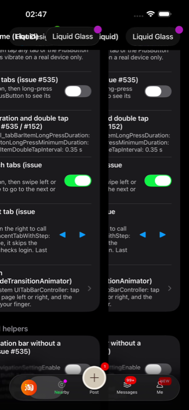 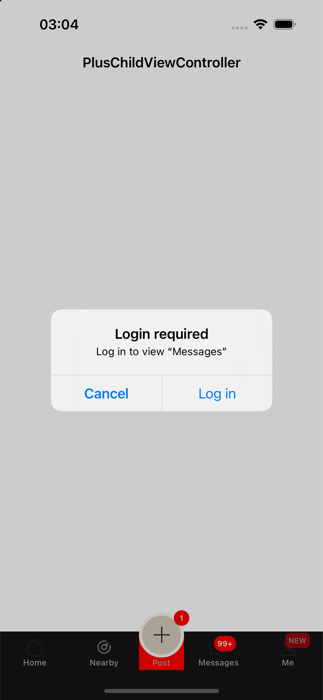

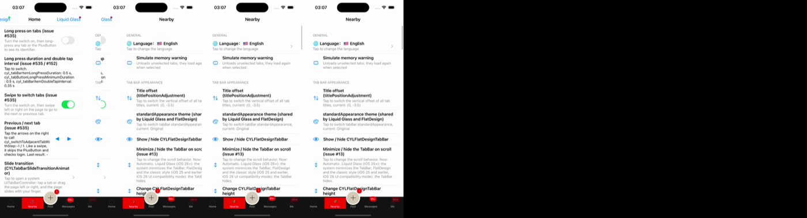

### [CN]滑动转场
### [EN]Slide transition

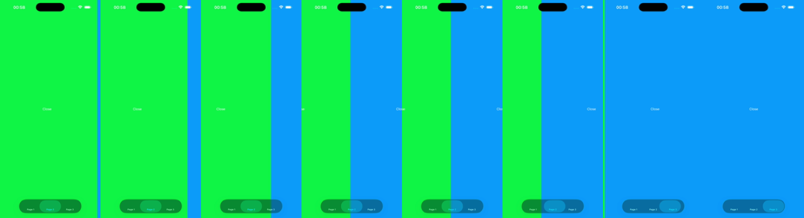

### [CN]超出父视图响应点击与不继承基类隐藏导航栏
### [EN]Touches outside the superview, and the navigation bar without a base class

| 中文 | English |
|:---|:---|
| 依次为液态玻璃与经典样式：打开开关后，点击灰框外的按钮部分也会计数；经典样式中 push 的普通 UIViewController 隐藏了导航栏。 | Liquid Glass and the classic style: with the switch on, taps on the part of the button outside the gray box count; in the classic style, the plain UIViewController pushed has no navigation bar. |

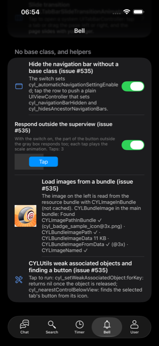 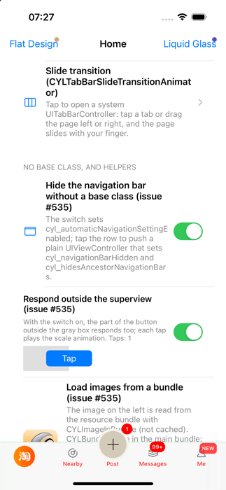 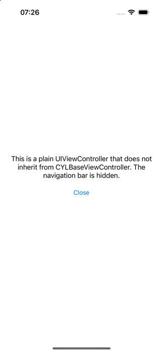

## [CN]待办
## [EN]To do

| 中文 | English |
|:---|:---|
| 已完成：液态玻璃与经典样式中复测点击动画、长按时长与双击间隔、上一个 / 下一个 Tab、不继承基类隐藏导航栏、超出父视图响应点击（均通过，见上方截图）；补齐截图。 | Done: the re-check in Liquid Glass and the classic style of the tap animations, the long press duration and double tap interval, previous / next tab, the navigation bar without a base class and touches outside the superview (all pass, see the screenshots above); the screenshots. |
| 仍待完成：在真机上验证点击声音与触感反馈（模拟器不会振动）。 | Still open: check the tap sound and haptics on a device (the simulator does not vibrate). |
