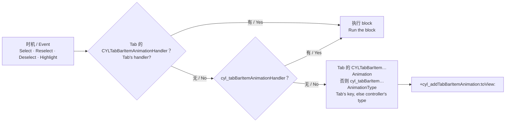

# Tab 图标的内置动画 / Built-in Tab Icon Animations

<!-- bound-classes: CYLTabBarController -->
<!-- binding:start -->
<!-- Generated by scripts/update-docs-navigation.py; do not edit by hand. -->

| 中文 | English |
|:---|:---|
| 绑定的代码类 `CYLTabBarController`：[`CYLTabBarController/CYLTabBarController.h`](../CYLTabBarController/CYLTabBarController.h) | Bound to the class `CYLTabBarController`: [`CYLTabBarController/CYLTabBarController.h`](../CYLTabBarController/CYLTabBarController.h) |

<!-- binding:end -->

| 中文 | English |
|:---|:---|
| 以前为 Tab 图标添加点击动画，需要在 `tabBarController:didSelectControl:` 中按类名查找私有子视图（`UITabBarSwappableImageView`）并自己写 `CAKeyframeAnimation`，而且无法区分选中、重复点击与取消选中。现在本库内置了 5 种动画，可分别用于选中、重复点击、取消选中与按下 4 个时机，也可以用 block 写自己的动画；可以全局设置，也可以为单个 Tab 设置。经典样式、液态玻璃与扁平样式都支持。 | Animating a tab icon used to mean looking up a private subview by class name (`UITabBarSwappableImageView`) in `tabBarController:didSelectControl:` and writing a `CAKeyframeAnimation` yourself, with no way to tell select, reselect and deselect apart. The library now has 5 built-in animations for 4 moments (select, reselect, deselect and press), plus a block for your own; set them for every tab or for one tab. Works in the classic style, Liquid Glass and FlatDesign. |



## 目录 / Contents

<!-- navigation:start -->
<!-- Generated by scripts/update-docs-navigation.py; do not edit by hand. -->

| 中文 | English |
|:---|:---|
| [用法](#用法--usage) | [Usage](#用法--usage) |
| &nbsp;&nbsp;&nbsp;&nbsp;↳ [全局设置](#全局设置--for-every-tab) | &nbsp;&nbsp;&nbsp;&nbsp;↳ [For every tab](#全局设置--for-every-tab) |
| &nbsp;&nbsp;&nbsp;&nbsp;↳ [单个 Tab](#单个-tab--one-tab) | &nbsp;&nbsp;&nbsp;&nbsp;↳ [One tab](#单个-tab--one-tab) |
| &nbsp;&nbsp;&nbsp;&nbsp;↳ [自定义动画](#自定义动画--your-own-animation) | &nbsp;&nbsp;&nbsp;&nbsp;↳ [Your own animation](#自定义动画--your-own-animation) |
| [API](#api) | [API](#api) |
| [限制](#限制--limits) | [Limits](#限制--limits) |
| [截图](#截图--screenshots) | [Screenshots](#截图--screenshots) |

<!-- navigation:end -->

## 用法 / Usage

### 全局设置 / For every tab

```objc
tabBarController.cyl_tabBarItemSelectAnimationType    = CYLTabBarItemAnimationTypeBounce;  // 选中 / select
tabBarController.cyl_tabBarItemReselectAnimationType  = CYLTabBarItemAnimationTypeRotate;  // 重复点击 / reselect
tabBarController.cyl_tabBarItemHighlightAnimationType = CYLTabBarItemAnimationTypeScale;   // 按下 / press
```

### 单个 Tab / One tab

```objc
NSDictionary *home = @{
    CYLTabBarItemTitle : @"Home",
    CYLTabBarItemImage : @"home_normal",
    CYLTabBarItemSelectedImage : @"home_selected",
    CYLTabBarItemSelectAnimation : @(CYLTabBarItemAnimationTypeJump),    // 优先于全局设置 / wins over the global value
    CYLTabBarItemReselectAnimation : @(CYLTabBarItemAnimationTypeShake),
};
```

### 自定义动画 / Your own animation

```objc
tabBarController.cyl_tabBarItemAnimationHandler = ^(UIView *iconView, UIControl *control, CYLTabBarItemAnimationEvent event) {
    if (event == CYLTabBarItemAnimationEventSelect) {
        iconView.transform = CGAffineTransformMakeScale(0.6, 0.6);
        [UIView animateWithDuration:0.4 delay:0 usingSpringWithDamping:0.5 initialSpringVelocity:0 options:0 animations:^{
            iconView.transform = CGAffineTransformIdentity;
        } completion:nil];
    } else if (event == CYLTabBarItemAnimationEventReselect) {
        [CYLTabBarController cyl_addTabBarItemAnimation:CYLTabBarItemAnimationTypeRotate toView:iconView]; // 组合预设 / reuse a preset
    }
};
```

```swift
tabBarController.cyl_tabBarItemSelectAnimationType = .bounce
tabBarController.cyl_tabBarItemAnimationHandler = { iconView, control, event in
    if event == .reselect {
        CYLTabBarController.cyl_addTabBarItemAnimation(.rotate, to: iconView)
    }
}
```

## API

| API | 中文 | English |
|:---|:---|:---|
| `CYLTabBarItemAnimationType` | `None`、`Bounce`（弹性缩放）、`Scale`（快速放大）、`Rotate`（翻转一周）、`Shake`（摇摆）、`Jump`（跳起回弹）。 | `None`, `Bounce` (springy scale), `Scale` (quick pop), `Rotate` (a full flip), `Shake` (wiggle), `Jump` (jump and land). |
| `CYLTabBarItemAnimationEvent` | `Select`、`Reselect`、`Deselect`、`Highlight`（手指按下）。 | `Select`, `Reselect`, `Deselect`, `Highlight` (finger down). |
| `cyl_tabBarItemSelectAnimationType` 等 4 个属性 | 全局预设动画，默认 `None`。 | Controller-wide presets, default `None`. |
| `cyl_tabBarItemAnimationHandler` | 全局自定义动画；设置后不再播放预设动画。 | Your animation for every tab; presets are then not played. |
| `CYLTabBarItemSelectAnimation` / `…Reselect…` / `…Deselect…` / `…Highlight…` | `tabBarItemsAttributes` 中单个 Tab 的预设动画（NSNumber）。 | One tab's preset in `tabBarItemsAttributes` (NSNumber). |
| `CYLTabBarItemAnimationHandler` | 单个 Tab 的自定义 block，优先级最高。 | One tab's block; highest precedence. |
| `+cyl_addTabBarItemAnimation:toView:` | 在任意视图上播放预设动画。 | Plays a preset on any view. |

| 中文 | English |
|:---|:---|
| `iconView` 是 Tab 当前显示的图标：有 Lottie 时为 Lottie 视图，用 `-setTabBarItemIconViewProvider:atIndex:` 替换图标时为你的视图，否则为图片视图。液态玻璃中每个 Tab 有普通层与选中层两份，两份都会播放。 | `iconView` is what the tab shows as its icon: the Lottie view when there is one, your view when `-setTabBarItemIconViewProvider:atIndex:` replaced the icon, otherwise the image view. In Liquid Glass each tab is drawn twice (normal and selected layer), and both are animated. |
| 选中 / 取消选中：用户点击与代码切换（`selectedIndex = …`）都会播放；TabBar 首次显示时的初始选中不播放。重复点击：与 `-tabBarController:didReselectViewController:` 同时触发，见 [Tab-Reselect.md](Tab-Reselect.md)。 | Select / deselect: played for taps and for changes in code (`selectedIndex = …`), but not for the first selection when the tab bar appears. Reselect: fires with `-tabBarController:didReselectViewController:`, see [Tab-Reselect.md](Tab-Reselect.md). |
| 新动画会替换正在播放的同类动画，快速连续点击不会叠加。 | A new animation replaces the running one, so fast taps do not stack. |

## 限制 / Limits

| 中文 | English |
|:---|:---|
| PlusButton 是你自己的按钮，不受这些设置影响；请在其子类中自行添加动画（`+cyl_addTabBarItemAnimation:toView:` 同样可用）。 | The plus button is your own button and is not animated by these settings; animate it in your subclass (`+cyl_addTabBarItemAnimation:toView:` works there too). |
| 液态玻璃自带按压效果，因此不回调 `Highlight`。 | Liquid Glass draws its own press effect, so `Highlight` is not reported there. |
| "更多"（More）Tab 不参与。 | The "More" tab is not covered. |

## 截图 / Screenshots

| 中文 | English |
|:---|:---|
| 本次开发环境没有 iOS 模拟器或真机，无法运行 Demo，因此暂无测试截图；上方为流程示意图。在设备上验证后，请将截图或 GIF 放入 `docs/assets/` 并在此引用，例如 ``。 | This change was developed without an iOS simulator or device, so there are no test screenshots yet; the figure above is a flow diagram. After testing on a device, put screenshots or GIFs in `docs/assets/` and reference them here, e.g. ``. |
