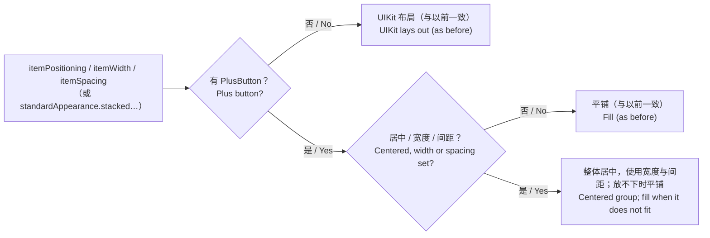
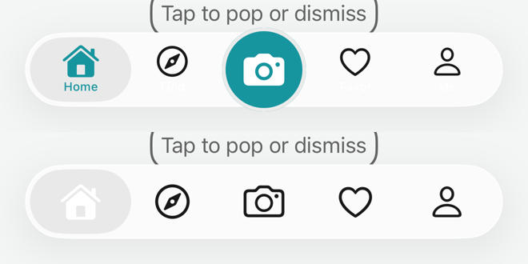

# Tab 的排列方式 / Tab Item Positioning

<!-- bound-classes: CYLTabBar -->
<!-- binding:start -->
<!-- Generated by scripts/update-docs-navigation.py; do not edit by hand. -->

| 中文 | English |
|:---|:---|
| 绑定的代码类 `CYLTabBar`：[`CYLTabBarController/CYLTabBar.h`](../CYLTabBarController/CYLTabBar.h) | Bound to the class `CYLTabBar`: [`CYLTabBarController/CYLTabBar.h`](../CYLTabBarController/CYLTabBar.h) |

<!-- binding:end -->

| 中文 | English |
|:---|:---|
| UIKit 可以让 Tab 居中排列，并指定每个 Tab 的宽度与间距（`itemPositioning = .centered`、`itemWidth`、`itemSpacing`，或 `standardAppearance.stackedItemPositioning` 等），在 iPad 等宽屏上很常用。以前经典 TabBar 只要有 PlusButton，就会自己把所有 Tab 平铺到整个宽度，这些设置全部失效；没有 PlusButton 时则由 UIKit 处理，表现不一致。现在有 PlusButton 时同样遵守这些设置：Tab 与 PlusButton 作为一组居中，使用指定的宽度与间距。 | UIKit can center the tabs and give them a width and a spacing (`itemPositioning = .centered`, `itemWidth`, `itemSpacing`, or `standardAppearance.stackedItemPositioning`...), common on wide screens such as iPad. The classic tab bar used to spread the tabs over the whole width as soon as there was a plus button, ignoring all of these; without a plus button UIKit honored them, so the two cases differed. With a plus button they are now honored too: the tabs and the plus button are centered as a group, with the given width and spacing. |



## 目录 / Contents

<!-- navigation:start -->
<!-- Generated by scripts/update-docs-navigation.py; do not edit by hand. -->

| 中文 | English |
|:---|:---|
| [用法](#用法--usage) | [Usage](#用法--usage) |
| &nbsp;&nbsp;&nbsp;&nbsp;↳ [两端留白](#两端留白--space-at-both-ends) | &nbsp;&nbsp;&nbsp;&nbsp;↳ [Space at both ends](#两端留白--space-at-both-ends) |
| [规则](#规则--rules) | [Rules](#规则--rules) |
| [限制](#限制--limits) | [Limits](#限制--limits) |
| [截图](#截图--screenshots) | [Screenshots](#截图--screenshots) |
| [任务记录](#任务记录--task-log) | [Task log](#任务记录--task-log) |

<!-- navigation:end -->

## 用法 / Usage

```objc
// iOS 13+：推荐通过 appearance 设置（UIKit 优先使用它）。/ iOS 13+: prefer the appearance (UIKit reads it first).
UITabBarAppearance *appearance = [tabBarController.tabBar.standardAppearance copy];
appearance.stackedItemPositioning = UITabBarItemPositioningCentered;
appearance.stackedItemWidth = 76;
appearance.stackedItemSpacing = 24;
tabBarController.tabBar.standardAppearance = appearance;

// 或 / or:
tabBarController.tabBar.itemPositioning = UITabBarItemPositioningCentered;
tabBarController.tabBar.itemWidth = 76;
tabBarController.tabBar.itemSpacing = 24;
```

### 两端留白 / Space at both ends

```objc
// Tab（及 PlusButton）排列在两端 16pt 之间；可与居中同时使用。
// The tabs (and the plus button) are laid out 16 pt in from both ends; works together with centering.
((CYLTabBar *)tabBarController.tabBar).cyl_itemEdgeInsets = UIEdgeInsetsMake(0, 16, 0, 16);
```

| 中文 | English |
|:---|:---|
| `cyl_itemEdgeInsets` 只使用 `left`（起始端）与 `right`（末端），从右到左布局时自动镜像。有无 PlusButton 均生效：没有 PlusButton 时，设置后由本库在两端留白之间布局 Tab 按钮（未设置时仍由 UIKit 布局）。 | `cyl_itemEdgeInsets` uses only `left` (the leading end) and `right` (the trailing end), mirrored in right-to-left layouts. It works with and without a plus button: without one, the library lays the tab buttons out between the insets once they are set (UIKit still lays them out otherwise). |

## 规则 / Rules

| 中文 | English |
|:---|:---|
| 与 UIKit 相同：设置了 `standardAppearance` 中的值（iOS 13+）时使用它们，否则使用 TabBar 自身的 `itemPositioning` / `itemWidth` / `itemSpacing`。 | As UIKit: the `standardAppearance` values (iOS 13+) when set, otherwise the tab bar's own `itemPositioning` / `itemWidth` / `itemSpacing`. |
| 居中或 `itemWidth > 0` 时按居中排列（`itemWidth` 为 0 时使用平分宽度），并使用 `itemSpacing`。PlusButton 占一个位置，宽度为其自身宽度。 | Centered or `itemWidth > 0` centers the group (`itemWidth` 0 uses the shared width), with `itemSpacing`. The plus button takes one slot of its own width. |
| 只设置 `itemSpacing`（未居中、`itemWidth` 为 0）时，各位置铺满宽度，之间留出 `itemSpacing` 的间隙，TabBar 的背景透过间隙显示，例如作为有背景色（`CYLTabBarItemBackgroundColor`）的 Tab 之间的分隔线。没有 PlusButton 时同样由本库布局，因为 UIKit 铺满时不留间隙。 | `itemSpacing` alone (not centered, `itemWidth` 0) fills the width with gaps of `itemSpacing` between the slots; the tab bar shows through them, e.g. as separators between tabs with a background color (`CYLTabBarItemBackgroundColor`). The library lays this out without a plus button too, since UIKit leaves no gaps when it fills. |
| 总宽度超过 TabBar 时回退为平铺。默认值（Automatic、0、0）时与以前完全相同。 | When the group is wider than the tab bar, it falls back to fill. With the defaults (Automatic, 0, 0) the layout is exactly as before. |
| 支持 RTL（从右到左）布局。 | Right-to-left layouts are mirrored. |

## 限制 / Limits

| 中文 | English |
|:---|:---|
| 仅经典 TabBar（iOS 25 及以前，以及 iOS 26 的 UI 兼容模式）。液态玻璃由系统布局；扁平样式通过 `standardAppearance` 自行处理排列方式。 | Classic tab bar only (iOS 25 and earlier, and iOS 26 in UI compatibility mode). Liquid Glass is laid out by the system; FlatDesign handles positioning from `standardAppearance` itself. |

## 截图 / Screenshots

| 中文 | English |
|:---|:---|
| 已验证（2026-11-10，iOS 26.1，iPhone 17 Pro Max 模拟器）。上：图库「8.8 Centered tabs around a plus button」（`itemPositioning = Centered`、`itemWidth` 64、`itemSpacing` 12），Tab 围绕中间的 PlusButton 排列；下：「8.9 Edge insets and gaps between tabs」，iOS 26 的液态玻璃 TabBar 由系统布局，`cyl_itemEdgeInsets` 只对经典 TabBar（iOS 25 及更早，或 iOS 26 兼容模式）生效，因此这里与普通布局相同。 | Verified (2026-11-10, iOS 26.1, iPhone 17 Pro Max simulator). Top: gallery "8.8 Centered tabs around a plus button" (`itemPositioning = Centered`, `itemWidth` 64, `itemSpacing` 12): the tabs sit around the middle plus button. Bottom: "8.9 Edge insets and gaps between tabs": the iOS 26 Liquid Glass tab bar is laid out by the system, and `cyl_itemEdgeInsets` applies only to the classic tab bar (iOS 25 and earlier, or iOS 26 compatibility mode), so it looks like the plain layout here. |



## 任务记录 / Task log

| 中文 | English |
|:---|:---|
| TODO（2026-11-12，issue #561）：用户提示词：「我看到你支持了横屏展示icon与title中心点对齐了。请测试该功能是否符合 该issue要求。如果符合，关联issue并回复issue附带截图展示。https://github.com/ChenYilong/CYLTabBarController/issues/561」。上下文：issue #561「iPad 横排按钮 做个适配 竖排 横排 可以切换」（iPad 上 Tab 按钮的图标与标题横向排列（inline）与竖向排列（stacked）的适配与切换）。要求：测试横屏 / 横向排列时图标与标题中心对齐的功能是否满足该 issue；满足则在提交中关联 issue，并在 issue 中回复截图。 | TODO (2026-11-12, issue #561): user prompt: "我看到你支持了横屏展示icon与title中心点对齐了。请测试该功能是否符合 该issue要求。如果符合，关联issue并回复issue附带截图展示。https://github.com/ChenYilong/CYLTabBarController/issues/561". Context: issue #561 "iPad 横排按钮 做个适配 竖排 横排 可以切换" (on iPad, support tab buttons with icon and title side by side (inline) and stacked, and switching between them). Requirement: test whether the landscape / side-by-side layout with icon and title centered meets the issue; if it does, link the issue in a commit and reply on the issue with screenshots. |
