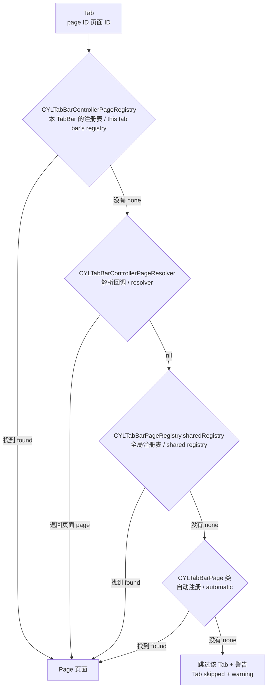
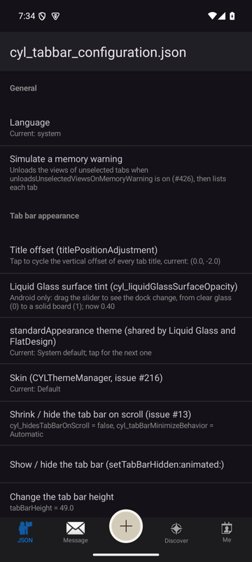

# [CN]按页面 ID 获得 Tab 页面（页面注册表）
# [EN]Tab pages from page IDs (the page registry)

<!-- bound-classes: CYLTabBarPageRegistry, CYLTabBarController -->
<!-- binding:start -->
<!-- Generated by scripts/update-docs-navigation.py; do not edit by hand. -->

| 中文 | English |
|:---|:---|
| 绑定的代码类 `CYLTabBarPageRegistry`：[`CYLTabBarController/CYLTabBarPageRegistry.h`](../CYLTabBarController/CYLTabBarPageRegistry.h) | Bound to the class `CYLTabBarPageRegistry`: [`CYLTabBarController/CYLTabBarPageRegistry.h`](../CYLTabBarController/CYLTabBarPageRegistry.h) |
| 绑定的代码类 `CYLTabBarController`：[`CYLTabBarController/CYLTabBarController.h`](../CYLTabBarController/CYLTabBarController.h) | Bound to the class `CYLTabBarController`: [`CYLTabBarController/CYLTabBarController.h`](../CYLTabBarController/CYLTabBarController.h) |

<!-- binding:end -->

| 中文 | English |
|:---|:---|
| 配置文件（JSON、YAML、plist……或网络下载的配置，见 [一个配置文件生成 TabBarController](Configuration-File.md)）不能包含对象，也不应该写 iOS 类名：Android 的类名不同，一个类可能需要多个对象，页面往往需要依赖注入。因此每个 Tab 只写一个**跨端通用的页面 ID**，iOS 与 Android 各自在代码中**注册**该 ID 创建什么页面。 | A configuration file (JSON, YAML, plist... or a downloaded one, see [One configuration file, one TabBarController](Configuration-File.md)) cannot hold objects, and should not name iOS classes: Android's classes differ, one class may need several objects, and pages usually need dependency injection. So each tab names one **cross-platform page ID**, and iOS and Android each **register** in code what that ID creates. |
| 这是 [调研报告](Tab-View-Controller-Resolution-Research.md) 中的方案 C（注册工厂）加方案 D（解析回调），与 React Native 的 `AppRegistry`、Flutter 的路由表、iOS 18 的 `UITab(identifier:viewControllerProvider:)` 是同一种模式。原来的类名键（`CYLTabBarItemViewControllerClass`、`CYLTabBarItemNavigationControllerClass`、`CYLTabBarControllerNavigationControllerClass`）在发布前已删除。 | This is option C (registered factories) plus option D (a resolver callback) of [the research report](Tab-View-Controller-Resolution-Research.md), the same pattern as React Native's `AppRegistry`, Flutter's route tables and iOS 18's `UITab(identifier:viewControllerProvider:)`. The class-name keys (`CYLTabBarItemViewControllerClass`, `CYLTabBarItemNavigationControllerClass`, `CYLTabBarControllerNavigationControllerClass`) were removed before release. |

## [CN]目录
## [EN]Contents

<!-- navigation:start -->
<!-- Generated by scripts/update-docs-navigation.py; do not edit by hand. -->

| 中文 | English |
|:---|:---|
| [快速开始](#cn快速开始) | [Quick start](#enquick-start) |
| [页面 ID](#cn页面-id) | [Page IDs](#enpage-ids) |
| [查找顺序](#cn查找顺序) | [Lookup order](#enlookup-order) |
| [多个 TabBar](#cn多个-tabbar) | [Several tab bars](#enseveral-tab-bars) |
| [解析回调](#cn解析回调) | [Resolver](#enresolver) |
| [自动注册（CYLTabBarPage）](#cn自动注册cyltabbarpage) | [Automatic registration (CYLTabBarPage)](#enautomatic-registration-cyltabbarpage) |
| [远程配置兼容字段](#cn远程配置兼容字段) | [Remote configuration keys](#enremote-configuration-keys) |
| [页面工厂与请求](#cn页面工厂与请求) | [Page factories and requests](#enpage-factories-and-requests) |
| [自定义页面来源（协议）](#cn自定义页面来源协议) | [Custom page sources (the protocol)](#encustom-page-sources-the-protocol) |
| [重新加载（配置更新、登录后换 Tab）](#cn重新加载配置更新登录后换-tab) | [Reload (a configuration update, tabs after login)](#enreload-a-configuration-update-tabs-after-login) |
| [异步页面](#cn异步页面) | [Asynchronous pages](#enasynchronous-pages) |
| [被跳过的 Tab](#cn被跳过的-tab) | [Skipped tabs](#enskipped-tabs) |
| [API](#cnapi) | [API](#enapi) |
| [Android](#cnandroid) | [Android](#enandroid) |
| [演示](#cn演示) | [Demo](#endemo) |
| [验证与限制](#cn验证与限制) | [Verification and limits](#enverification-and-limits) |

<!-- navigation:end -->

## [CN]快速开始
## [EN]Quick start

| 中文 | English |
|:---|:---|
| 1. 配置文件中每个 Tab 写一个页面 ID（`CYLTabBarItemPageIdentifier`，或直接使用 `CYLTabBarItemIdentifier`）。Tab 的顺序就是文件中数组的顺序。 | 1. Give each tab in the file a page ID (`CYLTabBarItemPageIdentifier`, or just `CYLTabBarItemIdentifier`). The tab order is the order of the array in the file. |
| 2. App 启动时注册每个 ID 创建什么页面（例如在 `-application:didFinishLaunchingWithOptions:` 中）。 | 2. At launch, register what each ID creates (e.g. in `-application:didFinishLaunchingWithOptions:`). |
| 3. 照常由文件或 URL 创建 TabBarController。 | 3. Create the tab bar controller from the file or the URL as usual. |

```json
{
  "CYLTabBarControllerTabBarItemsAttributes": [
    { "CYLTabBarItemTitle": "Home", "CYLTabBarItemImage": "system:house", "CYLTabBarItemIdentifier": "home" },
    { "CYLTabBarItemTitle": "News", "CYLTabBarItemPageIdentifier": "web",
      "CYLTabBarItemPageParameters": { "url": "https://example.com/news" } },
    { "CYLTabBarItemTitle": "Help", "CYLTabBarItemPageIdentifier": "web",
      "CYLTabBarItemPageParameters": { "url": "https://example.com/help" }, "CYLTabBarItemPlatforms": "ios,android" },
    { "CYLTabBarItemTitle": "Live", "CYLTabBarItemPageIdentifier": "live", "CYLTabBarItemMinimumAppVersion": "2.3.0" }
  ]
}
```

```objc
// Objective-C: once at launch. 启动时注册一次。
CYLTabBarPageRegistry *pages = CYLTabBarPageRegistry.sharedRegistry;
[pages registerPageProvider:^UIViewController *(NSString *pageIdentifier, NSDictionary<NSString *, id> *tab) {
    HomeViewController *home = [[HomeViewController alloc] initWithViewModel:[HomeViewModel new]];
    return [[UINavigationController alloc] initWithRootViewController:home];
} forPageIdentifier:@"home"];
// One class, several tabs: the parameters come from the file. 一个类、多个 Tab：参数来自配置文件。
[pages registerPageProvider:^UIViewController *(NSString *pageIdentifier, NSDictionary<NSString *, id> *tab) {
    NSString *url = tab[CYLTabBarItemPageParameters][@"url"];
    return [[WebViewController alloc] initWithURL:[NSURL URLWithString:url]];
} forPageIdentifier:@"web"];

NSError *error = nil;
self.window.rootViewController = [CYLTabBarController tabBarControllerWithConfigurationFile:@"tabbar.json" error:&error];
```

```swift
// Swift
CYLTabBarPageRegistry.shared.register({ pageIdentifier, tab in
    UINavigationController(rootViewController: HomeViewController(viewModel: HomeViewModel()))
}, forPageIdentifier: "home")
let tabBarController = try CYLTabBarController(configurationFile: "tabbar.json")
```

## [CN]页面 ID
## [EN]Page IDs

| 中文 | English |
|:---|:---|
| 页面 ID = `CYLTabBarItemPageIdentifier`；未设置或为空字符串时使用 `CYLTabBarItemIdentifier`。这样“Tab 标识”（无障碍、自定义点击、按标识查找 Tab）与“页面标识”可以分开，多数情况下只写 `CYLTabBarItemIdentifier` 即可。 | Page ID = `CYLTabBarItemPageIdentifier`; when it is missing or an empty string, `CYLTabBarItemIdentifier` is used. The "tab identity" (accessibility, custom tab actions, finding a tab by identifier) and the "page identity" can differ, and most of the time `CYLTabBarItemIdentifier` alone is enough. |
| 同一个页面 ID 可以出现在多个 Tab 中（例如两个网页 Tab），每个 Tab 调用一次提供者，得到各自的页面。重复的 `CYLTabBarItemIdentifier` 会被改名为 `id_2`，改名前原标识会保存为 `CYLTabBarItemPageIdentifier`，因此页面仍能找到（C17）。 | One page ID can appear in several tabs (e.g. two web tabs): the provider is called once per tab and each gets its own page. A duplicate `CYLTabBarItemIdentifier` is renamed `id_2`, but the original is first kept as `CYLTabBarItemPageIdentifier`, so the page is still found (C17). |

## [CN]查找顺序
## [EN]Lookup order



| 中文 | English |
|:---|:---|
| Tab 的**顺序只由配置中的数组决定**；注册表是无序的映射。没有找到页面的 Tab 会被跳过（DEBUG 下输出警告），其余 Tab 保持原来的顺序。由文件或 URL 创建时，如果没有任何 Tab 找到页面，返回 `CYLTabBarConfigurationErrorNoPages`（11）错误，而不是空的 TabBar。 | The **order comes only from the array in the configuration**; registries are unordered maps. A tab whose page is not found is skipped (with a warning in DEBUG) and the other tabs keep their order. From a file or a URL, when no tab finds its page, the result is a `CYLTabBarConfigurationErrorNoPages` (11) error instead of an empty tab bar. |
| 提供者返回的页面会被检查：nil、不是视图控制器、是 TabBarController（不允许嵌套）、已属于其他容器（例如单例页面已在另一个 TabBar 中）或已被本 TabBar 的其他 Tab 使用，都会被拒绝并跳过该 Tab；提供者抛出的 Objective-C 异常会被捕获（C12、C13）。提供者每次调用都应返回新页面。 | Every page a provider returns is checked: nil, not a view controller, a tab bar controller (no nested tab bars), a page that already belongs to another container (e.g. a singleton page already in another tab bar) or a page already used by another tab of this tab bar is refused and the tab skipped; an Objective-C exception a provider raises is caught (C12, C13). A provider should return a new page on each call. |
| 传入 `CYLTabBarControllerViewControllers`（代码，按下标对应）时不使用页面 ID，行为与以前一致。 | With `CYLTabBarControllerViewControllers` (code, matched by index), page IDs are not used; the behavior is the same as before. |
| 顺序可以配置：`CYLTabBarControllerPageLookupOrder`（数组或逗号分隔的字符串，取值 `instance`、`resolver`、`shared`、`automatic`，代码中为 `CYLTabBarPageSource` 常量）只保留列出的来源并按其顺序查找；`CYLTabBarControllerAutomaticPageRegistration` 为 NO 时不扫描 `CYLTabBarPage` 类。未知项会被丢弃并警告，都无效时使用默认顺序（C18）。控制器用 `cyl_pageLookupOrder` 给出实际顺序。 | The order is configurable: `CYLTabBarControllerPageLookupOrder` (an array or a comma-separated string of `instance`, `resolver`, `shared`, `automatic`; the `CYLTabBarPageSource` constants in code) keeps only the listed sources, in that order; `CYLTabBarControllerAutomaticPageRegistration` NO leaves the `CYLTabBarPage` classes out. Unknown entries are dropped with a warning, and the default order is used when nothing valid is left (C18). The controller reports the order in use in `cyl_pageLookupOrder`. |
| 查找本身是 `+[CYLTabBarPageRegistry pagesOfTabs:registry:resolver:lookupOrder:keptTabs:skipped:]`，TabBarController 只是调用它；其他容器或测试可以直接调用。 | The lookup itself is `+[CYLTabBarPageRegistry pagesOfTabs:registry:resolver:lookupOrder:keptTabs:skipped:]`; the tab bar controller only calls it, and another container or a test can call it directly. |

## [CN]多个 TabBar
## [EN]Several tab bars

| 中文 | English |
|:---|:---|
| 全局注册表 `CYLTabBarPageRegistry.sharedRegistry` 给所有 TabBar 使用。需要让不同 TabBar 把同一个 ID 对应到不同页面时（例如普通模式与儿童模式、多个账号、iPad 的两栏），为每个 TabBar 创建自己的注册表，作为 `CYLTabBarControllerPageRegistry` 传入；它先于全局注册表查找，没有注册的 ID 仍会落到全局注册表（C16）。 | The shared registry, `CYLTabBarPageRegistry.sharedRegistry`, serves every tab bar. When different tab bars must map one ID to different pages (e.g. a normal and a kids mode, several accounts, two panes on iPad), give each tab bar its own registry as `CYLTabBarControllerPageRegistry`: it is looked up before the shared registry, and IDs it does not have still fall back to the shared one (C16). |

```objc
CYLTabBarPageRegistry *kidsPages = [[CYLTabBarPageRegistry alloc] init];
[kidsPages registerPageProvider:^UIViewController *(NSString *pageIdentifier, NSDictionary *tab) {
    return [[KidsHomeViewController alloc] init];
} forPageIdentifier:@"home"];

// A tab bar's own registry is passed in code: read the file, add the registry. 自己的注册表在代码中传入：读取文件，加入注册表。
NSMutableDictionary *configuration = [[CYLTabBarController configurationWithContentsOfFile:@"tabbar.json" error:NULL] mutableCopy];
configuration[CYLTabBarControllerPageRegistry] = kidsPages;
CYLTabBarController *kidsTabBarController = [CYLTabBarController tabBarControllerWithConfiguration:configuration];
```

## [CN]解析回调
## [EN]Resolver

| 中文 | English |
|:---|:---|
| 不想维护注册表时，传入一个 block 作为 `CYLTabBarControllerPageResolver`，例如接入 App 已有的路由（JLRoutes、CTMediator 等）。返回 nil 表示继续在全局注册表与 `CYLTabBarPage` 类中查找。文件中写的注册表或解析回调（字符串）会被忽略并输出警告（C15）。 | Instead of a registry, pass a block as `CYLTabBarControllerPageResolver`, e.g. to reuse the app's router (JLRoutes, CTMediator, ...). Returning nil goes on looking in the shared registry and the `CYLTabBarPage` classes. A registry or resolver written in a file (a string) is ignored with a warning (C15). |

```objc
configuration[CYLTabBarControllerPageResolver] = ^UIViewController *(NSString *pageIdentifier, NSDictionary *tab) {
    return [MyRouter viewControllerForURL:[NSString stringWithFormat:@"myapp://tab/%@", pageIdentifier]];
};
```

## [CN]自动注册（CYLTabBarPage）
## [EN]Automatic registration (CYLTabBarPage)

| 中文 | English |
|:---|:---|
| 视图控制器类遵守 `CYLTabBarPage` 并实现 `+cylTabBarPageIdentifier`，即自动按该 ID 注册，无需任何注册代码（类似 Android ARouter 的注解）。实现 `+cylTabBarPageWithAttributes:` 可以自定义创建（例如包裹导航控制器），否则用 `-init`。只扫描 App 自身的镜像（不扫描系统库），首次使用时扫描一次，扫描只读取类信息，不触发 `+initialize`。两个类声明同一个 ID 时按类名顺序使用第一个并输出警告（C14）。 | A view controller class that adopts `CYLTabBarPage` and implements `+cylTabBarPageIdentifier` is registered under that ID automatically, with no registration code (like Android ARouter's annotations). Implement `+cylTabBarPageWithAttributes:` to create the page yourself (e.g. in a navigation controller); otherwise `-init` is used. Only the app's own images are scanned (not the system's), once, on first use; the scan only reads class data and runs no `+initialize`. When two classes claim one ID, the first in class name order is used, with a warning (C14). |

```objc
@interface MessageViewController : UIViewController <CYLTabBarPage>
@end

@implementation MessageViewController
+ (NSString *)cylTabBarPageIdentifier { return @"message"; }
+ (UIViewController *)cylTabBarPageWithAttributes:(NSDictionary *)tab {
    return [[UINavigationController alloc] initWithRootViewController:[[self alloc] init]];
}
@end
```

```swift
final class MessageViewController: UIViewController, CYLTabBarPage {
    static func cylTabBarPageIdentifier() -> String { "message" }
}
```

## [CN]远程配置兼容字段
## [EN]Remote configuration keys

| 键 Key | 中文 | English |
|:---|:---|:---|
| `CYLTabBarItemPlatforms` | 字符串数组或逗号分隔的字符串，例如 `["ios", "android"]` / `"ios,android"`。不含 `ios` 时 iOS 上不显示该 Tab。未设置：所有平台。无效值被忽略并输出警告（B23）。 | A list of strings or a comma-separated string, e.g. `["ios", "android"]` / `"ios,android"`. Without `ios`, the tab is left out on iOS. Missing: every platform. An invalid value is ignored, with a warning (B23). |
| `CYLTabBarItemMinimumAppVersion` | 例如 `"2.3.0"`。App 的 `CFBundleShortVersionString` 更低时不显示该 Tab（旧版本 App 不认识新页面 ID）。按数字逐段比较（`2.10` 比 `2.9` 新）；无效版本被忽略并输出警告（B24）。 | E.g. `"2.3.0"`. The tab is left out when the app's `CFBundleShortVersionString` is lower (an older app does not know a new page ID). Compared number by number (`2.10` is newer than `2.9`); an invalid version is ignored, with a warning (B24). |
| `CYLTabBarItemPageParameters` | 字典，随 Tab 的属性传给提供者。Protobuf 的 key / value 条目会转换为字典；不是字典时移除（B25）。 | A dictionary passed to the provider with the tab's attributes. Protobuf key / value entries become a dictionary; anything else is removed (B25). |

| 中文 | English |
|:---|:---|
| 子控制器由代码传入（按下标对应）时，被排除的 Tab 连同对应的子控制器一起移除，其余 Tab 与子控制器仍然一一对应（B22）。Protobuf 字段：页面 ID 33、页面参数 34（map）、平台 35（逗号分隔的字符串）、最低版本 36；原来的类名字段 19、20 与顶层 6 为保留编号。 | With view controllers from code (matched by index), a left-out tab takes its view controller out with it, so the other tabs and view controllers still match (B22). Protobuf fields: page ID 33, page parameters 34 (map), platforms 35 (a comma-separated string), minimum version 36; the former class-name fields 19, 20 and the top-level 6 are reserved. |

## [CN]页面工厂与请求
## [EN]Page factories and requests

| 中文 | English |
|:---|:---|
| `CYLTabBarPageProvider` 收到整个属性字典；新代码建议注册 `CYLTabBarPageFactory`：它收到只读的 `CYLTabBarPageRequest`（`pageIdentifier`、`tabIdentifier`、`title`、`parameters`、`attributes`，不含库的私有标记键），库新增键时契约不变。两种注册方式可以混用，查找时没有区别。 | A `CYLTabBarPageProvider` receives the whole attribute dictionary; new code should register a `CYLTabBarPageFactory`, which receives a read-only `CYLTabBarPageRequest` (`pageIdentifier`, `tabIdentifier`, `title`, `parameters`, `attributes`, without the library's private marker keys), so the contract does not change when the library adds keys. Both kinds can be mixed; the lookup does not tell them apart. |

```objc
[CYLTabBarPageRegistry.sharedRegistry registerPageFactory:^UIViewController *(CYLTabBarPageRequest *request) {
    CYLWebViewController *web = [[CYLWebViewController alloc] initWithURLString:request.parameters[@"url"]];
    web.title = request.title;
    return [[UINavigationController alloc] initWithRootViewController:web];
} forPageIdentifiers:@[ @"web", @"docs" ]];
```

```swift
CYLTabBarPageRegistry.shared.register(factory: { request in
    UINavigationController(rootViewController: WebViewController(url: request.parameters["url"] as? String))
}, forPageIdentifier: "web")
```

## [CN]自定义页面来源（协议）
## [EN]Custom page sources (the protocol)

| 中文 | English |
|:---|:---|
| `CYLTabBarControllerPageRegistry` 接受任何遵守 `CYLTabBarPageProviding` 的对象（一个方法：`-pageProviderForPageIdentifier:`），而不只是 `CYLTabBarPageRegistry`：App 的路由器、DI 容器或测试替身都可以直接作为注册表传入，不必绕道解析回调。TabBarController 只依赖这个协议。 | `CYLTabBarControllerPageRegistry` accepts any object that adopts `CYLTabBarPageProviding` (one method, `-pageProviderForPageIdentifier:`), not only a `CYLTabBarPageRegistry`: an app's router, DI container or test double can be passed as the registry directly, without the detour through the resolver. The tab bar controller depends on this protocol only. |
| 显式注册一个 `CYLTabBarPage` 类（关闭了自动注册，或类在之后加载的镜像中）：`-registerPageClass:`；镜像加载后重新扫描：`+rescanPageClasses`。 | To register a `CYLTabBarPage` class explicitly (automatic registration off, or a class in an image loaded later): `-registerPageClass:`; to scan again after an image was loaded: `+rescanPageClasses`. |
| 扫描 App 镜像的类只做一次、在首次使用时于主线程进行；大型 App 可在启动时调用 `+prepareAutomaticRegistrationInBackground`，让扫描在后台队列完成。 | The scan of the app's images runs once, on the main thread, on first use; a large app can call `+prepareAutomaticRegistrationInBackground` at launch to run it on a background queue instead. |

## [CN]重新加载（配置更新、登录后换 Tab）
## [EN]Reload (a configuration update, tabs after login)

| 中文 | English |
|:---|:---|
| 由页面 ID 创建的 TabBarController 保留它的页面来源（`cyl_pageRegistry`、`cyl_pageResolver`、`cyl_pageLookupOrder`）。调用 `-reloadTabBarItemsWithAttributes:` 时，新的属性像配置一样规范化（平台、最低版本、占位），然后：页面 ID 已有页面的 Tab 继续使用该页面（同一对象，状态保留；同一 ID 的多个页面按 Tab 顺序复用），其余 Tab 通过同样的来源创建，找不到的跳过。被移除的 Tab 的页面随之释放。传入代码子控制器的控制器不受影响。 | A tab bar controller created from page IDs keeps its page sources (`cyl_pageRegistry`, `cyl_pageResolver`, `cyl_pageLookupOrder`). On `-reloadTabBarItemsWithAttributes:` the new attributes are normalized like a configuration (platforms, minimum version, placeholders), then a tab whose page ID already has a page keeps that page (the same object, state kept; several pages of one ID are reused in tab order), the other tabs are created through the same sources, and tabs without a page are skipped. The pages of removed tabs are released. A controller with view controllers from code is not affected. |

```objc
// [EN] A remote configuration arrived: same controller, new tabs. [CN] 收到远程配置：同一个控制器，新的 Tab。
[tabBarController reloadTabBarItemsWithAttributes:remoteConfiguration[CYLTabBarControllerTabBarItemsAttributes]];
```

## [CN]异步页面
## [EN]Asynchronous pages

| 中文 | English |
|:---|:---|
| 页面稍后才能创建（模块需要下载或初始化）时，注册 `CYLTabBarAsyncPageFactory`：工厂收到 `CYLTabBarPageRequest` 与一个 `completion`，立即返回期间显示的视图控制器（返回 nil 使用内置的 `CYLTabBarPagePlaceholder`，居中的活动指示器），稍后在任意线程调用一次 `completion(page)`。TabBarController 在同一下标换入页面（标题、Tab 属性与选中状态保留）；交付 nil 或不能作为 Tab 的页面时移除该 Tab 并加入 `cyl_skippedTabs`。`cyl_pendingPages` 列出尚未到达的占位；代理可实现 `-cyl_tabBarController:didLoadPage:forPlaceholder:atIndex:`。 | When a page cannot be created yet (a module to download or initialize), register a `CYLTabBarAsyncPageFactory`: it receives the `CYLTabBarPageRequest` and a `completion`, returns at once the view controller to show meanwhile (nil for the built-in `CYLTabBarPagePlaceholder`, a centered activity indicator), and later calls `completion(page)` once, on any thread. The tab bar controller swaps the page in at the same index (title, tab attributes and selection kept); nil, or a page that cannot be a tab, removes the tab and adds it to `cyl_skippedTabs`. `cyl_pendingPages` lists the placeholders still waiting; a delegate may implement `-cyl_tabBarController:didLoadPage:forPlaceholder:atIndex:`. |
| 规则（边界情况 C20）：completion 自动切回主线程；只接受第一次调用；工厂同步完成时在下一次 run loop 换入（不重入 `-setViewControllers:`）；控制器已释放时忽略；重新加载时占位与页面一样按 ID 复用。 | Rules (edge case C20): the completion is moved to the main thread; only the first call counts; a factory that completes synchronously is swapped on the next run loop turn (no re-entry into `-setViewControllers:`); nothing happens when the controller is gone; on reload a placeholder is reused by ID like a page. |

```objc
[CYLTabBarPageRegistry.sharedRegistry registerAsyncPageFactory:^UIViewController *(CYLTabBarPageRequest *request, CYLTabBarPageCompletion completion) {
    [MyModules loadModule:request.pageIdentifier completion:^(MyModule *module) {
        completion(module ? [module makePageWithParameters:request.parameters] : nil); // nil: the tab is removed 移除该 Tab
    }];
    return nil; // the built-in placeholder meanwhile 期间显示内置占位
} forPageIdentifier:@"market"];
```

```swift
CYLTabBarPageRegistry.shared.register(asyncFactory: { request, completion in
    Task { completion(await Modules.page(for: request.pageIdentifier)) }
    return nil
}, forPageIdentifier: "market")
```

## [CN]被跳过的 Tab
## [EN]Skipped tabs

| 中文 | English |
|:---|:---|
| 没有页面的 Tab 不再只在 DEBUG 日志里出现：`cyl_skippedTabs`（`CYLTabBarSkippedTab` 数组，Release 下同样可用）按顺序列出最近一次初始化或重新加载中被跳过的 Tab，带 `reason`（`CYLTabBarPageSkipReason`：无效、没有 ID、未注册、被排除、提供者失败）、`pageIdentifier`、`title`、原始 `attributes` 与英文 `detail`（失败的来源、异常等）。演示中“配置文件：模拟意外情况”的结果会列出它们。 | A tab without a page no longer shows up in the DEBUG log only: `cyl_skippedTabs` (an array of `CYLTabBarSkippedTab`, available in Release too) lists, in order, the tabs skipped by the last initialization or reload, with a `reason` (`CYLTabBarPageSkipReason`: invalid, no ID, unregistered, excluded, provider failed), the `pageIdentifier`, the `title`, the original `attributes` and an English `detail` (the source that failed, the exception...). The results of the "simulated failures" demo list them. |

## [CN]API
## [EN]API

| API | 中文 | English |
|:---|:---|:---|
| `CYLTabBarPageRegistry.sharedRegistry` | 全局注册表 | The shared registry |
| `-initWithConfiguration:` 的 `CYLTabBarControllerPageRegistry` | 本 TabBar 自己的注册表（仅代码） | This tab bar's own registry (code only) |
| `-registerPageProvider:forPageIdentifier:` / `…forPageIdentifiers:` | 注册（或替换）提供者 | Registers (or replaces) a provider |
| `-unregisterPageIdentifier:`、`-removeAllPageProviders` | 移除提供者 | Removes providers |
| `-pageProviderForPageIdentifier:`、`registeredPageIdentifiers` | 查询 | Lookups |
| `+automaticallyRegisteredPageClasses` | `CYLTabBarPage` 类自动注册的 ID 与类 | The IDs and classes registered automatically by `CYLTabBarPage` |
| `CYLTabBarPage`：`+cylTabBarPageIdentifier`、可选 `+cylTabBarPageWithAttributes:` | 自动注册协议 | The automatic registration protocol |
| `CYLTabBarControllerPageResolver` | 解析回调（`CYLTabBarPageProvider` block，仅代码） | Resolver (a `CYLTabBarPageProvider` block, code only) |
| `CYLTabBarPageProviding`（协议） | 任何页面来源都可作为 `CYLTabBarControllerPageRegistry` 传入 | Any page source can be passed as `CYLTabBarControllerPageRegistry` |
| `-registerPageFactory:forPageIdentifier:` / `…forPageIdentifiers:`、`CYLTabBarPageRequest` | 类型化请求的工厂 | Factories with a typed request |
| `-registerPageClass:`、`+rescanPageClasses` | 显式注册 `CYLTabBarPage` 类；重新扫描 | Explicit `CYLTabBarPage` registration; rescan |
| `CYLTabBarControllerPageLookupOrder`、`CYLTabBarControllerAutomaticPageRegistration`、`+defaultPageLookupOrder` | 查找顺序与自动注册开关 | The lookup order and the automatic-registration switch |
| `+pagesOfTabs:registry:resolver:lookupOrder:keptTabs:skipped:`、`+pageIdentifierOfTab:` | 查找本身（可直接调用） | The lookup itself (callable directly) |
| `cyl_pagesFromPageIdentifiers`、`cyl_pageRegistry`、`cyl_pageResolver`、`cyl_pageLookupOrder` | 控制器保留的页面来源 | The page sources the controller keeps |
| `cyl_skippedTabs`（`CYLTabBarSkippedTab`、`CYLTabBarPageSkipReason`） | 没有页面的 Tab 及原因 | The tabs without a page, and why |
| `-reloadTabBarItemsWithAttributes:` | 由页面 ID 创建时按 ID 解析新 Tab、复用已有页面 | Resolves new tabs by ID and reuses existing pages when created from page IDs |
| `-registerAsyncPageFactory:forPageIdentifier:` / `…forPageIdentifiers:`、`CYLTabBarAsyncPageFactory`、`CYLTabBarPageCompletion`、`CYLTabBarPagePlaceholder` | 异步页面 | Asynchronous pages |
| `cyl_pendingPages`、`cyl_isPendingPage` / `cyl_loadedPage` / `cyl_pageLoadFailed`、`-cyl_tabBarController:didLoadPage:forPlaceholder:atIndex:` | 异步页面的状态与回调 | The state and callback of asynchronous pages |
| `+prepareAutomaticRegistrationInBackground` | 后台预热自动注册 | Warms automatic registration up in the background |
| `CYLTabBarConfigurationErrorNoPages`（11） | 没有任何 Tab 找到页面（文件 / URL） | No tab found its page (file / URL) |

## [CN]Android
## [EN]Android

| 中文 | English |
|:---|:---|
| `Example-Android/` 是同一套规则的 Android 实现与演示（Kotlin）。它直接使用 iOS 库自带的 `cyl_tabbar_configuration.json`（作为 asset 引用，而不是副本），页面 ID 与 iOS 演示相同。 | `Example-Android/` is the Android implementation and demo of the same rules (Kotlin). It uses the iOS library's own `cyl_tabbar_configuration.json` (referenced as an asset, not copied), with the same page IDs as the iOS demo. |
| `tabpages` 模块（纯 Kotlin，不依赖 Android）：`TabPageRegistry<P>`（全局或每个 TabBar 一份）、`TabPageFactory`（通过 `META-INF/services` 自动注册，对应 `CYLTabBarPage`）、`TabConfiguration.tabs(json, platform, appVersion)`（平台、最低版本、页面 ID 与 iOS 规则相同）、`TabPages.resolve(...)`（相同的查找顺序与拒绝规则）。`app` 模块：`BottomNavigationView` + Fragment，`TwoTabBarsActivity` 演示两个 TabBar 共用页面 ID。 | The `tabpages` module (pure Kotlin, no Android): `TabPageRegistry<P>` (global or one per tab bar), `TabPageFactory` (registered automatically through `META-INF/services`, the twin of `CYLTabBarPage`), `TabConfiguration.tabs(json, platform, appVersion)` (platforms, minimum version and page IDs with the iOS rules), `TabPages.resolve(...)` (the same lookup order and refusals). The `app` module: a `BottomNavigationView` with Fragments; `TwoTabBarsActivity` shows two tab bars sharing page IDs. |
| 格式与规则对齐：`TabConfigurationFormats` 读取 JSON、XML plist 与 Java `.properties`（只用 JVM 自带的解析器；YAML、TOML 等仍只在 iOS 上支持），`TabConfiguration.configuration(text, platform, appVersion)` 返回顶层属性、Tab、查找顺序（`CYLTabBarControllerPageLookupOrder` / `…AutomaticPageRegistration`）与被排除的 Tab；`TabPages.resolve(..., lookupOrder, skipped, reuse)` 按配置的顺序查找、报告 `SkippedTab`（原因与 iOS 相同），并在重新加载时按 ID 复用已有页面。异步页面在 Android 上由 Fragment 自身处理，没有对应实现。 | Formats and rules aligned: `TabConfigurationFormats` reads JSON, XML plists and Java `.properties` (JVM parsers only; YAML, TOML and the rest stay iOS-only), `TabConfiguration.configuration(text, platform, appVersion)` returns the top-level attributes, the tabs, the lookup order (`CYLTabBarControllerPageLookupOrder` / `…AutomaticPageRegistration`) and the tabs left out; `TabPages.resolve(..., lookupOrder, skipped, reuse)` looks up in the configured order, reports `SkippedTab`s (the same reasons as iOS) and reuses existing pages by ID on reload. Asynchronous pages have no counterpart: a Fragment loads its own content. |

```kotlin
val shared = TabPageRegistry<Fragment>()
shared.register("home") { id, tab -> HomeFragment() }
shared.register("web") { id, tab -> WebFragment.newInstance(tab.pageParameters["url"]) }

val tabs = TabConfiguration.tabs(json, platform = "android", appVersion = BuildConfig.VERSION_NAME)
val pages = TabPages.resolve(tabs, Fragment::class.java, registry = thisTabBarsRegistry, shared = shared)
```

```sh
cd Example-Android
gradle :tabpages:test          # the shared rules, on the JVM 在 JVM 上测试共用规则
gradle :app:assembleDebug      # the demo app (needs the Android SDK) 演示 App（需要 Android SDK）
```

## [CN]演示
## [EN]Demo

| 中文 | English |
|:---|:---|
| iOS：设置列表中“从配置文件创建 TabBarController”使用的示例文件已改为页面 ID（演示在全局注册表中注册了 `home`、`message`、`discover`、`me`、`web`）。“配置文件：模拟意外情况”分组新增：C11 未注册的页面 ID、C12 提供者抛出异常、C13 不能作为 Tab 的页面、C14 自动注册（`CYLTabBarPage`，包括两个类声明同一个 ID）、C15 类型错误的注册表与解析回调、**C16 两个 TabBar 共用页面 ID**（同一屏幕上的两个 TabBarController，各自的注册表把 `home`、`me` 对应到蓝色与橙色页面）、B22 其他平台与更高版本的 Tab、B23 无效的平台 / 版本 / 页面参数。 | iOS: the sample files of "Create a TabBarController from a configuration file" now use page IDs (the demo registers `home`, `message`, `discover`, `me` and `web` in the shared registry). The "Configuration: simulated failures" section adds: C11 unregistered page IDs, C12 a provider that raises, C13 pages that cannot be tabs, C14 automatic registration (`CYLTabBarPage`, including two classes that claim one ID), C15 a registry and a resolver of the wrong type, **C16 two tab bars sharing page IDs** (two tab bar controllers on one screen, whose registries map `home` and `me` to blue and orange pages), B22 tabs for other platforms and newer versions, B23 invalid platforms / versions / page parameters. |
| 新增：C20 异步页面（"later" 2 秒后换入页面、"never" 2 秒后移除）、C18 查找顺序与自动注册开关、B27 重新加载（`-reloadTabBarItemsWithAttributes:` 创建 "message"、复用 "home"、跳过 "no_such_page"）；每个结果都列出被跳过的 Tab 及原因。Swift：`Example-Swift-SwiftManager-FlatDesign/TWDFGASDGDSFDFG/TabPages.swift` 用 Swift 注册工厂、实现 `CYLTabBarPage` 并读取 `cyl_skippedTabs`，由 CI 编译。 | New: C20 asynchronous pages ("later" swapped in after 2 s, "never" removed after 2 s), C18 the lookup order and the automatic-registration switch, B27 reload (`-reloadTabBarItemsWithAttributes:` creates "message", reuses "home", skips "no_such_page"); every result lists the skipped tabs with their reason. Swift: `Example-Swift-SwiftManager-FlatDesign/TWDFGASDGDSFDFG/TabPages.swift` registers factories, adopts `CYLTabBarPage` and reads `cyl_skippedTabs` from Swift, compiled by CI. |
| Android：启动后显示共用示例文件中的 4 个 Tab（“Discover” 使用页面 ID `web` 并显示其 URL）；“Home” 页的按钮打开两个 TabBar 的演示。 | Android: the app shows the 4 tabs of the shared sample file ("Discover" uses the page ID `web` and shows its URL); the button on "Home" opens the two-tab-bar demo. |

## [CN]验证与限制
## [EN]Verification and limits

| 中文 | English |
|:---|:---|
| 第一版在 Linux 上完成（UIKit 桩头文件下的语法检查与 clang 静态分析，解析器测试 312 个通过；Android 的 8 个 `tabpages` 单元测试在 JVM 上通过，Demo 编译为 debug 与 release APK）。之后已在模拟器上运行（2026-11-10）：iOS 单元测试 `CYLTabBarPageRegistryTests`（12 个）在 iPhone 17 Pro Max 模拟器（iOS 26.1）上通过；Android Demo 在 API 35 模拟器上用「A tab bar controller from a configuration file」打开 `cyl_tabbar_configuration.json`，各 Tab 的页面按页面 ID 由注册表创建（截图）；iOS 示例中配置文件创建 TabBar 的截图见 [Configuration-File](Configuration-File.md)。 | The first version was made on Linux (syntax checks and the clang static analyzer against UIKit stub headers, 312 parser tests passing; the 8 Android `tabpages` unit tests on the JVM, the demo built as debug and release APKs). It has since run on simulators (2026-11-10): the iOS unit tests `CYLTabBarPageRegistryTests` (12) pass on an iPhone 17 Pro Max simulator (iOS 26.1); on an API 35 emulator the Android demo opens `cyl_tabbar_configuration.json` from "A tab bar controller from a configuration file", and every tab's page is created by the registry from its page ID (screenshot); screenshots of the iOS example building a tab bar from a configuration file are in [Configuration-File](Configuration-File.md). |


| PlusButton 仍在代码中按 context 注册；按 ID 注册 PlusButton 的设计提案见 [调研：PlusButton 注册](PlusButton-Registration-Research.md)。 | The plus button is still registered in code by context; a design proposal for registering it by ID: [Research: PlusButton registration](PlusButton-Registration-Research.md). |
| 页面在创建 TabBarController 时一次创建（不是选中时才创建）。配置更新时不必重新创建 TabBarController：`-reloadTabBarItemsWithAttributes:` 按 ID 解析新 Tab 并复用已有页面（见“重新加载”）。异步页面见“异步页面”。 | Pages are created when the tab bar controller is created (not on selection). A configuration update needs no new tab bar controller: `-reloadTabBarItemsWithAttributes:` resolves new tabs by ID and reuses existing pages (see "Reload"). For asynchronous pages see "Asynchronous pages". |
| 单元测试：`CYLTabBarControllerTests/CYLTabBarPageRegistryTests.m`（注册、工厂与请求、查找顺序、协议来源、跳过原因、控制器保留来源、重新加载复用页面）。CI 只编译框架，不运行测试目标；请在 Xcode 中运行。评审与改造记录见 [评审](Tab-Page-Registry-Review.md)。 | Unit tests: `CYLTabBarControllerTests/CYLTabBarPageRegistryTests.m` (registration, factories and requests, lookup order, protocol sources, skip reasons, the controller keeping its sources, reload reusing pages). CI builds the framework only and does not run the test target; run it in Xcode. The review and the refactoring are recorded in the [review](Tab-Page-Registry-Review.md). |
