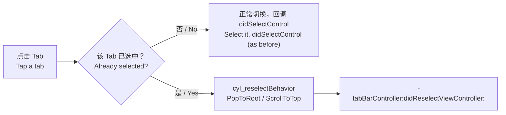

# 重复点击已选中的 Tab / Tapping the Selected Tab Again

<!-- bound-classes: CYLTabBarController -->
<!-- binding:start -->
<!-- Generated by scripts/update-docs-navigation.py; do not edit by hand. -->

| 中文 | English |
|:---|:---|
| 绑定的代码类 `CYLTabBarController`：[`CYLTabBarController/CYLTabBarController.h`](../CYLTabBarController/CYLTabBarController.h) | Bound to the class `CYLTabBarController`: [`CYLTabBarController/CYLTabBarController.h`](../CYLTabBarController/CYLTabBarController.h) |

<!-- binding:end -->

| 中文 | English |
|:---|:---|
| 用户点击已经选中的 Tab（"重复点击"）时，常见的需求是返回根页面、滚动到顶部或刷新页面。以前本库会在 `-tabBarController:shouldSelectViewController:` 中拒绝重复点击，UIKit 自带的返回根页面不会执行，`tabBarController:didSelectControl:` 也无法区分重复点击与切换。现在提供 `cyl_reselectBehavior`（一行代码返回根页面 / 滚动到顶部）以及代理方法 `-tabBarController:didReselectViewController:`。经典样式、液态玻璃与扁平样式都支持。 | When the user taps the tab that is already selected (a "reselect"), apps usually pop to the root page, scroll to the top or refresh. The library used to refuse a reselect in `-tabBarController:shouldSelectViewController:`, so UIKit's own pop-to-root never ran, and `tabBarController:didSelectControl:` could not tell a reselect from a selection. Now there is `cyl_reselectBehavior` (pop to root / scroll to top in one line) and the delegate method `-tabBarController:didReselectViewController:`. Works in the classic style, Liquid Glass and FlatDesign. |



## 目录 / Contents

<!-- navigation:start -->
<!-- Generated by scripts/update-docs-navigation.py; do not edit by hand. -->

| 中文 | English |
|:---|:---|
| [用法](#用法--usage) | [Usage](#用法--usage) |
| [API](#api) | [API](#api) |
| [限制](#限制--limits) | [Limits](#限制--limits) |
| [截图](#截图--screenshots) | [Screenshots](#截图--screenshots) |

<!-- navigation:end -->

## 用法 / Usage

```objc
// 1. 一行代码：先返回根页面，已在根页面时滚动到顶部（与系统 App 一致）。
//    One line: pop to the root page, then scroll to the top once at the root (as the system apps do).
tabBarController.cyl_reselectBehavior = CYLTabBarReselectBehaviorPopToRootThenScrollToTop;

// 2. 可选：在代理中处理（例如下拉刷新）。在 cyl_reselectBehavior 之后调用。
//    Optional: handle it in the delegate (e.g. refresh). Called after cyl_reselectBehavior ran.
- (void)tabBarController:(CYLTabBarController *)tabBarController didReselectViewController:(UIViewController *)viewController {
    [self refreshPageOfViewController:viewController];
}
```

```swift
tabBarController.cyl_reselectBehavior = .popToRootThenScrollToTop

func tabBarController(_ tabBarController: CYLTabBarController, didReselect viewController: UIViewController) {
    refreshPage(of: viewController)
}
```

| 中文 | English |
|:---|:---|
| Swift 中代理方法的名称由编译器生成，以 Xcode 自动补全为准（通常为 `tabBarController(_:didReselect:)`）。 | In Swift the delegate method's name is generated by the compiler; use what Xcode completes (usually `tabBarController(_:didReselect:)`). |

## API

| API | 中文 | English |
|:---|:---|:---|
| `cyl_reselectBehavior` | 重复点击时的操作，默认 `None`（与以前一致）。 | What a reselect does; default `None` (as before). |
| `CYLTabBarReselectBehaviorPopToRoot` | 导航控制器 push 了页面时返回根页面（带动画）。 | Pops a navigation controller with pushed pages to its root (animated). |
| `CYLTabBarReselectBehaviorScrollToTop` | 当前页面的滚动视图滚动到顶部（页面底部的 content scroll view，没有时取视图层级中第一个滚动视图），考虑 `adjustedContentInset`。 | Scrolls the visible page's scroll view to the top (its bottom content scroll view, otherwise the first scroll view in its hierarchy), above `adjustedContentInset`. |
| `CYLTabBarReselectBehaviorPopToRootThenScrollToTop` | 二者兼有：先返回根页面，已在根页面时滚动到顶部。 | Both: pops first, scrolls to the top once at the root. |
| `-tabBarController:didReselectViewController:` | 每次重复点击回调一次；代码切换与 PlusButton 不回调。 | Called once per reselect; never for changes in code or for the plus button. |

| 中文 | English |
|:---|:---|
| `tabBarController:didSelectControl:` 的行为不变：重复点击时仍会回调。需要区分时，使用新的代理方法。 | `tabBarController:didSelectControl:` is unchanged: it is still called on a reselect. Use the new method to tell them apart. |
| 实现：经典 TabBar 在 UIKit 修改选中状态之后才执行 Tab 按钮的点击事件，所以本库保存"上一个 runloop 结束时的选中控制器"，点击时与它比较；液态玻璃在手势代理中、仅对已选中的 Tab 回调（手指按下时）；扁平样式在 `-[CYLFlatDesignTabBar _tabBarDidSelectButton:]` 中、选中状态变化之前判断。同一 runloop 内只上报一次。 | Implementation: the classic tab bar runs the tab button's action after UIKit changed the selection, so the library keeps "the selected view controller as of the previous run loop turn" and compares with it; Liquid Glass reports from the gesture delegate, only for the selected tab (when the touch begins); FlatDesign checks in `-[CYLFlatDesignTabBar _tabBarDidSelectButton:]`, before the selection changes. Reported once per run loop turn. |

## 限制 / Limits

| 中文 | English |
|:---|:---|
| 液态玻璃在手指按下时回调，因此在已选中的 Tab 上按下后拖到别处也会被视为一次重复点击。 | Liquid Glass reports when the touch begins, so pressing the selected tab and dragging away also counts as a reselect. |
| "更多"（More）Tab 中的页面不参与判断。 | Pages inside the "More" tab are not covered. |

## 截图 / Screenshots

| 中文 | English |
|:---|:---|
| 本次开发环境没有 iOS 模拟器或真机，无法运行 Demo，因此暂无测试截图；上方为流程示意图。在设备上验证后，请将截图放入 `docs/assets/` 并在此引用，例如 ``。 | This change was developed without an iOS simulator or device, so there are no test screenshots yet; the figure above is a flow diagram. After testing on a device, put screenshots in `docs/assets/` and reference them here, e.g. ``. |
