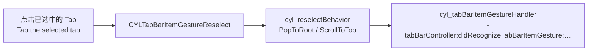

# 重复点击已选中 Tab 的内置操作 / Built-in Actions for Tapping the Selected Tab

<!-- bound-classes: CYLTabBarController -->
<!-- binding:start -->
<!-- Generated by scripts/update-docs-navigation.py; do not edit by hand. -->

| 中文 | English |
|:---|:---|
| 绑定的代码类 `CYLTabBarController`：[`CYLTabBarController/CYLTabBarController.h`](../CYLTabBarController/CYLTabBarController.h) | Bound to the class `CYLTabBarController`: [`CYLTabBarController/CYLTabBarController.h`](../CYLTabBarController/CYLTabBarController.h) |

<!-- binding:end -->

| 中文 | English |
|:---|:---|
| 用户点击已经选中的 Tab（"重复点击"）时，最常见的需求是返回根页面或滚动到顶部。本库在 `-tabBarController:shouldSelectViewController:` 中拒绝重复点击，所以 UIKit 自带的返回根页面不会执行。重复点击已经可以通过 `CYLTabBarItemGestureReselect` 识别（见 [TabBarItem-Gestures.md](TabBarItem-Gestures.md)），但返回根页面、滚动到顶部需要自己写。`cyl_reselectBehavior` 用一行代码提供这两种操作，经典样式、液态玻璃与扁平样式都支持。 | When the user taps the tab that is already selected (a "reselect"), apps usually pop to the root page or scroll to the top. The library refuses a reselect in `-tabBarController:shouldSelectViewController:`, so UIKit's own pop-to-root never runs. A reselect is already recognized as `CYLTabBarItemGestureReselect` (see [TabBarItem-Gestures.md](TabBarItem-Gestures.md)), but popping and scrolling had to be written by hand. `cyl_reselectBehavior` provides both in one line, in the classic style, Liquid Glass and FlatDesign. |



## 目录 / Contents

<!-- navigation:start -->
<!-- Generated by scripts/update-docs-navigation.py; do not edit by hand. -->

| 中文 | English |
|:---|:---|
| [用法](#用法--usage) | [Usage](#用法--usage) |
| [API](#api) | [API](#api) |
| [限制](#限制--limits) | [Limits](#限制--limits) |
| [截图](#截图--screenshots) | [Screenshots](#截图--screenshots) |

<!-- navigation:end -->

## 用法 / Usage

```objc
// 先返回根页面，已在根页面时滚动到顶部（与系统 App 一致）。
// Pop to the root page, then scroll to the top once at the root (as the system apps do).
tabBarController.cyl_reselectBehavior = CYLTabBarReselectBehaviorPopToRootThenScrollToTop;

// 可选：同时处理手势回调（例如刷新页面），在内置操作之后调用。
// Optional: the gesture callback too (e.g. refresh), called after the built-in action.
tabBarController.cyl_tabBarItemGestureHandler = ^(CYLTabBarController *tabBarController, CYLTabBarItemGesture gesture,
                                                  UIControl *control, UIViewController *viewController) {
    if (gesture == CYLTabBarItemGestureDoubleTap) {
        [self refreshPageOfViewController:viewController];
    }
};
```

```swift
tabBarController.cyl_reselectBehavior = .popToRootThenScrollToTop
```

## API

| API | 中文 | English |
|:---|:---|:---|
| `cyl_reselectBehavior` | 重复点击时的操作，默认 `None`（与以前一致）。任何时候都可以设置。 | What a reselect does; default `None` (as before). Can be set at any time. |
| `CYLTabBarReselectBehaviorPopToRoot` | 导航控制器 push 了页面时返回根页面（带动画）。 | Pops a navigation controller with pushed pages to its root (animated). |
| `CYLTabBarReselectBehaviorScrollToTop` | 当前页面的滚动视图滚动到顶部（页面底部的 content scroll view，没有时取视图层级中第一个滚动视图），考虑 `adjustedContentInset`。 | Scrolls the visible page's scroll view to the top (its bottom content scroll view, otherwise the first scroll view in its hierarchy), above `adjustedContentInset`. |
| `CYLTabBarReselectBehaviorPopToRootThenScrollToTop` | 二者兼有：先返回根页面，已在根页面时滚动到顶部。 | Both: pops first, scrolls to the top once at the root. |

| 中文 | English |
|:---|:---|
| 由 `CYLTabBarItemGestureReselect` 驱动：在 `cyl_tabBarItemGestureHandler` 与 `-tabBarController:didRecognizeTabBarItemGesture:control:viewController:` 之前执行。只设置 `cyl_reselectBehavior` 时，本库同样会开始识别 TabBarItem 手势。PlusButton 有子控制器时同样适用。 | Driven by `CYLTabBarItemGestureReselect`: runs before `cyl_tabBarItemGestureHandler` and `-tabBarController:didRecognizeTabBarItemGesture:control:viewController:`. Setting only `cyl_reselectBehavior` also starts the tab bar item gesture recognition. Works for a plus button with a child view controller too. |
| 与 `UITabBarController` 的区别：系统在重复点击时也会回调 `-tabBarController:didSelectViewController:`；本库拒绝重复点击（这样 PlusButton 与 Lottie 的选中状态不会被打乱），因此重复点击时不会回调它（与以前一致）。请改用 `CYLTabBarItemGestureReselect`。 | A difference from `UITabBarController`: UIKit also calls `-tabBarController:didSelectViewController:` on a reselect; this library refuses a reselect (so the plus button and Lottie selection states stay right), so it is not called then (as before). Use `CYLTabBarItemGestureReselect` instead. |

## 限制 / Limits

| 中文 | English |
|:---|:---|
| 代理是 TabBarController 以外的对象、且对已选中的 Tab 在 `-tabBarController:shouldSelectViewController:` 中返回 YES 时，UIKit 会自己先返回根页面，`PopToRootThenScrollToTop` 可能在同一次点击中再滚动到顶部。这类代理请对已选中的 Tab 返回 NO（与本库默认行为一致）。 | With a delegate that is another object and returns YES for the selected tab in `-tabBarController:shouldSelectViewController:`, UIKit pops to the root itself first, and `PopToRootThenScrollToTop` may then also scroll to the top on the same tap. Such a delegate should return NO for the selected tab (as the library does by default). |
| "更多"（More）Tab 中的页面不参与。 | Pages inside the "More" tab are not covered. |

## 截图 / Screenshots

| 中文 | English |
|:---|:---|
| 本次开发环境没有 iOS 模拟器或真机，无法运行 Demo，因此暂无测试截图；上方为流程示意图。在设备上验证后，请将截图放入 `docs/assets/` 并在此引用，例如 ``。 | This change was developed without an iOS simulator or device, so there are no test screenshots yet; the figure above is a flow diagram. After testing on a device, put screenshots in `docs/assets/` and reference them here, e.g. ``. |
