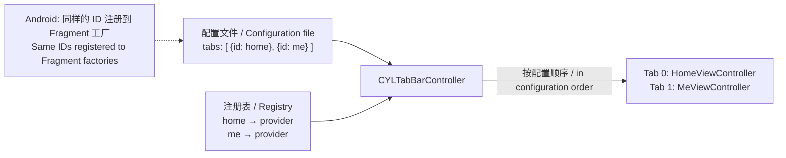

# [CN]调研：配置文件中的 Tab 如何对应到页面对象（跨端标识、注册表与顺序）
# [EN]Research: how a tab in a configuration file finds its page object (cross-platform IDs, registries and order)

<!-- bound-classes: CYLTabBarController -->
<!-- binding:start -->
<!-- Generated by scripts/update-docs-navigation.py; do not edit by hand. -->

| 中文 | English |
|:---|:---|
| 绑定的代码类 `CYLTabBarController`：[`CYLTabBarController/CYLTabBarController.h`](../CYLTabBarController/CYLTabBarController.h) | Bound to the class `CYLTabBarController`: [`CYLTabBarController/CYLTabBarController.h`](../CYLTabBarController/CYLTabBarController.h) |

<!-- binding:end -->

| 中文 | English |
|:---|:---|
| 本文是调研报告，供决定 `CYLTabBarControllerViewControllers`（包含对象的数组）与 `CYLTabBarItemViewControllerClass` 如何重新设计。**尚未实现任何新接口**；文末列出需要你决定的问题。 | This is a research report to decide how `CYLTabBarControllerViewControllers` (the array of objects) and `CYLTabBarItemViewControllerClass` are redesigned. **No new API is implemented yet**; the questions you need to decide are listed at the end. |
| 这两个键都是 [一个配置文件生成 TabBarController](Configuration-File.md)（PR #754）新增的，还没有合并到 master，也没有发布，所以现在仍可以改名或删除，不违反“不修改公开 API”的规则。 | Both keys were added by [One configuration file, one TabBarController](Configuration-File.md) (PR #754), which is not merged into master or released yet, so they can still be renamed or removed without breaking the "never change public API" rule. |

## 目录 / Contents

<!-- navigation:start -->
<!-- Generated by scripts/update-docs-navigation.py; do not edit by hand. -->

| 中文 | English |
|:---|:---|
| [结论先看](#结论先看--summary-first) | [Summary first](#结论先看--summary-first) |
| [一、类名方案的问题](#一类名方案的问题--1-what-is-wrong-with-class-names) | [1. What is wrong with class names](#一类名方案的问题--1-what-is-wrong-with-class-names) |
| [二、各跨端方案怎么做](#二各跨端方案怎么做--2-how-cross-platform-frameworks-do-it) | [2. How cross-platform frameworks do it](#二各跨端方案怎么做--2-how-cross-platform-frameworks-do-it) |
| [三、可选方案](#三可选方案--3-options) | [3. Options](#三可选方案--3-options) |
| &nbsp;&nbsp;&nbsp;&nbsp;↳ [方案 A：保留类名](#方案-a保留类名--option-a-keep-class-names) | &nbsp;&nbsp;&nbsp;&nbsp;↳ [Option A: keep class names](#方案-a保留类名--option-a-keep-class-names) |
| &nbsp;&nbsp;&nbsp;&nbsp;↳ [方案 B：注册对象（map：ID → 已创建的对象）/ Option B: register objects (map: ID → created object)](#方案-b注册对象mapid--已创建的对象-option-b-register-objects-map-id--created-object) | &nbsp;&nbsp;&nbsp;&nbsp;↳ [方案 B：注册对象（map：ID → 已创建的对象）/ Option B: register objects (map: ID → created object)](#方案-b注册对象mapid--已创建的对象-option-b-register-objects-map-id--created-object) |
| &nbsp;&nbsp;&nbsp;&nbsp;↳ [方案 C（推荐）：注册工厂（map：ID → 页面提供者）/ Option C (recommended): register factories (map: ID → page provider)](#方案-c推荐注册工厂mapid--页面提供者-option-c-recommended-register-factories-map-id--page-provider) | &nbsp;&nbsp;&nbsp;&nbsp;↳ [方案 C（推荐）：注册工厂（map：ID → 页面提供者）/ Option C (recommended): register factories (map: ID → page provider)](#方案-c推荐注册工厂mapid--页面提供者-option-c-recommended-register-factories-map-id--page-provider) |
| &nbsp;&nbsp;&nbsp;&nbsp;↳ [方案 D：一个解析回调（代理 / block），不建注册表 / Option D: one resolver callback (delegate / block), no registry](#方案-d一个解析回调代理--block不建注册表--option-d-one-resolver-callback-delegate--block-no-registry) | &nbsp;&nbsp;&nbsp;&nbsp;↳ [方案 D：一个解析回调（代理 / block），不建注册表 / Option D: one resolver callback (delegate / block), no registry](#方案-d一个解析回调代理--block不建注册表--option-d-one-resolver-callback-delegate--block-no-registry) |
| &nbsp;&nbsp;&nbsp;&nbsp;↳ [方案 E：路由 URL](#方案-e路由-url--option-e-route-urls) | &nbsp;&nbsp;&nbsp;&nbsp;↳ [Option E: route URLs](#方案-e路由-url--option-e-route-urls) |
| &nbsp;&nbsp;&nbsp;&nbsp;↳ [方案 F：代码中传入对象字典（ID → 对象），配置负责顺序](#方案-f代码中传入对象字典id--对象配置负责顺序--option-f-pass-a-dictionary-of-objects-id--object-in-code-the-configuration-gives-the-order) | &nbsp;&nbsp;&nbsp;&nbsp;↳ [Option F: pass a dictionary of objects (ID → object) in code, the configuration gives the order](#方案-f代码中传入对象字典id--对象配置负责顺序--option-f-pass-a-dictionary-of-objects-id--object-in-code-the-configuration-gives-the-order) |
| [四、方案对比](#四方案对比--4-comparison) | [4. Comparison](#四方案对比--4-comparison) |
| [五、顺序与匹配规则（建议）/ 5. Order and matching rules (proposed)](#五顺序与匹配规则建议-5-order-and-matching-rules-proposed) | [五、顺序与匹配规则（建议）/ 5. Order and matching rules (proposed)](#五顺序与匹配规则建议-5-order-and-matching-rules-proposed) |
| [六、对现有键的影响](#六对现有键的影响--6-effect-on-the-current-keys) | [6. Effect on the current keys](#六对现有键的影响--6-effect-on-the-current-keys) |
| [七、需要你决定的问题](#七需要你决定的问题--7-questions-for-you-to-decide) | [7. Questions for you to decide](#七需要你决定的问题--7-questions-for-you-to-decide) |

<!-- navigation:end -->

## 结论先看 / Summary first

| 中文 | English |
|:---|:---|
| **推荐**：配置文件里每个 Tab 只写一个跨端通用的字符串 **ID**（例如 `"home"`），不写类名；iOS 与 Android 各自在代码里把 ID **注册**到一个“页面提供者”（工厂 block / 函数），由库按 ID 取出并在需要时创建页面对象。Tab 的**顺序只由配置文件中的 Tab 数组决定**，注册表是无序的 map。 | **Recommended**: each tab in the configuration file has one cross-platform string **ID** (e.g. `"home"`), not a class name; iOS and Android each **register** the ID in code to a "page provider" (a factory block / function), and the library looks it up by ID and creates the page object when it is needed. The **order comes only from the tab array of the configuration file**; the registry is an unordered map. |
| 这正是 React Native（`AppRegistry.registerComponent`）、Flutter（`routes` / go_router）、Android Jetpack Navigation（菜单项 ID 对应目的地 ID）与 iOS 18 的 `UITab(identifier:viewControllerProvider:)` 共同采用的模式：**字符串 ID + 工厂**，而不是类名，也不是预先创建好的对象。 | This is the pattern shared by React Native (`AppRegistry.registerComponent`), Flutter (`routes` / go_router), Android Jetpack Navigation (menu item IDs match destination IDs) and iOS 18's `UITab(identifier:viewControllerProvider:)`: **a string ID + a factory**, not a class name and not objects created in advance. |



## 一、类名方案的问题 / 1. What is wrong with class names

| 中文 | English |
|:---|:---|
| **跨端不可用**：iOS 的 `HomeViewController` 在 Android 上是 `HomeFragment` 或 `com.app.home.HomeActivity`，同一个配置文件无法同时描述两端。 | **Not cross-platform**: iOS's `HomeViewController` is `HomeFragment` or `com.app.home.HomeActivity` on Android, so one configuration file cannot describe both. |
| **同一平台也不稳定**：Swift 类名带模块前缀（`MyApp.HomeViewController`），改 target 名就会变；Android 发布包经过 R8 / ProGuard 混淆后类名会被改掉。 | **Not stable even on one platform**: Swift class names carry a module prefix (`MyApp.HomeViewController`) that changes with the target name; Android release builds are obfuscated by R8 / ProGuard, which renames classes. |
| **一个类可能有多个对象**：两个 Tab 都使用 `WebViewController`（打开不同网址）时，类名无法区分它们，也无法传入不同的参数。 | **One class can have several objects**: when two tabs both use `WebViewController` (with different URLs), the class name cannot tell them apart or pass them different parameters. |
| **拿不到“初始化好的”对象**：库只能调用 `-init`，而真实页面往往需要依赖注入（view model、服务、路由参数）或指定初始化方法（`-initWithUserID:`）。 | **No way to get an "initialized" object**: the library can only call `-init`, while real pages usually need dependency injection (view models, services, route parameters) or a designated initializer (`-initWithUserID:`). |
| **安全**：远程配置里的类名会让库实例化 App 中任意一个类；当前实现虽然限制为 `UIViewController` 子类并拒绝容器类，但这是黑名单思路。注册表是白名单：只有 App 注册过的 ID 才能创建页面。 | **Security**: a class name in a remote configuration makes the library instantiate any class of the app; the current code limits it to `UIViewController` subclasses and refuses container classes, but that is a deny list. A registry is an allow list: only IDs the app registered can create pages. |

## 二、各跨端方案怎么做 / 2. How cross-platform frameworks do it

| 方案 Framework | 标识 Identifier | 如何得到页面对象 How the page object is obtained | 顺序 Order | 一个类多个实例 Several instances of one class |
|:---|:---|:---|:---|:---|
| React Native `AppRegistry` | 字符串 appKey / A string appKey | `registerComponent('Home', () => HomeScreen)`：注册**工厂**，原生端用 `RCTRootView(moduleName: "Home")` 按名字创建 / registers a **factory**; the native side creates it by name with `RCTRootView(moduleName: "Home")` | 无（单个入口）/ None (one entry) | 同一组件可用不同 `initialProperties` 创建多次 / The same component can be created several times with different `initialProperties` |
| React Navigation（底部 Tab）/ React Navigation (bottom tabs) | `<Tab.Screen name="Home">`，name 在导航器内唯一 / `name` unique within the navigator | `component` 或 `getComponent`（懒加载）；默认 `lazy: true`，第一次选中时才创建 / `component` or `getComponent` (lazy); `lazy: true` by default, created on first selection | **声明顺序**；`initialRouteName` 指定初始 Tab / **Declaration order**; `initialRouteName` picks the first tab | 两个 Screen 用同一组件，不同 `name` 与 `initialParams` / Two screens use the same component with different `name` and `initialParams` |
| Flutter `MaterialApp.routes` / `onGenerateRoute` | 路由名 `'/home'` / Route name `'/home'` | `Map<String, WidgetBuilder>`：名字 → **构建函数**；`onGenerateRoute` 处理带参数或未知的名字 / name → **builder function**; `onGenerateRoute` handles parameters and unknown names | 由导航调用决定 / Decided by navigation calls | 构建函数每次调用都创建新对象，参数通过 `settings.arguments` 传入 / The builder creates a new object on each call; parameters come through `settings.arguments` |
| Flutter go_router `StatefulShellRoute.indexedStack`（底部导航）/ (bottom navigation) | 每个分支的 `path` 与可选 `name` / Each branch's `path` and optional `name` | 每个分支一个 `builder`；`indexedStack` 保留每个 Tab 的状态 / One `builder` per branch; `indexedStack` keeps each tab's state | **branches 数组顺序**就是 Tab 顺序 / **The branches array order** is the tab order | 不同 path 指向同一 Widget 类 / Different paths point to the same widget class |
| Flutter `Key`（`ValueKey('home')`）| 稳定的值 / A stable value | 重建时按 key 而不是按位置复用状态 / Reuses state by key, not by position, when rebuilding | 位置可变，身份不变 / Positions may change, identity does not | — |
| React 列表的 `key` / React list `key` | 稳定的 ID，不用数组下标 / A stable ID, not the array index | 重新排序时按 key 对应到原有组件 / Matches existing components by key when reordered | 同上 / Same | — |
| Android Jetpack Navigation + `BottomNavigationView` | 资源 ID：菜单项 `@id/home` 与导航图目的地 `@id/home` **必须相同** / Resource IDs: the menu item `@id/home` and the destination `@id/home` **must match** | 导航图声明 Fragment 类，`NavController` 创建；`setupWithNavController` 按 ID 关联 / The graph names the Fragment class, `NavController` creates it; `setupWithNavController` links them by ID | **菜单 XML 的顺序** / **The order of the menu XML** | 两个目的地可用同一 Fragment 类与不同参数 / Two destinations can use the same Fragment class with different arguments |
| Android ARouter（阿里）/ ARouter (Alibaba) | 路径字符串 `@Route(path = "/app/home")` / A path string | 注解生成路由表：路径 → 类；`ARouter.getInstance().build(path).navigation()` 返回 Fragment 实例 / Annotations generate a path → class table; `navigation()` returns a Fragment instance | 无 / None | 带参数 `withString(...)` / With parameters `withString(...)` |
| iOS 18 `UITab` | `UITab(title:image:identifier:viewControllerProvider:)` 的 `identifier` 字符串 / The `identifier` string | **`viewControllerProvider` 闭包**：需要时才创建页面；`tab(forIdentifier:)` 按 ID 查找 / **A `viewControllerProvider` closure** creates the page when needed; `tab(forIdentifier:)` finds a tab by ID | `tabs` 数组顺序；用户自定义顺序可按 identifier 保存 / The `tabs` array order; a user-customized order can be saved by identifier | 不同 identifier，同一类 / Different identifiers, the same class |
| iOS Storyboard | Storyboard ID / A Storyboard ID | `instantiateViewController(withIdentifier:)` 按 ID 创建 / creates it by ID | 无 / None | 每次调用新建 / A new one on each call |
| iOS 路由（JLRoutes、MGJRouter、CTMediator）/ iOS routers | URL `app://home` 或 target-action 名 / A URL or a target-action name | 注册 URL → block，block 返回或打开页面 / Registers URL → block; the block returns or opens the page | 无 / None | URL 参数 / URL parameters |
| 服务端驱动 UI（Yandex DivKit 等）/ Server-driven UI (Yandex DivKit, ...) | 组件 `type` 与 `id` / Component `type` and `id` | 客户端注册 `type` → 渲染器；未知 type 按约定回退 / The client registers `type` → renderer; unknown types fall back by convention | JSON 数组顺序 / JSON array order | 同一 type 多个实例，`id` 区分 / Several instances of one type, told apart by `id` |

| 中文 | English |
|:---|:---|
| **共同点**：(1) 配置或声明里只有**字符串标识**；(2) 每端在代码中把标识**注册到工厂**（不是类名，也极少是现成对象）；(3) **顺序来自声明的数组**，注册表本身无序；(4) 同一个类通过不同标识 + 不同参数创建多个实例；(5) 页面**懒创建**；(6) 用稳定的 key / ID（而不是数组下标）在刷新时保留状态。 | **What they share**: (1) only a **string identifier** in the configuration or declaration; (2) each platform **registers the identifier to a factory** in code (not a class name, and rarely a ready-made object); (3) **the order comes from the declared array**, the registry itself is unordered; (4) one class gives several instances through different identifiers and parameters; (5) pages are **created lazily**; (6) a stable key / ID (not an array index) keeps state across refreshes. |

## 三、可选方案 / 3. Options

### 方案 A：保留类名 / Option A: keep class names

| 中文 | English |
|:---|:---|
| 现状。只适用于单端、页面只需 `-init` 的场景。问题见第一节。若保留，建议只作为 iOS 的调试 / 兜底手段，不写进跨端配置。 | The current design. Only fits one platform with pages that need nothing but `-init`. Problems: see section 1. If kept, use it only as an iOS debugging / fallback tool, not in cross-platform configurations. |

### 方案 B：注册对象（map：ID → 已创建的对象）/ Option B: register objects (map: ID → created object)

```objc
[CYLTabBarController cyl_registerViewController:homeViewController forTabIdentifier:@"home"];
```

| 中文 | English |
|:---|:---|
| 优点：App 完全控制初始化（依赖注入、指定初始化方法）；简单。 | Pros: the app controls initialization completely (dependency injection, designated initializers); simple. |
| 缺点：所有页面**提前创建**，即使远程配置没有这个 Tab；注册表强引用会导致页面不释放（弱引用又要求别处持有）；同一对象被两个 Tab 使用会被 UIKit 移动（一个页面只能有一个父控制器）；刷新配置时无法“再创建一个”。 | Cons: every page is **created in advance**, even when the remote configuration has no such tab; a strong registry keeps pages alive (a weak one needs someone else to keep them); one object used by two tabs is moved by UIKit (a view controller has only one parent); a configuration refresh cannot "create another one". |

### 方案 C（推荐）：注册工厂（map：ID → 页面提供者）/ Option C (recommended): register factories (map: ID → page provider)

```objc
// iOS：启动时注册一次（如 AppDelegate）/ register once at launch (e.g. in the AppDelegate)
[CYLTabBarController cyl_registerViewControllerProvider:^UIViewController *(NSString *identifier, NSDictionary *tab) {
    return [[HomeViewController alloc] initWithViewModel:[HomeViewModel new]];
} forTabIdentifier:@"home"];

[CYLTabBarController cyl_registerViewControllerProvider:^UIViewController *(NSString *identifier, NSDictionary *tab) {
    // 同一个类，两个 Tab，参数来自配置 / one class, two tabs, parameters from the configuration
    return [[WebViewController alloc] initWithURL:[NSURL URLWithString:tab[@"CYLTabBarItemPageParameters"][@"url"]]];
} forTabIdentifiers:@[ @"news", @"help" ]];
```

```kotlin
// Android：同样的 ID / the same IDs
TabRegistry.register("home") { HomeFragment.newInstance() }
TabRegistry.register("news", "help") { tab -> WebFragment.newInstance(tab.params["url"]) }
```

```json
{
  "CYLTabBarControllerTabBarItemsAttributes": [
    { "CYLTabBarItemIdentifier": "home", "CYLTabBarItemTitle": "Home", "CYLTabBarItemImage": "system:house" },
    { "CYLTabBarItemIdentifier": "news", "CYLTabBarItemTitle": "News",
      "CYLTabBarItemPageParameters": { "url": "https://example.com/news" } },
    { "CYLTabBarItemIdentifier": "help", "CYLTabBarItemTitle": "Help",
      "CYLTabBarItemPageParameters": { "url": "https://example.com/help" } }
  ]
}
```

| 中文 | English |
|:---|:---|
| 优点：跨端（两端只共享 ID）；懒创建；一个类多个实例（不同 ID + 参数）；App 控制初始化；白名单更安全；与 React Native、Flutter、`UITab` 的模型一致，团队容易理解。 | Pros: cross-platform (the platforms share only IDs); lazy; several instances of one class (different IDs + parameters); the app controls initialization; an allow list is safer; the same model as React Native, Flutter and `UITab`, which teams already know. |
| 缺点：需要一个全局（或每个控制器）的注册表；注册必须早于创建 TabBarController；需要定义“ID 没注册时怎么办”。 | Cons: needs a global (or per-controller) registry; registration must happen before the tab bar controller is created; "what if an ID is not registered" must be defined. |

### 方案 D：一个解析回调（代理 / block），不建注册表 / Option D: one resolver callback (delegate / block), no registry

```objc
CYLTabBarController *tabBarController = [CYLTabBarController tabBarControllerWithConfiguration:configuration
    viewControllerResolver:^UIViewController *(NSString *identifier, NSDictionary *tab) {
        if ([identifier isEqualToString:@"home"]) { return [HomeViewController new]; }
        return [MyRouter viewControllerForURL:tab[@"CYLTabBarItemRoute"]];   // 接入现有路由 / reuse an existing router
    }];
```

| 中文 | English |
|:---|:---|
| 优点：没有全局状态；可以直接接入 App 已有的路由（JLRoutes、CTMediator、ARouter 的 iOS 对应方案）；也可以实现为 `CYLTabBarControllerDelegate` 的可选方法（仓库规则更倾向实现已有协议的方法）。缺点：一个大 switch；创建时必须提供；每次都要写。实际上 C 与 D 可以并存：注册表是 D 的一种默认实现。 | Pros: no global state; plugs straight into the app's router (JLRoutes, CTMediator, the iOS side of ARouter-style routing); can also be an optional `CYLTabBarControllerDelegate` method (the repository prefers implementing existing protocol methods). Cons: one big switch; must be passed at creation; written every time. C and D can coexist: the registry is one default implementation of D. |

### 方案 E：路由 URL / Option E: route URLs

| 中文 | English |
|:---|:---|
| 每个 Tab 写 `"CYLTabBarItemRoute": "myapp://tab/home?from=config"`，两端各自用路由表解析。适合已有完整路由体系的 App；本质上是 C / D 的一种标识格式（URL 代替纯 ID），可作为可选键与 ID 并存。 | Each tab has `"CYLTabBarItemRoute": "myapp://tab/home?from=config"`, resolved by each platform's router. Fits apps that already have a full routing system; in essence an identifier format for C / D (a URL instead of a plain ID), and can live next to the ID as an optional key. |

### 方案 F：代码中传入对象字典（ID → 对象），配置负责顺序 / Option F: pass a dictionary of objects (ID → object) in code, the configuration gives the order

```objc
[CYLTabBarController tabBarControllerWithConfiguration:@{
    CYLTabBarControllerViewControllers : @{ @"home" : homeViewController, @"me" : meViewController },
    CYLTabBarControllerTabBarItemsAttributes : itemsFromRemoteConfiguration,
}];
```

| 中文 | English |
|:---|:---|
| 把现在的“对象数组”改为（或额外接受）“ID → 对象”的字典，彻底解决与配置数组的顺序对应问题：顺序只看配置，对象按 ID 匹配。适合页面在代码中已经创建好的老项目；缺点与方案 B 相同（提前创建）。可以作为 C 的补充：本次创建优先用字典里的对象。 | Changing (or also accepting) the "array of objects" as an "ID → object" dictionary removes the order-matching problem: the order comes only from the configuration, objects are matched by ID. Fits existing projects whose pages are already created in code; same cons as option B (created in advance). Can complement C: objects in the dictionary are used first for this creation. |

## 四、方案对比 / 4. Comparison

| 维度 Criterion | A 类名 Class | B 注册对象 Objects | C 注册工厂 Factories | D 解析回调 Resolver | E 路由 Route | F 对象字典 Dictionary |
|:---|:---|:---|:---|:---|:---|:---|
| 跨端 Cross-platform | ❌ | ✅ ID | ✅ ID | ✅ ID | ✅ URL | ✅ ID |
| 一个类多个实例 Several instances | ❌ | ⚠️ 需各自创建 / created one by one | ✅ | ✅ | ✅ | ⚠️ 同 B / as B |
| App 控制初始化 App controls init | ❌ 只能 -init / -init only | ✅ | ✅ | ✅ | ✅ | ✅ |
| 懒创建 Lazy | ✅ | ❌ | ✅ | ✅ | ✅ | ❌ |
| 远程新增未知 Tab Unknown tab from remote | 类不存在 / class missing | ID 未注册 / not registered | ID 未注册 / not registered | 返回 nil / returns nil | 路由失败 / route fails | ID 缺失 / missing |
| 安全（白名单）Safety (allow list) | ❌ | ✅ | ✅ | ✅ | ✅ | ✅ |
| 全局状态 Global state | 无 / none | 有 / yes | 有 / yes | 无 / none | 路由自身 / the router's | 无 / none |
| 与主流方案一致 Matches mainstream | — | 少见 / rare | RN、Flutter、UITab | Flutter `onGenerateRoute` | ARouter、JLRoutes | — |

## 五、顺序与匹配规则（建议）/ 5. Order and matching rules (proposed)

| 中文 | English |
|:---|:---|
| **顺序只有一个来源**：配置文件的 `CYLTabBarControllerTabBarItemsAttributes` 数组。注册表与对象字典都按 ID 查找，与它们自身的顺序无关。不建议再加 `order` / `index` 字段（两个来源会冲突）。 | **One source of order**: the `CYLTabBarControllerTabBarItemsAttributes` array of the configuration. The registry and the object dictionary are looked up by ID, whatever their own order. An extra `order` / `index` field is not recommended (two sources conflict). |
| **ID 必须唯一**：沿用已有的 `CYLTabBarItemIdentifier`。目前重复的 ID 会被改名为 `id_2`（边界情况 B12）；用于匹配页面后，重复应改为“保留第一个、忽略后面的并警告”，因为改名后的 ID 匹配不到任何注册。 | **IDs must be unique**: reuse the existing `CYLTabBarItemIdentifier`. Duplicates are currently renamed `id_2` (edge case B12); once IDs find pages, a duplicate should instead be "keep the first, drop the rest, with a warning", because a renamed ID matches no registration. |
| **查找顺序**（每个 Tab）：① 本次创建传入的对象字典（方案 F）→ ② 解析回调（方案 D）→ ③ 注册表（方案 C）→ ④ 路由（方案 E，可选）→ ⑤ 类名（方案 A，仅 iOS，可选兜底）→ ⑥ 都没有：**跳过该 Tab 并警告**（与现在跳过无效 Tab 的规则一致），或使用占位页面（可配置）。 | **Lookup order** (per tab): ① the object dictionary of this creation (option F) → ② the resolver callback (option D) → ③ the registry (option C) → ④ the route (option E, optional) → ⑤ the class name (option A, iOS only, optional fallback) → ⑥ nothing: **skip the tab with a warning** (as invalid tabs are skipped today), or use a placeholder page (configurable). |
| **远程配置的兼容**：服务端可能下发旧版本 App 不认识的 ID。建议可选字段 `CYLTabBarItemPlatforms`（`["ios", "android"]`）与 `CYLTabBarItemMinimumAppVersion`，以及“未知 ID 跳过”的默认行为；如果跳过后少于 1 个 Tab，返回 NoTabs 错误（已有）。 | **Remote compatibility**: the server may send IDs an older app does not know. Proposed optional keys `CYLTabBarItemPlatforms` (`["ios", "android"]`) and `CYLTabBarItemMinimumAppVersion`, with "skip unknown IDs" as the default; if fewer than 1 tab remains, the existing NoTabs error. |
| **刷新时保留状态**：像 React 的 `key` 与 Flutter 的 `ValueKey` 一样，配置更新（例如重新下载后调用 `-updateTabBarItemsWithAttributes:`）时，按 ID 复用已创建的页面，只为新 ID 调用工厂，被删除的 ID 释放页面。顺序变化只移动页面，不重建。 | **Keep state across refreshes**: like React's `key` and Flutter's `ValueKey`, when the configuration is updated (e.g. downloaded again, then `-updateTabBarItemsWithAttributes:`), pages already created are reused by ID, the factory runs only for new IDs, and removed IDs release their pages. A changed order only moves pages, it does not rebuild them. |
| **线程**：注册与创建都在主线程（与现有 `MainThreadRequired` 一致）；注册表读写加锁或限制主线程。 | **Threads**: registration and creation on the main thread (as the existing `MainThreadRequired`); the registry is locked or main-thread only. |

## 六、对现有键的影响 / 6. Effect on the current keys

| 键 Key | 建议 Proposal |
|:---|:---|
| `CYLTabBarItemIdentifier`（已发布 / released） | 作为跨端页面 ID / Becomes the cross-platform page ID |
| `CYLTabBarItemViewControllerClass`（未发布 / unreleased） | 删除，或保留为仅 iOS 的兜底（第 ⑤ 步）/ Remove, or keep as an iOS-only fallback (step ⑤) |
| `CYLTabBarItemNavigationControllerClass`、`CYLTabBarControllerNavigationControllerClass`（未发布 / unreleased） | 同上；或改为 `CYLTabBarItemEmbedsInNavigationController: true`，导航控制器类由 App 注册一次 / Same; or `CYLTabBarItemEmbedsInNavigationController: true`, with the navigation controller class registered once by the app |
| `CYLTabBarControllerViewControllers`（已发布的初始化参数，数组 / a released initializer parameter, an array） | 数组形式保持不变（按下标对应，兼容旧代码）；另外接受“ID → 对象”字典（方案 F）/ The array form stays (matched by index, compatible with old code); also accept an "ID → object" dictionary (option F) |
| 新增（可选）/ New (optional) | `CYLTabBarItemPageParameters`（字典，传给工厂）、`CYLTabBarItemRoute`（URL）、`CYLTabBarItemPlatforms`、`CYLTabBarItemMinimumAppVersion` / (a dictionary passed to the factory), (a URL), ... |

## 七、需要你决定的问题 / 7. Questions for you to decide

| 中文 | English |
|:---|:---|
| 1. 采用哪种组合？建议 **C（注册工厂）+ F（对象字典，兼容老项目）**，D（解析回调 / 代理方法）作为可选扩展，E（路由）以后再说。 | 1. Which combination? Proposed: **C (registered factories) + F (object dictionary, for existing projects)**, D (resolver callback / delegate method) as an optional extension, E (routes) later. |
| 2. 页面 ID 直接用已有的 `CYLTabBarItemIdentifier`，还是新增一个专门的键（例如 `CYLTabBarItemPageIdentifier`），让“Tab 标识”（无障碍、自定义点击）与“页面标识”分开？ | 2. Use the existing `CYLTabBarItemIdentifier` as the page ID, or add a dedicated key (e.g. `CYLTabBarItemPageIdentifier`) so the "tab identity" (accessibility, custom actions) and the "page identity" stay separate? |
| 3. 类名键（`…ViewControllerClass` / `…NavigationControllerClass`）删除，还是保留为仅 iOS 的兜底？ | 3. Remove the class-name keys (`…ViewControllerClass` / `…NavigationControllerClass`), or keep them as an iOS-only fallback? |
| 4. 注册表是全局的（`+[CYLTabBarController cyl_register…]`，类似 `AppRegistry`），还是每个 TabBarController 实例一份，或两者都有？ | 4. Is the registry global (`+[CYLTabBarController cyl_register…]`, like `AppRegistry`), per tab bar controller instance, or both? |
| 5. ID 没有注册时：跳过该 Tab（推荐），还是显示占位页面？ | 5. When an ID is not registered: skip the tab (proposed), or show a placeholder page? |
| 6. 是否需要 `CYLTabBarItemPlatforms` / `CYLTabBarItemMinimumAppVersion` 这类远程配置兼容字段？ | 6. Are remote-compatibility keys such as `CYLTabBarItemPlatforms` / `CYLTabBarItemMinimumAppVersion` wanted? |
| 7. Android 端是否由本仓库提供示例实现（Kotlin 注册表 + 同一份配置文件），还是只在文档中说明约定？ | 7. Should this repository ship a sample Android implementation (a Kotlin registry + the same configuration file), or only document the convention? |

| 中文 | English |
|:---|:---|
| 资料来源（据公开文档整理，未在本仓库运行）：React Native `AppRegistry`、React Navigation Bottom Tabs（`lazy`、`initialRouteName`）、Flutter `MaterialApp.routes` / `onGenerateRoute` 与 go_router `StatefulShellRoute`、Flutter `Key`、React 列表 `key`、Android Navigation `setupWithNavController`、ARouter、R8 / ProGuard 混淆、iOS 18 `UITab` 与 `UITabBarController.tab(forIdentifier:)`、`UIStoryboard.instantiateViewController(withIdentifier:)`、JLRoutes / MGJRouter / CTMediator、Yandex DivKit。 | Sources (summarized from public documentation, nothing run in this repository): React Native `AppRegistry`, React Navigation Bottom Tabs (`lazy`, `initialRouteName`), Flutter `MaterialApp.routes` / `onGenerateRoute` and go_router `StatefulShellRoute`, Flutter `Key`, React list `key`, Android Navigation `setupWithNavController`, ARouter, R8 / ProGuard obfuscation, iOS 18 `UITab` and `UITabBarController.tab(forIdentifier:)`, `UIStoryboard.instantiateViewController(withIdentifier:)`, JLRoutes / MGJRouter / CTMediator, Yandex DivKit. |
