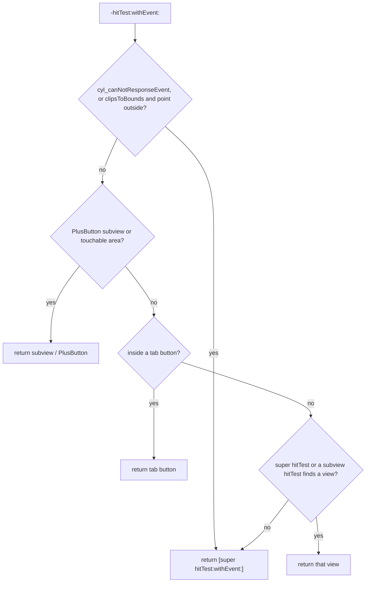

# [CN]TabBar 的 hitTest 不再返回 nil，交给 super 处理
# [EN]The tab bar's hitTest falls back to super instead of returning nil

<!-- bound-classes: CYLTabBar, CYLFlatDesignTabBar -->
<!-- binding:start -->
<!-- Generated by scripts/update-docs-navigation.py; do not edit by hand. -->

| 中文 | English |
|:---|:---|
| 绑定的代码类 `CYLTabBar`：[`CYLTabBarController/CYLTabBar.h`](../CYLTabBarController/CYLTabBar.h) | Bound to the class `CYLTabBar`: [`CYLTabBarController/CYLTabBar.h`](../CYLTabBarController/CYLTabBar.h) |
| 绑定的代码类 `CYLFlatDesignTabBar`：[`CYLTabBarController/CYLFlatDesignTabBar/CYLFlatDesignTabBar-ObjectiveC/CYLFlatDesignTabBar/CYLFlatDesignTabBar.h`](../CYLTabBarController/CYLFlatDesignTabBar/CYLFlatDesignTabBar-ObjectiveC/CYLFlatDesignTabBar/CYLFlatDesignTabBar.h) | Bound to the class `CYLFlatDesignTabBar`: [`CYLTabBarController/CYLFlatDesignTabBar/CYLFlatDesignTabBar-ObjectiveC/CYLFlatDesignTabBar/CYLFlatDesignTabBar.h`](../CYLTabBarController/CYLFlatDesignTabBar/CYLFlatDesignTabBar-ObjectiveC/CYLFlatDesignTabBar/CYLFlatDesignTabBar.h) |

<!-- binding:end -->

| 中文 | English |
|:---|:---|
| 解决 [#474](https://github.com/ChenYilong/CYLTabBarController/issues/474)：`CYLTabBar` 重写的 `-hitTest:withEvent:` 以前在三种情况下直接 `return nil`，导致同样重写了 `hitTest`（或依赖 UIKit 默认命中结果）的第三方库收不到触摸。现在这三处都改为 `return [super hitTest:point withEvent:event]`，由 UIKit 的默认实现决定结果。 | Solves [#474](https://github.com/ChenYilong/CYLTabBarController/issues/474): `CYLTabBar`'s `-hitTest:withEvent:` used to `return nil` in three cases, so third-party code that also overrides `hitTest` (or relies on UIKit's default result) never got the touch. All three now `return [super hitTest:point withEvent:event]` and let UIKit's default implementation decide. |
| 该修复最早发布于 1.29.1（提交 [062ad52](https://github.com/ChenYilong/CYLTabBarController/commit/062ad52c9cb0cee9fabbb9de6c3a0ad893713d86)），此后的版本（包括液态玻璃 Liquid Glass 和扁平样式 FlatDesign 的 `CYLFlatDesignTabBar`）都保持这一行为。本文档说明当前的命中顺序。 | The fix first shipped in 1.29.1 (commit [062ad52](https://github.com/ChenYilong/CYLTabBarController/commit/062ad52c9cb0cee9fabbb9de6c3a0ad893713d86)); every later version keeps it, including Liquid Glass and FlatDesign's `CYLFlatDesignTabBar`. This document describes the current hit-test order. |

## [CN]目录
## [EN]Contents

<!-- navigation:start -->
<!-- Generated by scripts/update-docs-navigation.py; do not edit by hand. -->

| 中文 | English |
|:---|:---|
| [问题](#cn问题) | [Problem](#enproblem) |
| [命中顺序](#cn命中顺序) | [Hit-test order](#enhit-test-order) |
| [与第三方代码一起使用](#cn与第三方代码一起使用) | [Working with third-party code](#enworking-with-third-party-code) |
| [限制](#cn限制) | [Limits](#enlimits) |
| [测试与截图](#cn测试与截图) | [Testing and screenshots](#entesting-and-screenshots) |

<!-- navigation:end -->

## [CN]问题
## [EN]Problem

| 中文 | English |
|:---|:---|
| 1.29.1 之前，以下三种情况 `-hitTest:withEvent:` 返回 nil：① TabBar 设置了不响应事件（`cyl_canNotResponseEvent`）；② TabBar 的 `clipsToBounds` 为 YES 且触摸点在 TabBar 之外；③ 所有判断都没有命中。 | Before 1.29.1, `-hitTest:withEvent:` returned nil in three cases: ① the tab bar was marked as not responding to events (`cyl_canNotResponseEvent`); ② the tab bar had `clipsToBounds` set and the point was outside it; ③ none of the checks matched. |
| 返回 nil 等于告诉 UIKit“这里没有视图”，因此 TabBar 子类、Method Swizzling 或其他第三方库中对 `hitTest` 的处理不会生效，UIKit 的默认命中逻辑也被跳过。 | Returning nil tells UIKit "no view here", so `hitTest` handling in a tab bar subclass, a method swizzle or another third-party library never ran, and UIKit's default hit testing was skipped too. |

## [CN]命中顺序
## [EN]Hit-test order

| 中文 | English |
|:---|:---|
| 1. TabBar 不响应事件，或 `clipsToBounds` 为 YES 且触摸点在 TabBar 之外：返回 `[super hitTest:point withEvent:event]`。 | 1. The tab bar does not respond to events, or it has `clipsToBounds` and the point is outside it: return `[super hitTest:point withEvent:event]`. |
| 2. 有 PlusButton 时：先交给 PlusButton 中可交互的子视图（[#202](PlusButton-Subview-Touches.md)），再交给 PlusButton 的可点击区域（[#91](PlusButton-Touchable-Area.md)）。 | 2. With a plus button: first its interactive subviews ([#202](PlusButton-Subview-Touches.md)), then its touchable area ([#91](PlusButton-Touchable-Area.md)). |
| 3. 触摸点在某个 Tab 按钮（或其凸出的图标）范围内：返回该 Tab 按钮。 | 3. The point is inside a tab button (or its raised icon): return that tab button. |
| 4. 其他情况：先调用 `[super hitTest:point withEvent:event]`；没有结果时，依次询问 TabBar 的每个子视图（因此超出 TabBar 的自定义子视图也能收到触摸）；仍没有结果时，最后返回 `[super hitTest:point withEvent:event]`，不再返回 nil。 | 4. Anything else: call `[super hitTest:point withEvent:event]`; if it finds nothing, ask each subview of the tab bar (so custom subviews sticking out of the bar still get touches); if there is still nothing, return `[super hitTest:point withEvent:event]` at the end, never a hard-coded nil. |



## [CN]与第三方代码一起使用
## [EN]Working with third-party code

| 中文 | English |
|:---|:---|
| 第三方库（如手势、埋点、调试工具）通过 Method Swizzling 或 category 拦截 `-hitTest:withEvent:` 时，原实现会被调用，即使 CYLTabBarController 没有命中任何视图，返回的也是 UIKit 的默认结果，而不是 nil。 | When a third-party library (gestures, analytics, debugging tools, …) intercepts `-hitTest:withEvent:` with method swizzling or a category, the original implementation runs, and even when CYLTabBarController matches no view it returns UIKit's default result instead of nil. |
| 添加到 TabBar 上的自定义视图（例如引导气泡、悬浮按钮）可以重写自己的 `-hitTest:withEvent:` / `-pointInside:withEvent:`，步骤 4 会询问它们，超出 TabBar 的部分也能收到触摸。 | Custom views added to the tab bar (e.g. a guide bubble or a floating button) can override their own `-hitTest:withEvent:` / `-pointInside:withEvent:`: step 4 asks them, so even the part outside the bar gets touches. |

```objc
#import <CYLTabBarController/CYLTabBarController.h>

// [EN] A custom view added to the tab bar, with its own hit test.
// [CN] 添加到 TabBar 上、自己处理 hitTest 的自定义视图。
@interface MyFloatingView : UIView
@end

@implementation MyFloatingView

- (UIView *)hitTest:(CGPoint)point withEvent:(UIEvent *)event {
    UIView *view = [super hitTest:point withEvent:event];
    // [EN] Your own handling here; the tab bar calls this method in step 4.
    // [CN] 在这里添加自己的处理；TabBar 会在步骤 4 调用该方法。
    return view;
}

@end

// [EN] Usage: [tabBarController.tabBar addSubview:floatingView];
// [CN] 用法：[tabBarController.tabBar addSubview:floatingView];
```

## [CN]限制
## [EN]Limits

| 中文 | English |
|:---|:---|
| PlusButton 的可点击区域和 Tab 按钮的范围优先于 UIKit 的默认结果：这些区域内的触摸仍交给 PlusButton 或 Tab 按钮，这是本库的设计行为。 | The plus button's touchable area and the tab buttons take priority over UIKit's default result: touches inside them still go to the plus button or the tab button, by design. |

## [CN]测试与截图
## [EN]Testing and screenshots

| 中文 | English |
|:---|:---|
| 本次只更新文档，没有修改代码。编写文档的环境是 Linux，没有 Xcode 和 iOS 模拟器，因此没有运行截图。代码修改见提交 [062ad52](https://github.com/ChenYilong/CYLTabBarController/commit/062ad52c9cb0cee9fabbb9de6c3a0ad893713d86)，当前实现见 `CYLTabBar.m` 和 `CYLFlatDesignTabBar.m` 中的 `-hitTest:withEvent:`。 | This change only adds documentation; no code changed. It was written on Linux with no Xcode or iOS simulator, so there are no screenshots. The code change is commit [062ad52](https://github.com/ChenYilong/CYLTabBarController/commit/062ad52c9cb0cee9fabbb9de6c3a0ad893713d86); the current implementation is `-hitTest:withEvent:` in `CYLTabBar.m` and `CYLFlatDesignTabBar.m`. |
