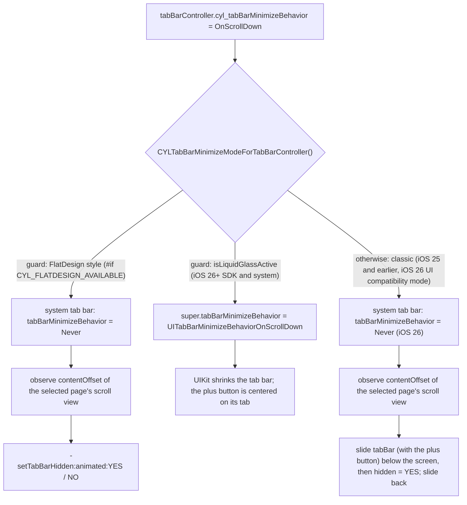
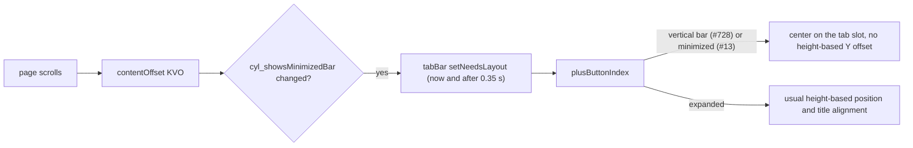

# [CN]滚动时缩小或隐藏 TabBar
# [EN]Minimize or hide the TabBar on scroll

<!-- bound-classes: CYLTabBarController, CYLTabBar, CYLPlusButton -->
<!-- binding:start -->
<!-- Generated by scripts/update-docs-navigation.py; do not edit by hand. -->

| 中文 | English |
|:---|:---|
| 绑定的代码类 `CYLTabBarController`：[`CYLTabBarController/CYLTabBarController.h`](../CYLTabBarController/CYLTabBarController.h) | Bound to the class `CYLTabBarController`: [`CYLTabBarController/CYLTabBarController.h`](../CYLTabBarController/CYLTabBarController.h) |
| 绑定的代码类 `CYLTabBar`：[`CYLTabBarController/CYLTabBar.h`](../CYLTabBarController/CYLTabBar.h) | Bound to the class `CYLTabBar`: [`CYLTabBarController/CYLTabBar.h`](../CYLTabBarController/CYLTabBar.h) |
| 绑定的代码类 `CYLPlusButton`：[`CYLTabBarController/CYLPlusButton.h`](../CYLTabBarController/CYLPlusButton.h) | Bound to the class `CYLPlusButton`: [`CYLTabBarController/CYLPlusButton.h`](../CYLTabBarController/CYLPlusButton.h) |

<!-- binding:end -->

| 中文 | English |
|:---|:---|
| 解决 [#13](https://github.com/ChenYilong/CYLTabBarController/issues/13)「可以加入滚动隐藏 TabBar 吗」。新增一个接口 `cyl_tabBarMinimizeBehavior`，所有样式与系统共用：液态玻璃（iOS 26+）使用系统原生的 `UITabBarController.tabBarMinimizeBehavior`，由系统缩小 TabBar；扁平样式在当前页面滚动时隐藏、显示 TabBar；经典样式（iOS 25 及以前，以及 iOS 26 的 UI 兼容模式）在页面滚动时把系统 TabBar 连同 PlusButton 滑出、滑回。 | Solves [#13](https://github.com/ChenYilong/CYLTabBarController/issues/13), "Can the TabBar hide on scroll?". One new API, `cyl_tabBarMinimizeBehavior`, serves every style and system: Liquid Glass (iOS 26+) uses the native `UITabBarController.tabBarMinimizeBehavior`, so the system shrinks the tab bar; FlatDesign hides and shows its tab bar while the current page scrolls; the classic style (iOS 25 and earlier, and iOS 26 in UI compatibility mode) slides the system tab bar, with its plus button, out and back while the page scrolls. |

## [CN]目录
## [EN]Contents

<!-- navigation:start -->
<!-- Generated by scripts/update-docs-navigation.py; do not edit by hand. -->

| 中文 | English |
|:---|:---|
| [API](#cnapi) | [API](#enapi) |
| [用法](#cn用法) | [Usage](#enusage) |
| [各样式的实现](#cn各样式的实现) | [How each style works](#enhow-each-style-works) |
| [缩小时的 PlusButton](#cn缩小时的-plusbutton) | [The PlusButton in the minimized bar](#enthe-plusbutton-in-the-minimized-bar) |
| [经典样式：iOS 25 及以前与 iOS 26 UI 兼容模式](#cn经典样式ios-25-及以前与-ios-26-ui-兼容模式) | [Classic style: iOS 25 and earlier, and iOS 26 UI compatibility mode](#enclassic-style-ios-25-and-earlier-and-ios-26-ui-compatibility-mode) |
| [演示](#cn演示) | [Demo](#endemo) |
| [限制](#cn限制) | [Limits](#enlimits) |
| [测试与截图](#cn测试与截图) | [Testing and screenshots](#entesting-and-screenshots) |

<!-- navigation:end -->

## [CN]API
## [EN]API

```Objective-C
// CYLConstants.h
typedef NS_ENUM(NSInteger, CYLTabBarMinimizeBehavior) {
    CYLTabBarMinimizeBehaviorAutomatic = 0, // Liquid Glass: system default. FlatDesign and classic: same as Never.
    CYLTabBarMinimizeBehaviorNever,
    CYLTabBarMinimizeBehaviorOnScrollDown,  // minimize (FlatDesign and classic: hide) on scroll down, expand on scroll up
    CYLTabBarMinimizeBehaviorOnScrollUp,    // minimize (FlatDesign and classic: hide) on scroll up, for bottom-aligned content
};

// CYLTabBarController.h
@interface CYLTabBarController (CYLTabBarMinimize)
@property (nonatomic, assign) CYLTabBarMinimizeBehavior cyl_tabBarMinimizeBehavior;
@end
```

| 取值 | 液态玻璃（iOS 26+） | 扁平样式 | 经典样式（iOS 25 及以前、iOS 26 UI 兼容模式） |
|:---|:---|:---|:---|
| `Automatic`（默认） | 系统默认行为（`UITabBarMinimizeBehaviorAutomatic`） | 不隐藏 | 不隐藏 |
| `Never` | 不缩小 | 不隐藏 | 不隐藏 |
| `OnScrollDown` | 向下滚动时缩小，向上滚动时恢复 | 向下滚动时隐藏；向上滚动、回到顶部时显示 | 向下滚动时滑出；向上滚动、回到顶部时滑回 |
| `OnScrollUp` | 向上滚动时缩小，向下滚动时恢复 | 向上滚动时隐藏；向下滚动、回到底部时显示 | 向上滚动时滑出；向下滚动、回到底部时滑回 |

| Value | Liquid Glass (iOS 26+) | FlatDesign | Classic (iOS 25 and earlier, iOS 26 UI compatibility mode) |
|:---|:---|:---|:---|
| `Automatic` (default) | System default (`UITabBarMinimizeBehaviorAutomatic`) | Never hides | Never hides |
| `Never` | Never minimizes | Never hides | Never hides |
| `OnScrollDown` | Minimizes on scroll down, expands on scroll up | Hides on scroll down; shows on scroll up and back at the top | Slides out on scroll down; slides back on scroll up and at the top |
| `OnScrollUp` | Minimizes on scroll up, expands on scroll down | Hides on scroll up; shows on scroll down and back at the bottom | Slides out on scroll up; slides back on scroll down and at the bottom |

| 中文 | English |
|:---|:---|
| 取值与系统的 [`UITabBarController.MinimizeBehavior`](https://developer.apple.com/documentation/uikit/uitabbarcontroller/minimizebehavior)（Objective-C：`UITabBarMinimizeBehavior`）一一对应，系统属性见 [`tabBarMinimizeBehavior`](https://developer.apple.com/documentation/uikit/uitabbarcontroller/tabbarminimizebehavior)（iOS 26.0+）。 | The values match the system's [`UITabBarController.MinimizeBehavior`](https://developer.apple.com/documentation/uikit/uitabbarcontroller/minimizebehavior) (Objective-C: `UITabBarMinimizeBehavior`) one to one; the system property is [`tabBarMinimizeBehavior`](https://developer.apple.com/documentation/uikit/uitabbarcontroller/tabbarminimizebehavior) (iOS 26.0+). |
| 任何时候都可以设置，视图加载前后均可，也可以在运行时切换。没有设置时，CYLTabBarController 不会改动系统的默认值。 | Set it at any time, before or after the view loads, and change it at runtime. Until you set it, CYLTabBarController leaves the system default untouched. |

## [CN]用法
## [EN]Usage

```Objective-C
CYLTabBarController *tabBarController = [CYLTabBarController tabBarControllerWithViewControllers:viewControllers
                                                                           tabBarItemsAttributes:tabBarItemsAttributes];
// [EN] The same line for every style and system. [CN] 所有样式与系统使用同一行代码。
tabBarController.cyl_tabBarMinimizeBehavior = CYLTabBarMinimizeBehaviorOnScrollDown;
```

```Swift
let tabBarController = CYLTabBarController(viewControllers: viewControllers,
                                           tabBarItemsAttributes: tabBarItemsAttributes)
tabBarController.cyl_tabBarMinimizeBehavior = .onScrollDown
```

| 中文 | English |
|:---|:---|
| 一个页面里有多个滚动视图时，用 UIKit 的 `setContentScrollView:forEdge:`（iOS 15+）指定控制 TabBar 的那一个，所有样式都会使用它：`[self setContentScrollView:self.tableView forEdge:NSDirectionalRectEdgeBottom];` | When a page has several scroll views, choose the one that drives the tab bar with UIKit's `setContentScrollView:forEdge:` (iOS 15+); every style uses it: `[self setContentScrollView:self.tableView forEdge:NSDirectionalRectEdgeBottom];` |

## [CN]各样式的实现
## [EN]How each style works



| 中文 | English |
|:---|:---|
| **液态玻璃**（扁平样式以外的所有样式，iOS 26+）：把取值写入系统的 `tabBarMinimizeBehavior`。缩小动画、滚动视图的选择、哪些设备生效都由系统决定；按 Apple 的说明与开发者论坛的反馈，缩小只在 iPhone 上发生，内容需要足够长才会缩小。 | **Liquid Glass** (every style except FlatDesign, iOS 26+): the value goes to the system's `tabBarMinimizeBehavior`. The animation, the scroll view and the devices it works on are the system's choice; per Apple's documentation and developer forum reports, the tab bar minimizes on iPhone only, and only when the content is long enough. |
| **扁平样式**：扁平 TabBar 是自定义视图，系统不会缩小它，因此系统 TabBar 被设为 `Never`，由 CYLTabBarController 观察选中页面（导航控制器的栈顶页面）的滚动视图：页面的 `contentScrollViewForEdge:NSDirectionalRectEdgeBottom`，没有时取其视图层级中第一个可见的滚动视图。用户同方向滚动超过 12pt 后调用已有的 `-setTabBarHidden:animated:`（即 Demo「Show / hide CYLFlatDesignTabBar」那一行使用的方法），所以 `willHideTabBar` / `didShowTabBar` 等代理回调照常触发。 | **FlatDesign**: the flat tab bar is a custom view the system does not shrink, so the system tab bar is set to `Never` and CYLTabBarController observes the scroll view of the selected page (the top page of a navigation controller): the page's `contentScrollViewForEdge:NSDirectionalRectEdgeBottom`, otherwise the first visible scroll view in its view hierarchy. After the user scrolls 12pt in one direction it calls the existing `-setTabBarHidden:animated:` (the method the demo's "Show / hide CYLFlatDesignTabBar" row uses), so delegate callbacks such as `willHideTabBar` / `didShowTabBar` fire as usual. |
| 扁平样式的规则：只响应用户的滚动（拖动或减速），代码设置的偏移不处理；可滚动距离不足 100pt 的内容不隐藏；超出边缘的回弹不处理；切换 Tab、push / pop 到其他页面、改为 `Never` 时，被滚动隐藏的 TabBar 会重新显示；你自己用 `-setTabBarHidden:` 隐藏的 TabBar 不会被显示；`hidesBottomBarWhenPushed` 优先级更高。 | FlatDesign rules: only scrolling by the user (dragging or decelerating) counts, offsets set in code do not; content that scrolls less than 100pt never hides the bar; the rubber band past either edge is ignored; when another tab or page appears (tab switch, push, pop) or the value becomes `Never`, a tab bar hidden by scrolling comes back; a tab bar you hid with `-setTabBarHidden:` stays hidden; `hidesBottomBarWhenPushed` takes priority. |

## [CN]缩小时的 PlusButton
## [EN]The PlusButton in the minimized bar

| 中文 | English |
|:---|:---|
| 液态玻璃 TabBar 缩小后，platter（承载 Tab 按钮的玻璃胶囊）变小，PlusButton 原本按 TabBar 高度计算的 Y 轴位置（`multiplierOfTabBarHeight:`、`constantOfPlusButtonCenterYOffsetForTabBarHeight:`）与标题对齐（`-cyl_alignedCenterForCenter:`）不再适用。参照 [PR #728](https://github.com/ChenYilong/CYLTabBarController/pull/728) 对 iOS 27.1 竖向栏的处理：缩小时 PlusButton 忽略这些高度调整，直接居中于它的 TabBarItem（`-[CYLTabBar plusButtonIndex]`）；恢复后回到原来的位置。 | When the Liquid Glass tab bar is minimized, the platter (the glass capsule with the tab buttons) shrinks, so the PlusButton's height-based Y position (`multiplierOfTabBarHeight:`, `constantOfPlusButtonCenterYOffsetForTabBarHeight:`) and its title alignment (`-cyl_alignedCenterForCenter:`) no longer fit. As [PR #728](https://github.com/ChenYilong/CYLTabBarController/pull/728) does for the iOS 27.1 vertical bar, the PlusButton ignores these height adjustments while minimized and is centered on its tab item (`-[CYLTabBar plusButtonIndex]`); once expanded it goes back to its usual position. |
| UIKit 没有公开的缩小状态或回调，因此通过几何尺寸判断（`-[CYLTabBar cyl_showsMinimizedBar]`）：仅限 iPhone、液态玻璃、`cyl_tabBarMinimizeBehavior` 为 OnScrollDown / OnScrollUp，且 platter 宽度不到 TabBar 宽度的一半。CYLTabBarController 观察当前页面的滚动视图，该状态变化时重新布局 TabBar，系统动画结束后（0.35 秒）再布局一次。 | UIKit has no public minimized state or callback, so it is read from the geometry (`-[CYLTabBar cyl_showsMinimizedBar]`): iPhone only, Liquid Glass, `cyl_tabBarMinimizeBehavior` is OnScrollDown / OnScrollUp, and the platter is less than half as wide as the tab bar. CYLTabBarController observes the current page's scroll view and lays the tab bar out when that state flips, and once more after the system's animation (0.35 s). |



## [CN]经典样式：iOS 25 及以前与 iOS 26 UI 兼容模式
## [EN]Classic style: iOS 25 and earlier, and iOS 26 UI compatibility mode

| 中文 | English |
|:---|:---|
| 这些系统没有原生的缩小接口，液态玻璃也未启用（`+[CYLConstants isLiquidGlassActive]` 为 NO：iOS 25 及以前，或 iOS 26 的 `UIDesignRequiresCompatibility`）。扁平样式以外的所有样式在这里都是经典系统 TabBar（`CYLTabBar`），由 CYLTabBarController 自行处理：同一个 `cyl_tabBarMinimizeBehavior`，无需额外代码。 | These systems have no native minimize API, and Liquid Glass is not active (`+[CYLConstants isLiquidGlassActive]` is NO: iOS 25 and earlier, or iOS 26 with `UIDesignRequiresCompatibility`). Every style except FlatDesign is the classic system tab bar (`CYLTabBar`) here, and CYLTabBarController handles it itself: the same `cyl_tabBarMinimizeBehavior`, no extra code. |
| **隐藏**：用户同方向滚动超过 12pt 后，系统 TabBar 用 0.25 秒滑到屏幕下方，滑动距离为 TabBar 顶部到父视图底部的距离，再加上 PlusButton 等子视图高出 TabBar 的部分，因此凸起的 PlusButton 也会完全移出屏幕。动画结束后 TabBar 设为 `hidden = YES` 并还原 `transform`，UIKit 之后的布局（如旋转）不会遇到带 transform 的 TabBar。 | **Hide**: after the user scrolls 12pt in one direction, the system tab bar slides below the screen in 0.25 s. It moves from its top to the bottom of its superview, plus the part of the plus button (or any subview) that sticks up above it, so a raised plus button leaves the screen too. When the slide ends the tab bar is set to `hidden = YES` and its `transform` is reset, so later layouts by UIKit (e.g. rotation) never meet a transformed tab bar. |
| **显示**：反向滚动、回到内容起始边缘、切换 Tab、push / pop 到其他页面、改为 `Never` 时，被滚动隐藏的 TabBar 从屏幕下方滑回。滑动过程中再次反向滚动，会从当前位置继续动画。 | **Show**: on the opposite scroll, back at the edge the content starts from, on a tab switch, a push or pop, or when the value becomes `Never`, a tab bar hidden by scrolling slides back from below the screen. Scrolling back mid-slide continues from the current position. |
| **Guard**：每条路径都在 `CYLTabBarMinimizeModeForTabBarController()` 的 guard 之后，经典样式的代码只在液态玻璃未启用且不是扁平样式时运行；以下情况不移动 TabBar：App 自己隐藏的（`tabBar.hidden` 或 `alpha` 为 0）；不在父视图底部的（例如显示在顶部的 TabBar）；选中的导航控制器中，根页面之上被 push 的页面设置了 `hidesBottomBarWhenPushed`（TabBar 由 UIKit 移动，保持“滚动隐藏”状态，回到显示 TabBar 的页面后再滑回）。iOS 26 UI 兼容模式下，系统的 `tabBarMinimizeBehavior` 被设为 `Never`，避免与系统重复处理。 | **Guards**: every path sits behind the guards of `CYLTabBarMinimizeModeForTabBarController()`; the classic code runs only when Liquid Glass is not active and the style is not FlatDesign. The tab bar is not moved when the app hid it (`tabBar.hidden`, or `alpha` 0); when it is not at the bottom of its superview (e.g. a tab bar shown at the top); or when a page pushed above the root of the selected navigation controller sets `hidesBottomBarWhenPushed` (UIKit moves the bar then; it stays hidden by scrolling and slides back once a page that shows the bar is back). In iOS 26 UI compatibility mode the system's `tabBarMinimizeBehavior` is set to `Never`, so the system never acts as well. |
| **跟随页面**：FlatDesign 以外，Core 中没有 push / pop 回调，因此经典样式除了在 TabBarController 布局时确认当前页面的滚动视图，还会每 0.5 秒（仅在 TabBarController 显示在窗口中时）再确认一次，使 push 的新页面同样生效。该定时器只在经典样式且取值为 OnScrollDown / OnScrollUp 时存在。 | **Following the page**: outside FlatDesign, core has no push / pop callback, so besides checking the current page's scroll view whenever the tab bar controller lays out, the classic path checks again every 0.5 s (only while the tab bar controller is in a window), so a newly pushed page works too. That timer exists only for the classic path with OnScrollDown / OnScrollUp. |

## [CN]演示
## [EN]Demo

| 中文 | English |
|:---|:---|
| 每个 Demo 列表顶部的设置分组新增「滚动时缩小 / 隐藏 TabBar（issue #13）」一行（`UIViewController+CYLSettingsSection`，Objective-C 与 Swift Demo 共用）。点击后依次为显示该列表的 TabBarController 设置 Automatic → OnScrollDown → OnScrollUp → Never，然后滚动列表即可：在液态玻璃 TabBar 中看到系统缩小 TabBar，在扁平样式 TabBar（Demo 中导航栏左侧的 FlatDesign 按钮）中看到 TabBar 隐藏与显示，在 iOS 25 及以前或开启 UI 兼容模式的 iOS 26 上看到经典 TabBar 滑出与滑回。 | The settings section at the top of every demo list has a new row, "Minimize / hide the TabBar on scroll (issue #13)" (`UIViewController+CYLSettingsSection`, shared by the Objective-C and Swift demos). Each tap sets the next value on the tab bar controller that shows the list (Automatic → OnScrollDown → OnScrollUp → Never); then scroll the list: in a Liquid Glass tab bar the system minimizes it, in a FlatDesign tab bar (the FlatDesign button on the left of the demo's navigation bar) it hides and shows, and on iOS 25 and earlier or on iOS 26 in UI compatibility mode the classic tab bar slides out and back. |

## [CN]限制
## [EN]Limits

| 中文 | English |
|:---|:---|
| 液态玻璃的缩小完全由系统完成。缩小时 PlusButton 居中于它的 TabBarItem（见上文），但缩小后的系统 TabBar 只显示选中的 Tab：PlusButton 所在的 Tab 未选中时是否需要隐藏 PlusButton、Lottie 图标的表现，尚未在真机上验证；如效果不理想，请对带 PlusButton 的 TabBarController 保持 `Never`。缩小状态通过几何尺寸判断，系统改变缩小样式后阈值可能需要调整。 | Liquid Glass minimizing is done entirely by the system. While minimized the PlusButton is centered on its tab item (see above), but the minimized system tab bar shows only the selected tab: whether the PlusButton should hide when its tab is not selected, and how Lottie icons look, has not been verified on a device yet. If it does not look right, keep `Never` for tab bar controllers with a PlusButton. The minimized state is read from the geometry; the threshold may need adjusting if the system changes how it minimizes. |
| 扁平样式每次布局时会确认当前页面的滚动视图；页面替换了滚动视图（例如重新创建 tableView）时，下一次布局后会自动跟随。 | FlatDesign checks the current page's scroll view on every layout; when a page replaces its scroll view (e.g. creates a new table view), the next layout picks it up. |
| 经典样式通过滑出与 `hidden` 隐藏 TabBar，不改变页面的安全区：TabBar 隐藏期间，列表底部仍保留 TabBar 的内边距。半透明的经典 TabBar（默认）下内容本就延伸到 TabBar 下方，不受影响；不透明的 TabBar 隐藏后，底部会露出页面的背景。 | The classic style hides the tab bar by sliding it out and setting `hidden`, without changing the page's safe area: while the bar is hidden, lists keep the tab bar's bottom inset. With a translucent classic tab bar (the default) the content already extends under it, so nothing changes; with an opaque tab bar the page's background shows at the bottom while it is hidden. |
| 经典样式在 iOS 26 UI 兼容模式与 iOS 25 及以前的系统上尚未在真机上验证，iPad 上显示在顶部的 TabBar 不会被移动。 | The classic style has not been verified on a device in iOS 26 UI compatibility mode or on iOS 25 and earlier yet; on iPad a tab bar shown at the top is never moved. |

## [CN]测试与截图
## [EN]Testing and screenshots

| 中文 | English |
|:---|:---|
| 本次修改在没有 Xcode、模拟器与真机的 Linux 环境中完成，无法运行 Demo，因此没有截图。新代码已用 clang（`-target arm64-apple-ios12.0 -fobjc-arc`，`-Weverything` 及 `-Wall -Wextra -Wunguarded-availability`）针对精简的 UIKit 声明做过语法与警告检查，并分别检查了三种编译配置：默认、不含 FlatDesign 子库（`CYL_FLATDESIGN_AVAILABLE` 为 0）、iOS 18 SDK（没有 iOS 26 接口）；Docs navigation 检查通过。请在 iOS 26（液态玻璃与 UI 兼容模式）以及 iOS 18 等旧系统的真机或模拟器上运行 Demo 验证后补充截图。 | This change was made on Linux without Xcode, a simulator or a device, so the demo could not be run and there are no screenshots. The new code was checked for syntax and warnings with clang (`-target arm64-apple-ios12.0 -fobjc-arc`, `-Weverything` and `-Wall -Wextra -Wunguarded-availability`) against minimal UIKit declarations, in three build configurations: default, without the FlatDesign subspec (`CYL_FLATDESIGN_AVAILABLE` 0), and the iOS 18 SDK (no iOS 26 APIs); the docs navigation check passes. Please run the demo on iOS 26 (Liquid Glass and UI compatibility mode) and on an older system such as iOS 18, on a device or simulator, and add screenshots. |
