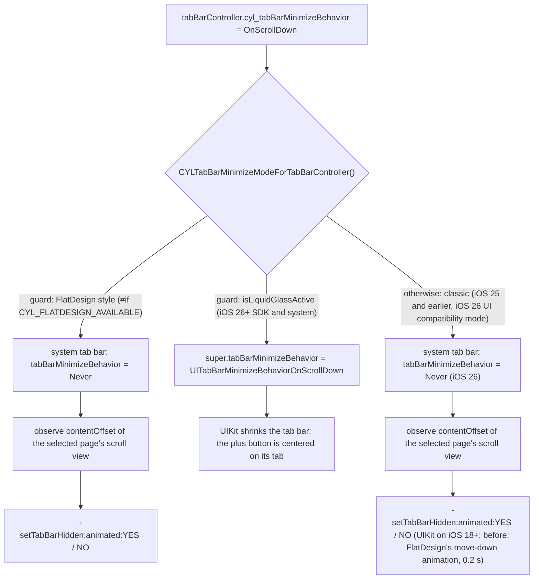
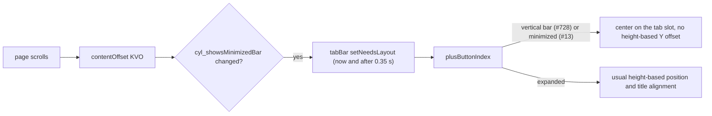
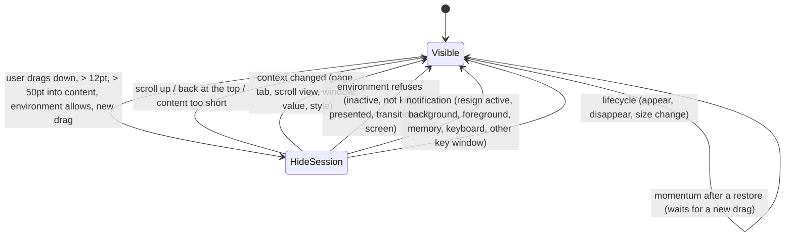
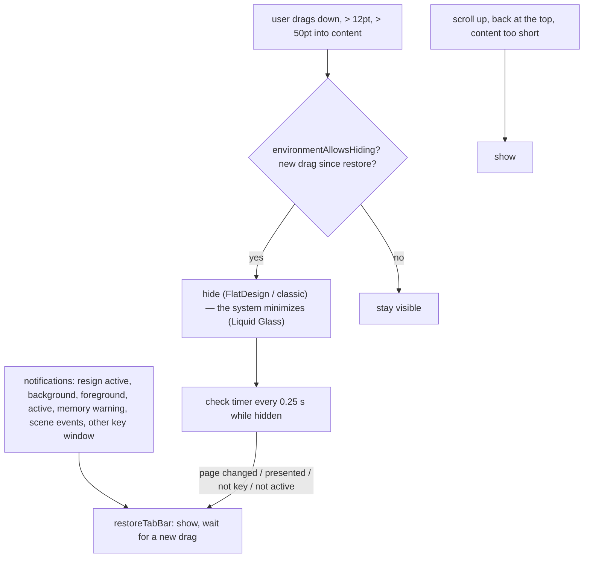

# [CN]滚动时缩小或隐藏 TabBar
# [EN]Minimize or hide the TabBar on scroll

<!-- bound-classes: CYLTabBarController, CYLTabBar, CYLPlusButton -->
<!-- binding:start -->
<!-- Generated by scripts/update-docs-navigation.py; do not edit by hand. -->

| 中文 | English |
|:---|:---|
| 绑定的代码类 `CYLTabBarController`：[`CYLTabBarController/CYLTabBarController.h`](../CYLTabBarController/CYLTabBarController.h) | Bound to the class `CYLTabBarController`: [`CYLTabBarController/CYLTabBarController.h`](../CYLTabBarController/CYLTabBarController.h) |
| 绑定的代码类 `CYLTabBar`：[`CYLTabBarController/CYLTabBar.h`](../CYLTabBarController/CYLTabBar.h) | Bound to the class `CYLTabBar`: [`CYLTabBarController/CYLTabBar.h`](../CYLTabBarController/CYLTabBar.h) |
| 绑定的代码类 `CYLPlusButton`：[`CYLTabBarController/CYLPlusButton.h`](../CYLTabBarController/CYLPlusButton.h) | Bound to the class `CYLPlusButton`: [`CYLTabBarController/CYLPlusButton.h`](../CYLTabBarController/CYLPlusButton.h) |

<!-- binding:end -->

| 中文 | English |
|:---|:---|
| 解决 [#13](https://github.com/ChenYilong/CYLTabBarController/issues/13)「可以加入滚动隐藏 TabBar 吗」。新增一个接口 `cyl_tabBarMinimizeBehavior`，所有样式与系统共用：液态玻璃（iOS 26+）使用系统原生的 `UITabBarController.tabBarMinimizeBehavior`，由系统缩小 TabBar；扁平样式在当前页面滚动时隐藏、显示 TabBar；经典样式（iOS 25 及以前，以及 iOS 26 的 UI 兼容模式）在页面滚动时隐藏、显示系统 TabBar（连同 PlusButton）。扁平样式与经典样式都通过同一个公开接口 `-setTabBarHidden:animated:` 隐藏 TabBar。 | Solves [#13](https://github.com/ChenYilong/CYLTabBarController/issues/13), "Can the TabBar hide on scroll?". One new API, `cyl_tabBarMinimizeBehavior`, serves every style and system: Liquid Glass (iOS 26+) uses the native `UITabBarController.tabBarMinimizeBehavior`, so the system shrinks the tab bar; FlatDesign hides and shows its tab bar while the current page scrolls; the classic style (iOS 25 and earlier, and iOS 26 in UI compatibility mode) hides and shows the system tab bar, with its plus button, while the page scrolls. FlatDesign and the classic style both hide the bar through the same public `-setTabBarHidden:animated:`. |

## [CN]目录
## [EN]Contents

<!-- navigation:start -->
<!-- Generated by scripts/update-docs-navigation.py; do not edit by hand. -->

| 中文 | English |
|:---|:---|
| [API](#cnapi) | [API](#enapi) |
| [最直接的写法：cyl_hidesTabBarOnScroll](#cn最直接的写法cyl_hidestabbaronscroll) | [The most direct way: cyl_hidesTabBarOnScroll](#enthe-most-direct-way-cyl_hidestabbaronscroll) |
| [同一个开关的两种写法](#cn同一个开关的两种写法) | [One switch, two ways to set it](#enone-switch-two-ways-to-set-it) |
| [用法](#cn用法) | [Usage](#enusage) |
| [各样式的实现](#cn各样式的实现) | [How each style works](#enhow-each-style-works) |
| [缩小时的 PlusButton](#cn缩小时的-plusbutton) | [The PlusButton in the minimized bar](#enthe-plusbutton-in-the-minimized-bar) |
| [经典样式：iOS 25 及以前与 iOS 26 UI 兼容模式](#cn经典样式ios-25-及以前与-ios-26-ui-兼容模式) | [Classic style: iOS 25 and earlier, and iOS 26 UI compatibility mode](#enclassic-style-ios-25-and-earlier-and-ios-26-ui-compatibility-mode) |
| [何时隐藏、何时恢复显示](#cn何时隐藏何时恢复显示) | [When the tab bar hides, and when it comes back](#enwhen-the-tab-bar-hides-and-when-it-comes-back) |
| &nbsp;&nbsp;&nbsp;&nbsp;↳ [白名单：隐藏会话](#cn白名单隐藏会话) | &nbsp;&nbsp;&nbsp;&nbsp;↳ [The whitelist: a hide session](#enthe-whitelist-a-hide-session) |
| &nbsp;&nbsp;&nbsp;&nbsp;↳ [隐藏的条件](#cn隐藏的条件) | &nbsp;&nbsp;&nbsp;&nbsp;↳ [When it hides](#enwhen-it-hides) |
| &nbsp;&nbsp;&nbsp;&nbsp;↳ [恢复显示的场景](#cn恢复显示的场景) | &nbsp;&nbsp;&nbsp;&nbsp;↳ [When it comes back](#enwhen-it-comes-back) |
| [演示](#cn演示) | [Demo](#endemo) |
| [边界情况与自评](#cn边界情况与自评) | [Edge cases and self-assessment](#enedge-cases-and-self-assessment) |
| &nbsp;&nbsp;&nbsp;&nbsp;↳ [自评记录](#cn自评记录) | &nbsp;&nbsp;&nbsp;&nbsp;↳ [Self-assessment rounds](#enself-assessment-rounds) |
| &nbsp;&nbsp;&nbsp;&nbsp;↳ [边界情况清单](#cn边界情况清单) | &nbsp;&nbsp;&nbsp;&nbsp;↳ [Edge case list](#enedge-case-list) |
| [限制](#cn限制) | [Limits](#enlimits) |
| [测试与截图](#cn测试与截图) | [Testing and screenshots](#entesting-and-screenshots) |

<!-- navigation:end -->

## [CN]API
## [EN]API

```Objective-C
// CYLConstants.h
typedef NS_ENUM(NSInteger, CYLTabBarMinimizeBehavior) {
    CYLTabBarMinimizeBehaviorAutomatic = 0, // Liquid Glass: system default. FlatDesign and classic: same as Never.
    CYLTabBarMinimizeBehaviorNever,
    CYLTabBarMinimizeBehaviorOnScrollDown,  // minimize (FlatDesign and classic: hide) on scroll down, expand on scroll up
    CYLTabBarMinimizeBehaviorOnScrollUp,    // minimize (FlatDesign and classic: hide) on scroll up, for bottom-aligned content
};

// CYLTabBarController.h
@interface CYLTabBarController (CYLTabBarMinimize)
@property (nonatomic, assign) CYLTabBarMinimizeBehavior cyl_tabBarMinimizeBehavior;
@end
```

| 取值 | 液态玻璃（iOS 26+） | 扁平样式 | 经典样式（iOS 25 及以前、iOS 26 UI 兼容模式） |
|:---|:---|:---|:---|
| `Automatic`（默认） | 系统默认行为（`UITabBarMinimizeBehaviorAutomatic`） | 不隐藏 | 不隐藏 |
| `Never` | 不缩小 | 不隐藏 | 不隐藏 |
| `OnScrollDown` | 向下滚动时缩小，向上滚动时恢复 | 向下滚动时隐藏；向上滚动、回到顶部时显示 | 向下滚动时隐藏；向上滚动、回到顶部时显示 |
| `OnScrollUp` | 向上滚动时缩小，向下滚动时恢复 | 向上滚动时隐藏；向下滚动、回到底部时显示 | 向上滚动时隐藏；向下滚动、回到底部时显示 |

| Value | Liquid Glass (iOS 26+) | FlatDesign | Classic (iOS 25 and earlier, iOS 26 UI compatibility mode) |
|:---|:---|:---|:---|
| `Automatic` (default) | System default (`UITabBarMinimizeBehaviorAutomatic`) | Never hides | Never hides |
| `Never` | Never minimizes | Never hides | Never hides |
| `OnScrollDown` | Minimizes on scroll down, expands on scroll up | Hides on scroll down; shows on scroll up and back at the top | Hides on scroll down; shows on scroll up and back at the top |
| `OnScrollUp` | Minimizes on scroll up, expands on scroll down | Hides on scroll up; shows on scroll down and back at the bottom | Hides on scroll up; shows on scroll down and back at the bottom |

| 中文 | English |
|:---|:---|
| 取值与系统的 [`UITabBarController.MinimizeBehavior`](https://developer.apple.com/documentation/uikit/uitabbarcontroller/minimizebehavior)（Objective-C：`UITabBarMinimizeBehavior`）一一对应，系统属性见 [`tabBarMinimizeBehavior`](https://developer.apple.com/documentation/uikit/uitabbarcontroller/tabbarminimizebehavior)（iOS 26.0+）。 | The values match the system's [`UITabBarController.MinimizeBehavior`](https://developer.apple.com/documentation/uikit/uitabbarcontroller/minimizebehavior) (Objective-C: `UITabBarMinimizeBehavior`) one to one; the system property is [`tabBarMinimizeBehavior`](https://developer.apple.com/documentation/uikit/uitabbarcontroller/tabbarminimizebehavior) (iOS 26.0+). |
| 任何时候都可以设置，视图加载前后均可，也可以在运行时切换。没有设置时，CYLTabBarController 不会改动系统的默认值。 | Set it at any time, before or after the view loads, and change it at runtime. Until you set it, CYLTabBarController leaves the system default untouched. |

## [CN]最直接的写法：cyl_hidesTabBarOnScroll
## [EN]The most direct way: cyl_hidesTabBarOnScroll

| 中文 | English |
|:---|:---|
| 只需要“向下滚动时隐藏 TabBar”时，用 BOOL 属性 `cyl_hidesTabBarOnScroll` 最直观，命名方式与 UIKit 的 `hidesBarsOnSwipe`、`hidesBottomBarWhenPushed` 一致。它与 `cyl_tabBarMinimizeBehavior` 共存、读写同一个取值：`YES` 等同于 `OnScrollDown`，`NO` 等同于 `Never`；滚动隐藏开启时（`OnScrollDown` 或 `OnScrollUp`）getter 返回 `YES`。需要 `OnScrollUp` 或 `Automatic` 时再使用 `cyl_tabBarMinimizeBehavior`。 | When all you need is "hide the tab bar while scrolling down", the BOOL property `cyl_hidesTabBarOnScroll` is the most direct, named like UIKit's `hidesBarsOnSwipe` and `hidesBottomBarWhenPushed`. It coexists with `cyl_tabBarMinimizeBehavior` and reads and writes the same value: `YES` is `OnScrollDown`, `NO` is `Never`; the getter is `YES` while scroll hiding is on (`OnScrollDown` or `OnScrollUp`). Use `cyl_tabBarMinimizeBehavior` for `OnScrollUp` or `Automatic`. |

```Objective-C
tabBarController.cyl_hidesTabBarOnScroll = YES; // [EN] Every style, every system. [CN] 所有样式、所有系统。
```

```Swift
tabBarController.cyl_hidesTabBarOnScroll = true
```

| 中文 | English |
|:---|:---|
| setter 按样式分成三个分支，读代码即可知道效果；三个分支保存的都是同一个取值，因此样式之后改变也保持一致。 | The setter has one branch per style, so the code reads as what happens; every branch stores the same value, so it stays right if the style changes later. |

| 样式 | `cyl_hidesTabBarOnScroll = YES` 时实际执行 | 效果 |
|:---|:---|:---|
| 液态玻璃（iOS 26+） | Apple 的 `tabBarMinimizeBehavior = UITabBarMinimizeBehaviorOnScrollDown` | 系统缩小 TabBar，PlusButton 居中于它的 Tab |
| 扁平样式 | `cyl_tabBarMinimizeBehavior = OnScrollDown`，滚动时调用 `-setTabBarHidden:animated:` | 扁平 TabBar 下移隐藏、移回显示（0.2 秒） |
| 经典 TabBar（iOS 25 及以前如 iOS 17、iOS 26 UI 兼容模式） | `cyl_tabBarMinimizeBehavior = OnScrollDown`，滚动时调用 `-setTabBarHidden:animated:` | iOS 18 起由 UIKit 执行动画；更早的系统与扁平样式动画相同 |

| Style | What `cyl_hidesTabBarOnScroll = YES` runs | Result |
|:---|:---|:---|
| Liquid Glass (iOS 26+) | Apple's `tabBarMinimizeBehavior = UITabBarMinimizeBehaviorOnScrollDown` | The system minimizes the tab bar; the PlusButton is centered on its tab |
| FlatDesign | `cyl_tabBarMinimizeBehavior = OnScrollDown`; `-setTabBarHidden:animated:` while scrolling | The flat tab bar moves down to hide and back to show (0.2 s) |
| Classic tab bar (iOS 25 and earlier such as iOS 17, iOS 26 UI compatibility mode) | `cyl_tabBarMinimizeBehavior = OnScrollDown`; `-setTabBarHidden:animated:` while scrolling | Animated by UIKit on iOS 18+; on earlier systems the same animation as FlatDesign |

| 写法 | 适合 |
|:---|:---|
| `cyl_hidesTabBarOnScroll` | 开 / 关，最直观（推荐） |
| `cyl_tabBarMinimizeBehavior` | 需要 OnScrollUp、Automatic 等全部取值 |
| `tabBarMinimizeBehavior`（Apple，iOS 26+） | 只支持 iOS 26+、习惯使用系统接口 |

| Way | Best for |
|:---|:---|
| `cyl_hidesTabBarOnScroll` | On / off, the most direct (recommended) |
| `cyl_tabBarMinimizeBehavior` | Every value, including OnScrollUp and Automatic |
| `tabBarMinimizeBehavior` (Apple, iOS 26+) | iOS 26+ only apps that prefer the system API |

## [CN]同一个开关的两种写法
## [EN]One switch, two ways to set it

| 中文 | English |
|:---|:---|
| 开启、关闭滚动隐藏只有一个开关，可以用两种写法设置，效果完全相同：Apple 的 `tabBarMinimizeBehavior`（iOS 26+）与 `cyl_tabBarMinimizeBehavior`（所有系统）。CYLTabBarController 重写了 Apple 的 `tabBarMinimizeBehavior` 的 setter 与 getter，二者读写同一个保存的取值，因此用 Apple 的接口设置后，扁平样式与经典 TabBar（iOS 26 UI 兼容模式）同样生效，`cyl_tabBarMinimizeBehavior` 也会读到相同的取值，反之亦然。 | Scroll hiding has one switch, set in either of two ways with exactly the same effect: Apple's `tabBarMinimizeBehavior` (iOS 26+) and `cyl_tabBarMinimizeBehavior` (every system). CYLTabBarController overrides the setter and getter of Apple's `tabBarMinimizeBehavior`, and both read and write one stored value: set through Apple's API, FlatDesign and the classic tab bar (iOS 26 UI compatibility mode) follow it too, and `cyl_tabBarMinimizeBehavior` reads the same value, and the other way round. |
| 交给 UIKit 的真实取值（扁平样式与经典 TabBar 为 `Never`，避免系统重复处理）通过 `super` 写入，不会出现在 getter 中：getter 始终返回 App 设置的取值。App 设置之前，getter 返回 UIKit 自己的取值。 | The value really given to UIKit (`Never` for FlatDesign and the classic tab bar, so the system never acts as well) is written through `super` and never shows in the getter: the getter always returns the value the app set. Until the app sets one, the getter returns UIKit's own value. |
| 只支持 iOS 26+ 的 App 可以直接使用 Apple 的接口；需要支持 iOS 25 及以前的 App 请使用 `cyl_tabBarMinimizeBehavior`，因为旧系统上没有 Apple 的这个属性。 | Apps that support only iOS 26+ can use Apple's API directly; apps that also support iOS 25 and earlier use `cyl_tabBarMinimizeBehavior`, since Apple's property does not exist on older systems. |

| 写法 | 系统 | 液态玻璃 | 扁平样式 | 经典 TabBar |
|:---|:---|:---|:---|:---|
| `cyl_tabBarMinimizeBehavior` | 所有系统 | ✅ | ✅ | ✅ |
| `tabBarMinimizeBehavior`（Apple） | iOS 26+ | ✅ | ✅ | ✅（UI 兼容模式） |

| Way | Systems | Liquid Glass | FlatDesign | Classic tab bar |
|:---|:---|:---|:---|:---|
| `cyl_tabBarMinimizeBehavior` | Every system | ✅ | ✅ | ✅ |
| `tabBarMinimizeBehavior` (Apple) | iOS 26+ | ✅ | ✅ | ✅ (UI compatibility mode) |

## [CN]用法
## [EN]Usage

```Objective-C
CYLTabBarController *tabBarController = [CYLTabBarController tabBarControllerWithViewControllers:viewControllers
                                                                           tabBarItemsAttributes:tabBarItemsAttributes];
// [EN] The same line for every style and system. [CN] 所有样式与系统使用同一行代码。
tabBarController.cyl_hidesTabBarOnScroll = YES;
// [EN] Or, with every value: [CN] 或者使用全部取值：
tabBarController.cyl_tabBarMinimizeBehavior = CYLTabBarMinimizeBehaviorOnScrollDown;
```

```Swift
let tabBarController = CYLTabBarController(viewControllers: viewControllers,
                                           tabBarItemsAttributes: tabBarItemsAttributes)
tabBarController.cyl_hidesTabBarOnScroll = true
// [EN] Or, with every value: [CN] 或者使用全部取值：
tabBarController.cyl_tabBarMinimizeBehavior = .onScrollDown
```

```Objective-C
// [EN] iOS 26+ only: Apple's API, the same switch. [CN] 仅 iOS 26+：Apple 的接口，同一个开关。
if (@available(iOS 26.0, *)) {
    tabBarController.tabBarMinimizeBehavior = UITabBarMinimizeBehaviorOnScrollDown;
}
```

```Swift
// [EN] iOS 26+ only: Apple's API, the same switch. [CN] 仅 iOS 26+：Apple 的接口，同一个开关。
if #available(iOS 26.0, *) {
    tabBarController.tabBarMinimizeBehavior = .onScrollDown
}
```

| 中文 | English |
|:---|:---|
| 一个页面里有多个滚动视图时，用 UIKit 的 `setContentScrollView:forEdge:`（iOS 15+）指定控制 TabBar 的那一个，所有样式都会使用它：`[self setContentScrollView:self.tableView forEdge:NSDirectionalRectEdgeBottom];` | When a page has several scroll views, choose the one that drives the tab bar with UIKit's `setContentScrollView:forEdge:` (iOS 15+); every style uses it: `[self setContentScrollView:self.tableView forEdge:NSDirectionalRectEdgeBottom];` |

## [CN]各样式的实现
## [EN]How each style works



| 中文 | English |
|:---|:---|
| **液态玻璃**（扁平样式以外的所有样式，iOS 26+）：把取值写入系统的 `tabBarMinimizeBehavior`。缩小动画、滚动视图的选择、哪些设备生效都由系统决定；按 Apple 的说明与开发者论坛的反馈，缩小只在 iPhone 上发生，内容需要足够长才会缩小。 | **Liquid Glass** (every style except FlatDesign, iOS 26+): the value goes to the system's `tabBarMinimizeBehavior`. The animation, the scroll view and the devices it works on are the system's choice; per Apple's documentation and developer forum reports, the tab bar minimizes on iPhone only, and only when the content is long enough. |
| **扁平样式**：扁平 TabBar 是自定义视图，系统不会缩小它，因此系统 TabBar 被设为 `Never`，由 CYLTabBarController 观察选中页面（导航控制器的栈顶页面）的滚动视图：页面的 `contentScrollViewForEdge:NSDirectionalRectEdgeBottom`，没有时取其视图层级中第一个可见的滚动视图。用户同方向滚动超过 12pt 后调用已有的 `-setTabBarHidden:animated:`（即 Demo「Show / hide CYLFlatDesignTabBar」那一行使用的方法），所以 `willHideTabBar` / `didShowTabBar` 等代理回调照常触发。 | **FlatDesign**: the flat tab bar is a custom view the system does not shrink, so the system tab bar is set to `Never` and CYLTabBarController observes the scroll view of the selected page (the top page of a navigation controller): the page's `contentScrollViewForEdge:NSDirectionalRectEdgeBottom`, otherwise the first visible scroll view in its view hierarchy. After the user scrolls 12pt in one direction it calls the existing `-setTabBarHidden:animated:` (the method the demo's "Show / hide CYLFlatDesignTabBar" row uses), so delegate callbacks such as `willHideTabBar` / `didShowTabBar` fire as usual. |
| 扁平样式的规则：只响应用户的滚动（拖动或减速），代码设置的偏移不处理；可滚动距离不足 100pt 的内容不隐藏；超出边缘的回弹不处理；切换 Tab、push / pop 到其他页面、改为 `Never` 时，被滚动隐藏的 TabBar 会重新显示；你自己用 `-setTabBarHidden:` 隐藏的 TabBar 不会被显示；`hidesBottomBarWhenPushed` 优先级更高。 | FlatDesign rules: only scrolling by the user (dragging or decelerating) counts, offsets set in code do not; content that scrolls less than 100pt never hides the bar; the rubber band past either edge is ignored; when another tab or page appears (tab switch, push, pop) or the value becomes `Never`, a tab bar hidden by scrolling comes back; a tab bar you hid with `-setTabBarHidden:` stays hidden; `hidesBottomBarWhenPushed` takes priority. |

## [CN]缩小时的 PlusButton
## [EN]The PlusButton in the minimized bar

| 中文 | English |
|:---|:---|
| 液态玻璃 TabBar 缩小后，platter（承载 Tab 按钮的玻璃胶囊）变小，PlusButton 原本按 TabBar 高度计算的 Y 轴位置（`multiplierOfTabBarHeight:`、`constantOfPlusButtonCenterYOffsetForTabBarHeight:`）与标题对齐（`-cyl_alignedCenterForCenter:`）不再适用。参照 [PR #728](https://github.com/ChenYilong/CYLTabBarController/pull/728) 对 iOS 27.1 竖向栏的处理：缩小时 PlusButton 忽略这些高度调整，直接居中于它的 TabBarItem（`-[CYLTabBar plusButtonIndex]`）；恢复后回到原来的位置。 | When the Liquid Glass tab bar is minimized, the platter (the glass capsule with the tab buttons) shrinks, so the PlusButton's height-based Y position (`multiplierOfTabBarHeight:`, `constantOfPlusButtonCenterYOffsetForTabBarHeight:`) and its title alignment (`-cyl_alignedCenterForCenter:`) no longer fit. As [PR #728](https://github.com/ChenYilong/CYLTabBarController/pull/728) does for the iOS 27.1 vertical bar, the PlusButton ignores these height adjustments while minimized and is centered on its tab item (`-[CYLTabBar plusButtonIndex]`); once expanded it goes back to its usual position. |
| UIKit 没有公开的缩小状态或回调，因此通过几何尺寸判断（`-[CYLTabBar cyl_showsMinimizedBar]`）：仅限 iPhone、液态玻璃、`cyl_tabBarMinimizeBehavior` 为 OnScrollDown / OnScrollUp，且 platter 宽度不到 TabBar 宽度的一半。CYLTabBarController 观察当前页面的滚动视图，该状态变化时重新布局 TabBar，系统动画结束后（0.35 秒）再布局一次。 | UIKit has no public minimized state or callback, so it is read from the geometry (`-[CYLTabBar cyl_showsMinimizedBar]`): iPhone only, Liquid Glass, `cyl_tabBarMinimizeBehavior` is OnScrollDown / OnScrollUp, and the platter is less than half as wide as the tab bar. CYLTabBarController observes the current page's scroll view and lays the tab bar out when that state flips, and once more after the system's animation (0.35 s). |



## [CN]经典样式：iOS 25 及以前与 iOS 26 UI 兼容模式
## [EN]Classic style: iOS 25 and earlier, and iOS 26 UI compatibility mode

| 中文 | English |
|:---|:---|
| 这些系统没有原生的缩小接口，液态玻璃也未启用（`+[CYLConstants isLiquidGlassActive]` 为 NO：iOS 25 及以前，或 iOS 26 的 `UIDesignRequiresCompatibility`）。扁平样式以外的所有样式在这里都是经典系统 TabBar（`CYLTabBar`），由 CYLTabBarController 自行处理：同一个 `cyl_tabBarMinimizeBehavior`，无需额外代码。 | These systems have no native minimize API, and Liquid Glass is not active (`+[CYLConstants isLiquidGlassActive]` is NO: iOS 25 and earlier, or iOS 26 with `UIDesignRequiresCompatibility`). Every style except FlatDesign is the classic system tab bar (`CYLTabBar`) here, and CYLTabBarController handles it itself: the same `cyl_tabBarMinimizeBehavior`, no extra code. |
| **隐藏**：用户同方向滚动超过 12pt 后，调用公开的 `-setTabBarHidden:YES animated:YES`，与扁平样式、与 App 自己调用的是同一个接口。液态玻璃与经典样式下，该方法在 iOS 18 及以上交给 UIKit 的 `-[UITabBarController setTabBarHidden:animated:]`（带动画，并更新页面的安全区），更早的系统使用与扁平样式相同的动画：相同时长（0.2 秒），TabBar 连同凸起的 PlusButton 向下移出屏幕，动画结束时设置 `hidden = YES` 并还原 transform；显示时从屏幕下方移回。动画中途反向请求时，从当前位置继续，以最新请求为准。PlusButton 是 TabBar 的子视图，随 TabBar 一起隐藏。 | **Hide**: after the user scrolls 12pt in one direction, the public `-setTabBarHidden:YES animated:YES` is called: the same API FlatDesign uses and the app can call itself. For Liquid Glass and the classic style that method hands over to UIKit's `-[UITabBarController setTabBarHidden:animated:]` on iOS 18 and later (animated, and the page's safe area follows), and on earlier systems animates as FlatDesign does: the same duration (0.2 s), the tab bar moves down out of the screen together with its raised plus button, then `hidden = YES` is set and the transform reset; showing moves it back up from below. A reverse request mid-animation continues from the current position, and the newest request wins. The plus button is a subview of the tab bar and hides with it. |
| **显示**：反向滚动、回到内容起始边缘、切换 Tab、push / pop 到其他页面、改为 `Never` 时，被滚动隐藏的 TabBar 通过 `-setTabBarHidden:NO animated:YES` 重新显示。 | **Show**: on the opposite scroll, back at the edge the content starts from, on a tab switch, a push or pop, or when the value becomes `Never`, a tab bar hidden by scrolling is shown again with `-setTabBarHidden:NO animated:YES`. |
| **Guard**：每条路径都在 `CYLTabBarMinimizeModeForTabBarController()` 的 guard 之后，经典样式的代码只在液态玻璃未启用且不是扁平样式时运行；以下情况不隐藏 TabBar：App 自己隐藏的（`tabBar.hidden` 或 `alpha` 为 0）；不在父视图底部的（例如显示在顶部的 TabBar）；选中的导航控制器中，根页面之上被 push 的页面设置了 `hidesBottomBarWhenPushed`（TabBar 由 UIKit 移动，保持“滚动隐藏”状态，回到显示 TabBar 的页面后再显示）。iOS 26 UI 兼容模式下，系统的 `tabBarMinimizeBehavior` 被设为 `Never`，避免与系统重复处理。 | **Guards**: every path sits behind the guards of `CYLTabBarMinimizeModeForTabBarController()`; the classic code runs only when Liquid Glass is not active and the style is not FlatDesign. The tab bar is not hidden when the app hid it (`tabBar.hidden`, or `alpha` 0); when it is not at the bottom of its superview (e.g. a tab bar shown at the top); or when a page pushed above the root of the selected navigation controller sets `hidesBottomBarWhenPushed` (UIKit moves the bar then; it stays hidden by scrolling and is shown once a page that shows the bar is back). In iOS 26 UI compatibility mode the system's `tabBarMinimizeBehavior` is set to `Never`, so the system never acts as well. |
| **跟随页面**：FlatDesign 以外，Core 中没有 push / pop 回调，因此经典样式除了在 TabBarController 布局时确认当前页面的滚动视图，还会每 0.5 秒（仅在 TabBarController 显示在窗口中时）再确认一次，使 push 的新页面同样生效。该定时器只在经典样式且取值为 OnScrollDown / OnScrollUp 时存在。 | **Following the page**: outside FlatDesign, core has no push / pop callback, so besides checking the current page's scroll view whenever the tab bar controller lays out, the classic path checks again every 0.5 s (only while the tab bar controller is in a window), so a newly pushed page works too. That timer exists only for the classic path with OnScrollDown / OnScrollUp. |

## [CN]何时隐藏、何时恢复显示
## [EN]When the tab bar hides, and when it comes back

| 中文 | English |
|:---|:---|
| 滚动隐藏最容易出 bug 的地方是“何时恢复显示”。逻辑参考 Facebook App：只在用户向下滑动浏览内容时隐藏；任何打断浏览的情况都立即恢复显示，并且恢复之后，只有用户开始新的拖动才会再次隐藏，旧拖动的惯性不会。以下规则对三种样式都生效：扁平样式与经典样式恢复的是被滚动隐藏的 TabBar，液态玻璃恢复的是被系统缩小的 TabBar；App 自己用 `-setTabBarHidden:` 隐藏的 TabBar 不会被显示。 | The hard part of scroll hiding is when the tab bar comes back. The logic follows the Facebook app: hide only while the user scrolls down to read content; bring the bar back at once on anything that interrupts reading, and after that hide it again only on a new drag, never on the momentum of the old one. These rules hold for all three styles: FlatDesign and the classic style bring back a bar hidden by scrolling, Liquid Glass a bar the system minimized; a bar the app hid itself with `-setTabBarHidden:` is never shown. |

### [CN]白名单：隐藏会话
### [EN]The whitelist: a hide session

| 中文 | English |
|:---|:---|
| 列举“何时恢复”的事件总会有遗漏，因此核心改为白名单：内存中只有一个标记（`_hideSessionActive`），只有在“隐藏会话”内，TabBar 才可以保持隐藏。开始会话的唯一方式是用户向下滚动浏览内容（液态玻璃为允许隐藏时系统缩小了 TabBar）。开始时记录上下文：滚动视图、选中的 Tab、当前显示的页面、窗口、取值与路径。 | Listing the events that bring the bar back always misses some, so the core is a whitelist: one flag in memory (`_hideSessionActive`), and the tab bar may stay hidden only inside a "hide session". The one way to start a session is the user scrolling down through content (for Liquid Glass, the system minimizing the bar while hiding is allowed). The session records its context: the scroll view, the selected tab, the page on screen, the window, the value and the path. |
| 之后任何与该上下文不一致的情况（换了页面、换了 Tab、换了滚动视图、换了窗口、改了取值或样式），或 App 环境不再允许隐藏（App 不活跃、窗口不是 key window、有页面被 present、push / pop 转场中、滚动视图不在屏幕上），都会立即结束会话并恢复显示。没有被列举到的情况（例如从通知横幅打开的页面、分享面板、分屏尺寸变化）只要改变了上述任一项，同样会恢复。 | From then on, anything that does not match that context (another page, tab, scroll view or window, a changed value or style), or an app that no longer allows hiding (not active, window not key, something presented, a push or pop running, the scroll view off screen), ends the session at once and shows the bar. Situations nobody listed (a page opened from a notification banner, a share sheet, a split screen resize) bring it back too, as soon as they change any of these. |
| 检查时机：每次滚动事件、TabBarController 每次布局、它的 `viewWillAppear:` / `viewDidAppear:` / `viewWillDisappear:` / `viewDidDisappear:` / `viewWillTransitionToSize:`、每个被监听的通知，以及 TabBar 隐藏期间每 0.25 秒的定时检查。会话结束后，只有新的拖动才会开始新的会话。 | It is checked on every scroll event, every layout of the tab bar controller, its `viewWillAppear:` / `viewDidAppear:` / `viewWillDisappear:` / `viewDidDisappear:` / `viewWillTransitionToSize:`, every observed notification, and every 0.25 s while the bar is hidden. After a session ends, only a new drag starts a new one. |



### [CN]隐藏的条件
### [EN]When it hides

| 中文 | English |
|:---|:---|
| 用户正在拖动或拖动后的惯性滚动中（代码设置的偏移不算），同方向滚动超过 12pt。 | The user is dragging, or the scroll is decelerating after a drag (offsets set in code do not count), 12pt in one direction. |
| 已经滚入内容超过 50pt（`CYLTabBarMinimizeHideStartDistance`），内容开头不隐藏；内容可滚动距离至少 100pt。 | More than 50pt into the content (`CYLTabBarMinimizeHideStartDistance`), never at its start; the content scrolls at least 100pt. |
| 上次恢复之后，用户已经开始新的拖动。 | The user has started a new drag since the last restore. |
| App 处于活跃状态、本窗口是 key window、没有任何页面被 present（弹框、操作表、模态页面）、没有 push / pop 正在进行、滚动视图在屏幕上（`-environmentAllowsHiding`）。 | The app is active, this window is the key window, nothing is presented (alert, action sheet, modal page), no push or pop is running, and the scroll view is on screen (`-environmentAllowsHiding`). |

### [CN]恢复显示的场景
### [EN]When it comes back

| 场景 | 监听方式 | 行为 |
|:---|:---|:---|
| 向上滚动、回到顶部（包括点击状态栏）、内容变短不再能滚动 | 滚动视图的 `contentOffset`（KVO） | 恢复显示 |
| 前后台切换 | `UIApplicationDidEnterBackground` / `WillEnterForeground` / `DidBecomeActive`，以及对应的 Scene 通知（iOS 13+，只处理本窗口的 Scene） | 恢复显示，等待新的拖动 |
| 来电（接听时 App 失去活跃）、低电量弹框、任何系统弹框、控制中心、通知中心、App 切换器 | `UIApplicationWillResignActive`、`UISceneWillDeactivate` | 恢复显示，等待新的拖动 |
| 点击推送打开 App，然后 push 到详情页 | 进入前台 / 变为活跃通知；随后的 push 按页面变化处理 | 恢复显示 |
| push、pop（包括手势返回）、切换 Tab | 扁平样式的转场回调、TabBarController 布局时重新确认滚动视图、定时检查（安全网） | 恢复显示；转场进行中不隐藏 |
| App 内的弹框、操作表、模态页面 | 定时检查 `presentedViewController`（隐藏期间每 0.25 秒） | 恢复显示，等待新的拖动 |
| 显示在独立窗口中的弹框、HUD、浮层 | `UIWindowDidBecomeKey`（其他窗口）；定时检查本窗口是否仍是 key window | 恢复显示，等待新的拖动 |
| 内存警告 | `UIApplicationDidReceiveMemoryWarning` | 恢复显示，等待新的拖动 |
| 键盘弹出（输入不是浏览） | `UIKeyboardWillShow` | 恢复显示，键盘收起后 TabBar 已在 |
| TabBarController 出现、消失（全屏模态页面、在它之上 push、外层容器切换） | `viewWillAppear:`、`viewDidAppear:`、`viewWillDisappear:`、`viewDidDisappear:` | 恢复显示，等待新的拖动 |
| 旋转、分屏 / 台前调度尺寸变化 | `viewWillTransitionToSize:withTransitionCoordinator:` | 恢复显示，等待新的拖动 |
| 其他任何改变会话上下文的情况 | 白名单检查（见上文） | 恢复显示，等待新的拖动 |
| 关闭滚动隐藏（`NO` / `Never`）、样式改变 | 设置取值、每次布局 | 恢复显示 |

| Scenario | How it is observed | Result |
|:---|:---|:---|
| Scrolling up, back at the top (also a tap on the status bar), content that no longer scrolls | The scroll view's `contentOffset` (KVO) | Shown |
| Background / foreground switches | `UIApplicationDidEnterBackground` / `WillEnterForeground` / `DidBecomeActive`, and the matching scene notifications (iOS 13+, this window's scene only) | Shown, waits for a new drag |
| A call (the app resigns active when it is answered), the low battery alert, any system alert, Control Center, Notification Center, the app switcher | `UIApplicationWillResignActive`, `UISceneWillDeactivate` | Shown, waits for a new drag |
| Tapping a push notification opens the app, which then pushes a detail page | The foreground / become active notifications; the push that follows counts as a page change | Shown |
| Push, pop (also the swipe back), tab switch | FlatDesign's transition callbacks, re-resolving the scroll view whenever the tab bar controller lays out, the check timer (safety net) | Shown; never hidden while a transition runs |
| In-app alerts, action sheets, modal pages | The check timer looks at `presentedViewController` (every 0.25 s while hidden) | Shown, waits for a new drag |
| Alerts, HUDs or overlays in a window of their own | `UIWindowDidBecomeKey` (another window); the check timer checks that this window is still key | Shown, waits for a new drag |
| Memory warning | `UIApplicationDidReceiveMemoryWarning` | Shown, waits for a new drag |
| The keyboard appears (typing is not reading) | `UIKeyboardWillShow` | Shown; the bar is there when the keyboard goes |
| The tab bar controller appears or disappears (a full-screen modal, a push over it, an outer container switching) | `viewWillAppear:`, `viewDidAppear:`, `viewWillDisappear:`, `viewDidDisappear:` | Shown, waits for a new drag |
| Rotation, a Split View / Stage Manager resize | `viewWillTransitionToSize:withTransitionCoordinator:` | Shown, waits for a new drag |
| Anything else that changes the session's context | The whitelist check (see above) | Shown, waits for a new drag |
| Scroll hiding turned off (`NO` / `Never`), a style change | Setting the value, every layout | Shown |



| 中文 | English |
|:---|:---|
| 液态玻璃：UIKit 没有恢复已缩小 TabBar 的接口。恢复时，CYLTabBarController 通过 `super` 把系统的 `tabBarMinimizeBehavior` 暂时设为 `Never`（让系统恢复 TabBar），0.35 秒后写回 App 的取值，之后滚动缩小继续生效。该做法尚未在真机上验证。 | Liquid Glass: UIKit has no API to expand a minimized tab bar. To restore it, CYLTabBarController briefly sets the system's `tabBarMinimizeBehavior` to `Never` through `super` (so the system expands the bar) and writes the app's value back 0.35 s later, after which minimizing on scroll works again. Not verified on a device yet. |
| 来电：iOS 14 起，未接听的来电以横幅显示，App 保持活跃，横幅不遮挡 TabBar，因此不需要处理；接听或全屏来电时 App 失去活跃，TabBar 恢复显示。 | Calls: since iOS 14 an unanswered call shows as a banner, the app stays active and the banner does not cover the tab bar, so nothing is needed; when the call is answered or shown full screen the app resigns active and the tab bar comes back. |
| 定时检查只在需要时运行：TabBar 被隐藏或缩小期间每 0.25 秒；经典样式在 TabBar 显示时每 0.5 秒确认一次当前页面（Core 中没有 push / pop 回调）；其他情况不运行。通知观察者与定时器只在开启滚动隐藏时存在。 | The check timer runs only when needed: every 0.25 s while the bar is hidden or minimized; for the classic style every 0.5 s while it is shown, to follow the page (core has no push / pop callback); otherwise not at all. The notification observers and the timer exist only while scroll hiding is on. |

## [CN]演示
## [EN]Demo

| 中文 | English |
|:---|:---|
| 每个 Demo 列表顶部的设置分组新增「滚动时缩小 / 隐藏 TabBar（issue #13）」一行（`UIViewController+CYLSettingsSection`，Objective-C 与 Swift Demo 共用）。点击后依次为显示该列表的 TabBarController 设置 Automatic → OnScrollDown → OnScrollUp → Never，然后滚动列表即可：在液态玻璃 TabBar 中看到系统缩小 TabBar，在扁平样式 TabBar（Demo 中导航栏左侧的 FlatDesign 按钮）中看到 TabBar 隐藏与显示，在 iOS 25 及以前或开启 UI 兼容模式的 iOS 26 上看到经典 TabBar 隐藏与显示。 | The settings section at the top of every demo list has a new row, "Minimize / hide the TabBar on scroll (issue #13)" (`UIViewController+CYLSettingsSection`, shared by the Objective-C and Swift demos). Each tap sets the next value on the tab bar controller that shows the list (Automatic → OnScrollDown → OnScrollUp → Never); then scroll the list: in a Liquid Glass tab bar the system minimizes it, in a FlatDesign tab bar (the FlatDesign button on the left of the demo's navigation bar) it hides and shows, and on iOS 25 and earlier or on iOS 26 in UI compatibility mode the classic tab bar hides and shows. |

<!-- edge-cases:start -->

## [CN]边界情况与自评
## [EN]Edge cases and self-assessment

| 中文 | English |
|:---|:---|
| 滚动隐藏最难的是“何时恢复显示”。每一轮按满分 100 分给边界情况的兼容程度打分，列出减分项与加分项，修改代码与文档后再打分，直到不低于 90 分（至少五轮）。分数衡量的是设计对边界情况的覆盖程度；没有真机验证始终作为减分项保留，不会被当作已解决。 | The hard part of scroll hiding is when the bar comes back. Each round scores how well edge cases are handled (out of 100), lists deductions and positives, changes the code and the docs, and scores again, until the score is at least 90 (at least five rounds). The score measures how well the design covers edge cases; the lack of device testing stays a deduction and is never counted as solved. |
| 演示：Objective-C Demo 的分组列表（液态玻璃与扁平样式页面）末尾新增「滚动隐藏：模拟意外情况（issue #13）」section。每行先开启滚动隐藏，点击 1.5 秒后触发对应的意外情况，留出时间先向下滚动隐藏 TabBar；行标题即触发的 API 或事件名称，副标题说明预期结果。无法用代码触发的系统事件（真实来电、低电量弹框）通过发送系统会发送的通知来模拟，真机上仍需手动验证。 | Demo: the grouped list of the Objective-C demo (Liquid Glass and FlatDesign pages) ends with a new section, "Scroll hiding: simulate interruptions (issue #13)". Each row turns scroll hiding on and fires its interruption 1.5 s after the tap, so there is time to scroll down and hide the bar first; the row title names the API or event, the subtitle the expected result. System events code cannot trigger (a real call, the low battery alert) are simulated by posting the notifications the system posts; they still need checking by hand on a device. |

### [CN]自评记录
### [EN]Self-assessment rounds

| 轮次 | 分数 | 减分项 | 加分项 | 本轮修改 |
|:---|:---|:---|:---|:---|
| 1 | 70 | 没有模拟意外情况的演示 −8；子控制器 presentation −4；App 自己隐藏后会被显示 −4；刚好够长的内容闪动 −3；横向分页选错滚动视图 −2；VoiceOver −3；hidesBottomBarWhenPushed 页面每 0.25 秒重复恢复 −1；iPad 多 Scene 的 key window −2；液态玻璃恢复方式未验证 −3 | 白名单隐藏会话；通知 + 生命周期 + 定时检查；新拖动规则；三种样式用 guard 隔离 | 新增演示 section（18 行）；App 的 setTabBarHidden: 接管 TabBar；检查子控制器的 presentedViewController；优先选择竖向滚动视图；隐藏需要 ≥ 200pt 可滚动距离（滞回） |
| 2 | 80 | 没有真机验证 −5；VoiceOver / 切换控制 −3；液态玻璃恢复方式未验证 −3；iPad 多 Scene 的 key window 与活跃状态 −2；键盘显示时仍会隐藏 −2；Swift Demo 没有模拟 section −2；hidesBottomBarWhenPushed 页面重复恢复 −1；经典样式显示期间每 0.5 秒遍历视图 −1；系统事件以发送通知模拟 −1 | App 接管、子控制器 presentation、分页列表、滞回已处理；18 行模拟演示；用精简 UIKit 声明编译演示代码时发现并修复了 switch 中 block 导致的编译错误 | VoiceOver / 切换控制开启时不隐藏，状态变化时恢复；按 Scene 判断 key window 与活跃状态（iOS 13 / 15+）；键盘显示期间不隐藏；hidesBottomBarWhenPushed 页面只结束一次会话；新增 2 个演示行 |
| 3 | 84 | 没有真机验证 −5；液态玻璃恢复方式未验证 −3；Swift Demo 没有模拟 −2；“减弱动态效果”下仍有滑动动画 −1；旋转没有演示 −1；没有调试日志，真机问题难以定位 −1；经典样式显示期间每 0.5 秒遍历视图 −1；长按上下文菜单预览是否算 present 未知 −1；系统事件以发送通知模拟 −1 | VoiceOver / 切换控制、按 Scene 判断焦点、键盘、hidesBottomBarWhenPushed 已处理；20 行模拟演示；30 个边界情况 | 模拟移入库中的演示辅助（UIViewController+CYLSettingsSection），设置分组第 8 行用操作表列出全部模拟，Swift Demo 同样可用；ObjC Demo 的 section 调用同一份代码；“减弱动态效果”下不执行滑动动画；监听减弱动态效果与低电量模式变化；新增旋转、减弱动态效果、低电量模式 3 个演示行（共 23 行） |
| 4 | 88 | 没有真机验证 −5；液态玻璃恢复方式未验证 −3；没有诊断手段，真机上无法知道为何恢复 −1；经典样式显示期间每 0.5 秒遍历视图 −1；长按上下文菜单预览没有公开回调 −1；系统事件以发送通知模拟 −1 | 所有 Demo（含 Swift）都能运行全部模拟；减弱动态效果、低电量模式、旋转已处理；33 个边界情况 | 可选诊断日志（环境变量 CYLTabBarMinimizeLog=1）：会话开始、每次恢复及具体原因、App 接管；会话与环境检查给出具体原因；液态玻璃强制恢复后自检并记录；当前页面不变时复用滚动视图 2 秒 |

| Round | Score | Deductions | Positives | Changes in this round |
|:---|:---|:---|:---|:---|
| 1 | 70 | no demo of interruptions −8; child presentation −4; a bar the app hid gets shown −4; flicker on content just long enough −3; wrong scroll view in pagers −2; VoiceOver −3; repeated restores every 0.25 s on hidesBottomBarWhenPushed pages −1; key window with several iPad scenes −2; Liquid Glass restore unverified −3 | whitelist hide session; notifications + lifecycle + timer; new-drag rule; three styles isolated by guards | demo section (18 rows); the app's setTabBarHidden: takes the bar over; children's presentedViewController checked; vertical scroll views preferred; hiding needs 200pt of scrollable distance (hysteresis) |
| 2 | 80 | no device testing −5; VoiceOver / Switch Control −3; Liquid Glass restore unverified −3; key window and active state with several iPad scenes −2; still hides with the keyboard up −2; no simulation section in the Swift demos −2; repeated restores on hidesBottomBarWhenPushed pages −1; the classic style walks views every 0.5 s while shown −1; system events simulated by posting notifications −1 | app takeover, child presentations, pager lists and hysteresis handled; an 18-row simulation demo; compiling the demo against minimal UIKit declarations found and fixed a build error (blocks in switch cases) | never hides with VoiceOver / Switch Control running, shown when their status changes; key window and active state per scene (iOS 13 / 15+); never hides with the keyboard up; one session end on hidesBottomBarWhenPushed pages; 2 more demo rows |
| 3 | 84 | no device testing −5; Liquid Glass restore unverified −3; no simulations in the Swift demos −2; still slides with Reduce Motion −1; no rotation demo −1; no debug log, device issues are hard to trace −1; the classic style walks views every 0.5 s while shown −1; unknown whether a context menu preview counts as presented −1; system events simulated by posting notifications −1 | VoiceOver / Switch Control, focus per scene, keyboard, hidesBottomBarWhenPushed handled; a 20-row simulation demo; 30 edge cases | the simulations move into the library's demo helpers (UIViewController+CYLSettingsSection); settings row 8 lists them in an action sheet, so the Swift demos have them too; the ObjC demo section calls the same code; no slide with Reduce Motion; Reduce Motion and Low Power Mode changes observed; 3 more demo rows: rotation, Reduce Motion, Low Power Mode (23 rows) |
| 4 | 88 | no device testing −5; Liquid Glass restore unverified −3; no diagnostics, on a device one cannot tell why the bar came back −1; the classic style walks views every 0.5 s while shown −1; context menu previews have no public callback −1; system events simulated by posting notifications −1 | every demo (Swift included) runs every simulation; Reduce Motion, Low Power Mode and rotation handled; 33 edge cases | opt-in diagnostic log (environment variable CYLTabBarMinimizeLog=1): session starts, every restore with its exact reason, app takeovers; session and environment checks report exact reasons; self-check and log after the Liquid Glass forced expand; the scroll view is reused for 2 s while the page stays the same |

### [CN]边界情况清单
### [EN]Edge case list

| 中文 | English |
|:---|:---|
| 状态：✅ 由代码处理；🧪 另有演示行（「滚动隐藏：模拟意外情况」section）；📱 只能在真机上手动验证。 | Status: ✅ handled in code; 🧪 also has a demo row (the "Scroll hiding: simulate interruptions" section); 📱 can only be checked by hand on a device. |

| # | 场景 | 处理方式 | 状态 |
|:---|:---|:---|:---|
| 1 | 向上滚动 | 滚动方向反转超过 12pt | ✅ |
| 2 | 回到顶部、点击状态栏回到顶部 | contentOffset 到达起始边缘（代码设置的偏移也算） | ✅🧪 |
| 3 | 代码向下滚动（非用户拖动） | 只响应拖动或拖动后的惯性 | ✅🧪 |
| 4 | 内容变短不再能滚动 | 可滚动距离 < 100pt 时恢复；隐藏需要 ≥ 200pt（滞回，防止闪动） | ✅ |
| 5 | 内容开头 | 滚入超过 50pt 才隐藏 | ✅ |
| 6 | 恢复后的惯性滚动 | 恢复后需要新的拖动 | ✅ |
| 7 | 前后台切换 | App 与 Scene 通知 | ✅🧪 |
| 8 | 来电（接听） | WillResignActive | ✅🧪📱 |
| 9 | 低电量弹框、系统弹框、权限请求 | WillResignActive | ✅🧪📱 |
| 10 | 控制中心、通知中心、App 切换器 | WillResignActive / DidEnterBackground | ✅📱 |
| 11 | 点击推送打开 App 后 push | 前台通知 + 页面变化 | ✅🧪 |
| 12 | push、pop、手势返回 | 会话上下文（页面）+ 转场中不隐藏 | ✅🧪 |
| 13 | push 设置了 hidesBottomBarWhenPushed 的页面 | 交给 UIKit；返回后恢复 | ✅🧪 |
| 14 | 切换 Tab（点击或代码） | 会话上下文（Tab） | ✅🧪 |
| 15 | App 内 alert、actionSheet | presentedViewController（本控制器、选中 Tab、当前页面） | ✅🧪 |
| 16 | 全屏模态页面、页面卡片 | presentedViewController + viewWillDisappear / viewWillAppear | ✅🧪 |
| 17 | 子控制器自定义 presentation context | 检查选中 Tab 与当前页面的 presentedViewController | ✅ |
| 18 | 分享面板 | presentedViewController | ✅🧪 |
| 19 | 独立窗口中的 HUD、浮层 | UIWindowDidBecomeKey + key window 检查 | ✅🧪 |
| 20 | 键盘弹出 | UIKeyboardWillShow | ✅🧪 |
| 21 | 内存警告 | UIApplicationDidReceiveMemoryWarning | ✅🧪 |
| 22 | 旋转、分屏 / 台前调度尺寸变化 | viewWillTransitionToSize | ✅🧪📱 |
| 23 | App 自己隐藏 TabBar | App 的 setTabBarHidden: 接管 TabBar，滚动隐藏不再显示它 | ✅🧪 |
| 24 | 关闭滚动隐藏、改变样式 | 设置取值、每次布局 | ✅🧪 |
| 25 | 横向分页中的竖向列表 | 优先选择可以竖向滚动的滚动视图 | ✅ |
| 26 | 滚动视图被替换或释放 | 会话上下文（滚动视图）+ weak | ✅ |
| 27 | VoiceOver、切换控制开启或正在使用 | 不隐藏；状态变化时恢复 | ✅🧪 |
| 28 | 键盘已显示时滚动（如搜索结果） | 键盘显示期间不隐藏 | ✅🧪 |
| 29 | iPad 多窗口：另一个 Scene 获得焦点 | 按本 Scene 的 keyWindow 与 activationState 判断 | ✅📱 |
| 30 | 开启“减弱动态效果” | 滚动隐藏不执行滑动动画；状态变化时恢复 | ✅🧪 |
| 31 | 低电量模式开启或关闭 | NSProcessInfoPowerStateDidChange | ✅🧪 |
| 32 | 长按上下文菜单预览（UIContextMenuInteraction） | 没有公开的回调；打开预览中的页面时随页面变化恢复 | 📱 |
| 33 | 真机上定位“为何恢复 / 为何没恢复” | Xcode scheme 中设置环境变量 CYLTabBarMinimizeLog=1：打印会话开始、每次恢复及原因、App 接管、液态玻璃恢复自检 | ✅ |
| 34 | 经典样式显示期间的页面检查开销 | 当前页面不变时复用滚动视图 2 秒，不重复遍历视图层级 | ✅ |
| 35 | Swift Demo 中的模拟 | 设置分组第 8 行用操作表列出全部模拟 | 🧪 |
| 36 | 经典样式：返回到 hidesBottomBarWhenPushed 页面之前的页面 | 会话只结束一次，不重复恢复；返回时随页面变化显示 | ✅🧪 |

| # | Scenario | How it is handled | Status |
|:---|:---|:---|:---|
| 1 | Scrolling up | The direction reverses for 12pt | ✅ |
| 2 | Back at the top, a status bar tap | contentOffset reaches the start edge (offsets set in code count too) | ✅🧪 |
| 3 | Scrolling down in code (not a user drag) | Only drags and their momentum count | ✅🧪 |
| 4 | Content that no longer scrolls | Shown below 100pt of scrollable distance; hiding needs 200pt (hysteresis, no flicker) | ✅ |
| 5 | The start of the content | Hides only after 50pt into the content | ✅ |
| 6 | Momentum after a restore | A new drag is needed after a restore | ✅ |
| 7 | Background / foreground | App and scene notifications | ✅🧪 |
| 8 | A call (answered) | WillResignActive | ✅🧪📱 |
| 9 | Low battery alert, system alerts, permission requests | WillResignActive | ✅🧪📱 |
| 10 | Control Center, Notification Center, the app switcher | WillResignActive / DidEnterBackground | ✅📱 |
| 11 | A push notification tap that opens the app and pushes a page | Foreground notifications + page change | ✅🧪 |
| 12 | Push, pop, swipe back | Session context (page) + no hiding during a transition | ✅🧪 |
| 13 | Push of a page with hidesBottomBarWhenPushed | Left to UIKit; shown on the way back | ✅🧪 |
| 14 | Tab switch (tap or code) | Session context (tab) | ✅🧪 |
| 15 | In-app alert, action sheet | presentedViewController (this controller, the selected tab, the page) | ✅🧪 |
| 16 | Full-screen modal, page sheet | presentedViewController + viewWillDisappear / viewWillAppear | ✅🧪 |
| 17 | A child that defines its own presentation context | Checks the selected tab's and the page's presentedViewController | ✅ |
| 18 | Share sheet | presentedViewController | ✅🧪 |
| 19 | HUD or overlay in a window of its own | UIWindowDidBecomeKey + key window check | ✅🧪 |
| 20 | The keyboard appears | UIKeyboardWillShow | ✅🧪 |
| 21 | Memory warning | UIApplicationDidReceiveMemoryWarning | ✅🧪 |
| 22 | Rotation, Split View / Stage Manager resize | viewWillTransitionToSize | ✅🧪📱 |
| 23 | The app hides the tab bar itself | The app's setTabBarHidden: takes the bar over; scroll hiding never shows it | ✅🧪 |
| 24 | Scroll hiding turned off, a style change | Setting the value, every layout | ✅🧪 |
| 25 | A vertical list inside a horizontal pager | A vertically scrolling scroll view is preferred | ✅ |
| 26 | The scroll view is replaced or released | Session context (scroll view) + weak | ✅ |
| 27 | VoiceOver or Switch Control turned on or running | Never hides; shown when the status changes | ✅🧪 |
| 28 | Scrolling while the keyboard is up (e.g. search results) | Never hides while the keyboard is up | ✅🧪 |
| 29 | iPad multiple windows: another scene takes focus | Uses this scene's keyWindow and activationState | ✅📱 |
| 30 | Reduce Motion turned on | Scroll hiding does not slide; shown when the setting changes | ✅🧪 |
| 31 | Low Power Mode turned on or off | NSProcessInfoPowerStateDidChange | ✅🧪 |
| 32 | A context menu preview (UIContextMenuInteraction) | No public callback; opening the previewed page restores the bar with the page change | 📱 |
| 33 | On a device: why the bar came back, or did not | Set the environment variable CYLTabBarMinimizeLog=1 in the Xcode scheme: logs session starts, every restore with its reason, app takeovers, the Liquid Glass restore self-check | ✅ |
| 34 | Cost of the classic page check while the bar is shown | The scroll view is reused for 2 s while the page stays the same, without searching the view hierarchy again | ✅ |
| 35 | Simulations in the Swift demos | Settings row 8 lists every simulation in an action sheet | 🧪 |
| 36 | Classic: coming back from a hidesBottomBarWhenPushed page | The session ends once, no repeated restores; shown on the page change back | ✅🧪 |

<!-- edge-cases:end -->

## [CN]限制
## [EN]Limits

| 中文 | English |
|:---|:---|
| 液态玻璃的缩小完全由系统完成。缩小时 PlusButton 居中于它的 TabBarItem（见上文），但缩小后的系统 TabBar 只显示选中的 Tab：PlusButton 所在的 Tab 未选中时是否需要隐藏 PlusButton、Lottie 图标的表现，尚未在真机上验证；如效果不理想，请对带 PlusButton 的 TabBarController 保持 `Never`。缩小状态通过几何尺寸判断，系统改变缩小样式后阈值可能需要调整。 | Liquid Glass minimizing is done entirely by the system. While minimized the PlusButton is centered on its tab item (see above), but the minimized system tab bar shows only the selected tab: whether the PlusButton should hide when its tab is not selected, and how Lottie icons look, has not been verified on a device yet. If it does not look right, keep `Never` for tab bar controllers with a PlusButton. The minimized state is read from the geometry; the threshold may need adjusting if the system changes how it minimizes. |
| 扁平样式每次布局时会确认当前页面的滚动视图；页面替换了滚动视图（例如重新创建 tableView）时，下一次布局后会自动跟随。 | FlatDesign checks the current page's scroll view on every layout; when a page replaces its scroll view (e.g. creates a new table view), the next layout picks it up. |
| iOS 18 以前的经典样式使用与扁平样式相同的下移动画，但页面的安全区不变：TabBar 隐藏期间，列表底部仍保留 TabBar 的内边距（扁平样式会更新安全区）。iOS 18 及以上由 UIKit 处理动画与安全区。代理回调 `willHideTabBar:` 等仅属于扁平样式（参数为 `CYLFlatDesignTabBar`），经典样式不发送。 | Before iOS 18 the classic style uses FlatDesign's move-down animation, but the page's safe area does not change: lists keep the tab bar's bottom inset while it is hidden (FlatDesign updates the safe area). On iOS 18 and later UIKit animates it and updates the safe area. Delegate callbacks such as `willHideTabBar:` belong to FlatDesign only (their parameter is a `CYLFlatDesignTabBar`); the classic style does not send them. |
| 经典样式在 iOS 26 UI 兼容模式与 iOS 25 及以前的系统上尚未在真机上验证，iPad 上显示在顶部的 TabBar 不会被移动。 | The classic style has not been verified on a device in iOS 26 UI compatibility mode or on iOS 25 and earlier yet; on iPad a tab bar shown at the top is never moved. |

## [CN]测试与截图
## [EN]Testing and screenshots

| 中文 | English |
|:---|:---|
| 本次修改在没有 Xcode、模拟器与真机的 Linux 环境中完成，无法运行 Demo，因此没有截图。新代码已用 clang（`-target arm64-apple-ios12.0 -fobjc-arc`，`-Weverything` 及 `-Wall -Wextra -Wunguarded-availability`）针对精简的 UIKit 声明做过语法与警告检查，并分别检查了三种编译配置：默认、不含 FlatDesign 子库（`CYL_FLATDESIGN_AVAILABLE` 为 0）、iOS 18 SDK（没有 iOS 26 接口）；Docs navigation 检查通过。请在 iOS 26（液态玻璃与 UI 兼容模式）以及 iOS 18 等旧系统的真机或模拟器上运行 Demo 验证后补充截图。 | This change was made on Linux without Xcode, a simulator or a device, so the demo could not be run and there are no screenshots. The new code was checked for syntax and warnings with clang (`-target arm64-apple-ios12.0 -fobjc-arc`, `-Weverything` and `-Wall -Wextra -Wunguarded-availability`) against minimal UIKit declarations, in three build configurations: default, without the FlatDesign subspec (`CYL_FLATDESIGN_AVAILABLE` 0), and the iOS 18 SDK (no iOS 26 APIs); the docs navigation check passes. Please run the demo on iOS 26 (Liquid Glass and UI compatibility mode) and on an older system such as iOS 18, on a device or simulator, and add screenshots. |

| 中文 | English |
|:---|:---|
| 生命周期场景（何时恢复显示）同样尚未在真机上验证。建议在真机上逐项检查，每项都在 TabBar 被滚动隐藏后进行：① 切到后台再回来；② 来电并接听，挂断后回到 App；③ 低电量弹框（或任一系统弹框，如权限请求）；④ 点击推送打开 App 并 push 到详情页；⑤ push 新页面、手势返回 pop；⑥ App 内的 UIAlertController（alert 与 actionSheet）、模态页面；⑦ 独立窗口中的 HUD；⑧ 模拟器的“模拟内存警告”；⑨ 点击搜索框弹出键盘；⑩ 旋转屏幕、iPad 分屏调整尺寸；⑪ 分享面板（UIActivityViewController）、全屏模态页面；⑫ 隐藏后不松手继续上下拖动、快速甩动后立即点击 Tab。预期：TabBar 都立即恢复显示，并且惯性滚动不会再次隐藏它，新的向下拖动才会隐藏。 | The lifecycle scenarios (when the bar comes back) are not verified on a device yet either. Check each on a device, each time after scrolling has hidden the tab bar: (1) go to the background and back; (2) receive and answer a call, hang up and return; (3) the low battery alert (or any system alert, such as a permission request); (4) tap a push notification that opens the app and pushes a detail page; (5) push a page, pop with the swipe back; (6) an in-app UIAlertController (alert and action sheet), a modal page; (7) a HUD in a window of its own; (8) the simulator's "Simulate Memory Warning"; (9) tap a search field so the keyboard appears; (10) rotate, resize in iPad Split View; (11) a share sheet (UIActivityViewController), a full-screen modal page; (12) keep dragging up and down without lifting the finger after the bar hides, fling and tap a tab right away. Expected: the tab bar comes back at once each time, momentum does not hide it again, and only a new drag down hides it. |
