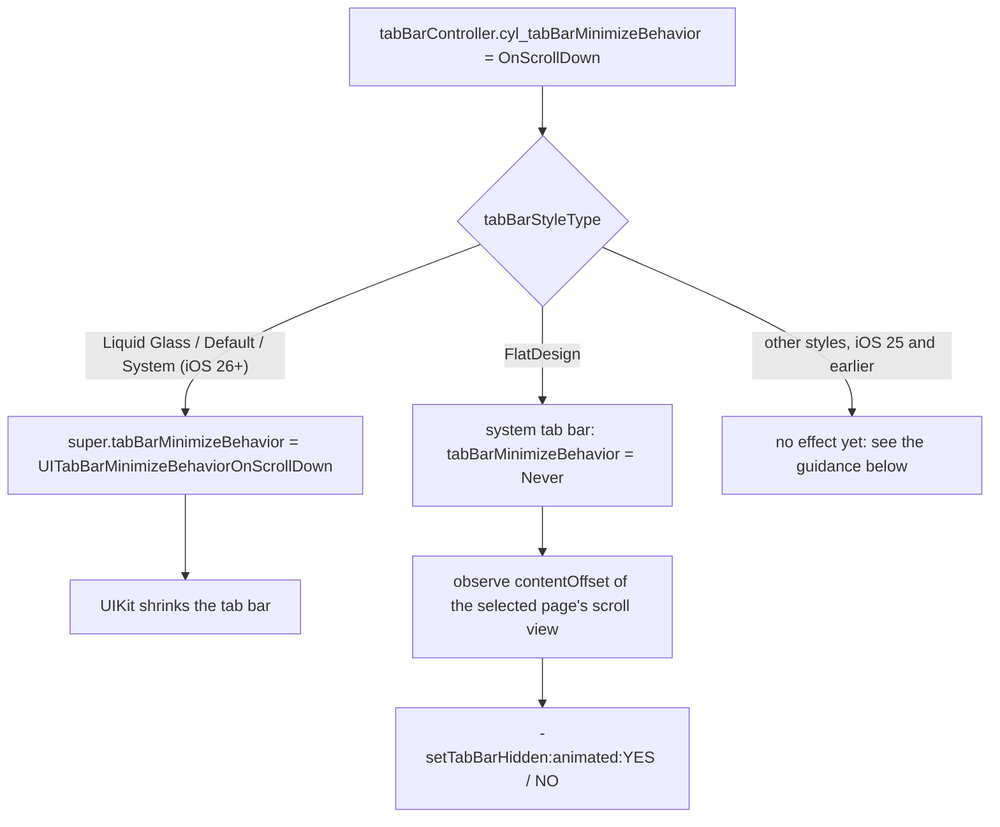
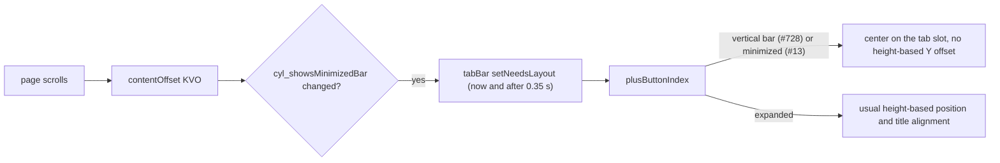

# [CN]滚动时缩小或隐藏 TabBar
# [EN]Minimize or hide the TabBar on scroll

<!-- bound-classes: CYLTabBarController, CYLTabBar, CYLPlusButton -->
<!-- binding:start -->
<!-- Generated by scripts/update-docs-navigation.py; do not edit by hand. -->

| 中文 | English |
|:---|:---|
| 绑定的代码类 `CYLTabBarController`：[`CYLTabBarController/CYLTabBarController.h`](../CYLTabBarController/CYLTabBarController.h) | Bound to the class `CYLTabBarController`: [`CYLTabBarController/CYLTabBarController.h`](../CYLTabBarController/CYLTabBarController.h) |
| 绑定的代码类 `CYLTabBar`：[`CYLTabBarController/CYLTabBar.h`](../CYLTabBarController/CYLTabBar.h) | Bound to the class `CYLTabBar`: [`CYLTabBarController/CYLTabBar.h`](../CYLTabBarController/CYLTabBar.h) |
| 绑定的代码类 `CYLPlusButton`：[`CYLTabBarController/CYLPlusButton.h`](../CYLTabBarController/CYLPlusButton.h) | Bound to the class `CYLPlusButton`: [`CYLTabBarController/CYLPlusButton.h`](../CYLTabBarController/CYLPlusButton.h) |

<!-- binding:end -->

| 中文 | English |
|:---|:---|
| 解决 [#13](https://github.com/ChenYilong/CYLTabBarController/issues/13)「可以加入滚动隐藏 TabBar 吗」。新增一个接口 `cyl_tabBarMinimizeBehavior`，液态玻璃与扁平样式共用：液态玻璃（iOS 26+）使用系统原生的 `UITabBarController.tabBarMinimizeBehavior`，由系统缩小 TabBar；扁平样式在当前页面滚动时隐藏、显示 TabBar。 | Solves [#13](https://github.com/ChenYilong/CYLTabBarController/issues/13), "Can the TabBar hide on scroll?". One new API, `cyl_tabBarMinimizeBehavior`, serves Liquid Glass and FlatDesign: Liquid Glass (iOS 26+) uses the native `UITabBarController.tabBarMinimizeBehavior`, so the system shrinks the tab bar; FlatDesign hides and shows its tab bar while the current page scrolls. |

## [CN]目录
## [EN]Contents

<!-- navigation:start -->
<!-- Generated by scripts/update-docs-navigation.py; do not edit by hand. -->

| 中文 | English |
|:---|:---|
| [API](#cnapi) | [API](#enapi) |
| [用法](#cn用法) | [Usage](#enusage) |
| [各样式的实现](#cn各样式的实现) | [How each style works](#enhow-each-style-works) |
| [缩小时的 PlusButton](#cn缩小时的-plusbutton) | [The PlusButton in the minimized bar](#enthe-plusbutton-in-the-minimized-bar) |
| [iOS 25 及以前的其他样式](#cnios-25-及以前的其他样式) | [Other styles on iOS 25 and earlier](#enother-styles-on-ios-25-and-earlier) |
| [演示](#cn演示) | [Demo](#endemo) |
| [限制](#cn限制) | [Limits](#enlimits) |
| [测试与截图](#cn测试与截图) | [Testing and screenshots](#entesting-and-screenshots) |

<!-- navigation:end -->

## [CN]API
## [EN]API

```Objective-C
// CYLConstants.h
typedef NS_ENUM(NSInteger, CYLTabBarMinimizeBehavior) {
    CYLTabBarMinimizeBehaviorAutomatic = 0, // Liquid Glass: system default. FlatDesign: same as Never.
    CYLTabBarMinimizeBehaviorNever,
    CYLTabBarMinimizeBehaviorOnScrollDown,  // minimize (FlatDesign: hide) on scroll down, expand on scroll up
    CYLTabBarMinimizeBehaviorOnScrollUp,    // minimize (FlatDesign: hide) on scroll up, for bottom-aligned content
};

// CYLTabBarController.h
@interface CYLTabBarController (CYLTabBarMinimize)
@property (nonatomic, assign) CYLTabBarMinimizeBehavior cyl_tabBarMinimizeBehavior;
@end
```

| 取值 | 液态玻璃（iOS 26+） | 扁平样式 |
|:---|:---|:---|
| `Automatic`（默认） | 系统默认行为（`UITabBarMinimizeBehaviorAutomatic`） | 不隐藏 |
| `Never` | 不缩小 | 不隐藏 |
| `OnScrollDown` | 向下滚动时缩小，向上滚动时恢复 | 向下滚动时隐藏；向上滚动、回到顶部时显示 |
| `OnScrollUp` | 向上滚动时缩小，向下滚动时恢复 | 向上滚动时隐藏；向下滚动、回到底部时显示 |

| Value | Liquid Glass (iOS 26+) | FlatDesign |
|:---|:---|:---|
| `Automatic` (default) | System default (`UITabBarMinimizeBehaviorAutomatic`) | Never hides |
| `Never` | Never minimizes | Never hides |
| `OnScrollDown` | Minimizes on scroll down, expands on scroll up | Hides on scroll down; shows on scroll up and back at the top |
| `OnScrollUp` | Minimizes on scroll up, expands on scroll down | Hides on scroll up; shows on scroll down and back at the bottom |

| 中文 | English |
|:---|:---|
| 取值与系统的 [`UITabBarController.MinimizeBehavior`](https://developer.apple.com/documentation/uikit/uitabbarcontroller/minimizebehavior)（Objective-C：`UITabBarMinimizeBehavior`）一一对应，系统属性见 [`tabBarMinimizeBehavior`](https://developer.apple.com/documentation/uikit/uitabbarcontroller/tabbarminimizebehavior)（iOS 26.0+）。 | The values match the system's [`UITabBarController.MinimizeBehavior`](https://developer.apple.com/documentation/uikit/uitabbarcontroller/minimizebehavior) (Objective-C: `UITabBarMinimizeBehavior`) one to one; the system property is [`tabBarMinimizeBehavior`](https://developer.apple.com/documentation/uikit/uitabbarcontroller/tabbarminimizebehavior) (iOS 26.0+). |
| 任何时候都可以设置，视图加载前后均可，也可以在运行时切换。没有设置时，CYLTabBarController 不会改动系统的默认值。 | Set it at any time, before or after the view loads, and change it at runtime. Until you set it, CYLTabBarController leaves the system default untouched. |

## [CN]用法
## [EN]Usage

```Objective-C
CYLTabBarController *tabBarController = [CYLTabBarController tabBarControllerWithViewControllers:viewControllers
                                                                           tabBarItemsAttributes:tabBarItemsAttributes];
// [EN] The same line for Liquid Glass and FlatDesign. [CN] 液态玻璃与扁平样式使用同一行代码。
tabBarController.cyl_tabBarMinimizeBehavior = CYLTabBarMinimizeBehaviorOnScrollDown;
```

```Swift
let tabBarController = CYLTabBarController(viewControllers: viewControllers,
                                           tabBarItemsAttributes: tabBarItemsAttributes)
tabBarController.cyl_tabBarMinimizeBehavior = .onScrollDown
```

| 中文 | English |
|:---|:---|
| 一个页面里有多个滚动视图时，用 UIKit 的 `setContentScrollView:forEdge:`（iOS 15+）指定控制 TabBar 的那一个，两种样式都会使用它：`[self setContentScrollView:self.tableView forEdge:NSDirectionalRectEdgeBottom];` | When a page has several scroll views, choose the one that drives the tab bar with UIKit's `setContentScrollView:forEdge:` (iOS 15+); both styles use it: `[self setContentScrollView:self.tableView forEdge:NSDirectionalRectEdgeBottom];` |

## [CN]各样式的实现
## [EN]How each style works



| 中文 | English |
|:---|:---|
| **液态玻璃**（扁平样式以外的所有样式，iOS 26+）：把取值写入系统的 `tabBarMinimizeBehavior`。缩小动画、滚动视图的选择、哪些设备生效都由系统决定；按 Apple 的说明与开发者论坛的反馈，缩小只在 iPhone 上发生，内容需要足够长才会缩小。 | **Liquid Glass** (every style except FlatDesign, iOS 26+): the value goes to the system's `tabBarMinimizeBehavior`. The animation, the scroll view and the devices it works on are the system's choice; per Apple's documentation and developer forum reports, the tab bar minimizes on iPhone only, and only when the content is long enough. |
| **扁平样式**：扁平 TabBar 是自定义视图，系统不会缩小它，因此系统 TabBar 被设为 `Never`，由 CYLTabBarController 观察选中页面（导航控制器的栈顶页面）的滚动视图：页面的 `contentScrollViewForEdge:NSDirectionalRectEdgeBottom`，没有时取其视图层级中第一个可见的滚动视图。用户同方向滚动超过 12pt 后调用已有的 `-setTabBarHidden:animated:`（即 Demo「Show / hide CYLFlatDesignTabBar」那一行使用的方法），所以 `willHideTabBar` / `didShowTabBar` 等代理回调照常触发。 | **FlatDesign**: the flat tab bar is a custom view the system does not shrink, so the system tab bar is set to `Never` and CYLTabBarController observes the scroll view of the selected page (the top page of a navigation controller): the page's `contentScrollViewForEdge:NSDirectionalRectEdgeBottom`, otherwise the first visible scroll view in its view hierarchy. After the user scrolls 12pt in one direction it calls the existing `-setTabBarHidden:animated:` (the method the demo's "Show / hide CYLFlatDesignTabBar" row uses), so delegate callbacks such as `willHideTabBar` / `didShowTabBar` fire as usual. |
| 扁平样式的规则：只响应用户的滚动（拖动或减速），代码设置的偏移不处理；可滚动距离不足 100pt 的内容不隐藏；超出边缘的回弹不处理；切换 Tab、push / pop 到其他页面、改为 `Never` 时，被滚动隐藏的 TabBar 会重新显示；你自己用 `-setTabBarHidden:` 隐藏的 TabBar 不会被显示；`hidesBottomBarWhenPushed` 优先级更高。 | FlatDesign rules: only scrolling by the user (dragging or decelerating) counts, offsets set in code do not; content that scrolls less than 100pt never hides the bar; the rubber band past either edge is ignored; when another tab or page appears (tab switch, push, pop) or the value becomes `Never`, a tab bar hidden by scrolling comes back; a tab bar you hid with `-setTabBarHidden:` stays hidden; `hidesBottomBarWhenPushed` takes priority. |

## [CN]缩小时的 PlusButton
## [EN]The PlusButton in the minimized bar

| 中文 | English |
|:---|:---|
| 液态玻璃 TabBar 缩小后，platter（承载 Tab 按钮的玻璃胶囊）变小，PlusButton 原本按 TabBar 高度计算的 Y 轴位置（`multiplierOfTabBarHeight:`、`constantOfPlusButtonCenterYOffsetForTabBarHeight:`）与标题对齐（`-cyl_alignedCenterForCenter:`）不再适用。参照 [PR #728](https://github.com/ChenYilong/CYLTabBarController/pull/728) 对 iOS 27.1 竖向栏的处理：缩小时 PlusButton 忽略这些高度调整，直接居中于它的 TabBarItem（`-[CYLTabBar plusButtonIndex]`）；恢复后回到原来的位置。 | When the Liquid Glass tab bar is minimized, the platter (the glass capsule with the tab buttons) shrinks, so the PlusButton's height-based Y position (`multiplierOfTabBarHeight:`, `constantOfPlusButtonCenterYOffsetForTabBarHeight:`) and its title alignment (`-cyl_alignedCenterForCenter:`) no longer fit. As [PR #728](https://github.com/ChenYilong/CYLTabBarController/pull/728) does for the iOS 27.1 vertical bar, the PlusButton ignores these height adjustments while minimized and is centered on its tab item (`-[CYLTabBar plusButtonIndex]`); once expanded it goes back to its usual position. |
| UIKit 没有公开的缩小状态或回调，因此通过几何尺寸判断（`-[CYLTabBar cyl_showsMinimizedBar]`）：仅限 iPhone、液态玻璃、`cyl_tabBarMinimizeBehavior` 为 OnScrollDown / OnScrollUp，且 platter 宽度不到 TabBar 宽度的一半。CYLTabBarController 观察当前页面的滚动视图，该状态变化时重新布局 TabBar，系统动画结束后（0.35 秒）再布局一次。 | UIKit has no public minimized state or callback, so it is read from the geometry (`-[CYLTabBar cyl_showsMinimizedBar]`): iPhone only, Liquid Glass, `cyl_tabBarMinimizeBehavior` is OnScrollDown / OnScrollUp, and the platter is less than half as wide as the tab bar. CYLTabBarController observes the current page's scroll view and lays the tab bar out when that state flips, and once more after the system's animation (0.35 s). |



## [CN]iOS 25 及以前的其他样式
## [EN]Other styles on iOS 25 and earlier

| 中文 | English |
|:---|:---|
| 这些系统没有原生的缩小接口，经典 TabBar（`CYLTabBar`）的滚动隐藏会在之后的版本中适配，目前 `cyl_tabBarMinimizeBehavior` 在这些系统上不生效。在此之前，可以选择以下方式之一： | These systems have no native minimize API. Hiding the classic tab bar (`CYLTabBar`) on scroll will come in a later version; for now `cyl_tabBarMinimizeBehavior` has no effect there. Until then, pick one of these: |
| 1. 使用扁平样式（`tabBarStyleType = CYLTabBarStyleTypeFlatDesign`），它在所有系统上都使用同一个 `cyl_tabBarMinimizeBehavior`。 | 1. Use FlatDesign (`tabBarStyleType = CYLTabBarStyleTypeFlatDesign`); it uses the same `cyl_tabBarMinimizeBehavior` on every system. |
| 2. 只在进入详情页时隐藏 TabBar：push 前设置 `hidesBottomBarWhenPushed = YES`。 | 2. Hide the tab bar only on detail pages: set `hidesBottomBarWhenPushed = YES` before the push. |
| 3. 在页面的 `UIScrollViewDelegate` 中自行移动 TabBar，例如下面的代码（未在旧系统上验证，仅作思路参考）： | 3. Move the tab bar yourself in the page's `UIScrollViewDelegate`, for example as below (not verified on older systems; a starting point only): |

```Objective-C
- (void)scrollViewWillEndDragging:(UIScrollView *)scrollView
                     withVelocity:(CGPoint)velocity
              targetContentOffset:(inout CGPoint *)targetContentOffset {
    UITabBar *tabBar = self.tabBarController.tabBar;
    // [EN] velocity.y > 0: scrolling down. [CN] velocity.y > 0：向下滚动。
    BOOL hides = velocity.y > 0 && targetContentOffset->y > -scrollView.adjustedContentInset.top;
    CGFloat offset = CGRectGetHeight(tabBar.bounds) + self.view.safeAreaInsets.bottom;
    [UIView animateWithDuration:0.25 animations:^{
        tabBar.transform = hides ? CGAffineTransformMakeTranslation(0, offset) : CGAffineTransformIdentity;
    }];
}
```

## [CN]演示
## [EN]Demo

| 中文 | English |
|:---|:---|
| 每个 Demo 列表顶部的设置分组新增「滚动时缩小 / 隐藏 TabBar（issue #13）」一行（`UIViewController+CYLSettingsSection`，Objective-C 与 Swift Demo 共用）。点击后依次为显示该列表的 TabBarController 设置 Automatic → OnScrollDown → OnScrollUp → Never，然后滚动列表即可：在液态玻璃 TabBar 中看到系统缩小 TabBar，在扁平样式 TabBar（Demo 中导航栏左侧的 FlatDesign 按钮）中看到 TabBar 隐藏与显示。 | The settings section at the top of every demo list has a new row, "Minimize / hide the TabBar on scroll (issue #13)" (`UIViewController+CYLSettingsSection`, shared by the Objective-C and Swift demos). Each tap sets the next value on the tab bar controller that shows the list (Automatic → OnScrollDown → OnScrollUp → Never); then scroll the list: in a Liquid Glass tab bar the system minimizes it, in a FlatDesign tab bar (the FlatDesign button on the left of the demo's navigation bar) it hides and shows. |

## [CN]限制
## [EN]Limits

| 中文 | English |
|:---|:---|
| 液态玻璃的缩小完全由系统完成。缩小时 PlusButton 居中于它的 TabBarItem（见上文），但缩小后的系统 TabBar 只显示选中的 Tab：PlusButton 所在的 Tab 未选中时是否需要隐藏 PlusButton、Lottie 图标的表现，尚未在真机上验证；如效果不理想，请对带 PlusButton 的 TabBarController 保持 `Never`。缩小状态通过几何尺寸判断，系统改变缩小样式后阈值可能需要调整。 | Liquid Glass minimizing is done entirely by the system. While minimized the PlusButton is centered on its tab item (see above), but the minimized system tab bar shows only the selected tab: whether the PlusButton should hide when its tab is not selected, and how Lottie icons look, has not been verified on a device yet. If it does not look right, keep `Never` for tab bar controllers with a PlusButton. The minimized state is read from the geometry; the threshold may need adjusting if the system changes how it minimizes. |
| 扁平样式每次布局时会确认当前页面的滚动视图；页面替换了滚动视图（例如重新创建 tableView）时，下一次布局后会自动跟随。 | FlatDesign checks the current page's scroll view on every layout; when a page replaces its scroll view (e.g. creates a new table view), the next layout picks it up. |
| iOS 25 及以前的经典样式、iOS 26 UI 兼容模式（`UIDesignRequiresCompatibility`）下暂不生效，见上文。 | No effect yet for the classic style on iOS 25 and earlier, nor in iOS 26 UI compatibility mode (`UIDesignRequiresCompatibility`); see above. |

## [CN]测试与截图
## [EN]Testing and screenshots

| 中文 | English |
|:---|:---|
| 本次修改在没有 Xcode、模拟器与真机的 Linux 环境中完成，无法运行 Demo，因此没有截图。新代码已用 clang（`-target arm64-apple-ios12.0 -fobjc-arc -Weverything`）针对精简的 UIKit 声明做过语法与警告检查；Docs navigation 检查通过。请在 iOS 26 真机或模拟器上运行 Demo 验证后补充截图。 | This change was made on Linux without Xcode, a simulator or a device, so the demo could not be run and there are no screenshots. The new code was checked for syntax and warnings with clang (`-target arm64-apple-ios12.0 -fobjc-arc -Weverything`) against minimal UIKit declarations, and the docs navigation check passes. Please run the demo on an iOS 26 device or simulator and add screenshots. |
