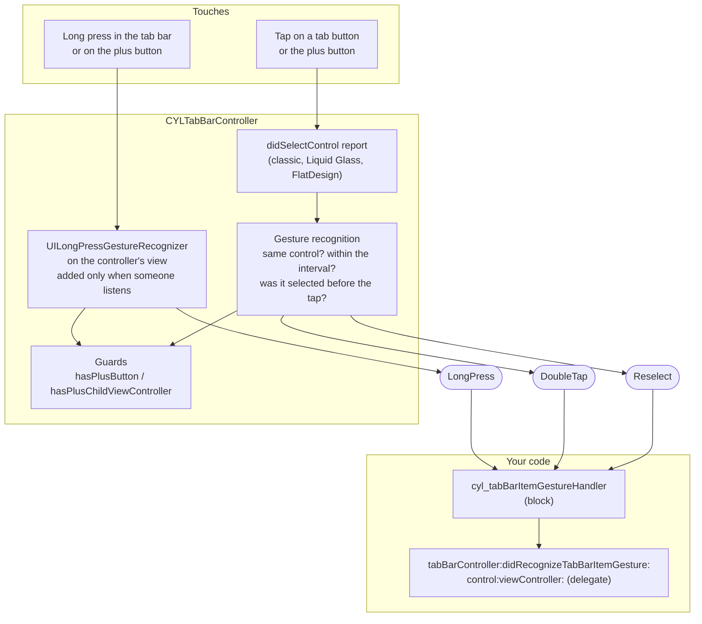
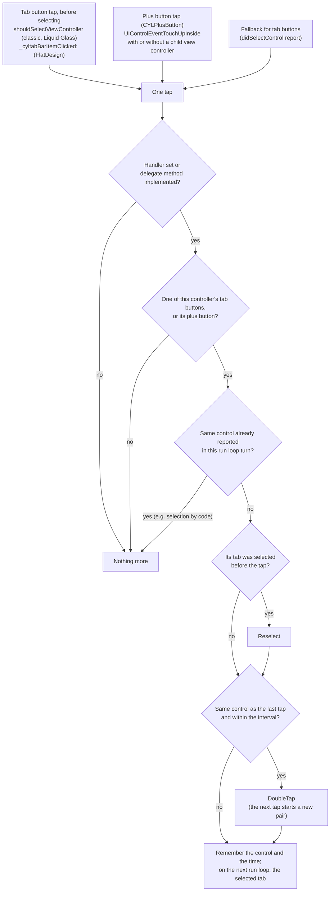
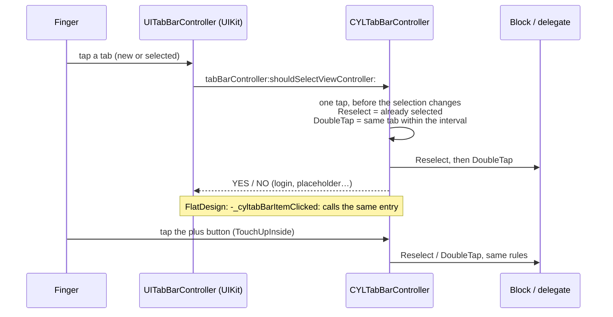

# [CN]TabBarItem 手势：再次点击、双击与长按
# [EN]Tab bar item gestures: reselect, double tap and long press

<!-- bound-classes: CYLTabBarController -->
<!-- binding:start -->
<!-- Generated by scripts/update-docs-navigation.py; do not edit by hand. -->

| 中文 | English |
|:---|:---|
| 绑定的代码类 `CYLTabBarController`：[`CYLTabBarController/CYLTabBarController.h`](../CYLTabBarController/CYLTabBarController.h) | Bound to the class `CYLTabBarController`: [`CYLTabBarController/CYLTabBarController.h`](../CYLTabBarController/CYLTabBarController.h) |

<!-- binding:end -->

| 中文 | English |
|:---|:---|
| 解决 [#152](https://github.com/ChenYilong/CYLTabBarController/issues/152)：希望拿到 Tab 按钮的双击事件，像微博一样双击刷新。以前 Demo 只能在 `-tabBarController:shouldSelectViewController:` 中判断"点击已选中的 Tab"，没有专门的 API。现在 CYLTabBarController 直接报告三种手势，**block 与代理方法两种方式都支持，也可以同时使用**，适用于经典系统 TabBar、液态玻璃（Liquid Glass）与扁平样式（FlatDesign），Tab 按钮与 PlusButton 均可。 | Solves [#152](https://github.com/ChenYilong/CYLTabBarController/issues/152): get a tab button's double tap, to refresh on double tap as Weibo does. Before, the demo could only detect "a tap on the selected tab" in `-tabBarController:shouldSelectViewController:`; there was no API for it. CYLTabBarController now reports three gestures, **as a block and as a delegate method, which can be used together**, in the classic system tab bar, Liquid Glass and FlatDesign, on tab buttons and on the plus button. |

## [CN]目录
## [EN]Contents

<!-- navigation:start -->
<!-- Generated by scripts/update-docs-navigation.py; do not edit by hand. -->

| 中文 | English |
|:---|:---|
| [三种手势](#cn三种手势) | [The three gestures](#enthe-three-gestures) |
| [API](#cnapi) | [API](#enapi) |
| [各项关系](#cn各项关系) | [How the pieces relate](#enhow-the-pieces-relate) |
| [一次点击的识别流程](#cn一次点击的识别流程) | [What happens on each tap](#enwhat-happens-on-each-tap) |
| [统一接口：在 shouldSelect 中识别点击（含液态玻璃）](#cn统一接口在-shouldselect-中识别点击含液态玻璃) | [One entry for every tap: shouldSelect (including Liquid Glass)](#enone-entry-for-every-tap-shouldselect-including-liquid-glass) |
| [代码演示](#cn代码演示) | [Code](#encode) |
| &nbsp;&nbsp;&nbsp;&nbsp;↳ [Objective-C (block)](#objective-c-block) | &nbsp;&nbsp;&nbsp;&nbsp;↳ [Objective-C (block)](#objective-c-block) |
| &nbsp;&nbsp;&nbsp;&nbsp;↳ [Objective-C (delegate)](#objective-c-delegate) | &nbsp;&nbsp;&nbsp;&nbsp;↳ [Objective-C (delegate)](#objective-c-delegate) |
| &nbsp;&nbsp;&nbsp;&nbsp;↳ [Swift (delegate)](#swift-delegate) | &nbsp;&nbsp;&nbsp;&nbsp;↳ [Swift (delegate)](#swift-delegate) |
| [Demo](#cndemo) | [Demos](#endemos) |
| [注意事项](#cn注意事项) | [Notes](#ennotes) |
| [测试与截图](#cn测试与截图) | [Testing and screenshots](#entesting-and-screenshots) |

<!-- navigation:end -->

## [CN]三种手势
## [EN]The three gestures

| `CYLTabBarItemGesture` | 中文 | English |
|:---|:---|:---|
| `CYLTabBarItemGestureReselect` | 点击已经选中的 Tab，例如滚动到顶部。 | A tap on the tab that is already selected, e.g. scroll to the top. |
| `CYLTabBarItemGestureDoubleTap` | 在 `cyl_tabBarItemDoubleTapInterval`（默认 0.35 秒）内连续两次点击同一个 Tab，例如刷新。第二次点击同时也是 Reselect，Reselect 先回调。第三次点击重新开始计数。 | Two taps on the same tab within `cyl_tabBarItemDoubleTapInterval` (0.35 s by default), e.g. refresh. The second tap is also a Reselect, reported first. A third tap starts a new pair. |
| `CYLTabBarItemGestureLongPress` | 按住超过 `cyl_tabBarItemLongPressDuration`（默认 0.5 秒）时回调，例如弹出菜单。手指抬起时该 Tab 仍会照常被选中。 | Reported once a press lasts `cyl_tabBarItemLongPressDuration` (0.5 s by default), e.g. a menu. The tab is still selected as usual when the finger lifts. |

## [CN]API
## [EN]API

| API | 中文 | English |
|:---|:---|:---|
| `cyl_tabBarItemGestureHandler` | block，每个手势都会回调，先于代理方法。 | A block, called for every gesture, before the delegate method. |
| `-tabBarController:didRecognizeTabBarItemGesture:control:viewController:` | `CYLTabBarControllerDelegate` 的可选方法；Swift 中为 `tabBarController(_:didRecognize:control:viewController:)`。 | An optional `CYLTabBarControllerDelegate` method; `tabBarController(_:didRecognize:control:viewController:)` in Swift. |
| `cyl_tabBarItemDoubleTapInterval` | 双击的最长间隔（秒），默认 0.35。 | The longest time between the two taps of a double tap, in seconds; 0.35 by default. |
| `cyl_tabBarItemLongPressDuration` | 长按的时长（秒），默认 0.5。 | How long a press lasts before it is a long press, in seconds; 0.5 by default. |

| 中文 | English |
|:---|:---|
| 回调参数：`control` 为 Tab 按钮或 PlusButton；`viewController` 为对应 Tab 的控制器（PlusButton 为其子控制器，没有子控制器时为 nil）。可用 `control.cyl_tabBarItemIdentifier` 区分 Tab（#408）。 | Parameters: `control` is the tab button or the plus button; `viewController` is the tab's view controller (the plus child view controller for the plus button, nil without one). Tell tabs apart with `control.cyl_tabBarItemIdentifier` (#408). |

## [CN]各项关系
## [EN]How the pieces relate



## [CN]一次点击的识别流程
## [EN]What happens on each tap



## [CN]统一接口：在 shouldSelect 中识别点击（含液态玻璃）
## [EN]One entry for every tap: shouldSelect (including Liquid Glass)

| 中文 | English |
|:---|:---|
| **可行性评估**：液态玻璃（iOS 26+）下 Tab 按钮没有 target-action，`didSelectControl` 的上报来自两个时刻：点击新 Tab 时在手指**抬起**时由 `selectedViewController` 的 setter 上报，再次点击已选中的 Tab 时在手指**按下**时由 `-gestureRecognizerShouldBegin:` 上报。跨这两个时刻计算双击间隔、在液态玻璃气泡移动中读取 `selected`，都不可靠。而 UIKit 对**每次用户点击**都会询问一次 `-tabBarController:shouldSelectViewController:`：新 Tab 与已选中的 Tab 都会询问，且都在选中变化**之前**；代码切换（`selectedIndex` 等）不会询问；它是公开 API，不依赖私有手势的状态。因此用它作为点击来源：计时一致，Reselect 就是"已经选中"，代码切换不会被误判为点击。结论：**可行，且比基于私有手势状态的方案更稳定**。 | **Assessment**: with Liquid Glass (iOS 26+) a tab button has no target-action, and the `didSelectControl` reports come at two moments: a new tab from the `selectedViewController` setter when the finger **lifts**, the selected tab from `-gestureRecognizerShouldBegin:` when it **touches down**. Timing a double tap across them, or reading `selected` while the lens moves, was unreliable. UIKit, however, asks `-tabBarController:shouldSelectViewController:` **once per user tap**: for a new tab and for the selected tab alike, always **before** the selection changes, never for a selection made in code (`selectedIndex`…), and it is public API, independent of private gesture states. Used as the tap source, every tap is timed at the same moment, Reselect is simply "already selected", and selection by code is never taken for a tap. Verdict: **feasible, and steadier than relying on the state of private gestures**. |
| **统一接口**：库内部只有一个入口"用户点击 Tab 按钮、即将选中某个控制器"，由 `-tabBarController:shouldSelectViewController:`（经典与液态玻璃）和 `-_cyltabBarItemClicked:`（扁平样式，无需代理）调用；对外仍是同一组 block 与代理方法，三种样式行为一致。 | **One entry**: inside the library there is a single entry, "a user tap on a tab button is about to select this view controller", called from `-tabBarController:shouldSelectViewController:` (classic and Liquid Glass) and from `-_cyltabBarItemClicked:` (FlatDesign, no delegate needed). Outside, it is the same block and delegate method, with the same behavior in all three styles. |
| **PlusButton 也走同一入口**：PlusButton（CYLPlusButton）在 `UIControlEventTouchUpInside`（一次点击完成）时进入同一入口，有无子控制器、三种样式都一样，因此**双击 PlusButton 同样回调 DoubleTap**，再次点击已选中的 PlusButton 子控制器回调 Reselect。手指按下时记录当时选中的控制器，因此即使 `-plusChildViewControllerButtonClicked:` 已先切换到子控制器，Reselect 依然准确。点击 PlusButton 下方的 Tab 按钮（`shouldSelectViewController` 询问 PlusButton 子控制器）同样算作点击 PlusButton。PlusButton 原有的处理路径（按样式不同，在按下或抬起时）不再用于手势计数。 | **The plus button takes the same entry**: the plus button (a CYLPlusButton) enters it on `UIControlEventTouchUpInside` (when a tap completes), with or without a child view controller, in all three styles, so **a double tap on the plus button is reported as DoubleTap too**, and a tap on its selected child view controller as Reselect. The selected view controller is recorded on touch down, so Reselect stays right even though `-plusChildViewControllerButtonClicked:` has already selected the child. A tap on the tab button under the plus button (`shouldSelectViewController` asked for the plus child view controller) also counts as a tap on the plus button. The plus button's own paths (on touch down or lift, depending on the style) are no longer used for counting. |
| **前提**：UIKit 只询问 TabBarController 的 `delegate`。`delegate` 为 TabBarController 自己（Demo 中均如此），或子类重写该方法时调用 `super`，即可走这一入口（与 #19 需要登录的 Tab 的要求相同）。否则 Tab 按钮回退到 `didSelectControl` 上报。PlusButton 不受此影响，始终通过自己的点击事件进入统一入口。 | **Requirement**: UIKit only asks the tab bar controller's `delegate`. With the tab bar controller as its own `delegate` (as in every demo), or a subclass override that calls `super`, taps take this entry (the same requirement as #19's tabs that need login). Otherwise tab buttons fall back to the `didSelectControl` reports. The plus button is not affected: it always enters through its own touch events. |



```swift
// A subclass that overrides shouldSelect: call super so the gestures keep working.
// 重写 shouldSelect 的子类：调用 super，手势才能继续生效。
override func tabBarController(_ tabBarController: UITabBarController, shouldSelect viewController: UIViewController) -> Bool {
    _ = super.tabBarController(tabBarController, shouldSelect: viewController)
    return true
}
```

## [CN]代码演示
## [EN]Code

### Objective-C (block)

| 中文 | English |
|:---|:---|
| 摘自 `Example/MainTabBarController.m`。 | From `Example/MainTabBarController.m`. |

```objc
- (void)setUpTabBarItemGestures {
    __weak __typeof(self) weakSelf = self;
    self.cyl_tabBarItemGestureHandler = ^(CYLTabBarController *tabBarController, CYLTabBarItemGesture gesture,
                                          UIControl *control, UIViewController *viewController) {
        UIViewController *page = [viewController cyl_getViewControllerInsteadOfNavigationController];
        switch (gesture) {
            case CYLTabBarItemGestureReselect:  [weakSelf scrollToTop:page]; break;   // tap the selected tab
            case CYLTabBarItemGestureDoubleTap: [page refresh]; break;                 // double tap: refresh
            case CYLTabBarItemGestureLongPress: [weakSelf showActionsForControl:control]; break;
        }
    };
    // self.cyl_tabBarItemDoubleTapInterval = 0.3;   // optional
    // self.cyl_tabBarItemLongPressDuration = 0.4;   // optional
}
```

### Objective-C (delegate)

| 中文 | English |
|:---|:---|
| 摘自 `Example/Classes/FlatDesignExample/MainVC/CYLFlatDesignMainTabBarController.m`（扁平样式）。 | From `Example/Classes/FlatDesignExample/MainVC/CYLFlatDesignMainTabBarController.m` (FlatDesign). |

```objc
- (void)tabBarController:(CYLTabBarController *)tabBarController
didRecognizeTabBarItemGesture:(CYLTabBarItemGesture)gesture
                 control:(UIControl *)control
          viewController:(UIViewController *)viewController {
    [tabBarController cyl_demo_handleTabBarItemGesture:gesture control:control viewController:viewController];
}
```

### Swift (delegate)

| 中文 | English |
|:---|:---|
| 摘自 `Example-Swift/MainTabBarController.swift`。在 CYLTabBarController 子类中实现时，请写明 `@objc(tabBarController:didRecognizeTabBarItemGesture:control:viewController:)`，确保 Objective-C 选择器一致。 | From `Example-Swift/MainTabBarController.swift`. When you implement it in a CYLTabBarController subclass, spell out `@objc(tabBarController:didRecognizeTabBarItemGesture:control:viewController:)` so the Objective-C selector matches. |

```swift
extension MainTabBarController {
    @objc(tabBarController:didRecognizeTabBarItemGesture:control:viewController:)
    func tabBarController(_ _: CYLTabBarController, didRecognize gesture: CYLTabBarItemGesture,
                          control: UIControl, viewController: UIViewController?) {
        let page = viewController?.cyl_getViewControllerInsteadOfNavigationController()
        switch gesture {
        case .reselect:  (page as? UITableViewController)?.tableView.setContentOffset(.zero, animated: true)
        case .doubleTap: (page as? UITableViewController)?.tableView.reloadData()
        case .longPress: print("long press on", control.cyl_tabBarItemIdentifier ?? "")
        @unknown default: break
        }
    }
}

// Or the block: 或使用 block：
tabBarController.cyl_tabBarItemGestureHandler = { _, gesture, control, viewController in
    if gesture == .doubleTap { /* refresh */ }
}
```

## [CN]Demo
## [EN]Demos

| Demo | 中文 | English |
|:---|:---|:---|
| `Example`（ObjC，`MainTabBarController`） | block 方式：再次点击滚动到顶部，双击调用页面的 `-refresh`，长按弹出菜单（可选中该 Tab）。替换了以前在 `shouldSelectViewController` 中的"再次点击刷新"。 | Block API: reselect scrolls to the top, double tap calls the page's `-refresh`, long press shows a menu (with a way to select the tab). Replaces the old "re-tap to refresh" in `shouldSelectViewController`. |
| `Example`（扁平样式，`CYLFlatDesignMainTabBarController`） | 代理方法，行为与上一行相同。 | The delegate method, with the same behavior. |
| `Example-Swift` | Swift 代理方法：再次点击滚动到顶部，双击重新加载并在导航栏提示 1 秒，长按弹出菜单。 | The Swift delegate method: reselect scrolls to the top, double tap reloads and shows a 1-second prompt in the navigation bar, long press shows a menu. |

## [CN]注意事项
## [EN]Notes

| 中文 | English |
|:---|:---|
| **双击也会先触发 Reselect**：两次点击中的第二次本身就是"点击已选中的 Tab"，因此先回调 Reselect，再回调 DoubleTap。如果只想在双击时做事，在 Reselect 中不做处理即可；不会为了区分而延迟回调。 | **A double tap also brings a Reselect first**: the second tap is itself "a tap on the selected tab", so Reselect is reported, then DoubleTap. To act only on double taps, do nothing for Reselect; no delay is added to tell them apart. |
| **代码切换不算点击**：Tab 按钮的点击来自 `shouldSelectViewController`（扁平样式为 `-_cyltabBarItemClicked:`），只在用户点击时调用，因此代码切换不会产生 Reselect 或 DoubleTap。回退到 `didSelectControl` 上报时（代理不是 TabBarController 自己，或子类未调用 super），代码切换也会上报；同一 runloop 内同一控件的多次上报只算一次。 | **Selection by code is no tap**: tab button taps come from `shouldSelectViewController` (`-_cyltabBarItemClicked:` in FlatDesign), which only user taps reach, so selecting in code gives no Reselect or DoubleTap. With the `didSelectControl` fallback (the delegate is not the tab bar controller, or a subclass does not call super), selection by code is reported too; several reports of one control in one run loop turn count once. |
| **长按不阻止选中**：长按手势不取消任何触摸，手指抬起时 Tab 照常被选中，TabBar、液态玻璃的手势与页面滚动都不受影响。例外：同时设置了 [Tab 交互](Tab-Interactions.md)（#535）的 `cyl_didLongPressControlBlock` 或 `-tabBarController:didLongPressControl:` 时，按其文档，长按后抬起手指不会选中该 Tab。两者共用同一个长按手势，一次长按先回调它们，再回调 `CYLTabBarItemGestureLongPress`；`cyl_tabBarItemLongPressDuration` 与 `cyl_tabButtonLongPressMinimumDuration` 是同一个值（最短 0.1 秒）。 | **A long press does not prevent the selection**: the recognizer cancels no touch, so the tab is still selected when the finger lifts, and the tab bar, Liquid Glass gestures and page scrolling are unaffected. Exception: when `cyl_didLongPressControlBlock` or `-tabBarController:didLongPressControl:` of the [tab interactions](Tab-Interactions.md) (#535) is set too, lifting the finger after a long press does not select the tab, as those document. Both share one long press recognizer: one long press calls them first, then `CYLTabBarItemGestureLongPress`; `cyl_tabBarItemLongPressDuration` and `cyl_tabButtonLongPressMinimumDuration` are the same value (at least 0.1 s). |
| **按需启用**：只有设置了 block 或实现了代理方法时才添加长按手势，并识别手势；否则不做任何事。 | **Only when used**: the long press recognizer is added, and gestures are recognized, only when a block is set or the delegate method is implemented; otherwise nothing happens. |
| **PlusButton**：仅在 `hasPlusButton` 时处理；`viewController` 仅在 `hasPlusChildViewController` 时为子控制器。 | **The plus button**: handled only with `hasPlusButton`; `viewController` is its child view controller only with `hasPlusChildViewController`. |
| **iOS 27.1 竖向栏**：竖向栏中的 Tab 按钮不在 TabBar 内，长按暂不支持（点击、再次点击与双击正常）。 | **iOS 27.1 vertical bar**: its tab buttons are outside the tab bar, so long press is not supported there yet (taps, reselect and double tap work). |

## [CN]测试与截图
## [EN]Testing and screenshots

| 中文 | English |
|:---|:---|
| 本次修改在 Linux 环境中完成，无法运行 Xcode 和 iOS 模拟器，因此**没有截图**，也未编译验证。建议在三种样式下验证：① 点击已选中的 Tab，页面滚动到顶部；② 快速双击，页面刷新，且只回调一次 DoubleTap；③ 长按 Tab 与 PlusButton，弹出菜单，抬起手指后 Tab 照常选中；④ 未设置 block 也未实现代理方法时，行为与以前完全一致。验证后的截图请放在 `docs/assets/` 中，并用 `` 引用。 | This change was made on Linux, where Xcode and the iOS simulator cannot run, so there are **no screenshots** and it has not been compiled. In all three styles, check: ① a tap on the selected tab scrolls the page to the top; ② a quick double tap refreshes, with one DoubleTap; ③ a long press on a tab and on the plus button shows the menu, and the tab is selected when the finger lifts; ④ with no block and no delegate method, nothing changes. Put screenshots from these checks in `docs/assets/` and reference them as ``. |
