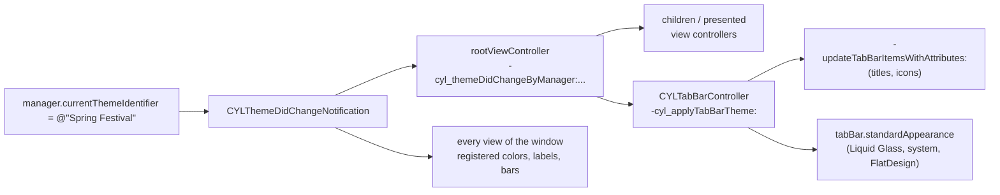

# [CN]换肤（主题切换）
# [EN]Theme switching (skins)

<!-- bound-classes: CYLThemeManager, CYLThemeManagerCenter, CYLTabBarController -->
<!-- binding:start -->
<!-- Generated by scripts/update-docs-navigation.py; do not edit by hand. -->

| 中文 | English |
|:---|:---|
| 绑定的代码类 `CYLThemeManager`：[`CYLTabBarController/CYLUtils/CYLComponents/CYLTheme/CYLThemeManager.h`](../CYLTabBarController/CYLUtils/CYLComponents/CYLTheme/CYLThemeManager.h) | Bound to the class `CYLThemeManager`: [`CYLTabBarController/CYLUtils/CYLComponents/CYLTheme/CYLThemeManager.h`](../CYLTabBarController/CYLUtils/CYLComponents/CYLTheme/CYLThemeManager.h) |
| 绑定的代码类 `CYLThemeManagerCenter`：[`CYLTabBarController/CYLUtils/CYLComponents/CYLTheme/CYLThemeManagerCenter.h`](../CYLTabBarController/CYLUtils/CYLComponents/CYLTheme/CYLThemeManagerCenter.h) | Bound to the class `CYLThemeManagerCenter`: [`CYLTabBarController/CYLUtils/CYLComponents/CYLTheme/CYLThemeManagerCenter.h`](../CYLTabBarController/CYLUtils/CYLComponents/CYLTheme/CYLThemeManagerCenter.h) |
| 绑定的代码类 `CYLTabBarController`：[`CYLTabBarController/CYLTabBarController.h`](../CYLTabBarController/CYLTabBarController.h) | Bound to the class `CYLTabBarController`: [`CYLTabBarController/CYLTabBarController.h`](../CYLTabBarController/CYLTabBarController.h) |

<!-- binding:end -->

| 中文 | English |
|:---|:---|
| 解决 [#216](https://github.com/ChenYilong/CYLTabBarController/issues/216)「支持节日活动换肤」，以及 [#136](https://github.com/ChenYilong/CYLTabBarController/issues/136)「更换主题时 TabBar 上 item 属性无法动态更改」。新增一套换肤组件（位于 `CYLUtils/CYLComponents/CYLTheme/`）：注册若干主题，修改当前主题后，所有视图控制器与视图都会收到回调；`CYLTabBarController` 收到后原地更新 TabBar 的背景、item 颜色、标题与图标，适用于液态玻璃、系统 TabBar、扁平样式，无需新建 TabBar，也无需重新创建页面。 | Solves [#216](https://github.com/ChenYilong/CYLTabBarController/issues/216), "skins for holidays and events", and [#136](https://github.com/ChenYilong/CYLTabBarController/issues/136), "the tab items cannot change when the theme changes". A new theme component (in `CYLUtils/CYLComponents/CYLTheme/`): register some themes and change the current one, and every view controller and view is told; `CYLTabBarController` then restyles its tab bar in place (background, item colors, titles and icons) in Liquid Glass, the system tab bar and FlatDesign, with no new tab bar and no new pages. |

## [CN]目录
## [EN]Contents

<!-- navigation:start -->
<!-- Generated by scripts/update-docs-navigation.py; do not edit by hand. -->

| 中文 | English |
|:---|:---|
| [API](#cnapi) | [API](#enapi) |
| [用法](#cn用法) | [Usage](#enusage) |
| [TabBar 主题：CYLTabBarTheme](#cntabbar-主题cyltabbartheme) | [Tab bar themes: CYLTabBarTheme](#entab-bar-themes-cyltabbartheme) |
| [跟随系统深色模式](#cn跟随系统深色模式) | [Following the system Dark Mode](#enfollowing-the-system-dark-mode) |
| [视图与颜色](#cn视图与颜色) | [Views and colors](#enviews-and-colors) |
| [代码组织](#cn代码组织) | [Code layout](#encode-layout) |
| [演示](#cn演示) | [Demo](#endemo) |
| [限制](#cn限制) | [Limits](#enlimits) |
| [测试与截图](#cn测试与截图) | [Testing and screenshots](#entesting-and-screenshots) |

<!-- navigation:end -->

## [CN]API
## [EN]API

```Objective-C
// CYLUtils/CYLComponents/CYLTheme/CYLThemeManager.h
FOUNDATION_EXTERN NSNotificationName const CYLThemeDidChangeNotification;

@interface CYLThemeManager : NSObject
@property (nonatomic, copy, readonly) __kindof NSObject<NSCopying> *name;
@property (nonatomic, copy, nullable) __kindof NSObject<NSCopying> *currentThemeIdentifier;
@property (nonatomic, strong, nullable) __kindof NSObject *currentTheme;
@property (nonatomic, copy, readonly, nullable) NSArray *themeIdentifiers;
@property (nonatomic, copy, readonly, nullable) NSArray *themes;
@property (nonatomic, copy, nullable) NSObject * _Nullable (^themeGenerator)(NSObject<NSCopying> *identifier);
@property (nonatomic, copy, nullable) NSObject<NSCopying> * _Nullable (^themeIdentifierGenerator)(NSObject *theme);
@property (nonatomic, assign) BOOL respondsSystemStyleAutomatically;                                      // iOS 13+
@property (nonatomic, copy, nullable) NSObject<NSCopying> * _Nullable (^identifierForTrait)(UITraitCollection *trait); // iOS 13+
- (void)addThemeIdentifier:(NSObject<NSCopying> *)identifier theme:(NSObject *)theme;
- (void)removeThemeIdentifier:(NSObject<NSCopying> *)identifier;
- (void)removeTheme:(NSObject *)theme;
- (nullable NSObject *)themeForIdentifier:(NSObject<NSCopying> *)identifier;
- (nullable NSObject<NSCopying> *)identifierForTheme:(NSObject *)theme;
- (void)updateThemeForTraitCollection:(UITraitCollection *)traitCollection;                               // iOS 13+
@end

// CYLUtils/CYLComponents/CYLTheme/CYLThemeManagerCenter.h
@interface CYLThemeManagerCenter : NSObject
@property (class, nonatomic, strong, readonly) CYLThemeManager *defaultThemeManager;
@property (class, nonatomic, copy, readonly) NSArray<CYLThemeManager *> *themeManagers;
+ (CYLThemeManager *)themeManagerWithName:(NSObject<NSCopying> *)name;
+ (void)updateThemesForTraitCollection:(UITraitCollection *)traitCollection;                              // iOS 13+
@end

// CYLUtils/CYLComponents/CYLTheme/UIColor+CYLTheme.h
+ (UIColor *)cyl_colorWithThemeProvider:(CYLThemeColorProvider)provider;
+ (UIColor *)cyl_colorWithName:(nullable NSString *)name themeProvider:(CYLThemeColorProvider)provider;
+ (UIColor *)cyl_colorWithThemeManagerName:(NSObject<NSCopying> *)managerName provider:(CYLThemeColorProvider)provider;
+ (UIColor *)cyl_colorWithName:(nullable NSString *)name themeManagerName:(NSObject<NSCopying> *)managerName provider:(CYLThemeColorProvider)provider;

// CYLUtils/CYLComponents/CYLTheme/UIView+CYLTheme.h and UIViewController+CYLTheme.h
- (void)cyl_registerThemeColorProperties:(NSArray<NSString *> *)getters;      // UIView
- (void)cyl_unregisterThemeColorProperties:(NSArray<NSString *> *)getters;    // UIView
@property (nonatomic, copy, nullable) void (^cyl_themeDidChangeBlock)(void);  // UIView
- (void)cyl_themeDidChangeByManager:(CYLThemeManager *)manager identifier:(id)identifier theme:(id)theme; // UIView, UIViewController

// CYLTabBarController.h
@protocol CYLTabBarTheme <NSObject>
@optional
- (nullable NSArray<NSDictionary<NSString *, id> *> *)cyl_tabBarItemsAttributesForTabBarController:(CYLTabBarController *)tabBarController;
- (nullable UITabBarAppearance *)cyl_tabBarAppearanceForTabBarController:(CYLTabBarController *)tabBarController; // iOS 13+
- (void)cyl_customizeTabBarController:(CYLTabBarController *)tabBarController;
@end

@interface CYLTabBarController (CYLTheme)
- (void)cyl_applyTabBarTheme:(nullable id)theme;
@end
```

| 中文 | English |
|:---|:---|
| 主题可以是任意对象，identifier 可以是任意 `NSCopying` 对象（通常为 `NSString`），二者都不能为空、不能重复。修改 `currentThemeIdentifier` 或 `currentTheme` 之一，另一个会随之改变。第一次设置当前主题不算切换（不发送通知），请在启动时、界面显示之前设置。 | A theme is any object and its identifier any `NSCopying` object (usually an `NSString`); neither may be nil or repeated. Setting `currentThemeIdentifier` or `currentTheme` sets the other one too. The first value set is not a change (nothing is posted): set it at launch, before the UI shows. |
| 主题切换时依次：发送 `CYLThemeDidChangeNotification`（`object` 为管理器）；从每个可见 window 的根控制器开始，对所有子控制器与 present 出的控制器调用 `-cyl_themeDidChangeByManager:identifier:theme:`；最后对 window 上的所有视图调用同名方法。 | When the theme changes, in order: `CYLThemeDidChangeNotification` is posted (its `object` is the manager); `-cyl_themeDidChangeByManager:identifier:theme:` is called on each visible window's root view controller and on through every child and presented view controller; then the same method is called on every view of the window. |
| 只需要一套主题时使用 `CYLThemeManagerCenter.defaultThemeManager`；需要多个维度（例如全局浅色 / 深色，加上某个页面的四种颜色）时，用 `+themeManagerWithName:` 为每个维度获取一个管理器，各自互不影响。 | One set of themes: use `CYLThemeManagerCenter.defaultThemeManager`. Several dimensions (e.g. light / dark for the app, plus four colors for one page): get one manager per dimension with `+themeManagerWithName:`; they do not affect each other. |



## [CN]用法
## [EN]Usage

| 中文 | English |
|:---|:---|
| 1. 定义主题类并遵守 `CYLTabBarTheme`，返回该主题下的 TabBar 外观、图标（可选）。下面的“春节”皮肤换成节日图标与红金配色；“默认”主题什么也不返回，TabBar 恢复 App 自己的外观。 | 1. Define a theme class that adopts `CYLTabBarTheme` and returns the tab bar's appearance and, optionally, icons in this theme. The "Spring Festival" skin below has holiday icons and red and gold colors; the "Default" theme returns nothing, so the tab bar shows the app's own look again. |

```Objective-C
@interface MyTheme : NSObject <CYLTabBarTheme>
@property (nonatomic, strong) UIColor *tintColor;   // nil: the app's own look
@property (nonatomic, strong) UIColor *barColor;
@property (nonatomic, assign) BOOL holidayIcons;
@end

@implementation MyTheme

- (NSArray<NSDictionary *> *)cyl_tabBarItemsAttributesForTabBarController:(CYLTabBarController *)tabBarController {
    if (!self.holidayIcons) {
        return nil; // the app's own icons
    }
    return @[
        @{ CYLTabBarItemImage : @"home_spring", CYLTabBarItemSelectedImage : @"home_spring_selected" },
        @{ CYLTabBarItemImage : @"mine_spring", CYLTabBarItemSelectedImage : @"mine_spring_selected" },
    ];
}

- (UITabBarAppearance *)cyl_tabBarAppearanceForTabBarController:(CYLTabBarController *)tabBarController API_AVAILABLE(ios(13.0)) {
    if (!self.tintColor) {
        return nil; // the app's own appearance
    }
    UITabBarAppearance *appearance = [[UITabBarAppearance alloc] init];
    [appearance configureWithOpaqueBackground];
    appearance.backgroundColor = self.barColor;
    appearance.stackedLayoutAppearance.selected.iconColor = self.tintColor;
    appearance.stackedLayoutAppearance.selected.titleTextAttributes = @{ NSForegroundColorAttributeName : self.tintColor };
    return appearance;
}

@end
```

| 中文 | English |
|:---|:---|
| 2. 启动时（TabBar 显示之前）注册主题，并恢复用户上次的选择；主题切换时保存。 | 2. At launch (before the tab bar shows), register the themes and restore the user's last choice; save it when the theme changes. |

```Objective-C
CYLThemeManager *manager = CYLThemeManagerCenter.defaultThemeManager;
[manager addThemeIdentifier:@"Default" theme:[MyTheme new]];
[manager addThemeIdentifier:@"Spring Festival" theme:springFestivalTheme];
manager.currentThemeIdentifier = [[NSUserDefaults standardUserDefaults] stringForKey:@"theme"] ?: @"Default";

[[NSNotificationCenter defaultCenter] addObserverForName:CYLThemeDidChangeNotification object:nil queue:nil usingBlock:^(NSNotification *note) {
    CYLThemeManager *changed = note.object;
    [[NSUserDefaults standardUserDefaults] setObject:changed.currentThemeIdentifier forKey:@"theme"];
}];
```

| 中文 | English |
|:---|:---|
| 3. 换肤：一行代码。`CYLTabBarController` 首次显示时会应用当前主题，之后每次切换都会原地更新。 | 3. Switch the skin: one line. `CYLTabBarController` applies the current theme when it first appears, and restyles in place on every change. |

```Objective-C
CYLThemeManagerCenter.defaultThemeManager.currentThemeIdentifier = @"Spring Festival";
```

```Swift
// Swift: the same API.
CYLThemeManagerCenter.defaultThemeManager.currentThemeIdentifier = "Spring Festival" as NSString
```

## [CN]TabBar 主题：CYLTabBarTheme
## [EN]Tab bar themes: CYLTabBarTheme

| 中文 | English |
|:---|:---|
| `-cyl_tabBarItemsAttributesForTabBarController:`：结构与 `tabBarItemsAttributes` 相同（每个 Tab 一项，PlusButton 不占项），通过 `-updateTabBarItemsWithAttributes:`（[#601](https://github.com/ChenYilong/CYLTabBarController/issues/601)）原地应用；图片可以是图片名、文件绝对路径或 `UIImage`（例如 SF Symbols）。使用 Lottie 动画的 Tab 继续显示动画。 | `-cyl_tabBarItemsAttributesForTabBarController:` has the shape of `tabBarItemsAttributes` (one entry per tab, none for the plus button) and is applied in place with `-updateTabBarItemsWithAttributes:` ([#601](https://github.com/ChenYilong/CYLTabBarController/issues/601)); an image is a name, the absolute path of a file or a `UIImage` (e.g. an SF Symbol). A tab with a Lottie animation keeps the animation. |
| `-cyl_tabBarAppearanceForTabBarController:`（iOS 13+）：赋给 `tabBar.standardAppearance`，iOS 15+ 同时赋给 `scrollEdgeAppearance`；扁平样式通过已有的同步机制跟随（见 [FlatDesign-StandardAppearance.md](FlatDesign-StandardAppearance.md)），标题偏移（[#475](https://github.com/ChenYilong/CYLTabBarController/issues/475)）同样保留。请每次返回带有该主题颜色的新对象。 | `-cyl_tabBarAppearanceForTabBarController:` (iOS 13+) is assigned to `tabBar.standardAppearance` and, on iOS 15+, `scrollEdgeAppearance`; FlatDesign follows through the existing sync (see [FlatDesign-StandardAppearance.md](FlatDesign-StandardAppearance.md)), and title offsets ([#475](https://github.com/ChenYilong/CYLTabBarController/issues/475)) are kept. Return a new object with the theme's colors each time. |
| `-cyl_customizeTabBarController:`：其余内容，例如 PlusButton、所有页面的 `tintColor`、iOS 13 以前的 `tabBar.tintColor`。 | `-cyl_customizeTabBarController:`: anything else, e.g. the plus button, the `tintColor` of every page, `tabBar.tintColor` before iOS 13. |
| 恢复：未实现或返回 nil 的方法，会把 TabBar 恢复为第一次被主题修改前 App 自己的标题、图标与外观。不遵守 `CYLTabBarTheme` 的默认管理器主题同样会恢复。其他管理器的主题只有遵守 `CYLTabBarTheme` 时才会作用于 TabBar，因此页面级主题不会影响 TabBar。 | Restoring: a method that is missing or returns nil gives the tab bar back the app's own titles, icons and appearance from before the first theme changed them. A theme of the default manager that does not adopt `CYLTabBarTheme` restores them too. A theme of another manager restyles the tab bar only when it adopts `CYLTabBarTheme`, so the themes of a single page leave the tab bar alone. |
| 需要立即应用（例如自己管理主题对象）时，可直接调用 `-[CYLTabBarController cyl_applyTabBarTheme:]`。 | To apply a theme right away (e.g. one you manage yourself), call `-[CYLTabBarController cyl_applyTabBarTheme:]`. |

## [CN]跟随系统深色模式
## [EN]Following the system Dark Mode

| 中文 | English |
|:---|:---|
| iOS 13+：先设置 `identifierForTrait`，把系统外观转换为主题 identifier，再打开 `respondsSystemStyleAutomatically`。系统外观变化由 `CYLTabBarController` 上报（`+[CYLThemeManagerCenter updateThemesForTraitCollection:]`）；根控制器不是 `CYLTabBarController` 时，请在其 `-traitCollectionDidChange:` 中调用该方法。 | iOS 13+: set `identifierForTrait`, which turns the system appearance into a theme identifier, then turn on `respondsSystemStyleAutomatically`. `CYLTabBarController` reports appearance changes (`+[CYLThemeManagerCenter updateThemesForTraitCollection:]`); when the root view controller is not one, call that method from its `-traitCollectionDidChange:`. |
| App 在后台时，iOS 会以另一种外观各截一次图用于多任务界面，这时的外观变化会被忽略，回到前台时（`UIApplicationDidBecomeActiveNotification`）重新检查，因此不会出现切到后台皮肤就变了，也不会漏掉在后台切换的深色模式。 | In the background iOS draws the app in the other appearance too, to snapshot it for the app switcher: such changes are ignored and checked again once the app is active (`UIApplicationDidBecomeActiveNotification`). So the skin does not change just because the app went to the background, and a Dark Mode switch made meanwhile is not missed. |

```Objective-C
CYLThemeManager *manager = CYLThemeManagerCenter.defaultThemeManager;
manager.identifierForTrait = ^NSObject<NSCopying> *(UITraitCollection *trait) {
    return trait.userInterfaceStyle == UIUserInterfaceStyleDark ? @"Dark" : @"Default";
};
manager.respondsSystemStyleAutomatically = YES;
```

## [CN]视图与颜色
## [EN]Views and colors

| 中文 | English |
|:---|:---|
| `+[UIColor cyl_colorWithThemeProvider:]` 创建跟随主题的颜色：iOS 13+ 为动态颜色，每次绘制时向 provider 取当前主题的值，provider 返回的系统颜色（例如 `labelColor`）仍跟随深色模式。 | `+[UIColor cyl_colorWithThemeProvider:]` makes a color that follows the theme: on iOS 13+ a dynamic color that asks the provider for the current theme's value each time it is drawn; system colors returned by the provider (e.g. `labelColor`) still follow Dark Mode. |
| 用 `-cyl_registerThemeColorProperties:` 注册持有这些颜色的属性（例如 `@[@"backgroundColor", @"tintColor"]`），主题切换时会被设为该颜色的新副本，使 UIKit 重绘（UIKit 遇到同一个颜色对象会跳过赋值）。普通颜色与图片不会被重新设置，因此后来在代码中设置的样式不会被覆盖。 | Register the properties that hold such colors with `-cyl_registerThemeColorProperties:` (e.g. `@[@"backgroundColor", @"tintColor"]`): on a theme change they get a fresh copy of the color, so UIKit redraws (UIKit skips setting the very same color object). Plain colors and images are not set again, so a style set later in code is kept. |
| 无需注册即自动处理：UILabel 与 UITextView 重绘；`UITabBar`、`UINavigationBar`、`UIToolbar` 重新设置 appearance。其他内容（枚举值、layer 的 `CGColor`）请重写 `-cyl_themeDidChangeByManager:identifier:theme:`（调用 super）或设置 `cyl_themeDidChangeBlock`。 | Handled without registering: labels and text views redraw; `UITabBar`, `UINavigationBar` and `UIToolbar` assign their appearances again. For anything else (an enum, a layer's `CGColor`), override `-cyl_themeDidChangeByManager:identifier:theme:` (calling super) or set `cyl_themeDidChangeBlock`. |
| 视图控制器的回调会传给所有子控制器，包括尚未显示的 Tab：其 view 可能尚未加载，回调中请先判断 `isViewLoaded`，不要假定它一定晚于 `-viewDidLoad`。 | The view controller callback reaches every child, including tabs not shown yet: their view may not be loaded, so check `isViewLoaded` first and do not count on it coming after `-viewDidLoad`. |

```Objective-C
self.view.backgroundColor = [UIColor cyl_colorWithThemeProvider:^UIColor *(CYLThemeManager *manager, NSString *identifier, MyTheme *theme) {
    return [identifier isEqual:@"Dark"] ? UIColor.blackColor : UIColor.systemBackgroundColor;
}];
[self.view cyl_registerThemeColorProperties:@[ @"backgroundColor" ]];

self.cardView.cyl_themeDidChangeBlock = ^{
    weakSelf.cardView.layer.borderColor = [UIColor cyl_colorWithThemeProvider:provider].cyl_rawColor.CGColor;
};
```

## [CN]代码组织
## [EN]Code layout

| 中文 | English |
|:---|:---|
| 公共代码位于 `CYLUtils` 子库的 `CYLComponents/CYLTheme/` 文件夹，与 Core、CYLBadgeView 共用；`CYLUtils.h` 会导入 `CYLTheme.h`，因此 `#import <CYLTabBarController/CYLTabBarController.h>` 即可使用。`CYLThemePrivate.h` 为私有头文件。TabBar 相关部分（`CYLTabBarTheme`、`cyl_applyTabBarTheme:`）在 Core 的 `CYLTabBarController.h`。 | The shared code is in the `CYLComponents/CYLTheme/` folder of the `CYLUtils` subspec, shared by Core and CYLBadgeView; `CYLUtils.h` imports `CYLTheme.h`, so `#import <CYLTabBarController/CYLTabBarController.h>` is enough. `CYLThemePrivate.h` is private. The tab bar part (`CYLTabBarTheme`, `cyl_applyTabBarTheme:`) is in Core's `CYLTabBarController.h`. |

```text
CYLTabBarController/CYLUtils/
├── CYLUtils.h                      imports CYLComponents/CYLTheme/CYLTheme.h
└── CYLComponents/
    └── CYLTheme/
        ├── CYLTheme.h              umbrella header
        ├── CYLThemeManager.h/.m
        ├── CYLThemeManagerCenter.h/.m
        ├── CYLThemePrivate.h/.m    private
        ├── UIColor+CYLTheme.h/.m
        ├── UIView+CYLTheme.h/.m
        └── UIViewController+CYLTheme.h/.m
```

## [CN]演示
## [EN]Demo

| 中文 | English |
|:---|:---|
| 所有示例的设置分组新增“换肤（主题，issue #216）”一行（`UIViewController+CYLThemeSettings`）：点击打开主题选择器，包括默认、西柚、青草、玫瑰粉、深色，以及换成节日图标（SF Symbols）的春节皮肤；iOS 13+ 还可以选择“跟随系统深色模式”。所选主题保存在本地，下次启动时恢复。ObjC 示例首页导航栏还有一个“换肤”按钮。 | The settings section of every example gets a "Skin (theme, issue #216)" row (`UIViewController+CYLThemeSettings`): a tap opens the theme picker with Default, Grapefruit, Grass, Pink Rose, Dark and a Spring Festival skin with holiday icons (SF Symbols); on iOS 13+ also "Follow the system Dark Mode". The choice is saved and restored at the next launch. The ObjC example's home page also has a "Skin" button in its navigation bar. |
| ObjC 示例在 `SceneDelegate` 中调用 `+[UIViewController cyl_setUpThemeSettings]`，在 TabBar 显示之前注册主题并恢复上次的选择。 | The ObjC example calls `+[UIViewController cyl_setUpThemeSettings]` in its `SceneDelegate`, which registers the themes and restores the last choice before the tab bar shows. |

## [CN]限制
## [EN]Limits

| 中文 | English |
|:---|:---|
| 没有 hook 任何 UIKit 方法（避免与其他库冲突）：只有主题切换时位于 window 上的视图会收到回调；之后才加入 window 的视图在绘制时读取主题颜色，与其他动态颜色相同。 | No UIKit method is swizzled (so it cannot clash with other libraries): only the views in a window when the theme changes get the callback; a view added later reads its theme colors when it is drawn, as any dynamic color. |
| iOS 13 以前没有动态颜色：主题颜色为创建时所在主题的值，已注册的属性在主题切换时更新；`UITabBarAppearance` 不存在，TabBar 颜色请在 `-cyl_customizeTabBarController:` 中设置。 | Before iOS 13 there are no dynamic colors: a theme color has the value of the theme current when it was made, and registered properties update on a theme change; there is no `UITabBarAppearance`, so set the tab bar colors in `-cyl_customizeTabBarController:`. |
| 不提供“动态图片”：`UITabBarItem.selectedImage` 只保存图片的静态副本，动态图片会在切换后失效，选中图标会显示错误的图片。因此 TabBar 图标通过 `-cyl_tabBarItemsAttributesForTabBarController:` 在每次切换时重新设置。 | There are no "dynamic images": `UITabBarItem.selectedImage` keeps only a static copy of an image, so a dynamic image stops following the theme and a selected icon can show the wrong image. Tab bar icons are therefore set again on every switch through `-cyl_tabBarItemsAttributesForTabBarController:`. |
| layer 的 `CGColor` 不会跟随主题，请在回调中重新设置。 | A layer's `CGColor` does not follow the theme: set it again in the callback. |
| 恢复图标时只会恢复主题修改过的 key；主题请提供与 App 自身 `tabBarItemsAttributes` 相同的 key。 | Restoring icons restores the keys a theme changed; give a theme the same keys as the app's own `tabBarItemsAttributes`. |

## [CN]测试与截图
## [EN]Testing and screenshots

| 中文 | English |
|:---|:---|
| 本次修改在没有 Xcode、模拟器与真机的 Linux 环境中完成，无法运行示例，因此本文没有截图，也没有在 iOS 上编译验证。已完成：新增与修改的 Objective-C 代码（`CYLTheme` 全部源文件、`UIViewController+CYLThemeSettings.m`、`CYLTabBarController (CYLTheme)`）基于 UIKit 接口最小桩头文件的语法检查与静态分析（`clang -fsyntax-only -fobjc-arc -Wall -Wextra`、`clang --analyze`，无警告）、`pod lib lint CYLTabBarController.podspec --quick`（通过）、用 xcodeproj 解析 Xcode 工程确认新文件已加入 framework target，以及文档导航检查（`--check` 通过）。`Package.swift` 只新增了一个头文件搜索路径，未能用 Swift 工具链验证。请在合并前用 Xcode 运行 ObjC 示例：点击首页导航栏的“换肤”，依次选择各主题并在液态玻璃、扁平样式之间切换。 | This change was made on Linux, without Xcode, a simulator or a device, so the examples could not be run: there are no screenshots here and nothing was compiled for iOS. Done: a syntax check and static analysis of the new and changed Objective-C code (every `CYLTheme` source, `UIViewController+CYLThemeSettings.m`, `CYLTabBarController (CYLTheme)`) against minimal stub headers of the UIKit API they use (`clang -fsyntax-only -fobjc-arc -Wall -Wextra`, `clang --analyze`, no warnings), `pod lib lint CYLTabBarController.podspec --quick` (passed), parsing the Xcode project with xcodeproj to confirm the new files are in the framework target, and the documentation navigation check (`--check` passed). `Package.swift` only gains one header search path and could not be checked with a Swift toolchain. Before merging, run the ObjC example in Xcode: tap "Skin" in the home page's navigation bar, pick each theme, and switch between Liquid Glass and FlatDesign. |
