# 原地更新 Tab：标题、图标、网络图标与替换页面 / Update Tabs in Place: Titles, Icons, Network Icons and Pages

<!-- bound-classes: CYLTabBarController, CYLPlusButton, CYLImageCache -->
<!-- binding:start -->
<!-- Generated by scripts/update-docs-navigation.py; do not edit by hand. -->

| 中文 | English |
|:---|:---|
| 绑定的代码类 `CYLTabBarController`：[`CYLTabBarController/CYLTabBarController.h`](../CYLTabBarController/CYLTabBarController.h) | Bound to the class `CYLTabBarController`: [`CYLTabBarController/CYLTabBarController.h`](../CYLTabBarController/CYLTabBarController.h) |
| 绑定的代码类 `CYLPlusButton`：[`CYLTabBarController/CYLPlusButton.h`](../CYLTabBarController/CYLPlusButton.h) | Bound to the class `CYLPlusButton`: [`CYLTabBarController/CYLPlusButton.h`](../CYLTabBarController/CYLPlusButton.h) |
| 绑定的代码类 `CYLImageCache`：[`CYLTabBarController/UIImage+CYLTabBarControllerExtention.h`](../CYLTabBarController/UIImage%2BCYLTabBarControllerExtention.h) | Bound to the class `CYLImageCache`: [`CYLTabBarController/UIImage+CYLTabBarControllerExtention.h`](../CYLTabBarController/UIImage%2BCYLTabBarControllerExtention.h) |

<!-- binding:end -->

| 中文 | English |
|:---|:---|
| [#601](https://github.com/ChenYilong/CYLTabBarController/issues/601) 等：App 启动后，在不重建 TabBar、不重新创建页面的前提下，原地修改 Tab 的标题和图标：购买课程后改标题、切换主题或语言、显示用户头像、从网络下载图标（带内存与沙盒缓存）、GIF 动图图标，以及 PlusButton 的标题和图片。液态玻璃、经典样式与扁平样式都支持。 | [#601](https://github.com/ChenYilong/CYLTabBarController/issues/601) and others: after launch, change a tab's title and icon in place, without rebuilding the tab bar or creating its pages again: a new title after a purchase, a theme or language change, the user's avatar, icons downloaded from the network (cached in memory and in the sandbox), animated GIF icons, and the plus button's title and image. Works with Liquid Glass, the classic style and FlatDesign. |
| [#22](https://github.com/ChenYilong/CYLTabBarController/issues/22)：`self.tabBar.items` 在 `-init…` 与 `-viewDidLoad` 中为空。新的 `-performWhenTabBarItemsReady:` 在 item 创建后执行你的代码。 | [#22](https://github.com/ChenYilong/CYLTabBarController/issues/22): `self.tabBar.items` is empty in `-init…` and `-viewDidLoad`. The new `-performWhenTabBarItemsReady:` runs your code once the items exist. |
| [#481](https://github.com/ChenYilong/CYLTabBarController/issues/481)：运行时替换某个 Tab 的页面，例如选中第三个 Tab 时替换相邻两个 Tab 的页面，选中首页时恢复。 | [#481](https://github.com/ChenYilong/CYLTabBarController/issues/481): replace a tab's page at runtime, e.g. the pages of the two neighbors while the third tab is selected, and the original ones when Home is selected. |

## 目录 / Contents

<!-- navigation:start -->
<!-- Generated by scripts/update-docs-navigation.py; do not edit by hand. -->

| 中文 | English |
|:---|:---|
| [用法](#用法--usage) | [Usage](#用法--usage) |
| &nbsp;&nbsp;&nbsp;&nbsp;↳ [标题与图片](#标题与图片--titles-and-images) | &nbsp;&nbsp;&nbsp;&nbsp;↳ [Titles and images](#标题与图片--titles-and-images) |
| &nbsp;&nbsp;&nbsp;&nbsp;↳ [任意视图、本地图片与网络图片](#任意视图本地图片与网络图片--any-view-local-images-and-network-images) | &nbsp;&nbsp;&nbsp;&nbsp;↳ [Any view, local images and network images](#任意视图本地图片与网络图片--any-view-local-images-and-network-images) |
| &nbsp;&nbsp;&nbsp;&nbsp;↳ [初始化时传入图片 URL](#初始化时传入图片-url--image-urls-in-the-initial-attributes) | &nbsp;&nbsp;&nbsp;&nbsp;↳ [Image URLs in the initial attributes](#初始化时传入图片-url--image-urls-in-the-initial-attributes) |
| &nbsp;&nbsp;&nbsp;&nbsp;↳ [缓存策略](#缓存策略--cache-policy) | &nbsp;&nbsp;&nbsp;&nbsp;↳ [Cache policy](#缓存策略--cache-policy) |
| &nbsp;&nbsp;&nbsp;&nbsp;↳ [PlusButton](#plusbutton) | &nbsp;&nbsp;&nbsp;&nbsp;↳ [PlusButton](#plusbutton) |
| &nbsp;&nbsp;&nbsp;&nbsp;↳ [自定义 tabBar.items（#22）/ Customizing tabBar.items (#22)](#自定义-tabbaritems22-customizing-tabbaritems-22) | &nbsp;&nbsp;&nbsp;&nbsp;↳ [自定义 tabBar.items（#22）/ Customizing tabBar.items (#22)](#自定义-tabbaritems22-customizing-tabbaritems-22) |
| &nbsp;&nbsp;&nbsp;&nbsp;↳ [替换 Tab 的页面（#481）/ Replacing a tab's page (#481)](#替换-tab-的页面481-replacing-a-tabs-page-481) | &nbsp;&nbsp;&nbsp;&nbsp;↳ [替换 Tab 的页面（#481）/ Replacing a tab's page (#481)](#替换-tab-的页面481-replacing-a-tabs-page-481) |
| [API](#api) | [API](#api) |
| [导航栏标题跟随 Tab 标题](#导航栏标题跟随-tab-标题--navigation-bar-title-follows-the-tab-title) | [Navigation bar title follows the tab title](#导航栏标题跟随-tab-标题--navigation-bar-title-follows-the-tab-title) |
| [Tab 变化通知](#tab-变化通知--tab-change-notifications) | [Tab change notifications](#tab-变化通知--tab-change-notifications) |
| [Demo](#demo) | [Demo](#demo) |
| [截图](#截图--screenshots) | [Screenshots](#截图--screenshots) |
| [角标](#角标--badges) | [Badges](#角标--badges) |
| [限制](#限制--limits) | [Limits](#限制--limits) |

<!-- navigation:end -->

## 用法 / Usage

### 标题与图片 / Titles and images

| 中文 | English |
|:---|:---|
| `attributes` 使用与 `tabBarItemsAttributes` 相同的 key；未提供的 key 保持不变。这些值也会合并进 `tabBarItemsAttributes`，之后重新加载时仍保留。 | `attributes` takes the keys of `tabBarItemsAttributes`; a missing key keeps its value. The values are merged into `tabBarItemsAttributes` too, so a later reload keeps them. |

```objc
// 一个 Tab（按索引或按页面）/ One tab (by index or by page)
[tabBarController updateTabBarItemAtIndex:1 attributes:@{ CYLTabBarItemTitle : @"已购课程" }];
[tabBarController updateTabBarItemForViewController:self attributes:@{ CYLTabBarItemImage : @"tab_course" }];

// 所有 Tab，例如切换语言后 / Every tab, e.g. after a language change
[tabBarController updateTabBarItemsWithAttributes:@[ @{ CYLTabBarItemTitle : @"Home" }, @{ CYLTabBarItemTitle : @"Me" } ]];
```

### 任意视图、本地图片与网络图片 / Any view, local images and network images

| 中文 | English |
|:---|:---|
| `-setTabBarItemIcon:selectedIcon:size:atIndex:` 接受任意图片来源：`UIImage`、图片名、图片文件的绝对路径、`NSURL`（文件或网络）、`http(s)` 字符串。网络图片下载并缓存；本地图片立即显示；GIF 会播放动画；图片保持自身颜色。图片就绪前，以及加载失败时，Tab 保持自身图标。也能覆盖 Lottie 图标。 | `-setTabBarItemIcon:selectedIcon:size:atIndex:` takes any image source: a `UIImage`, an image name, the absolute path of an image file, an `NSURL` (file or network) or an `http(s)` string. Network images are downloaded and cached; local ones show at once; a GIF animates; images keep their own colors. The tab keeps its own icon until the image is ready, and when loading fails. It also covers a Lottie icon. |

```objc
// 网络 / Network
[tabBarController setTabBarItemIconWithURL:[NSURL URLWithString:@"https://example.com/home.png"]
                               selectedURL:[NSURL URLWithString:@"https://example.com/home_selected.png"]
                                      size:CGSizeMake(24, 24)
                                   atIndex:0];
// 本地：图片名、文件路径、UIImage、文件 URL / Local: a name, a file path, a UIImage, a file URL
[tabBarController setTabBarItemIcon:@"img_tab_home_0" selectedIcon:@"img_tab_home_1" size:CGSizeMake(24, 24) atIndex:0];
[tabBarController setTabBarItemIcon:[NSBundle.mainBundle pathForResource:@"icon" ofType:@"png"] selectedIcon:nil size:CGSizeZero atIndex:1];
// 任意视图（PAG、SDWebImage 的 UIImageView……），传 nil 恢复 / Any view (PAG, an SDWebImage UIImageView...); nil restores
[tabBarController setTabBarItemIconViewProvider:^UIView *(BOOL selected) {
    return [[UIImageView alloc] initWithImage:[UIImage systemImageNamed:(selected ? @"star.fill" : @"star")]];
} atIndex:2];
```

### 初始化时传入图片 URL / Image URLs in the initial attributes

| 中文 | English |
|:---|:---|
| `CYLTabBarItemImage` / `CYLTabBarItemSelectedImage` 是默认图标及占位图；`CYLTabBarItemImageURL` / `CYLTabBarItemSelectedImageURL` 下载完成后覆盖它们，`CYLTabBarItemImageURLSize` 设置尺寸。URL 键同样接受上面的所有本地来源。 | `CYLTabBarItemImage` / `CYLTabBarItemSelectedImage` are the default icons and the placeholders; `CYLTabBarItemImageURL` / `CYLTabBarItemSelectedImageURL` replace them once downloaded, and `CYLTabBarItemImageURLSize` sets their size. The URL keys take every local source above too. |

```objc
@{ CYLTabBarItemTitle : @"首页",
   CYLTabBarItemImage : @"home_normal",                       // 默认与占位 / default and placeholder
   CYLTabBarItemSelectedImage : @"home_selected",
   CYLTabBarItemImageURL : @"https://example.com/home.png",   // 下载后覆盖 / replaces them once downloaded
   CYLTabBarItemSelectedImageURL : @"https://example.com/home_selected.png",
   CYLTabBarItemImageURLSize : [NSValue valueWithCGSize:CGSizeMake(24, 24)] }
```

### 缓存策略 / Cache policy

| 中文 | English |
|:---|:---|
| 参考 SDWebImage 的 `SDImageCache` / `SDImageCacheConfig`：在启动时配置一次 `[CYLImageCache sharedImageCache]`。App 进入后台或退出时删除过期文件及超出上限的文件（最久未用的先删除），收到内存警告时清空内存缓存。单次加载可用 `CYLImageLoadOptions` 调整。 | As SDWebImage's `SDImageCache` / `SDImageCacheConfig`: configure `[CYLImageCache sharedImageCache]` once at launch. Expired files and files over the limit (least recently used first) are removed when the app goes to the background or terminates; the memory cache is emptied on a memory warning. Adjust one load with `CYLImageLoadOptions`. |

```objc
CYLImageCache *cache = [CYLImageCache sharedImageCache];
cache.maxDiskAge = 30 * 24 * 60 * 60;                           // 30 天；<= 0 永不过期 / 30 days; <= 0 never expires
cache.diskCacheExpireType = CYLImageCacheExpireTypeAccessDate;  // 或 / or ModificationDate
cache.maxDiskSize = 20 * 1024 * 1024;                           // 20 MB；0 不限 / 0 no limit
cache.maxMemoryCount = 100;
cache.downloadTimeout = 15;
[cache clearDiskOnCompletion:nil];
[UIImage cyl_loadImageWithURL:URL options:CYLImageLoadOptionsRefreshCached completion:^(UIImage *image) { }];
```

### PlusButton

| 中文 | English |
|:---|:---|
| `-updatePlusButtonWithAttributes:` 接受与 Tab 相同的 key 和图片来源，图片缩放到 `CYLTabBarItemImageURLSize`，未设置时缩放到 PlusButton 当前图片的尺寸。液态玻璃下由 TabBarItem 显示的标题（#636）与选中图层中的替身也会更新。 | `-updatePlusButtonWithAttributes:` takes the tab keys and image sources; images are scaled to `CYLTabBarItemImageURLSize`, else to the plus button's current image size. With Liquid Glass, the title shown by the tab item (#636) and the stand-in in the selected layer are updated too. |
| 下载的图片不会保留原始尺寸（512 px 的图标约 170 pt）：读不到 PlusButton 当前图片的尺寸时，改用其图片视图的尺寸，再没有则用 Tab 图标的尺寸。 | A downloaded image never keeps its own size (a 512 px icon is about 170 pt): when the plus button's current image size cannot be read, its image view's size is used, else the tab icon's. |
| 液态玻璃下，标题与 PlusButton 不在同一个图层：标题在 Tab 按钮的普通图层与选中图层（透过放大镜）中各绘制一次，PlusButton 在 platter 上。PlusButton 只与普通图层中、自己 Tab 的标题对齐（先直接取其 slot 的 Tab 按钮，见 [PlusButton-Slot.md](PlusButton-Slot.md)；离它的 Tab 中心不超过半个 Tab 宽），选中图层中的副本不再参与计算。以前点击「更换所有网络图标」后再点击 PlusButton，PlusButton 会对齐到其他图层中的标题而移到 x = 0。 | With Liquid Glass the titles and the plus button are not in the same layer: each title is drawn in the tab buttons' normal layer and again in the selected layer (through the lens), and the plus button sits on the platter. The plus button now follows only its own tab's title in the normal layer (taken from its slot's tab button first, see [PlusButton-Slot.md](PlusButton-Slot.md); within half a tab width of its tab's center); copies in the selected layer are left out. After "Change all network icons", a tap on the plus button used to align it with a title of another layer and move it to x = 0. |
| DONE：2026-11-09 在 iPhone 17 Pro Max 模拟器（iOS 26.1，液态玻璃）上验证：点击「批量下载网络图标」后再点击 PlusButton，PlusButton 仍在 x = 192（与之前相同），居中于自己的「Post」标题之上。 | DONE: verified on 2026-11-09 on an iPhone 17 Pro Max simulator (iOS 26.1, Liquid Glass): after "Change all network icons" and a tap on the plus button, the plus button stays at x = 192 (as before), centered over its own "Post" title. |
| 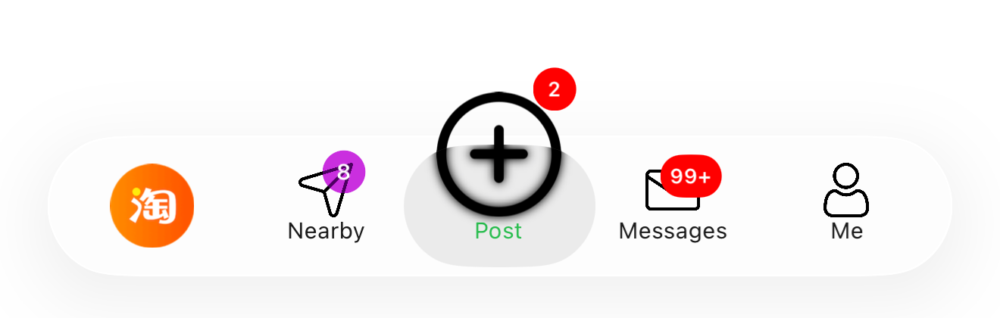 |  |

```objc
[tabBarController updatePlusButtonWithAttributes:@{ CYLTabBarItemTitle : @"★ 发布",
                                                    CYLTabBarItemImageURL : @"https://example.com/plus.png" }];
```

### 自定义 tabBar.items（#22）/ Customizing tabBar.items (#22)

| 中文 | English |
|:---|:---|
| Tab 以子控制器的方式添加，`self.tabBar.items` 在 TabBar 第一次布局时才生成。需要直接访问 item 时使用 `-performWhenTabBarItemsReady:`；只修改标题或图标时，上面的原地更新 API 无需等待。`-reloadBadgesWithBlock:` 现在也基于它，修复了液态玻璃下及第一个 Tab 被封面覆盖时 block 不执行的问题。 | The tabs are installed as child view controllers, so `self.tabBar.items` is filled in the tab bar's first layout. Use `-performWhenTabBarItemsReady:` when you need the items themselves; to change a title or an icon, the in-place APIs above need no waiting. `-reloadBadgesWithBlock:` is now built on it, which fixes its blocks never running with Liquid Glass or when the first tab is covered. |

```objc
- (void)viewDidLoad {
    [super viewDidLoad];
    // self.tabBar.items 此时为空 / self.tabBar.items is still empty here
    [self performWhenTabBarItemsReady:^(CYLTabBarController *tabBarController) {
        for (UITabBarItem *item in tabBarController.tabBar.items) {
            item.accessibilityHint = item.title;
        }
    }];
}
```

### 替换 Tab 的页面（#481）/ Replacing a tab's page (#481)

| 中文 | English |
|:---|:---|
| `-replaceViewControllerAtIndex:withViewController:attributes:` 替换一个 Tab 的页面，`attributes` 是新 Tab 的属性（替换旧的；nil 保留）。其他 Tab 不变，选中的 Tab 保持选中。放回原来的页面及属性即可恢复。TabBar 会重新设置，请在转场之外调用。 | `-replaceViewControllerAtIndex:withViewController:attributes:` replaces one tab's page; `attributes` is the new tab's entry (in place of the old one; nil keeps it). The other tabs stay, and the selected tab stays selected. Put the original page and attributes back to restore it. The tab bar is set up again, so call it outside a transition. |

```objc
- (void)tabBarController:(CYLTabBarController *)tabBarController didSelectViewController:(UIViewController *)viewController {
    NSUInteger index = [tabBarController.viewControllers indexOfObject:viewController];
    if (index == 2) {        // 第三个 Tab：替换相邻页面 / The third tab: replace its neighbors
        [tabBarController replaceViewControllerAtIndex:1 withViewController:self.pageA attributes:@{ CYLTabBarItemTitle : @"A" }];
        [tabBarController replaceViewControllerAtIndex:3 withViewController:self.pageB attributes:@{ CYLTabBarItemTitle : @"B" }];
    } else if (index == 0) { // 首页：恢复 / Home: restore
        [tabBarController replaceViewControllerAtIndex:1 withViewController:self.originalPage1 attributes:self.originalAttributes1];
        [tabBarController replaceViewControllerAtIndex:3 withViewController:self.originalPage3 attributes:self.originalAttributes3];
    }
}
```

## API

| 方法或类型 / Method or type | 说明 / Description |
|:---|:---|
| `-updateTabBarItemAtIndex:attributes:`、`-updateTabBarItemForViewController:attributes:`、`-updateTabBarItemsWithAttributes:` | 原地更新一个或所有 Tab / Update one or every tab in place |
| `-setTabBarItemIconViewProvider:atIndex:` | 用任意视图替换图标，nil 恢复 / Any view in place of the icon; nil restores |
| `-setTabBarItemIcon:selectedIcon:size:atIndex:` | 任意本地或网络图片来源 / Any local or network image source |
| `-setTabBarItemIconWithURL:selectedURL:size:atIndex:` | 网络图片（基于上一个方法）/ Network images (built on the method above) |
| `CYLTabBarItemImageURL`、`CYLTabBarItemSelectedImageURL`、`CYLTabBarItemImageURLSize` | 初始化或更新时的图片 URL 键 / Image URL keys, at creation or in an update |
| `-tabBarItemAttributesAtIndex:` | 某个 Tab 当前的属性（处理 PlusButton 造成的索引差异）/ A tab's current attributes (maps the plus button's index offset) |
| `-updatePlusButtonWithAttributes:`、`-[CYLPlusButton cyl_updateTitle:image:selectedImage:]`、`-[CYLPlusButton cyl_title]` | 更新 PlusButton / Update the plus button |
| `CYLImageCache`、`CYLImageLoadOptions`、`CYLImageCacheExpireType`、`+[UIImage cyl_loadImageWithURL:options:completion:]` | 缓存与加载选项 / Cache and load options |
| `-performWhenTabBarItemsReady:` | item 创建后执行（#22）/ Runs once the items exist (#22) |
| `-replaceViewControllerAtIndex:withViewController:attributes:` | 替换一个 Tab 的页面（#481）/ Replace one tab's page (#481) |

## 导航栏标题跟随 Tab 标题 / Navigation bar title follows the tab title

| 中文 | English |
|:---|:---|
| 页面的 `title` 会同时设置 Tab 与导航栏，而原地修改的 Tab 标题（本页的 API、皮肤、配置文件）不会传到导航栏。在创建 Tab 时让页面跟随 Tab 标题即可，不需要在 `-viewDidLoad` 中再设置标题：本库在 Tab 设置时与之后每次修改时设置 `navigationItem.title`，并发送 `CYLTabBarItemTitleDidChangeNotification`（object 为页面，`userInfo[CYLTabBarItemTitle]` 为新标题）。`CYL_TAB_BAR_ITEM_TITLE(page)` 随时读取当前的 Tab 标题（显示选中标题时返回普通标题）。 | A page's `title` sets both its tab and its navigation bar, and a tab title changed in place (this page's API, skins, configuration files) never reached the navigation bar. Make the page follow its tab title where the tabs are created; there is no need to set a title in `-viewDidLoad`: the library sets `navigationItem.title` when the tab is set up and on every later change, and posts `CYLTabBarItemTitleDidChangeNotification` (the object is the page, `userInfo[CYLTabBarItemTitle]` the new title). `CYL_TAB_BAR_ITEM_TITLE(page)` reads the current tab title at any time (the normal title while a selected title shows). |

```objc
// Where the tabs are created (the ObjC example: MainTabBarController.m). 创建 Tab 的位置（ObjC 示例：MainTabBarController.m）。
for (UIViewController *viewController in viewControllers) {
    CYL_NAVIGATION_TITLE_FOLLOWS_TAB_BAR_ITEM(viewController.cyl_getViewControllerInsteadOfNavigationController);
}
// Later, anywhere: 之后任意位置：
NSString *title = CYL_TAB_BAR_ITEM_TITLE(self);
```

| 中文 | English |
|:---|:---|
| 2026-11-09 在 iPhone 17 Pro Max 模拟器（iOS 26.1，液态玻璃）上验证：启动后各 Tab 的导航栏标题即 Tab 标题；「批量更换标题」后导航栏显示「★ Nearby」，恢复后显示「Nearby」。单元测试 `testNavigationTitleFollowsTabBarItemTitle`。ObjC 示例去掉了重复设置标题的代码（以前每个页面再设置一次 `title`，液态玻璃下加上「 (Liquid)」，且不跟随之后的修改）。Android 尚未提供。 | Verified on 2026-11-09 on an iPhone 17 Pro Max simulator (iOS 26.1, Liquid Glass): at launch each tab's navigation bar title is its tab title; after "Change all titles" the navigation bar reads "★ Nearby", and "Nearby" after restoring. Unit test: `testNavigationTitleFollowsTabBarItemTitle`. The ObjC example drops the code that set the titles a second time (each page set `title` again, with " (Liquid)" on Liquid Glass, and never followed later changes). Not on Android yet. |
| 「批量更换标题」之后（导航栏与 Tab 同步）： | After "Change all titles" (the navigation bar follows the tab): |
| 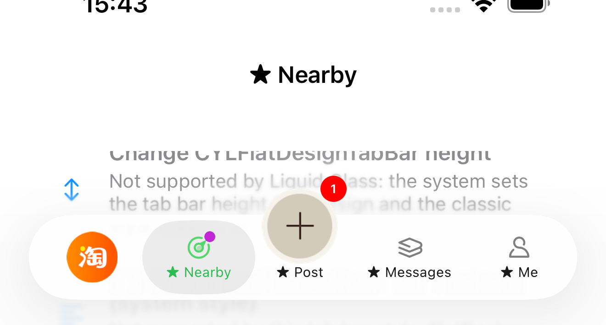 |  |
| 恢复之后： | After restoring: |
| 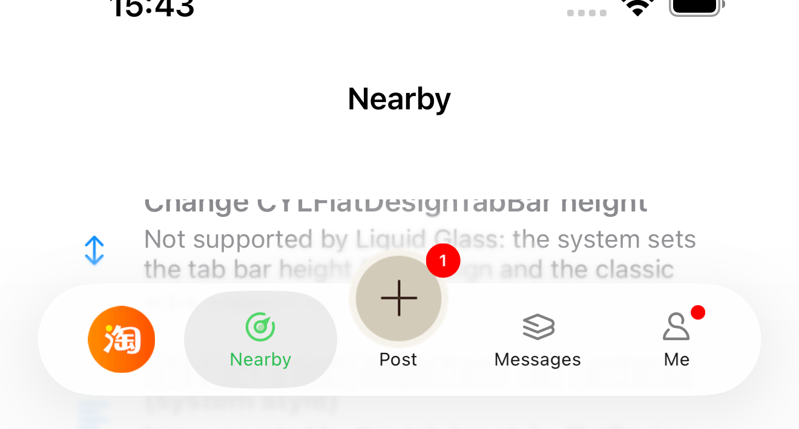 |  |
| 换肤（「网络图标、标题与配色」皮肤）之后，导航栏同样显示「★ Me」；切回「默认」后恢复为「Me」： | After a skin (the "Network icons, titles and colors" skin) the navigation bar also reads "★ Me", and "Me" again after switching back to "Default": |
| 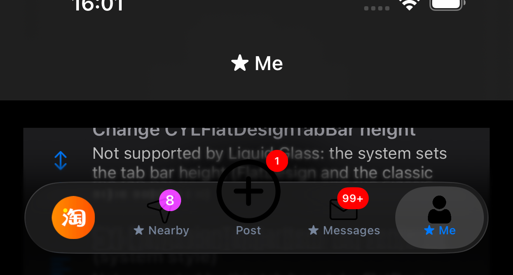 |  |

## Tab 变化通知 / Tab change notifications

| 中文 | English |
|:---|:---|
| 导航栏标题以外的需求（自定义标题视图、统计、跟随 Tab 颜色的页面头部……）可以监听通知。本库在 Tab 显示变化之后发送。 | For anything beyond the navigation bar title (a custom title view, analytics, a page header in the tab's color…), observe the notifications. The library posts them after the tab shows the change. |

| 通知 / Notification | 中文：何时发送 | English: when |
|:---|:---|:---|
| `CYLTabBarItemTitleDidChangeNotification` | 某个 Tab 的标题或选中标题原地变化（本页的 API、皮肤） | A tab's title or selected title changes in place (this page's API, skins) |
| `CYLTabBarItemIconDidChangeNotification` | 某个 Tab 的图标变化：图片 key、图片 URL、`-setTabBarItemIcon:…`（网络图标在加载完成时）、皮肤、恢复 | A tab's icon changes: image keys, image URLs, `-setTabBarItemIcon:…` (a network icon once loaded), skins, restoring |
| `CYLTabBarItemDidChangeNotification` | 某个 Tab 的任意原地变化（标题、图片、颜色、字体、动画……），每次一条 | Any in-place change of a tab (title, images, colors, fonts, animations…), one per change |
| `CYLTabBarControllerThemeDidApplyNotification` | TabBar 应用了皮肤（或恢复）：默认视为全部 Tab 都已变化 | The tab bar applied a skin (or restored): every tab counts as changed by default |

| 中文 | English |
|:---|:---|
| 前三个通知的 object 为该 Tab 的页面（导航控制器的根控制器），userInfo 精确指出变化的对象：`CYLTabBarItemIdentifier`（Tab 的 ID，最精确；没有 ID 时不存在）、`CYLTabBarItemIndexKey`（下标）、`CYLTabBarControllerKey`（TabBar 控制器）、`CYLTabBarItemViewControllerKey`（`viewControllers` 中的控制器，例如导航控制器）、`CYLTabBarItemKey`（`UITabBarItem`，扁平样式为 `CYLFlatDesignTabBarItem`）、`CYLTabBarItemChangedAttributesKey`（变化的 key 与新值）。标题通知另有 `CYLTabBarItemTitle`（新标题）、`CYLTabBarItemSelectedTitle`、`CYLTabBarItemOldTitleKey`（旧标题）；图标通知另有 `CYLTabBarItemIconViewProviderKey`（替换图标的视图，恢复 Tab 自己的图标时不存在）。皮肤通知的 object 为 TabBar 控制器，userInfo 有 `CYLTabBarThemeKey`（主题，恢复时不存在）、`CYLTabBarItemIndexesKey`（NSIndexSet）与 `CYLTabBarItemIdentifiersKey`（ID 数组），默认为全部 Tab（PlusButton 的 Tab 除外）。`CYLThemeDidChangeNotification` 由主题管理器发送，早于 TabBar 应用皮肤。 | The first three have the tab's page (the root view controller of its navigation controller) as object, and their userInfo names exactly what changed: `CYLTabBarItemIdentifier` (the tab's identifier, the most exact; absent when it has none), `CYLTabBarItemIndexKey` (its index), `CYLTabBarControllerKey` (the tab bar controller), `CYLTabBarItemViewControllerKey` (its entry in `viewControllers`, e.g. the navigation controller), `CYLTabBarItemKey` (the `UITabBarItem`; `CYLFlatDesignTabBarItem` on FlatDesign) and `CYLTabBarItemChangedAttributesKey` (the changed keys and their new values). The title notification adds `CYLTabBarItemTitle` (the new title), `CYLTabBarItemSelectedTitle` and `CYLTabBarItemOldTitleKey` (the title before); the icon notification adds `CYLTabBarItemIconViewProviderKey` (the view in place of the icon, absent when the tab's own icon comes back). The skin notification has the tab bar controller as object, with `CYLTabBarThemeKey` (the theme, absent when restoring), `CYLTabBarItemIndexesKey` (an NSIndexSet) and `CYLTabBarItemIdentifiersKey` (an array of identifiers): every tab by default, the plus button's tab excepted. `CYLThemeDidChangeNotification` comes from the theme manager, before the tab bar applies the skin. |

```objc
[[NSNotificationCenter defaultCenter] addObserverForName:CYLTabBarItemTitleDidChangeNotification object:nil queue:nil
                                              usingBlock:^(NSNotification *note) {
    NSString *identifier = note.userInfo[CYLTabBarItemIdentifier];   // e.g. @"home"
    NSString *newTitle = note.userInfo[CYLTabBarItemTitle];
    NSString *oldTitle = note.userInfo[CYLTabBarItemOldTitleKey];
}];
```

| 中文 | English |
|:---|:---|
| 单元测试：`testNavigationTitleFollowsTabBarItemTitle`（标题与图标通知、ID 与各对象）、`testSkinUpdatesFollowingNavigationTitlesAndPostsNotifications`（皮肤通知、跟随的导航栏标题）。Android 尚未提供。 | Unit tests: `testNavigationTitleFollowsTabBarItemTitle` (title and icon notifications, identifier and objects), `testSkinUpdatesFollowingNavigationTitlesAndPostsNotifications` (skin notification, following navigation titles). Not on Android yet. |

## Demo

| 中文 | English |
|:---|:---|
| ObjC 示例每个页面的设置分组：更换 Tab 标题、切换 Tab 图标、下载网络图标、批量下载网络图标、批量使用本地图标、GIF 动图图标、批量更换标题、替换相邻 Tab 的页面。每行再点一次恢复为初始化时传入的 `tabBarItemsAttributes`；带“批量”的行同时作用于 PlusButton。`Example-network-download` 用 `CYLTabBarItemImageURL` 加载全部图标，并设置缓存策略。示例中所有列表行都会换行显示完整文字。 | The settings section of every ObjC example page: Change tab title, Switch tab icon, Download network icon, Change all network icons, Change all local icons, GIF icon, Change all titles, Replace neighboring tabs. A second tap restores the `tabBarItemsAttributes` given at initialization; the "all" rows apply to the plus button too. `Example-network-download` loads every icon with `CYLTabBarItemImageURL` and sets the cache policy. Every row of the examples wraps its text in full. |

## 截图 / Screenshots

| 中文 | English |
|:---|:---|
| 以下截图来自 iPhone 17 Pro Max 模拟器（iOS 26.5），ObjC 示例，均为调试过程中功能正常时的截图。 | The screenshots come from the iPhone 17 Pro Max simulator (iOS 26.5), ObjC example, taken while debugging, with the feature working. |

| 场景 / Case | 截图 / Screenshot |
|:---|:---|
| 更换 Tab 标题，PlusButton 仍对齐其标题 / Change tab title; the plus button stays on its title | 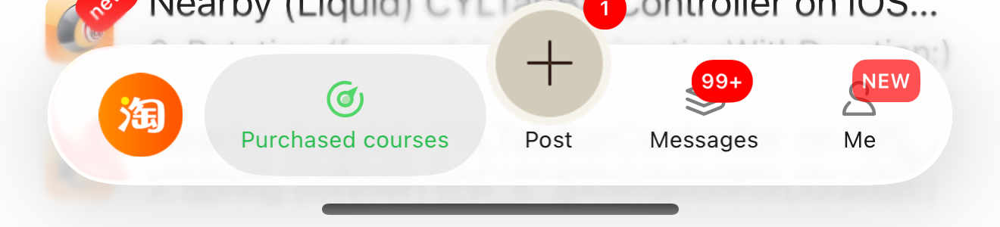 |
| 批量更换标题 / Change all titles | 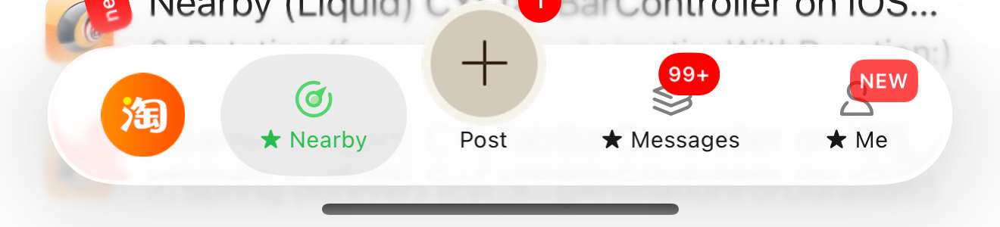 |
| 切换 Tab 图标（自定义视图）/ Switch tab icon (a custom view) | 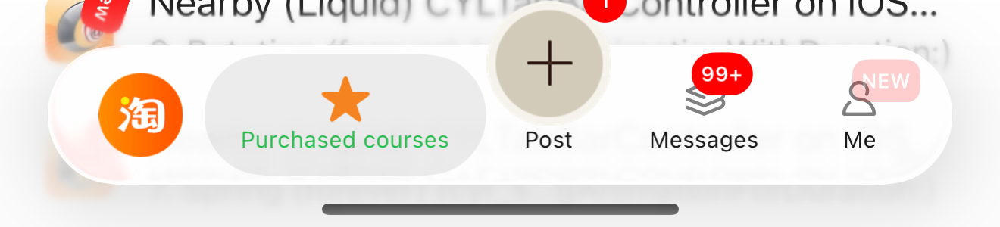 |
| 下载网络图标 / Download network icon | 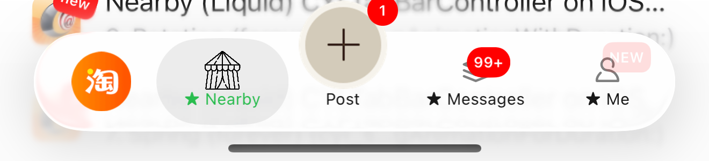 |
| GIF 动图图标 / GIF icon | 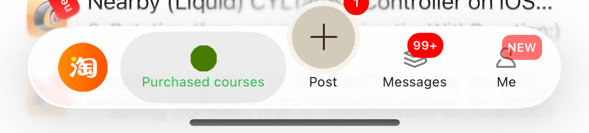 |
| 批量下载网络图标：角标在图标之上，封面保持 / Change all network icons: badges above, the cover kept | 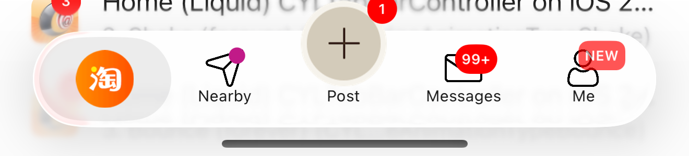 |
| 再点一次恢复 / Restored by a second tap | 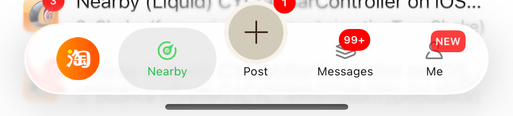 |
| 批量使用本地图标 / Change all local icons | 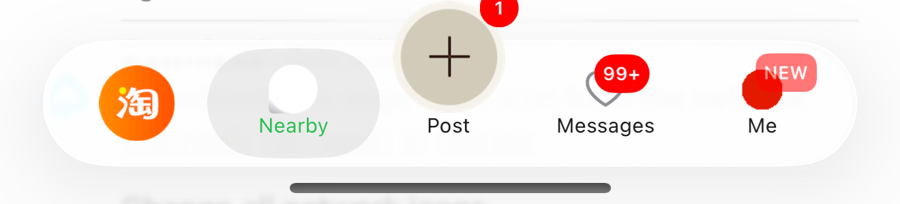 |
| 扁平样式：修改与恢复 / FlatDesign: changed and restored | 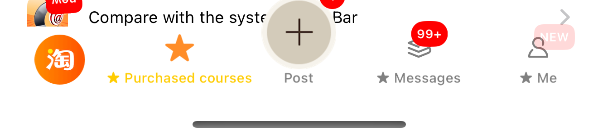 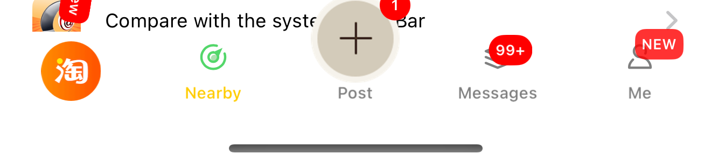 |
| PlusButton：标题、网络图片、本地图片、恢复 / Plus button: title, network image, local image, restored | 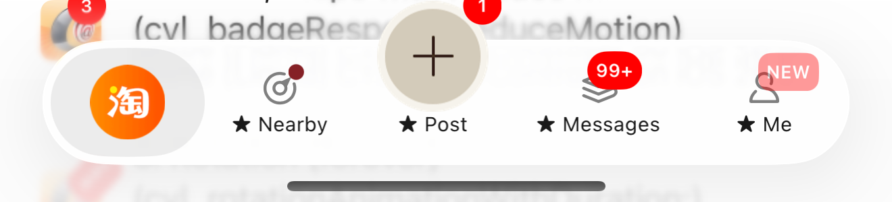 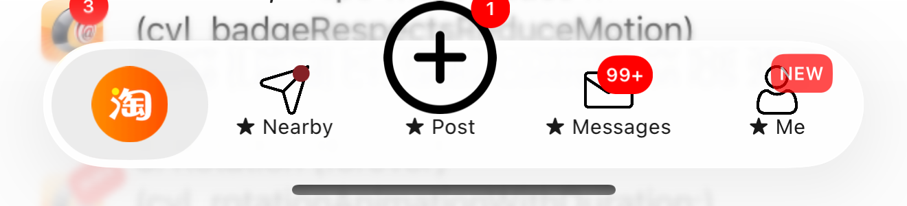 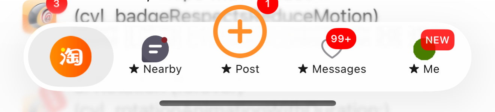 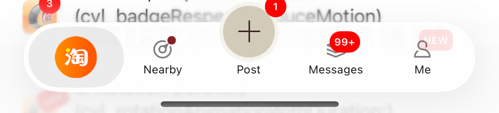 |
| `CYLTabBarItemImageURL`（Example-network-download）/ `CYLTabBarItemImageURL` (Example-network-download) | 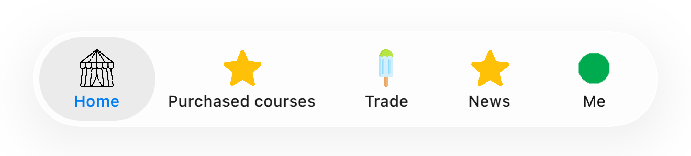 |
| 角标在 SF Symbol（模板）图标上保持自身颜色与文字 / Badges keep their colors and text on SF Symbol (template) icons | 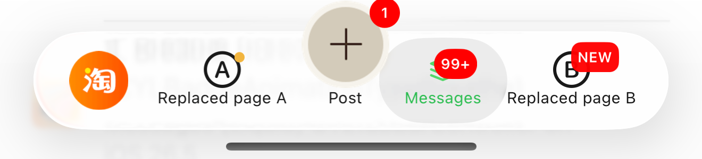 |
| 直接设置在 `tabBarItem` 上的角标，选中图层中同样显示 / A badge set on `tabBarItem` directly shows in the selected layer too | 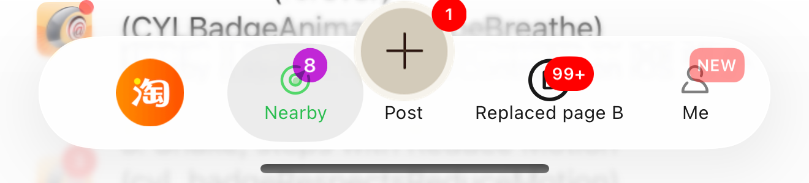 |
| 替换相邻 Tab 的页面（#481）与恢复 / Replace neighboring tabs (#481) and restored | 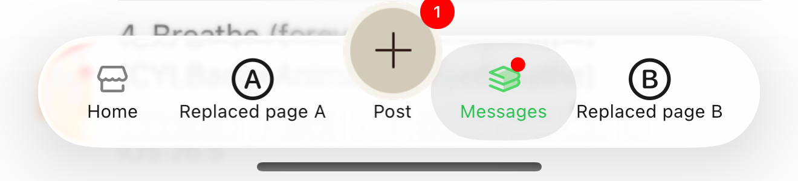 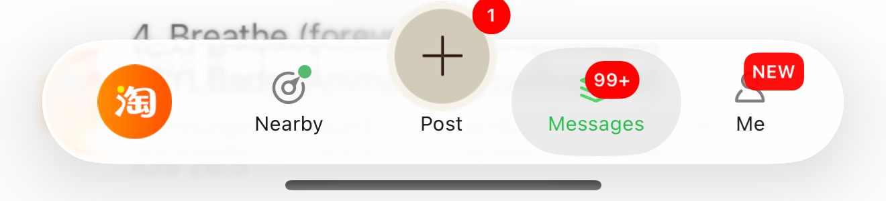 |
| [#434](https://github.com/ChenYilong/CYLTabBarController/issues/434)：修改标题后反复切换 Tab，只有选中的 Tab 处于选中状态（液态玻璃、扁平样式；经典样式在 iOS 17.5 用代码验证）/ [#434](https://github.com/ChenYilong/CYLTabBarController/issues/434): after a title change, switching tabs leaves only the selected tab selected (Liquid Glass, FlatDesign; the classic style checked by code on iOS 17.5) | 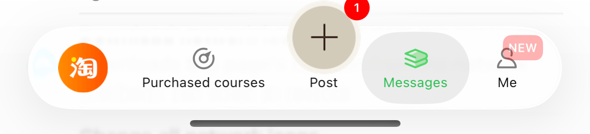 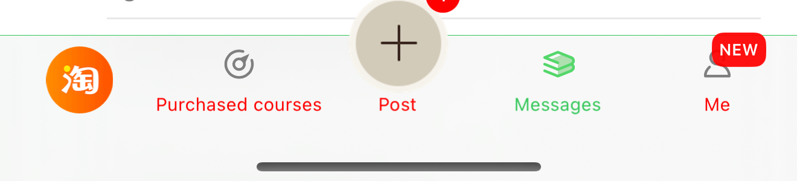 |
| 列表行换行显示（液态玻璃、扁平样式）/ Wrapped rows (Liquid Glass, FlatDesign) | 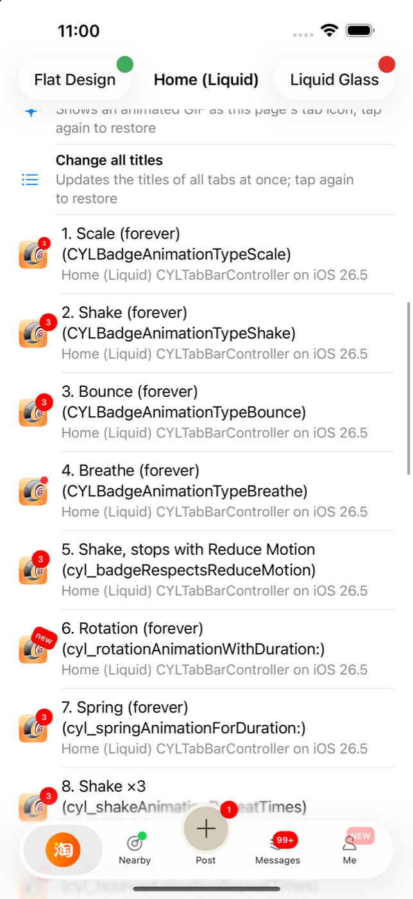 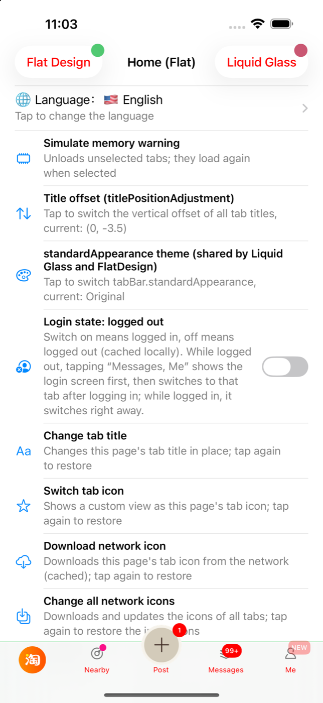 |

## 角标 / Badges

| 中文 | English |
|:---|:---|
| 液态玻璃把模板图标（如 SF Symbol）连同其子视图一起用 Tab 着色绘制，放在图标中的角标会变成没有文字的黑色形状。现在这类图标的角标放在图标上方的透明浮层中，保持自身颜色与文字。 | Liquid Glass draws a template icon (e.g. an SF Symbol) with the tab's tint, subviews included, so a badge inside the icon became a black shape without its text. The badge of such an icon now sits on a transparent overlay above it, with its own colors and text. |
| 直接在 `UITabBarItem` 上设置角标（`[viewController.tabBarItem cyl_showBadgeValue:…]`、`cyl_setBadgeBackgroundColor:` 等）与在 `UIViewController` 上设置相同：液态玻璃下同时作用于普通图层与选中图层的 Tab 按钮。以前样式 setter 只作用于普通图层。 | Badges set on the `UITabBarItem` directly (`[viewController.tabBarItem cyl_showBadgeValue:…]`, `cyl_setBadgeBackgroundColor:`, ...) now behave as those set on the `UIViewController`: with Liquid Glass they apply to the tab button of the normal layer and of the selected layer. The style setters used to reach the normal layer only. |

## 限制 / Limits

| 中文 | English |
|:---|:---|
| 本库不依赖任何图片库；需要 WebP、渐进式加载等时，请用 `-setTabBarItemIconViewProvider:atIndex:` 返回 SDWebImage 或 Kingfisher 加载的视图。 | The library depends on no image library; for WebP, progressive loading and the like, return a view loaded by SDWebImage or Kingfisher from `-setTabBarItemIconViewProvider:atIndex:`. |
| 替换页面会重新设置 TabBar：直接添加到 Tab 按钮上的视图（如封面、角标）需要在新按钮创建后重新添加，例如在 `-performWhenTabBarItemsReady:` 中。 | Replacing a page sets the tab bar up again: views added to the tab buttons yourself (covers, badges) must be added again to the new buttons, e.g. in `-performWhenTabBarItemsReady:`. |
| 本次在 iOS 26.5 模拟器上验证了液态玻璃与扁平样式；经典样式（iOS 25 及更早）未在本次重新运行。 | Verified this time on the iOS 26.5 simulator with Liquid Glass and FlatDesign; the classic style (iOS 25 and earlier) was not run again this time. |
