# [CN]CYLTabBarController 使用指南
# [EN]CYLTabBarController usage guide

<!-- bound-classes: CYLTabBarController, CYLPlusButton -->
<!-- binding:start -->
<!-- Generated by scripts/update-docs-navigation.py; do not edit by hand. -->

| 中文 | English |
|:---|:---|
| 绑定的代码类 `CYLTabBarController`：[`CYLTabBarController/CYLTabBarController.h`](../CYLTabBarController/CYLTabBarController.h) | Bound to the class `CYLTabBarController`: [`CYLTabBarController/CYLTabBarController.h`](../CYLTabBarController/CYLTabBarController.h) |
| 绑定的代码类 `CYLPlusButton`：[`CYLTabBarController/CYLPlusButton.h`](../CYLTabBarController/CYLPlusButton.h) | Bound to the class `CYLPlusButton`: [`CYLTabBarController/CYLPlusButton.h`](../CYLTabBarController/CYLPlusButton.h) |

<!-- binding:end -->

| 中文 | English |
|:---|:---|
| 本文收录原 README 中的详细用法：安装细节（CocoaPods、Carthage）、Objective-C 的完整接入步骤与 PlusButton 协议说明，以及各项自定义（外观、点击动画、角标、深色模式、本地化、横竖屏、PlusButton 跳转、仅图标、嵌套 TabBar、跨端、Swift、Storyboard、实现原理）。README 只保留 Swift 快速开始，并链接到本文。 | This page holds the detailed usage that used to be in the README: installation details (CocoaPods, Carthage), the full Objective-C setup and the PlusButton protocol, and every customization (appearance, tap animations, badges, Dark Mode, localization, orientation, plus button navigation, icon-only items, nested tab bars, cross-platform, Swift, Storyboard, implementation details). The README keeps a Swift quick start and links here. |

## [CN]目录
## [EN]Contents

<!-- navigation:start -->
<!-- Generated by scripts/update-docs-navigation.py; do not edit by hand. -->

| 中文 | English |
|:---|:---|
| [第一步：使用 CocoaPods 导入 CYLTabBarController](#cn第一步使用-cocoapods-导入-cyltabbarcontroller) | [Step 1: Import CYLTabBarController with CocoaPods](#enstep-1-import-cyltabbarcontroller-with-cocoapods) |
| &nbsp;&nbsp;&nbsp;&nbsp;↳ [1. 安装 CocoaPods](#cn1-安装-cocoapods) | &nbsp;&nbsp;&nbsp;&nbsp;↳ [1. Install CocoaPods](#en1-install-cocoapods) |
| &nbsp;&nbsp;&nbsp;&nbsp;↳ [2. 查询 CocoaPods 源](#cn2-查询-cocoapods-源) | &nbsp;&nbsp;&nbsp;&nbsp;↳ [2. Search the CocoaPods repository](#en2-search-the-cocoapods-repository) |
| &nbsp;&nbsp;&nbsp;&nbsp;↳ [3. 使用 CocoaPods 导入](#cn3-使用-cocoapods-导入) | &nbsp;&nbsp;&nbsp;&nbsp;↳ [3. Integrate with CocoaPods](#en3-integrate-with-cocoapods) |
| [CocoaPods 使用说明](#cncocoapods-使用说明) | [CocoaPods usage notes](#encocoapods-usage-notes) |
| &nbsp;&nbsp;&nbsp;&nbsp;↳ [指定 CYLTabBarController 版本](#cn指定-cyltabbarcontroller-版本) | &nbsp;&nbsp;&nbsp;&nbsp;↳ [Pinning the CYLTabBarController version](#enpinning-the-cyltabbarcontroller-version) |
| &nbsp;&nbsp;&nbsp;&nbsp;↳ [升级本地 CocoaPods 源](#cn升级本地-cocoapods-源) | &nbsp;&nbsp;&nbsp;&nbsp;↳ [Update the local CocoaPods repository](#enupdate-the-local-cocoapods-repository) |
| &nbsp;&nbsp;&nbsp;&nbsp;↳ [升级工程中的 CYLTabBarController 版本](#cn升级工程中的-cyltabbarcontroller-版本) | &nbsp;&nbsp;&nbsp;&nbsp;↳ [Upgrade CYLTabBarController in the project](#enupgrade-cyltabbarcontroller-in-the-project) |
| &nbsp;&nbsp;&nbsp;&nbsp;↳ [清除 CocoaPods 本地缓存](#cn清除-cocoapods-本地缓存) | &nbsp;&nbsp;&nbsp;&nbsp;↳ [Clear the CocoaPods cache](#enclear-the-cocoapods-cache) |
| &nbsp;&nbsp;&nbsp;&nbsp;↳ [查看当前使用的版本](#cn查看当前使用的版本) | &nbsp;&nbsp;&nbsp;&nbsp;↳ [Check the installed version](#encheck-the-installed-version) |
| [使用 Carthage 导入 CYLTabBarController（可选）](#cn使用-carthage-导入-cyltabbarcontroller可选) | [Import CYLTabBarController with Carthage (optional)](#enimport-cyltabbarcontroller-with-carthage-optional) |
| [第二步：设置 CYLTabBarController 的两个数组](#cn第二步设置-cyltabbarcontroller-的两个数组) | [Step 2: Configure the view controller and tab bar item attribute arrays](#enstep-2-configure-the-view-controller-and-tab-bar-item-attribute-arrays) |
| &nbsp;&nbsp;&nbsp;&nbsp;↳ [图片传名称（NSString）还是 UIImage？](#cn图片传名称nsstring还是-uiimage) | &nbsp;&nbsp;&nbsp;&nbsp;↳ [Image names (NSString) or UIImage objects?](#enimage-names-nsstring-or-uiimage-objects) |
| [第三步：将 CYLTabBarController 设置为 window 的 RootViewController](#cn第三步将-cyltabbarcontroller-设置为-window-的-rootviewcontroller) | [Step 3: Set CYLTabBarController as the window's root view controller](#enstep-3-set-cyltabbarcontroller-as-the-windows-root-view-controller) |
| [第四步（可选）：创建自定义的不规则加号按钮](#cn第四步可选创建自定义的不规则加号按钮) | [Step 4 (optional): Create a custom irregular plus button](#enstep-4-optional-create-a-custom-irregular-plus-button) |
| &nbsp;&nbsp;&nbsp;&nbsp;↳ [让 PlusButton 的标题与 Tab 标题对齐](#cn让-plusbutton-的标题与-tab-标题对齐) | &nbsp;&nbsp;&nbsp;&nbsp;↳ [Align the PlusButton's title with the tab titles](#enalign-the-plusbuttons-title-with-the-tab-titles) |
| &nbsp;&nbsp;&nbsp;&nbsp;↳ [调整 PlusButton 与 TabBarItem 的宽度](#cn调整-plusbutton-与-tabbaritem-的宽度) | &nbsp;&nbsp;&nbsp;&nbsp;↳ [Customize the PlusButton and TabBarItem widths](#encustomize-the-plusbutton-and-tabbaritem-widths) |
| [自定义 `TabBar` 样式](#cn自定义-tabbar-样式) | [Customizing the `TabBar` appearance](#encustomizing-the-tabbar-appearance) |
| &nbsp;&nbsp;&nbsp;&nbsp;↳ [捕获 TabBar 点击事件](#cn捕获-tabbar-点击事件) | &nbsp;&nbsp;&nbsp;&nbsp;↳ [Handling TabBar selection events](#enhandling-tabbar-selection-events) |
| &nbsp;&nbsp;&nbsp;&nbsp;↳ [用标识区分 Tab](#cn用标识区分-tab) | &nbsp;&nbsp;&nbsp;&nbsp;↳ [Telling tabs apart by identifier](#entelling-tabs-apart-by-identifier) |
| [点击 TabBarButton 时添加动画](#cn点击-tabbarbutton-时添加动画) | [Adding animations when a TabBar button is tapped](#enadding-animations-when-a-tabbar-button-is-tapped) |
| [单独使用角标组件 CYLBadgeView](#cn单独使用角标组件-cylbadgeview) | [Using the badge component on its own: CYLBadgeView](#enusing-the-badge-component-on-its-own-cylbadgeview) |
| [全局设置角标样式](#cn全局设置角标样式) | [Setting the badge style globally](#ensetting-the-badge-style-globally) |
| [更新 Tab 角标](#cn更新-tab-角标) | [Updating tab badges](#enupdating-tab-badges) |
| [适配深色模式](#cn适配深色模式) | [Supporting Dark Mode](#ensupporting-dark-mode) |
| &nbsp;&nbsp;&nbsp;&nbsp;↳ [使用 CYLTabBarItemDarkImage 指定深色图片](#cn使用-cyltabbaritemdarkimage-指定深色图片) | &nbsp;&nbsp;&nbsp;&nbsp;↳ [Naming dark images with CYLTabBarItemDarkImage](#ennaming-dark-images-with-cyltabbaritemdarkimage) |
| &nbsp;&nbsp;&nbsp;&nbsp;↳ [Lottie 图标的深色模式](#cnlottie-图标的深色模式) | &nbsp;&nbsp;&nbsp;&nbsp;↳ [Lottie icons in Dark Mode](#enlottie-icons-in-dark-mode) |
| [多语言（本地化）](#cn多语言本地化) | [Localization](#enlocalization) |
| [横竖屏适配](#cn横竖屏适配) | [Supporting portrait and landscape orientations](#ensupporting-portrait-and-landscape-orientations) |
| [访问初始化好的 CYLTabBarController 对象](#cn访问初始化好的-cyltabbarcontroller-对象) | [Accessing the initialized CYLTabBarController instance](#enaccessing-the-initialized-cyltabbarcontroller-instance) |
| [点击 PlusButton 跳转到指定 UIViewController](#cn点击-plusbutton-跳转到指定-uiviewcontroller) | [Navigating to a UIViewController by tapping the PlusButton](#ennavigating-to-a-uiviewcontroller-by-tapping-the-plusbutton) |
| [让 TabBarItem 仅显示图标并使图标垂直居中](#cn让-tabbaritem-仅显示图标并使图标垂直居中) | [Display only icons in TabBarItems and center them vertically](#endisplay-only-icons-in-tabbaritems-and-center-them-vertically) |
| [多 TabBar 嵌套并指定 PlusButton 位置](#cn多-tabbar-嵌套并指定-plusbutton-位置) | [Nesting multiple TabBars and specifying the PlusButton position](#ennesting-multiple-tabbars-and-specifying-the-plusbutton-position) |
| [在 React Native 与 Flutter 中使用 CYLTabBarController](#cn在-react-native-与-flutter-中使用-cyltabbarcontroller) | [Using CYLTabBarController in React Native and Flutter](#enusing-cyltabbarcontroller-in-react-native-and-flutter) |
| [在 Swift 项目中使用 CYLTabBarController](#cn在-swift-项目中使用-cyltabbarcontroller) | [Using CYLTabBarController in a Swift project](#enusing-cyltabbarcontroller-in-a-swift-project) |
| [搭配 Storyboard 使用 CYLTabBarController](#cn搭配-storyboard-使用-cyltabbarcontroller) | [Using CYLTabBarController with Storyboard](#enusing-cyltabbarcontroller-with-storyboard) |
| [源码实现原理](#cn源码实现原理) | [Implementation details](#enimplementation-details) |

<!-- navigation:end -->

## [CN]第一步：使用 CocoaPods 导入 CYLTabBarController
## [EN]Step 1: Import CYLTabBarController with CocoaPods

### [CN]1. 安装 CocoaPods
### [EN]1. Install CocoaPods

| 中文 | English |
|:---|:---|
| 如果您的机器上已经安装了 CocoaPods，直接进入下一步即可。 | If CocoaPods is already installed, continue to the next step. |

| 中文 | English |
|:---|:---|
| 如果网络环境允许直接访问 RubyGems，请在终端运行： | If RubyGems is directly accessible, run: |

  ```
  sudo gem install cocoapods
  ```

| 中文 | English |
|:---|:---|
| 如果无法直接访问 RubyGems，可以使用 Ruby China 镜像： | If RubyGems is unavailable, use the Ruby China mirror: |

| 中文 | English |
|:---|:---|
| 在终端依次运行以下命令： | Run the following commands in sequence in the terminal: |

  ```
  gem sources --add https://gems.ruby-china.com/ --remove https://rubygems.org/
 
  sudo gem install cocoapods
  ```

### [CN]2. 查询 CocoaPods 源
### [EN]2. Search the CocoaPods repository

| 中文 | English |
|:---|:---|
| 在终端中运行以下命令： | Run the following command in the terminal: |

  ```
  pod search CYLTabBarController
  ```

| 中文 | English |
|:---|:---|
| 注意：该命令搜索的是本机缓存，并不会联网查询。 | Note: this command searches the local cache and does not query the network. |

| 中文 | English |
|:---|:---|
| 如果没有找到库或版本不是最新，请更新本地源： | If the library is missing or outdated, update the local repository: |

  ```
  pod repo update
  ```

### [CN]3. 使用 CocoaPods 导入
### [EN]3. Integrate with CocoaPods

| 中文 | English |
|:---|:---|
| 进入工程目录并初始化 Podfile： | Open your project directory and initialize a Podfile: |

  ```
  pod init
  ```

| 中文 | English |
|:---|:---|
| 如果尚未安装 CocoaPods，也可以运行： | If CocoaPods is not installed, run: |

 ```
 gem install cocoapods
 ```

| 中文 | English |
|:---|:---|
| 打开 Podfile，在目标 target 中加入以下内容。版本号请以 [podspec](https://github.com/ChenYilong/CYLTabBarController/blob/master/CYLTabBarController.podspec) 为准。 | Open the Podfile and add the following line to your target. Check the [podspec](https://github.com/ChenYilong/CYLTabBarController/blob/master/CYLTabBarController.podspec) for the latest version. |

| 中文 | English |
|:---|:---|
| 在文件 `Podfile` 中加入以下内容： | Add the following content to the `Podfile`: |

 ```
 pod 'CYLTabBarController', '~> 1.100.0'
 ```

| 中文 | English |
|:---|:---|
| 安装依赖： | Install the dependency: |

 ```
 pod install
 ```

| 中文 | English |
|:---|:---|
| 如果不希望更新 spec 仓库，可使用： | To avoid updating the spec repository, use: |

 ```
 # 禁止升级 CocoaPods 的 spec 仓库，否则会卡在 Analyzing dependencies，非常慢
 pod update --verbose --no-repo-update
 ```

| 中文 | English |
|:---|:---|
| 如果提示找不到库，请移除 `--no-repo-update`。 | If the library cannot be found, remove `--no-repo-update`. |

| 中文 | English |
|:---|:---|
| 安装完成后，CocoaPods 会在工程根目录生成 `.xcworkspace` 文件。请使用该文件打开工程，而不是 `.xcodeproj`。 | After installation, CocoaPods creates an `.xcworkspace` file in the project root. Open the project with this file instead of the `.xcodeproj`. |

## [CN]CocoaPods 使用说明
## [EN]CocoaPods usage notes

### [CN]指定 CYLTabBarController 版本
### [EN]Pinning the CYLTabBarController version

| 中文 | English |
|:---|:---|
| 可以使用以下版本约束： | You can use the following version constraints: |

| 中文 | English |
|:---|:---|
| `>= 1.n.X` 会根据您本地的 CocoaPods 源列表，导入不低于 `1.(n+1).X` 版本的 CYLTabBarController。 | Based on your local CocoaPods sources, imports a CYLTabBarController version no lower than `1.(n+1).X`. |

| 中文 | English |
|:---|:---|
| `~> 1.n.X` 会根据您本地的 CocoaPods 源列表，介于 1.n.X~1.(n+1).0 之前版本的 CYLTabBarController。 | Based on your local CocoaPods sources, imports a CYLTabBarController version from `1.n.X` up to but not including `1.(n+1).0`. |

| 中文 | English |
|:---|:---|
| 建议锁定版本，便于团队协作。 | Pinning a version is recommended for consistent team builds. |

| 中文 | English |
|:---|:---|
| （此处示例可能是旧版本，使用时请替换为最新版，最新版信息可以从这里获取：[podspec](https://github.com/ChenYilong/CYLTabBarController/blob/master/CYLTabBarController.podspec)。） | This example may use an older version. Replace it with the latest version when needed; the latest version is available in the [podspec](https://github.com/ChenYilong/CYLTabBarController/blob/master/CYLTabBarController.podspec). |

```
pod 'CYLTabBarController', '~> 1.100.0'
```

### [CN]升级本地 CocoaPods 源
### [EN]Update the local CocoaPods repository

| 中文 | English |
|:---|:---|
| CocoaPods 会在本地缓存源服务器上的版本。如果搜索不到最新版本，请运行： | CocoaPods caches versions locally. Run the following command when the latest version is unavailable: |

 ```
 pod repo update
 ```

### [CN]升级工程中的 CYLTabBarController 版本
### [EN]Upgrade CYLTabBarController in the project

| 中文 | English |
|:---|:---|
| 修改 Podfile 中的版本后运行： | After changing the version in the Podfile, run: |

 ```
 pod update
 ```

### [CN]清除 CocoaPods 本地缓存
### [EN]Clear the CocoaPods cache

| 中文 | English |
|:---|:---|
| 如果下载文件损坏，可以删除 `~/Library/Caches/CocoaPods/Pods/Release` 后重新导入。 | If downloaded files are corrupted, remove `~/Library/Caches/CocoaPods/Pods/Release` and integrate again. |

### [CN]查看当前使用的版本
### [EN]Check the installed version

| 中文 | English |
|:---|:---|
| 在 `Podfile.lock` 中可以查看项目使用的版本。 | The installed version is recorded in `Podfile.lock`. |

| 中文 | English |
|:---|:---|
| 更多信息请参考 [CocoaPods 文档](https://cocoapods.org/)。 | For more information, see the [CocoaPods documentation](https://cocoapods.org/). |

## [CN]使用 Carthage 导入 CYLTabBarController（可选）
## [EN]Import CYLTabBarController with Carthage (optional)

| 中文 | English |
|:---|:---|
| 除了 CocoaPods 和 Swift Package Manager，也可以通过 [Carthage](https://github.com/Carthage/Carthage) 集成本库：每个版本都附带预编译的 XCFramework。在 `Cartfile` 中添加： | In addition to CocoaPods and Swift Package Manager, you can integrate the library with [Carthage](https://github.com/Carthage/Carthage): every release ships a prebuilt XCFramework. Add the following to `Cartfile`: |

```
binary "https://raw.githubusercontent.com/ChenYilong/CYLTabBarController/master/CYLTabBarController.json"
```

| 中文 | English |
|:---|:---|
| 然后执行： | Then run: |

```
carthage update --use-xcframeworks --platform iOS
```

| 中文 | English |
|:---|:---|
| 下载完成后，将 `Carthage/Build/CYLTabBarController.xcframework` 拖入工程，并在 "Frameworks, Libraries, and Embedded Content" 中设置为 `Embed & Sign`。 | Once it is downloaded, drag `Carthage/Build/CYLTabBarController.xcframework` into the project and set it to `Embed & Sign` under "Frameworks, Libraries, and Embedded Content". |

| 中文 | English |
|:---|:---|
| 说明：第一个附带 XCFramework 的版本是 1.100.0 之后的下一个版本，此前（至 1.100.0）仍用 `github "ChenYilong/CYLTabBarController" ~> 1.100.0`。之所以改用预编译版本：本仓库包含 Flutter 示例的 Xcode 工程，Carthage 无法从源码编译本仓库。该 framework 包含核心功能、角标、扁平样式与资源包（多语言文案），不含 Lottie 动画（`LottieSwift` 目录，需要时请使用 CocoaPods 或 SPM）；最低支持 iOS 15.0。发布时 `scripts/pod-lint.sh bump` 更新二进制规格 `CYLTabBarController.json`，Release workflow 上传 zip。详见 [docs/Carthage.md](Carthage.md)（[#384](https://github.com/ChenYilong/CYLTabBarController/issues/384)）。 | Note: the first release with an XCFramework is the one after 1.100.0; up to 1.100.0, use `github "ChenYilong/CYLTabBarController" ~> 1.100.0`. Why prebuilt: this repository holds the Flutter examples' Xcode projects, so Carthage cannot build it from source. The framework contains the core, badges, the flat design style and the resource bundle (localized strings), without Lottie animations (the `LottieSwift` folder; use CocoaPods or SPM for them); it supports iOS 15.0 and later. On release, `scripts/pod-lint.sh bump` updates the binary spec `CYLTabBarController.json` and the Release workflow uploads the zip. See [docs/Carthage.md](Carthage.md) ([#384](https://github.com/ChenYilong/CYLTabBarController/issues/384)). |
| 演示工程：`Example-Swift-Carthage`（复制自 `Example-Swift-03`，改用 Carthage 集成），运行步骤与差异见 [docs/Carthage-Example.md](Carthage-Example.md)。 | Demo project: `Example-Swift-Carthage` (a copy of `Example-Swift-03` integrated with Carthage); see [docs/Carthage-Example.md](Carthage-Example.md) for how to run it and what differs. |

## [CN]第二步：设置 CYLTabBarController 的两个数组
## [EN]Step 2: Configure the view controller and tab bar item attribute arrays

 ```Objective-C
 //MainTabBarController

@interface MainTabBarController : CYLTabBarController
@end


- (instancetype)init {
    /**
     * 以下两行代码目的在于手动设置让TabBarItem只显示图标，不显示文字，并让图标垂直居中。
     * 等效于在 `-tabBarItemsAttributesForTabBar` 方法中不传 `CYLTabBarItemTitle` 字段。
     * 更推荐后一种做法。
     */
    UIEdgeInsets imageInsets = UIEdgeInsetsZero;//UIEdgeInsetsMake(4.5, 0, -4.5, 0);
    UIOffset titlePositionAdjustment = UIOffsetMake(0, -3.5);
    // Initialize self through super. Don't create another CYLTabBarController and return it from -init: the app would
    // then show that plain instance, so this subclass's methods (-viewDidLoad, badge blocks, delegates) never run (#404).
    // 通过 super 初始化 self。不要在 -init 中创建另一个 CYLTabBarController 并返回它：App 显示的会是那个普通实例，
    // 本子类的方法（-viewDidLoad、角标 block、代理）都不会执行（#404）。
    if (self = [super initWithViewControllers:[self viewControllersForTabBar]
                        tabBarItemsAttributes:[self tabBarItemsAttributesForTabBar]
                                  imageInsets:imageInsets
                      titlePositionAdjustment:titlePositionAdjustment
                                      context:nil]) {
        [self customizeTabBarAppearance:self];
    }
    return self;
}

// Not named -viewControllers: that would override UITabBarController's own property.
// 不要命名为 -viewControllers：那会覆盖 UITabBarController 自身的属性。
- (NSArray *)viewControllersForTabBar {
    CYLHomeViewController *firstViewController = [[CYLHomeViewController alloc] init];
    UIViewController *firstNavigationController = [[CYLBaseNavigationController alloc]
                                                   initWithRootViewController:firstViewController];
    [firstViewController cyl_setHideNavigationBarSeparator:YES];
    CYLSameCityViewController *secondViewController = [[CYLSameCityViewController alloc] init];
    UIViewController *secondNavigationController = [[CYLBaseNavigationController alloc]
                                                    initWithRootViewController:secondViewController];
    [secondViewController cyl_setHideNavigationBarSeparator:YES];
    NSArray *viewControllers = @[
                                 firstNavigationController,
                                 secondNavigationController,
                                 ];
    return viewControllers;
}

- (NSArray *)tabBarItemsAttributesForTabBar {
    NSDictionary *firstTabBarItemsAttributes = @{
                                                 CYLTabBarItemTitle : @"首页",
                                                 CYLTabBarItemImage : @"home_normal",  /* NSString and UIImage are supported*/
                                                 CYLTabBarItemDarkImage : @"home_normal_night",  /* optional, Dark Mode */
                                                 CYLTabBarItemSelectedImage : @"home_highlight",  /* NSString and UIImage are supported*/
                                                 };
    NSDictionary *secondTabBarItemsAttributes = @{
                                                  CYLTabBarItemTitle : @"同城",
                                                  CYLTabBarItemImage : @"fishpond_normal",
                                                  CYLTabBarItemSelectedImage : @"fishpond_highlight",
                                                  };


    NSArray *tabBarItemsAttributes = @[
                                       firstTabBarItemsAttributes,
                                       secondTabBarItemsAttributes,
                                       ];
    return tabBarItemsAttributes;
}
 ```

| 中文 | English |
|:---|:---|
| 在这个字典中，`CYLTabBarItemImage` 和 `CYLTabBarItemSelectedImage` 支持 `NSString`、`UIImage` 两种格式。 | The `CYLTabBarItemImage` and `CYLTabBarItemSelectedImage` values support both `NSString` and `UIImage`. |

### [CN]图片传名称（NSString）还是 UIImage？
### [EN]Image names (NSString) or UIImage objects?

| 中文 | English |
|:---|:---|
| 推荐传图片名（NSString）：这是库预先处理好的形式，适用于绝大多数场景。UIImage 则原样使用，适合需要自己控制图片的场景（[#465](https://github.com/ChenYilong/CYLTabBarController/issues/465)）。 | Pass image names (NSString) when you can: it is the form the library prepares for you and fits most cases. A UIImage is used as it is, for when you want full control of the image ([#465](https://github.com/ChenYilong/CYLTabBarController/issues/465)). |

| 处理 | 图片名（NSString） | UIImage |
|:---|:---|:---|
| 渲染模式 | 按原图显示（`AlwaysOriginal`），图标保持设计稿的颜色 | 保留图片自身的模式；`imageNamed:` 得到的是 `Automatic`，在 TabBar 中会被当作模板图按 tintColor 着色 |
| 深色图片 | 自动加载：Asset Catalog 的 Dark 外观，否则 `<图片名>_dark` | 只使用图片自带的 Dark 外观，或 `CYLTabBarItemDarkImage` 指定的图片 |
| 找不到图片 | 使用透明占位图，保持布局 | 不适用 |

| Handling | Image name (NSString) | UIImage |
|:---|:---|:---|
| Rendering mode | Rendered as original (`AlwaysOriginal`), so icons keep the designed colors | Keeps the image's own mode; `imageNamed:` gives `Automatic`, which a tab bar tints as a template with the tint color |
| Dark image | Loaded for you: the asset's Dark appearance, else `<name>_dark` | Only the image's own Dark appearance, or the image named by `CYLTabBarItemDarkImage` |
| Missing image | Transparent placeholder, the layout is kept | Not applicable |

| 中文 | English |
|:---|:---|
| #465 中未选中的图标变成了灰色剪影，原因是传入的 UIImage 被系统当作模板图着色；改为传图片名后恢复正常。传 UIImage 又希望保持原色，请先调用 `imageWithRenderingMode:UIImageRenderingModeAlwaysOriginal`，或在 Asset Catalog 中把 Render As 设为 Original Image。 | In #465, unselected icons turned into gray silhouettes because the UIImage passed in was tinted as a template; passing the names fixed it. To keep a UIImage's own colors, call `imageWithRenderingMode:UIImageRenderingModeAlwaysOriginal` first, or set Render As to Original Image in the asset catalog. |
| 深色模式同理：`CYLTabBarItemDarkImage` / `CYLTabBarItemSelectedDarkImage` 传图片名时同样按原图显示，推荐使用。 | The same goes for Dark Mode: names given to `CYLTabBarItemDarkImage` / `CYLTabBarItemSelectedDarkImage` are rendered as original too, and are recommended. |

| 中文 | English |
|:---|:---|
| 深色模式图片使用可选的 `CYLTabBarItemDarkImage` / `CYLTabBarItemSelectedDarkImage`，同样支持 `NSString`、`UIImage`，会随深色模式自动切换。不要像旧示例那样在创建时判断 `darkMode` 二选一：那样只选择一次，之后切换风格不会更新。详见 [适配深色模式](#cn适配深色模式)。 | For Dark Mode, add the optional `CYLTabBarItemDarkImage` / `CYLTabBarItemSelectedDarkImage`, also `NSString` or `UIImage`; the tab switches by itself. Don't pick one image by `darkMode` when creating the items, as the old sample did: that chooses once, and the tab won't update when the style changes. See [Supporting Dark Mode](#ensupporting-dark-mode). |
| 不设置 `CYLTabBarItemTitle` 时，只显示图标并自动居中。 | Omit `CYLTabBarItemTitle` to display and center the icon only. |

## [CN]第三步：将 CYLTabBarController 设置为 window 的 RootViewController
## [EN]Step 3: Set CYLTabBarController as the window's root view controller

 ```Objective-C
 - (BOOL)application:(UIApplication *)application didFinishLaunchingWithOptions:(NSDictionary *)launchOptions {
 /* *省略部分：   * */
    [self.window setRootViewController:self.tabBarController];
 /* *省略部分：   * */
    return YES;
}
 ```

| 中文 | English |
|:---|:---|
| 使用 iOS 27 SDK 构建的 App 必须采用 UIScene 生命周期（`Info.plist` 中的 `UIApplicationSceneManifest` 与 `SceneDelegate`），此时在 `SceneDelegate` 中设置根控制器。推荐使用 provider：App 内切换语言后会自动重建。完整代码见 `Example/SceneDelegate.m`，Swift 见 [docs/Swift-Guide.md](Swift-Guide.md)，SwiftUI 见 [docs/SwiftUI-Integration.md](SwiftUI-Integration.md)。 | An app built with the iOS 27 SDK must use the UIScene life cycle (`UIApplicationSceneManifest` in `Info.plist`, and a `SceneDelegate`), so the root view controller is set in `SceneDelegate`. A provider is recommended: it is rebuilt after an in-app language change. Full code: `Example/SceneDelegate.m`; Swift: [docs/Swift-Guide.md](Swift-Guide.md); SwiftUI: [docs/SwiftUI-Integration.md](SwiftUI-Integration.md). |

 ```Objective-C
 // SceneDelegate
 - (void)scene:(UIScene *)scene willConnectToSession:(UISceneSession *)session options:(UISceneConnectionOptions *)connectionOptions {
    if (![scene isKindOfClass:[UIWindowScene class]]) { return; }
    self.window = [[UIWindow alloc] initWithWindowScene:(UIWindowScene *)scene];
    [self.window cyl_setRootViewControllerProvider:^UIViewController *{
        return [[MainTabBarController alloc] init];
    }];
    [self.window makeKeyAndVisible];
 }
 ```

| 中文 | English |
|:---|:---|
| 也可以将 CYLTabBarController 的子类设置为 RootViewController，或将其 NavigationViewController 设置为 RootViewController。 | You can also use a CYLTabBarController subclass, or its NavigationViewController, as the root view controller. |
| Demo 使用后者，便于动态更新。 | The demo uses the latter so the hierarchy can be updated dynamically. |

## [CN]第四步（可选）：创建自定义的不规则加号按钮
## [EN]Step 4 (optional): Create a custom irregular plus button

| 中文 | English |
|:---|:---|
| 创建一个继承自 `CYLPlusButton` 的类，并按以下步骤配置： | Create a `CYLPlusButton` subclass and follow these steps: |

| 中文 | English |
|:---|:---|
| 实现 `CYLPlusButtonSubclassing` 协议。 | Conform to `CYLPlusButtonSubclassing`. |

| 中文 | English |
|:---|:---|
| 注册子类：在创建任何 `CYLTabBarController` 之前调用 `[YourClass registerPlusButton]`，例如在 `application:didFinishLaunchingWithOptions:` 中（SwiftUI：`App` 的 `init`）。 | Register the subclass by calling `[YourClass registerPlusButton]` before any `CYLTabBarController` is created, e.g. in `application:didFinishLaunchingWithOptions:` (SwiftUI: the `App`'s `init`). |

| 中文 | English |
|:---|:---|
| 不要在子类的 `+load` 方法中注册，否则在 iOS 10 上可能发生崩溃。 | Do not register it from `+load`, because this may crash on iOS 10. |

 ```Objective-C
 // 错误示例 / Wrong: do not do this
 + (void)load {
    [super registerPlusButton];
 }
 ```

| 中文 | English |
|:---|:---|
| 协议提供以下可选方法： | The protocol provides the following optional methods: |

 ```Objective-C
+ (NSUInteger)indexOfPlusButtonInTabBar;
+ (CGFloat)multiplierOfTabBarHeight:(CGFloat)tabBarHeight;
+ (UIViewController *)plusChildViewController;
+ (BOOL)shouldSelectPlusChildViewController;
 ```

| 中文 | English |
|:---|:---|
| 这些方法的作用如下： | Their roles are described below. |

 ```Objective-C
 + (NSUInteger)indexOfPlusButtonInTabBar;
 ```

| 中文 | English |
|:---|:---|
| 用于自定义 PlusButton 的位置。未实现时默认居中；当 TabBarItem 数量为奇数时必须实现，否则会抛出异常。 | Use this method to customize the PlusButton index. It defaults to the center, but must be implemented when the number of TabBarItems is odd. |

| 中文 | English |
|:---|:---|
| 主要适用于如下情景： | This is mainly useful in the following situations: |

<p align="center"><a href="https://mp.weixin.qq.com/s/A4e5h3xgIEh6PInf1Rjqsw"></a></p>

| 中文 | English |
|:---|:---|
| Airbnb app 效果 / Airbnb-style layout: | Airbnb-style layout: |

<p align="center"><a href="https://mp.weixin.qq.com/s/A4e5h3xgIEh6PInf1Rjqsw"></a></p>

 ```Objective-C
+ (CGFloat)multiplierOfTabBarHeight:(CGFloat)tabBarHeight;
 ```

| 中文 | English |
|:---|:---|
| 该方法用于调整自定义按钮中心点在 Y 轴上的位置，适用于按钮超出 `TabBar` 边界的场景。 | Use this method to adjust the button center on the Y axis, especially when it extends beyond the `TabBar`. |
| 返回值为按钮中心点 Y 坐标与 `TabBar` 高度的比值；不实现时使用自动布局。 | The return value is the button center Y coordinate divided by the `TabBar` height. Automatic positioning is used when it is not implemented. |

| 中文 | English |
|:---|:---|
| 内部实现时，会使用该返回值来设置 PlusButton 的 centerY 坐标，公式如下： | `PlusButtonCenterY = multiplierOfTabBarHeight * taBarHeight + constantOfPlusButtonCenterYOffset;` |

| 中文 | English |
|:---|:---|
| 当 `constantOfPlusButtonCenterYOffset` 为 0 且 `multiplierOfTabBarHeight` 为 0.5 时，PlusButton 居中；小于 0.5 时向上，大于 0.5 时向下。 | With an offset of 0, a multiplier of 0.5 centers the PlusButton. Values below 0.5 move it upward; values above 0.5 move it downward. |

 ```Objective-C
+ (CGFloat)constantOfPlusButtonCenterYOffsetForTabBarHeight:(CGFloat)tabBarHeight;
 ```

| 中文 | English |
|:---|:---|
| 参考 `+multiplierOfTabBarHeight:` 中的公式： | `PlusButtonCenterY = multiplierOfTabBarHeight * taBarHeight + constantOfPlusButtonCenterYOffset;` |

| 中文 | English |
|:---|:---|
| `constantOfPlusButtonCenterYOffset` 大于 0 时向下偏移，小于 0 时向上偏移。 | Positive values move the button downward; negative values move it upward. |

| 中文 | English |
|:---|:---|
| 如果只实现该方法而未实现 `+multiplierOfTabBarHeight:`，偏移量会叠加到默认布局逻辑上。 | If only this method is implemented, the offset is applied on top of the default layout. |

| 中文 | English |
|:---|:---|
| 详见 Demo 中 `CYLPlusButtonSubclass` 的实现。 | See `CYLPlusButtonSubclass` in the demo for a complete implementation. |

 ```Objective-C
+ (UIViewController *)plusChildViewController;
 ```

| 中文 | English |
|:---|:---|
| 详见 [点击 PlusButton 跳转到指定 UIViewController](#cn点击-plusbutton-跳转到指定-uiviewcontroller)。 | See [Navigating to a UIViewController by tapping the PlusButton](#ennavigating-to-a-uiviewcontroller-by-tapping-the-plusbutton). |

| 中文 | English |
|:---|:---|
| 另外，如果加号按钮超出了边界，一般需要手动调用如下代码取消 tabbar 顶部默认的阴影，可在 AppDelegate 类中调用： | If the plus button extends beyond the bounds, you may need to remove the default tab bar top shadow by calling the following code from the AppDelegate: |

 ```Objective-C
    //去除 TabBar 自带的顶部阴影
    [[UITabBar appearance] setShadowImage:[[UIImage alloc] init]];
 ```
// iOS 10 and later: use -[CYLTabBarController hideTabBarShadowImageView].
// See the AppDelegate example.

### [CN]让 PlusButton 的标题与 Tab 标题对齐
### [EN]Align the PlusButton's title with the tab titles

| 中文 | English |
|:---|:---|
| 实现 `+alignsTitleWithTabBarItemTitles` 并返回 YES：标题与 Tab 标题同一中心线、相同字体和颜色。此时**建议为 PlusButton 设置标题**：没有标题时该方法不起作用，液态玻璃下按钮会覆盖整个 Tab。标题画在背景图上的按钮不要实现它。详见 [docs/PlusButton.md](PlusButton.md)。 | Implement `+alignsTitleWithTabBarItemTitles` and return YES: the title takes the tab titles' center line, font and colors. **Give the plus button a title then**: without one the method has no effect, and on Liquid Glass the button covers the whole tab. Do not implement it for a button whose title is drawn on its background image. See [docs/PlusButton.md](PlusButton.md). |

### [CN]调整 PlusButton 与 TabBarItem 的宽度
### [EN]Customize the PlusButton and TabBarItem widths

| 中文 | English |
|:---|:---|
| `CYLTabBarController` 使用以下计算方式： | `CYLTabBarController` uses the following formula: |

 ```Objective-C
 TabBarItem 宽度 ＝  ( TabBar 总宽度 －  PlusButton 宽度  ) / (TabBarItem 个数)
 ```

| 中文 | English |
|:---|:---|
| 因此只需修改 PlusButton 的宽度即可改变各 TabBarItem 的宽度。 | Change the PlusButton width to customize the width of the other TabBarItems. |

| 中文 | English |
|:---|:---|
| 例如，在 Demo 的 `CYLPlusButtonSubclass.m` 中： | For example, in `CYLPlusButtonSubclass.m`: |

| 中文 | English |
|:---|:---|
| 把： | Replace: |

 ```Objective-C
 [button sizeToFit];
 ```

| 中文 | English |
|:---|:---|
| 改为： | With: |

 ```Objective-C
 button.frame = CGRectMake(0.0, 0.0, 250, 100);
 button.backgroundColor = [UIColor redColor];
 ```

| 中文 | English |
|:---|:---|
| 效果如下： | The result is shown below: |

<p align="center"><a href="https://mp.weixin.qq.com/s/A4e5h3xgIEh6PInf1Rjqsw"></a></p>

| 中文 | English |
|:---|:---|
| 你也可以测试 `CYLTabBarController` 的以下特性： | You can also test this feature: |

| 中文 | English |
|:---|:---|
| 即使 PlusButton 超出 TabBar 区域，超出部分仍可响应点击事件。 | The portion of PlusButton outside the TabBar bounds can still receive taps. |

| 中文 | English |
|:---|:---|
| 你还可以在任意位置读取 `CYLPlusButtonWidth`，该 extern 定义在 `CYLTabBarController.h` 中。 | The PlusButton width is also available through the `CYLPlusButtonWidth` extern declared in `CYLTabBarController.h`. |
| 参考 `+[CYLTabBarControllerConfig customizeTabBarAppearance:]` 的用法。 | See `+[CYLTabBarControllerConfig customizeTabBarAppearance:]` for an example. |


## [CN]自定义 `TabBar` 样式
## [EN]Customizing the `TabBar` appearance

| 中文 | English |
|:---|:---|
| 可以在 `-application:didFinishLaunchingWithOptions:` 中进一步自定义 `TabBar` 样式。 | Customize the `TabBar` appearance from `-application:didFinishLaunchingWithOptions:`: |

 ```Objective-C
 /**
 *  tabBarItem 的选中和不选中文字属性、背景图片
 */
- (void)customizeInterface {

    // 普通状态下的文字属性
    NSMutableDictionary *normalAttrs = [NSMutableDictionary dictionary];
    normalAttrs[NSForegroundColorAttributeName] = [UIColor grayColor];

    // 选中状态下的文字属性
    NSMutableDictionary *selectedAttrs = [NSMutableDictionary dictionary];
    selectedAttrs[NSForegroundColorAttributeName] = [UIColor darkGrayColor];

    // 设置文字属性
    UITabBarItem *tabBar = [UITabBarItem appearance];
    [tabBar setTitleTextAttributes:normalAttrs forState:UIControlStateNormal];
    [tabBar setTitleTextAttributes:selectedAttrs forState:UIControlStateSelected];

    // 设置背景图片
    UITabBar *tabBarAppearance = [UITabBar appearance];
    [tabBarAppearance setBackgroundImage:[UIImage imageNamed:@"tabbar_background"]];
}

 - (BOOL)application:(UIApplication *)application didFinishLaunchingWithOptions:(NSDictionary *)launchOptions {
 /* *省略部分：   * */
    [self.window makeKeyAndVisible];
    [self customizeInterface];
    return YES;
}
 ```

### [CN]捕获 TabBar 点击事件
### [EN]Handling TabBar selection events

| 中文 | English |
|:---|:---|
| 实现以下代理方法即可捕获点击事件。 | Implement the following delegate methods to observe selections. |

| 中文 | English |
|:---|:---|
| 下面的方法可以捕获 `TabBar` 上被点击的控件，包括 `UITabBarButton`、PlusButton 或其他 `UIControl`。 | This method reports the selected control, including `UITabBarButton`, PlusButton, or any other `UIControl`. |
| 如果 PlusButton 自身添加了点击事件，点击它时不会触发该代理方法。 | It is not called for PlusButton when PlusButton has its own action. |
| 扁平样式（`CYLTabBarStyleTypeFlatDesign`）同样会回调（[#610](https://github.com/ChenYilong/CYLTabBarController/issues/610)）：点击每个 Tab 按钮和 PlusButton（有或没有子控制器）都会调用一次，传入的 `control` 为被点击的按钮；点在有子控制器的 PlusButton 下方的占位 Tab 上时，传入的是 PlusButton。 | The flat design style (`CYLTabBarStyleTypeFlatDesign`) calls it too ([#610](https://github.com/ChenYilong/CYLTabBarController/issues/610)): once for each tap on a tab button or the plus button (with or without a child view controller), with the tapped button as `control`; a tap on the tab under a plus button with a child view controller passes the plus button. |

 ```Objective-C
//CYLTabBarController.h

@protocol CYLTabBarControllerDelegate <NSObject>

/*!
 * @param tabBarController The tab bar controller containing viewController.
 * @param control Selected UIControl in TabBar.
 * @attention If PlusButton also add an action, then this delegate method will not be invoked when the PlusButton is selected.
 */
- (void)tabBarController:(UITabBarController *)tabBarController didSelectControl:(UIControl *)control;

@end

 ```

| 中文 | English |
|:---|:---|
| 下面的方法可以捕获跳转前的控制器和即将跳转到的目标控制器。 | The following method receives the current and destination view controllers. |

 ```Objective-C
//UITabBarController.h
@protocol UITabBarControllerDelegate <NSObject>
@optional
- (BOOL)tabBarController:(UITabBarController *)tabBarController shouldSelectViewController:(UIViewController *)viewController NS_AVAILABLE_IOS(3_0);
@end

 ```

| 中文 | English |
|:---|:---|
| 注意：调用该方法时应始终调用 `[[self cyl_tabBarController] updateSelectionStatusIfNeededForTabBarController:tabBarController shouldSelectViewController:viewController];` 以确保 PlusButton 的选中状态正确。 | Always call the following method to keep the PlusButton selection state synchronized: |

 ```Objective-C
- (BOOL)tabBarController:(UITabBarController *)tabBarController shouldSelectViewController:(UIViewController *)viewController {
    [[self cyl_tabBarController] updateSelectionStatusIfNeededForTabBarController:tabBarController shouldSelectViewController:viewController];
    return YES;
}
 ```

| 中文 | English |
|:---|:---|
| 完整用法请参考 Demo。 | See the demo for a complete example. |

| 中文 | English |
|:---|:---|
| 协议声明方式如下： | Declare the protocols as follows: |

 ```Objective-C
@interface AppDelegate ()<UITabBarControllerDelegate, CYLTabBarControllerDelegate>

@end

- (BOOL)application:(UIApplication *)application didFinishLaunchingWithOptions:(NSDictionary *)launchOptions {
    //...
        tabBarControllerConfig.tabBarController.delegate = self;
    //...
    return YES;
}
 ```

### [CN]用标识区分 Tab
### [EN]Telling tabs apart by identifier

| 中文 | English |
|:---|:---|
| Tab 会在运行时增减（例如由后台控制隐藏第二个或第三个）时，`selectedIndex` 无法确定是哪个 Tab（[#408](https://github.com/ChenYilong/CYLTabBarController/issues/408)）。在 `tabBarItemsAttributes` 中加上 `CYLTabBarItemIdentifier`（NSString，类似 tag），之后按标识判断和查找。 | When tabs come and go at run time (e.g. the server hides the second or third one), `selectedIndex` no longer tells which tab it is ([#408](https://github.com/ChenYilong/CYLTabBarController/issues/408)). Add `CYLTabBarItemIdentifier` (an NSString, like a tag) to `tabBarItemsAttributes`, then check and look tabs up by it. |
| 读取：`control.cyl_tabBarItemIdentifier`（代理方法中的 Tab 按钮或 PlusButton）、`viewController.cyl_tabBarItemIdentifier`（`viewControllers` 中的控制器及其内容控制器）、`tabBarController.cyl_selectedTabBarItemIdentifier`。 | Read it with `control.cyl_tabBarItemIdentifier` (the tab button or plus button in the delegate methods), `viewController.cyl_tabBarItemIdentifier` (a view controller in `viewControllers` and its content view controller), or `tabBarController.cyl_selectedTabBarItemIdentifier`. |
| 查找：`-cyl_indexOfTabBarItemIdentifier:`（不存在时为 NSNotFound）、`-cyl_viewControllerWithTabBarItemIdentifier:`、`-cyl_selectTabBarItemWithIdentifier:`（选中并返回控制器）、`-cyl_controlWithTabBarItemIdentifier:`（Tab 按钮或 PlusButton）；`cyl_tabBarItemIdentifiers` 列出全部标识。 | Look up with `-cyl_indexOfTabBarItemIdentifier:` (NSNotFound when missing), `-cyl_viewControllerWithTabBarItemIdentifier:`, `-cyl_selectTabBarItemWithIdentifier:` (selects and returns the view controller) and `-cyl_controlWithTabBarItemIdentifier:` (tab button or plus button); `cyl_tabBarItemIdentifiers` lists them all. |
| Pop / Push：与 `…ForClassType:` 对应，`-cyl_popSelectTabBarChildViewControllerForTabBarItemIdentifier:`（及 `animated:`、`completion:` 版本）Pop 到当前导航栈底并选中该标识的 Tab，找不到时返回 nil 且不 pop、不切换；`-cyl_pushOrPopToViewController:animated:tabBarItemIdentifier:callback:` 在 Push 前按标识选中 Tab（completion handler 的 `index` 被忽略）。 | Pop / Push: like `…ForClassType:`, `-cyl_popSelectTabBarChildViewControllerForTabBarItemIdentifier:` (and its `animated:` and `completion:` versions) pops to the root and selects the tab with that identifier, returning nil and doing nothing when there is none; `-cyl_pushOrPopToViewController:animated:tabBarItemIdentifier:callback:` selects the tab by identifier before pushing (the completion handler's `index` is ignored). |
| PlusButton：在 `CYLPlusButtonSubclassing` 子类中实现 `+tabBarItemIdentifier`（例如返回 @"plus"）。点击 PlusButton 同样会回调 `-tabBarController:didSelectControl:`，`control.cyl_tabBarItemIdentifier` 即为该标识；有 PlusButton 子控制器时，按标识查找、选中也包括它。 | Plus button: implement `+tabBarItemIdentifier` in the `CYLPlusButtonSubclassing` subclass (e.g. return @"plus"). A tap on it also calls `-tabBarController:didSelectControl:`, where `control.cyl_tabBarItemIdentifier` is that identifier; with a plus child view controller, lookups and selection by identifier include it. |
| 多 TabBar：每个 TabBarController（不同 context，或 push 出来的）只处理自己的 Tab 和 PlusButton；每个 TabBarController 的 PlusButton 副本都带有同一个标识。不同 context 的 PlusButton 可以返回不同的标识（Demo 中为 @"plus" 和 @"camera"）。 | Several tab bar controllers: each one (another context, or a pushed one) answers for its own tabs and plus button, and every copy of the plus button carries the identifier. Plus buttons of different contexts can return different identifiers (@"plus" and @"camera" in the demo). |
| 默认值（不设置时）：普通 Tab 为内容控制器的类名（导航控制器取根控制器，Swift 类不含模块名），例如 `CYLHomeViewController`；同一 TabBar 中后续同类的 Tab 依次加 `_2`、`_3`；PlusButton 为其类名，例如 `CYLPlusButtonSubclass`；PlusButton 子控制器沿用 PlusButton 的标识。类名不会因增减 Tab 或切换语言而改变。`-cyl_defaultTabBarItemIdentifierForViewController:` 返回某个 Tab 的默认值。 | Defaults (when none is set): a tab gets its content view controller's class name (a navigation controller's root; Swift classes without the module), e.g. `CYLHomeViewController`, with `_2`, `_3`... for the next tabs of the same class in one tab bar; a plus button gets its class name, e.g. `CYLPlusButtonSubclass`, and the plus child view controller shares it. Class names do not change when tabs are added or removed, or with the language. `-cyl_defaultTabBarItemIdentifierForViewController:` returns a tab's default. |

```Objective-C
NSDictionary *messageAttributes = @{
    CYLTabBarItemTitle : @"消息",
    CYLTabBarItemImage : @"message_normal",
    CYLTabBarItemIdentifier : @"message",
};

// CYLPlusButtonSubclass.m
+ (NSString *)tabBarItemIdentifier {
    return @"plus";
}

// Called for every tab button and the plus button. 点击任意 Tab 按钮和 PlusButton 都会调用。
- (void)tabBarController:(CYLTabBarController *)tabBarController didSelectControl:(UIControl *)control {
    NSString *identifier = control.cyl_tabBarItemIdentifier;
    NSLog(@"[%@] tapped %@", tabBarController.context, identifier);
    for (NSString *eachIdentifier in tabBarController.cyl_tabBarItemIdentifiers) {
        UIControl *eachControl = [tabBarController cyl_controlWithTabBarItemIdentifier:eachIdentifier];
        NSLog(@"%@: index %@, plus button %@", eachIdentifier,
              @([tabBarController cyl_indexOfTabBarItemIdentifier:eachIdentifier]), @([eachControl cyl_isPlusButton]));
    }
    if ([identifier isEqualToString:@"plus"]) {
        // the plus button
    } else if ([identifier isEqualToString:@"message"]) {
        // the message tab, wherever it is
    }
}

[tabBarController cyl_selectTabBarItemWithIdentifier:@"message"];

// From any page: pop to the root and select the message tab, wherever it is. 从任意页面 Pop 到栈底并选中“消息”，无论它在第几个。
[self cyl_popSelectTabBarChildViewControllerForTabBarItemIdentifier:@"message" completion:^(__kindof UIViewController *selected) {
    [selected.navigationController pushViewController:detailViewController animated:YES];
}];
```

```Swift
let messageAttributes: [String: Any] = [
    CYLTabBarItemTitle: "消息",
    CYLTabBarItemImage: "message_normal",
    CYLTabBarItemIdentifier: "message",
]

// CYLPlusButtonSubclass.swift
static func tabBarItemIdentifier() -> String { "plus" }

override func tabBarController(_ tabBarController: CYLTabBarController, didSelect control: UIControl) {
    switch control.cyl_tabBarItemIdentifier {
    case "plus": break     // the plus button
    case "message": break  // the message tab, wherever it is
    default: break
    }
}

tabBarController.cyl_selectTabBarItem(withIdentifier: "message")
```

## [CN]点击 TabBarButton 时添加动画
## [EN]Adding animations when a TabBar button is tapped

| 中文 | English |
|:---|:---|
| Demo 效果： | Demo preview: |

<p align="center"><a href="https://mp.weixin.qq.com/s/A4e5h3xgIEh6PInf1Rjqsw"></a></p>

| 中文 | English |
|:---|:---|
| 实现该代理方法即可获取选中的控件，并直接为其添加动画。 | Implement this delegate method to access the selected control and animate it. |

 ```Objective-C
//CYLTabBarController.h

@protocol CYLTabBarControllerDelegate <NSObject>

/*!
 * @param tabBarController The tab bar controller containing viewController.
 * @param control Selected UIControl in TabBar.
 */
- (void)tabBarController:(UITabBarController *)tabBarController didSelectControl:(UIControl *)control;

@end

 ```

| 中文 | English |
|:---|:---|
| Demo 中的示例代码如下： | The demo uses the following code: |

| 中文 | English |
|:---|:---|
| 遵循协议： | Conform to the protocols: |

 ```Objective-C
@interface AppDelegate ()<UITabBarControllerDelegate, CYLTabBarControllerDelegate>

@end
 ```

 ```Objective-C
 //AppDelegate.m
- (void)tabBarController:(UITabBarController *)tabBarController didSelectControl:(UIControl *)control {
    UIView *animationView;
    // If PlusButton has its own action, this delegate is not called for it.
    if ([control cyl_isPlusButton]) {
        // The plus button of this tab bar controller's context (`CYLExternPlusButton` is the one registered last).
        UIButton *button = [CYLPlusButton plusButtonForOwner:tabBarController];
        animationView = button.imageView;
    } else if ([control isKindOfClass:NSClassFromString(@"UITabBarButton")]) {
        for (UIView *subView in control.subviews) {
            if ([subView isKindOfClass:NSClassFromString(@"UITabBarSwappableImageView")]) {
                animationView = subView;
            }
        }
    }

    if ([self cyl_tabBarController].selectedIndex % 2 == 0) {
        [self addScaleAnimationOnView:animationView];
    } else {
        [self addRotateAnimationOnView:animationView];
    }
}

// 缩放动画 / Scale animation
- (void)addScaleAnimationOnView:(UIView *)animationView {
    // Customize the keyframe animation as needed.
    CAKeyframeAnimation *animation = [CAKeyframeAnimation animation];
    animation.keyPath = @"transform.scale";
    animation.values = @[@1.0,@1.3,@0.9,@1.15,@0.95,@1.02,@1.0];
    animation.duration = 1;
    animation.calculationMode = kCAAnimationCubic;
    [animationView.layer addAnimation:animation forKey:nil];
}

// 旋转动画 / Rotation animation
- (void)addRotateAnimationOnView:(UIView *)animationView {
    [UIView animateWithDuration:0.32 delay:0 options:UIViewAnimationOptionCurveEaseIn animations:^{
        animationView.layer.transform = CATransform3DMakeRotation(M_PI, 0, 1, 0);
    } completion:nil];

    dispatch_after(dispatch_time(DISPATCH_TIME_NOW, (int64_t)(0.2 * NSEC_PER_SEC)), dispatch_get_main_queue(), ^{
        [UIView animateWithDuration:0.70 delay:0 usingSpringWithDamping:1 initialSpringVelocity:0.2 options:UIViewAnimationOptionCurveEaseOut animations:^{
            animationView.layer.transform = CATransform3DMakeRotation(2 * M_PI, 0, 1, 0);
        } completion:nil];
    });
}
 ```

## [CN]单独使用角标组件 CYLBadgeView
## [EN]Using the badge component on its own: CYLBadgeView

| 中文 | English |
|:---|:---|
| 角标功能是一个独立的 subspec：`CYLTabBarController/CYLBadgeView`（#535）。它不依赖 TabBar 代码，可以单独引入，为任意 `UIView`、`UIControl`（如 `UIButton`）、`UIBarButtonItem`、`UITabBarItem` 添加带动画的角标（红点、数字、文字、图片、自定义视图）。 | The badges are their own subspec, `CYLTabBarController/CYLBadgeView` (#535). It has no tab bar code, so you can use it alone to add animated badges (red dot, number, text, image, custom view) to any `UIView`, `UIControl` (e.g. `UIButton`), `UIBarButtonItem` and `UITabBarItem`. |
| Core 与 CYLBadgeView 共用的部分放在 subspec `CYLTabBarController/CYLUtils` 中，二者都依赖它：通用宏、工具方法（如 `-cyl_setHidden:`、`-cyl_valueForKey:`、`-cyl_tabButton`）、`+[CYLUtils isLiquidGlassActive]`、字符串表（`CYLLocalizedString()`）与资源包。引入 CYLBadgeView 时会自动带上 CYLUtils。 | What Core and CYLBadgeView share lives in the subspec `CYLTabBarController/CYLUtils`, which both depend on: generic macros, helpers (e.g. `-cyl_setHidden:`, `-cyl_valueForKey:`, `-cyl_tabButton`), `+[CYLUtils isLiquidGlassActive]`, the string table (`CYLLocalizedString()`) and the resource bundle. CYLBadgeView brings it in automatically. |
| Core 依赖 CYLUtils 和 CYLBadgeView，所以 `pod 'CYLTabBarController'` 以及其他所有 subspec、SPM、Carthage 都已包含它们，已有的 Podfile 和代码无需任何修改。 | Core depends on CYLUtils and CYLBadgeView, so `pod 'CYLTabBarController'`, every other subspec, SPM and Carthage include them already; existing Podfiles and code need no change. |

 ```ruby
 # 只引入角标 / badges only
 pod 'CYLTabBarController/CYLBadgeView'
 ```

 ```Objective-C
#import <CYLTabBarController/CYLBadgeView.h>   // Swift: import CYLTabBarController

[self.avatarView cyl_showBadge];                                                     // 红点 / red dot
[self.messageButton cyl_showBadgeValue:@"99+" animationType:CYLBadgeAnimationTypeShake];
[self.navigationItem.rightBarButtonItem cyl_showBadgeValue:@"new" animationType:CYLBadgeAnimationTypeNone];
[self.tabBarItem cyl_showBadgeValue:@"3" animationType:CYLBadgeAnimationTypeBounce];  // 系统 UITabBar 也可以 / a system UITabBar too
[self.messageButton cyl_clearBadge];

// 配合 CYLTabBarController 时，PlusButton 也可以显示角标，与 Tab 角标效果一致（Demo：每次点击数字加 1）。
// With CYLTabBarController, the plus button can show a badge too, like the tabs (demo: each tap adds 1).
[[CYLPlusButton plusButtonForOwner:tabBarController] cyl_showBadgeValue:@"1" animationType:CYLBadgeAnimationTypeBounce];
 ```

| 中文 | English |
|:---|:---|
| 单独使用与配合 CYLTabBarController 使用时 API 完全相同，区别只在 TabBar 相关的部分：`UIControl` 的角标显示在控件本身上（配合 CYLTabBarController 时，Tab 按钮的角标显示在图标或 Lottie 视图上，并同步到液态玻璃 platter）；`UITabBarItem` 的角标显示在 Tab 图标上。无障碍朗读文案两种情况下相同，都使用 CYLUtils 内置的 33 种语言。 | The API is the same alone or with CYLTabBarController; only the tab bar parts differ. A `UIControl` gets its badge on the control itself (with CYLTabBarController, a tab button's badge goes on its icon or Lottie view and is mirrored to the Liquid Glass platter). A `UITabBarItem` gets its badge on the tab icon. VoiceOver texts are the same either way, in CYLUtils' 33 built-in languages. |
| SPM 和 Carthage 只提供完整的 CYLTabBarController（包含角标）。 | SPM and Carthage only provide the whole of CYLTabBarController, badges included. |

## [CN]全局设置角标样式
## [EN]Setting the badge style globally

| 中文 | English |
|:---|:---|
| 大多数 App 的角标处处相同：红色背景、白色文字、同一种字体、同样的位置偏移。用 `CYLBadgeAppearance` 统一设置一次即可，不必在每个 Tab、BarButton、视图上重复设置（[#425](https://github.com/ChenYilong/CYLTabBarController/issues/425)）。 | Most apps use the same badge everywhere: a red background, white text, one font, the same offset. Set it once with `CYLBadgeAppearance` instead of on every tab, bar button and view ([#425](https://github.com/ChenYilong/CYLTabBarController/issues/425)). |
| 通常在 `-application:didFinishLaunchingWithOptions:` 中、显示角标之前设置： | Set it before showing badges, typically in `-application:didFinishLaunchingWithOptions:`: |

```Objective-C
CYLBadgeAppearance *appearance = [CYLBadgeAppearance globalAppearance];
appearance.backgroundColor = [UIColor systemPinkColor];   // default: red
appearance.textColor = [UIColor whiteColor];              // default: white
appearance.font = [UIFont boldSystemFontOfSize:10];       // default: [UIFont boldSystemFontOfSize:9]
appearance.centerOffset = CGPointMake(-5, 3);             // default: {0, 0}, from the top-right corner
```

```Swift
CYLBadgeAppearance.global.backgroundColor = .systemPink
CYLBadgeAppearance.global.centerOffset = CGPoint(x: -5, y: 3)
```

| 中文 | English |
|:---|:---|
| 优先级：对象上单独设置的值（如 `viewController.cyl_badgeBackgroundColor`）> 全局值 > 内置默认值。适用于 UIViewController、UITabBarItem、UIBarButtonItem、UIControl 和 UIView 上的所有角标。 | Precedence: a value set on an object (e.g. `viewController.cyl_badgeBackgroundColor`) > the global value > the built-in default. It covers every badge on UIViewController, UITabBarItem, UIBarButtonItem, UIControl and UIView. |
| 可设置的属性：`backgroundColor`、`textColor`、`font`、`centerOffset`、`radius`（红点半径，默认 4）、`margin`（文字四周的空间，默认 8）、`maximumBadgeNumber`（默认 99，超过显示 "99+"）、`cornerRadius`（默认 0，即胶囊形）、`borderColor`、`borderWidth`。`-reset` 恢复全部默认值。 | Properties: `backgroundColor`, `textColor`, `font`, `centerOffset`, `radius` (red dot radius, 4 by default), `margin` (space around the text, 8 by default), `maximumBadgeNumber` (99 by default; larger numbers show "99+"), `cornerRadius` (0 by default, a capsule), `borderColor`, `borderWidth`. `-reset` restores all defaults. |
| 复用的视图（如 cell）先调用 `-[UIView cyl_resetBadgeAppearance]`，清除上一次单独设置的角标属性、恢复跟随全局样式，再只设置本次不同的部分，不必把每个属性手动设回默认值。 | For reused views such as cells, call `-[UIView cyl_resetBadgeAppearance]` first: it drops the badge properties set for the previous content so they follow the global style again; then set only what differs, instead of setting every property back to a default by hand. |
| 请在显示角标之前设置。之后再修改全局值，已显示的角标会在下次显示（`-cyl_showBadgeValue:animationType:`）时使用新的颜色、字体和边框。对象上设为 nil 的颜色、字体会恢复使用全局值。 | Set it before showing badges. If you change it later, a badge already on screen uses the new colors, font and border the next time it is shown (`-cyl_showBadgeValue:animationType:`). Setting a color or font to nil on an object goes back to the global value. |
| **角标总在宿主之上、不被裁剪**：角标绘制在宿主视图所有内容之上。PlusButton 等非 Tab 按钮的控件，角标放在控件最上层的透明视图中、与图标对齐，不会被控件其他内容（如 configuration 绘制的图片）遮住；宿主会裁剪时（`clipsToBounds`、`masksToBounds` 或 `mask`，例如圆形头像），角标放在宿主之上的透明视图中，宿主仍保留自己的裁剪，角标跟随宿主的显示/隐藏与透明度。 | **Badges always above their host, never clipped**: a badge is drawn above everything in its host view. For a control that is not a tab button, such as the plus button, it sits in a transparent view at the top of the control, aligned to the icon, so the control's other content (e.g. an image drawn by a button configuration) cannot cover it. When the host clips (`clipsToBounds`, `masksToBounds` or a `mask`, e.g. a round avatar), it sits in a transparent view right above the host, which keeps its own clipping; the badge follows the host's hidden state and alpha. |
| **iOS 26+ 液态玻璃下的导航栏 / 工具栏按钮**：系统会以导航栏的 tint 单色绘制 bar button 的内容，放在其中的自定义角标颜色会被替换（例如随机色变成黑点）。因此液态玻璃生效时，`UIBarButtonItem` 的角标改用系统角标 `UIBarButtonItemBadge`，并使用 `cyl_badgeBackgroundColor`、`cyl_badgeTextColor`、`cyl_badgeFont`（未设置时取全局值），颜色不再受 tint 影响。取值规则与动画类型不变；动画在能找到系统角标视图时添加。iOS 26 以前以及设置了 `UIDesignRequiresCompatibility` 时不受影响。 | **Navigation bar / toolbar buttons on iOS 26+ with Liquid Glass**: the system draws a bar button's content monochrome in the bar's tint, so a custom badge inside it lost its colors (e.g. a random color became a black dot). With Liquid Glass active, a `UIBarButtonItem`'s badge is now the system `UIBarButtonItemBadge`, with `cyl_badgeBackgroundColor`, `cyl_badgeTextColor` and `cyl_badgeFont` (global values when unset), so the tint no longer changes its colors. Values and animation types work as before; the animation is added when the system badge view can be found. Before iOS 26, and with `UIDesignRequiresCompatibility`, nothing changes. |

## [CN]更新 Tab 角标
## [EN]Updating tab badges

| 中文 | English |
|:---|:---|
| Tab 按钮在 TabBar 布局完成后才创建，过早调用 `cyl_showBadge` 等方法，角标不会显示。用 `-reloadBadgesWithBlock:` 包裹 Tab 角标代码即可：Tab 按钮已就绪时立即执行，否则在 TabBar 布局完成后执行（[#404](https://github.com/ChenYilong/CYLTabBarController/issues/404)）。 | Tab buttons are created when the tab bar is laid out; a badge shown on a tab earlier (e.g. with `cyl_showBadge`) is dropped. Wrap the tab badge code in `-reloadBadgesWithBlock:`: it runs right away when the tab buttons exist, otherwise once the tab bar is laid out ([#404](https://github.com/ChenYilong/CYLTabBarController/issues/404)). |

```Objective-C
// In a CYLTabBarController subclass: -viewDidLoad, or whenever the badge data changes.
- (void)reloadBadge {
    [self reloadBadgesWithBlock:^(CYLTabBarController *tabBarController) {
        [tabBarController.viewControllers[0] cyl_showBadge];
        [tabBarController.viewControllers[1] cyl_showBadgeValue:@"100" animationType:CYLBadgeAnimationTypeNone];
    }];
}
```

| 中文 | English |
|:---|:---|
| 可以随时、多次调用（如在 `-viewDidLoad` 中和数据变化后）：每个 block 各执行一次，不会互相覆盖，也无需 `dispatch_after`。`-setViewDidLayoutSubViewsBlockInvokeOnce:block:` 只保存一个 block，且在 TabBar 已完成布局后设置的 block 可能不再执行，不适合用来更新角标。 | Call it at any time and as often as needed (e.g. in `-viewDidLoad` and after data changes): each block runs once, none replaces another, and no `dispatch_after` is needed. `-setViewDidLayoutSubViewsBlockInvokeOnce:block:` holds a single block, and one set after the tab bar was laid out may never run, so it does not suit badge updates. |
| 子类请按 [第二步](#cn第二步设置-cyltabbarcontroller-的两个数组) 通过 `[super initWithViewControllers:…]` 初始化。在 `-init` 中创建另一个 CYLTabBarController 并返回它，App 显示的是那个普通实例，子类中的代码（包括这里的 block）不会执行。 | Initialize a subclass through `[super initWithViewControllers:…]` as in [Step 2](#enstep-2-configure-the-view-controller-and-tab-bar-item-attribute-arrays). If `-init` creates and returns another CYLTabBarController, the app shows that plain instance and the subclass's code, these blocks included, never runs. |

## [CN]适配深色模式
## [EN]Supporting Dark Mode

| 中文 | English |
|:---|:---|
| 图片有三种方式（[#620](https://github.com/ChenYilong/CYLTabBarController/issues/620)），都会随系统设置和 `overrideUserInterfaceStyle` 自动切换： | Images, three ways ([#620](https://github.com/ChenYilong/CYLTabBarController/issues/620)); all switch with the system setting and with `overrideUserInterfaceStyle`: |
| 1. Asset Catalog（推荐）：给图片添加 Dark 外观，在 `tabBarItemsAttributes` 中传图片名。 | 1. Asset catalog (recommended): give the image a Dark appearance and pass its name in `tabBarItemsAttributes`. |
| 2. 命名规范：传图片名 `@"home_normal"` 时，如果存在名为 `home_normal_dark` 的图片（`home.png` 对应 `home_dark.png`），会自动作为深色图片。图片自带 Dark 外观时优先使用自带的，不会出现两个深色来源。后缀可通过 `UIImage.cyl_darkImageNameSuffix` 修改（如 `@"-dark"`），设为 nil 关闭。 | 2. Naming convention: when you pass `@"home_normal"` and an image named `home_normal_dark` exists (`home_dark.png` for `home.png`), it is used as the dark image. An image's own Dark appearance wins, so one image never gets two dark sources. Change the suffix with `UIImage.cyl_darkImageNameSuffix` (e.g. `@"-dark"`), or set it to nil to turn this off. |
| 3. 指定深色图片：在 `tabBarItemsAttributes` 中加上 `CYLTabBarItemDarkImage` / `CYLTabBarItemSelectedDarkImage`（图片名或 UIImage，名称任意），优先于前两种。需要 UIImage 对象时，`+[UIImage cyl_imageWithImageInfo:darkImageInfo:]` 按名称生成（与传图片名一样按原图渲染），`+cyl_lightOrDarkModeImageWithLightImage:darkImage:`（即 `+cyl_imageWithLightImage:darkImage:`，Swift 中为 `UIImage.cyl_image(withLight:dark:)`）合成任意两张图。 | 3. Name the dark image: add `CYLTabBarItemDarkImage` / `CYLTabBarItemSelectedDarkImage` (a name or a UIImage, any name) to `tabBarItemsAttributes`; it wins over the other two. For a UIImage object, `+[UIImage cyl_imageWithImageInfo:darkImageInfo:]` builds one from names (rendered as original, like names), and `+cyl_lightOrDarkModeImageWithLightImage:darkImage:` (same as `+cyl_imageWithLightImage:darkImage:`, `UIImage.cyl_image(withLight:dark:)` in Swift) combines any two images. |
| 颜色：使用动态颜色，如 `systemBackgroundColor`、库中的 `cyl_systemBackgroundColor`、`cyl_labelColor` 等，或用 `+[UIColor cyl_colorWithLightColor:darkColor:]` 指定浅色和深色（[#552](https://github.com/ChenYilong/CYLTabBarController/issues/552)）。`+[UIImage cyl_imageWithColor:size:]` 用动态颜色生成的图片（如 `shadowImage`）同样会切换。 | Colors: use dynamic colors, such as `systemBackgroundColor`, the library's `cyl_systemBackgroundColor`, `cyl_labelColor` and so on, or give a light and a dark color with `+[UIColor cyl_colorWithLightColor:darkColor:]` ([#552](https://github.com/ChenYilong/CYLTabBarController/issues/552)). Images made from a dynamic color with `+[UIImage cyl_imageWithColor:size:]` (e.g. a `shadowImage`) switch too. |

```Objective-C
NSDictionary *homeAttributes = @{
    CYLTabBarItemTitle : @"首页",
    CYLTabBarItemImage : @"home_normal",              // 2. also loads home_normal_dark, if it exists
    CYLTabBarItemSelectedImage : @"home_highlight",   // 1. an asset catalog image with a Dark appearance
};
NSDictionary *messageAttributes = @{
    CYLTabBarItemTitle : @"消息",
    CYLTabBarItemImage : @"message_normal",
    CYLTabBarItemDarkImage : @"message_normal_night",  // 3. a dark image under any name
};
// 3. or one UIImage object holding a light and a dark image
UIImage *messageImage = [UIImage cyl_imageWithImageInfo:@"message_normal" darkImageInfo:@"message_normal_night"];
tabBarController.tabBar.backgroundColor = [UIColor cyl_colorWithLightColor:UIColor.whiteColor darkColor:UIColor.blackColor];
```

| 中文 | English |
|:---|:---|
| 推荐传图片名：库会按原图渲染并自动加载深色图片。传 UIImage 对象时库不会修改其渲染模式：`imageNamed:` 得到的图片在 TabBar 中会按模板图被着色（显示为 tintColor），要显示图片本身的颜色请先调用 `imageWithRenderingMode:UIImageRenderingModeAlwaysOriginal`。两者的区别见 [图片传名称还是 UIImage](#cn图片传名称nsstring还是-uiimage)（[#465](https://github.com/ChenYilong/CYLTabBarController/issues/465)）。 | Prefer names: the library renders them as original and loads their dark images. A UIImage object keeps its rendering mode: an image from `imageNamed:` is tinted as a template in a tab bar, so call `imageWithRenderingMode:UIImageRenderingModeAlwaysOriginal` first to show its own colors. See [Image names or UIImage objects](#enimage-names-nsstring-or-uiimage-objects) for the differences ([#465](https://github.com/ChenYilong/CYLTabBarController/issues/465)). |

### [CN]使用 CYLTabBarItemDarkImage 指定深色图片
### [EN]Naming dark images with CYLTabBarItemDarkImage

| 键 | 值 | 作用 |
|:---|:---|:---|
| `CYLTabBarItemDarkImage` | `NSString`（图片名）或 `UIImage` | 深色模式下的未选中图片，对应 `CYLTabBarItemImage` |
| `CYLTabBarItemSelectedDarkImage` | `NSString`（图片名）或 `UIImage` | 深色模式下的选中图片，对应 `CYLTabBarItemSelectedImage` |

| Key | Value | Purpose |
|:---|:---|:---|
| `CYLTabBarItemDarkImage` | `NSString` (image name) or `UIImage` | The unselected image in Dark Mode, for `CYLTabBarItemImage` |
| `CYLTabBarItemSelectedDarkImage` | `NSString` (image name) or `UIImage` | The selected image in Dark Mode, for `CYLTabBarItemSelectedImage` |

| 中文 | English |
|:---|:---|
| 两个键都是可选的，可以只设置其中一个；没有设置的状态仍按 Asset Catalog 的 Dark 外观或 `_dark` 命名规范查找，都没有时深浅色共用同一张图。 | Both keys are optional, and either can be used alone. A state without one still uses the asset's Dark appearance or the `_dark` naming convention; without those it shows the same image in both styles. |
| 设置后优先于 Asset Catalog 的 Dark 外观和 `_dark` 命名规范，适合深色图片名称不规则、来自其他 bundle 或在代码中生成（UIImage）的情况。 | When set, it wins over the asset's Dark appearance and the `_dark` naming convention: use it when the dark image has an unrelated name, comes from another bundle, or is made in code (a UIImage). |
| 图片名与 `CYLTabBarItemImage` 一样按原图渲染；`UIImage` 保留自身的渲染模式（见上一条）。 | Names are rendered as original, as for `CYLTabBarItemImage`; a `UIImage` keeps its own rendering mode (see the note above). |
| 普通、液态玻璃与扁平样式（`CYLTabBarStyleTypeFlatDesign`）都支持。运行时更换图片时，在新的属性数组中带上这两个键，再调用 `-reloadTabBarItemsWithAttributes:`。 | Works in the classic, Liquid Glass and flat design (`CYLTabBarStyleTypeFlatDesign`) styles. To change images at runtime, include the keys in the new attributes and call `-reloadTabBarItemsWithAttributes:`. |
| 风格跟随系统设置，以及 window、视图控制器上的 `overrideUserInterfaceStyle`，切换时自动更新，无需在 `-traitCollectionDidChange:` 中重新设置。 | The style follows the system setting and any `overrideUserInterfaceStyle` on a window or view controller, and the tab updates by itself; there is no need to set images again in `-traitCollectionDidChange:`. |

```Objective-C
NSDictionary *messageAttributes = @{
    CYLTabBarItemTitle : @"消息",
    CYLTabBarItemImage : @"message_normal",
    CYLTabBarItemDarkImage : @"message_normal_night",              // any name
    CYLTabBarItemSelectedImage : @"message_highlight",
    CYLTabBarItemSelectedDarkImage : [UIImage imageNamed:@"message_highlight_night"
                                                inBundle:themeBundle
                           compatibleWithTraitCollection:nil],     // or a UIImage, e.g. from another bundle
};
```

```Swift
let messageAttributes: [String: Any] = [
    CYLTabBarItemTitle: "消息",
    CYLTabBarItemImage: "message_normal",
    CYLTabBarItemDarkImage: "message_normal_night",
    CYLTabBarItemSelectedImage: "message_highlight",
]
```

| 中文 | English |
|:---|:---|
| 需要同样的图片作为 UIImage 对象（例如用于其他视图）时，用 `+[UIImage cyl_imageWithImageInfo:darkImageInfo:]`，参数与这两个键的取值相同。 | To get the same image as a UIImage object (e.g. for another view), use `+[UIImage cyl_imageWithImageInfo:darkImageInfo:]`, which takes the same values as these keys. |

### [CN]Lottie 图标的深色模式
### [EN]Lottie icons in Dark Mode

| 中文 | English |
|:---|:---|
| 设置了 `CYLTabBarLottieURL` / `CYLTabBarLottieFilePath` 的 Tab，图标由 Lottie 动画绘制，上面的图片不会显示；动画的颜色写在 JSON 中，不会随深色模式变化（[#442](https://github.com/ChenYilong/CYLTabBarController/issues/442)）。 | A tab with `CYLTabBarLottieURL` / `CYLTabBarLottieFilePath` draws its icon with the Lottie animation, not the images above, and the animation's colors are fixed in its JSON, so they do not follow Dark Mode ([#442](https://github.com/ChenYilong/CYLTabBarController/issues/442)). |
| 加上 `CYLTabBarLottieDarkURL`（NSURL）或 `CYLTabBarLottieDarkFilePath`（文件路径）指定深色动画。界面风格为深色时（系统设置或 `overrideUserInterfaceStyle`）显示深色动画，切换时自动替换，选中状态和播放进度保持不变。普通、液态玻璃与扁平样式都支持。 | Add `CYLTabBarLottieDarkURL` (an NSURL) or `CYLTabBarLottieDarkFilePath` (a file path) for the dark animation. It is shown where the interface style is dark (system setting or `overrideUserInterfaceStyle`) and swapped in when the style changes, keeping the selected state and progress. Classic, Liquid Glass and flat design styles are supported. |

```Objective-C
NSDictionary *homeAttributes = @{
    CYLTabBarItemTitle : @"首页",
    CYLTabBarItemImage : @"home_normal",
    CYLTabBarItemSelectedImage : @"home_highlight",
    CYLTabBarLottieFilePath : [[NSBundle mainBundle] pathForResource:@"tab_home" ofType:@"json"],
    CYLTabBarLottieDarkFilePath : [[NSBundle mainBundle] pathForResource:@"tab_home_dark" ofType:@"json"],
};
```

```Swift
let homeAttributes: [String: Any] = [
    CYLTabBarItemTitle: "首页",
    CYLTabBarItemImage: "home_normal",
    CYLTabBarItemSelectedImage: "home_highlight",
    CYLTabBarLottieURL: Bundle.main.url(forResource: "tab_home", withExtension: "json")!,
    CYLTabBarLottieDarkURL: Bundle.main.url(forResource: "tab_home_dark", withExtension: "json")!,
]
```

| 中文 | English |
|:---|:---|
| 两种方式：**深色文件**（上面的 `CYLTabBarLottieDarkURL` / `CYLTabBarLottieDarkFilePath`，Lottie 2.x 与 4.x 都支持）；**一份文件 + 深色颜色**（`CYLTabBarLottieDarkColors`，仅 Lottie 4.x：`CYLTabBarController/LottieSwift`、`CYLFlatDesignTabBar`、SPM）。Lottie 文件本身不能同时包含两种配色：JSON 中的颜色是固定值，dotLottie 的主题只有 LottieFiles 的播放器支持，lottie-ios 不支持。 | Two ways: **a dark file** (`CYLTabBarLottieDarkURL` / `CYLTabBarLottieDarkFilePath` above, Lottie 2.x and 4.x), or **one file plus dark colors** (`CYLTabBarLottieDarkColors`, Lottie 4.x only: `CYLTabBarController/LottieSwift`, `CYLFlatDesignTabBar`, SPM). A Lottie file cannot hold both palettes itself: colors in the JSON are fixed values, and dotLottie themes only work in LottieFiles' players, not lottie-ios. |
| `CYLTabBarLottieDarkColors` 是 keypath -> UIColor 的字典：深色模式下用 Lottie 官方的 value provider（`setValueProvider(_:keypath:)` + `ColorValueProvider`，两种渲染引擎都支持）设置这些颜色，浅色模式下移除，恢复动画自身颜色；切换时保留原视图和播放进度。keypath 由图层、组、元素名称以 "." 连接，"*" 匹配一个名称，"**" 匹配任意多个；可用 `logHierarchyKeypaths()` 打印。 | `CYLTabBarLottieDarkColors` is a keypath -> UIColor dictionary: in Dark Mode the colors are set with Lottie's official value providers (`setValueProvider(_:keypath:)` with a `ColorValueProvider`, supported by both rendering engines), and removed in light mode, so the animation shows its own colors again; switching keeps the view and its progress. Keypaths join layer, group and item names with "."; "*" matches one name, "**" any number; print them with `logHierarchyKeypaths()`. |
| 按命名规范批量设置：`CYLTabBarItemsAttributesAddingLottieFiles()` 为每个 item 加上「<名称>.json」，存在「<名称>_dark.json」时自动加上 `CYLTabBarLottieDarkFilePath`（后缀与图片相同，为 `UIImage.cyl_darkImageNameSuffix`）。 | By naming convention: `CYLTabBarItemsAttributesAddingLottieFiles()` adds "<name>.json" to each item, and `CYLTabBarLottieDarkFilePath` when "<name>_dark.json" exists (the same suffix as images, `UIImage.cyl_darkImageNameSuffix`). |

```Objective-C
// green_lottie_tab_home.json + green_lottie_tab_home_dark.json, ...
NSArray *attributes = CYLTabBarItemsAttributesAddingLottieFiles(tabBarItemsAttributes,
    @[@"green_lottie_tab_home", @"green_lottie_tab_discover", @"green_lottie_tab_news", @"green_lottie_tab_mine"], nil);
```

```Swift
let attributes = CYLTabBarItemsAttributesAddingLottieFiles(tabBarItemsAttributes,
    ["green_lottie_tab_home", "green_lottie_tab_discover", "green_lottie_tab_news", "green_lottie_tab_mine"], nil)
```

```Objective-C
// Lottie 4.x: one file, dark colors by keypath. Lottie 4.x：一份文件，按 keypath 指定深色颜色。
NSDictionary *homeAttributes = @{
    CYLTabBarItemTitle : @"首页",
    CYLTabBarLottieFilePath : [[NSBundle mainBundle] pathForResource:@"green_lottie_tab_home" ofType:@"json"],
    CYLTabBarLottieDarkColors : @{
        @"Icon_Shop_Normal.**.Color" : [UIColor colorWithWhite:0.78 alpha:1],                          // gray outline → light gray
        @"Icon_Shop_Active_Main.**.Color" : [UIColor colorWithRed:0.15 green:0.39 blue:0.16 alpha:1], // pale fill → dark green
    },
};
```

```Swift
CYLTabBarLottieDarkColors: [
    "Icon_Shop_Normal.**.Color": UIColor(white: 0.78, alpha: 1),
    "Icon_Shop_Active_Main.**.Color": UIColor(red: 0.15, green: 0.39, blue: 0.16, alpha: 1),
],
```

| 中文 | English |
|:---|:---|
| 不要在设置颜色或图片时自行判断当前是深色还是浅色再二选一：此时 `UITraitCollection.currentTraitCollection` 往往是 unspecified，window scene 和屏幕的 trait 不认 `overrideUserInterfaceStyle`，而且之后切换风格时不会更新。需要在风格变化时执行代码，请在 `-traitCollectionDidChange:` 中比较 `self.traitCollection`。 | Don't check whether the style is dark or light yourself and pick one when you set a color or image: at that moment `UITraitCollection.currentTraitCollection` is often unspecified, the window scene's and the screen's traits ignore `overrideUserInterfaceStyle`, and nothing updates when the style changes later. To run code when it changes, compare `self.traitCollection` in `-traitCollectionDidChange:`. |
| 不需要深色模式时（[#440](https://github.com/ChenYilong/CYLTabBarController/issues/440)），在 Info.plist 中添加 `UIUserInterfaceStyle`，值为 `Light`，整个 App 固定为浅色。也可以只设置 `window.overrideUserInterfaceStyle = UIUserInterfaceStyleLight;`（或 window 的 rootViewController）。 | If the app does not support Dark Mode ([#440](https://github.com/ChenYilong/CYLTabBarController/issues/440)), add `UIUserInterfaceStyle` with the value `Light` to Info.plist; the whole app then stays light. Or set `window.overrideUserInterfaceStyle = UIUserInterfaceStyleLight;` (or on the window's root view controller). |

## [CN]多语言（本地化）
## [EN]Localization

| 中文 | English |
|:---|:---|
| 本库与所有 Demo 中用户可见的文字都已本地化，支持 33 种语言：English、简体中文、繁體中文、日本語、한국어、Français、Deutsch、Español、Italiano、Português (Brasil)、Русский、العربية、ไทย、Tiếng Việt、Bahasa Indonesia、Türkçe、Nederlands、Polski、Svenska、Dansk、Norsk bokmål、Suomi、Čeština、Slovenčina、Magyar、Română、Hrvatski、Català、Bahasa Melayu、Українська、Ελληνικά、עברית、हिन्दी。 | Every user-visible text in the library and in all demos is localized into 33 languages: English, Simplified Chinese, Traditional Chinese, Japanese, Korean, French, German, Spanish, Italian, Portuguese (Brazil), Russian, Arabic, Thai, Vietnamese, Indonesian, Turkish, Dutch, Polish, Swedish, Danish, Norwegian Bokmål, Finnish, Czech, Slovak, Hungarian, Romanian, Croatian, Catalan, Malay, Ukrainian, Greek, Hebrew and Hindi. |
| 译文放在资源包 `CYLTabBarController.bundle` 中（`*.lproj/CYLTabBarController.strings`，属于 Core 依赖的 CYLUtils），CocoaPods、SPM、Carthage 都原样带上，无需额外导入。`CYLResourceBundle()` 返回该资源包，图片等资源也可以放进去，例如 `[UIImage imageNamed:@"icon" inBundle:CYLResourceBundle() compatibleWithTraitCollection:nil]`。 | The translations live in the resource bundle of CYLUtils (which Core depends on), `CYLTabBarController.bundle` (`*.lproj/CYLTabBarController.strings`), shipped as is by CocoaPods, SPM and Carthage; no extra import. `CYLResourceBundle()` returns it, and images can go in it too, e.g. `[UIImage imageNamed:@"icon" inBundle:CYLResourceBundle() compatibleWithTraitCollection:nil]`. |
| App 内切换语言：列表中加入 `-cyl_languageCellForTableView:` 这一行，点击时调用 `-cyl_presentLanguagePicker`（英语、中文、印地语、西班牙语、阿拉伯语，国旗加语言名称，以及“跟随系统”）。副标题始终使用设备语言，切换到任何语言都能看懂。用 `[window cyl_setRootViewControllerProvider:^{ … }]` 代替设置 `rootViewController`，切换后界面立即用新语言重建，阿拉伯语等从右到左的语言同时翻转布局。 | In-app language setting: add the row from `-cyl_languageCellForTableView:` and call `-cyl_presentLanguagePicker` on tap (English, Chinese, Hindi, Spanish, Arabic with flag and own name, plus "Follow system"). Its subtitle is always in the device language, so it stays readable after any switch. Set the root with `[window cyl_setRootViewControllerProvider:^{ … }]` instead of `rootViewController`: the screen is rebuilt in the new language at once, and right-to-left languages such as Arabic flip the layout. |
| VoiceOver：切换语言时同时设置 App 的 `accessibilityLanguage`，VoiceOver 使用对应语言的语音。角标会被读出（“消息，3 条新消息”“有新内容”），即使角标 label 位于 Tab 按钮或 cell 内部；加号按钮下方的占位 Tab 读作加号按钮；仅有图标的 PlusButton 读作其标题或“加号按钮”。 | VoiceOver: switching the language also sets the app's `accessibilityLanguage`, so VoiceOver uses a matching voice. Badges are read ("Messages, 3 new messages", "New content") even though the badge label sits inside a tab button or cell; the placeholder tab under the plus button reads as the plus button; an icon-only plus button reads as its title or "Plus button". |
| 所有文字使用同一种语言：取 App 自身当前显示的语言（`[NSBundle mainBundle].preferredLocalizations`），匹配最接近的译文，没有时使用英文。因此本库不会显示 App 本身不支持的语言。想让 App 跟随设备语言，在 Info.plist 中声明 `CFBundleLocalizations`（Demo 已声明）。 | All text uses one language: the one the app itself is displayed in (`[NSBundle mainBundle].preferredLocalizations`), matched to the closest translation, else English. So the library never shows a language the app doesn't. To follow the device language, declare `CFBundleLocalizations` in Info.plist (the demos do). |
| 角标值 `@"new"` / `@"NEW"` 仍按原值传入，显示时自动翻译。 | Badge values `@"new"` / `@"NEW"` are still passed as is, and are translated when shown. |
| xib / storyboard 中设置的文字：在 `-viewDidLoad` 中调用 `[self.view cyl_localizeTexts]`，会翻译其中所有 `UILabel`、`UIButton` 标题和 `UITextField` 占位文字，无需为每种语言复制 xib。 | Texts set in a xib or storyboard: call `[self.view cyl_localizeTexts]` in `-viewDidLoad`; it translates every `UILabel`, `UIButton` title and `UITextField` placeholder in it, so the xib needs no per-language copy. |

```Objective-C
// 1. 用一个 C 函数包住字面量，key 即原文（Wrap the literal; the key is the original text）
self.navigationItem.title = CYLLocalizedString(@"首页");
cell.textLabel.text = [NSString stringWithFormat:CYLLocalizedString(@"首页(%@)"), @(count)];

// 2. 可选：App 内切换语言（Optional: in-app language setting; nil follows the app again）
CYLSetLocalizationLanguage(@"ja");
NSString *language = CYLLocalizationLanguage(); // @"ja"
```

```Swift
navigationItem.title = CYLLocalizedString("首页")
cell.textLabel?.text = String(format: CYLLocalizedString("我是第%ld行"), indexPath.row)
```

| 中文 | English |
|:---|:---|
| 新增文字：在每个 `Resources/<语言>.lproj/CYLTabBarController.strings` 中添加 `"原文" = "译文";`。没有译文时显示原文。 | To add a text, add `"original" = "translation";` to each `Resources/<language>.lproj/CYLTabBarController.strings`. Without a translation the original text is shown. |
| `CYLSetLocalizationLanguage()` 只影响之后设置的文字；已显示的文字需要重新设置（例如重新创建 TabBarController）。 | `CYLSetLocalizationLanguage()` affects texts set afterwards; texts already on screen need to be set again (e.g. create the tab bar controller again). |
| Android：`CYLLocalization.language = "ar"`（null 跟随设备）对应 `CYLSetLocalizationLanguage()`，用于库自身的文字（角标与 PlusButton 的无障碍文字、`new` / `NEW` 角标）；这些文字是由 iOS 字符串表生成的资源（`scripts/android-library-strings.py`，修改 `.lproj` 后运行）。从右到左的语言使 TabBar 镜像，第一个 Tab 位于最右侧（`CYLTabBar.cyl_isRightToLeftLayout`）。React Native / Flutter：组件的 `language` 属性（见[跨平台组件](Cross-Platform-Components.md)）；示例的语言行与 Objective-C 示例相同，译文由 `scripts/sync-example-shared.py` 从库的字符串表生成。 | Android: `CYLLocalization.language = "ar"` (null follows the device) is `CYLSetLocalizationLanguage()` for the library's own texts (badge and plus button accessibility texts, `new` / `NEW` badges); those texts are resources generated from the iOS string tables (`scripts/android-library-strings.py`, run it after changing a `.lproj`). A right-to-left language mirrors the tab bar, the first tab on the right (`CYLTabBar.cyl_isRightToLeftLayout`). React Native / Flutter: the component's `language` prop (see [Cross-platform components](Cross-Platform-Components.md)); the examples' language row works as the Objective-C example's, with translations generated from the library's string tables by `scripts/sync-example-shared.py`. |

## [CN]横竖屏适配
## [EN]Supporting portrait and landscape orientations

| 中文 | English |
|:---|:---|
| 当 TabBar 中包含 PlusButton，且布局依赖 TabBarItem 宽度时，不建议使用系统的 `UIDeviceOrientationDidChangeNotification`。 | When a PlusButton is present and your layout depends on TabBarItem width, do not rely on `UIDeviceOrientationDidChangeNotification`. |
| 请使用 `CYLTabBarItemWidthDidChangeNotification` 更新布局，例如根据屏幕方向切换选中 TabBarItem 的背景图。 | Use `CYLTabBarItemWidthDidChangeNotification` to update the layout, for example to switch the selected TabBarItem background image by orientation. |

| 中文 | English |
|:---|:---|
| 每个 TabBar 保存自己的 item 宽度：`tabBar.cyl_tabBarItemWidth`（同理有 `cyl_tabbarItemsCount`、`cyl_plusButtonIndex`、`cyl_plusButtonWidth`），存在多个 TabBarController 时互不影响，并会在宽度变化时更新。`CYLTabBarController.h` 里的 `CYLTabBarItemWidth` extern 保存最后一次写入的值，仍然可用。 | Each TabBar keeps its own item width: `tabBar.cyl_tabBarItemWidth` (likewise `cyl_tabbarItemsCount`, `cyl_plusButtonIndex`, `cyl_plusButtonWidth`). They do not affect each other with several TabBarControllers, and are updated whenever the width changes. The `CYLTabBarItemWidth` extern in `CYLTabBarController.h` holds what was written last and still works. |

 ```Objective-C
- (void)updateTabBarCustomizationWhenTabBarItemWidthDidUpdate {
    void (^deviceOrientationDidChangeBlock)(NSNotification *) = ^(NSNotification *notification) {
        [self tabBarItemWidthDidUpdate];
};
    [[NSNotificationCenter defaultCenter] addObserverForName:CYLTabBarItemWidthDidChangeNotification
                                                      object:nil
                                                       queue:[NSOperationQueue mainQueue]
                                                  usingBlock:deviceOrientationDidChangeBlock];
}

- (void)tabBarItemWidthDidUpdate {
    UIDeviceOrientation orientation = [[UIDevice currentDevice] orientation];
    if ((orientation == UIDeviceOrientationLandscapeLeft) || (orientation == UIDeviceOrientationLandscapeRight)) {
        NSLog(@"Landscape Left or Right !");
    } else if (orientation == UIDeviceOrientationPortrait){
        NSLog(@"Landscape portrait!");
    }
    CGSize selectionIndicatorImageSize = CGSizeMake([self cyl_tabBar].cyl_tabBarItemWidth, [self cyl_tabBarController].tabBar.bounds.size.height);
    [[self cyl_tabBarController].tabBar setSelectionIndicatorImage:[[self class]
                                                                    imageFromColor:[UIColor yellowColor]
                                                                    forSize:selectionIndicatorImageSize
                                                                    withCornerRadius:0]];
}
 ```

<p align="center"><a href="https://mp.weixin.qq.com/s/A4e5h3xgIEh6PInf1Rjqsw"></a></p>

## [CN]访问初始化好的 CYLTabBarController 对象
## [EN]Accessing the initialized CYLTabBarController instance

| 中文 | English |
|:---|:---|
| 对于任意 `NSObject` 对象： | For any `NSObject`: |

| 中文 | English |
|:---|:---|
| `CYLTabBarController.h` 为 `NSObject` 提供了 `-cyl_tabBarController` 分类属性。 | `CYLTabBarController.h` adds `-cyl_tabBarController` to `NSObject`. |
| 因此可以在任意对象中用一行代码访问已初始化的 CYLTabBarController。 | It provides one-line access to the initialized CYLTabBarController, similar to retrieving a shared instance. |

| 中文 | English |
|:---|:---|
| 接口如下： | The interface is: |

 ```Objective-C
// CYLTabBarController.h

@interface NSObject (CYLTabBarController)

/**
 * If `self` is kind of `UIViewController`, this method will return the nearest ancestor in the view controller hierarchy that is a tab bar controller. If `self` is not kind of `UIViewController`, it will return the `rootViewController` of the `rootWindow` as long as you have set the `CYLTabBarController` as the  `rootViewController`. Otherwise return nil. (read-only)
 */
@property (nonatomic, readonly) CYLTabBarController *cyl_tabBarController;

@end
 ```

| 中文 | English |
|:---|:---|
| 用法： | Usage: |

 ```Objective-C
//导入 CYLTabBarController.h
#import "CYLTabBarController.h"

- (void)viewDidLoad {
    [super viewDidLoad];
    CYLTabBarController *tabbarController = [self cyl_tabBarController];
    /*...*/
}
 ```

## [CN]点击 PlusButton 跳转到指定 UIViewController
## [EN]Navigating to a UIViewController by tapping the PlusButton

| 中文 | English |
|:---|:---|
| 通过协议方法即可实现该功能。 | Use the protocol methods below to enable this behavior. |

<p align="center"><a href="https://mp.weixin.qq.com/s/A4e5h3xgIEh6PInf1Rjqsw"></a></p>

| 中文 | English |
|:---|:---|
| 实现后，点击 PlusButton 的效果与点击其他 TabBar 按钮一致，并跳转到指定的 UIViewController。 | After implementation, tapping PlusButton behaves like tapping another TabBar button and navigates to the specified view controller. |

| 中文 | English |
|:---|:---|
| 注意：必须同时实现 `+indexOfPlusButtonInTabBar` 指定 PlusButton 的位置。 | You must also implement `+indexOfPlusButtonInTabBar` to define its position. |

| 中文 | English |
|:---|:---|
| 协议示例： | Protocol example: |

 ```Objective-C
#pragma mark - CYLPlusButtonSubclassing

+ (UIViewController *)plusChildViewController {
    UIViewController *plusChildViewController = [[UIViewController alloc] init];
    plusChildViewController.view.backgroundColor = [UIColor redColor];
    plusChildViewController.navigationItem.title = @"PlusChildViewController";
    UIViewController *plusChildNavigationController = [[UINavigationController alloc]
                                                   initWithRootViewController:plusChildViewController];
    return plusChildNavigationController;
}

+ (NSUInteger)indexOfPlusButtonInTabBar {
    return 2;
}

+ (BOOL)shouldSelectPlusChildViewController {
    BOOL isSelected = [CYLPlusButton plusButtonForTabBarContext:[self matchedTabBarContext]].selected;
    return YES;
}

+ (CGFloat)multiplierOfTabBarHeight:(CGFloat)tabBarHeight {
    return  0.3;
}

+ (CGFloat)constantOfPlusButtonCenterYOffsetForTabBarHeight:(CGFloat)tabBarHeight {
    return (CYL_IS_IPHONE_X ? - 6 : 4);
}

//+ (NSString *)tabBarContext {
//    return NSStringFromClass([self class]);
//}

 ```

| 中文 | English |
|:---|:---|
| 也可以通过下面的方法获取 PlusButton 的点击状态： | Use the following method to inspect the PlusButton selection state: |

```Objective-C
+ (BOOL)shouldSelectPlusChildViewController;
```

| 中文 | English |
|:---|:---|
| 用法如下： | Usage: |

```Objective-C
+ (BOOL)shouldSelectPlusChildViewController {
    BOOL isSelected = [CYLPlusButton plusButtonForTabBarContext:[self matchedTabBarContext]].selected;
    if (isSelected) {
        NSLog(@"🔴类名与方法名：%@（在第%@行），描述：%@", @(__PRETTY_FUNCTION__), @(__LINE__), @"PlusButton is selected");
    } else {
        NSLog(@"🔴类名与方法名：%@（在第%@行），描述：%@", @(__PRETTY_FUNCTION__), @(__LINE__), @"PlusButton is not selected");
    }
    return YES;
}

```

## [CN]让 TabBarItem 仅显示图标并使图标垂直居中
## [EN]Display only icons in TabBarItems and center them vertically

| 中文 | English |
|:---|:---|
| 要实现该效果，只需在 `tabBarItemsAttributes` 中省略 `title`。 | To enable this behavior, omit `title` from `tabBarItemsAttributes`. |

| 中文 | English |
|:---|:---|
| 例如，在 Demo 中注释掉下图红框部分： | For example, comment out the highlighted code in the demo: |

<p align="center"><a href="https://mp.weixin.qq.com/s/A4e5h3xgIEh6PInf1Rjqsw"></a></p>

注释前 / Before | 注释后 / After
-------------|-------------
|

| 中文 | English |
|:---|:---|
| 这样即可实现 Airbnb app 风格： | This produces an Airbnb-style layout: |

<p align="center"><a href="https://mp.weixin.qq.com/s/A4e5h3xgIEh6PInf1Rjqsw"></a></p>

| 中文 | English |
|:---|:---|
| 如需手动设置偏移量，可在 `-setViewControllers:` 前设置 `imageInsets` 和 `titlePositionAdjustment`。 | To adjust the offset manually, set `imageInsets` and `titlePositionAdjustment` before `-setViewControllers:`. |
| `titlePositionAdjustment` 也可以在运行时修改（`tabBarController.titlePositionAdjustment = UIOffsetMake(0, -3);`），已添加的 Tab 会立即更新，所有 TabBar 样式均适用。iOS 13+ 上设置了 `tabBar.standardAppearance`（`UITabBarAppearance`）时，偏移会同步写入 appearance，不再失效（[#475](https://github.com/ChenYilong/CYLTabBarController/issues/475)）。Demo 列表顶部设置分组中的「标题偏移」行演示了该用法。 | `titlePositionAdjustment` can also be changed at runtime (`tabBarController.titlePositionAdjustment = UIOffsetMake(0, -3);`): the tabs already added update right away, on every tab bar style. On iOS 13+, when `tabBar.standardAppearance` (`UITabBarAppearance`) is set, the offset is written into the appearance too, so it no longer has no effect ([#475](https://github.com/ChenYilong/CYLTabBarController/issues/475)). The "Title offset" row in the demo's settings section shows it. |

| 中文 | English |
|:---|:---|
| 注意：这两个属性会应用于所有 TabBarItem，并优先于自动居中逻辑。 | These properties apply to every TabBarItem and take precedence over the automatic centering logic. |

| 中文 | English |
|:---|:---|
| Demo 中已提供完整示例。 | See the demo for a complete example. |

| 中文 | English |
|:---|:---|
| 要实现完整的 Airbnb app 效果，还需要设置 `CYLTabBarController` 的 `tabBarHeight`。 | For the complete Airbnb-style layout, also set the `tabBarHeight` of `CYLTabBarController`. |
| 可在 Demo 的 `CYLTabBarControllerConfig.m` 的 `-customizeTabBarAppearance:` 中设置。 | Set it in `-customizeTabBarAppearance:` in the demo’s `CYLTabBarControllerConfig.m`. |

| 中文 | English |
|:---|:---|
| 注：这里的“图标”属于系统私有类 `UITabBarSwappableImageView`，因此相关接口名称包含 `SwappableImageView`。 | Note: the icon is backed by the private system class `UITabBarSwappableImageView`, which explains the `SwappableImageView` naming. |
| 使用该特性需要将依赖更新到 1.5.5 或更高版本。 | This feature requires version 1.5.5 or later. |

## [CN]多 TabBar 嵌套并指定 PlusButton 位置
## [EN]Nesting multiple TabBars and specifying the PlusButton position

| 中文 | English |
|:---|:---|
| 旧版本可能不支持此功能，建议使用最新版本。 | Older versions may not support this feature; use the latest release. |

| 中文 | English |
|:---|:---|
| 效果图 / Preview: | Preview: |

<p align="center"><a href="https://mp.weixin.qq.com/s/A4e5h3xgIEh6PInf1Rjqsw"></a></p>

| 中文 | English |
|:---|:---|
| 实现以下协议方法，为 PlusButton 指定 context： | Implement the following protocol method to assign a context: |

 ```Objective-C
//CYLPlusButtonSubclassing
+ (NSString *)tabBarContext;

 ```

| 中文 | English |
|:---|:---|
| 当 PlusButton 的 context 与 TabBarController 的 context 匹配时，PlusButton 才会展示。 | The PlusButton is shown when its context matches the TabBarController context. |
| 如果两者都未设置 context，则默认视为匹配。 | If neither value is set, they are considered equal by default. |

| 中文 | English |
|:---|:---|
| 可以同时注册多个 PlusButton（每个 `+tabBarContext` 一个），每个 TabBarController 使用 context 与自己 `context` 相同的那一个，互不影响。PlusButton 绑定的是 CYLTabBarController，它的 TabBar 通过控制器找到它。 | Several PlusButtons can be registered at the same time, one per `+tabBarContext`. Each TabBarController uses the one whose context equals its own `context`, and they do not affect each other. A PlusButton is bound to the CYLTabBarController; its TabBar finds it through the controller. |
| context 相同的多个 TabBarController 各自有一个 PlusButton：第一个使用注册的实例，其余的使用同一个类的 `+plusButton` / `+plusChildViewController` 新建的实例（所以这两个方法每次调用应返回新实例）。 | TabBarControllers that share a context each get their own PlusButton: the first uses the registered instance, the others new instances from the same class's `+plusButton` / `+plusChildViewController` (so these should return a new instance on every call). |
| 用 `+[CYLPlusButton plusButtonForTabBarContext:]` 和 `+[CYLPlusButton plusChildViewControllerForTabBarContext:]` 读取某个 context 的 PlusButton 及其子控制器。`CYLExternPlusButton` 与 `CYLPlusChildViewController` 指向最后注册的那一个。 | Read the PlusButton and the child view controller of a context with `+[CYLPlusButton plusButtonForTabBarContext:]` and `+[CYLPlusButton plusChildViewControllerForTabBarContext:]`. `CYLExternPlusButton` and `CYLPlusChildViewController` point at the one registered last. |
| Demo 里有两个 PlusButton（`CYLPlusButtonSubclass`、继承自它且只改了图标、标题和 context 的 `CYLSecondPlusButtonSubclass`），点击 PlusButton 切换样式、或点击 table cell push 另一个 TabBarController 时，会显示另一个 PlusButton。 | The demo has two PlusButtons (`CYLPlusButtonSubclass`, and `CYLSecondPlusButtonSubclass`, which inherits from it and only changes the icon, the title and the context). Switching the style from the PlusButton, or pushing another TabBarController from a table cell, shows the other PlusButton. |
## [CN]在 React Native 与 Flutter 中使用 CYLTabBarController
## [EN]Using CYLTabBarController in React Native and Flutter

| 中文 | English |
|:---|:---|
| `CrossPlatform/` 中的 `react-native-cyltabbar` 与 `flutter_cyltabbar` 提供原生 TabBar 组件，iOS 与 Android 共用一份[配置文件](Configuration-File.md)的键，页面由 JS / Dart 绘制。**建议先运行示例**：React Native 见 [React Native 接入](React-Native-Component.md)，Flutter 见 [Flutter 接入](Flutter-Component.md)；原理与原生 App 中的 `CYLTabBarHostView` 见[总览](Cross-Platform-Components.md)。 | `react-native-cyltabbar` and `flutter_cyltabbar` in `CrossPlatform/` provide a native tab bar component; iOS and Android share the keys of one [configuration file](Configuration-File.md), and JS / Dart draws the pages. **Run an example first**: see [React Native integration](React-Native-Component.md) and [Flutter integration](Flutter-Component.md); how it works, and `CYLTabBarHostView` in a native app: [the overview](Cross-Platform-Components.md). |

```tsx
<CYLTabBar items={items} styleType="liquidGlass" plusButton={{ title: 'Post', image: require('./post.png') }}
           selectedIndex={index} badgeValues={['', 'dot']} onTabSelect={(i) => setIndex(i)} />
```

```dart
CYLTabBar(items: items, styleType: 'liquidGlass', selectedIndex: index, badgeValues: const ['', 'dot'],
          onTabSelect: (i, identifier) => setState(() => index = i))
```

| React Native | Flutter |
|:---|:---|
| 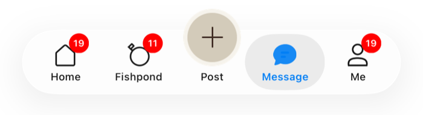 |  |
| 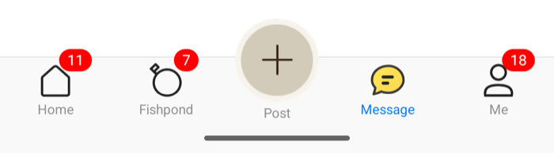 | 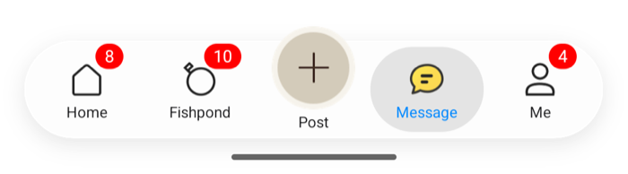 |
| 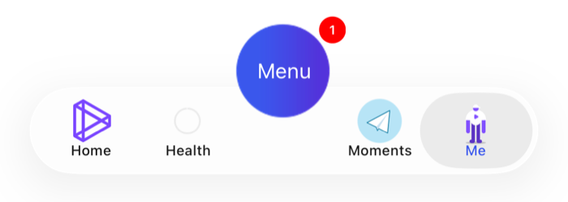 | 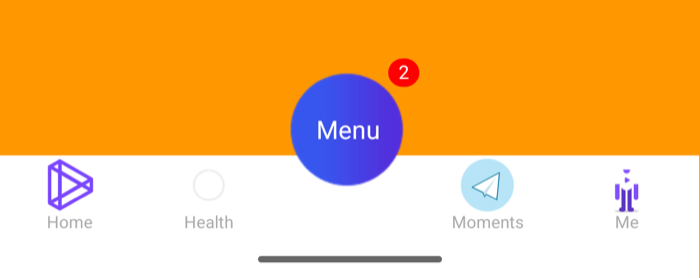 |
| 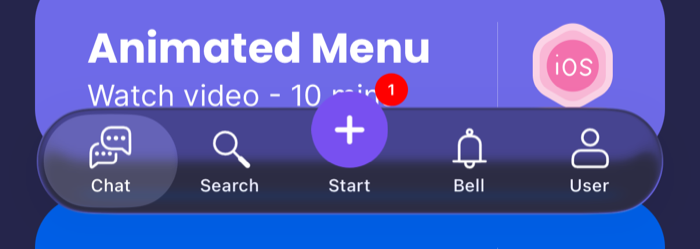 | 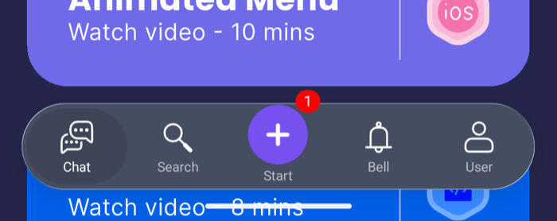 |

| 中文 | English |
|:---|:---|
| PAG 与 Rive 动效图标示例各有 React Native 与 Flutter 版本，TabBar 与 `Example-PAG`、`Example-Rive` 一致；页面中的动画用 `CYLAnimationView` 播放。见[动效图标示例](Cross-Platform-Components.md#cn动效图标示例)。 | The PAG and Rive animated-icon demos each have a React Native and a Flutter version, with the same tab bar as `Example-PAG` and `Example-Rive`; animations in a page play through `CYLAnimationView`. See [Animated-icon demos](Cross-Platform-Components.md#enanimated-icon-demos). |
| **微信小程序**：`CrossPlatform/wechat-miniprogram-cyltabbar` 中的 `cyl-tab-bar` 组件用小程序代码实现 TabBar，读取同样的配置键（Tab、凸起的 PlusButton 及其页面、角标、皮肤与深色模式、三种样式、点击动画、需要登录的 Tab），示例读取共用的 `Example-Shared/Configurations`。Lottie Tab 图标来自它的子依赖 `cyl-lottie-miniprogram`（我们维护的 lottie-miniprogram 分支），PAG 图标来自 `cyl-pag-miniprogram`，Rive 图标来自 `cyl-rive-miniprogram`。配置键评分 100 / 100，见 [微信小程序版](WeChat-Mini-Program.md)。下图从上到下：Lottie 图标、Lottie 图标上的角标、深色皮肤与着色图标、圣诞皮肤与液态玻璃（微信开发者工具 2.02.2609250 模拟器，iPhone 12/13 Pro，基础库 3.18.0，macOS 27.3，提交 [`69ae5b1`](https://github.com/ChenYilong/CYLTabBarController/commit/69ae5b1)，2026-11-13）。 | **WeChat Mini Program**: the `cyl-tab-bar` component in `CrossPlatform/wechat-miniprogram-cyltabbar` draws the tab bar in mini program code and reads the same configuration keys (tabs, the raised plus button and its page, badges, skins and Dark Mode, the three styles, tap animations, login-required tabs); its example reads the shared `Example-Shared/Configurations`. Lottie tab icons come from its sub-dependency `cyl-lottie-miniprogram` (our fork of lottie-miniprogram), PAG icons from `cyl-pag-miniprogram` and Rive icons from `cyl-rive-miniprogram`. Key score 100 / 100, see [WeChat Mini Program](WeChat-Mini-Program.md). Below, top to bottom: Lottie icons, badges on Lottie icons, the dark skin with tinted icons, the christmas skin with Liquid Glass (WeChat DevTools 2.02.2609250 simulator, iPhone 12/13 Pro, base library 3.18.0, macOS 27.3, commit [`69ae5b1`](https://github.com/ChenYilong/CYLTabBarController/commit/69ae5b1), 2026-11-13). |

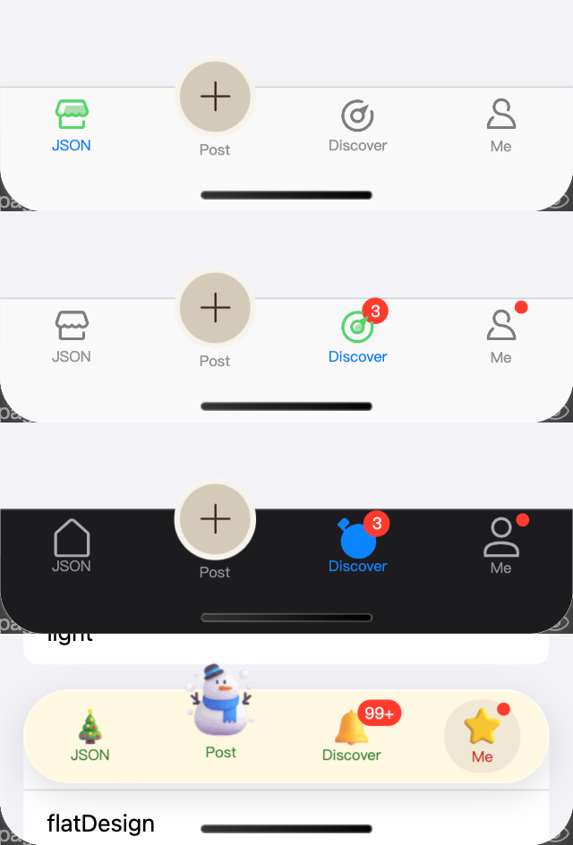

| 中文 | English |
|:---|:---|
| **微信小程序：液态玻璃**：`CYLTabBarItemStyle`（`flat`、`liquidGlass`）由 TabBar 与 Item 共用；液态玻璃透镜有两种外观 `CYLGlassLensStyle`：`regular`（默认「液态」，接近不透明，在任何 TabBar 上一致）与 `skeuomorphic`（「拟物风液态」，半透明，像真实的玻璃）；PlusButton 的标题默认与 Tab 标题在同一行。下图从上到下：液态玻璃 regular、skeuomorphic，PlusButton 标题对齐（默认样式、液态玻璃）（微信开发者工具模拟器，iPhone，基础库 3.17.6，macOS 27.3，提交 [`91236d5`](https://github.com/ChenYilong/CYLTabBarController/commit/91236d5) 之后，2026-11-13）。见[微信小程序版](WeChat-Mini-Program.md)。 | **WeChat Mini Program: Liquid Glass**: `CYLTabBarItemStyle` (`flat`, `liquidGlass`) is shared by the bar and its items; the Liquid Glass lens has two looks, `CYLGlassLensStyle`: `regular` (the default "liquid", nearly opaque, the same on any bar) and `skeuomorphic` ("skeuomorphic liquid", see-through, like real glass); the plus button's title sits on the line of the tab titles by default. Below, top to bottom: Liquid Glass regular, skeuomorphic, the plus title aligned (default style, Liquid Glass) (WeChat DevTools simulator, iPhone, base library 3.17.6, macOS 27.3, after commit [`91236d5`](https://github.com/ChenYilong/CYLTabBarController/commit/91236d5), 2026-11-13). See [WeChat Mini Program](WeChat-Mini-Program.md). |

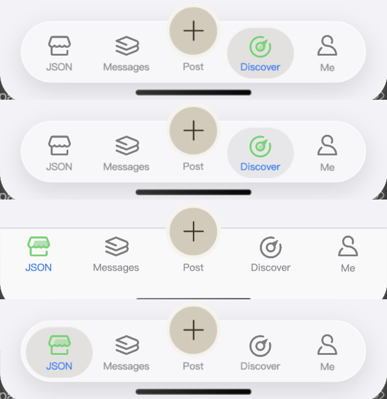

| 中文 | English |
|:---|:---|
| **微信小程序：Feed 点击与 iOS 一致**：Message、Discover、Me 的 Feed 与 iOS 示例一样响应点击。下图（微信小程序，Windows 11 开发者工具，模拟器 iPhone 12/13 Pro，基础库 3.17.6，基于 [ef5afc3](https://github.com/ChenYilong/CYLTabBarController/commit/ef5afc3)，2026-11-15）从上到下：Message 第 1 行推入新上下文的 TabBar，其 PlusButton 带可点击的 X（#202）；Discover 详情页（橙色，关闭返回手势）；Me 的 Feed，Me 为选中状态。见[微信小程序文档](WeChat-Mini-Program.md)。 | **WeChat Mini Program: feed taps as on iOS**: the feeds of Message, Discover and Me act on tap as in the iOS example. Below (WeChat Mini Program, DevTools on Windows 11, simulator iPhone 12/13 Pro, base library 3.17.6, on top of [ef5afc3](https://github.com/ChenYilong/CYLTabBarController/commit/ef5afc3), 2026-11-15), top to bottom: Message row 1 pushes a tab bar of a new context whose plus button has a tappable X (#202); the Discover details page (orange, pop gesture off); the Me feed with Me selected. See [WeChat Mini Program](WeChat-Mini-Program.md). |

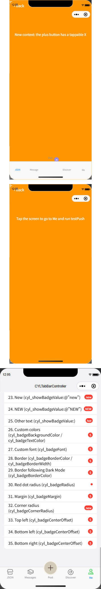

| 中文 | English |
|:---|:---|
| **微信小程序：与 Objective-C 示例相同的 Tab 与启动效果**：首页 / Refresh、同城、发布、消息、我的，ObjC 的图片与红 / 绿标题，液态玻璃；启动 1.5 秒后显示角标（紫色 8、99+、NEW、PlusButton 1）与首页的「淘」封面；选中 Tab 的点击把角标变为同色红点；消息与我的需要登录。下图（微信小程序，Windows 11 开发者工具，模拟器 iPhone 12/13 Pro，基础库 3.17.6，基于 [4e2e327](https://github.com/ChenYilong/CYLTabBarController/commit/4e2e327)，2026-11-15）从上到下：启动后；点击同城；未登录时点击消息。进度见 [ObjC 示例复刻](ObjC-Example-Parity/README.md)。 | **WeChat Mini Program: the Objective-C example’s tabs and launch**: Home / Refresh, Nearby, Post, Messages, Me, the ObjC images and red / green titles, Liquid Glass; 1.5 s after launch the badges (purple 8, 99+, NEW, plus button 1) and the cover over Home; a tap that selects a tab turns its badge into a dot of its color; Messages and Me need login. Below (WeChat Mini Program, DevTools on Windows 11, simulator iPhone 12/13 Pro, base library 3.17.6, on top of [4e2e327](https://github.com/ChenYilong/CYLTabBarController/commit/4e2e327), 2026-11-15), top to bottom: after launch; Nearby tapped; Messages tapped while logged out. Progress: [ObjC example parity](ObjC-Example-Parity/README.md). |

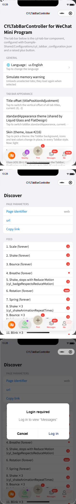

| 中文 | English |
|:---|:---|
| **微信小程序：首页导航栏与 17 个皮肤**：与 Objective-C 示例相同，首页导航栏左侧「Flat Design」（呼吸红点）、右侧「换肤」与「Liquid Glass」（抖动红点）；前后两者用对应样式的新 TabBar 替换当前 TabBar，「换肤」打开 17 个皮肤与「跟随系统深色模式」的菜单（节日图标、网络图标、配色）。下图（微信小程序，Windows 11 开发者工具，模拟器 iPhone 12/13 Pro，基础库 3.17.6，基于 [b850f51](https://github.com/ChenYilong/CYLTabBarController/commit/b850f51)，2026-11-15）从左到右：启动后；换肤菜单；圣诞节皮肤；网络皮肤下的扁平样式。进度见 [ObjC 示例复刻](ObjC-Example-Parity/README.md)。 | **WeChat Mini Program: the Home navigation bar and the 17 skins**: as the Objective-C example, "Flat Design" (a breathing dot) on the left of the Home navigation bar, "Skin" and "Liquid Glass" (a shaking dot) on the right; the first and last replace the bar with a new one in that style, "Skin" opens the menu of the 17 skins and "Follow the system Dark Mode" (holiday icons, network icons, colors). Below (WeChat Mini Program, DevTools on Windows 11, simulator iPhone 12/13 Pro, base library 3.17.6, on top of [b850f51](https://github.com/ChenYilong/CYLTabBarController/commit/b850f51), 2026-11-15), left to right: after launch; the skin menu; Christmas; FlatDesign in the network skin. Progress: [ObjC example parity](ObjC-Example-Parity/README.md). |

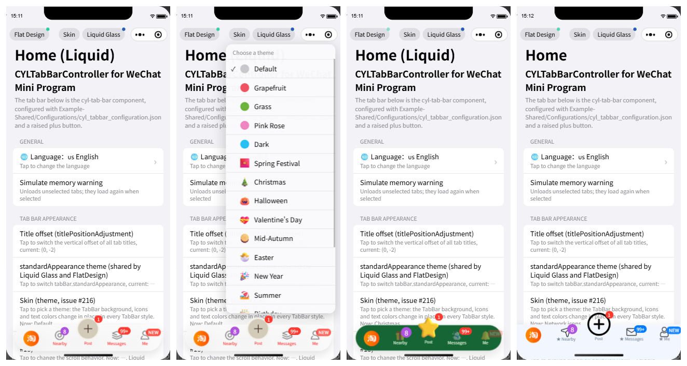

| 中文 | English |
|:---|:---|
| **微信小程序：首页各行与 Objective-C 示例取值一致**：标题偏移 0 / -4 / 4、四种 standardAppearance、四种滚动行为、扁平样式 Item 背景色、原地更新 Tab（「已购课程」、网络 / 本地 / GIF 图标、「★ 」标题，带勾号，再点恢复）、selectedIndex 循环。下图（微信小程序，Windows 11 开发者工具，模拟器 iPhone 12/13 Pro，基础库 3.17.6，基于 [a9b1278](https://github.com/ChenYilong/CYLTabBarController/commit/a9b1278)，2026-11-15）从左到右：深色外观 + 本地图标；居中胶囊 + 网络图标 +「★ 」标题；扁平样式 + 绿色描边 + Item 背景色。进度见 [ObjC 示例复刻](ObjC-Example-Parity/README.md)。 | **WeChat Mini Program: the Home rows with the Objective-C values**: title offset 0 / -4 / 4, the four standardAppearance themes, the four scroll behaviors, the FlatDesign item background, tabs updated in place ("Purchased courses", network / local / GIF icons, "★ " titles, with checkmarks, tap again to restore), selectedIndex wrapping. Below (WeChat Mini Program, DevTools on Windows 11, simulator iPhone 12/13 Pro, base library 3.17.6, on top of [a9b1278](https://github.com/ChenYilong/CYLTabBarController/commit/a9b1278), 2026-11-15), left to right: Dark + local icons; Centered capsule + network icons + "★ " titles; FlatDesign + Green line + item background. Progress: [ObjC example parity](ObjC-Example-Parity/README.md). |

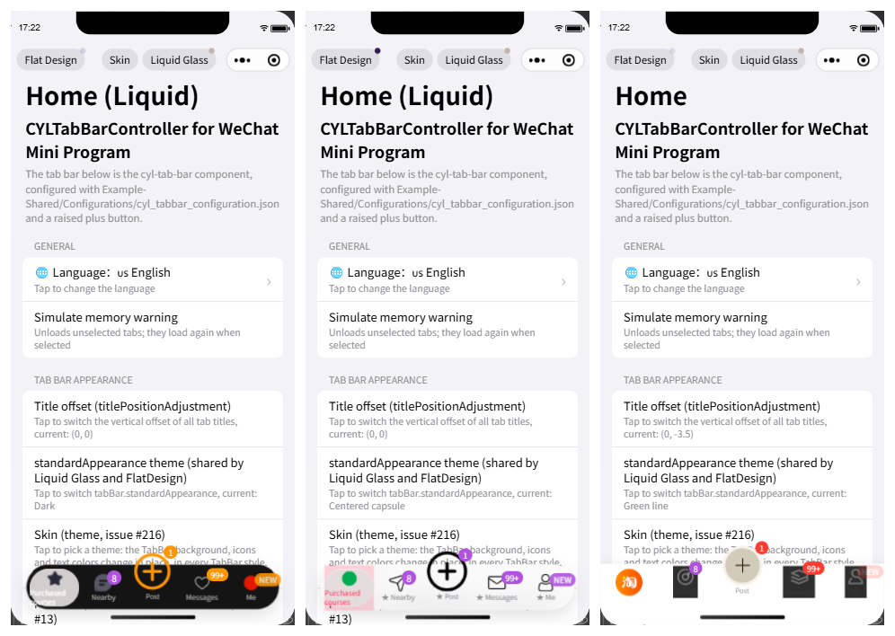

| 中文 | English |
|:---|:---|
| **微信小程序：上一个 / 下一个箭头、PlusButton 点击范围、替换相邻 Tab、长按与双击时长**：与 Objective-C 示例相同，◀︎ ▶︎ 调用 `cyl_switchToAdjacentTab`（不循环，显示 YES / NO）；开关以红色显示 PlusButton 的可点击区域，滑块按 1–3 倍扩大；同城变为「替换页 B」；长按时长与双击间隔三档切换。下图（微信小程序，Windows 11 开发者工具，模拟器 iPhone 12/13 Pro，基础库 3.17.6，基于 [5d86b75](https://github.com/ChenYilong/CYLTabBarController/commit/5d86b75)，2026-11-15）左：1.8 倍可点击区域与「替换页 B」Tab；右：▶︎ 进入替换页 B。进度见 [ObjC 示例复刻](ObjC-Example-Parity/README.md)。 | **WeChat Mini Program: previous / next arrows, the plus button's touchable area, replaced neighboring tabs, long press and double tap timings**: as the Objective-C example, ◀︎ ▶︎ call `cyl_switchToAdjacentTab` (no wrapping, YES / NO shown); a switch shows the plus button's touchable area in red and a slider multiplies it 1–3; Nearby becomes "Replaced page B"; the long press and double tap timings cycle through three presets. Below (WeChat Mini Program, DevTools on Windows 11, simulator iPhone 12/13 Pro, base library 3.17.6, on top of [5d86b75](https://github.com/ChenYilong/CYLTabBarController/commit/5d86b75), 2026-11-15), left: the 1.8x touchable area and the "Replaced page B" tab; right: ▶︎ opened Replaced page B. Progress: [ObjC example parity](ObjC-Example-Parity/README.md). |

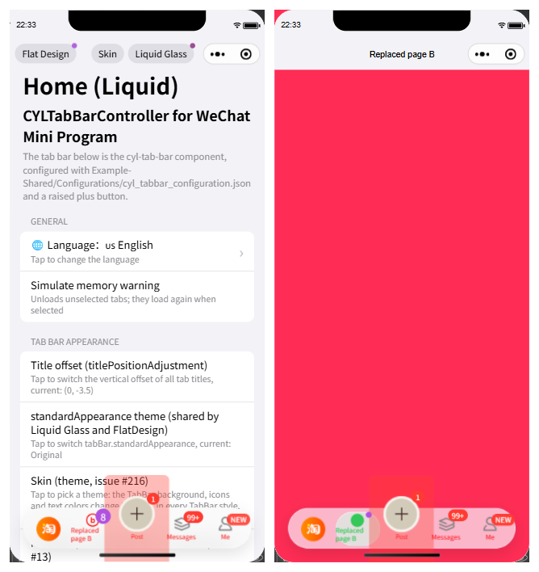

## [CN]在 Swift 项目中使用 CYLTabBarController
## [EN]Using CYLTabBarController in a Swift project

| 中文 | English |
|:---|:---|
| 仓库提供了 Swift Demo，目录为 `Example-Swift`。 | The repository includes a Swift demo in `Example-Swift`. |
| 完整的中英文 Swift 使用指南（`import` 报错排查、初始化、PlusButton、代理、角标、Lottie、深色模式等 API 示例）：[docs/Swift-Guide.md](Swift-Guide.md)。 | A full bilingual Swift guide (fixing `import` errors, initializers, PlusButton, delegates, badges, Lottie, Dark Mode and more, with code): [docs/Swift-Guide.md](Swift-Guide.md). |
| SwiftUI App 中的集成方式（`UIViewControllerRepresentable`、`UIHostingController`、在 SwiftUI 中控制 TabBar）：[docs/SwiftUI-Integration.md](SwiftUI-Integration.md)，示例目录 `Example-SwiftUI`。 | Integrating it in a SwiftUI app (`UIViewControllerRepresentable`, `UIHostingController`, driving the tab bar from SwiftUI): [docs/SwiftUI-Integration.md](SwiftUI-Integration.md), example in `Example-SwiftUI`. |

| 中文 | English |
|:---|:---|
| 在 Swift 项目中作为静态库使用： | To use the library as a static library in a Swift project: |

| 中文 | English |
|:---|:---|
| 使用 CocoaPods： | With CocoaPods: |

 ```Objective-C
 platform :ios, '15.0'
# Uncomment the next line when you want all Pods as static framework
# use_modular_headers!
pod 'CYLTabBarController', '~> 1.100.0', :modular_headers => true
 ```

| 中文 | English |
|:---|:---|
| 作为动态库使用： | To use it as a dynamic framework: |

 ```Objective-C
platform :ios, '15.0'
use_frameworks!
 ```

| 中文 | English |
|:---|:---|
| 感谢 [@WeMadeCode](https://github.com/WeMadeCode) 提供 Swift Demo，原仓库：[WeMadeCode/CYLTabBarController-Swift](https://github.com/WeMadeCode/CYLTabBarController-Swift)。 | Thanks to [@WeMadeCode](https://github.com/WeMadeCode) for the Swift demo. Original repository: [WeMadeCode/CYLTabBarController-Swift](https://github.com/WeMadeCode/CYLTabBarController-Swift). |

| 中文 | English |
|:---|:---|
| 具体步骤可参考教程：[从头开始 Swift 2.1：主流 Tabbed 框架搭建](http://www.jianshu.com/p/c5bc2eae0f55?nomobile=yes)。 | For step-by-step instructions, see [Building a mainstream Tabbed framework with Swift 2.1](http://www.jianshu.com/p/c5bc2eae0f55?nomobile=yes). |

| 中文 | English |
|:---|:---|
| 注意：教程早期版本的示例缺少 PlusButton 尺寸设置，可能导致点击事件失效。当前教程已更新。 | Note: an early version of the tutorial omitted the PlusButton size, which could disable taps. The tutorial has since been updated. |

<p align="center"><a href="https://mp.weixin.qq.com/s/A4e5h3xgIEh6PInf1Rjqsw"></a></p>

## [CN]搭配 Storyboard 使用 CYLTabBarController
## [EN]Using CYLTabBarController with Storyboard

| 中文 | English |
|:---|:---|
| 参考： | References: |

| 中文 | English |
|:---|:---|
| [Issue 讨论](https://github.com/ChenYilong/CYLTabBarController/issues/170) | [Issue discussion](https://github.com/ChenYilong/CYLTabBarController/issues/170) |
| [CYLDeallocBlockExecutor](https://github.com/ChenYilong/CYLDeallocBlockExecutor) 中的 `CYLTabBarControllerTestDemo` 演示了如何与 Storyboard 配合使用。 | The `CYLTabBarControllerTestDemo` directory demonstrates Storyboard integration. |

## [CN]源码实现原理
## [EN]Implementation details

| 中文 | English |
|:---|:---|
| 参考：[《[Note] CYLTabBarController》](http://www.jianshu.com/p/8758d8014f86) | See [Note: CYLTabBarController](http://www.jianshu.com/p/8758d8014f86). |

| 中文 | English |
|:---|:---|
| 更多文档请查看 [CocoaDocs: CYLTabBarController](http://cocoadocs.org/docsets/CYLTabBarController/1.2.1/index.html)。 | For additional documentation, see [CocoaDocs: CYLTabBarController](http://cocoadocs.org/docsets/CYLTabBarController/1.2.1/index.html). |
