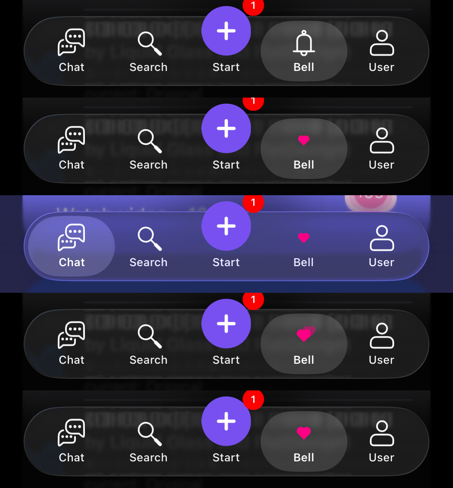
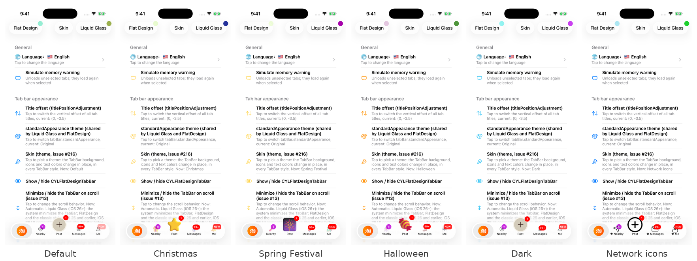
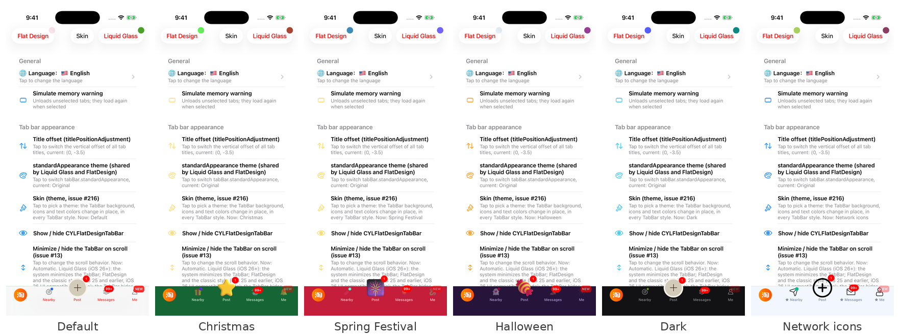
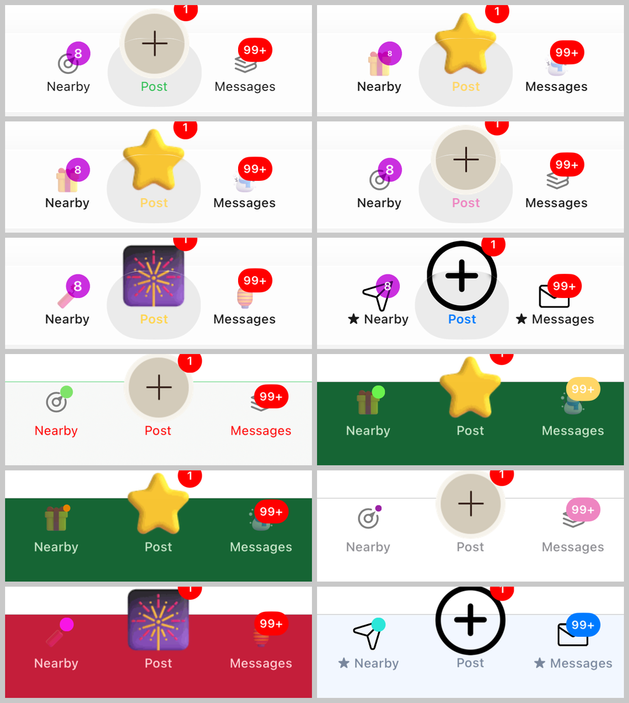

# [CN]CYLTabBarController 历史版本亮点
# [EN]CYLTabBarController highlights of earlier versions

<!-- bound-classes: none -->
<!-- binding:start -->
<!-- Generated by scripts/update-docs-navigation.py; do not edit by hand. -->

| 中文 | English |
|:---|:---|
| 本文档不绑定代码类。 | This document is not bound to a code class. |

<!-- binding:end -->

| 中文 | English |
|:---|:---|
| 本文收录原 README「最新版本预览」中较早版本（1.99.x）的说明与截图：iOS 27、iPhone Duo、iOS 26 运行时增删 PlusButton 等。最新版本见 [README](../README.md)。 | This page holds the notes and screenshots of earlier versions (1.99.x) that used to be in the README's preview: iOS 27, iPhone Duo, adding and removing the plus button at runtime on iOS 26. For the latest version, see the [README](../README.md). |

## [CN]目录
## [EN]Contents

<!-- navigation:start -->
<!-- Generated by scripts/update-docs-navigation.py; do not edit by hand. -->

| 中文 | English |
|:---|:---|
| [iOS 27 和 iPhone Duo 适配](#cnios-27-和-iphone-duo-适配) | [iOS 27 and iPhone Duo support](#enios-27-and-iphone-duo-support) |

<!-- navigation:end -->

## [CN]iOS 27 和 iPhone Duo 适配
## [EN]iOS 27 and iPhone Duo support

CYLTabBarController 现已适配 iOS 27，新增如下功能：
CYLTabBarController now supports iOS 27 with the following improvements:

现在已适配 iPhone Duo 的横向布局与竖向布局，请更新至 CYLTabBarController 1.99.66 查看。
It also supports both landscape and portrait layouts on iPhone Duo. Update to CYLTabBarController 1.99.66 to try it.

CYLTabBarController 现已适配 iOS 27 和 iPhone Duo，更新内容如下：
CYLTabBarController now supports iOS 27 and iPhone Duo with the following features:

| 中文 | English |
|:---|:---|
| ✅ 支持横向布局与竖向布局 | ✅ Supports landscape and portrait layouts. |
| ✅ 支持扁平样式与液态玻璃样式 | ✅ Supports flat and Liquid Glass styles. |
| ✅ 所有样式均支持加号按钮居中显示。 | ✅ The plus button can be centered in every style. |
| ✅ 零代码适配：已经接入 CYLTabBar 液态玻璃样式或扁平样式的代码，无需修改代码，更新版本即可适配 iPhone Duo。 | ✅ Zero-code adaptation: apps already using the CYLTabBar Liquid Glass or flat style require no code changes to support iPhone Duo. |
| ✅ 审核友好，适配代码均为纯原生公开 API，无审核风险。 | ✅ Review-friendly: the adaptation uses only public native APIs. |

请更新 CYLTabBarController 1.99.66 查看演示：
Update to CYLTabBarController 1.99.66 to see the demo:

| 中文 | English |
|:---|:---|
| ✅ iOS 27 下无需新增代码即可启用扁平风格；保留 `UIDesignRequiresCompatibility` 时会自动切换到扁平样式。 | ✅ Enable the flat style on iOS 27 without adding code; `UIDesignRequiresCompatibility` automatically selects the flat style. |
| ✅ 扁平风格作为独立组件集成，降低耦合并减小包体积。 | ✅ The flat style is integrated as an independent component for lower coupling and a smaller package size. |
| ✅ 扁平风格与液态玻璃样式共享 API，只需修改样式属性即可切换。 | ✅ The flat and Liquid Glass styles share the same APIs; switch styles by changing the appearance property. |
| ✅ 一个 `UITabBarAppearance` 同时控制液态玻璃与扁平样式：设置 `tabBar.standardAppearance` 即可自定义扁平样式 TabBar 的背景、阴影、标题、图标与角标等，详见 [docs/FlatDesign-StandardAppearance.md](FlatDesign-StandardAppearance.md)。 | ✅ One `UITabBarAppearance` styles both Liquid Glass and FlatDesign: set `tabBar.standardAppearance` to customize the flat design tab bar's background, shadow, titles, icons, badges and more, see [docs/FlatDesign-StandardAppearance.md](FlatDesign-StandardAppearance.md). |
| ✅ 需要登录的 Tab：未登录时点击会先弹出登录页（不切换、无动画），登录后自动切换到该 Tab；登录状态缓存在本地，支持 block 与代理，详见 [docs/Login-Required-Tabs.md](Login-Required-Tabs.md)（[#19](https://github.com/ChenYilong/CYLTabBarController/issues/19)）。 | ✅ Tabs that need login: while logged out, a tap shows the login screen first (no switch, no animation), then selects that tab after logging in; the login state is cached locally, with block and delegate APIs, see [docs/Login-Required-Tabs.md](Login-Required-Tabs.md) ([#19](https://github.com/ChenYilong/CYLTabBarController/issues/19)). |
| ✅ 原地更新 Tab：不重建 TabBar 修改标题、图标、PlusButton；图标可来自网络（`CYLTabBarItemImageURL`，内存与沙盒缓存，`CYLImageCache` 可调整过期时间与容量）或本地（图片名、路径、UIImage、GIF）；`-performWhenTabBarItemsReady:` 在 `tabBar.items` 生成后执行（[#22](https://github.com/ChenYilong/CYLTabBarController/issues/22)）；`-replaceViewControllerAtIndex:withViewController:attributes:` 运行时替换 Tab 的页面（[#481](https://github.com/ChenYilong/CYLTabBarController/issues/481)），详见 [docs/Update-Tab-Bar-Items-In-Place.md](Update-Tab-Bar-Items-In-Place.md)（[#601](https://github.com/ChenYilong/CYLTabBarController/issues/601)）。 | ✅ Update tabs in place: change titles, icons and the PlusButton without rebuilding the tab bar; icons from the network (`CYLTabBarItemImageURL`, cached in memory and in the sandbox, with expiration and size set on `CYLImageCache`) or local (a name, a path, a UIImage, a GIF); `-performWhenTabBarItemsReady:` runs once `tabBar.items` exist ([#22](https://github.com/ChenYilong/CYLTabBarController/issues/22)); `-replaceViewControllerAtIndex:withViewController:attributes:` replaces a tab's page at runtime ([#481](https://github.com/ChenYilong/CYLTabBarController/issues/481)). See [docs/Update-Tab-Bar-Items-In-Place.md](Update-Tab-Bar-Items-In-Place.md) ([#601](https://github.com/ChenYilong/CYLTabBarController/issues/601)). |
| ✅ SwiftUI 集成：用 `UIViewControllerRepresentable` 在 SwiftUI App 中使用 CYLTabBarController，各 Tab 与 PlusButton 页面可以是 SwiftUI 视图，示例 `Example-SwiftUI`，详见 [docs/SwiftUI-Integration.md](SwiftUI-Integration.md)。 | ✅ SwiftUI integration: use CYLTabBarController in a SwiftUI app with `UIViewControllerRepresentable`; tabs and the plus button's page can be SwiftUI views. Example: `Example-SwiftUI`; see [docs/SwiftUI-Integration.md](SwiftUI-Integration.md). |
| ✅ PAG 动画 Tab 图标（腾讯 libpag）：与 Lottie 用法相同，`pod 'CYLTabBarController/PAG'`，使用 `CYLTabBarPAGURL` / `CYLTabBarPAGFilePath` 等 key 或 `CYLTabBarItemsAttributesAddingPAGFiles()`，示例 `Example-PAG`，详见 [docs/PAG-Animation.md](PAG-Animation.md)（[#604](https://github.com/ChenYilong/CYLTabBarController/issues/604)）。 | ✅ PAG animated tab icons (Tencent libpag), used like Lottie: `pod 'CYLTabBarController/PAG'`, with the `CYLTabBarPAGURL` / `CYLTabBarPAGFilePath` keys or `CYLTabBarItemsAttributesAddingPAGFiles()`; example `Example-PAG`; see [docs/PAG-Animation.md](PAG-Animation.md) ([#604](https://github.com/ChenYilong/CYLTabBarController/issues/604)). |
| ✅ Rive 动画 Tab 图标：与 Lottie、PAG 用法相同，`pod 'CYLTabBarController/Rive'`（RiveRuntime 6.29+，iOS 14+），使用 `CYLTabBarRiveURL` 等 key，通用的 `CYLTabBarAnimationURLWithOptions()` 可指定画板与状态机，一个 `.riv` 文件即可包含所有 Tab 的图标，也支持没有 view model 的旧版文件（状态机输入）；Rive 通过共用子库的「可播放视图」方式接入，Core 无需修改；示例 `Example-SwiftUI-Rive`（由 Design+Code「SwiftUI Animations」课程改造）与其 UIKit 版本 `Example-Rive`，详见 [docs/Rive-Animation.md](Rive-Animation.md)。 | ✅ Rive animated tab icons, used like Lottie and PAG: `pod 'CYLTabBarController/Rive'` (RiveRuntime 6.29+, iOS 14+), with the `CYLTabBarRiveURL` keys; the generic `CYLTabBarAnimationURLWithOptions()` picks an artboard and a state machine, so one `.riv` file can hold every tab's icon; legacy files without a view model (state machine inputs) work too. Rive plugs in through the shared subspec's "playable view" way, with no change to Core; examples `Example-SwiftUI-Rive` (reworked from Design+Code's "SwiftUI Animations" course) and its UIKit version `Example-Rive`; see [docs/Rive-Animation.md](Rive-Animation.md). |
| ✅ GIF Tab 图标（[#605](https://github.com/ChenYilong/CYLTabBarController/issues/605)）：作为图片传入时循环；`pod 'CYLTabBarController/GIF'` 并使用 `CYLTabBarGIFURL` / `CYLTabBarGIFFilePath` 时，与 Lottie、PAG、Rive 一样，选中时播放一次。配置文件与 Android 版同样支持这些 key。详见 [docs/GIF-Animation.md](GIF-Animation.md)。 | ✅ GIF tab icons ([#605](https://github.com/ChenYilong/CYLTabBarController/issues/605)): given as an image, a GIF loops; with `pod 'CYLTabBarController/GIF'` and `CYLTabBarGIFURL` / `CYLTabBarGIFFilePath`, it plays once when selected, like Lottie, PAG and Rive. Configuration files and the Android version take the same keys. See [docs/GIF-Animation.md](GIF-Animation.md). |
| ✅ SVGA Tab 图标（[#415](https://github.com/ChenYilong/CYLTabBarController/issues/415)）：接入方式与 Rive 相同，`pod 'CYLTabBarController/SVGA'`（播放器为 SVGAPlayer 的维护分支 SVGAPlayerLite，Protobuf 3.27），使用 `CYLTabBarSVGAURL` 等 key，选中时播放一次并停在最后一帧；Example-Rive 的 Bell Tab 在 Rive 演示之后展示 SVGA。详见 [docs/SVGA-Animation.md](SVGA-Animation.md)。 已在经典、液态玻璃与扁平样式下作为真正的 Tab 图标验证（液态玻璃，iOS 26.3 模拟器，Xcode 27.2，[0af437e](https://github.com/ChenYilong/CYLTabBarController/commit/0af437e) 之上的工作区，2026-11-15）：  | ✅ SVGA tab icons ([#415](https://github.com/ChenYilong/CYLTabBarController/issues/415)), integrated like Rive: `pod 'CYLTabBarController/SVGA'` (player: SVGAPlayerLite, a maintained fork of SVGAPlayer, Protobuf 3.27), with the `CYLTabBarSVGAURL` keys; selecting a tab plays it once and keeps the last frame; Example-Rive's Bell tab shows SVGA after the Rive demo. See [docs/SVGA-Animation.md](SVGA-Animation.md). Verified as a real tab icon in the classic, Liquid Glass and FlatDesign styles (Liquid Glass, iOS 26.3 simulator, Xcode 27.2, working tree on top of [0af437e](https://github.com/ChenYilong/CYLTabBarController/commit/0af437e), 2026-11-15):  |
| ✅ Tab 图标动画共用子库 `CYLTabBarItemAnimation`：面向协议、依赖反转，只在引入动画库的子库时引入（Core 不依赖它）。Lottie 与 PAG 都是通过公开协议 `CYLTabBarItemAnimator` 自行注册的插件，以后新增动画库只需新增一个 animator 与子库，无需修改其他代码；新增通用 key `CYLTabBarAnimationURL` 等，以及通用通知名称 `CYLTabBarItemAnimationPlayingNotification`、`CYLTabBarItemAnimationViewDidAddNotification`（与 Lottie 名称取值相同）；原来只为 Lottie 设计的通用 API（`lottieAnimationSpeed`、`-cyl_lottieAnimationView` 等）已废弃，改用通用名称（`tabBarItemAnimationSpeed`、`-cyl_tabBarItemAnimationView` 等，旧名称仍可用）；引擎的依赖（注册表、工厂、风格来源、宿主）都通过协议注入，详见 [docs/Tab-Bar-Item-Animation.md](Tab-Bar-Item-Animation.md)（[#604](https://github.com/ChenYilong/CYLTabBarController/issues/604)）。 PAG 与 Rive 的 key 只在引入对应动画库时存在（开关 `CYL_PAG_AVAILABLE`、`CYL_RIVE_AVAILABLE`），未引入时使用即编译失败。没有 Lottie 时使用 Lottie key 会给出编译警告并提示所需的 pod（key 已发布，保持可用）。 | ✅ The shared tab icon animation subspec `CYLTabBarItemAnimation`: protocol-oriented with dependency inversion, pulled in only by an animation library's subspec (Core does not depend on it). Lottie and PAG are plugins that register themselves through the public `CYLTabBarItemAnimator` protocol, so a library added later is one more animator and subspec with no change elsewhere; new generic keys such as `CYLTabBarAnimationURL`, and library-neutral notification names `CYLTabBarItemAnimationPlayingNotification` and `CYLTabBarItemAnimationViewDidAddNotification` (same values as the Lottie names); the generic API that was named for Lottie only (`lottieAnimationSpeed`, `-cyl_lottieAnimationView`…) is deprecated in favour of neutral names (`tabBarItemAnimationSpeed`, `-cyl_tabBarItemAnimationView`…; the old names keep working); the engine gets its dependencies (registry, factory, style source, host) injected through protocols; see [docs/Tab-Bar-Item-Animation.md](Tab-Bar-Item-Animation.md) ([#604](https://github.com/ChenYilong/CYLTabBarController/issues/604)). The PAG and Rive keys exist only when their library does (switches `CYL_PAG_AVAILABLE`, `CYL_RIVE_AVAILABLE`); without it, using one fails to build. Using a Lottie key in a build without Lottie gives a compile warning naming the pod to add (the keys are released, so they stay usable). |
| ✅ 只有部分 Tab 有动画：同一个 TabBar 中可以混用有动画与无动画的 Tab，以及 Lottie 与 PAG 的 Tab（三种样式均支持）；新增 `CYLTabBarItemAttributesAddingAnimationFile()` 为单个 Tab 添加动画，详见 [docs/Per-Tab-Animation.md](Per-Tab-Animation.md)（[#477](https://github.com/ChenYilong/CYLTabBarController/issues/477)）。 | ✅ Only some tabs animated: one tab bar can mix animated and static tabs, and Lottie and PAG tabs (all three styles); the new `CYLTabBarItemAttributesAddingAnimationFile()` adds an animation to one tab; see [docs/Per-Tab-Animation.md](Per-Tab-Animation.md) ([#477](https://github.com/ChenYilong/CYLTabBarController/issues/477)). |
| ✅ PlusButton 子控件响应各自的点击：在加号按钮上添加的按钮或带手势的视图（如直播间封面与关闭按钮）不再被加号按钮拦截；Demo 中“消息”页第 2 行可体验带 X 子按钮的 PlusButton，详见 [docs/PlusButton-Subview-Touches.md](PlusButton-Subview-Touches.md)。 | ✅ Subviews of the PlusButton get their own touches: buttons and views with gesture recognizers added to the plus button (e.g. a live room's cover and close button) are no longer swallowed by it; try the PlusButton with an X subview from row 2 of the demo's Message tab. See [docs/PlusButton-Subview-Touches.md](PlusButton-Subview-Touches.md). |
| ✅ TabBarItem 手势：再次点击、双击（如双击刷新）与长按 Tab 按钮或 PlusButton，支持 block 与代理方法，适用于所有样式，详见 [docs/TabBarItem-Gestures.md](TabBarItem-Gestures.md)（[#152](https://github.com/ChenYilong/CYLTabBarController/issues/152)）。 | ✅ Tab bar item gestures: reselect, double tap (e.g. double tap to refresh) and long press on a tab button or the plus button, as a block and a delegate method, in every style; see [docs/TabBarItem-Gestures.md](TabBarItem-Gestures.md) ([#152](https://github.com/ChenYilong/CYLTabBarController/issues/152)). |
| ✅ 选中标题：`CYLTabBarItemSelectedTitle` 让选中的 Tab 显示不同文字（如京东「首页」选中后显示「刷新」），搭配选中图标、再次点击重播的 Lottie 动画与再次点击手势，实现再次点击刷新，适用于所有样式，详见 [docs/TabBarItem-Selected-Title.md](TabBarItem-Selected-Title.md)（[#433](https://github.com/ChenYilong/CYLTabBarController/issues/433)）。 | ✅ Selected title: `CYLTabBarItemSelectedTitle` gives the selected tab a different title (like JD's "Home" tab that reads "Refresh" when selected); with the selected icon, the Lottie animation that replays on a re-tap and the reselect gesture, a re-tap refreshes, in every style; see [docs/TabBarItem-Selected-Title.md](TabBarItem-Selected-Title.md) ([#433](https://github.com/ChenYilong/CYLTabBarController/issues/433)). |
| ✅ 纯图标 Tab 的自动居中不再覆盖自定义值：App 设置的 `imageInsets` / `titlePositionAdjustment` 与有标题的 Tab 保持不变，布局时不再反复写入导致图标跳动；新增 `automaticallyAdjustsImageOnlyTabs` 可完全关闭；新增 `updateImageInsets:`，与 `titlePositionAdjustment` 一样可在控制器创建后设置，详见 [docs/Image-Only-Tabs.md](Image-Only-Tabs.md)（[#257](https://github.com/ChenYilong/CYLTabBarController/issues/257)、[#522](https://github.com/ChenYilong/CYLTabBarController/issues/522)、[#95](https://github.com/ChenYilong/CYLTabBarController/issues/95)）。 | ✅ The automatic centering of image-only tabs no longer overrides custom values: the app's `imageInsets` / `titlePositionAdjustment` and tabs with a title are left alone, and layout passes no longer write the items again and make the icons jump; the new `automaticallyAdjustsImageOnlyTabs` turns it off completely; the new `updateImageInsets:` can, like `titlePositionAdjustment`, be set after the controller is created. See [docs/Image-Only-Tabs.md](Image-Only-Tabs.md) ([#257](https://github.com/ChenYilong/CYLTabBarController/issues/257), [#522](https://github.com/ChenYilong/CYLTabBarController/issues/522), [#95](https://github.com/ChenYilong/CYLTabBarController/issues/95)). |
| ✅ TabBar 的 `-hitTest:withEvent:` 不再返回 nil，没有命中时交给 `[super hitTest:withEvent:]`，同样拦截 `hitTest` 的第三方库与 TabBar 上的自定义视图可以正常收到触摸，详见 [docs/TabBar-HitTest-Super-Fallback.md](TabBar-HitTest-Super-Fallback.md)（[#474](https://github.com/ChenYilong/CYLTabBarController/issues/474)）。 | ✅ The tab bar's `-hitTest:withEvent:` never returns nil: when nothing matches it falls back to `[super hitTest:withEvent:]`, so third-party libraries that also intercept `hitTest`, and custom views on the tab bar, get their touches. See [docs/TabBar-HitTest-Super-Fallback.md](TabBar-HitTest-Super-Fallback.md) ([#474](https://github.com/ChenYilong/CYLTabBarController/issues/474)). |
| ✅ 在任意位置 push：`[UIViewController cyl_currentNavigationController]` 返回当前可见页面所在的导航控制器（屏幕上有弹窗时也能拿到），配合 `cyl_pushViewController:animated:` 防重复 push，详见 [docs/Push-From-Anywhere.md](Push-From-Anywhere.md)；点击某个 Tab 时 push 页面而不切换（[#283](https://github.com/ChenYilong/CYLTabBarController/issues/283)、[#232](https://github.com/ChenYilong/CYLTabBarController/issues/232)）。 | ✅ Push from anywhere: `[UIViewController cyl_currentNavigationController]` returns the navigation controller of the visible page (also while an alert is on screen); combine it with `cyl_pushViewController:animated:` to avoid double pushes. See [docs/Push-From-Anywhere.md](Push-From-Anywhere.md). Also: push a page on a tab tap instead of switching ([#283](https://github.com/ChenYilong/CYLTabBarController/issues/283), [#232](https://github.com/ChenYilong/CYLTabBarController/issues/232)). |
| ✅ 自定义 PlusButton 位置时 `setSelectedIndex:` 选中的文字与图片一致（#515），并新增 `cyl_selectedIndexIgnoringPlusButton`，按不含 PlusButton 的下标在所有样式下选中同一个 Tab，详见 [docs/SelectedIndex-PlusButton.md](SelectedIndex-PlusButton.md)。 | ✅ With a custom PlusButton position, `setSelectedIndex:` selects the matching title and image (#515), and the new `cyl_selectedIndexIgnoringPlusButton` selects the same tab in every style by its index without the PlusButton. See [docs/SelectedIndex-PlusButton.md](SelectedIndex-PlusButton.md). |
| ✅ PlusButton 的 slot（占位控制器或 PlusButton 子控制器）只在一处按一条规则插入：重新赋值 `viewControllers` 不再丢失或重复 slot，扁平样式 PlusButton 在末尾或 Tab 数为奇数时不再数组越界，所有样式读取同一个 PlusButton 下标，详见 [docs/PlusButton-Slot.md](PlusButton-Slot.md)。 | ✅ The PlusButton's slot (its placeholder or plus child view controller) is inserted in one place by one rule: re-assigning `viewControllers` no longer loses or duplicates it, FlatDesign no longer goes out of range with the PlusButton at the end or an odd tab count, and every style reads the same PlusButton index. See [docs/PlusButton-Slot.md](PlusButton-Slot.md). |
| ✅ Tab 交互（#535）：Tab 与 PlusButton 的点击动画（放大再缩小、弹性、旋转、翻转等，或自定义）、长按回调、点击声音与触感反馈、左右滑动切换 Tab，以及超出父视图响应点击、从任意位置加载图片、无需继承基类的导航栏设置；全部默认关闭，适用于所有样式，详见 [docs/Tab-Interactions.md](Tab-Interactions.md) 与 [docs/CYLUtils-Helpers.md](CYLUtils-Helpers.md)。 | ✅ Tab interactions (#535): tap animations for the tabs and the PlusButton (scale, bounce, rotation, flip and more, or your own), a long press callback, a tap sound and haptics, swiping to switch tabs, plus subviews that respond outside their superview, images from anywhere, and navigation bar settings without base classes; all off by default, in every style. See [docs/Tab-Interactions.md](Tab-Interactions.md) and [docs/CYLUtils-Helpers.md](CYLUtils-Helpers.md). |
| ✅ 液态玻璃：标题画在背景图上的 PlusButton（只用 `setBackgroundImage`）现在居中于它的 Tab，按 `+multiplierOfTabBarHeight:` 定位，选中时放大镜中的副本与按钮对齐；加载给 PlusButton 的所有图片在所有样式下都自动按原图绘制，不会被 tint 染色；图片之后才加载时与启动时就设置的图片位置、尺寸与角标完全一致；扁平样式与经典 TabBar 下图片位于标题上方，不再与标题重叠（各种重叠情况的说明见文档），详见 [docs/PlusButton-Background-Image-Liquid-Glass.md](PlusButton-Background-Image-Liquid-Glass.md)。 | ✅ Liquid Glass: a PlusButton with its title on a background image (`setBackgroundImage` only) is now centered on its tab and placed by `+multiplierOfTabBarHeight:`, and the copy in the lens lines up with it when selected; every image given to a PlusButton is drawn as is, in every style, never tinted; an image set later lands exactly where the same image set at launch does (position, size, badge); in FlatDesign and the classic tab bar the image sits above the title instead of covering it (when overlap can still happen is explained in the doc). See [docs/PlusButton-Background-Image-Liquid-Glass.md](PlusButton-Background-Image-Liquid-Glass.md). |
| ✅ Demo 测试列表分组：库提供 `CYLSettingsGroup` 与 `-cyl_settingsRowsInGroup:` 等分组 API，ObjC Demo 与新增的纯 Swift 测试列表（`Example-Shared/CYLSettingsDemoTableViewController.swift`，用于 Example-Rive、Example-SwiftUI-Rive、Example-PAG）使用同一套分组，详见 [docs/Demo-Test-List.md](Demo-Test-List.md)。 | ✅ Grouped demo test list: the library provides group APIs such as `CYLSettingsGroup` and `-cyl_settingsRowsInGroup:`, and the ObjC demo and the new pure Swift test list (`Example-Shared/CYLSettingsDemoTableViewController.swift`, used by Example-Rive, Example-SwiftUI-Rive and Example-PAG) share the groups; see [docs/Demo-Test-List.md](Demo-Test-List.md). |
| ✅ 滚动时缩小或隐藏 TabBar（[#13](https://github.com/ChenYilong/CYLTabBarController/issues/13)）：一行 `tabBarController.cyl_hidesTabBarOnScroll = YES;` 用于所有样式与系统（需要全部取值时用 `cyl_tabBarMinimizeBehavior`；iOS 26+ 也可以直接使用 Apple 的 `tabBarMinimizeBehavior`，效果相同），液态玻璃（iOS 26+）使用系统原生的 `tabBarMinimizeBehavior` 缩小 TabBar，扁平样式在页面滚动时隐藏、显示 TabBar，经典样式（iOS 25 及以前、iOS 26 UI 兼容模式）隐藏、显示 TabBar（连同 PlusButton）；扁平样式与经典样式都通过同一个公开接口 `-setTabBarHidden:animated:` 隐藏；想知道 TabBar 为何恢复或没有隐藏时，把环境变量 `CYL_TAB_BAR_MINIMIZE_LOG` 设为 `1` 打开[诊断日志](TabBar-Minimize-On-Scroll.md#cn诊断日志cyl_tab_bar_minimize_log)；Demo 中「滚动隐藏：模拟意外情况」的近 40 个模拟默认收起，可用操作表选择，或点击「展开全部 N 个模拟」逐行查看。详见 [docs/TabBar-Minimize-On-Scroll.md](TabBar-Minimize-On-Scroll.md)。 | ✅ Minimize or hide the TabBar on scroll ([#13](https://github.com/ChenYilong/CYLTabBarController/issues/13)): one line, `tabBarController.cyl_hidesTabBarOnScroll = YES;`, for every style and system (`cyl_tabBarMinimizeBehavior` for every value; on iOS 26+ Apple's `tabBarMinimizeBehavior` does the same). Liquid Glass (iOS 26+) minimizes the tab bar with the native `tabBarMinimizeBehavior`; FlatDesign hides and shows it while the page scrolls; the classic style (iOS 25 and earlier, iOS 26 UI compatibility mode) hides and shows it with its PlusButton; FlatDesign and classic both hide through the same public `-setTabBarHidden:animated:`. To find out why the bar came back or did not hide, set the environment variable `CYL_TAB_BAR_MINIMIZE_LOG` to `1` for the [diagnostic log](TabBar-Minimize-On-Scroll.md#endiagnostic-log-cyl_tab_bar_minimize_log). In the demo, the almost 40 "Scroll hiding: simulate interruptions" rows are collapsed by default: pick one from the action sheet, or tap "Show all N simulations" to see them row by row. See [docs/TabBar-Minimize-On-Scroll.md](TabBar-Minimize-On-Scroll.md). |
| ✅ 一个配置文件生成 TabBarController：新增 `-initWithConfiguration:`，一个字典包含所有初始化参数（现有初始化方法都调用它）；同样的键可写在 JSON、JSON5 / JSONC、plist（XML / 二进制 / OpenStep / .strings）、YAML、TOML、INI、.properties、.env、XML、Protocol Buffers（文本与二进制）文件中，`+tabBarControllerWithConfigurationFile:error:` 读取本地文件，`+loadTabBarControllerWithConfigurationURL:completion:` 从网络加载；页面按跨端页面 ID 获得（见下一条），图标可用 SF Symbol（`system:house`），Demo 中“跳转与对比”第一行可体验 17 个示例文件；`scripts/export-tabbar-configurations.py` 把代码中的配置导出为文件（已对所有 Example 运行）；68 种边界情况（空文件、嵌套过深、超大文件、HTML 页面、NaN、错误类型、超时等）经 11 轮修复全部处理，“模拟意外情况”分组可逐一演示，详见 [docs/Configuration-File.md](Configuration-File.md)；导出、评分与测试脚本的用法见 [docs/Configuration-Scripts.md](Configuration-Scripts.md)。；合并 #752 后支持动效键：通用动画键、`CYLTabBarAnimationOptions`（写入动画 URL 的选项）、PAG / Rive 键与顶层 `CYLTabBarControllerTabBarItemAnimationSpeed` | ✅ One configuration file, one TabBarController: the new `-initWithConfiguration:` takes every initializer parameter in one dictionary (every existing initializer calls it); the same keys work in JSON, JSON5 / JSONC, plist (XML / binary / OpenStep / .strings), YAML, TOML, INI, .properties, .env, XML and Protocol Buffers (text and binary) files; `+tabBarControllerWithConfigurationFile:error:` reads a local file and `+loadTabBarControllerWithConfigurationURL:completion:` downloads one; pages come from cross-platform page IDs (see the next entry), icons can be SF Symbols (`system:house`); try the 17 sample files from the first row of the demo's "Navigation and comparisons" section; `scripts/export-tabbar-configurations.py` exports the configuration written in code to files (run on every Example); 68 edge cases (empty files, deep nesting, huge files, HTML pages, NaN, wrong types, timeouts...) are all handled after 11 rounds of fixes, each one shown in the "simulated failures" section. See [docs/Configuration-File.md](Configuration-File.md); how to use the export, scoring and test scripts: [docs/Configuration-Scripts.md](Configuration-Scripts.md).; after #752 the animation keys are supported: the generic animation keys, `CYLTabBarAnimationOptions` (options written into the animation URL), the PAG / Rive keys and the top-level `CYLTabBarControllerTabBarItemAnimationSpeed` |
| ✅ 配置文件中的皮肤（[配置文件：皮肤](Configuration-File.md#cn皮肤)），参照 QMUI 的换肤：`CYLTabBarControllerThemes` 带多套皮肤，Tab 的值写成 `"@name"` 引用当前皮肤中的值，保留名称（`CYLTabBarBackgroundColor`、`CYLTabBarItemSelectedTitleColor` 等）决定整个 TabBar；`CYLTabBarControllerDarkThemeIdentifier` 跟随深色模式。每个皮肤是 `CYLTabBarConfigurationTheme`（`CYLTabBarTheme`），切换沿用原地更新与恢复；App 的视图用 `colorNamed:`（Android 还可用 `cyl_themeValue`）跟随同样的皮肤。iOS 与 Android 读取同一个文件。 | ✅ Skins in a configuration file ([configuration file: skins](Configuration-File.md#enskins)), after QMUI's skins: `CYLTabBarControllerThemes` carries several skins, a tab value written `"@name"` refers to a value of the current skin, and reserved names (`CYLTabBarBackgroundColor`, `CYLTabBarItemSelectedTitleColor`...) style the whole bar; `CYLTabBarControllerDarkThemeIdentifier` follows Dark Mode. Each skin is a `CYLTabBarConfigurationTheme` (a `CYLTabBarTheme`), so switching reuses the in-place update and restore; the app's views follow the same skins with `colorNamed:` (and `cyl_themeValue` on Android). iOS and Android read the same file. |
| ✅ 配置文件的本地化文本：`CYLTabBarControllerLocalization` 把标题等文本作为键，在 App 的 `{语言}.lproj/{表名}.strings` 中查找；字符串表可以内置在 App 中或运行时下载到沙盒，用位置路由（`bundle:`、`sandbox:Caches/…`、`file:`、绝对路径、相对路径）指定。iOS、Android、React Native 与 Flutter 读取同样的文件，详见 [docs/Configuration-Localization.md](Configuration-Localization.md)。 | ✅ Localized texts in a configuration file: `CYLTabBarControllerLocalization` makes the titles and other texts keys looked up in the app's `{language}.lproj/{table}.strings`; the tables ship in the app or are downloaded into the sandbox at run time, located with a route (`bundle:`, `sandbox:Caches/…`, `file:`, an absolute or relative path). iOS, Android, React Native and Flutter read the same files; see [docs/Configuration-Localization.md](Configuration-Localization.md). |
| ✅ 按页面 ID 获得 Tab 页面（跨端）：配置文件中每个 Tab 只写一个页面 ID（`CYLTabBarItemPageIdentifier`，默认取 `CYLTabBarItemIdentifier`），iOS 用 `CYLTabBarPageRegistry` 注册该 ID 创建什么页面（全局注册表与每个 TabBar 自己的注册表、`CYLTabBarControllerPageResolver` 解析回调、遵守 `CYLTabBarPage` 的类自动注册），Android 演示用同一份配置文件与同样的 ID；Tab 顺序只由配置决定，找不到页面的 Tab 被跳过；新增远程配置字段 `CYLTabBarItemPlatforms`、`CYLTabBarItemMinimumAppVersion`、`CYLTabBarItemPageParameters`。详见 [按页面 ID 获得 Tab 页面](Tab-Page-Registry.md)。；控制器保留页面来源，`-reloadTabBarItemsWithAttributes:` 按 ID 解析新 Tab 并复用已有页面，`cyl_skippedTabs` 列出没有页面的 Tab 及原因（[评审与改造](Tab-Page-Registry-Review.md)） | ✅ Tab pages from page IDs (cross-platform): each tab in a configuration names one page ID (`CYLTabBarItemPageIdentifier`, by default `CYLTabBarItemIdentifier`); iOS registers what the ID creates with `CYLTabBarPageRegistry` (a shared registry and one per tab bar, a `CYLTabBarControllerPageResolver` block, automatic registration of `CYLTabBarPage` classes), and the Android demo uses the same file and the same IDs; the order comes only from the configuration, and a tab without a page is skipped; new remote keys `CYLTabBarItemPlatforms`, `CYLTabBarItemMinimumAppVersion`, `CYLTabBarItemPageParameters`. See [Tab pages from page IDs](Tab-Page-Registry.md).; the controller keeps its page sources, `-reloadTabBarItemsWithAttributes:` resolves new tabs by ID and reuses existing pages, and `cyl_skippedTabs` lists the tabs without a page and why ([review and refactoring](Tab-Page-Registry-Review.md)) |
| ✅ Android 版 CYLTabBarController（[Android 库](Android-Library.md)）：`Example-Android/cyltabbar`，Kotlin 与 Java，按 iOS 公开 API 一比一翻译（`CYLTabBarController`、`CYLTabBar`、`CYLPlusButton`、角标、主题、登录拦截、手势、点击动画对象与转场、Lottie / PAG / Rive 动画图标、页面注册表、全部配置文件格式）；每个 iOS 符号的对应项与迁移完成率（100 / 100）见 [Android API 对照表](Android-API-Map.md)，由脚本生成。 | ✅ CYLTabBarController for Android ([Android library](Android-Library.md)): `Example-Android/cyltabbar`, Kotlin and Java, the iOS public API translated one to one (`CYLTabBarController`, `CYLTabBar`, `CYLPlusButton`, badges, themes, login interception, gestures, tap animation objects and transitions, Lottie / PAG / Rive icons, the page registry, every configuration format); the twin of every iOS symbol and the migration score (100 / 100) are in the generated [Android API map](Android-API-Map.md). |
| ✅ Android 演示迁移（[Android 演示迁移](Android-Demo-Migration.md)）：iOS `Example` 中演示用的每个列表行都移植到 `Example-Android/app`（设置分组、扁平样式行、39 个滚动隐藏模拟、17 个皮肤、46 个配置意外情况、角标行、46 个 TabBar 场景），文档先列出 iOS 演示了什么，再列出 Android 的实现、状态与完成率（100 / 100）；Android 库新增滚动隐藏在意外情况后的恢复，并修复 Lottie 无法加载文件时的崩溃。 | ✅ Android demo migration ([Android demo migration](Android-Demo-Migration.md)): every demo table row of the iOS `Example` is ported to `Example-Android/app` (the settings groups, the FlatDesign rows, 39 scroll hiding simulations, 17 skins, 46 configuration failures, the badge rows, 46 gallery scenes); the document lists what iOS shows, then the Android implementation, status and score (100 / 100); the Android library now restores a bar hidden by scrolling after interruptions and no longer crashes when Lottie cannot load a file. |
| ✅ Android 版 PAG、GIF、Rive 示例（[Android 示例](Android-Examples.md)）：`Example-PAG`、`Example-GIF`、`Example-Rive` 在 `Example-Android` 中各有 Android 版本（`example-pag`、`example-gif`、`example-rive`），Tab、PlusButton、页面与 iOS 相同，直接读取 iOS 示例的动画文件；共用 `demokit` 中的设置列表与 PlusButton 角标演示。Android 库新增 `CYLGIFDrawable`：作为图片传入的 GIF 循环播放。 | ✅ The Android PAG, GIF and Rive examples ([Android examples](Android-Examples.md)): `Example-PAG`, `Example-GIF` and `Example-Rive` each have an Android version in `Example-Android` (`example-pag`, `example-gif`, `example-rive`) with the same tabs, plus buttons and pages, reading the iOS examples' own animation files; they share the settings list and the plus button badge demo of `demokit`. New in the Android library: `CYLGIFDrawable`, a GIF given as an image loops. |
| ✅ Android 独有的扩展，改编自 QMUI_Android（[Android 库](Android-Library.md#cn仅-android-的扩展)，[对比与评分](Android-QMUI-Comparison.md)）：选中指示条（`CYLTabBarIndicator`）、可滚动模式（`cyl_scrollMode`）、滑动翻页（`cyl_swipesBetweenPages`），以及主题值：`View.cyl_themeValue` 规则、`app:cyl_theme…` 布局属性、style / Map 主题、Span 与列表分割线、拦截与 `register`；一行代码绑定 ViewPager2（`cyl_setupWithViewPager2`）、按权重分配宽度（`cyl_itemWidthWeights`）、主题切换交叉淡入淡出（`themeChangeAnimationDuration`），GitHub Actions 运行 Android 构建（`android.yml`）。全部默认关闭，iOS 一致的 API 不变；Tab 评分 79 → 88，换肤 77 → 87（QMUI 60 / 61）。 | ✅ Android-only extensions adapted from QMUI_Android ([Android library](Android-Library.md#enandroid-only-extensions), [comparison and scores](Android-QMUI-Comparison.md)): a selection indicator (`CYLTabBarIndicator`), the scrollable mode (`cyl_scrollMode`), swiping between pages (`cyl_swipesBetweenPages`), and theme values: `View.cyl_themeValue` rules, `app:cyl_theme…` layout attributes, style / Map themes, spans and list decorations, interception and `register`; a one-line ViewPager2 binding (`cyl_setupWithViewPager2`), widths by weight (`cyl_itemWidthWeights`), a theme cross-fade (`themeChangeAnimationDuration`), and the Android build in GitHub Actions (`android.yml`). All off by default, with the iOS-matching API unchanged; tab score 79 → 88, skins 77 → 87 (QMUI 60 / 61). |
| ✅ Android 库一键发布到 Maven（[Android 库：发布到 Maven](Android-Library.md#cn发布到-maven)）：`scripts/publish-android.sh` 用 Gradle 发布 `io.github.chenyilong:cyltabbarcontroller` 与 `cyltabbarcontroller-pages`（源码、javadoc、POM、签名），目标为 Maven Local、Maven Central（Central Portal，上传前检查）或 GitHub Packages；版本与 podspec 一致。 | ✅ One script publishes the Android library to Maven ([Android library: publishing to Maven](Android-Library.md#enpublishing-to-maven)): `scripts/publish-android.sh` publishes `io.github.chenyilong:cyltabbarcontroller` and `cyltabbarcontroller-pages` with Gradle (sources, javadoc, POM, signatures) to Maven Local, Maven Central (the Central Portal, checked before uploading) or GitHub Packages; the version follows the podspec. |
| ✅ Tab 动画接入指南：Lottie、PAG、Rive 三种动画的接入步骤、注意事项与 Demo 地址，先运行 Demo 体验再接入，见 [docs/Tab-Icon-Animation-Quick-Start.md](Tab-Icon-Animation-Quick-Start.md)。 | ✅ Tab icon animation quick start: steps, things to watch for and demo links for Lottie, PAG and Rive; try a demo first, then integrate. See [docs/Tab-Icon-Animation-Quick-Start.md](Tab-Icon-Animation-Quick-Start.md). |
| ✅ AI 工具的 skill：`cyl-new-project`、`cyl-plus-button` 等项目专属 skill，以及精选的第三方 iOS skill，帮助快速基于本库创建项目，见 [docs/Agent-Skills.md](Agent-Skills.md)。 | ✅ Skills for AI tools: project skills such as `cyl-new-project` and `cyl-plus-button`, and selected third-party iOS skills, to start a project on this library quickly. See [docs/Agent-Skills.md](Agent-Skills.md). |
| ✅ 换肤（主题切换，[#216](https://github.com/ChenYilong/CYLTabBarController/issues/216)、[#136](https://github.com/ChenYilong/CYLTabBarController/issues/136)）：`CYLUtils` 新增换肤组件 `CYLThemeManager`（位于 `CYLUtils/CYLComponents/CYLTheme/`），一行 `CYLThemeManagerCenter.defaultThemeManager.currentThemeIdentifier = @"Spring Festival";` 即可切换皮肤；主题对象遵守 `CYLTabBarTheme` 后，TabBar 的背景、item 颜色、标题与图标（例如节日图标）在液态玻璃、系统 TabBar、扁平样式中原地更新，无需重建 TabBar；支持跟随系统深色模式、跟随主题的颜色 `+[UIColor cyl_colorWithThemeProvider:]`、图片 `+[UIImage cyl_imageWithThemeProvider:]`、模糊效果 `+[UIVisualEffect cyl_effectWithThemeProvider:]` 与 layer 颜色 `-[CALayer cyl_setThemeColor:forKeyPath:]`（`UIImageView`、`UIButton`、`UIVisualEffectView` 无需注册，不在 window 上的页面也会更新，不 hook UIKit），主题图标与“修改所有本地图标”使用同一个底层实现（`-setTabBarItemIcon:selectedIcon:size:atIndex:`），在液态玻璃上也能替换 Lottie 图标；液态玻璃首页与扁平样式页面都有“换肤”按钮，并单独列出十七套主题（五个配色主题、圣诞节、万圣节、春节等十一个节日皮肤，以及 Tab 标题、Tab 图标与 PlusButton 图片都来自主题、图标从网络下载的网络皮肤，图标为 MIT 许可的 Fluent Emoji），详见 [docs/Theme-Switching.md](Theme-Switching.md)，与 QMUI 的评分对比、架构评估与改进建议见 [docs/Theme-Switching-QMUI-Evaluation.md](Theme-Switching-QMUI-Evaluation.md)，换肤与 Lottie / PAG / Rive 动画组件集成方式的评分、差距与改进见 [docs/Theme-Switching-Evaluation.md](Theme-Switching-Evaluation.md)。选中 PlusButton 子控制器后换肤、PlusButton 图标不模糊的自动化测试（CI workflow “Plus child theme test”）见 [docs/Plus-Child-Theme-Switching-Test.md](Plus-Child-Theme-Switching-Test.md)，PlusButton 替身的规则见 [docs/PlusButton.md](PlusButton.md)。 | ✅ Skins (theme switching, [#216](https://github.com/ChenYilong/CYLTabBarController/issues/216), [#136](https://github.com/ChenYilong/CYLTabBarController/issues/136)): `CYLUtils` gets a theme component, `CYLThemeManager` (in `CYLUtils/CYLComponents/CYLTheme/`); one line, `CYLThemeManagerCenter.defaultThemeManager.currentThemeIdentifier = @"Spring Festival";`, switches the skin. With theme objects that adopt `CYLTabBarTheme`, the tab bar's background, item colors, titles and icons (e.g. holiday icons) change in place in Liquid Glass, the system tab bar and FlatDesign, without rebuilding the tab bar; themes can follow the system Dark Mode, colors, images, blur effects and layer colors can follow the theme (`+[UIColor cyl_colorWithThemeProvider:]`, `+[UIImage cyl_imageWithThemeProvider:]`, `+[UIVisualEffect cyl_effectWithThemeProvider:]`, `-[CALayer cyl_setThemeColor:forKeyPath:]`; image views, buttons and effect views need no registration, pages not in a window update too, and no UIKit method is hooked), theme icons use the same mechanism as "change all local icons" (`-setTabBarItemIcon:selectedIcon:size:atIndex:`), so they also replace Lottie icons on Liquid Glass; the Liquid Glass home page and the FlatDesign page both have a "Skin" button, and the examples get a section that lists seventeen themes (five color themes, eleven holiday skins such as Christmas, Halloween and Spring Festival, and a network skin whose tab titles, tab icons and plus button images come from the theme, the icons downloaded from the network, with MIT-licensed Fluent Emoji icons). See [docs/Theme-Switching.md](Theme-Switching.md); the scored comparison with QMUI, the architecture assessment and the improvement plan are in [docs/Theme-Switching-QMUI-Evaluation.md](Theme-Switching-QMUI-Evaluation.md), and the scores, gaps and improvements of theming and its integration with the Lottie / PAG / Rive animation components are in [docs/Theme-Switching-Evaluation.md](Theme-Switching-Evaluation.md). The automated test that the plus button's icon stays sharp when the theme is switched with the plus child view controller selected (CI workflow "Plus child theme test") is in [docs/Plus-Child-Theme-Switching-Test.md](Plus-Child-Theme-Switching-Test.md), and the rules of the PlusButton's stand-in in [docs/PlusButton.md](PlusButton.md). |

| 中文 | English |
|:---|:---|
| 选中 PlusButton 子控制器后换肤：上方六张为液态玻璃、下方六张为扁平样式；每行一个场景（默认→圣诞节、圣诞节→玫瑰粉、春节→网络皮肤），左列切换前、右列切换后。PlusButton 的图标（“+”、星星、烟花、网络图标）完整且清晰，玻璃内没有模糊的光晕，玻璃上下没有缝隙，角标仍在。截图来自 CI 的 “Plus child theme test” workflow（iOS 26 模拟器），未经修改，只裁剪了 TabBar 部分并拼合；玻璃边缘的细亮线是系统玻璃自身的边框。详见 [docs/Plus-Child-Theme-Switching-Test.md](Plus-Child-Theme-Switching-Test.md)。 | Switching the theme with the plus child view controller selected: the top six images are Liquid Glass, the bottom six FlatDesign; one scenario per row (Default → Christmas, Christmas → Pink Rose, Spring Festival → Network), before the switch on the left and after it on the right. The plus button's icon ("+", the star, the fireworks, the network icon) is whole and sharp, with no blurred halo inside the glass and no seam at its edge, and the badge stays. The screenshots come from the CI workflow "Plus child theme test" (iOS 26 simulator), unedited apart from cropping to the tab bar and putting them together; the thin light line at the glass edge is the system glass's own border. See [docs/Plus-Child-Theme-Switching-Test.md](Plus-Child-Theme-Switching-Test.md). |

| 中文 | English |
|:---|:---|
| ✅ TabBar 自定义工具集：单个 Tab 的双击 block（`cyl_doubleTapBlock`，基于 TabBarItem 手势）、一次设置所有布局的 item 样式（`-[UITabBarAppearance cyl_applyItemAppearanceWithBlock:]`）、使用 `UITabBarAppearance` 后 `tintColor` / `barTintColor` / `shadowImage` 等经典接口仍然生效、背景模糊与阴影线（`cyl_backgroundEffect`、`cyl_shadowImageView`）、TabBar 占用的高度（`cyl_tabBarSpacingInViewCoordinator`）、屏幕方向与 Home Indicator 交给当前页面决定、修复 iOS 13/14 粗体标题被截断、Tab 按钮布局回调（`cyl_viewDidLayoutSubviewsBlock`）、在一处设置标题字体 / 颜色、图标颜色、背景与分割线（`cyl_tabBarItemTitleFont` 等）、修复不透明 TabBar 遮挡滚动视图底部等，适用于所有样式，详见 [docs/TabBar-Customization-Toolkit.md](TabBar-Customization-Toolkit.md)。 | ✅ Tab bar customization toolkit: a double tap block per tab (`cyl_doubleTapBlock`, on top of the tab bar item gestures), item styles for every layout in one go (`-[UITabBarAppearance cyl_applyItemAppearanceWithBlock:]`), classic `tintColor` / `barTintColor` / `shadowImage`... that keep working next to `UITabBarAppearance`, the background blur and the shadow line (`cyl_backgroundEffect`, `cyl_shadowImageView`), the height the tab bar covers (`cyl_tabBarSpacingInViewCoordinator`), orientation and the home indicator left to the current page, bold titles no longer cut off on iOS 13/14, a tab button layout callback (`cyl_viewDidLayoutSubviewsBlock`), title fonts / colors, icon colors, the background and the separator in one place (`cyl_tabBarItemTitleFont`...), an opaque tab bar no longer covering the end of a scroll view, and more, in every style. See [docs/TabBar-Customization-Toolkit.md](TabBar-Customization-Toolkit.md). |
| ✅ 重复点击已选中的 Tab 的内置操作：`cyl_reselectBehavior` 一行代码返回根页面 / 滚动到顶部，由 `CYLTabBarItemGestureReselect` 驱动，可与手势回调同时使用，适用于所有样式，详见 [docs/Tab-Reselect.md](Tab-Reselect.md)。 | ✅ Built-in actions for tapping the selected tab: `cyl_reselectBehavior` pops to the root page / scrolls to the top in one line, driven by `CYLTabBarItemGestureReselect` and usable together with the gesture callbacks, in every style. See [docs/Tab-Reselect.md](Tab-Reselect.md). |
| ✅ 点击动画新增重复点击与按下动画：`CYLTabButtonAnimation` 新增可选的 reselect / highlight / dehighlight 方法，按下动画适用于所有样式（含液态玻璃），并内置 `CYLTabButtonPressAnimation`，详见 [docs/Tab-Interactions.md](Tab-Interactions.md)。 | ✅ Reselect and pressed animations: `CYLTabButtonAnimation` gains optional reselect / highlight / dehighlight methods, the pressed animation works in every style (Liquid Glass included), and `CYLTabButtonPressAnimation` is built in. See [docs/Tab-Interactions.md](Tab-Interactions.md). |
| ✅ 任意 Tab 的自定义点击操作：`cyl_customActionTabBarItemIdentifiers` / `cyl_shouldPerformCustomTabActionHandler` 指定 Tab，点击后不切换，改为执行 `cyl_customTabActionHandler`（如模态弹出发布页），支持 block 与代理，适用于所有样式，详见 [docs/Tab-Custom-Action.md](Tab-Custom-Action.md)。 | ✅ A custom action for any tab's tap: pick tabs with `cyl_customActionTabBarItemIdentifiers` / `cyl_shouldPerformCustomTabActionHandler`; a tap then runs `cyl_customTabActionHandler` (e.g. presents a publish page) instead of switching, with blocks or the delegate, in every style. See [docs/Tab-Custom-Action.md](Tab-Custom-Action.md). |
| ✅ 单个 Tab 的颜色：在 `tabBarItemsAttributes` 中为每个 Tab 设置未选中 / 选中的标题颜色与图标着色（`CYLTabBarItemTitleColor` 等）、标题字体（`CYLTabBarItemTitleFont` / `CYLTabBarItemSelectedTitleFont`）以及选中背景色（`CYLTabBarItemSelectedBackgroundColor`），可与标题偏移同时使用；`CYLTabBarItemIconRenderingMode` 让一张图片随状态着色（`"template"`）或保持原色（`"original"`，#787；iOS、Android、React Native、Flutter 均支持，截图见文档），详见 [docs/Tab-Item-Colors.md](Tab-Item-Colors.md)。 | ✅ Per-tab colors: give each tab its own unselected / selected title color and icon tint (`CYLTabBarItemTitleColor`...) title fonts (`CYLTabBarItemTitleFont` / `CYLTabBarItemSelectedTitleFont`) and a selected background (`CYLTabBarItemSelectedBackgroundColor`) in `tabBarItemsAttributes`, together with title offsets; `CYLTabBarItemIconRenderingMode` tints one image per state (`"template"`) or keeps its colors (`"original"`, #787; iOS, Android, React Native and Flutter, screenshots in the document). See [docs/Tab-Item-Colors.md](Tab-Item-Colors.md). |
| ✅ Tab 的无障碍与 UI 测试：每个 Tab 与 PlusButton 默认带 `accessibilityIdentifier`（取自 `CYLTabBarItemIdentifier`），可用 `app.tabBars.buttons["home"]` 定位；`CYLTabBarItemAccessibilityLabel` / `Hint` / `Identifier` 显式指定；PlusButton 与系统 Tab 一致：VoiceOver 选中状态、iPad 指针悬停、大内容查看器，适用于所有样式，详见 [docs/Tab-Accessibility.md](Tab-Accessibility.md)。 | ✅ Tab accessibility and UI tests: every tab and the plus button get an `accessibilityIdentifier` by default (from `CYLTabBarItemIdentifier`), so `app.tabBars.buttons["home"]` finds them; set `CYLTabBarItemAccessibilityLabel` / `Hint` / `Identifier` explicitly; the plus button behaves like a system tab (VoiceOver selected state, iPad pointer hover, Large Content Viewer), in every style. See [docs/Tab-Accessibility.md](Tab-Accessibility.md). |
| ✅ Tab 的排列方式：有 PlusButton 的经典 TabBar 现在同样遵守 `itemPositioning = .centered`、`itemWidth`、`itemSpacing`（或 `standardAppearance.stacked…`），Tab 与 PlusButton 整体居中；`cyl_itemEdgeInsets` 在两端留白，适合 iPad 等宽屏，详见 [docs/Tab-Item-Positioning.md](Tab-Item-Positioning.md)。 | ✅ Tab positioning: the classic tab bar with a plus button now honors `itemPositioning = .centered`, `itemWidth` and `itemSpacing` (or `standardAppearance.stacked…`), centering the tabs and the plus button as a group, and `cyl_itemEdgeInsets` keeps space at both ends, for wide screens such as iPad. See [docs/Tab-Item-Positioning.md](Tab-Item-Positioning.md). |
| ✅ TabBar 图库：ObjC Demo 首页新增「Tab Bar Gallery」，46 个 TabBar 场景（系统对照、嵌套、动画、不规则按钮、自定义点击、提醒、Lottie、每个新增接口、液态玻璃健壮性，以及超过 5 个 Tab 不出现 More）都只用公开 API 构建，点击某行即展示，详见 [docs/Tab-Bar-Gallery.md](Tab-Bar-Gallery.md)。 | ✅ Tab bar gallery: the ObjC demo's home page has a new "Tab Bar Gallery" with 46 tab bar scenes (system baselines, embedding, animations, an irregular button, custom clicks, reminders, Lottie, every new API, Liquid Glass robustness, and more than five tabs without More), built with the public API only and presented from a row. See [docs/Tab-Bar-Gallery.md](Tab-Bar-Gallery.md). |
| ✅ Swift 版图库与角标变化动画：`Example-Swift-Gallery` 用 Swift 重写同一个图库，通过 Swift Package Manager 集成；`CYLTabButtonAnimation` 新增可选方法 `-cyl_playBadgeChangedAnimationWithTabButton:iconView:badgeView:`，`badgeValue` 出现或变化时自动播放动画，详见 [docs/Tab-Bar-Gallery.md](Tab-Bar-Gallery.md) 与 [docs/Tab-Interactions.md](Tab-Interactions.md)。 | ✅ A Swift gallery and badge-changed animations: `Example-Swift-Gallery` rebuilds the same gallery in Swift, integrated with Swift Package Manager; the new optional `CYLTabButtonAnimation` method `-cyl_playBadgeChangedAnimationWithTabButton:iconView:badgeView:` plays automatically when `badgeValue` appears or changes. See [docs/Tab-Bar-Gallery.md](Tab-Bar-Gallery.md) and [docs/Tab-Interactions.md](Tab-Interactions.md). |
| ✅ 液态玻璃健壮性：越界读取改为先检查下标（修复 `cyl_selectedControl` 的备选从不生效），库插入 Tab 按钮的视图统一标记（`cyl_markAsInsertedForTabControl:`），PlusButton 在选中层的替身随布局安装而不是固定延迟，「More」编辑期间隐藏插入的视图，详见 [docs/Liquid-Glass-Robustness.md](Liquid-Glass-Robustness.md)。 | ✅ Liquid Glass robustness: out-of-range reads check the index first (fixing the `cyl_selectedControl` fallbacks that never ran), the views the library inserts into tab buttons are marked in one way (`cyl_markAsInsertedForTabControl:`), the plus button's stand-in in the selected layer is installed with layout instead of after a fixed delay, and More editing hides the inserted views. See [docs/Liquid-Glass-Robustness.md](Liquid-Glass-Robustness.md). |
| ✅ 用 block 组成 Tab 按钮动画：`CYLTabButtonBlockAnimation` 的 `selectAnimation` / `reselectAnimation` / `highlightAnimation` / `dehighlightAnimation` / `deselectAnimation` / `badgeChangedAnimation` 对应同名协议方法，Swift 用闭包即可，无需实现 `cyl_play…` 方法，详见 [docs/Tab-Interactions.md](Tab-Interactions.md)。 | ✅ Tab button animations made of blocks: the `selectAnimation` / `reselectAnimation` / `highlightAnimation` / `dehighlightAnimation` / `deselectAnimation` / `badgeChangedAnimation` blocks of `CYLTabButtonBlockAnimation` play the protocol methods of the same names, so Swift uses closures and implements no `cyl_play…` method. See [docs/Tab-Interactions.md](Tab-Interactions.md). |
| ✅ 无下划线的动画方法名：`CYLTabButtonAnimation` 的每个方法新增 `cylPlay…` 写法（如 `-cylPlaySelectAnimationWithTabButton:…`，Swift 中为 `cylPlaySelectAnimation(withTabButton:iconView:titleLabel:)`），与 `cyl_play…` 执行相同逻辑且优先调用；选中动画方法改为可选，已有实现不受影响，详见 [docs/Tab-Interactions.md](Tab-Interactions.md)。 | ✅ Underscore-free animation method names: every `CYLTabButtonAnimation` method gains a `cylPlay…` spelling (e.g. `-cylPlaySelectAnimationWithTabButton:…`, `cylPlaySelectAnimation(withTabButton:iconView:titleLabel:)` in Swift) that runs the same logic as `cyl_play…` and is called first; the select method is optional now, and existing implementations are unaffected. See [docs/Tab-Interactions.md](Tab-Interactions.md). |
| ✅ 自定义 TabBar 功能清单：逐项说明默认样式、More、混合 Item、UIKit 属性、导航嵌套、自定义外观与动画、不规则按钮与点击事件、提醒样式、Lottie、iOS 26 液态玻璃的实现方式与演示行；新增 `CYLTabBarLottieLoopsWhenUnselected`（未选中时循环播放 Lottie）与 `cyl_hidesBadgeOfSelectedTab`（选中的 Tab 隐藏角标），详见 [docs/Custom-Tab-Bar-Features.md](Custom-Tab-Bar-Features.md)。 | ✅ Custom tab bar feature checklist: how the default style, More, mixed items, UIKit properties, navigation nesting, custom looks and animations, irregular buttons and click events, reminders, Lottie and iOS 26 Liquid Glass are implemented, with their demo rows; adds `CYLTabBarLottieLoopsWhenUnselected` (a Lottie that loops while unselected) and `cyl_hidesBadgeOfSelectedTab` (the selected tab hides its badge). See [docs/Custom-Tab-Bar-Features.md](Custom-Tab-Bar-Features.md). |
| ✅ 支持运行期间在两种样式之间切换，适合 A/B 测试和灰度发布。 | ✅ Switch between styles at runtime for A/B testing and staged rollout. |
| ✅ 液态玻璃样式继承自 `UITabBar`，支持系统样式设置，并提供 PlusButton。 | ✅ The Liquid Glass style inherits from `UITabBar`, supports system appearance settings, and adds PlusButton support. |
| ✅ 支持同时展示 Lottie 动画、液态玻璃效果和红点角标动画。 | ✅ Display Lottie animations, Liquid Glass effects, and animated badges together. |
| ✅ 建议升级到 1.99.41 或更高版本进行 iOS 27 适配。 | ✅ Upgrade to 1.99.41 or later for iOS 27 support. |
CYLTabBarController 现已支持在 iOS 26 上实现以下效果，请更新至 1.99.39 或更高版本。
CYLTabBarController supports the following features on iOS 26. Update to version 1.99.39 or later:

| 中文 | English |
|:---|:---|
| ✅ 同时展示 Lottie 动画与液态玻璃效果。 | ✅ Display Lottie animations and the Liquid Glass effect together. |
| ✅ 支持将 PlusButton 居中显示在液态玻璃效果上，并保留旧版本的按钮逻辑。 | ✅ Center PlusButton over the Liquid Glass effect while preserving the previous button behavior. |
| ✅ 液态玻璃效果不使用私有 API，适合 Apple 审核。 | ✅ Liquid Glass uses no private APIs and is suitable for App Store review. |
| ✅ 使用纯原生液态玻璃效果，支持系统对相关属性的设置。 | ✅ Use a native Liquid Glass effect and support the system appearance settings. |
| ✅ 面向企业生产环境的开源解决方案。 | ✅ An open-source solution suitable for production environments. |
| ✅ 对现有集成友好，升级通常只需少量代码修改。 | ✅ Existing integrations can usually be upgraded with minimal code changes. |
| ✅ 不依赖 UI 兼容模式，适合 iOS 27 审核。 | ✅ Does not depend on UI compatibility mode and is review-friendly on iOS 27. |
| ✅ GitHub：<https://github.com/ChenYilong/CYLTabBarController> | ✅ GitHub: <https://github.com/ChenYilong/CYLTabBarController> |

1.99.39 版本现已支持在 iOS 26 运行期间增加或删除加号按钮。效果见下方演示，欢迎访问 [Demo](https://github.com/ChenYilong/CYLTabBarController) 进行尝试：
Version 1.99.39 supports adding or removing the plus button at runtime on iOS 26. See the demo below or visit the [Demo](https://github.com/ChenYilong/CYLTabBarController) to try it:

