# [CN]微信小程序版 CYLTabBarController
# [EN]CYLTabBarController for WeChat Mini Program

<!-- bound-classes: none -->
<!-- binding:start -->
<!-- Generated by scripts/update-docs-navigation.py; do not edit by hand. -->

| 中文 | English |
|:---|:---|
| 本文档不绑定代码类。 | This document is not bound to a code class. |

<!-- binding:end -->

## [CN]目录
## [EN]Contents

<!-- navigation:start -->
<!-- Generated by scripts/update-docs-navigation.py; do not edit by hand. -->

| 中文 | English |
|:---|:---|
| [任务](#cn任务) | [Task](#entask) |
| [评分](#cn评分) | [Score](#enscore) |
| &nbsp;&nbsp;&nbsp;&nbsp;↳ [item 键](#cnitem-键) | &nbsp;&nbsp;&nbsp;&nbsp;↳ [Item keys](#enitem-keys) |
| [方案](#cn方案) | [Plan](#enplan) |
| [运行与使用](#cn运行与使用) | [Run and use](#enrun-and-use) |
| [cyl-tabbar-miniprogram API](#cncyl-tabbar-miniprogram-api) | [cyl-tabbar-miniprogram API](#encyl-tabbar-miniprogram-api) |
| [cyl-tab-bar-item 与 CYLFlatDesignTabBarItem](#cncyl-tab-bar-item-与-cylflatdesigntabbaritem) | [cyl-tab-bar-item and CYLFlatDesignTabBarItem](#encyl-tab-bar-item-and-cylflatdesigntabbaritem) |
| [动画方案评估](#cn动画方案评估) | [Animation approach evaluation](#enanimation-approach-evaluation) |
| [Example 截图](#cnexample-截图) | [Example screenshots](#enexample-screenshots) |
| [截图（63 / 100 时）](#cn截图63--100-时) | [Screenshots (at 63 / 100)](#enscreenshots-at-63--100) |
| [待办](#cn待办) | [TODO](#entodo) |
| [lottie-miniprogram issues](#cnlottie-miniprogram-issues) | [lottie-miniprogram issues](#enlottie-miniprogram-issues) |
| [自定义 TabBar 参考项目的 issues](#cn自定义-tabbar-参考项目的-issues) | [Custom tab bar reference issues](#encustom-tab-bar-reference-issues) |
| [参考](#cn参考) | [References](#enreferences) |
| [进度](#cn进度) | [Progress](#enprogress) |

<!-- navigation:end -->

## [CN]任务
## [EN]Task

| 中文 | English |
|:---|:---|
| 本文按用户要求使用英文（见右列）。 | DONE (2026-11-12, WeChat Mini Program; 100 / 100 reached on 2026-11-13, see [Score](#enscore)): user prompt, verbatim: "在docs 中找到跨端相关文档，如果没有就新建，写入以下英文，标注TODO 在 crossplatform文件夹下新建文件夹WeChatMiniProgram （平台名字叫WeChat Mini Program）支持微信小程序，文件夹命名规范参考同一级文件夹命名。参考下面的实现 支持微信小程序，新建docs 文档，或者找到跨端的文档增加一列，有一个表格标注了objc 支持的初始化配置以及功能，新增一列列出微信小程序已经实现的对应功能，objc（可能已经翻译为swift）满分100分，没实现一个微信小程序功能就给微信小程序打分，如此反复一直到微信小程序满分为止。参考下面的微信小程序代码，以实现翻译为 cyltabbarcontroller 版本：https://github.com/mtjsoft/customTabBar https://github.com/Jonham/weapp-component-tabbar https://github.com/jiangdoc/wxChar https://github.com/handwill/weapp-custom-tabbar https://github.com/LonJinUp/wxTabBar" |
| | Requirements: a WeChat Mini Program version of CYLTabBarController in a new folder under `CrossPlatform/`, named like its siblings (`react-native-cyltabbar`, `flutter_cyltabbar`): **`CrossPlatform/wechat-miniprogram-cyltabbar`** (the platform is called WeChat Mini Program). It reads the same configuration keys as the iOS library (Objective-C, possibly Swift by then). The configuration keys table in [Configuration-File.md](Configuration-File.md#enconfiguration-keys) has a "WeChat Mini Program" column marking what is implemented. Score it on every change: the iOS library is 100; the WeChat Mini Program score rises with each implemented key or feature, until 100. |

## [CN]评分
## [EN]Score

| 中文 | English |
|:---|:---|
| 分数 = 100 × 已实现 / 适用的键。范围：[配置键](Configuration-File.md#cn配置键)表中的 24 个键，加上 iOS 库读取的 19 组 item 键（[新增的 item 键](Configuration-File.md#cn新增的-item-键与文件中的写法)表的每一行，以及标题、图片、选中图片、标识这组基础键）。在小程序中没有对应概念的键记为「不适用」，不计入分母。2026-11-13：**100 / 100**（33 个适用项全部实现；此前为 63 / 100）。 | Score = 100 × implemented / applicable keys, over the 24 keys of [the configuration keys table](Configuration-File.md#enconfiguration-keys) and 19 groups of item keys the iOS library reads (each row of [the new item keys table](Configuration-File.md#ennew-item-keys-and-file-values), plus the basic group: title, image, selected image, identifier). A key a mini program has no counterpart for is "N/A" and left out of the total. A key counts when the component honors it in the WeChat DevTools simulator, with a screenshot or a test. 2026-11-13: **100 / 100** (all 33 applicable keys; 63 / 100 before). |

| 范围 | Scope | 适用 / Applicable | 已实现 / Implemented |
|:---|:---|:---|:---|
| 顶层配置键（24 个，8 个不适用：只能在代码中设置、与 iOS 视图控制器或内存有关） | Top-level keys (24; 8 N/A: code only, or about iOS view controllers and memory) | 16 | 16 |
| item 键（19 组，2026-11-13 起全部适用：PAG 由 `cyl-pag-miniprogram` 播放，Rive 由 `cyl-rive-miniprogram` 播放，`CYLTabBarAnimationOptions` 传给 Rive） | Item keys (19 groups, all applicable since 2026-11-13: PAG plays through `cyl-pag-miniprogram`, Rive through `cyl-rive-miniprogram`, `CYLTabBarAnimationOptions` goes to Rive) | 19 | 19 |
| 合计 | Total | 35 | 35 → 100 / 100 |

### [CN]item 键
### [EN]Item keys

| 键 / Key | 微信小程序 / WeChat Mini Program |
|:---|:---|
| `CYLTabBarItemTitle`、`CYLTabBarItemImage`、`CYLTabBarItemSelectedImage`、`CYLTabBarItemIdentifier` | ✅（截图 / screenshot 01） |
| `CYLTabBarItemPageIdentifier` | ✅ 页面路径 / page path `pages/<pageIdentifier>/index`（02） |
| `CYLTabBarItemPageParameters` | ✅ 在 `select` 事件中 / in the `select` event |
| `CYLTabBarItemPlatforms` | ✅ 平台名 / platform names `miniprogram`、`wechat`、`weixin`、`wechat-miniprogram`、`all`（01：Message 不显示 / Message left out） |
| `CYLTabBarItemMinimumAppVersion` | ✅ 与组件属性 / against the property `appVersion`（测试 / test） |
| 图片键 / image keys | ✅ `system:<name>` 通过 / through `symbolsByTheme`；名称与相对路径在 / names and relative paths under `imageBasePath` 下（05） |
| `CYLTabBarItemImageInsets`、`CYLTabBarItemTitlePositionAdjustment` | ✅（01，Discover） |
| `CYLTabBarItemImageURLSize`、`CYLTabBarLottieSize` | ✅（01：Lottie 30 × 30；测试 / test） |
| `CYLTabBarLottieURL`、`CYLTabBarLottieDarkURL` | ✅ 通过 / through `cyl-lottie-miniprogram`；文件名在 / file names under `animationBasePath` 下（01–04） |
| `CYLTabBarLottieDarkColors` | ✅ 加载前换色 / recolored before loading（`cyl-lottie` `colors`，12） |
| `CYLTabBarAnimation…`（通用动画键 / generic animation keys） | ✅ `.json` 用 Lottie，`.gif` 用 `<image>` / `.json` plays with Lottie, `.gif` in `<image>`; `.pag` 用 `cyl-pag`，`.riv` 用 `cyl-rive` / `.pag` plays in `cyl-pag`, `.riv` in `cyl-rive`（测试 / test） |
| `CYLTabBarPAG…` | ✅ `cyl-pag`（完整 libpag-miniprogram 4.5.85，WebAssembly + WebGL，播放 iOS 示例的矢量 Tab 图标，开发者工具已验证（19、20），真机待验证 / the full libpag-miniprogram 4.5.85, WebAssembly + WebGL, plays the iOS example's vector tab icons, checked in DevTools (19, 20); a device check is TODO） |
| `CYLTabBarRive…` | ✅ `cyl-rive`（`@rive-app/canvas-advanced` 2.39.1 + WXWebAssembly，画板 / 状态机 / 输入 / 颜色；18；每个 Tab 页面都有自己的 TabBar，加载期间的播放请求在就绪后执行（实测：就绪后 73 ms `active` = true，1 秒后 false）；icons.riv 是白色线条，示例的 Rive 模式与 iOS Rive 示例一样使用深色皮肤 / artboard, state machine, input, colors; screenshot 18; every tab page has its own tab bar, so a play request made while the file loads runs once it is ready (measured: `active` true 73 ms after ready, false 1 s later); icons.riv is white strokes, so the example's Rive mode picks the dark skin, as the iOS Rive examples run in dark mode） |
| `CYLTabBarGIF…` | ✅ 选中时显示 GIF / the GIF shows while the tab is selected（测试 / test） |
| `CYLTabBarAnimationOptions` | ✅ 与路径的 URL fragment 合并后传给 `cyl-rive` / merged into the path's URL fragment and passed to `cyl-rive`（测试 / test） |
| `CYLTabBarAnimationColors`、`CYLTabBarAnimationDarkColors` | ✅（`cyl-lottie` `colors`，12） |
| `CYLTabBarLottieLoopsWhenUnselected` | ✅ 未选中时循环 / loops while unselected（测试 / test） |
| 颜色键 / color keys | ✅ 标题、背景与图标颜色 / title, background and icon colors（05、09） |
| `CYLTabBarItemIconRenderingMode`、`CYLTabBarControllerIconRenderingMode`、`CYLTabBarControllerIconColor`、`CYLTabBarControllerSelectedIconColor` | ✅ `template` 着色、`original` 原色、`automatic` 给 `system:` 图片着色 / `template` tinted, `original` own colors, `automatic` tints `system:` images（05；测试 / test） |
| `CYLTabBarItemTitleFont`、`CYLTabBarItemSelectedTitleFont` | ✅（08） |
| `CYLTabBarItemAccessibilityIdentifier`、`CYLTabBarItemAccessibilityLabel`、`CYLTabBarItemAccessibilityHint`、`CYLTabBarItemSelectedTitle` | ✅（`aria-label`、`id`；见 / see [cyl-tabbar-miniprogram API](#encyl-tabbar-miniprogram-api)） |

## [CN]方案
## [EN]Plan

| 中文 | English |
|:---|:---|
| 见右列。 | **Mechanism**: a WeChat Mini Program custom tab bar (`"tabBar": { "custom": true }` in `app.json`, a `custom-tab-bar` component), packaged as a reusable component that takes the CYLTabBarController configuration (JSON) as a property and emits selection events with the same names and parameters as the other platforms. |
| | **Order**: ① tabs from `CYLTabBarControllerTabBarItemsAttributes` (title, image, selected image, colors) and selection; ② the plus button (`CYLTabBarControllerPlusButton`), raised above the bar, with and without its own page; ③ badges (number, dot); ④ appearance keys (background, title offsets, image insets, item colors, style type); ⑤ themes / skins (`CYLTabBarControllerThemes`), localization, login-required tabs; ⑥ the remaining keys of the table. |
| | **Example**: a mini program project inside the folder that opens the shared `Example-Shared/Configurations/cyl_tabbar_configuration.json`, as the React Native and Flutter examples do. |
| | **Verify**: WeChat DevTools (simulator and the automation SDK `miniprogram-automator` for tests), screenshots in `docs/assets/`. |

## [CN]运行与使用
## [EN]Run and use

| 中文 | English |
|:---|:---|
| 见右列。 | **Packages** (relative-path dependencies, no registry): `CrossPlatform/wechat-miniprogram-cyltabbar` is the package **`cyl-tabbar-miniprogram`** (`src/cyl-tab-bar`, `src/cyl-tab-bar-item`, `src/cyl-animation-placeholder`) and **depends on no animation library**. Animated tab icons come from four optional packages, one per library, so the 2 MB main code package holds only the runtime an app uses: **`cyl-lottie-miniprogram`** (`CrossPlatform/lottie-miniprogram`, `cyl-lottie`), **`cyl-pag-miniprogram`** (`../pag-miniprogram`, `cyl-pag`, full libpag), **`cyl-rive-miniprogram`** (`../rive-miniprogram`, `cyl-rive`) and **`cyl-gif-miniprogram`** (`../gif-miniprogram`: no component, GIF plays in `<image>`; it holds the GIF icons). `cyl-tab-bar` and `cyl-tab-bar-item` take the components through abstract nodes (`componentGenerics`: `cyl-lottie-view`, `cyl-pag-view`, `cyl-rive-view`, defaulting to `cyl-animation-placeholder`, an empty view that emits `error`); `cyl-tab-bar` forwards them to every item. Each animation package lists its sample icons in `cylExampleResources` of its `package.json` (folder, source folder in this repository, files) and its WebAssembly in `cylMiniprogramAssets`. A mini program code package leaves out `.pag` and `.riv` files, so the copies end in `.bin`; it cannot read files under `miniprogram_npm`, so the installer copies each WebAssembly to `miniprogram/<package>/` (`/cyl-rive-miniprogram/rive.wasm.br`, `/cyl-pag-miniprogram/libpag.wasm.br`) and leaves it out of `miniprogram_npm`. |
| | **Run the example**: `cd CrossPlatform/wechat-miniprogram-cyltabbar/example && npm run setup` (Node only, no network) installs `cyl-tabbar-miniprogram` and **one** animation package, Lottie by default (`cylExampleAnimation` in its `package.json`); choose another with `npm run setup -- --animation=pag` (`lottie`, `pag`, `rive`, `gif`, remembered in `.cyl-animation`). `scripts/cyl_install_components.js` copies the packages into `miniprogram/miniprogram_npm` (the layout of DevTools' "Build npm"), removes the others, and points the animation tags of `custom-tab-bar/index.json` and `pages/lottie/index.json` at the chosen component (the placeholder for the rest); `scripts/cyl_sync_shared.js` copies the shared configuration, localization tables, skin images and the chosen package's icons into `miniprogram/shared` (the animation folders and `animations.js` are generated, not committed). The Me page lists the installed animation and Images. Measured code package (all files): Lottie 0.45 MB, PAG 1.20 MB, Rive 0.85 MB, GIF 0.33 MB (2.25 MB with Lottie, PAG and Rive together). Import `example/` in WeChat DevTools (`project.config.json`, AppID `wx5e29c9d33906f074`) and compile. npm itself is not used because it links `file:` dependencies with symbolic links, which an exFAT drive cannot hold. On macOS, allow DevTools to access files on a removable volume when the repository is on an external drive. `npm run check` fails when `miniprogram_npm`, the page files or `shared` are out of date. |
| | **Use the component**: `"tabBar": {"custom": true, "list": […]}` in `app.json`; in `custom-tab-bar/index.json`, `"cyl-tab-bar": "cyl-tabbar-miniprogram/cyl-tab-bar/index"` plus the animation component you installed (e.g. `"cyl-lottie": "cyl-lottie-miniprogram/cyl-lottie/index"`); in its WXML, `<cyl-tab-bar generic:cyl-lottie-view="cyl-lottie" configuration="{{configuration}}" selected-identifier="{{selected}}" animation-base-path="/shared/lottie" bind:select="onSelect" />`, and `wx.switchTab` in `onSelect`. Every tab page has its own `custom-tab-bar` instance, so the example keeps badges, skin and overrides in `App`, each instance follows them, and the page that appears calls `cyl_playLottie()`. Full API: [cyl-tabbar-miniprogram API](#encyl-tabbar-miniprogram-api). |
| | **Drive it in DevTools**: `source CrossPlatform/wechat-miniprogram-cyltabbar/example/scripts/cyl_devtools.sh` (outside a sandbox; DevTools' service port on, `wechatide` authorized for client "Claude"), then `cyl_refresh`, `cyl_state "{overrides:{cylDemoIcons:'rive'}}"`, `cyl_tap discover`, `cyl_shot <name>` (to `docs/assets`), `cyl_playback <tab>` (taps the tab and prints the selected icon's frames, or the Rive `active` input, every 100 ms). |
| | **Tests**: `cd CrossPlatform/wechat-miniprogram-cyltabbar && npm test` (configuration reader and `cyl-tab-bar-item`, 15 / 15); `cd CrossPlatform/rive-miniprogram && npm install && npm run build && npm test` (Rive options, 3 / 3); `cd CrossPlatform/lottie-miniprogram && npm install && npm run build && npm test` (lottie library and `cyl-lottie` colors, 12 / 12). |

## [CN]cyl-tabbar-miniprogram API
## [EN]cyl-tabbar-miniprogram API

| 中文 | English |
|:---|:---|
| 见右列。 | Score of the component API: every property, event and method of `cyl-tab-bar` (package `cyl-tabbar-miniprogram`) and of its sub-dependency `cyl-lottie` (package `cyl-lottie-miniprogram`), checked in the example in WeChat DevTools (screenshot number below, or a check made through the agent skill `wechatide`'s `automation_evaluate` and its result) or in the Node tests. Score = 100 × verified / total: **100 / 100** (48 of 48). |

| API | 类型 / Kind | 验证 / Verified |
|:---|:---|:---|
| `configuration` | 属性 / property | ✅ 01–15 |
| `strings` | 属性 / property | ✅ 本地化表 / localization table（测试 / test：zh-Hans "发现"） |
| `symbolsByTheme` | 属性 / property | ✅ 每个皮肤的图片 / images per skin（05、09） |
| `imageBasePath` | 属性 / property | ✅ 测试 / test |
| `animationBasePath` | 属性 / property | ✅ `/shared/lottie`（01） |
| `selectedIdentifier` | 属性 / property | ✅ 02、06 |
| `loggedIn` | 属性 / property | ✅ 10 |
| `appVersion` | 属性 / property | ✅ 测试 / test |
| `select` | 事件 / event | ✅ 02（route `pages/web/index`） |
| `reselect` | 事件 / event | ✅ evaluate：再次点击 Home 得到 / tapping Home again gave `["reselect"]` |
| `plustap` | 事件 / event | ✅ 15（PlusButton 没有页面 / without a page） |
| `loginrequired` | 事件 / event | ✅ 10（route 仍为 / stays `pages/home/index`） |
| `cyl_selectIdentifier` | 方法 / method | ✅ 测试 / test（同 `selectedIdentifier` / as `selectedIdentifier`） |
| `cyl_showBadgeValue` | 方法 / method | ✅ 03（3）、09（99+） |
| `cyl_showBadgeDot` | 方法 / method | ✅ 03 |
| `cyl_removeBadge` | 方法 / method | ✅ 06 |
| `cyl_setThemeIdentifier` | 方法 / method | ✅ 04、09 |
| `cyl_themeIdentifiers` | 方法 / method | ✅ Me 页面的皮肤列表 / the skin list of the Me page |
| `cyl_playLottie` | 方法 / method | ✅ evaluate：第 0 帧 → 200 ms 后第 5 帧 → 停在第 29 帧 / frame 0 → frame 5 after 200 ms → stops on frame 29 |
| `cyl_selectAdjacent` | 方法 / method | ✅ 07（滑动到 / swiped to Discover） |
| `cyl_swipe_behavior.js` | behavior | ✅ 07（`cyl_onSwipeStart` / `cyl_onSwipeEnd`） |
| `cyl-lottie`、`cyl-pag`、`cyl-rive` 在开发者工具中只显示一个图层 / one layer in DevTools（`CYL_USES_SNAPSHOTS`） | 组件行为 / component behavior | ✅ UI 测试 / UI tests 5–7（Lottie、PAG、Rive 各 7/7）：滚动期间与之后，图标区域与整个 TabBar 变化 < 2%；每个图标只有一个图片图层 / during and after a scroll the icon areas and the whole bar change < 2%; each icon is one image layer |
| 无障碍 / accessibility | `aria-*` | ✅ evaluate：`tablist`；每个 Tab 为 `tab`，标签含角标 / each tab a `tab`, label with its badge（"Discover, 3"），`aria-selected`；PlusButton 为 / is a `button` |
| 点击动画 / tap animation | `CYLTabBarControllerTabButtonTapAnimation` | ✅ evaluate：`bounce`，400 ms |
| `CYLTabBarItemStyle`（`flat`、`liquidGlass`） | 枚举 / enum | ✅ 测试 / test `cyl_tab_bar_item_style.test.js`；`cyl-tab-bar` 与 `cyl-tab-bar-item` 共用 / shared by both（`require('cyl-tabbar-miniprogram/cyl-tab-bar/cyl_tab_bar_item_style')`） |
| `itemStyle`（`cyl-tab-bar`、`cyl-tab-bar-item`） | 属性 / property | ✅ evaluate：`liquidGlass` → TabBar `cylStyleType` liquidGlass，Item `cylItemStyle` liquidGlass（25、26）；为空时由 / empty: from `CYLTabBarControllerStyleType` |
| `cyl_setItemStyle` | 方法 / method | ✅ Me → Item style 切换 flat / liquidGlass / switches flat / liquidGlass（25、26） |
| `CYLGlassLensStyle`（`regular`、`skeuomorphic`） | 枚举 / enum | ✅ 测试 / test `cyl_tab_bar_item_style.test.js`；液态玻璃透镜的两种外观：`regular` 默认「液态」，`skeuomorphic`「拟物风液态」/ the two looks of the Liquid Glass lens: `regular` default "liquid", `skeuomorphic` "skeuomorphic liquid"（44） |
| `glassLensStyle`（`cyl-tab-bar`、`cyl-tab-bar-item`）、`lensStyle`（`cyl-glass-lens`）、`cyl_setGlassLensStyle` | 属性、方法 / properties, method | ✅ evaluate：Me → Glass lens 选择后 TabBar 与 Tab、PlusButton 透镜同时切换 / choosing it on Me switches the bar's tab and plus lenses together；采样 / sampled regular (227, 225, 223)，skeuomorphic (231, 231, 233)（44） |
| `cyl_playAll`、`animationSpeed`、`animationLoop`（`cyl_setAnimationSpeed`、`cyl_setAnimationLoop`） | 方法、属性 / methods, properties | ✅ evaluate：2× 循环时四个 Lottie 图标同时从第 0 帧开始，每 0.6 s 重复；关闭循环后停止 / at 2× with loop the four Lottie icons start at frame 0 together and repeat every 0.6 s; loop off stops them（33） |
| `cyl-pag` `speed`、`cyl-rive` `speed`、`loop` | 属性 / properties | ✅ evaluate：PAG 时长 1.83 s → 2× 时 0.92 s；Rive 2× 循环：active 0.5 s，关闭 0.2 s 后再次打开 / PAG duration 1.83 s → 0.92 s at 2×; Rive at 2× with loop: active 0.5 s, on again 0.2 s after off |
| `cyl-lottie-view`、`cyl-pag-view`、`cyl-rive-view` | 抽象节点 / abstract nodes | ✅ evaluate：每个 Tab 的动画组件为所传组件 / each tab's animation component is the one passed（cyl-lottie / cyl-pag / cyl-rive，21–23）；未传时为 `cyl-animation-placeholder` / the placeholder when none is passed |
| `cyl-lottie` `path` | 属性 / property | ✅ 包内文件 / package file（01、11），用户数据目录 / user data folder（13） |
| `cyl-lottie` `animationData` | 属性 / property | ✅ 测试 / test |
| `cyl-lottie` `loop` | 属性 / property | ✅ 11（`loopcomplete`） |
| `cyl-lottie` `autoplay` | 属性 / property | ✅ 11 |
| `cyl-lottie` `speed` | 属性 / property | ✅ 12（2×） |
| `cyl-lottie` `colors` | 属性 / property | ✅ 12 |
| `cyl-lottie` `fit` | 属性 / property | ✅ 12（cover） |
| `cyl-lottie` `restingFrame` | 属性 / property | ✅ 01（选中 Tab 停在最后一帧 / the selected tab rests on its last frame） |
| `cyl-lottie` `label` | 属性 / property | ✅ 11（`aria-label`） |
| `cyl-lottie` `ready` | 事件 / event | ✅ 13 |
| `cyl-lottie` `complete`、`loopcomplete` | 事件 / event | ✅ 11、13 |
| `cyl-lottie` `error` | 事件 / event | ✅ 测试 / test（404、zip） |
| `cyl-lottie` `cyl_play`、`cyl_pause`、`cyl_stop` | 方法 / method | ✅ 11（按钮 / buttons） |
| `cyl-lottie` `cyl_playFromStart` | 方法 / method | ✅ 02（`cyl_playLottie`） |
| `cyl-lottie` `cyl_goToAndStop`、`cyl_goToAndPlay` | 方法 / method | ✅ evaluate（`goToAndStop(0, true)`） |
| `cyl-lottie` `cyl_playSegments` | 方法 / method | ✅ 透传 / passes through to lottie-web `playSegments` |
| `cyl-lottie` `cyl_setSpeed` | 方法 / method | ✅ 12 |
| `cyl-lottie` `cyl_animation` | 方法 / method | ✅ evaluate（读取 / read `currentFrame`、`totalFrames`） |
| 依赖 / dependency | 动画包可选 / animation packages optional | ✅ `cyl-tabbar-miniprogram` 不依赖动画库；示例只安装所选的一个 / depends on no animation library; the example installs the chosen one only（21–24） |

## [CN]cyl-tab-bar-item 与 CYLFlatDesignTabBarItem
## [EN]cyl-tab-bar-item and CYLFlatDesignTabBarItem

| 中文 | English |
|:---|:---|
| 见右列。 | `cyl-tab-bar-item` (package `cyl-tabbar-miniprogram`, `src/cyl-tab-bar-item`) is the animated icon and title of a tab, modeled on the iOS FlatDesign item, [`CYLFlatDesignTabBarItem`](../CYLTabBarController/CYLFlatDesignTabBar/CYLFlatDesignTabBar-ObjectiveC/CYLFlatDesignTabBar/CYLFlatDesignTabBarItem.h). `cyl-tab-bar` draws every tab with it, so the Lottie tab icons verify it (screenshots 01–05, 17), and it works alone (the `cyl-tab-bar-item` playground, screenshot 16). Its icon is an image or an animation picked by file type, like `CYLTabBarAnimationFilePath`: `.json` Lottie, `.pag` PAG, `.riv` Rive. Column 1: the iOS API; column 2: ours (properties keep the iOS names; methods add the `cyl_` prefix). Score = 100 × matched / 32: **100 / 100**. Tests: `test/cyl_tab_bar_item.test.js` (5 tests, one per group). |

| iOS `CYLFlatDesignTabBarItem` | 小程序 / Mini program `cyl-tab-bar-item` |
|:---|:---|
| `-initWithTitle:image:` | ✅ `title` + `image` 属性 / properties（16） |
| `-initWithTitle:image:selectedImage:` | ✅ `title` + `image` + `selectedImage`（16） |
| `-initWithTitle:image:selectedImage:index:titlePositionAdjustment:imagePositionAdjustment:imageInsets:lottieFilePath:lottieSizeValue:` | ✅ 同名属性 / the properties of the same names（16，测试 / test） |
| `tabBarButton` | ✅ `cyl_tabBarButton()`（返回组件本身 / returns the component; evaluate） |
| `enabled` | ✅ `enabled`，默认 YES；NO 时不发出 `itemtap` / default YES; NO sends no `itemtap`（16，evaluate） |
| `index` | ✅ `index`（`itemtap` / `change` 的 detail / their detail） |
| `title` | ✅ `title` |
| `image` | ✅ `image` |
| `selectedImage` | ✅ `selectedImage`（16：Home） |
| `childViewController` | ✅ Tab 的页面 / the tab's page: `cyl-tab-bar` 的 `pageIdentifier`（`select` 事件 / event） |
| `badgeValue` | ✅ `badgeValue`，"•" 为小红点 / "•" for a dot（16，03） |
| `badgeColor` | ✅ `badgeColor`（16：Badge） |
| `cylflatdesign_tabBarController` | ✅ `cyl_tabBarController()`：所属的 `cyl-tab-bar`，单独使用时为 null / the owning `cyl-tab-bar`, null alone（evaluate） |
| `titlePositionAdjustment` | ✅ `titlePositionAdjustment`（16：Offset） |
| `standardAppearance` | ✅ `standardAppearance`（`stackedLayoutAppearance.normal/selected` 的 / its `iconColor`、`titleTextAttributes`、`badgeBackgroundColor`、`badgeTextAttributes`；16：Appear） |
| `-setTitleTextAttributes:forState:` | ✅ `titleTextAttributes` 属性 / property + `cyl_setTitleTextAttributes(attributes, state)`（16：Styled，evaluate） |
| `-titleTextAttributesForState:` | ✅ `cyl_titleTextAttributesForState(state)`（evaluate） |
| `-setBadgeTextAttributes:forState:` | ✅ `badgeTextAttributes` + `cyl_setBadgeTextAttributes(attributes, state)`（16：Inset） |
| `-badgeTextAttributesForState:` | ✅ `cyl_badgeTextAttributesForState(state)`（evaluate） |
| `badgeSize` | ✅ `badgeSize`；为 0 时自动计算 / zero sizes itself（16：Dot） |
| `badgeContentInset` | ✅ `badgeContentInset`，默认 / default {1, 6, 1, 6}（16：Inset） |
| `badgePositionAdjustment` | ✅ `badgePositionAdjustment`（16：Dot） |
| `imagePositionAdjustment` | ✅ `imagePositionAdjustment`（16：Offset） |
| `layoutCentered` | ✅ `layoutCentered`（16：Centered） |
| `backgroundColor` | ✅ `backgroundColor` |
| `selectedBackgroundColor` | ✅ `selectedBackgroundColor`（16：Bg） |
| `imageInsets` | ✅ `imageInsets`（16：Insets） |
| `lottieURL` | ✅ `lottieURL`（网络地址 / network URL；测试 / test） |
| `lottieFilePath` | ✅ `lottieFilePath`（16：Lottie；01） |
| `lottieSizeValue` | ✅ `lottieSizeValue`（16：Lottie 36 × 36） |
| `-actualBadgeSuperView` | ✅ `cyl_actualBadgeSuperView()` → `{component, selector: ".cyl-item-icon-box"}`（evaluate） |
| `CYLFlatDesignTabBarItemDidChange`（通知 / notification） | ✅ `change` 事件 / event（evaluate：修改 `title` 后收到 / received after changing `title`） |

## [CN]动画方案评估
## [EN]Animation approach evaluation

| 中文 | English |
|:---|:---|
| 见右列。 | **RiveViewer-miniapp** (`CrossPlatform/RiveViewer-miniapp`, its README searched for Lottie and Rive): in the mini program it previews `.riv` files only; Lottie and PAG are supported only by its H5 / JOJO web version (README lines 255–260), and its mini program code (`utils`, `components`, `pages`) has no Lottie or PAG player. Its own code is licensed PolyForm-Noncommercial-1.0.0, which this MIT project cannot include; only the MIT Rive runtime it ships (`@rive-app/canvas-advanced` 2.39.1 with its WASM) and its approach can be reused. **Not usable as is** for Lottie, PAG and Rive icons, so every step is done separately: Lottie (`cyl-lottie-miniprogram`), PAG, Rive. |
| | **How RiveViewer-miniapp shows Rive** (README, architecture): a `<canvas type="2d">`, the full `@rive-app/canvas-advanced` runtime adapted to the WeChat environment, and its WASM loaded with `WXWebAssembly` from Brotli files in the package (`vendor/rive`: `canvas_advanced.js`, `rive.wasm.br`, `rive_fallback.wasm.br`, about 573 KB each); WebGL2 failed on phones, so the mini program stays on Canvas 2D. |
| | **libpag-lite-miniprogram** (replaced on 2026-11-13 by the full libpag-miniprogram 4.5.85, which plays vector files) (Tencent/libpag `web/lite`, npm 0.0.6, 64 KB of JavaScript, WebGL, no WebAssembly): it plays only PAG files made of **one BMP video sequence** and decodes them with `wx.createVideoDecoder`. Checked on all 44 PAG files of `Example-Shared/PAGResources`: the 4 iOS tab icons (`tab-icons/tab_home.pag`, `tab_health.pag`, `tab_me.pag`, `tab_moments.pag`) are vector files ("PAGFile has no BMP video sequence!"), so the lite library cannot play them; `pag-android/2J.pag` (60 KB, MIT) is one BMP sequence and is the example's PAG file. Vector PAG icons need the full `libpag-miniprogram` (WebAssembly, 4.6 MB unpacked). |
| | **Lottie: one engine with PAG and Rive, or its own? (2026-11-13)** RiveViewer-miniapp has no Lottie player in the mini program (its Lottie support is the H5 version only) and the Rive runtime cannot read Lottie JSON, so Lottie cannot share the Rive engine. Measured in DevTools: lottie-web (light canvas, 210 KB of JavaScript, no WebAssembly) draws a tab icon frame in about 0.03 ms, against Rive's 573 KB WebAssembly; rendering is correct (the home icon fills gray → green over frames 0 → 29, as on iOS). The weak tap effect was not the engine but the page model: every tab page has its own tab bar, so the tapped bar played nothing and the new page's bar started 100–300 ms late, half over. **Decision: fuse.** Keep the three engines (best fit and size for each file type) behind one item component (`cyl-tab-bar-item`) and one playback driver shared by all three: the tapped bar selects and plays at once, records the start time, and the new page's bar continues from it (`cyl_playFromStart(offset)` in `cyl-lottie`, `cyl-pag`, `cyl-rive`). Measured: playback starts 60–100 ms after the tap on the tapped bar; the new bar picks up at the same frame (8 / 9), Rive `active` on at 102 ms, off at 1.1 s. |

## [CN]Example 截图
## [EN]Example screenshots

| 中文 | English |
|:---|:---|
| 平台：微信小程序。环境：macOS 27.3，微信开发者工具 Stable 2.02.2609250 模拟器（iPhone 12/13 Pro，390 × 844 @3x），基础库 3.18.0。代码：[`69ae5b1`](https://github.com/ChenYilong/CYLTabBarController/commit/69ae5b1)（分支 `feat/cross-platform-components`）。时间：2026-11-13 02:22–02:38 NZDT（UTC+13）。原始截图（640 × 1386），由 agent skill `wechatide` 0.3.11 截取。默认折叠，第 1 张展开。 | Platform: WeChat Mini Program. Environment: macOS 27.3, WeChat DevTools Stable 2.02.2609250 simulator (iPhone 12/13 Pro, 390 × 844 @3x), base library 3.18.0. Code: [`69ae5b1`](https://github.com/ChenYilong/CYLTabBarController/commit/69ae5b1) (branch `feat/cross-platform-components`). Time: 2026-11-13 02:22–02:38 NZDT (UTC+13). Original screenshots (640 × 1386) taken with the agent skill `wechatide` 0.3.11. Collapsed by default; the first one is open. |

01. Lottie Tab 图标（选中的 Home 停在最后一帧）、凸起的 PlusButton，Message 因平台不显示 / Lottie tab icons (the selected Home rests on its last frame), the raised plus button, Message left out by its platforms

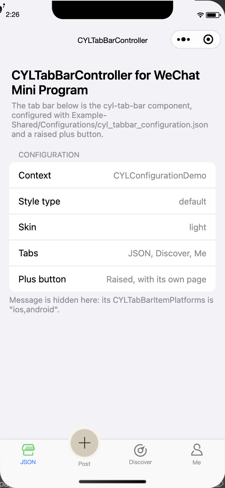

02. 点击 Discover：切换页面并播放它的 Lottie / Tapping Discover: the page switches and its Lottie plays

03. Lottie Tab 上的数字角标与小红点 / A number badge and a dot on Lottie tabs

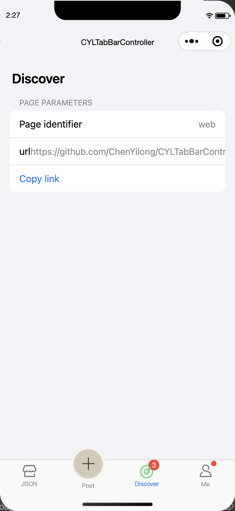

04. 深色皮肤：使用 Lottie 的深色文件 / The dark skin: the dark Lottie files

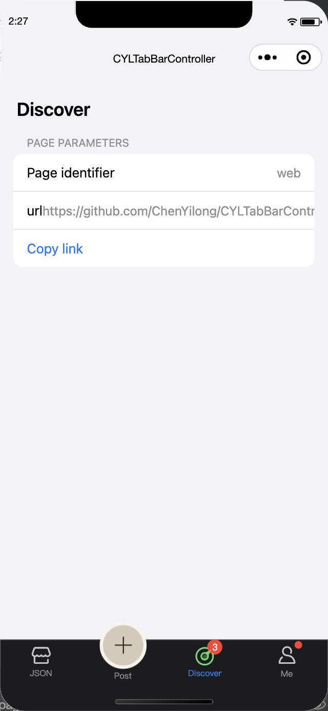

05. 深色皮肤、图片图标：system: 图片按图标颜色着色（#787） / The dark skin with image icons: system: images tinted with the icon colors (#787)

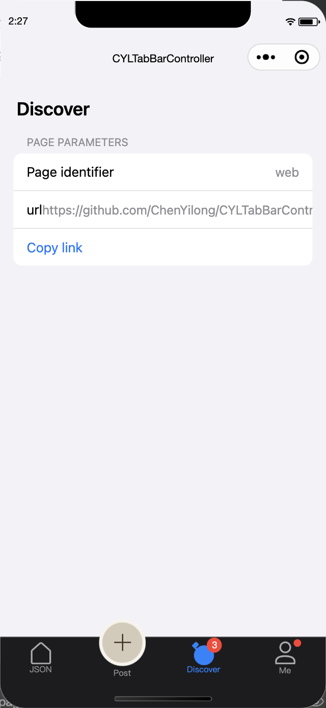

06. PlusButton 自己的页面，CYLPlusButtonShowsSelection / The plus button's own page, CYLPlusButtonShowsSelection

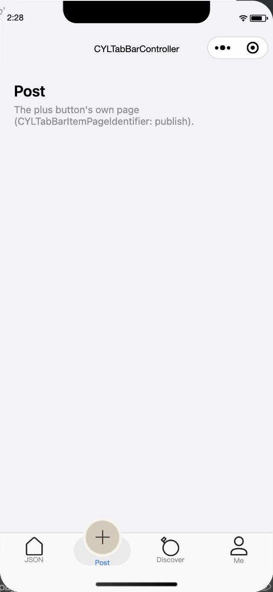

07. CYLTabBarControllerSwipeToSwitchTab：从 Home 滑动到 Discover / CYLTabBarControllerSwipeToSwitchTab: swiped from Home to Discover

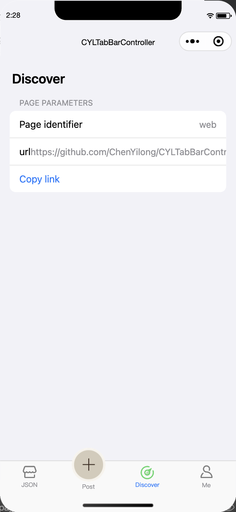

08. CYLTabBarItemSelectedTitleFont "bold:11" / CYLTabBarItemSelectedTitleFont "bold:11"

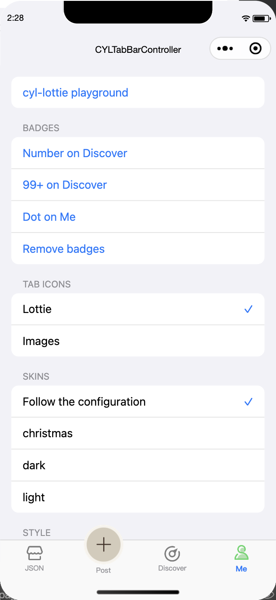

09. 圣诞皮肤、液态玻璃、99+ / The christmas skin, Liquid Glass, 99+

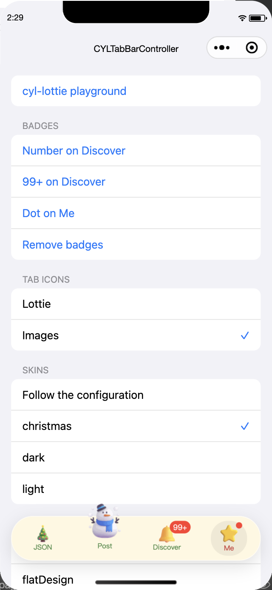

10. FlatDesign 与需要登录的 Tab / FlatDesign and a tab that needs login

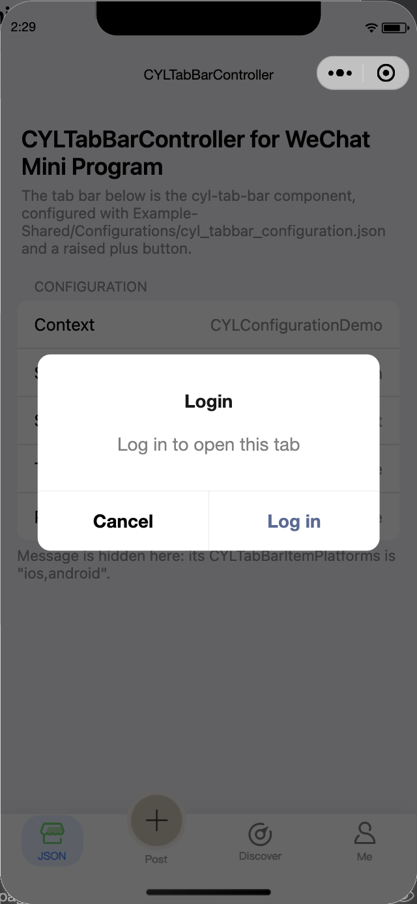

11. cyl-lottie 演示页：循环播放、按钮、事件 / The cyl-lottie playground: looping, buttons, events

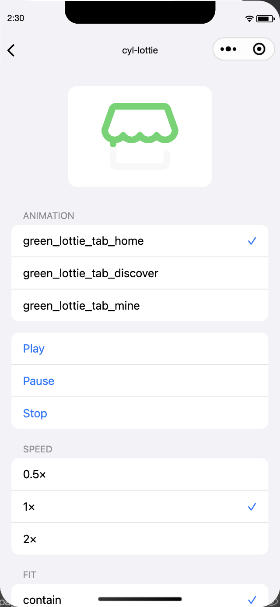

12. cyl-lottie：colors 换色、fit cover、2 倍速 / cyl-lottie: colors, fit cover, 2× speed

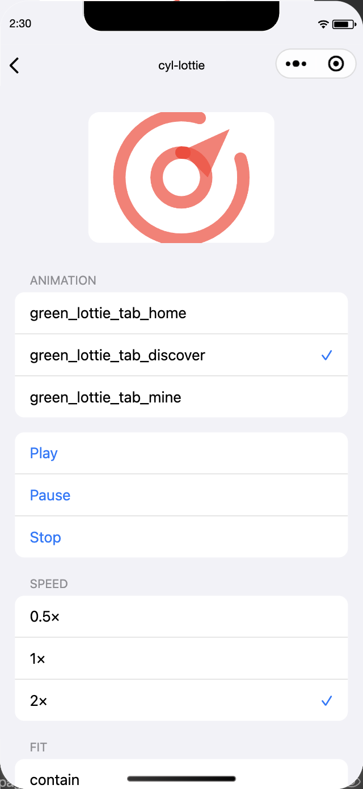

13. lottie-miniprogram issue #31 的文件（含内嵌图片）正常显示 / The file of lottie-miniprogram issue #31 (embedded images) displays

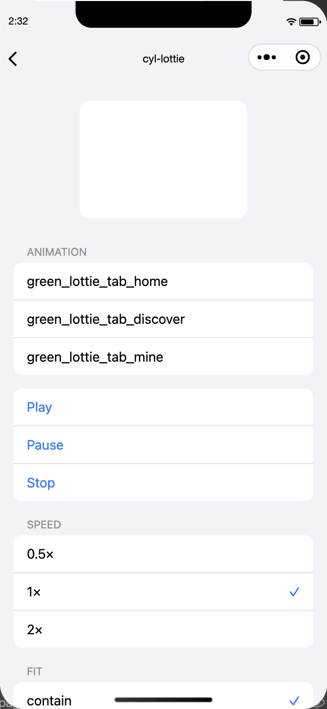

14. CYLTabBarControllerUserInterfaceStyle "dark" / CYLTabBarControllerUserInterfaceStyle "dark"

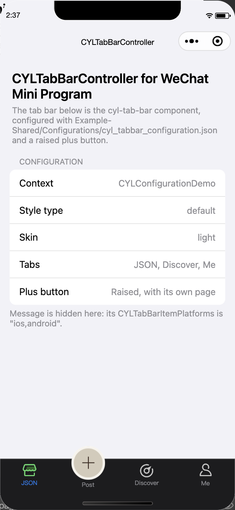

15. 没有页面的 PlusButton：plustap 事件（提示 "Post"） / A plus button without a page: the plustap event (the "Post" toast)

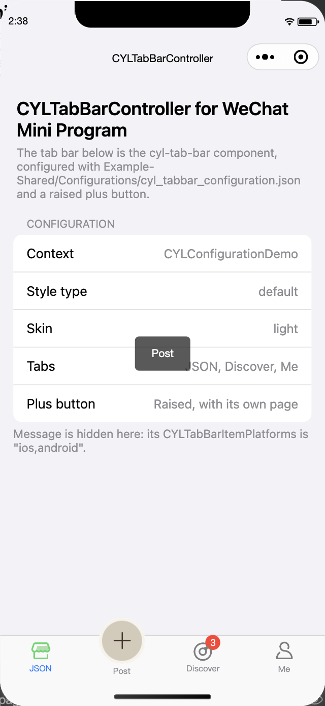

16. cyl-tab-bar-item 演示页：单独使用 Item，每格对应 iOS CYLFlatDesignTabBarItem 的一组 API / The cyl-tab-bar-item playground: the item alone, one tile per group of the iOS CYLFlatDesignTabBarItem API

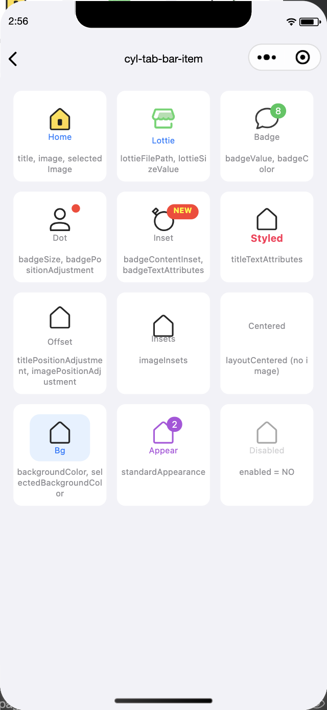

17. 与 iOS 示例一样的四个 Tab 与 PlusButton，每个 Tab 由 cyl-tab-bar-item 绘制 / Four tabs and the plus button as in the iOS example, each tab drawn by cyl-tab-bar-item

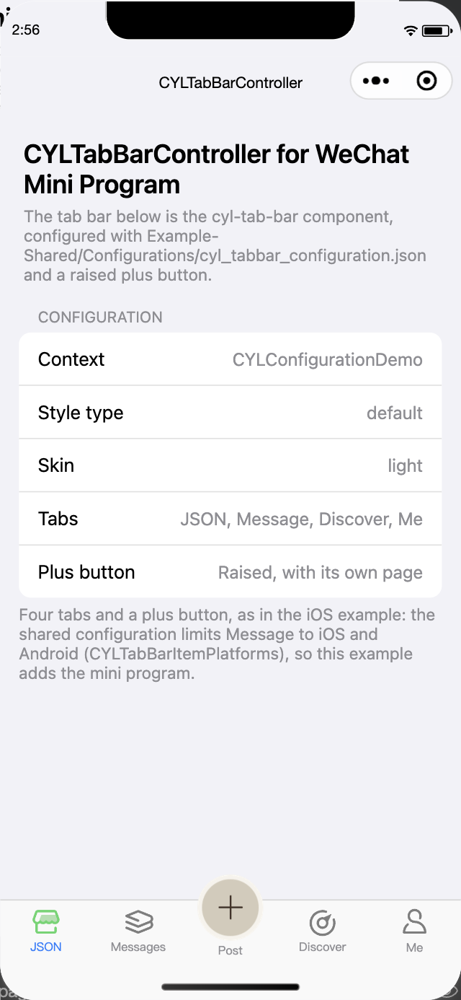

18. Rive 图标（iOS 示例的 icons.riv，深色皮肤，选中 Messages）/ Rive icons (the iOS examples' icons.riv, dark skin, Messages selected)

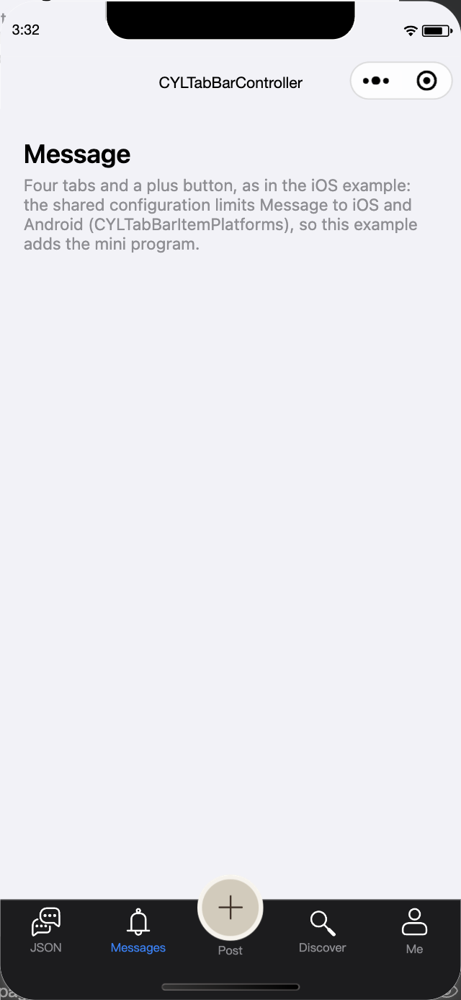

19. PAG 图标（iOS PAG 示例的 tab_home、tab_moments、tab_health、tab_me，完整 libpag 4.5.85，选中 Home）/ PAG icons (the iOS PAG example's tab_home, tab_moments, tab_health, tab_me on the full libpag 4.5.85, Home selected). WeChat Mini Program, WeChat DevTools simulator (iPhone, macOS 27.3), base library 3.17.6, branch feat/cross-platform-components after c895b11, 2026-11-13 12:44 (UTC+13)

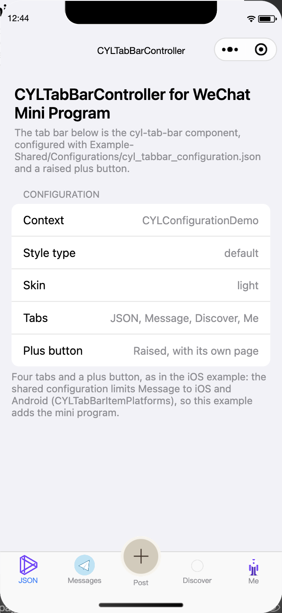

20. PAG 图标，点击 Me 后播放结束停在最后一帧 / PAG icons after tapping Me: the animation ends on its last frame. Same environment as 19

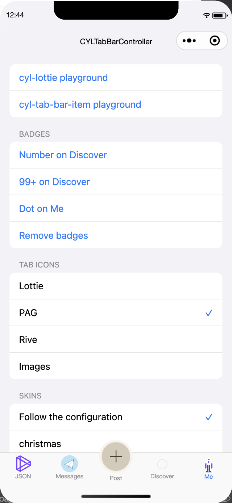

21. 只安装 Lottie 包（默认），选中 Messages / Only the Lottie package installed (the default), Messages selected. WeChat Mini Program, WeChat DevTools simulator (iPhone, macOS 27.3), base library 3.17.6, branch feat/cross-platform-components after d52b146, 2026-11-13 14:0x (UTC+13)

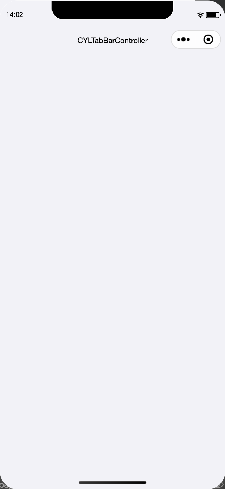

22. 只安装 PAG 包，选中 Messages / Only the PAG package installed, Messages selected. WeChat Mini Program, WeChat DevTools simulator (iPhone, macOS 27.3), base library 3.17.6, branch feat/cross-platform-components after d52b146, 2026-11-13 14:0x (UTC+13)

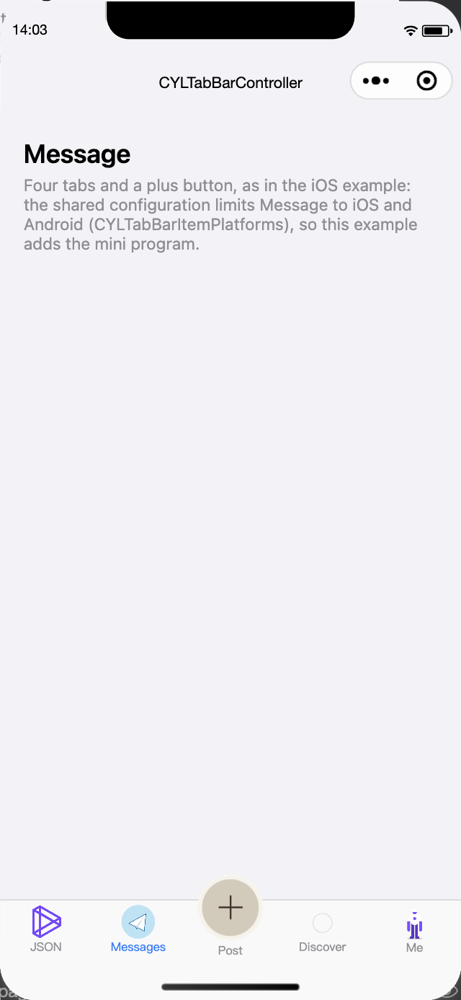

23. 只安装 Rive 包：Me 页面只列出 Rive 与 Images / Only the Rive package installed: the Me page lists Rive and Images only. WeChat Mini Program, WeChat DevTools simulator (iPhone, macOS 27.3), base library 3.17.6, branch feat/cross-platform-components after d52b146, 2026-11-13 14:0x (UTC+13)

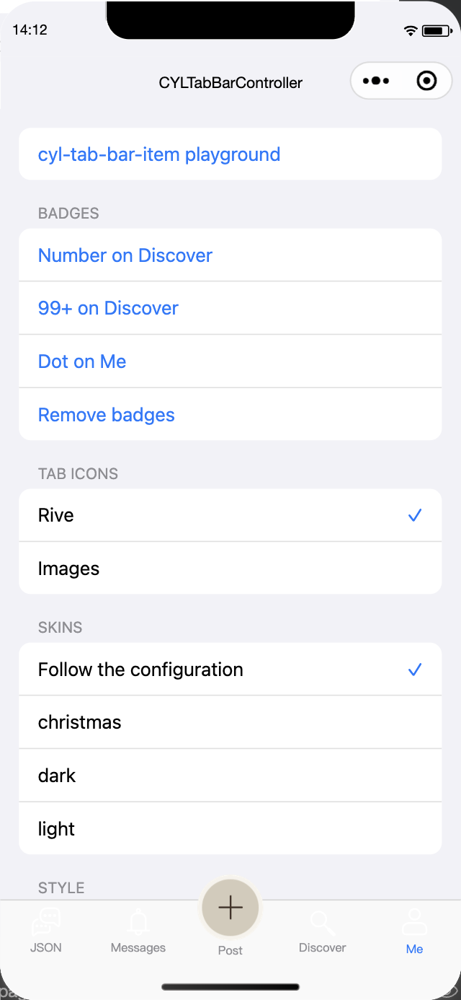

24. 只安装 GIF 包：选中的 Messages 显示星星 GIF，Discover 作为普通图片循环播放火焰 GIF / Only the GIF package installed: the selected Messages shows the star GIF, Discover loops the fire GIF as a plain image. WeChat Mini Program, WeChat DevTools simulator (iPhone, macOS 27.3), base library 3.17.6, branch feat/cross-platform-components after d52b146, 2026-11-13 14:0x (UTC+13)

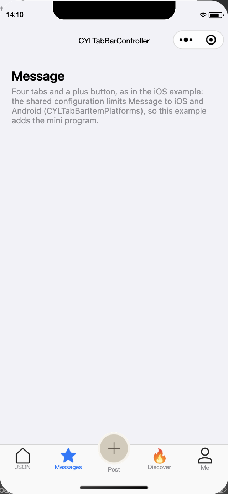

25. CYLTabBarItemStyle liquidGlass，浅色：悬浮玻璃胶囊，选中的 Home 位于玻璃透镜上 / CYLTabBarItemStyle liquidGlass, light: the floating glass capsule, the selected Home on its glass lens. WeChat Mini Program, WeChat DevTools simulator (iPhone, macOS 27.3), base library 3.17.6, branch feat/cross-platform-components after 33aa7bf (retaken with the lens fix), 2026-11-13 14:41 (UTC+13)

26. CYLTabBarItemStyle liquidGlass，深色皮肤，选中 Discover / CYLTabBarItemStyle liquidGlass, dark skin, Discover selected. Same environment as 25

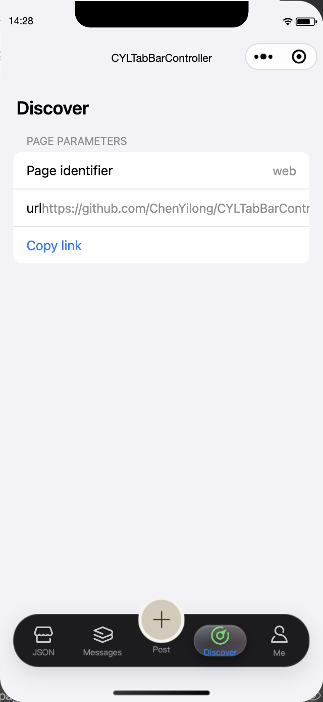

31. Bug：液态玻璃透镜间距不对（维护者截图）/ Bug: the Liquid Glass lens spacing is wrong (the maintainer's screenshot). WeChat Mini Program, WeChat DevTools simulator (iPhone, macOS 27.3), base library 3.17.6, commit e1e9c04, 2026-11-13 14:28 (UTC+13)

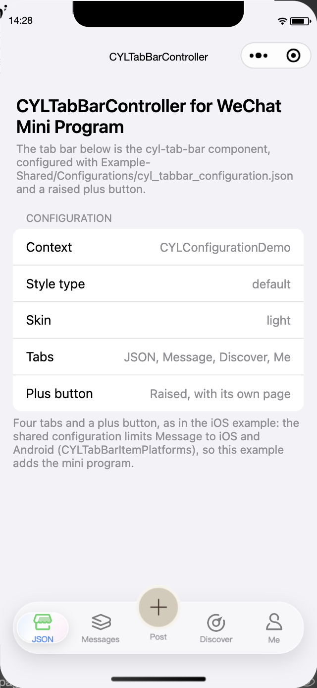

32. 修复后：透镜占满选中位置，TabBar 距两侧与底边 21 pt，与 iOS 示例一致 / Fixed: the lens fills the selected slot, the bar 21 pt from the sides and the bottom, as in the iOS example. WeChat Mini Program, WeChat DevTools simulator (iPhone, macOS 27.3), base library 3.17.6, branch feat/cross-platform-components after 33aa7bf, 2026-11-13 14:41 (UTC+13)

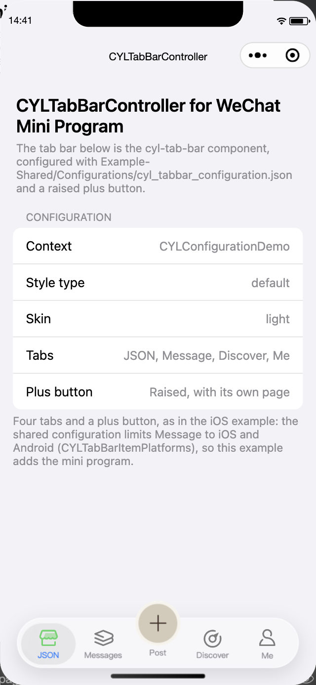

33. 播放控件：全部播放、速度滑块（1.5×）、循环开关（Me 页面，Lottie 图标播放中）/ Playback controls: Play all, speed slider (1.5×), loop switch (Me page, the Lottie icons playing). WeChat Mini Program, WeChat DevTools simulator (iPhone, macOS 27.3), base library 3.17.6, branch feat/cross-platform-components after b571a64, 2026-11-13 14:50 (UTC+13)

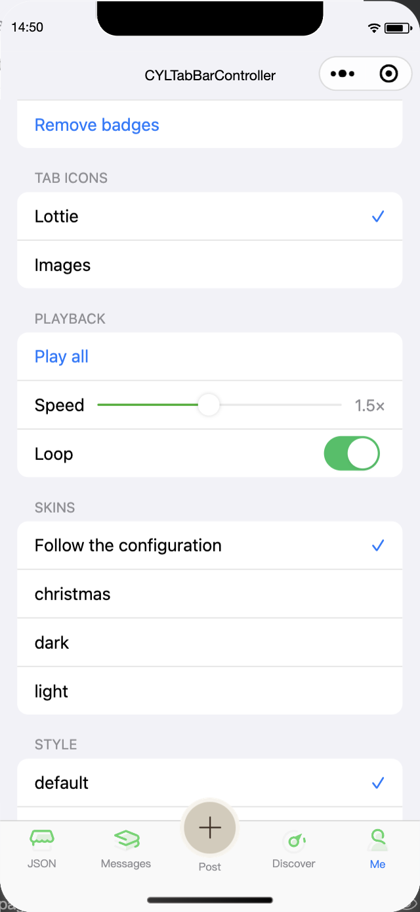

34. 修复前（维护者截图）：深色液态玻璃 TabBar / Before (the maintainer's screenshot): the dark Liquid Glass bar. WeChat DevTools, 2026-11-13

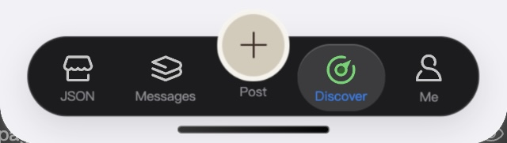

35. 选中 PlusButton（液态玻璃，浅色）：PlusButton 位置的透镜与选中 Tab 的透镜相同，与 iOS 一致 / Plus button selected (Liquid Glass, light): the plus slot gets the same lens as a selected tab, as on iOS. WeChat Mini Program, WeChat DevTools simulator (iPhone, macOS 27.3), base library 3.17.6, branch feat/cross-platform-components after 0910a3d, 2026-11-13 15:01 (UTC+13)

35. 选中 PlusButton（液态玻璃，深色） / Plus button selected (Liquid Glass, dark). WeChat Mini Program, WeChat DevTools simulator (iPhone, macOS 27.3), base library 3.17.6, branch feat/cross-platform-components after 0910a3d, 2026-11-13 15:01 (UTC+13)

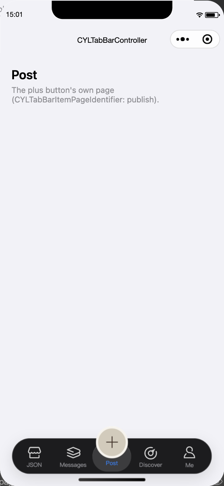

35. 选中 PlusButton（默认样式）：没有选中背景，与 iOS 一致 / Plus button selected (default style): no selection background, as on iOS. WeChat Mini Program, WeChat DevTools simulator (iPhone, macOS 27.3), base library 3.17.6, branch feat/cross-platform-components after 0910a3d, 2026-11-13 15:01 (UTC+13)

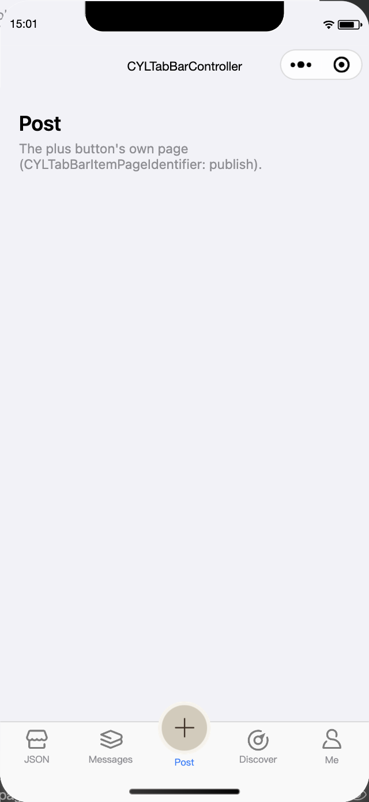

36. Bug（维护者截图）：默认样式下选中 PlusButton 出现玻璃背景 / Bug (the maintainer's screenshot): a glass background under the selected plus button in the default style. WeChat DevTools, 2026-11-13

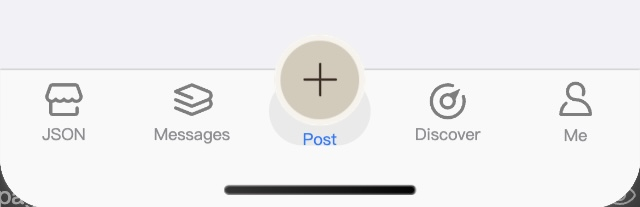

37. FlatDesign，选中 Discover：只有选中图片与标题颜色 / FlatDesign, Discover selected: only the selected image and title color. WeChat Mini Program, WeChat DevTools simulator (iPhone, macOS 27.3), base library 3.17.6, branch feat/cross-platform-components after eecc9f6, 2026-11-13 15:06–15:09 (UTC+13)

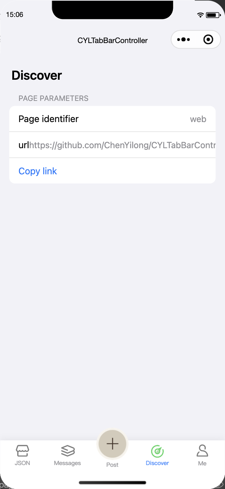

37. FlatDesign，选中 PlusButton：没有背景 / FlatDesign, plus button selected: no background. WeChat Mini Program, WeChat DevTools simulator (iPhone, macOS 27.3), base library 3.17.6, branch feat/cross-platform-components after eecc9f6, 2026-11-13 15:06–15:09 (UTC+13)

37. 默认样式，选中 Discover / Default style, Discover selected. WeChat Mini Program, WeChat DevTools simulator (iPhone, macOS 27.3), base library 3.17.6, branch feat/cross-platform-components after eecc9f6, 2026-11-13 15:06–15:09 (UTC+13)

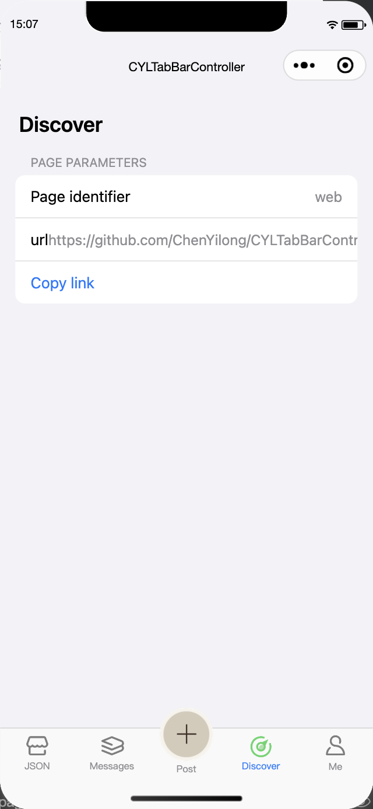

37. 默认样式，选中 PlusButton：没有背景 / Default style, plus button selected: no background. WeChat Mini Program, WeChat DevTools simulator (iPhone, macOS 27.3), base library 3.17.6, branch feat/cross-platform-components after eecc9f6, 2026-11-13 15:06–15:09 (UTC+13)

37. 液态玻璃，选中 Discover：Tab 透镜 / Liquid Glass, Discover selected: the tab lens. WeChat Mini Program, WeChat DevTools simulator (iPhone, macOS 27.3), base library 3.17.6, branch feat/cross-platform-components after eecc9f6, 2026-11-13 15:06–15:09 (UTC+13)

37. 液态玻璃，选中 PlusButton：PlusButton 透镜 / Liquid Glass, plus button selected: the plus lens. WeChat Mini Program, WeChat DevTools simulator (iPhone, macOS 27.3), base library 3.17.6, branch feat/cross-platform-components after eecc9f6, 2026-11-13 15:06–15:09 (UTC+13)

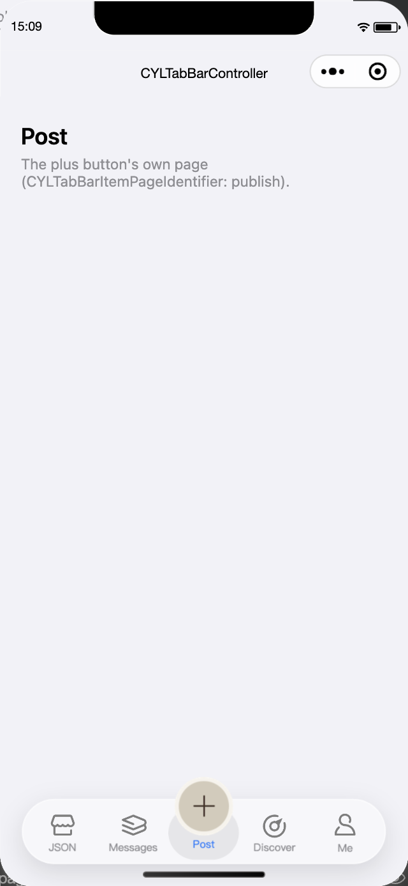

38. 参考（维护者截图）：画廊 TabBar 中选中 Feed 的玻璃透镜 / Reference (the maintainer's screenshot): the glass lens of the selected Feed in the gallery bar. WeChat DevTools, 2026-11-13

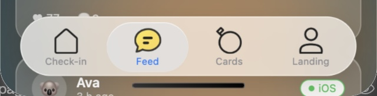

43. 透镜以 Tab 内容为中心（Discover）/ The lens centered on the tab's icon and title (Discover). WeChat Mini Program, WeChat DevTools simulator (iPhone, macOS 27.3), base library 3.17.6, branch feat/cross-platform-components after ef5ec4c, 2026-11-13 16:42 (UTC+13)

43. PlusButton 透镜以位置为中心（与 Tab 一致）/ The plus lens centered on its bar slot, like a tab's. WeChat Mini Program, WeChat DevTools simulator (iPhone, macOS 27.3), base library 3.17.6, branch feat/cross-platform-components after ef5ec4c, 2026-11-13 16:42 (UTC+13)

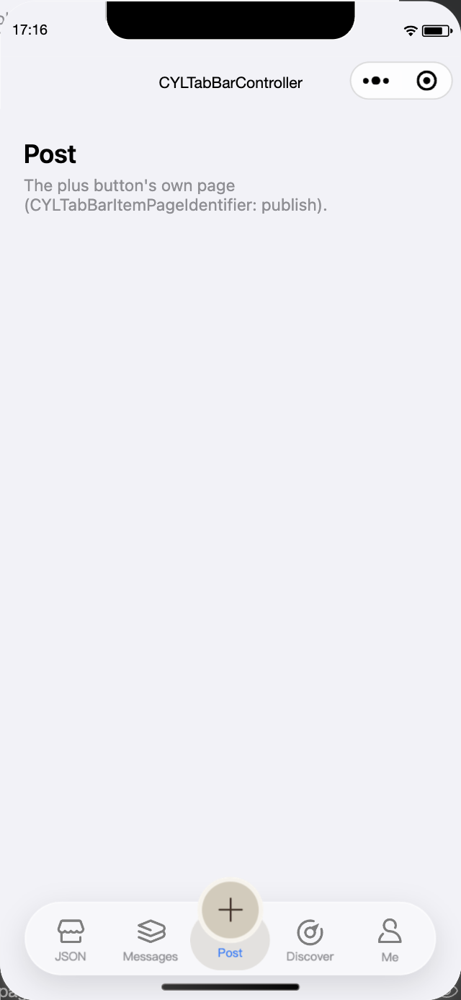

44. CYLGlassLensStyle regular（默认「液态」，接近不透明）：选中 Discover / CYLGlassLensStyle regular (default "liquid", nearly opaque): Discover selected. WeChat Mini Program, WeChat DevTools simulator (iPhone, macOS 27.3), base library 3.17.6, branch feat/cross-platform-components after 69e2c02, 2026-11-13 19:53–19:58 (UTC+13)

44. CYLGlassLensStyle skeuomorphic（「拟物风液态」，半透明）：选中 Discover / CYLGlassLensStyle skeuomorphic ("skeuomorphic liquid", see-through): Discover selected. WeChat Mini Program, WeChat DevTools simulator (iPhone, macOS 27.3), base library 3.17.6, branch feat/cross-platform-components after 69e2c02, 2026-11-13 19:53–19:58 (UTC+13)

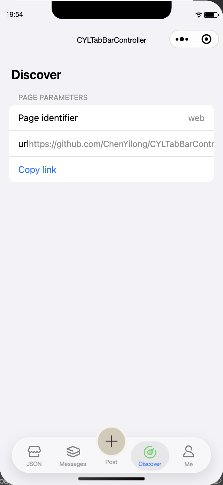

44. Me → Glass lens 两行 / The two Glass lens rows on Me. WeChat Mini Program, WeChat DevTools simulator (iPhone, macOS 27.3), base library 3.17.6, branch feat/cross-platform-components after 69e2c02, 2026-11-13 19:53–19:58 (UTC+13)

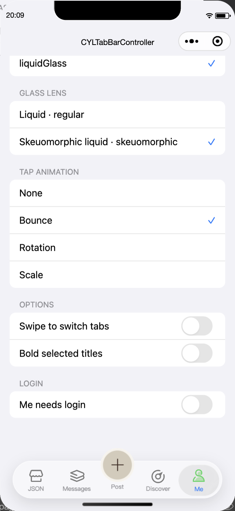

47. PlusButton 标题与 Tab 标题对齐（default）/ The plus title on the line of the tab titles (default). WeChat Mini Program, WeChat DevTools simulator (iPhone, macOS 27.3), base library 3.17.6, branch feat/cross-platform-components after ec82a9c, 2026-11-13 (UTC+13)

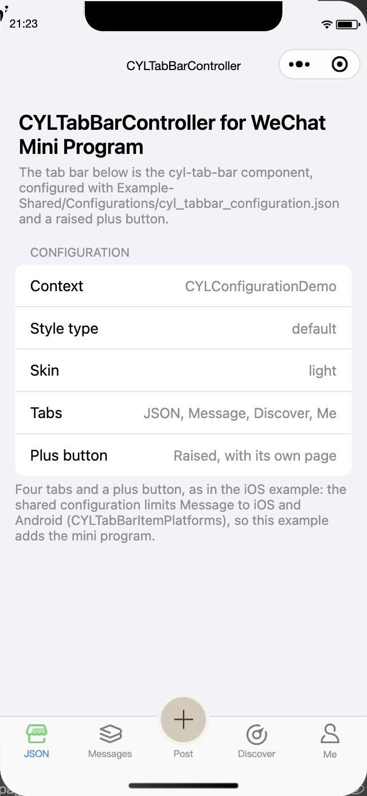

47. PlusButton 标题与 Tab 标题对齐（液态玻璃）/ The plus title on the line of the tab titles (Liquid Glass). WeChat Mini Program, WeChat DevTools simulator (iPhone, macOS 27.3), base library 3.17.6, branch feat/cross-platform-components after ec82a9c, 2026-11-13 (UTC+13)

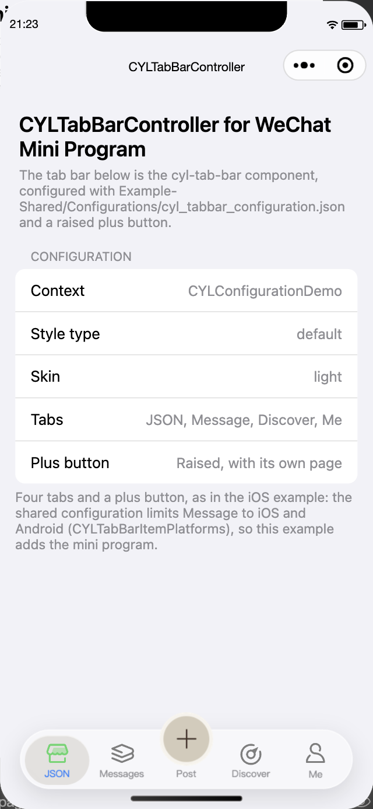

47. PlusButton 标题与 Tab 标题对齐（flatDesign）/ The plus title on the line of the tab titles (flatDesign). WeChat Mini Program, WeChat DevTools simulator (iPhone, macOS 27.3), base library 3.17.6, branch feat/cross-platform-components after ec82a9c, 2026-11-13 (UTC+13)

49. 首页模仿 Objective-C 示例的表格：通用与 TabBar 外观 / Home imitates the Objective-C example's table: General and Tab bar appearance. WeChat Mini Program, WeChat DevTools simulator (iPhone, macOS 27.3), base library 3.17.6, branch feat/cross-platform-components after 4a915ab, 2026-11-13 21:58–22:00 (UTC+13)

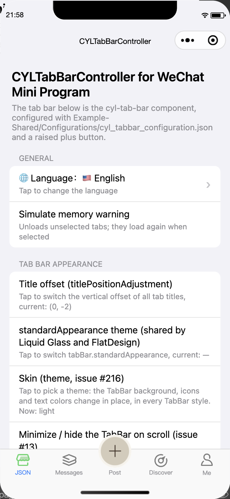

49. 首页模仿 Objective-C 示例的表格：皮肤与 Tab 交互 / Home imitates the Objective-C example's table: Skins and Tab interactions. WeChat Mini Program, WeChat DevTools simulator (iPhone, macOS 27.3), base library 3.17.6, branch feat/cross-platform-components after 4a915ab, 2026-11-13 21:58–22:00 (UTC+13)

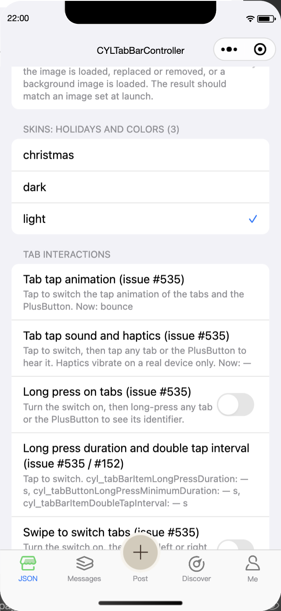

49. 首页模仿 Objective-C 示例的表格：Tab Bar Gallery 与角标 / Home imitates the Objective-C example's table: Tab Bar Gallery and Badges. WeChat Mini Program, WeChat DevTools simulator (iPhone, macOS 27.3), base library 3.17.6, branch feat/cross-platform-components after 4a915ab, 2026-11-13 21:58–22:00 (UTC+13)

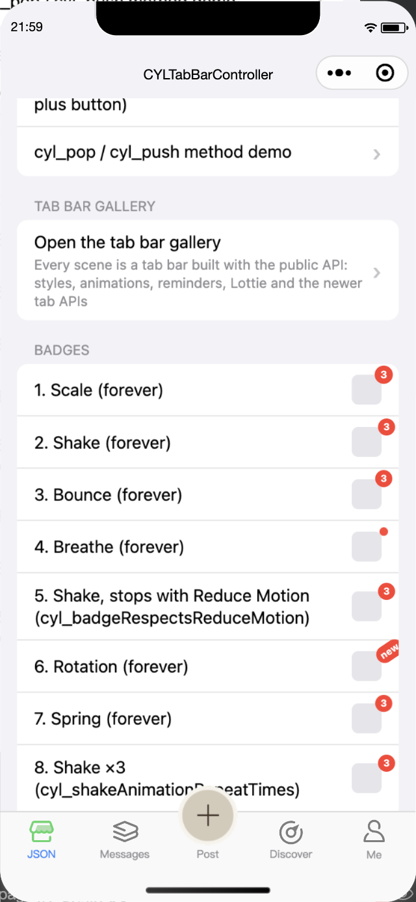

50. README 里程碑原图：透镜 regular / README milestone original: lens regular. WeChat Mini Program, WeChat DevTools simulator (iPhone, macOS 27.3), base library 3.17.6, branch feat/cross-platform-components after a9aae6c, 2026-11-13 (UTC+13)

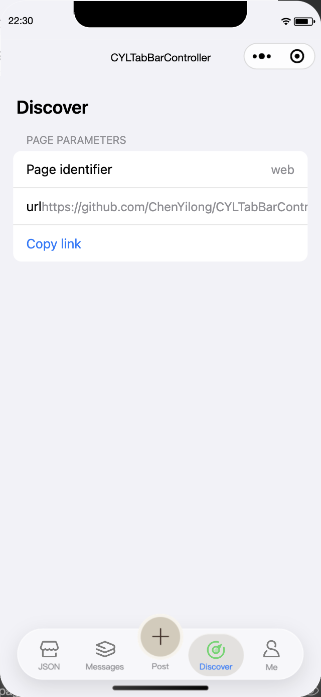

50. README 里程碑原图：透镜 skeuomorphic / README milestone original: lens skeuomorphic. WeChat Mini Program, WeChat DevTools simulator (iPhone, macOS 27.3), base library 3.17.6, branch feat/cross-platform-components after a9aae6c, 2026-11-13 (UTC+13)

39. cyl-glass-lens：选中 Discover / cyl-glass-lens: Discover selected. WeChat Mini Program, WeChat DevTools simulator (iPhone, macOS 27.3), base library 3.17.6, branch feat/cross-platform-components after 44e2a2b, 2026-11-13 15:16–15:18 (UTC+13)

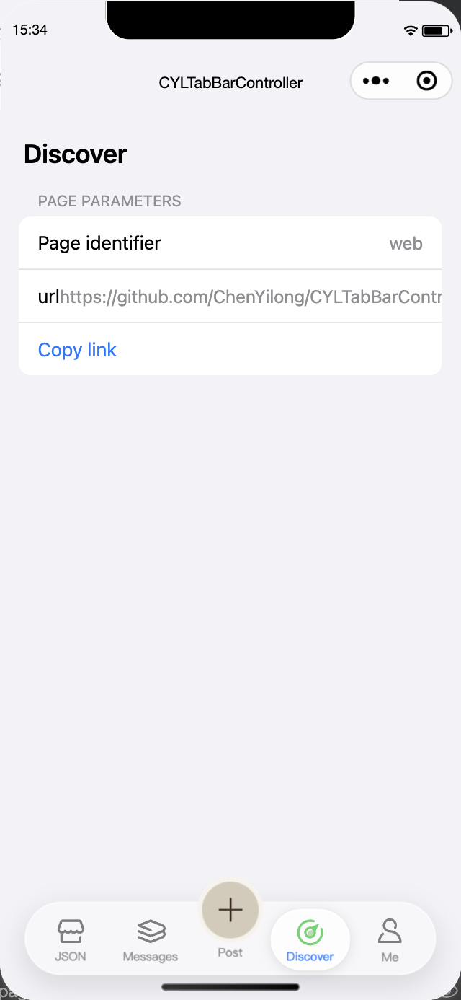

39. cyl-glass-lens：选中 PlusButton，与 Tab 透镜相同 / cyl-glass-lens: plus button selected, the same lens as a tab. WeChat Mini Program, WeChat DevTools simulator (iPhone, macOS 27.3), base library 3.17.6, branch feat/cross-platform-components after 44e2a2b, 2026-11-13 15:16–15:18 (UTC+13)

39. cyl-glass-lens：选中 Discover（深色） / cyl-glass-lens: Discover selected (dark). WeChat Mini Program, WeChat DevTools simulator (iPhone, macOS 27.3), base library 3.17.6, branch feat/cross-platform-components after 44e2a2b, 2026-11-13 15:16–15:18 (UTC+13)

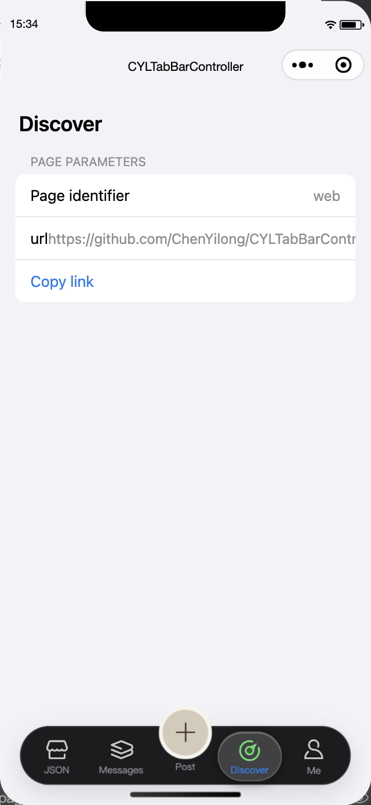

39. cyl-glass-lens：选中 PlusButton（深色） / cyl-glass-lens: plus button selected (dark). WeChat Mini Program, WeChat DevTools simulator (iPhone, macOS 27.3), base library 3.17.6, branch feat/cross-platform-components after 44e2a2b, 2026-11-13 15:16–15:18 (UTC+13)

27. 液态玻璃画廊：打卡（参考 sports-checkin） / Liquid Glass gallery: Check-in (after sports-checkin). WeChat Mini Program, WeChat DevTools simulator (iPhone, macOS 27.3), base library 3.17.6, branch feat/cross-platform-components after e1e9c04, 2026-11-13 14:36 (UTC+13)

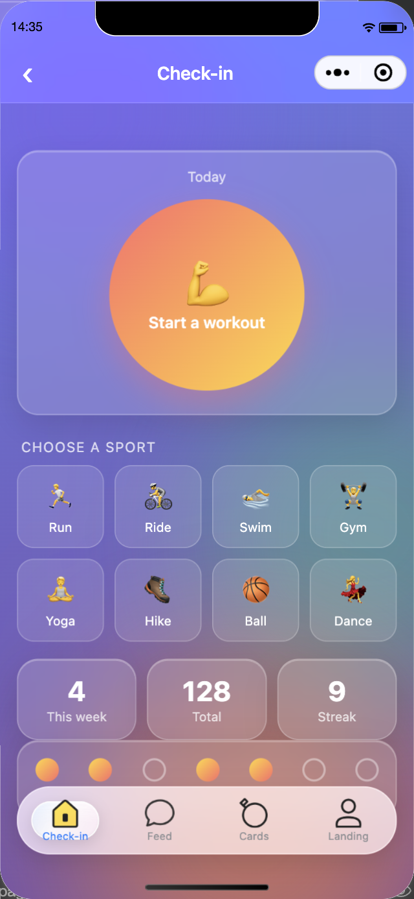

28. 画廊：导航栏、搜索框、标签与信息流（参考 chatnote） / Gallery: navigation bar, search box, tags and feed (after chatnote). WeChat Mini Program, WeChat DevTools simulator (iPhone, macOS 27.3), base library 3.17.6, branch feat/cross-platform-components after e1e9c04, 2026-11-13 14:36 (UTC+13)

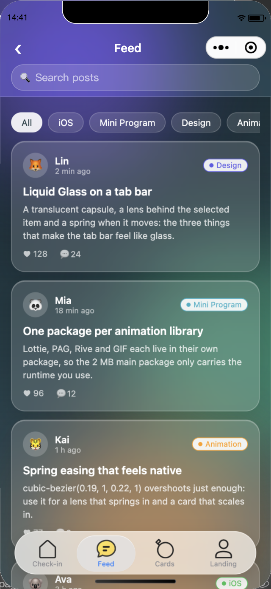

29. 画廊：两列集合视图 / Gallery: two-column collection view. WeChat Mini Program, WeChat DevTools simulator (iPhone, macOS 27.3), base library 3.17.6, branch feat/cross-platform-components after e1e9c04, 2026-11-13 14:36 (UTC+13)

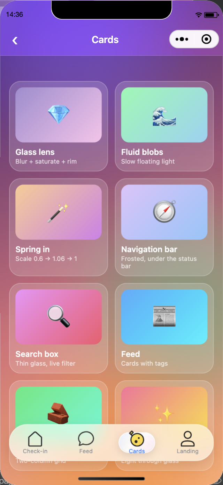

30. 画廊：落地页（参考 mirror-landing）、核心点击动画与两种 Item 样式 / Gallery: landing (after mirror-landing), core tap animations and both item styles. WeChat Mini Program, WeChat DevTools simulator (iPhone, macOS 27.3), base library 3.17.6, branch feat/cross-platform-components after e1e9c04, 2026-11-13 14:36 (UTC+13)

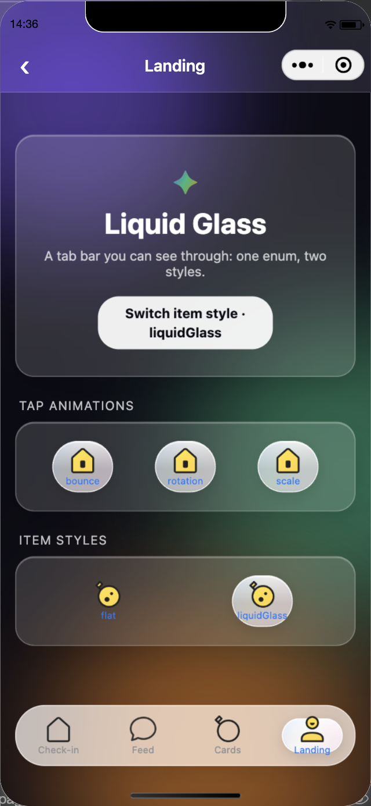

## [CN]截图（63 / 100 时）
## [EN]Screenshots (at 63 / 100)

| 中文 | English |
|:---|:---|
| 平台：微信小程序。环境：macOS 27.3，微信开发者工具 Stable 2.02.2609250 模拟器（iPhone 12/13 Pro，390 × 844 @3x），基础库 3.18.0。代码：[`08734ef`](https://github.com/ChenYilong/CYLTabBarController/commit/08734ef)（分支 `feat/cross-platform-components`）。时间：2026-11-13 01:23–01:24 NZDT。由 agent skill `wechatide` 0.3.11 截取的原始截图。 | Platform: WeChat Mini Program. Environment: macOS 27.3, WeChat DevTools Stable 2.02.2609250 simulator (iPhone 12/13 Pro, 390 × 844 @3x), base library 3.18.0. Code: [`08734ef`](https://github.com/ChenYilong/CYLTabBarController/commit/08734ef) (branch `feat/cross-platform-components`). Time: 2026-11-13 01:23–01:24 NZDT. Original screenshots taken with the agent skill `wechatide` 0.3.11. |

| 默认样式与共用配置（Message 因 `CYLTabBarItemPlatforms` 不显示） | The default style and the shared configuration (Message left out by `CYLTabBarItemPlatforms`) |
|:---|:---|
|  |  |
| 角标：数字与小红点 | Badges: a number and a dot |
|  |  |
| 圣诞皮肤、液态玻璃、99+ | The christmas skin, Liquid Glass, 99+ |
|  |  |
| FlatDesign 与需要登录的 Tab（`CYLTabBarControllerLoginRequiredTabBarItemIdentifiers`） | FlatDesign and a tab that needs login (`CYLTabBarControllerLoginRequiredTabBarItemIdentifiers`) |
|  |  |

## [CN]待办
## [EN]TODO

| 中文 | English |
|:---|:---|
| 见右列。 | DONE (2026-11-13): the five items of the earlier TODO list (icon tinting with a CSS drop-shadow, Lottie and GIF icons, title fonts, image URL size, swipe to switch tabs, `CYLPlusButtonShowsSelection`), and the known defect of the dark skin (its `system:` images are tinted now, screenshot 05). |
| | Remaining work outside the score: ① DONE 2026-11-14: UI tests with `miniprogram-automator` (`npm run test-ui`, see the entry below); in CI they need a self-hosted macOS runner labeled `wechat-devtools`; ② DONE 2026-11-13: the first tab imitates the Objective-C example's table (see Progress); ③ test on a phone (real-device preview needs the maintainer's WeChat). |
| | DONE (2026-11-14, item ①, logged as TODO first; user prompt, verbatim: "阅读小程序相关内容，继续小程序的开发，" English: "read the mini program material and continue its development"): UI tests with `miniprogram-automator` in `example/test-ui/` (`npm run test-ui`, `node --test`): the tab bar slots, tab switching, the item style and the glass lens style, the plus title alignment and the playback controls, against WeChat DevTools on this Mac; a GitHub Actions workflow started by hand that runs them on a self-hosted macOS runner with the DevTools logged in (GitHub's own runners cannot log in to WeChat). Done when the suite passes locally. DONE (2026-11-14): `example/test-ui/cyl_tab_bar.ui.test.js`, 5 tests (the four tabs and the plus button with Home selected; a tap opens Message and selects it; `itemStyle` liquidGlass and `glassLensStyle` skeuomorphic reach the bar; the plus title's top and bottom within 1 px of every tab title, default and Liquid Glass; speed, loop and Play all reach the bar), **5 / 5 pass in 41 s** against WeChat DevTools on this Mac (macOS 27, `miniprogram-automator` 0.13.0, Node 22). Workflow `.github/workflows/wechat-miniprogram.yml`: the Node tests of the component (17) and of cyl-lottie-miniprogram (12) on every change, on GitHub's Ubuntu runners; the UI tests when started by hand with "ui-tests" on, on a self-hosted macOS runner labeled `wechat-devtools` (none is registered yet). |
| | Limits: a mini program opens web pages only from business domains set in the WeChat admin console, so the `web` page shows and copies its URL; `CYLTabBarItemMinimumAppVersion` is checked only when the app passes `appVersion` (the DevTools have no release version); a screenshot through `wechatide` takes about 5 s, so a running Lottie animation is checked by its frame numbers instead. |
| | The rule "Upstream projects used for translation" of AGENTS.md: the five custom tab bar references were used for the approach only, no code was translated (see the component's NOTICE); their open issues and pull requests are now listed in [Custom tab bar reference issues](#encustom-tab-bar-reference-issues) (2026-11-14), since the task asks for a CYLTabBarController translation of them. lottie-miniprogram, which was ported, has its table below. |

## [CN]lottie-miniprogram issues
## [EN]lottie-miniprogram issues

| 中文 | English |
|:---|:---|
| 见右列。 | Every issue of [wechat-miniprogram/lottie-miniprogram](https://github.com/wechat-miniprogram/lottie-miniprogram/issues) (open and closed, 55 on 2026-11-13), fixed in our copy `CrossPlatform/lottie-miniprogram` (package `cyl-lottie-miniprogram`). Its 3 open pull requests are merged: [#45](https://github.com/wechat-miniprogram/lottie-miniprogram/pull/45) (lottie-web upgrade), [#50](https://github.com/wechat-miniprogram/lottie-miniprogram/pull/50) (iOS frames from `canvas.requestAnimationFrame`), [#17](https://github.com/wechat-miniprogram/lottie-miniprogram/pull/17) (`destroy`). Status: DONE (fixed in the code, with its test when one is named), DONE (platform / not this library / not supported) for a report whose cause is outside the library, with the reason, or TODO. Score = 100 × resolved / 55: **100 / 100** (55 of 55; 98 before #31). Tests: `cd CrossPlatform/lottie-miniprogram && npm install && npm run build && npm test` (12 / 12, Node 22). |

| Issue | 描述 / Description | 修复状况 / Status |
|:---|:---|:---|
| [#1](https://github.com/wechat-miniprogram/lottie-miniprogram/issues/1) | `destroy()` throws "Cannot set property 'innerHTML' of undefined" (lottie-web reads the DOM wrapper). (upstream: closed) | DONE: every animation gets an empty wrapper before lottie-web destroys it (PR #17 merged); test `load again after destroy` in `CrossPlatform/lottie-miniprogram/test/cyl_lottie.test.js` |
| [#2](https://github.com/wechat-miniprogram/lottie-miniprogram/issues/2) | Animations with expressions fail: "eval is not a function". (upstream: closed) | DONE: built from lottie-web's light canvas player, which has no expressions and no `eval`; such animations play without their expressions; test `no eval in the bundle` in `CrossPlatform/lottie-miniprogram/test/cyl_lottie.test.js` |
| [#3](https://github.com/wechat-miniprogram/lottie-miniprogram/issues/3) | Real-device debugging: "HTMLCanvasView is not defined". (upstream: closed) | DONE (platform): the canvas 2D interface was not yet supported by real-device debugging in 2019; base library 2.9.0+ supports it, nothing to change in the library. |
| [#4](https://github.com/wechat-miniprogram/lottie-miniprogram/issues/4) | Animations with image assets fail on devices (base64 images). (upstream: closed) | DONE: data URLs are written to the user data folder and loaded from there (`imageSource()` in `src/adapter/index.js`). |
| [#5](https://github.com/wechat-miniprogram/lottie-miniprogram/issues/5) | iOS 12.3.2: the demo (catrim.js) fails in real-device debugging. (upstream: closed) | DONE (platform): same cause as #3; preview and release worked upstream, and base library 2.9.0+ supports debugging. |
| [#6](https://github.com/wechat-miniprogram/lottie-miniprogram/issues/6) | Changing the position and size of what the canvas draws; `ctx.scale(dpr)` offsets the drawing. (upstream: closed) | DONE: `cyl-lottie` sizes the canvas in device pixels and lets lottie-web fit the animation, no `ctx.scale()` needed; `fit` chooses contain / cover / fill. |
| [#7](https://github.com/wechat-miniprogram/lottie-miniprogram/issues/7) | How to know when an animation finishes. (upstream: closed) | DONE: `addEventListener('complete' / 'loopComplete')`; `cyl-lottie` emits `complete` and `loopcomplete`. |
| [#8](https://github.com/wechat-miniprogram/lottie-miniprogram/issues/8) | The library is large (200 KB). (upstream: closed) | DONE: the light canvas build of lottie-web 5.13 is 210 KB minified, against 268 KB for its full canvas build. |
| [#9](https://github.com/wechat-miniprogram/lottie-miniprogram/issues/9) | iOS: nothing shows in uni-app. (upstream: closed) | DONE (not this library): uni-app's build, the native mini program API works; `cyl-lottie` is a native component. |
| [#10](https://github.com/wechat-miniprogram/lottie-miniprogram/issues/10) | "drawImage is not a function". (upstream: closed) | DONE: the canvas lottie creates for images is a real offscreen canvas (`wx.createOffscreenCanvas`, base library 2.16.1+), otherwise a stand-in that has `drawImage`. |
| [#11](https://github.com/wechat-miniprogram/lottie-miniprogram/issues/11) | Real-device debugging: "r.Canvas is not a constructor". (upstream: closed) | DONE (platform): same cause as #3. |
| [#12](https://github.com/wechat-miniprogram/lottie-miniprogram/issues/12) | Jagged edges on Android. (upstream: closed) | DONE: `cyl-lottie` sizes the canvas by the pixel ratio (`canvas.width = width × pixelRatio`). |
| [#13](https://github.com/wechat-miniprogram/lottie-miniprogram/issues/13) | How to destroy an animation. (upstream: closed) | DONE: `animation.destroy()`, `lottie.destroy(name)`, and `cyl-lottie` destroys itself when removed. |
| [#14](https://github.com/wechat-miniprogram/lottie-miniprogram/issues/14) | uni-app: "Converting circular structure to JSON". (upstream: closed) | DONE: caused by storing the animation in reactive data; `cyl-lottie` keeps it on the component instance, never in `data`. |
| [#15](https://github.com/wechat-miniprogram/lottie-miniprogram/issues/15) | Local JSON files need to be turned into JS modules. (upstream: closed) | DONE: `path` reads files of the package or the user data folder with FileSystemManager; test `path: package file, network URL, HTTP error, zip` in `CrossPlatform/lottie-miniprogram/test/cyl_lottie.test.js` |
| [#16](https://github.com/wechat-miniprogram/lottie-miniprogram/issues/16) | Two pages with animations: after going back, the first page's animation stops. (upstream: closed) | DONE: frames come from the latest canvas that is still registered, and a destroyed animation unregisters its canvas; test `several canvases play together` in `CrossPlatform/lottie-miniprogram/test/cyl_lottie.test.js` |
| [#18](https://github.com/wechat-miniprogram/lottie-miniprogram/issues/18) | TypeScript support. (upstream: closed) | DONE: `index.d.ts` declares every export (`setup`, `loadAnimation`, `freeze`, `unfreeze`, `destroy`, `setFrameInterval`) and the events. |
| [#19](https://github.com/wechat-miniprogram/lottie-miniprogram/issues/19) | Works in the DevTools, stuck on the first frame in preview. (upstream: closed) | DONE: upstream could not reproduce it; frames now come from a live canvas (#16), the remaining cause. |
| [#20](https://github.com/wechat-miniprogram/lottie-miniprogram/issues/20) | Reloading a page: no animation. (upstream: closed) | DONE: same cause as #16 and #58; test `load again after destroy` in `CrossPlatform/lottie-miniprogram/test/cyl_lottie.test.js` |
| [#22](https://github.com/wechat-miniprogram/lottie-miniprogram/issues/22) | QQ mini program support. (upstream: closed) | DONE (not supported): QQ mini programs have a different canvas API; out of scope, as upstream decided. |
| [#23](https://github.com/wechat-miniprogram/lottie-miniprogram/issues/23) | On devices the animation is half size and blurry. (upstream: closed) | DONE: same fix as #12 (canvas sized in device pixels). |
| [#24](https://github.com/wechat-miniprogram/lottie-miniprogram/issues/24) | Memory leak after refreshing a page about 20 times. (upstream: closed) | DONE: `cyl-lottie` destroys its animation when detached and the canvas is unregistered, so nothing keeps the old canvases; test `an animation plays on its canvas and stops after destroy` in `CrossPlatform/lottie-miniprogram/test/cyl_lottie.test.js` |
| [#26](https://github.com/wechat-miniprogram/lottie-miniprogram/issues/26) | Images are blurry compared with SVG rendering on the web. (upstream: closed) | DONE: same fix as #12. |
| [#27](https://github.com/wechat-miniprogram/lottie-miniprogram/issues/27) | Changing the speed quickly freezes or crashes the mini program. (upstream: closed) | DONE: not reproducible with lottie-web 5.13; test `many speed changes in a row` in `CrossPlatform/lottie-miniprogram/test/cyl_lottie.test.js` |
| [#28](https://github.com/wechat-miniprogram/lottie-miniprogram/issues/28) | Make the 16 ms frame timer configurable. (upstream: closed) | DONE: `lottie.setFrameInterval(ms)`, used when no canvas is registered. |
| [#29](https://github.com/wechat-miniprogram/lottie-miniprogram/issues/29) | Images in the JSON cause errors. (upstream: closed) | DONE: offscreen canvas for image processing (#10) and base64 images (#4); images no longer need the exact size of the JSON. |
| [#30](https://github.com/wechat-miniprogram/lottie-miniprogram/issues/30) | Warning: "Lottie creates a canvas dynamically, mini programs cannot". (upstream: closed) | DONE: an offscreen canvas is created instead, without the warning. |
| [#31](https://github.com/wechat-miniprogram/lottie-miniprogram/issues/31) | Some animations do not display correctly (sample file attached). (upstream: open) | DONE: images were created from `context.canvas`, which in WeChat DevTools is not the canvas node and has no `createImage()`, so the animation waited for its images forever; `setup()` maps each context to its node. Checked in the simulator (screenshot 13 of [Example screenshots](#enexample-screenshots)) and by test `embedded images load from the canvas node` in `CrossPlatform/lottie-miniprogram/test/cyl_lottie.test.js`. |
| [#32](https://github.com/wechat-miniprogram/lottie-miniprogram/issues/32) | Errors about WebGLCanvasContext2d / dynamic canvas (Taro); the context was null. (upstream: closed) | DONE: `setup()` throws a clear error when the node is missing or `getContext('2d')` returns null; test `setup rejects a missing node or a null context` in `CrossPlatform/lottie-miniprogram/test/cyl_lottie.test.js` |
| [#33](https://github.com/wechat-miniprogram/lottie-miniprogram/issues/33) | How to play and pause. (upstream: closed) | DONE: `play()`, `pause()`, `stop()`; `cyl-lottie` has `cyl_play`, `cyl_pause`, `cyl_stop`, `cyl_playFromStart`. |
| [#34](https://github.com/wechat-miniprogram/lottie-miniprogram/issues/34) | About 7 canvases on one page crash the mini program. (upstream: closed) | DONE (platform limit): each canvas costs memory whatever draws on it; `cyl-lottie` uses one canvas per animation and destroys it when removed. Keep few animations on screen. |
| [#36](https://github.com/wechat-miniprogram/lottie-miniprogram/issues/36) | "Cannot read property 'nodeId' of undefined" when an image loads. (upstream: open) | DONE: images are created by the animation's own canvas, not by a canvas that may be gone. |
| [#37](https://github.com/wechat-miniprogram/lottie-miniprogram/issues/37) | Building with webpack fails. (upstream: closed) | DONE: `npm install && npm run build` works with Node 22 (webpack 4, babel 7). |
| [#38](https://github.com/wechat-miniprogram/lottie-miniprogram/issues/38) | "Cannot read property 'fStyle' of undefined" for animations with text. (upstream: open) | DONE: text is measured on a canvas (no DOM), `OffscreenCanvas` comes from `wx.createOffscreenCanvas`, missing fonts are added; test `a text layer whose font is missing` in `CrossPlatform/lottie-miniprogram/test/cyl_lottie.test.js` |
| [#39](https://github.com/wechat-miniprogram/lottie-miniprogram/issues/39) | The canvas is drawn above everything; z-index has no effect. (upstream: open) | DONE (platform): `<canvas type="2d">` renders in the page layer and follows z-index; the old canvas was a native component. `cyl-lottie` always uses type 2d. |
| [#40](https://github.com/wechat-miniprogram/lottie-miniprogram/issues/40) | Upgrade lottie-web to 5.9.6. (upstream: open) | DONE: lottie-web 5.13.0 (PR #45). |
| [#41](https://github.com/wechat-miniprogram/lottie-miniprogram/issues/41) | TypeScript: "Cannot find name 'CanvasRenderingContext2D'". (upstream: open) | DONE: the context type no longer needs DOM typings. |
| [#42](https://github.com/wechat-miniprogram/lottie-miniprogram/issues/42) | Play only after the network JSON is loaded. (upstream: open) | DONE: `path` is loaded before lottie starts; listen to `DOMLoaded` (or `cyl-lottie`'s `ready`), and `autoplay: false` until then. |
| [#43](https://github.com/wechat-miniprogram/lottie-miniprogram/issues/43) | Make the animation fill its canvas. (upstream: closed) | DONE: `cyl-lottie fit="cover"` (`preserveAspectRatio: 'xMidYMid slice'`). |
| [#44](https://github.com/wechat-miniprogram/lottie-miniprogram/issues/44) | The drawing does not follow a scroll-view. (upstream: closed) | DONE (platform): the old native canvas; `<canvas type="2d">` scrolls with the page. |
| [#46](https://github.com/wechat-miniprogram/lottie-miniprogram/issues/46) | Gradients are not rendered. (upstream: closed) | DONE (not a library bug): upstream found the sample JSON itself was the cause, gradients render. |
| [#47](https://github.com/wechat-miniprogram/lottie-miniprogram/issues/47) | `path` with a network zip file does not work. (upstream: open) | DONE: zip / .lottie files are refused with a clear `data_failed` error, only Lottie JSON is supported; test `path: package file, network URL, HTTP error, zip` in `CrossPlatform/lottie-miniprogram/test/cyl_lottie.test.js` |
| [#48](https://github.com/wechat-miniprogram/lottie-miniprogram/issues/48) | Gaussian blur is not supported. (upstream: open) | DONE (not supported by lottie-web): lottie-web draws blur effects only with its SVG renderer, a mini program has the canvas renderer only. |
| [#49](https://github.com/wechat-miniprogram/lottie-miniprogram/issues/49) | Alipay mini program support. (upstream: closed) | DONE (not supported): out of scope, as upstream decided. |
| [#51](https://github.com/wechat-miniprogram/lottie-miniprogram/issues/51) | "eval is not a function" (again). (upstream: closed) | DONE: same fix as #2. |
| [#52](https://github.com/wechat-miniprogram/lottie-miniprogram/issues/52) | uni-app: the canvas is not found. (upstream: open) | DONE: query the canvas inside the component (`createSelectorQuery().in(this)`); `cyl-lottie` queries its own canvas. |
| [#53](https://github.com/wechat-miniprogram/lottie-miniprogram/issues/53) | Mini game: "XMLHttpRequest is not defined". (upstream: open) | DONE: `XMLHttpRequest` is declared inside the module instead of assigned to a global (reproduced in Node before the fix). |
| [#54](https://github.com/wechat-miniprogram/lottie-miniprogram/issues/54) | Building the source yourself gives errors. (upstream: open) | DONE: same as #37. |
| [#55](https://github.com/wechat-miniprogram/lottie-miniprogram/issues/55) | Several canvases in one component at the same time. (upstream: closed) | DONE: each animation keeps its own canvas and context; test `several canvases play together` in `CrossPlatform/lottie-miniprogram/test/cyl_lottie.test.js` |
| [#56](https://github.com/wechat-miniprogram/lottie-miniprogram/issues/56) | uni-app warns about `eval` in the bundle. (upstream: closed) | DONE: the bundle has no `eval` (#2). |
| [#57](https://github.com/wechat-miniprogram/lottie-miniprogram/issues/57) | uni-app subpackage: the JSON is bundled into the main package. (upstream: open) | DONE (not this library): uni-app's bundler; with `path` the JSON can stay a file in the subpackage. |
| [#58](https://github.com/wechat-miniprogram/lottie-miniprogram/issues/58) | After `destroy()`, loading again fails: "window.requestAnimationFrame is not a function". (upstream: open) | DONE: the frame function no longer depends on the canvas set up last; test `load again after destroy` in `CrossPlatform/lottie-miniprogram/test/cyl_lottie.test.js` |
| [#59](https://github.com/wechat-miniprogram/lottie-miniprogram/issues/59) | Not visible on devices, visible in the DevTools. (upstream: open) | DONE (platform): the reporter found z-index 0 was the cause; see #39. |
| [#60](https://github.com/wechat-miniprogram/lottie-miniprogram/issues/60) | A trophy animation displays wrongly. (upstream: closed) | DONE (not supported by lottie-web): the JSON uses the After Effects plugin effect "MDS Elastic Controller", which lottie-web does not run. |
| [#61](https://github.com/wechat-miniprogram/lottie-miniprogram/issues/61) | Xiaohongshu mini program support. (upstream: closed) | DONE (not supported): out of scope, as upstream decided. |

## [CN]自定义 TabBar 参考项目的 issues
## [EN]Custom tab bar reference issues

| 中文 | English |
|:---|:---|
| 见右列。 | The open issues and pull requests of the five custom tab bar references the task names as the source of this port (AGENTS.md "Upstream projects used for translation"), fetched on 2026-11-14: 11 open issues, no open pull requests. Each is checked against our component and fixed or answered there. Score: 0 / 11 resolved (TODO). |

| Issue | 描述 / Description | 修复状况 / Status |
|:---|:---|:---|
| [mtjsoft/customTabBar#4](https://github.com/mtjsoft/customTabBar/issues/4) | Add an example that hides a tab by condition (permissions). | TODO: `hiddenIdentifiers` on cyl-tab-bar. |
| [mtjsoft/customTabBar#3](https://github.com/mtjsoft/customTabBar/issues/3) | How to not show the custom tab bar on one page? | TODO: hide the bar of one page (iOS `setTabBarHidden:`). |
| [mtjsoft/customTabBar#2](https://github.com/mtjsoft/customTabBar/issues/2) | It still flickers (on tab switch). | TODO: select the tab of the page as soon as its bar is created, not only in onShow. |
| [mtjsoft/customTabBar#1](https://github.com/mtjsoft/customTabBar/issues/1) | Console error "Cannot read property 'pageX' of undefined". | TODO: check our touch handlers (swipe behavior). |
| [Jonham/weapp-component-tabbar](https://github.com/Jonham/weapp-component-tabbar/issues) | No open issues or pull requests (2026-11-14). | — |
| [jiangdoc/wxChar#4](https://github.com/jiangdoc/wxChar/issues/4) | Pages built as components lose onPullDownRefresh and custom navigation bars. | TODO: check (we use real tab pages). |
| [jiangdoc/wxChar#3](https://github.com/jiangdoc/wxChar/issues/3) | Page lifecycle functions such as onLoad stop working. | TODO: check (we use real tab pages). |
| [jiangdoc/wxChar#2](https://github.com/jiangdoc/wxChar/issues/2) | Setting new list data does not update the tab bar. | TODO: check (the app state reaches every bar). |
| [jiangdoc/wxChar#1](https://github.com/jiangdoc/wxChar/issues/1) | How to have more than five tabs? | TODO: platform limit of app.json (2 to 5 tab pages); document. |
| [handwill/weapp-custom-tabbar#1](https://github.com/handwill/weapp-custom-tabbar/issues/1) | Using wx:if reloads the page every time it is opened. | TODO: check (real tab pages, no wx:if). |
| [LonJinUp/wxTabBar#2](https://github.com/LonJinUp/wxTabBar/issues/2) | Add an example that hides a tab at run time (roles). | TODO: same as mtjsoft/customTabBar#4. |

## [CN]参考
## [EN]References

| 中文 | English |
|:---|:---|
| 见右列。 | Implementations to learn from (read each license before reusing any code; record what is reused in a NOTICE file): [mtjsoft/customTabBar](https://github.com/mtjsoft/customTabBar), [Jonham/weapp-component-tabbar](https://github.com/Jonham/weapp-component-tabbar), [jiangdoc/wxChar](https://github.com/jiangdoc/wxChar), [handwill/weapp-custom-tabbar](https://github.com/handwill/weapp-custom-tabbar), [LonJinUp/wxTabBar](https://github.com/LonJinUp/wxTabBar). |

## [CN]进度
## [EN]Progress

| 中文 | English |
|:---|:---|
| 见右列。 | 2026-11-12: task recorded; the configuration keys table has the "WeChat Mini Program" column (all ❌). Not started. |
| 见右列。 | DONE (2026-11-13): start the implementation. User prompts, verbatim: "在本项目crossplatform文件夹下创建小程序文件夹， 全英文， 并根据要求创建文件 ，创建小程序项目： 4. **项目根目录需包含有效的 `project.config.json`**，且其中 `appid` 字段有效（空字符串、`\"touristappid\"` 视为无效）。 请填写。\|AppID(小程序ID) wx5e29c9d33906f074" and "阅读docs文档找到小程序相关要求实现本项目代码". In English: create the mini program folder under `CrossPlatform/` (all English), with a valid `project.config.json` whose `appid` is `wx5e29c9d33906f074`, and implement this document's plan. Environment: WeChat DevTools Stable 2.02.2609250 with its agent skill `wechatide` 0.3.11 (service port on, client `Claude` authorized), used to open, compile, screenshot and drive the simulator. |
| 见右列。 | 2026-11-13 result: `CrossPlatform/wechat-miniprogram-cyltabbar` with `cyl-tab-bar` and the example, commit [`08734ef`](https://github.com/ChenYilong/CYLTabBarController/commit/08734ef); Node tests 8 / 8; checked in WeChat DevTools (screenshots above): tabs, raised plus button and its page, badges, skins, Dark Mode, the three styles, the login prompt. Two bugs found and fixed while testing: arrays inside the `configuration` property arrive as array-like objects (`{"0": "me"}`), and choosing the dark skin by hand did not switch the bar to dark colors. Score 63 / 100; the 2026-11-12 goal (100 / 100) stays TODO, see [TODO](#entodo). |
| 见右列。 | DONE (2026-11-13, Lottie component plan). User prompt, verbatim: "现在开始lottie 组件的开发计划： 详细步骤如下： 第一步： 将 文件夹名字为 CYLTabBarController/CrossPlatform/lottie-miniprogram  ， 合并  https://github.com/wechat-miniprogram/lottie-miniprogram/pulls 所有PR，到该文件夹将下的代码。 然后  在 [[CYLTabBarController/docs/WeChat-Mini-Program.md\|WeChat-Mini-Program]]  中为 https://github.com/wechat-miniprogram/lottie-miniprogram/issues 中的所有issue 列一个issues表格， 第一列为issue链接地址，第二列为issue描述，第三列为修复状况， 默认填写TODO。 表格填写结束后，开始尝试解决CYLTabBarController/CrossPlatform/lottie-miniprogram  里面代码的 issue， 等issue解决后，移除TODO。一直修复一直到满分为止。 第二步骤： 参考 CYLTabBarController/CrossPlatform/LottieWMC 这个项目的方式，将 CYLTabBarController/CrossPlatform/lottie-miniprogram  封装为一个组件 ，名字叫 cyl-lottie-miniprogram ， 提供给 我们的小程序 文件夹地址在 CYLTabBarController/CrossPlatform/wechat-miniprogram-cyltabbar 以一种合适的方式引用该组件， 最好是子组件的方式。 第三部还是模仿 ， CYLTabBarController/CrossPlatform/LottieWMC 这个项目的方式，将  cyl-tabbar-miniprogram 也封装为一个组件，然后在  CYLTabBarController/CrossPlatform/wechat-miniprogram-cyltabbar 中创建 Example中使用 cyl-tabbar-miniprogram 组件 。 期望的效果是 当Example 依赖cyl-tabbar-miniprogram ， 也会自动依赖  cyl-lottie-miniprogram，因为  cyl-lottie-miniprogram 是cyl-tabbar-miniprogram的子依赖项。 你可以考虑使用相对路径依赖的方式进行组件管理。 第四步骤， 在 [[CYLTabBarController/docs/WeChat-Mini-Program.md\|WeChat-Mini-Program]]  中完成对 cyl-tabbar-miniprogram 组件的api的  评分。 并使用 Example 进行截图测试， 所有截图都保存在 [[CYLTabBarController/docs/WeChat-Mini-Program.md\|WeChat-Mini-Program]]  文档中， 每一张都保存。默认折叠这些截图， 尊许本项目的截图规则， 参考instructions相关文件截图要求。  并在合适的时候，选择一个合适的截图， 选择展开该截图。 不停测试， 一直到 [[CYLTabBarController/docs/WeChat-Mini-Program.md\|WeChat-Mini-Program]] 中的表格满分为止。" In English: (1) in `CrossPlatform/lottie-miniprogram` (a copy of wechat-miniprogram/lottie-miniprogram), merge every open pull request of the upstream; list every upstream issue in a table here (link, description, status `TODO`), fix them in our copy and remove each `TODO` when fixed, until 100. (2) Like `CrossPlatform/LottieWMC`, wrap it as a component, `cyl-lottie-miniprogram`, used by `CrossPlatform/wechat-miniprogram-cyltabbar` (preferably as a child component). (3) Wrap the tab bar as a component, `cyl-tabbar-miniprogram`, the same way, with an Example in `wechat-miniprogram-cyltabbar` that depends on it, so that `cyl-lottie-miniprogram` comes in as its sub-dependency (relative-path dependencies are fine). (4) Score the `cyl-tabbar-miniprogram` API here, test with the Example and keep every screenshot in this document, collapsed by default (project screenshot rules), one suitable screenshot expanded; keep testing until the tables here reach 100. |
| 见右列。 | 2026-11-13 result of the Lottie component plan: (1) `CrossPlatform/lottie-miniprogram` imported at upstream 49066a6 ([`54646c5`](https://github.com/ChenYilong/CYLTabBarController/commit/54646c5)), its 3 open pull requests merged ([`1c857ac`](https://github.com/ChenYilong/CYLTabBarController/commit/1c857ac)), all 55 issues resolved ([lottie-miniprogram issues](#enlottie-miniprogram-issues), 100 / 100); (2) the `cyl-lottie` component in package `cyl-lottie-miniprogram`; (3) package `cyl-tabbar-miniprogram` with its example, which installs `cyl-lottie-miniprogram` as a sub-dependency ([`8bb5e82`](https://github.com/ChenYilong/CYLTabBarController/commit/8bb5e82)); (4) [the API score](#encyl-tabbar-miniprogram-api) 100 / 100 and the key score 100 / 100, 15 screenshots ([`69ae5b1`](https://github.com/ChenYilong/CYLTabBarController/commit/69ae5b1)). Bugs found while testing in the simulator and fixed: `context.canvas` is not the canvas node in the DevTools (#31), the DevTools user data folder is an `http://usr` URL. |
| 见右列。 | DONE (2026-11-13, layout, animated item component, PAG, Rive): four tabs like iOS ([`0cb54fe`](https://github.com/ChenYilong/CYLTabBarController/commit/0cb54fe)); `cyl-tab-bar-item` with the CYLFlatDesignTabBarItem table at 100 ([`e0d2e76`](https://github.com/ChenYilong/CYLTabBarController/commit/e0d2e76)); PAG through `cyl-pag-miniprogram` ([`81dd8d4`](https://github.com/ChenYilong/CYLTabBarController/commit/81dd8d4)); Rive through `cyl-rive-miniprogram` (screenshot 18, tests 3 / 3 and 15 / 15). Open: PAG frames on a real device. Original entry: TODO (2026-11-13, layout, animated item component, PAG, Rive). User prompt, verbatim: "继续。排查按钮为什么是三个tabbar item 一个PlusButton，而非iOS端的Example的结构， 四个tabbar item 一个PlusButton，是不是ui布局异常， 如果是异常的话修复，如果不是异常，请更新到和iOS端一样的布局。  完成lottie 动画集成后，请先对比 同时 请评估， 如果 需要先参考 CYLTabBarController/CrossPlatform/RiveViewer-miniapp/README.md 先在  [[CYLTabBarController/CrossPlatform/RiveViewer-miniapp/README.md\|README]]  里搜索lottie ， 对比两个方案的差别，评估直接使用  直接使用CYLTabBarController/CrossPlatform/RiveViewer-miniapp 该项目用来展示 lottie pag rive icon的可行性。 如果不可行就继续下面的操作， 如果可行， 直接学习 提取动画播放组件后，进行下面的封装步骤， 跳过pag与rive的单独集成步骤。 如果不可行， 完整执行下面的步骤：   Example需要的资源在iOS端里找  。 复制一份， 或者本地相对路径依赖。 需要封装一个动画 icon 和title 的组件。 参考iOS端里面扁平样式      tabbaritem 的封装逻辑 。    封装的视图， 也做一个表格， 放进 。 [[CYLTabBarController/docs/WeChat-Mini-Program.md\|WeChat-Mini-Program]]  ， 对比 iOS端里面扁平样式      tabbaritem 的封装API 与    小程序 里我们的对应封装的接口， 制作表格， 第一列是iOS端iOS端里面扁平样式      tabbaritem 的封装API  API 名， 第二列是上面提到的小程序的 封装一个动画 icon 和title 的组件。默认天TODO。  完全一致就是满分， 否则一直修复到满分为止。并通过上面已经集成好的lottie动画，来验证该组件可行性。 封装好之后开始集成 集成 PAG 动效。   集成 PAG 动效， 使用的https://github.com/Tencent/libpag/   里面的 libpag-lite-miniprogram库。 同样创建Example 展示 pag动画。 同样本项目iOS端也有。  完成PAG集成后， 开始集成， Rive动画。 集成过程中， 需要先参考 CYLTabBarController/CrossPlatform/RiveViewer-miniapp/README.md 先搜索 rive 关键词， 找到Rive在小程序上展示的基本原理， 然后基于他的代码， 改造刚刚我们提到的封装好的动画组件， 以支持Rive动画icon， 模仿上面对lottie和pag的要求， 处理Rive ，以及Rive的Example。" In English: (1) find out why the example shows three tabs and a plus button instead of the iOS example's four tabs and a plus button; fix it if it is a layout bug, otherwise match the iOS layout; (2) compare RiveViewer-miniapp (search its README for Lottie) and judge whether it can show Lottie, PAG and Rive icons directly; if not, do all the following steps; (3) a component for an animated icon and a title, modeled on the iOS FlatDesign tab bar item, with a table here comparing the iOS API (column 1) with ours (column 2, TODO by default) until it matches (100), verified with the Lottie icons; (4) PAG icons with libpag-lite-miniprogram of Tencent/libpag, with an example (the iOS side has one); (5) Rive icons, based on how RiveViewer-miniapp shows Rive in a mini program, in the same component, with an example. Resources come from the iOS side (copied or by relative path). |
| 见右列。 | DONE (2026-11-13, code layout and tab icon playback): (1) Playback: on a tab page's first visit, its own tab bar asks the still-loading icon to play; cyl-lottie dropped the request and showed the selected icon on its last frame. It now keeps the request ([`b439873`](https://github.com/ChenYilong/CYLTabBarController/commit/b439873); cyl-pag and cyl-rive the same in [`6698cc9`](https://github.com/ChenYilong/CYLTabBarController/commit/6698cc9)). Measured with `cyl_playback`: Discover and Message play frames 0 → 29 in 1.1 s on first and second visits (before: jumped to 29); Rive `active` true 73 ms after load, false 1 s later. (2) Layout: the four packages (`wechat-miniprogram-cyltabbar`, `lottie-miniprogram`, `pag-miniprogram`, `rive-miniprogram`) were already in `CrossPlatform/`; the DevTools driver used during testing moved in as `example/scripts/cyl_devtools.sh`; the temporary smoke-test project was removed. Not removed: the maintainer's untracked reference projects `CrossPlatform/LottieWMC` and `CrossPlatform/RiveViewer-miniapp` (not part of the repository; the Obsidian CLI did not respond, so no shell deletion). Original entry: TODO (2026-11-13, code layout and tab icon playback). User prompt, verbatim: "整理代码结构， 将上面我们已经使用的小程序代码， 全部放在CYLTabBarController/CrossPlatform 文件夹下管理， 无关的代码可以移除。 依稀调试动画播放细节， 现在点击icon后的动画播放效果很差， 基本没有动画效果。 禁忌你在你在me中提供的preview push到该页面后，这个页面内部的动画效果是符合预期的。tabbaritem里的播放效果差" English: organize the code: keep all the mini program code we use under CrossPlatform, remove unrelated code; debug the playback: tapping a tab icon shows almost no animation, while the playground page pushed from Me plays as expected. |
| 见右列。 | DONE (2026-11-13, see the next entry). Original entry: TODO (bug, 2026-11-13): **PAG tab icons do not show** when Me → Tab icons → PAG is chosen. Checked commit [`81dd8d4`](https://github.com/ChenYilong/CYLTabBarController/commit/81dd8d4): it ships the player (`cyl-pag`, libpag-lite 0.0.6) and the example's PAG mode, but **no PAG file**: the repository does not distribute PAG files, `miniprogram/shared/pag/` is in `.gitignore`, and `scripts/cyl_sync_shared.js` copies `pag-android/2J.pag` only after `python3 scripts/fetch-animation-resources.py PAGResources` (a fresh clone shows the toast "Run the PAG download first"). With the file present (59 KB `2J.pag.bin`), WeChat DevTools' video decoder returns no frame (`getFrame 0`), so the icon stays blank. Remaining: (1) check on a real phone; (2) `2J.pag` is a full animation, not a tab icon, and the iOS tab icons (`tab-icons/*.pag`) are vector PAG files that libpag-lite cannot play: real PAG tab icons need the full `libpag-miniprogram` (WebAssembly, 4.6 MB unpacked, beyond the 2 MB main package: a subpackage or remote WASM); (3) decide whether the example ships a small PAG file of its own. |
| 见右列。 | DONE (2026-11-13, Lottie playback evaluation, PAG check). User prompt, verbatim: "尤其是lottie，播放效果很差。 考虑 三个动画共用一个组件， lottie 之前是单独实现的， 并没和pag rive 一样使用 CYLTabBarController/CrossPlatform/RiveViewer-miniapp 。 评估lottie 也把代码改统一。 或者你评估哪一个效果好。或者两个实现都保留， 供用户自由选择。 或者两个方案融合。 以运行效果， 以及性能表现好，为准则。 在Me 中选择tab icons 为 PAG 时， 无法显示图标。 请标注为bug TODO 请排查commit 81dd8d4 PAG icons 是否正确提供" English: Lottie plays badly; evaluate one shared component for the three animations, keeping both implementations, or fusing them, judged by playback and performance; mark the PAG icons not showing as a bug TODO; check whether commit 81dd8d4 provides the PAG icons. Result: see "Lottie: one engine with PAG and Rive, or its own?" in the Animation approach evaluation (fused: three engines, one item component, one shared playback driver) and the PAG bug TODO above. |
| 见右列。 | DONE (2026-11-13, PAG tab icons on full libpag): `cyl-pag` runs on the full **libpag-miniprogram 4.5.85** (August 2026; the newest 4.4.76, 6 days old, fails in `PAGInit` with "UnboundTypeError: Cannot call VectorString.push_back due to unbound types" in DevTools). The example shows the four vector tab icons of the iOS PAG example (home → `tab_home`, message → `tab_moments`, discover → `tab_health`, me → `tab_me`), screenshots 19 and 20. Measured with a playback probe in DevTools: tapping Message, the tapped bar is at 6 % after 151 ms, the new page's bar continues (24 % at 457 ms) to 100 % at 1.85 s (duration 1.83 s), then stops; Me: 36 % at 447 ms, 100 % at 1.24 s (duration 1.17 s). The installer no longer copies `cylMiniprogramAssets` into `miniprogram_npm` (a second copy of each WebAssembly, unreadable there): the example's files went from 3.36 MB to 2.25 MB. Open: a real device check; the main package is still above 2 MB, see the package split task below. Tests: `npm test` 15 / 15. Original entry: TODO (2026-11-13, PAG tab icons on full libpag). User prompt, verbatim: "continue 阅读docs里小程序相关文档，以及最新小程序相关提交继续TODO任务。" English: read the mini program docs and the latest mini program commits, and continue the TODO tasks. Context: the code layout and playback task is DONE (`b439873`, `5cf9723`, `7f2a184`); the open TODO is the PAG bug above. Plan: `cyl-pag` moves from libpag-lite (BMP sequences only) to the full `libpag-miniprogram` 4.4.76 (Apache-2.0, WebAssembly + WebGL: 337 KB of JavaScript plus a 590 KB Brotli WASM, not 4.6 MB, which counted the source map and the raw WASM), so the vector iOS tab icons (`tab-icons/tab_home.pag`, `tab_moments.pag`, `tab_health.pag`, `tab_me.pag`) play; the WASM is copied to `miniprogram/cyl-pag-miniprogram/` like Rive's; check in WeChat DevTools with `cyl_playback` and a screenshot. |
| 见右列。 | DONE (2026-11-13, one package per animation library): `cyl-tabbar-miniprogram` depends on no animation library; `cyl-tab-bar-item` and `cyl-tab-bar` take `cyl-lottie-view`, `cyl-pag-view` and `cyl-rive-view` as abstract nodes (default `cyl-animation-placeholder`), checked in DevTools: each tab's animation component is the one passed. Four packages: `cyl-lottie-miniprogram`, `cyl-pag-miniprogram`, `cyl-rive-miniprogram` and the new `cyl-gif-miniprogram` (no component: GIF plays in `<image>`; it holds the GIF icons); each lists its icons in `cylExampleResources`. The example installs one, Lottie by default (`npm run setup -- --animation=pag`), copies only its icons, and its Me page lists only it and Images. Measured code package: Lottie 0.45 MB, PAG 1.20 MB, Rive 0.85 MB, GIF 0.33 MB, against 2.25 MB with all three runtimes; screenshots 21–24; `npm test` 15 / 15, `npm run check` passes. Open: the first compile after switching packages logged "Component is not found in path wx://not-found" once in DevTools (gone after a second compile); with Rive installed by default the light skin made its white icons faint (fixed 2026-11-13: the example starts on the dark skin when the Rive package is installed); a real device check. Original entry: TODO (2026-11-13, one package per animation library). User prompt, verbatim: "包大小限制问题可以通过将不同的代码拆分为子组件的方式，比如动效可以拆分为四个包gif lottie pag live分别一个包，供用户在集成式自由选择，我们的example也可以用这种方式保留一种动效，同时比如资源文件也应该打到对应的子组件中。进一步缩小包体积。" English: solve the package size limit by splitting the code into sub-components: one package per animation (GIF, Lottie, PAG, Rive), which integrators choose freely; the example keeps one animation the same way; resource files also go into the matching sub-component, to shrink the package further. Context: after the PAG fix the example is 2.25 MB, above the 2 MB main package (Lottie 0.21 MB, PAG 0.93 MB, Rive 0.67 MB of it). Plan: (1) `cyl-tabbar-miniprogram` no longer depends on the animation packages: `cyl-tab-bar-item` gets abstract nodes (`componentGenerics`: `cyl-lottie-view`, `cyl-pag-view`, `cyl-rive-view`, `cyl-gif-view`, each defaulting to an empty view) which `cyl-tab-bar` forwards, and the app names the component it installed (`generic:cyl-lottie-view="cyl-lottie"`); (2) a fourth package `cyl-gif-miniprogram` for GIF icons; (3) each package carries its sample icons; (4) the example installs one animation package, chosen at setup (`npm run setup -- --animation=lottie`, default Lottie), and the Me page lists only the installed one; (5) measure the package per choice, check each in DevTools with a screenshot. |
| 见右列。 | DONE (2026-11-13, Liquid Glass tab bar item and style enum): (1) licenses: chatnote-miniprogram and sports-checkin-miniprogram state MIT in their READMEs (no LICENSE file), mirror-landing has none; only their design ideas were used, no code copied. (2) Core ([`e1e9c04`](https://github.com/ChenYilong/CYLTabBarController/commit/e1e9c04)): `CYLTabBarItemStyle` (`flat`, `liquidGlass`) shared by `cyl-tab-bar` and `cyl-tab-bar-item`; the lens lives in `cyl-tab-bar-item`; `cyl-tab-bar` takes `item-style` at initialization (else from `CYLTabBarControllerStyleType`) and `cyl_setItemStyle()` at run time; screenshots 25, 26; tests 16 / 16. (3) Example: `pages/glass`, the Liquid Glass gallery, opened from the Message tab, with a custom navigation bar, a search box, a feed list, two collection grids and a landing panel, switched by the core `cyl-tab-bar` (`item-style="liquidGlass"`, no glass code for the bar in the example); the reference animations (fade up, slide up, scale in, floating blobs) are rewritten there, next to the core tap animations and both item styles; data from `/data/*.json`; screenshots 27–30. Checked in DevTools: tapping the gallery bar switches the panel (`feed`), the style switch turns bar and items to `flat`. Open: lens spacing bug, see the next entry. Original entry: TODO (2026-11-13, Liquid Glass tab bar item and style enum). User prompt, verbatim: "为小程序相关文档添加todo项目：当前的样式定义为扁平样式，再增加液态玻璃与扁平风格样式之间的切换逻辑。定义枚举用于初始化时指定样式。参考：https://github.com/tyfuser/chatnote-miniprogram  https://github.com/1994Umbrella/mirror-landing  与 https://github.com/Akenaiai/sports-checkin-miniprogram  里面的UI设计思路完成液态玻璃样式的代码实现，完成液态玻璃tabbar的代码实现。优先将液态玻璃代码封装到我们已经实现好的 icon加title的组合中。禁止在example层实现液态玻璃。Core 层现有代码已经实现了扁平样式的tabbaritem仅需封装现有样式为扁平样式，并封装一个枚举以定义扁平样式与液态玻璃样式。再在整个tabbar初始化时候使用相同的枚举，为tabbaritem 指定样式。tabbaritem与tabbar 复用同一个枚举定义。并将以上的GitHub链接里的项目提取关键UI 尤其是液态玻璃样式的页面追加不同页面到我们的小程序主example中，采用不同tabbaritem的点击切换的方式展示。如果以上GitHub里面有任何动效相关的代码，也提取出来作为我们封装好的动效组件的示例追加到合适页面展示。我们现在的example还缺少导航栏以及搜索框以及feed tableview collectionview相关的页面展示，如果这些项目中有相关页面是使用我提到的可以提取页面进入我们的example中。数据层，可以优先使用本地固化的json文件用来进行数据展示。then continue" English: the current item style is flat; add switching between Liquid Glass and flat, with an enum that sets the style at initialization. Following the UI ideas of tyfuser/chatnote-miniprogram, 1994Umbrella/mirror-landing and Akenaiai/sports-checkin-miniprogram, implement the Liquid Glass style and the Liquid Glass tab bar, preferably inside our icon + title component (`cyl-tab-bar-item`); never implement Liquid Glass in the example layer. The core already draws a flat item: wrap it as the flat style and define one enum for flat and Liquid Glass, used both by `cyl-tab-bar-item` and by `cyl-tab-bar` at initialization (the bar gives its items the style); item and bar share the same enum. Add the key UI of those projects, above all their Liquid Glass pages, as separate pages of the main example, reached by tapping different tab items; any animation code in them becomes an example of our animation components on a fitting page. The example still lacks navigation bar, search box, feed (table view) and collection view pages: bring in such pages from these projects when they have them. Data: local fixed JSON files first. Plan: (1) read the three repositories and their licenses (copy code only when the license allows; otherwise reimplement the design); (2) `CYL_TAB_BAR_ITEM_STYLES` enum in the core (`flat`, `liquidGlass`), `itemStyle` on `cyl-tab-bar-item`, `cyl-tab-bar` passes it from `CYLTabBarControllerStyleType`; (3) Liquid Glass CSS in `cyl-tab-bar-item` (frosted lens, highlight, press animation) and the glass bar in `cyl-tab-bar`; (4) example pages from the references: navigation bar + search, feed list, collection grid, glass showcase, with local JSON; (5) tests, DevTools screenshots, score. |
| 见右列。 | DONE (bug, 2026-11-13, Liquid Glass lens spacing): the item fills the bar's height and the lens fills its slot, 5 px from the top and bottom, neutral gray with a faint top highlight and no colored edge (`cyl-tab-bar-item`); the capsule sits 21 px from the screen sides and from the bottom edge, inside the safe area, with the tabs 4 px inside it (`cyl-tab-bar`). Measured in DevTools (390 x 753 pt window, safe area 34): bar 21 / 21 pt from the sides, 21 pt from the bottom, 62 high; lens 67.6 x 52 pt, 5 pt inside the bar on the left and top (iOS: 73 x 52 pt on a 402 pt screen, the same share of the slot, about 4 pt inside). Screenshots: [32](assets/wechat-miniprogram-api-32-fix-lens-spacing.png) (fixed), 25, 26 and 28 retaken with the fix; 31 keeps the bug. Tests 16 / 16. Original entry: TODO (bug, 2026-11-13, Liquid Glass lens spacing). User prompt, verbatim: "在docs相关文档中找到，找到小程序文档 写入英文TODO并带上截图，描述bug，玻璃遮罩，也就是选中后的 tabbaritem上面的 小玻璃效果。 间距有问题。请像素级对比iOS example ，对比效果 修复 布局问题。continue" English: write an English TODO with a screenshot in the mini program document describing the bug: the glass lens, the small glass effect on the selected tab item, has wrong spacing; compare pixel by pixel with the iOS example and fix the layout. Screenshot: [31](assets/wechat-miniprogram-api-31-bug-lens-spacing.png) (the maintainer's, CYLTabBarItemStyle liquidGlass, Home selected). Measured against the iOS example ([plus-button-titles-fit-liquid-glass-ios.png](assets/plus-button-titles-fit-liquid-glass-ios.png), iPhone, 3x) in points: iOS lens about 73 x 52 pt, about 4 pt inside the bar on top, bottom and left, as wide as the tab slot, flat neutral gray, no colored edge; mini program lens 61 x 36 pt, a fixed 64 px width, 3 px inside an item shorter than the bar, so it floats at mid height with large gaps above and below; white with a pink / blue iridescent edge. Bar: iOS 21 pt from the screen sides and 21 pt from the bottom edge, 61 pt high; mini program 15 pt from the sides, 41 pt from the bottom (8 px + the safe area), 62 px high. Fix plan: the item fills the bar height; the lens fills the slot with 4 px insets; neutral iOS colors; the bar 21 px from the sides and from the bottom edge (inside the safe area as on iOS). |
| 见右列。 | DONE (2026-11-13, plus button selected, against iOS): compared with the iOS screenshots of the selected plus button on Liquid Glass ([plusbutton-background-image-liquid-glass-selected.png](assets/plusbutton-background-image-liquid-glass-selected.png), [liquid-glass-robustness-plus-stand-in-ios.png](assets/liquid-glass-robustness-plus-stand-in-ios.png)): on iOS the plus slot gets the same lens as a selected tab (whole slot, full bar height inside the capsule, neutral gray), the raised button stays above it with its normal image, its title takes the selected color; `CYLPlusButtonShowsSelection` shows that selection on Liquid Glass only. Two differences fixed in `cyl-tab-bar`: (1) the mini program drew a narrower gray shape (8 px in from the sides, 4 px from top and bottom, 51.6 x 54) and it stood out from the tab lens; it is now the tab lens: 67.6 x 52 at y 676 in a 62 px bar, exactly the measurements of a selected tab's lens, same colors (dark too) and spring; (2) it also showed in the default style, where iOS shows none; now only on Liquid Glass. Screenshots 35 (Liquid Glass light, dark, default). Tests 16 / 16. Original entry: TODO (2026-11-13, plus button selected, against iOS). User prompt, verbatim: "在小程序上测试点击plus button后的显示效果图并对比 iOS端效果，如果效果有差异，修复到和iOS端一致" English: test on the mini program what the tab bar looks like after tapping the plus button, compare with iOS, and fix any difference to match iOS. Context: the maintainer attached the gallery bar and the dark Liquid Glass bar ([34](assets/wechat-miniprogram-api-34-plus-before-dark.jpg)); the example's plus button has its own page (`CYLPlusButtonShowsSelection`). Plan: screenshot the plus button selected in the mini program (classic, Liquid Glass light and dark), compare with the iOS screenshots of the selected plus button (`docs/PlusButton.md`, `plusbutton-background-image-liquid-glass-selected.png`), list each difference and fix it in the core. |
| 见右列。 | DONE (bug, 2026-11-13, flat style shows no selection background): the selection background follows CYLTabBarItemStyle only: flat (the default and flatDesign styles) shows the selected state by the selected image or tint and the title color, with no lens and no pill (the FlatDesign pill was removed from `cyl-tab-bar`, like iOS CYLFlatDesignTabBar); liquidGlass shows the lens under a selected tab and, with `CYLPlusButtonShowsSelection`, under the selected plus button (the look the maintainer wants on Liquid Glass, see the follow-up prompt below). Checked in DevTools after a fresh compile for each style, Discover then the plus button selected: flatDesign: no tab lens, no plus lens; default: no tab lens, no plus lens; liquidGlass: tab lens on Discover, plus lens on the plus page. Screenshots 37. Tests 16 / 16. Follow-up prompt, verbatim: "备注我在液态玻璃样式上确实想要的是选中后plusbutton 展示此种样式，你需要将你刚刚的逻辑，移植到液态玻璃样式中。并移除扁平样式选中后plus button的背景液态玻璃效果。continue" English: on Liquid Glass I do want the selected plus button to show this look: move that logic into the Liquid Glass style, and remove the glass background behind the selected plus button in the flat style. (Done by the same change.) Original entry: TODO (bug, 2026-11-13, flat style shows no selection background). User prompt, verbatim: "以上截图为错误使用样式，tabbar初始化如果是指定扁平样式 则忽略选中后的玻璃效果样式。扁平样式更新的选中状态是icon对应的选中图片或者是修改icon的tintcolor渲染后的效果。只在tabbar初始化如果是指定液态玻璃效果时候，才考虑plus button的液态玻璃遮罩添加逻辑。模仿iOS端实现" English: the screenshot ([36](assets/wechat-miniprogram-api-36-bug-flat-plus-glass.jpg), default style, a gray glass shape under the selected plus button) uses the wrong style: when the tab bar is initialized with the flat style, the glass selection is ignored; the flat style shows the selected state only by the icon's selected image or its tint; only a tab bar initialized with Liquid Glass adds the plus button\'s glass lens, as on iOS. Checked: the plus part was fixed in `5a827b0` (the plus selection only with CYLTabBarItemStyle liquidGlass); still wrong: the `flatDesign` style draws a blue pill behind the selected tab, which iOS FlatDesign does not ([plusbutton-slot-flatdesign.png](assets/plusbutton-slot-flatdesign.png): only the selected image and title color change). Plan: remove that pill; check default, flatDesign and Liquid Glass with a tab and the plus button selected. |
| 见右列。 | DONE (2026-11-13, one glass lens component for tabs and the plus button): new core component `cyl-glass-lens` (`src/cyl-glass-lens`): the lens's geometry (fills the slot, 5 px from top and bottom), tint with blur and saturation, top highlight, dark variant and spring live in this one component; `cyl-tab-bar-item` uses it for a selected tab and `cyl-tab-bar` for the selected plus button on Liquid Glass; the separate `.cyl-plus-selection` styles (which had no blur, so the plus lens looked flatter than the tab lens) are gone. Measured in DevTools, light and dark: plus lens 67.6 x 52 centered on its slot at (195.0, 702.0), tab lens (Discover) 67.6 x 52 centered on its slot at (262.6, 702.0): same size, same vertical center, both centered in their slot; the gallery bar's Feed lens 84.5 x 52 (a wider slot, 4 tabs). Screenshots 39 (tab, plus, light and dark), 28 retaken. Tests 16 / 16. Original entry: TODO (2026-11-13, one glass lens component for tabs and the plus button). User prompt, verbatim: "备注我在液态玻璃样式上确实想要的是选中后plusbutton 展示此种样式，你需要将你刚刚的逻辑，移植到液态玻璃样式中。并移除扁平样式选中后plus button的背景液态玻璃效果。continue 刚刚你的实现基本符合预期，但样式细节需要修复。请复用截图中选中普通tabbaritem后的玻璃遮罩组件，应用到 plus button 上，提供一致的UI显示效果。包括中心点位置，背景颜色 边框大小，间距大小。等细节保持一致" English: the implementation is close, but the details need fixing: reuse the glass lens of a selected tab item (screenshot [38](assets/wechat-miniprogram-api-38-tab-lens-reference.jpg), the gallery bar with Feed selected) for the plus button, so both look the same: center, background color, border, spacing. Plan: move the lens into its own core component `cyl-glass-lens` (one WXML and one WXSS: geometry, color, blur, highlight, spring), used by `cyl-tab-bar-item` for a selected tab and by `cyl-tab-bar` for the selected plus button on Liquid Glass; remove the separate `.cyl-plus-selection` styles; measure both lenses in DevTools (center, size, colors) and compare. |
| 见右列。 | REVERTED (2026-11-13, white frosted lens): the white frosted lens ([`7e59e21`](https://github.com/ChenYilong/CYLTabBarController/commit/7e59e21)) is reverted at the maintainer's request. Prompt, verbatim: "撤回该修改，还是以这个效果为准" English: revert that change; the effect in this image ([41](assets/wechat-miniprogram-api-41-lens-keep-reference.jpg), the gallery bar with Feed selected) is the reference. `cyl-glass-lens` is back to the lens of [`b6d4d05`](https://github.com/ChenYilong/CYLTabBarController/commit/b6d4d05) (neutral tint rgba(120, 120, 128, 0.14) with blur and saturation, top highlight), shared by selected tabs and the plus button; screenshots 39 and 28 are back to that version. Original entry: TODO (2026-11-13, white frosted lens). User prompt, verbatim: "你确实复用组件后，保障了一致性，但复用的组件请替换为图片中的组件。同样保持一致性" English: reusing the component made them consistent, but replace the reused component with the one in the image ([40](assets/wechat-miniprogram-api-40-lens-white-reference.jpg), the gallery bar with Feed selected), keeping the consistency. Finding: the image shows the same `cyl-glass-lens`; measured inside (225, 221, 219) on a warm bar (229, 213, 197), lighter and neutral; on the white main bar the same lens reads gray, (231, 231, 233) on (247, 247, 250), the iOS look. Asked; the maintainer chose "white frosted everywhere": the lens becomes a white frosted lens with a soft rim and shadow, so it looks like the image on any bar (it no longer matches the gray lens of the iOS example). |
| 见右列。 | DONE (2026-11-13, why the same lens looks different; lens centers). Findings in DevTools: (1) one component: both lenses are `miniprogram_npm/cyl-tabbar-miniprogram/cyl-glass-lens/index` with the same parameters (`is-dark` false, radius 999px, 5 px insets, the same tint). (2) Different look, three causes: the tint was translucent (14 %) with blur and saturation, so it took the color of what was behind it: gray on the white main bar, light and neutral on the warm gallery bar; the gallery lens is wider (84.5 px: 4 tabs, against 67.6 px: 5 slots), so its rounded ends look longer; the plus lens sat behind the raised plus button, which hides its rounded top, so its corners looked different. (3) Centers: a tab lens was centered on its icon and title (main bar 702.0 against 701.5, gallery 793.0 against 793.0), but the plus lens was centered on the slot (702) while the plus button and its title are centered at 685, 17 px higher: the lens looked low. Fixes inside the core: `cyl-glass-lens` default tint is now nearly opaque, rgba(225, 222, 220, 0.92), the color measured on the reference lens (screenshot 41), so it looks the same on any bar: sampled main-bar tab lens (227, 225, 223), gallery Feed lens (226, 224, 222), reference (225, 221, 219). The plus lens re-centering on the plus button and its title (`cyl_centerPlusLens`, in [`faf967e`](https://github.com/ChenYilong/CYLTabBarController/commit/faf967e)) was removed at the maintainer's request: prompt, verbatim: "revert you code. The lens on the plus slot sits 17 px low, is acceptable.  keep all lens centered on the bar slot rather than the plus button and title. stop re-centering it on the plus button and title block, measured at runtime, an continue"; every lens stays centered on its bar slot (plus lens measured: center 702.0 = slot center 702.0, 67.6 x 52). Follow-up prompt, verbatim: "你所有截图中的 白色小的玻璃效果，也就是玻璃遮罩中心点都没有和tabbaritem中心点保持一致。请确保中心点一致。否则偏下。" English: in every screenshot the small glass lens is not centered on its tab item; make the centers match, otherwise it sits low. Screenshots 43 (tab, plus), 28 retaken. Tests 16 / 16. Original entry: TODO (2026-11-13, why the same lens looks different). User prompt, verbatim: "我怀疑在不同截图中用的不是一个cyl-glass-lens 因为圆角不同背景颜色也不同。请排查⚠️，如果用的一个为什么效果不同。排查参数是否有不同。请在cyl-glass-lens内部更新默认样式实现。达到我想要的效果。" English: I suspect the screenshots do not use the same cyl-glass-lens, because the corner radius and the background color differ ([gallery](assets/wechat-miniprogram-api-42-lens-question-gallery.png), [plus](assets/wechat-miniprogram-api-42-lens-question-plus.png)); investigate: if it is one component, why does it look different; check whether the parameters differ; update the default style inside cyl-glass-lens to get the look I want (the gallery lens of screenshot 41). Plan: in DevTools, read the component path, size, radius and computed styles of both lenses; explain each difference; make the default style independent of what is behind it, so it looks like screenshot 41 on any bar. |
| 见右列。 | DONE (2026-11-13, two Liquid Glass lens looks): core enum `CYLGlassLensStyle` in `cyl_tab_bar_item_style.js` (also on `cyl_configuration`): `regular` (default, "liquid": nearly opaque rgba(225, 222, 220, 0.92), the same on any bar) and `skeuomorphic` ("skeuomorphic liquid": the see-through rgba(120, 120, 128, 0.14) of b6d4d05 with the 0.55 highlight, taking the color behind it like real glass); names and numbers (0, 1) accepted, anything else is `regular`. Both are looks of CYLTabBarItemStyle liquidGlass; flat shows no lens. `cyl-glass-lens` `lensStyle`, `cyl-tab-bar-item` `glassLensStyle`, `cyl-tab-bar` `glassLensStyle` and `cyl_setGlassLensStyle()` (`''` goes back to the property); the bar passes one value to every tab lens and the plus lens. Example: Me → Glass lens ("Liquid · regular", "Skeuomorphic liquid · skeuomorphic", three languages); the gallery follows it. Checked in DevTools: choosing a row switches the Me page, the custom tab bar and the core bar; sampled lens: regular (227, 225, 223), skeuomorphic (231, 231, 233); screenshots 44. Tests 17 / 17. Seen while testing, not from this change: after a page scroll in DevTools, the Lottie tab icons can go blank until the next render. Original entry: TODO (2026-11-13, two Liquid Glass lens looks). User prompt, verbatim: "保留两个实现，封装为 液态玻璃样式的两个不同配置项，取一个合适的名字。比如默认 液态，与拟物风液态。但都为 作为液态玻璃样式。continue" English: keep both lens looks (the nearly opaque tint of [`0fbb6d6`](https://github.com/ChenYilong/CYLTabBarController/commit/0fbb6d6) and the see-through tint of [`b6d4d05`](https://github.com/ChenYilong/CYLTabBarController/commit/b6d4d05)) as two options of the Liquid Glass style, with fitting names, for example a default "liquid" and a "skeuomorphic liquid"; both stay CYLTabBarItemStyle liquidGlass. Plan: a new core enum `CYLGlassLensStyle` (`regular`: default, the nearly opaque tint that looks the same on any bar; `skeuomorphic`: the see-through tint that takes the color of what is behind it, like real glass), a `glass-lens-style` property on `cyl-tab-bar`, `cyl-tab-bar-item` and `cyl-glass-lens`, `cyl_setGlassLensStyle()` at run time, tests, an option on the example's Me page, screenshots of both. |
| 见右列。 | DONE (2026-11-13, plus button title aligned with the other titles): measured in DevTools, "Post" sat 3 px above the tab titles on Liquid Glass and 3 px below them on the default bar. Cause: with `CYLPlusButtonAlignsTitle` (default YES with a title and no background image, as iOS) `cyl-tab-bar` put the plus title at the bottom of a 50 px bar, but a tab centers its icon and title in the bar (62 px on Liquid Glass), its icon follows the configuration (30 px in the example) and its title is moved by `CYLTabBarItemTitlePositionAdjustment` (-2 px). Fix in `cyl_plusSlot`: the raised button is placed so its title ends where the first tab's title ends: bar middle + (icon + 14) / 2 + title offset. Measured after the fix (title top, bottom): default plus 702–714 = tab 702–714; Liquid Glass 710–722 = 710–722; flatDesign 702–714 = 702–714 (screenshots 47). The plus button moves down by 1 px (default) and 4 px (Liquid Glass); the plus lens stays centered on its slot. Tests 17 / 17. Original entry: TODO (2026-11-13, plus button title aligned with the other titles). User prompt, verbatim: "如果plus button含有title ，那么title默认与其他title对齐。加入文档  标记 todo" English: when the plus button has a title, that title lines up with the other tab titles by default. Now (screenshot [44](assets/wechat-miniprogram-api-44-lens-skeuomorphic-discover.png)) "Post" sits about 6 px above "JSON", "Messages", "Discover" and "Me". Plan: in `cyl-tab-bar`, put the plus title on the same baseline as the item titles (measure in DevTools), keep the raised button above it; compare with the iOS example; screenshots. Not started. |
| 见右列。 | TODO (2026-11-14, upstream issues of the five custom tab bar references): user prompt "continue" (next open item); AGENTS.md "Upstream projects used for translation": list their open issues and pull requests (table in [Custom tab bar reference issues](#encustom-tab-bar-reference-issues)), fix or answer each in our component, score until 11 / 11. Plan: `hiddenIdentifiers` (hide tabs at run time), hiding the bar on one page, selection at creation (flicker), checks with UI tests, docs. |
| 见右列。 | DONE in DevTools, phone TODO (bug, 2026-11-14, two layers of tab icons while the page scrolls): user prompt, verbatim: "扁平风格 tabbar 存在截图中的bug。找到小程序文档 标记TODO。附上截图 附件 随着手势滚动上方的feed 数据流，tabbar 里面的item会出现两个图层，其中一个图层的位置是正确的，另外一个图层的tabbar item 却异常地随着滚动feed 出现y轴 方向 坐标变动。我推测出现了问题。推测解决该问题可以仅仅只保留一个tabbar 图层即可。不需要创建两份tabbaritem 我猜测是现在的代码有两个样式 。一个是液态玻璃样式，一个是扁平样式。但是没有做好代码隔离。continue" (EN: "The flat-style tab bar has the bug in the screenshots. Find the mini program document, mark it TODO, attach the screenshots. While a gesture scrolls the feed above, the tab bar items show two layers: one is in the right place, the other moves on the y axis with the feed. I suspect keeping only one tab bar layer fixes it: no need to create two sets of tab bar items. My guess: the code has two styles, Liquid Glass and flat, without proper isolation. Continue."). Screenshots by the user (WeChat Mini Program, DevTools, simulator iPhone 12/13 Pro, 13:54 and 13:55 on 2026-11-14, while the example was set up with Rive icons and the dark skin, on top of [adb0367](https://github.com/ChenYilong/CYLTabBarController/commit/adb0367) plus the uncommitted `cyl-rive` still image): [1](assets/wechat-miniprogram-two-icon-layers-user-1-devtools.jpg) (the second layer just below the right one), [2](assets/wechat-miniprogram-two-icon-layers-user-2-devtools.jpg) (the second layer under the bar). Note: UI tests 6 and 7 compare only the icon boxes, so a second layer drawn outside them is not caught. Plan: (1) find what the second layer is: the canvas left visible beside the still image, a second set of items (Liquid Glass and flat both rendered, as the user suspects), or another page's tab bar; (2) keep one layer only; (3) extend the tests to compare the whole bar and the area around it, with Lottie, PAG and Rive; (4) screenshots. **Result** (user prompt, sent again with "continue continue"): the template renders one `cyl-tab-bar-item` per tab (the Liquid Glass lens is one `wx:if` decoration, only for the Liquid Glass item style on a selected tab), so there was no second set of items; the second layer was the icon's canvas showing through beside its still image (DevTools did not always hide the covered canvas). Fixed as the user proposed, by keeping one layer: in DevTools (`CYL_USES_SNAPSHOTS`) `cyl-lottie`, `cyl-pag` and `cyl-rive` never show their canvas: it draws off screen, transparent and hidden, and one `<image>` of it shows the animation, updated on every drawn frame at most every 33 ms (Lottie `enterFrame`, PAG `onAnimationFlushed`, Rive's render loop) and after every playback change. Nothing visible depends on the canvas position any more, so today's `cyl_scroll_behavior.js`, `cyl_refreshAnimationLayout` and `cyl_refreshLayout` (and the `scrolling` flag) were removed. Phones are not changed: they show the canvas. Tests: test 6 compares the whole bar too (before and during / after scrolls: < 2% changed), test 5 and 7 assert one image layer per icon, also while looping, and that the image follows the animation while the page scrolls; 7/7 with Lottie, PAG and Rive icons (local macOS 27.3, DevTools base library 3.17.6). [Screenshot](assets/wechat-miniprogram-one-icon-layer-lottie-pag-rive-devtools-sdk3.17.6-e612393.png) (WeChat Mini Program, DevTools, simulator iPhone 12/13 Pro, base library 3.17.6, on top of [e612393](https://github.com/ChenYilong/CYLTabBarController/commit/e612393), 2026-11-14 15:3x), top to bottom: Lottie, PAG, Rive, each 1.2 s into a scroll: one layer. **Still TODO**: a phone check (TODO ③); if a phone shows the canvas drift too, drop the DevTools guard. |
| 见右列。 | DONE in DevTools, phone TODO (bug, 2026-11-14, the animated tab icons move with the scroll gesture): user prompt, verbatim: "小程序 动效icon ，会随手势 滑动，改变icon y轴以及中心点y轴坐标，  title 没有这个问题。 标记TODO continue" (EN: "In the mini program the animated icons move with the swipe gesture: their y and center y change; the titles do not. Mark it TODO, continue."). **Cause** (seen in DevTools 3.17.6 base library, iPhone 12/13 Pro simulator): the `<canvas type="2d">` of the Lottie icons is left where it was while the page scrolls, so the icons move with the page (after `pageScrollTo(300)` they float over the "Skins" rows; after 1380 they are off screen, which the entry below took for "blank"); titles and the plus button are not canvases and stay. Any render of `cyl-lottie` puts the canvas back. **Done**: `cyl_refreshLayout()` in `cyl-lottie`, `cyl-pag`, `cyl-rive` (renders the component again); `cyl_refreshAnimationLayout()` in `cyl-tab-bar-item` and `cyl-tab-bar` (and the example's custom tab bar, which forwards it); the page behavior `cyl-tab-bar/cyl_scroll_behavior.js` calls it on every scroll event and 100 ms after the last one, only in DevTools (`platform === 'devtools'`; on a phone it adds no `onPageScroll`, so no scroll events cost). The example's `cyl_tab_page` uses it. UI test 6 (`npm run test-ui`, 6/6 pass, 42 s, local macOS 27.3): the four icon areas are compared before and after scrolls to 300 and 1380 (screenshots, `pixelmatch`): 0% changed with the fix; without it the test fails ("icon 0 after a scroll to 300: 13.4% of its pixels changed"). [Screenshot](assets/wechat-miniprogram-scroll-icons-devtools-sdk3.17.6-88dd149.png) (WeChat Mini Program, DevTools, base library 3.17.6, simulator iPhone 12/13 Pro, on top of commit [88dd149](https://github.com/ChenYilong/CYLTabBarController/commit/88dd149), 2026-11-14 12:07), top to bottom: without the fix after a scroll to 300, with the fix after the same scroll, with the fix during an animated scroll. **Then fixed during the scroll too** (user prompt "continue"): in DevTools only (`CYL_USES_SNAPSHOTS` in `cyl-lottie`, `platform === 'devtools'`), an animation that is not playing shows a still image of its frame (`canvas.toDataURL('image/png')` into an `<image>`, which stays in place) and its canvas moves off screen (`visibility: hidden` alone was not always honored: the moving canvas showed through, doubled icons in 3 of 5 runs); the canvas comes back while it plays. `cyl_syncSnapshot()` runs after every playback change and on `complete`. UI test 6 now also asserts the icon areas 1.2 s into an animated 3 s scroll (< 2% changed; before: 19–21%) and that idle icons show their still image; test 5 asserts that playing icons (Play all, loop) show their canvas. Result: 6/6 pass in 5 runs in a row (about 40 s each), local macOS 27.3, DevTools base library 3.17.6. [Screenshot](assets/wechat-miniprogram-scroll-icons-still-images-devtools-sdk3.17.6-a157c97.png) (WeChat Mini Program, DevTools, base library 3.17.6, simulator iPhone 12/13 Pro, on top of [a157c97](https://github.com/ChenYilong/CYLTabBarController/commit/a157c97), 2026-11-14 13:20), top to bottom: no fix after a scroll; refresh only, after the scroll; refresh only, during the scroll (icons 5 px low); still images, during the scroll (in place). **Still TODO**: (1) a phone: whether WeChat on iOS / Android shows the drift at all is not known (TODO ③); if it does, the DevTools guards (`CYL_USES_SNAPSHOTS`, `cyl_scroll_behavior`) must go; (2) DONE (2026-11-14, user prompt "continue"): a looping icon (Play all with Loop on) also holds still during a scroll: `cyl_scroll_behavior` passes `scrolling` (true on every scroll event, false 100 ms after the last) through `cyl_refreshAnimationLayout(scrolling)` to `cyl_refreshLayout(scrolling)`, and `cyl-lottie` shows the frame of the moment as a still image until the scroll ends, then plays on its canvas again; UI test 7 (two screenshots 600 ms apart during one scroll: < 2% of the icon areas changed; all still images while scrolling; canvases back after) passes 3 runs in a row (7/7, about 60 s) and fails without the `scrolling` flag; (3) PAG DONE (2026-11-14, user prompt "continue"): PAG icons drifted too (`npm run setup -- --animation=pag`: up to 46% of an icon area in the first sample of a scroll); `cyl-pag` now has the same still image (`CYL_USES_SNAPSHOTS`, `scrolling`); its WebGL canvas read back blank (`makeSnapshot` fails: "WeChat Mini Programs do not support capturing screenshots of WebGL Canvas"; `toDataURL` gave 0 drawn pixels), so in DevTools `cyl-pag` creates the context first with `preserveDrawingBuffer: true` and the other attributes libpag's RenderCanvas asks for (alpha, no depth, stencil or antialias), which libpag then reuses; the still image is read after `flush()`. UI tests with PAG icons: 7/7, 2 runs in a row; the PAG icons show in the mid-scroll screenshot. `cyl-rive`: DONE (2026-11-14): Rive state machines draw every frame and have no idle state to detect, so `cyl-rive` shows its still image only while the page scrolls (`scrolling`); with `npm run setup -- --animation=rive`, two screenshots 600 ms apart during one scroll match (0% of the icon areas changed), all four still images show while scrolling and the canvases come back after. But see the next entry: the user then saw a second icon layer outside the icon areas, which these checks do not cover. |
| 见右列。 | DONE in DevTools, phone TODO (bug, 2026-11-13, Lottie tab icons blank after a page scroll): explained and fixed by the two entries above (2026-11-14): the icons were not blank, their canvases moved with the page (off screen after a long scroll); in DevTools each icon is now one image layer of its canvas (`CYL_USES_SNAPSHOTS`, commit c307651), checked by UI tests 5–7; a phone is still TODO ③. Original entry: Findings in DevTools: (1) any `wx.pageScrollTo` on the Me page (300 px or 1380 px) makes the four Lottie icons of the custom tab bar disappear from the screen, while titles, the plus button and the lens stay; (2) the canvases still hold their frame: read through `cylAnimation.renderer.canvasContext.getImageData` while blank: home 1596, message 1774, discover 1737, me 2149 drawn pixels of 90 x 90, frames 0 / 0 / 0 / 29, so `cyl-lottie` draws correctly; (3) the bar's `backdrop-filter` is not the cause: blank also with it removed; (4) the icons come back when the bar renders again (a style change). So the simulator stops showing the canvases; whether a phone does the same is not known (real-device preview needs the maintainer's WeChat, TODO ③). Next: check on a phone; if it happens there, redraw the current frame from the tab page's `onPageScroll`. Original entry: seen while testing `CYLGlassLensStyle` in DevTools: after `wx.pageScrollTo` on the Me page, the Lottie tab icons of the custom tab bar went blank (titles and lens still drawn) until the next render of the bar ([screenshot](assets/wechat-miniprogram-api-44-lens-me-rows.png) shows them back after a render). User prompt: "continue" (next open item). Plan: reproduce with each item style, check whether the canvas still holds the frame (DevTools only or the component), fix inside `cyl-lottie` or `cyl-tab-bar-item` if it is ours, screenshots. |
| 见右列。 | DONE (2026-11-13, first tab imitates the Objective-C home table): `scripts/cyl_sync_shared.js` makes `miniprogram/shared/demo_list.js` from `Example-Shared/DemoList/demo-list.json` (the list React Native and Flutter show) and the translations of `strings_source()` in `scripts/sync-example-shared.py` (one translator for every example), for the example's languages (English, Simplified and Traditional Chinese: 54 KB; all 33 languages would be 526 KB), without the icons (5.4 MB). The home page shows the same 12 sections in the same order (General, Tab bar appearance, Scroll hiding simulations, Update tabs in place, Tab pages, PlusButton, Skins, Tab interactions, No base class, Configuration file (46 rows), Navigation, Tab Bar Gallery) and the 35 badge rows of `CYLHomeViewController` (badge drawn in CSS with the CYLBadgeAppearance defaults; scale, shake, bounce, breathe and rotation animate, the others are still), with subtitle cells, switches and chevrons; the {name} parts are filled from the tab bar state (title offset (0, -2), skin, login, tap animation, selected index). Rows that act: language (follows WeChat), skin (next skin) and one row per skin, tap animation (none, bounce, rotation, scale), selectedIndex (next tab), login and swipe switches, gallery (the Liquid Glass gallery); the others show "Only in the iOS example". Checked in DevTools: 13 sections with 2, 9, 2, 7, 3, 2, 3, 7, 4, 46, 4, 1 and 35 rows; skin → christmas, tap animation → rotation, login → logged in, each subtitle updated (screenshots 49). Tests 17 / 17. Original entry: TODO (2026-11-13, first tab imitates the Objective-C home table): remaining work ② above, AGENTS.md "Demo table rows": the first tab imitates the table of `Example/Classes/Module/Home/CYLHomeViewController` (the shared demo sections of `UIViewController+CYLSettingsSection`, the Tab Bar Gallery row, the badge rows). User prompt: "continue" (next open item). Plan: reuse `Example-Shared/DemoList/demo-list.json` and its translations, as React Native and Flutter do (`scripts/sync-example-shared.py` gets a mini program target without the 5.4 MB of icons, too big for a code package); `cyl_sync_shared.js` turns them into `miniprogram/shared/demo_list.js` (the example's three languages); the home page shows every section and row in the same order with titles, subtitles and accessories, the 35 badge samples drawn in CSS, and the rows that apply to the mini program act (language, skin, title offset, login, tap animation, swipe, gallery); the others say they are iOS only. Screenshots. |
| 见右列。 | DONE (2026-11-13, README milestone screenshot): README gets a second mini program image, `assets/wechat-miniprogram-liquid-glass.png`, stitched from original screenshots without downscaling (640 px wide crops of 50 and 47): Liquid Glass regular, skeuomorphic, the plus title aligned on the default bar and on Liquid Glass. The lens shots were retaken on the current build (after the plus title fix, after a simulator reload so the Lottie icons show). User prompt: "continue" (open item: README milestone screenshots). |
